# The formalization ledger

Generated by `tools/ledger.py`; **do not edit by hand** — curated fields (`bucket`, `nl_status_override`, `decls`, `notes`) live in `ledger.json` and survive a rebuild.

Paper `alexandrov.tex` at `snapshot`; Lean `/home/maxbrain/Dropbox/LeanArticles/lean` at `b5b7f50`.

**127 statements.** Natural language: 84 proved or definitional. Lean: **0 stated**, of which **0 closed** and 0 partial.

**Closure: 0 of 127.** The target is the 127 in-scope statements less the 0 terminal ones (bucket `T`, each with its reason); a row counts as done only when it is closed in Lean **in bucket A**.

## How to read a row

| column | says |
|---|---|
| **natural language** | the paper's own status, and where its proof is. `proved` — a `proof` environment discharges it here; `cited` — it is quoted from the literature; `partial` — the paper itself discloses a gap; `open` — asserted and not proved; `informal` — a remark that argues rather than proves. |
| **Lean stated** | a declaration carries the statement. `strict` — in `Alexandrov/`, where `sorry` is a compile error; `scaffold` — in `scaffold/AlexandrovScaffold/`, where it is permitted and audited. |
| **Lean proved** | **yes** — closed, no `sorry` anywhere beneath it; `partial` — some items of a multi-part statement, or a disclosed weakening; `no` — stated only. |
| **lvl** | height in the dependency DAG: 0 depends on nothing in the paper. Formalize upwards. |
| **bucket** | how far the rest is. `A` nothing left; certified in full · `B` routine on the layers already built · `C` hard --- attempted and blocked on a named obstruction · `D` deferred --- needs a layer not built, or the paper itself does not prove it · `T` terminal --- not certifiable by design; out of the closure target, with a reason |

A row is marked ⚠️ **stale** when its LaTeX changed after the Lean was written: the certificate may no longer certify the statement the paper makes.

The DAG's edges are **references**, not always logical dependencies: a statement that says *see Lemma 7* gets an edge to Lemma 7 even when it does not stand on it. That is why the graph has cycles, and why `lvl` is a reading order rather than a proof order. Where the two disagree, the proof is the authority.

## The roadmap

**In scope: 127 statements**, of which 0 are closed in Lean and 0 partial. Out of scope: 0.

### Behind an obstruction — 0 statements, in scope

`C` is attempted-and-blocked, `D` is deferred; each row's `notes` field in `ledger.json` names the obstruction.

## Where it stands, by appendix

| appendix | statements | NL proved | Lean stated | Lean closed |
|---|---:|---:|---:|---:|
| Alexandrov Theorem for 2+1 flat radiant spacetimes (one file) | 127 | 84 | 0 | 0 |

## Alexandrov Theorem for 2+1 flat radiant spacetimes (one file)

| lvl | statement | natural language | Lean stated | Lean proved | bucket |
|---:|---|---|---|---|---|
| 0 | **Theorem** — [MR13540] `theo:mr` — [`alexandrov.tex:322`](alexandrov.tex#L322) | cited — `MR13540` | — | — | — |
| 0 | **Remark** `rem:closed_surface_genus_endowed` — [`alexandrov.tex:335`](alexandrov.tex#L335) | informal | — | — | — |
| 0 | **Theorem** `theo:closed_locally_euclidean_surface` — [`alexandrov.tex:373`](alexandrov.tex#L373) | open | — | — | — |
| 0 | **Remark** `rem:taking_all_obtain_manifold` — [`alexandrov.tex:381`](alexandrov.tex#L381) | informal | — | — | — |
| 0 | **Definition** `def:compact_euclidean_surface_conical` — [`alexandrov.tex:459`](alexandrov.tex#L459) | def | — | — | — |
| 0 | **Definition** `def:compact_euclidean_surface_conical_2` — [`alexandrov.tex:468`](alexandrov.tex#L468) | def | — | — | — |
| 0 | **Lemma** `lem:prolongement` — [`alexandrov.tex:490`](alexandrov.tex#L490) | proved — [`alexandrov.tex:500`](alexandrov.tex#L500) | — | — | — |
| 0 | **Lemma** `lem:isom_equiv` — [`alexandrov.tex:523`](alexandrov.tex#L523) | proved — [`alexandrov.tex:527`](alexandrov.tex#L527) | — | — | — |
| 1 | **Proposition** `prop:affine_emb` — [`alexandrov.tex:532`](alexandrov.tex#L532) | proved — [`alexandrov.tex:543`](alexandrov.tex#L543) | — | — | — |
| 0 | **Definition** — f-triangulation `def:triangulation` — [`alexandrov.tex:555`](alexandrov.tex#L555) | def | — | — | — |
| 0 | **Definition** — Distance-like function `def:distance_like_function` — [`alexandrov.tex:564`](alexandrov.tex#L564) | def | — | — | — |
| 0 | **Remark** `rem:singular_locally_euclidean_surface` — [`alexandrov.tex:569`](alexandrov.tex#L569) | informal | — | — | — |
| 1 | **Proposition** `prop:prolongement` — [`alexandrov.tex:573`](alexandrov.tex#L573) | proved — [`alexandrov.tex:579`](alexandrov.tex#L579) | — | — | — |
| 2 | **Definition** `def:singular_locally_euclidean_surface` — [`alexandrov.tex:581`](alexandrov.tex#L581) | def | — | — | — |
| 0 | **Definition** — Equivalent Triangulations `defi:triang_equi` — [`alexandrov.tex:590`](alexandrov.tex#L590) | def | — | — | — |
| 2 | **Definition** — τ-suspension `defi:tau_susp` — [`alexandrov.tex:598`](alexandrov.tex#L598) | def | — | — | — |
| 2 | **Proposition** `prop:Mtautilde` — [`alexandrov.tex:611`](alexandrov.tex#L611) | proved — [`alexandrov.tex:616`](alexandrov.tex#L616) | — | — | — |
| 0 | **Definition** — Equivalent polyhedral embedding `def:equivalent_polyhedral_embedding` — [`alexandrov.tex:621`](alexandrov.tex#L621) | def | — | — | — |
| 0 | **Theorem** `theo:time_carac` — [`alexandrov.tex:627`](alexandrov.tex#L627) | open | — | — | — |
| 0 | **Theorem** `theo:radiant_struc` — [`alexandrov.tex:2445`](alexandrov.tex#L2445) | proved — [`alexandrov.tex:2447`](alexandrov.tex#L2447) | — | — | — |
| 2 | **Remark** `rem:proof_depends_description_radiant` — [`alexandrov.tex:639`](alexandrov.tex#L639) | proved — [`alexandrov.tex:644`](alexandrov.tex#L644) | — | — | — |
| 0 | **Definition** — Convex Polyhedral embedding `defi:plong_conv` — [`alexandrov.tex:688`](alexandrov.tex#L688) | def | — | — | — |
| 0 | **Definition** — Q-convexity on R `def:q_convexity` — [`alexandrov.tex:695`](alexandrov.tex#L695) | def | — | — | — |
| 0 | **Definition** — Q-convexity on E^2_>0-surface `def:q_convexity_surface` — [`alexandrov.tex:703`](alexandrov.tex#L703) | def | — | — | — |
| 0 | **Lemma** `lem:diff_Q_convexe` — [`alexandrov.tex:712`](alexandrov.tex#L712) | proved — [`alexandrov.tex:722`](alexandrov.tex#L722) | — | — | — |
| 0 | **Lemma** `lem:future_radiant` — [`alexandrov.tex:724`](alexandrov.tex#L724) | proved — [`alexandrov.tex:729`](alexandrov.tex#L729) | — | — | — |
| 1 | **Proposition** `prop:conv_Q_conv` — [`alexandrov.tex:741`](alexandrov.tex#L741) | proved — [`alexandrov.tex:747`](alexandrov.tex#L747) | — | — | — |
| 1 | **Proposition** `prop:unique_Q_convexe` — [`alexandrov.tex:763`](alexandrov.tex#L763) | proved — [`alexandrov.tex:768`](alexandrov.tex#L768) | — | — | — |
| 0 | **Corollary** `cor:most_one_q_convex_distance_like` — [`alexandrov.tex:776`](alexandrov.tex#L776) | open | — | — | — |
| 0 | **Definition** — Admissible times `defi:temps_admissbles` — [`alexandrov.tex:780`](alexandrov.tex#L780) | def | — | — | — |
| 0 | **Proposition** `prop:plong_conv` — [`alexandrov.tex:789`](alexandrov.tex#L789) | open | — | — | — |
| 0 | **Definition** — Hinge `defi:hinge` — [`alexandrov.tex:828`](alexandrov.tex#L828) | def | — | — | — |
| 0 | **Definition** `defi:immersed_hinge` — [`alexandrov.tex:880`](alexandrov.tex#L880) | def | — | — | — |
| 0 | **Definition** — Affine form of a hinge `defi:Q_forme_affine` — [`alexandrov.tex:986`](alexandrov.tex#L986) | def | — | — | — |
| 1 | **Lemma** `lem:kernel_hinge` — [`alexandrov.tex:1087`](alexandrov.tex#L1087) | proved — [`alexandrov.tex:1091`](alexandrov.tex#L1091) | — | — | — |
| 0 | **Definition** — Flippable immersed hinge `defi:immersed_hinge_flippable` — [`alexandrov.tex:1125`](alexandrov.tex#L1125) | def | — | — | — |
| 0 | **Corollary** `cor:inversion_Qconvexe` — [`alexandrov.tex:1078`](alexandrov.tex#L1078) | open | — | — | — |
| 1 | **Lemma** `lem:decroissante` — [`alexandrov.tex:1164`](alexandrov.tex#L1164) | proved — [`alexandrov.tex:1176`](alexandrov.tex#L1176) | — | — | — |
| 0 | **Corollary** `cor:flip_injective` — [`alexandrov.tex:1191`](alexandrov.tex#L1191) | open | — | — | — |
| 0 | **Lemma** `lem:max_quad` — [`alexandrov.tex:1195`](alexandrov.tex#L1195) | proved — [`alexandrov.tex:1200`](alexandrov.tex#L1200) | — | — | — |
| 1 | **Lemma** `lem:triangulation_finie` — [`alexandrov.tex:1211`](alexandrov.tex#L1211) | proved — [`alexandrov.tex:1215`](alexandrov.tex#L1215) | — | — | — |
| 0 | **Lemma** `lem:arrete_ext` — [`alexandrov.tex:1230`](alexandrov.tex#L1230) | open | — | — | — |
| 1 | **Remark** `rem:orth_omega` — [`alexandrov.tex:939`](alexandrov.tex#L939) | informal | — | — | — |
| 1 | **Proposition** — Q-convexity criteria `prop:Qconv_critere` — [`alexandrov.tex:943`](alexandrov.tex#L943) | proved — [`alexandrov.tex:968`](alexandrov.tex#L968) | — | — | — |
| 2 | **Lemma** `lem:arrete_deg` — [`alexandrov.tex:1252`](alexandrov.tex#L1252) | proved — [`alexandrov.tex:1258`](alexandrov.tex#L1258) | — | — | — |
| 3 | **Proposition** `prop:algo_stop` — [`alexandrov.tex:1148`](alexandrov.tex#L1148) | proved — [`alexandrov.tex:1296`](alexandrov.tex#L1296) | — | — | — |
| 0 | **Proposition** `prop:domaine_convexe` — [`alexandrov.tex:1315`](alexandrov.tex#L1315) | open | — | — | — |
| 0 | **Corollary** `cor:translation` — [`alexandrov.tex:1099`](alexandrov.tex#L1099) | open | — | — | — |
| 0 | **Lemma** `lem:charniere_type_rel` — [`alexandrov.tex:1386`](alexandrov.tex#L1386) | proved — [`alexandrov.tex:1399`](alexandrov.tex#L1399) | — | — | — |
| 0 | **Lemma** `lem:charniere_type_existence` — [`alexandrov.tex:1415`](alexandrov.tex#L1415) | proved — [`alexandrov.tex:1422`](alexandrov.tex#L1422) | — | — | — |
| 1 | **Lemma** `lem:admissible_compact` — [`alexandrov.tex:1498`](alexandrov.tex#L1498) | proved — [`alexandrov.tex:1502`](alexandrov.tex#L1502) | — | — | — |
| 4 | **Theorem** `theo:domain_description` — [`alexandrov.tex:800`](alexandrov.tex#L800) | proved — [`alexandrov.tex:1520`](alexandrov.tex#L1520) | — | — | — |
| 0 | **Definition** — Flippable hinge, Hinge flipping `def:flippable_hinge_hinge_flipping` — [`alexandrov.tex:831`](alexandrov.tex#L831) | def | — | — | — |
| 0 | **Definition** — Weighted hinge `def:weighted_hinge` — [`alexandrov.tex:868`](alexandrov.tex#L868) | def | — | — | — |
| 0 | **Definition** — τ-legal/τ-critical hinge `def:legal_critical_hinge` — [`alexandrov.tex:872`](alexandrov.tex#L872) | def | — | — | — |
| 0 | **Definition** — τ-Delaunay triangulation `def:delaunay_triangulation` — [`alexandrov.tex:888`](alexandrov.tex#L888) | def | — | — | — |
| 0 | **Remark** `rem:forme_linaire_Qconvexe` — [`alexandrov.tex:1010`](alexandrov.tex#L1010) | informal | — | — | — |
| 0 | **Remark** `rem:immersed_hinge_sending_vertices` — [`alexandrov.tex:1015`](alexandrov.tex#L1015) | informal | — | — | — |
| 0 | **Remark** `rem:hinge_critical_only` — [`alexandrov.tex:1022`](alexandrov.tex#L1022) | informal | — | — | — |
| 1 | **Lemma** `lem:inverse_Qstar` — [`alexandrov.tex:1027`](alexandrov.tex#L1027) | proved — [`alexandrov.tex:1033`](alexandrov.tex#L1033) | — | — | — |
| 0 | **Corollary** `cor:weighted_flippable_hinge_critical` — [`alexandrov.tex:1073`](alexandrov.tex#L1073) | open | — | — | — |
| 5 | **Corollary** `cor:theo3_b` — [`alexandrov.tex:1103`](alexandrov.tex#L1103) | open | — | — | — |
| 0 | **Definition** — Flipping algorithm `def:flipping_algorithm` — [`alexandrov.tex:1131`](alexandrov.tex#L1131) | def | — | — | — |
| 1 | **Remark** `rem:notation_last_proposition_consistent` — [`alexandrov.tex:1159`](alexandrov.tex#L1159) | informal | — | — | — |
| 1 | **Remark** `rem:beware_triangulations_may_very` — [`alexandrov.tex:1234`](alexandrov.tex#L1234) | proved — [`alexandrov.tex:1239`](alexandrov.tex#L1239) | — | — | — |
| 1 | **Remark** `rem:lemma_lem_charniere_type` — [`alexandrov.tex:1320`](alexandrov.tex#L1320) | informal | — | — | — |
| 1 | **Proposition** `prop:unique_q_convex_distance_like_extension` — [`alexandrov.tex:1324`](alexandrov.tex#L1324) | proved — [`alexandrov.tex:1329`](alexandrov.tex#L1329) | — | — | — |
| 4 | **Proposition** `prop:delaunay_interieur` — [`alexandrov.tex:1335`](alexandrov.tex#L1335) | proved — [`alexandrov.tex:1339`](alexandrov.tex#L1339) | — | — | — |
| 0 | **Definition** — Type (x,L) hinge `defi:charniere_type` — [`alexandrov.tex:1377`](alexandrov.tex#L1377) | def | — | — | — |
| 0 | **Claim** `claim:claim` — [`alexandrov.tex:1442`](alexandrov.tex#L1442) | open | — | — | — |
| 0 | **Claim** `claim:claim_2` — [`alexandrov.tex:1446`](alexandrov.tex#L1446) | open | — | — | — |
| 0 | **Remark** `rem:inversion_sens` — [`alexandrov.tex:1644`](alexandrov.tex#L1644) | informal | — | — | — |
| 0 | **Lemma** `lem:Qconv_trig_ineq` — [`alexandrov.tex:1683`](alexandrov.tex#L1683) | proved — [`alexandrov.tex:1690`](alexandrov.tex#L1690) | — | — | — |
| 0 | **Proposition** `prop:density` — [`alexandrov.tex:1731`](alexandrov.tex#L1731) | proved — [`alexandrov.tex:1736`](alexandrov.tex#L1736) | — | — | — |
| 0 | **Lemma** `lem:stalk_to_geodesic` — [`alexandrov.tex:1713`](alexandrov.tex#L1713) | proved — [`alexandrov.tex:1720`](alexandrov.tex#L1720) | — | — | — |
| 1 | **Proposition** `prop:volkov_lorentz_case_bigger_than_2pi` — [`alexandrov.tex:1745`](alexandrov.tex#L1745) | proved — [`alexandrov.tex:1750`](alexandrov.tex#L1750) | — | — | — |
| 0 | **Proposition** `prop:volkov_inf_pi` — [`alexandrov.tex:1785`](alexandrov.tex#L1785) | proved — [`alexandrov.tex:1790`](alexandrov.tex#L1790) | — | — | — |
| 2 | **Theorem** `theo:volkov_lorentz` — [`alexandrov.tex:1571`](alexandrov.tex#L1571) | proved — [`alexandrov.tex:1805`](alexandrov.tex#L1805) | — | — | — |
| 0 | **Remark** `rem:though_results_stated_above` — [`alexandrov.tex:1585`](alexandrov.tex#L1585) | informal | — | — | — |
| 3 | **Remark** `rem:minkowski_convex_cone_always` — [`alexandrov.tex:1590`](alexandrov.tex#L1590) | informal | — | — | — |
| 0 | **Definition** — Stalk of a spacelike cone `def:stalk_spacelike_cone` — [`alexandrov.tex:1601`](alexandrov.tex#L1601) | def | — | — | — |
| 0 | **Remark** `rem:stalk_cone_unique_up` — [`alexandrov.tex:1612`](alexandrov.tex#L1612) | informal | — | — | — |
| 0 | **Proposition** `prop:T_convexe_base` — [`alexandrov.tex:1619`](alexandrov.tex#L1619) | proved — [`alexandrov.tex:1629`](alexandrov.tex#L1629) | — | — | — |
| 0 | **Definition** — Mass of a stalk `def:mass_stalk` — [`alexandrov.tex:1651`](alexandrov.tex#L1651) | def | — | — | — |
| 1 | **Remark** `rem:piecewise_trigonometric_q_convex_periodic` — [`alexandrov.tex:1655`](alexandrov.tex#L1655) | informal | — | — | — |
| 1 | **Corollary** `cor:kappa_coplanaire` — [`alexandrov.tex:1662`](alexandrov.tex#L1662) | proved — [`alexandrov.tex:1670`](alexandrov.tex#L1670) | — | — | — |
| 0 | **Definition** `def:universal_covering_round_sphere` — [`alexandrov.tex:1704`](alexandrov.tex#L1704) | def | — | — | — |
| 0 | **Definition** `def:piecewise_geodesic_curve_q_convex` — [`alexandrov.tex:1707`](alexandrov.tex#L1707) | def | — | — | — |
| 0 | **Definition** — Mass function `def:mass_function` — [`alexandrov.tex:1829`](alexandrov.tex#L1829) | def | — | — | — |
| 0 | **Remark** `rem:cell_function_continuous_furthermore` — [`alexandrov.tex:1835`](alexandrov.tex#L1835) | informal | — | — | — |
| 0 | **Remark** `rem:complement_previous_remark_do` — [`alexandrov.tex:1839`](alexandrov.tex#L1839) | informal | — | — | — |
| 0 | **Remark** `prob:kappa_bar` — [`alexandrov.tex:1844`](alexandrov.tex#L1844) | informal | — | — | — |
| 0 | **Theorem** `theo:closed_locally_euclidean_surface_2` — [`alexandrov.tex:1857`](alexandrov.tex#L1857) | open | — | — | — |
| 0 | **Definition** — Type of a vector of E^1,1 `def:type_vector` — [`alexandrov.tex:1891`](alexandrov.tex#L1891) | def | — | — | — |
| 0 | **Definition** `def:define_riemannian_submanifold_unit` — [`alexandrov.tex:1901`](alexandrov.tex#L1901) | def | — | — | — |
| 0 | **Definition** `def:two_linearly_independent_non` — [`alexandrov.tex:1905`](alexandrov.tex#L1905) | def | — | — | — |
| 0 | **Definition** — Dihedral angle `def:dihedral_angle` — [`alexandrov.tex:1917`](alexandrov.tex#L1917) | def | — | — | — |
| 0 | **Remark** `rem:definition_above_dihedral_angle` — [`alexandrov.tex:1930`](alexandrov.tex#L1930) | informal | — | — | — |
| 0 | **Definition** — 1-parameter family of oriented polyhedron `def:parameter_family_oriented_polyhedron` — [`alexandrov.tex:1935`](alexandrov.tex#L1935) | def | — | — | — |
| 0 | **Theorem** — Schläffli's formula [MR2030165] `theo:schl_ffli_formula_mr` — [`alexandrov.tex:1955`](alexandrov.tex#L1955) | cited — `MR2030165` | — | — | — |
| 0 | **Remark** `rem:convexity_condition_always_satisfied` — [`alexandrov.tex:1962`](alexandrov.tex#L1962) | informal | — | — | — |
| 0 | **Definition** — Kite,[Fenchel_hyp_kite] `prop:loisinus` — [`alexandrov.tex:1997`](alexandrov.tex#L1997) | def | — | — | — |
| 1 | **Corollary** `cor:drapeau` — [`alexandrov.tex:2063`](alexandrov.tex#L2063) | open | — | — | — |
| 0 | **Lemma** `lem:using_notations_figure_fig` — [`alexandrov.tex:2073`](alexandrov.tex#L2073) | proved — [`alexandrov.tex:2078`](alexandrov.tex#L2078) | — | — | — |
| 0 | **Definition** — Einstein-Hilbert functional `def:einstein_hilbert_functional` — [`alexandrov.tex:2090`](alexandrov.tex#L2090) | def | — | — | — |
| 2 | **Lemma** `lem:kappa_continuous` — [`alexandrov.tex:2100`](alexandrov.tex#L2100) | proved — [`alexandrov.tex:2103`](alexandrov.tex#L2103) | — | — | — |
| 1 | **Lemma** `lem:theta_continuous` — [`alexandrov.tex:2116`](alexandrov.tex#L2116) | proved — [`alexandrov.tex:2119`](alexandrov.tex#L2119) | — | — | — |
| 3 | **Proposition** `prop:diff_H` — [`alexandrov.tex:2130`](alexandrov.tex#L2130) | proved — [`alexandrov.tex:2135`](alexandrov.tex#L2135) | — | — | — |
| 3 | **Lemma** `lem:dif_kappa` — [`alexandrov.tex:2162`](alexandrov.tex#L2162) | proved — [`alexandrov.tex:2176`](alexandrov.tex#L2176) | — | — | — |
| 4 | **Proposition** `prop:H_convexe` — [`alexandrov.tex:2204`](alexandrov.tex#L2204) | proved — [`alexandrov.tex:2209`](alexandrov.tex#L2209) | — | — | — |
| 1 | **Lemma** `lem:limite_infty` — [`alexandrov.tex:2277`](alexandrov.tex#L2277) | proved — [`alexandrov.tex:2280`](alexandrov.tex#L2280) | — | — | — |
| 5 | **Theorem** `theo:main` — [`alexandrov.tex:2250`](alexandrov.tex#L2250) | proved — [`alexandrov.tex:2289`](alexandrov.tex#L2289) | — | — | — |
| 0 | **Corollary** `cor:closed_locally_euclidean_surface` — [`alexandrov.tex:2263`](alexandrov.tex#L2263) | open | — | — | — |
| 0 | **Remark** `rem:equivalence_triple_understood_isomorphism` — [`alexandrov.tex:2272`](alexandrov.tex#L2272) | informal | — | — | — |
| 0 | **Definition** — Massive particles model space `def:massive_particles_model_space` — [`alexandrov.tex:2355`](alexandrov.tex#L2355) | def | — | — | — |
| 0 | **Definition** — BTZ line model space `def:btz_line_model_space` — [`alexandrov.tex:2360`](alexandrov.tex#L2360) | def | — | — | — |
| 0 | **Definition** `def:define` — [`alexandrov.tex:2367`](alexandrov.tex#L2367) | def | — | — | — |
| 0 | **Definition** `def:define_space_ray_define` — [`alexandrov.tex:2394`](alexandrov.tex#L2394) | def | — | — | — |
| 0 | **Proposition** `prop:homeomorphic_comes_natural_singular` — [`alexandrov.tex:2397`](alexandrov.tex#L2397) | proved — [`alexandrov.tex:2405`](alexandrov.tex#L2405) | — | — | — |
| 0 | **Definition** `defi:Hgeq0` — [`alexandrov.tex:2415`](alexandrov.tex#L2415) | def | — | — | — |
| 0 | **Definition** `defi:Hsusp` — [`alexandrov.tex:2419`](alexandrov.tex#L2419) | def | — | — | — |
| 0 | **Remark** `rem:suspension_functor_category_manifolds` — [`alexandrov.tex:2425`](alexandrov.tex#L2425) | informal | — | — | — |
| 0 | **Remark** `rem:construction_manifold_natural_projection` — [`alexandrov.tex:2430`](alexandrov.tex#L2430) | informal | — | — | — |
| 0 | **Remark** `rem:wary_following_simpler_construction` — [`alexandrov.tex:2434`](alexandrov.tex#L2434) | informal | — | — | — |
| 0 | **Definition** `def:radiant_spacetime_cauchy_compact_cauchy_maximal` — [`alexandrov.tex:2441`](alexandrov.tex#L2441) | def | — | — | — |
| 0 | **Corollary** `cor:radiant_spacetime_admits_embedded` — [`alexandrov.tex:2465`](alexandrov.tex#L2465) | open | — | — | — |
| 0 | **Proposition** `prop:gluing_cones_polygonal_basis` — [`alexandrov.tex:2472`](alexandrov.tex#L2472) | open | — | — | — |

dependency graph — Alexandrov Theorem for 2+1 flat radiant spacetimes (one file)

```mermaid
graph BT
  n0["theo:mr [MR13540]"]
  n1["rem:closed_surface_genus_endowed closed surface genus endowed"]
  n2["theo:closed_locally_euclidean_surface closed locally euclidean surfa"]
  n3["rem:taking_all_obtain_manifold taking all obtain manifold"]
  n4["def:compact_euclidean_surface_conical compact euclidean surface coni"]
  n5["def:compact_euclidean_surface_conical_2 compact euclidean surface coni"]
  n6["lem:prolongement prolongement"]
  n7["lem:isom_equiv isom equiv"]
  n8["prop:affine_emb affine emb"]
  n9["def:triangulation f-triangulation"]
  n10["def:distance_like_function Distance-like function"]
  n11["rem:singular_locally_euclidean_surface singular locally euclidean sur"]
  n12["prop:prolongement prolongement"]
  n13["def:singular_locally_euclidean_surface singular locally euclidean sur"]
  n14["defi:triang_equi Equivalent Triangulations"]
  n15["defi:tau_susp τ-suspension"]
  n16["prop:Mtautilde Mtautilde"]
  n17["def:equivalent_polyhedral_embedding Equivalent polyhedral embeddin"]
  n18["theo:time_carac time carac"]
  n19["rem:proof_depends_description_radiant proof depends description radi"]
  n20["defi:plong_conv Convex Polyhedral embedding"]
  n21["def:q_convexity Q-convexity on R"]
  n22["def:q_convexity_surface Q-convexity on E^2_>0-surface"]
  n23["lem:diff_Q_convexe diff Q convexe"]
  n24["lem:future_radiant future radiant"]
  n25["prop:conv_Q_conv conv Q conv"]
  n26["prop:unique_Q_convexe unique Q convexe"]
  n27["cor:most_one_q_convex_distance_like most one q convex distance lik"]
  n28["defi:temps_admissbles Admissible times"]
  n29["prop:plong_conv plong conv"]
  n30["theo:domain_description domain description"]
  n31["defi:hinge Hinge"]
  n32["def:flippable_hinge_hinge_flipping Flippable hinge, Hinge flippin"]
  n33["def:weighted_hinge Weighted hinge"]
  n34["def:legal_critical_hinge τ-legal/τ-critical hinge"]
  n35["defi:immersed_hinge immersed hinge"]
  n36["def:delaunay_triangulation τ-Delaunay triangulation"]
  n37["rem:orth_omega orth omega"]
  n38["prop:Qconv_critere Q-convexity criteria"]
  n39["defi:Q_forme_affine Affine form of a hinge"]
  n40["rem:forme_linaire_Qconvexe forme linaire Qconvexe"]
  n41["rem:immersed_hinge_sending_vertices immersed hinge sending vertice"]
  n42["rem:hinge_critical_only hinge critical only"]
  n43["lem:inverse_Qstar inverse Qstar"]
  n44["cor:weighted_flippable_hinge_critical weighted flippable hinge criti"]
  n45["cor:inversion_Qconvexe inversion Qconvexe"]
  n46["lem:kernel_hinge kernel hinge"]
  n47["cor:translation translation"]
  n48["cor:theo3_b theo3 b"]
  n49["defi:immersed_hinge_flippable Flippable immersed hinge"]
  n50["def:flipping_algorithm Flipping algorithm"]
  n51["prop:algo_stop algo stop"]
  n52["rem:notation_last_proposition_consistent notation last proposition cons"]
  n53["lem:decroissante decroissante"]
  n54["cor:flip_injective flip injective"]
  n55["lem:max_quad max quad"]
  n56["lem:triangulation_finie triangulation finie"]
  n57["lem:arrete_ext arrete ext"]
  n58["rem:beware_triangulations_may_very beware triangulations may very"]
  n59["lem:arrete_deg arrete deg"]
  n60["prop:domaine_convexe domaine convexe"]
  n61["rem:lemma_lem_charniere_type lemma lem charniere type"]
  n62["prop:unique_q_convex_distance_like_extension unique q convex distance like "]
  n63["prop:delaunay_interieur delaunay interieur"]
  n64["defi:charniere_type Type (x,L) hinge"]
  n65["lem:charniere_type_rel charniere type rel"]
  n66["lem:charniere_type_existence charniere type existence"]
  n67["claim:claim claim"]
  n68["claim:claim_2 claim 2"]
  n69["lem:admissible_compact admissible compact"]
  n70["theo:volkov_lorentz volkov lorentz"]
  n71["rem:though_results_stated_above though results stated above"]
  n72["rem:minkowski_convex_cone_always minkowski convex cone always"]
  n73["def:stalk_spacelike_cone Stalk of a spacelike cone"]
  n74["rem:stalk_cone_unique_up stalk cone unique up"]
  n75["prop:T_convexe_base T convexe base"]
  n76["rem:inversion_sens inversion sens"]
  n77["def:mass_stalk Mass of a stalk"]
  n78["rem:piecewise_trigonometric_q_convex_periodic piecewise trigonometric q conv"]
  n79["cor:kappa_coplanaire kappa coplanaire"]
  n80["lem:Qconv_trig_ineq Qconv trig ineq"]
  n81["def:universal_covering_round_sphere universal covering round spher"]
  n82["def:piecewise_geodesic_curve_q_convex piecewise geodesic curve q con"]
  n83["lem:stalk_to_geodesic stalk to geodesic"]
  n84["prop:density density"]
  n85["prop:volkov_lorentz_case_bigger_than_2pi volkov lorentz case bigger tha"]
  n86["prop:volkov_inf_pi volkov inf pi"]
  n87["def:mass_function Mass function"]
  n88["rem:cell_function_continuous_furthermore cell function continuous furth"]
  n89["rem:complement_previous_remark_do complement previous remark do"]
  n90["prob:kappa_bar kappa bar"]
  n91["theo:closed_locally_euclidean_surface_2 closed locally euclidean surfa"]
  n92["def:type_vector Type of a vector of E^1,1"]
  n93["def:define_riemannian_submanifold_unit define riemannian submanifold "]
  n94["def:two_linearly_independent_non two linearly independent non"]
  n95["def:dihedral_angle Dihedral angle"]
  n96["rem:definition_above_dihedral_angle definition above dihedral angl"]
  n97["def:parameter_family_oriented_polyhedron 1-parameter family of oriented"]
  n98["theo:schl_ffli_formula_mr Schläffli's formula [MR2030165"]
  n99["rem:convexity_condition_always_satisfied convexity condition always sat"]
  n100["prop:loisinus Kite,[Fenchel_hyp_kite]"]
  n101["cor:drapeau drapeau"]
  n102["lem:using_notations_figure_fig using notations figure fig"]
  n103["def:einstein_hilbert_functional Einstein-Hilbert functional"]
  n104["lem:kappa_continuous kappa continuous"]
  n105["lem:theta_continuous theta continuous"]
  n106["prop:diff_H diff H"]
  n107["lem:dif_kappa dif kappa"]
  n108["prop:H_convexe H convexe"]
  n109["theo:main main"]
  n110["cor:closed_locally_euclidean_surface closed locally euclidean surfa"]
  n111["rem:equivalence_triple_understood_isomorphism equivalence triple understood "]
  n112["lem:limite_infty limite infty"]
  n113["def:massive_particles_model_space Massive particles model space"]
  n114["def:btz_line_model_space BTZ line model space"]
  n115["def:define define"]
  n116["def:define_space_ray_define define space ray define"]
  n117["prop:homeomorphic_comes_natural_singular homeomorphic comes natural sin"]
  n118["defi:Hgeq0 Hgeq0"]
  n119["defi:Hsusp Hsusp"]
  n120["rem:suspension_functor_category_manifolds suspension functor category ma"]
  n121["rem:construction_manifold_natural_projection construction manifold natural "]
  n122["rem:wary_following_simpler_construction wary following simpler constru"]
  n123["def:radiant_spacetime_cauchy_compact_cauchy_maximal radiant spacetime cauchy compa"]
  n124["theo:radiant_struc radiant struc"]
  n125["cor:radiant_spacetime_admits_embedded radiant spacetime admits embed"]
  n126["prop:gluing_cones_polygonal_basis gluing cones polygonal basis"]
  n8 --> n6
  n8 --> n7
  n12 --> n6
  n13 --> n12
  n15 --> n8
  n15 --> n7
  n16 --> n8
  n16 --> n7
  n19 --> n8
  n19 --> n124
  n19 --> n7
  n25 --> n23
  n25 --> n24
  n26 --> n23
  n30 --> n31
  n30 --> n35
  n30 --> n39
  n30 --> n49
  n30 --> n69
  n30 --> n60
  n30 --> n46
  n30 --> n51
  n30 --> n56
  n37 --> n6
  n38 --> n23
  n38 --> n6
  n43 --> n39
  n46 --> n39
  n48 --> n30
  n51 --> n53
  n51 --> n56
  n51 --> n54
  n51 --> n57
  n51 --> n59
  n52 --> n28
  n53 --> n45
  n53 --> n23
  n56 --> n55
  n58 --> n6
  n58 --> n23
  n59 --> n37
  n59 --> n38
  n61 --> n66
  n62 --> n23
  n63 --> n38
  n63 --> n51
  n69 --> n47
  n69 --> n65
  n69 --> n66
  n69 --> n60
  n70 --> n85
  n70 --> n86
  n70 --> n84
  n70 --> n76
  n70 --> n80
  n72 --> n70
  n78 --> n75
  n79 --> n75
  n85 --> n84
  n85 --> n83
  n101 --> n100
  n104 --> n100
  n104 --> n26
  n104 --> n101
  n105 --> n6
  n106 --> n104
  n106 --> n105
  n107 --> n104
  n107 --> n105
  n108 --> n106
  n108 --> n107
  n109 --> n30
  n109 --> n108
  n109 --> n70
  n109 --> n106
  n109 --> n112
  n112 --> n100
  classDef done fill:#b7e4c7,stroke:#2d6a4f;
  classDef part fill:#ffe08a,stroke:#b07d00;
  classDef scaf fill:#ffd6a5,stroke:#b35c00;
```

## Formalization order

The DAG, flattened dependencies-first. A statement is ready when every row above it that it depends on is closed.

### Ready now — every dependency is closed in Lean, and nothing is stated yet

| lvl | statement | where | deps |
|---:|---|---|---:|
| 0 | `theo:mr` — [MR13540] | `alexandrov.tex:322` | 0 |
| 0 | `def:compact_euclidean_surface_conical` — definition | `alexandrov.tex:459` | 0 |
| 0 | `def:compact_euclidean_surface_conical_2` — definition | `alexandrov.tex:468` | 0 |
| 0 | `lem:prolongement` — lemma | `alexandrov.tex:490` | 0 |
| 0 | `lem:isom_equiv` — lemma | `alexandrov.tex:523` | 0 |
| 0 | `def:triangulation` — f-triangulation | `alexandrov.tex:555` | 0 |
| 0 | `def:distance_like_function` — Distance-like function | `alexandrov.tex:564` | 0 |
| 0 | `defi:triang_equi` — Equivalent Triangulations | `alexandrov.tex:590` | 0 |
| 0 | `def:equivalent_polyhedral_embedding` — Equivalent polyhedral embedding | `alexandrov.tex:621` | 0 |
| 0 | `defi:plong_conv` — Convex Polyhedral embedding | `alexandrov.tex:688` | 0 |
| 0 | `def:q_convexity` — Q-convexity on R | `alexandrov.tex:695` | 0 |
| 0 | `def:q_convexity_surface` — Q-convexity on E^2_>0-surface | `alexandrov.tex:703` | 0 |
| 0 | `lem:diff_Q_convexe` — lemma | `alexandrov.tex:712` | 0 |
| 0 | `lem:future_radiant` — lemma | `alexandrov.tex:724` | 0 |
| 0 | `defi:temps_admissbles` — Admissible times | `alexandrov.tex:780` | 0 |
| 0 | `defi:hinge` — Hinge | `alexandrov.tex:828` | 0 |
| 0 | `def:flippable_hinge_hinge_flipping` — Flippable hinge, Hinge flipping | `alexandrov.tex:831` | 0 |
| 0 | `def:weighted_hinge` — Weighted hinge | `alexandrov.tex:868` | 0 |
| 0 | `def:legal_critical_hinge` — τ-legal/τ-critical hinge | `alexandrov.tex:872` | 0 |
| 0 | `defi:immersed_hinge` — definition | `alexandrov.tex:880` | 0 |
| 0 | `def:delaunay_triangulation` — τ-Delaunay triangulation | `alexandrov.tex:888` | 0 |
| 0 | `defi:Q_forme_affine` — Affine form of a hinge | `alexandrov.tex:986` | 0 |
| 0 | `defi:immersed_hinge_flippable` — Flippable immersed hinge | `alexandrov.tex:1125` | 0 |
| 0 | `def:flipping_algorithm` — Flipping algorithm | `alexandrov.tex:1131` | 0 |
| 0 | `lem:max_quad` — lemma | `alexandrov.tex:1195` | 0 |
| 0 | `defi:charniere_type` — Type (x,L) hinge | `alexandrov.tex:1377` | 0 |
| 0 | `lem:charniere_type_rel` — lemma | `alexandrov.tex:1386` | 0 |
| 0 | `lem:charniere_type_existence` — lemma | `alexandrov.tex:1415` | 0 |
| 0 | `def:stalk_spacelike_cone` — Stalk of a spacelike cone | `alexandrov.tex:1601` | 0 |
| 0 | `prop:T_convexe_base` — proposition | `alexandrov.tex:1619` | 0 |
| 0 | `def:mass_stalk` — Mass of a stalk | `alexandrov.tex:1651` | 0 |
| 0 | `lem:Qconv_trig_ineq` — lemma | `alexandrov.tex:1683` | 0 |
| 0 | `def:universal_covering_round_sphere` — definition | `alexandrov.tex:1704` | 0 |
| 0 | `def:piecewise_geodesic_curve_q_convex` — definition | `alexandrov.tex:1707` | 0 |
| 0 | `lem:stalk_to_geodesic` — lemma | `alexandrov.tex:1713` | 0 |
| 0 | `prop:density` — proposition | `alexandrov.tex:1731` | 0 |
| 0 | `prop:volkov_inf_pi` — proposition | `alexandrov.tex:1785` | 0 |
| 0 | `def:mass_function` — Mass function | `alexandrov.tex:1829` | 0 |
| 0 | `def:type_vector` — Type of a vector of E^1,1 | `alexandrov.tex:1891` | 0 |
| 0 | `def:define_riemannian_submanifold_unit` — definition | `alexandrov.tex:1901` | 0 |
| 0 | `def:two_linearly_independent_non` — definition | `alexandrov.tex:1905` | 0 |
| 0 | `def:dihedral_angle` — Dihedral angle | `alexandrov.tex:1917` | 0 |
| 0 | `def:parameter_family_oriented_polyhedron` — 1-parameter family of oriented polyhedron | `alexandrov.tex:1935` | 0 |
| 0 | `theo:schl_ffli_formula_mr` — Schläffli's formula [MR2030165] | `alexandrov.tex:1955` | 0 |
| 0 | `prop:loisinus` — Kite,[Fenchel_hyp_kite] | `alexandrov.tex:1997` | 0 |
| 0 | `lem:using_notations_figure_fig` — lemma | `alexandrov.tex:2073` | 0 |
| 0 | `def:einstein_hilbert_functional` — Einstein-Hilbert functional | `alexandrov.tex:2090` | 0 |
| 0 | `def:massive_particles_model_space` — Massive particles model space | `alexandrov.tex:2355` | 0 |
| 0 | `def:btz_line_model_space` — BTZ line model space | `alexandrov.tex:2360` | 0 |
| 0 | `def:define` — definition | `alexandrov.tex:2367` | 0 |
| 0 | `def:define_space_ray_define` — definition | `alexandrov.tex:2394` | 0 |
| 0 | `prop:homeomorphic_comes_natural_singular` — proposition | `alexandrov.tex:2397` | 0 |
| 0 | `defi:Hgeq0` — definition | `alexandrov.tex:2415` | 0 |
| 0 | `defi:Hsusp` — definition | `alexandrov.tex:2419` | 0 |
| 0 | `def:radiant_spacetime_cauchy_compact_cauchy_maximal` — definition | `alexandrov.tex:2441` | 0 |
| 0 | `theo:radiant_struc` — theorem | `alexandrov.tex:2445` | 0 |

