# The formalization ledger

Generated by `tools/ledger.py`; **do not edit by hand** — curated fields (`bucket`, `nl_status_override`, `decls`, `notes`) live in `ledger.json` and survive a rebuild.

Paper `GHFspace.tex` at `snapshot`; Lean `/home/maxbrain/Dropbox/LeanArticles/lean-causal` at `0946889`.

**44 statements.** Natural language: 36 proved or definitional. Lean: **39 stated**, of which **39 closed** and 0 partial.

**Closure: 39 of 39.** The target is the 44 in-scope statements less the 5 terminal ones (bucket `T`, each with its reason); a row counts as done only when it is closed in Lean **in bucket A**.

## How to read a row

| column | says |
|---|---|
| **natural language** | the paper's own status, and where its proof is. `proved` — a `proof` environment discharges it here; `cited` — it is quoted from the literature; `partial` — the paper itself discloses a gap; `open` — asserted and not proved; `informal` — a remark that argues rather than proves. |
| **Lean stated** | a declaration carries the statement. `strict` — in `Causal/`, where `sorry` is a compile error; `scaffold` — in `scaffold/CausalScaffold/`, where it is permitted and audited. |
| **Lean proved** | **yes** — closed, no `sorry` anywhere beneath it; `partial` — some items of a multi-part statement, or a disclosed weakening; `no` — stated only. |
| **lvl** | height in the dependency DAG: 0 depends on nothing in the paper. Formalize upwards. |
| **bucket** | how far the rest is. `A` nothing left; certified in full · `B` routine on the layers already built · `C` hard --- attempted and blocked on a named obstruction · `D` deferred --- needs a layer not built, or the paper itself does not prove it · `T` terminal --- not certifiable by design; out of the closure target, with a reason |

A row is marked ⚠️ **stale** when its LaTeX changed after the Lean was written: the certificate may no longer certify the statement the paper makes.

The DAG's edges are **references**, not always logical dependencies: a statement that says *see Lemma 7* gets an edge to Lemma 7 even when it does not stand on it. That is why the graph has cycles, and why `lvl` is a reading order rather than a proof order. Where the two disagree, the proof is the authority.

## What formalizing found in the paper

Formalizing is a proof-reading pass with a machine holding the pen. These are the places where writing the Lean turned up something about the **paper** — a hypothesis used but not stated, a constant that needs a side condition, a step that does not go through as written. None is a refutation; each is a sentence the author may want to change. Entries marked **APPLIED** were applied through `/writer` on the date given; the rest are the author's call, and edits to the `.tex` go through `/writer`.

### Triage

**Would change a sentence.** A reader following the proof as written can be misled, or the statement is one reading away from false.

- `bprop:regular_iff_bounded` — Prop 4.10's sign is a typo (DEC-95): closed Lambda is future regular iff s is bounded below, not above (the printed form is refuted, the corrected one proved and marked)
- `bprop:laoucapulse` — Prop 4.2: 'expanding' is undefined; in the metric reading the proposition is false (refuted in Lean for n = 3); in the volume reading (DEC-102) it holds for n >= 3 and fails for n = 2, so it is marked in a two-case form, conformal at n = 2 (DEC-104)
- `bdef:omega_lambda` — Def 4.4's closing sentence is false for non-closed Lambda; closedness, not 'at least 2 elements', is the condition (DEC-95: read under the closed-Lambda convention of l.1001-1004, under which it is proved and marked)
- `bcor:futetpast` — Cor 4.11 needs Lambda closed, which it does not print; covered by the closed-Lambda convention of l.1001-1004 (DEC-95), marked
- `bprop:regular_cauchy_complete` — [4.CT] (DEC-88, a wording issue): Def 4.4's literal 'at least 2 elements' also admits the paper's own unipotent domains (intro l.222-226), where proper times are unbounded; the intended reading is a regular domain, automatic for nonelementary Gamma
- `bthm:cauclo` — Rem 2.3 is false as written (the slab in a translation torus); the corrected form needs maximality and lemma K
- `bthm:caucomp` — F1: [11.i] 'Misner spacetimes are absolutely maximal' is false when Gamma has no loxodromic element
- `bthm:caucomp` — F2: [10.G] never treats torsion in L(Gamma); the torus-product family needs pi_1 finitely generated (Selberg), else the central-extension form
- `bthm:caucomp` — F3: [10.M] l.3326-3327 'the action on pi_P^-1(0) is free and properly discontinuous' is false for Gamma (true for ker a); the conclusion stands
- `bthm:caucomp` — F4: [10.M] l.3264-3269's conjugation formula needs alpha(gamma) to fix the origin of Q_0 (a screw part breaks it); the conclusion is proved another way
- `bthm:caucomp` — [3.U]: the Cauchy argument for S_f checks geodesics only, and the separation claim fails for bounded f
- `blem:suspendre` — Lemma 5.5 is false in dimension >= 3 (a glide restricts to U as a timelike Moebius strip); Gamma must preserve the orientation of U (DEC-99: marked with RestrictsIn)
- `bthm:unip` — [5.B]: the kernel of Gamma -> Isom(U) is finite, not of finite index; and the maximal and the cocompact U are different subspaces
- `blem:paranongh` — Lemma 7.1 is false as printed for n >= 4 (n >= 6 with R non-trivial); true exactly for n <= 3; the class-by-class corrected form is the formalization of record (DEC-98), marked
- `blem:paranongh` — Section 6: the normal forms overlap (zeta = 0, U = id), so elliptic/loxodromic/parabolic is not a partition as printed; and Omega_g (Section 7) is empty as written (q = 0) and not open in general
- `bprop:project` — W5: the maximal lift of an arbitrary path is Cauchy only for rectifiable paths; lift segments
- `bcor:abel` — Cor 8.4 is false as printed: Gamma_0 x Z, Gamma_0 cocompact Fuchsian, preserves a spacelike line and is not virtually abelian (DEC-101: the unified repair is the formalization of record, marked)
- `blem:SdanU` — the interior argument ('the complement of U(gamma) is a union of lightlike geodesics') is false for loxodromic gamma
- `bprop:ghyp` — W8: the components of U(gamma) need not be convex (loxodromic, tau != 0)
- `bprop:splitting` — the slices S x {*} are Cauchy only for a well-chosen flow (DEC-100: read 'for a suitable splitting', one with all slices Cauchy provided, marked)
- `bprop:danom` — W7: 'every nonspacelike line meets D(S~ x {t})' is false as written (the hyperboloid)
- `bprop:sanloxo` — Prop 9.1 gap (Tits): l.2621-2622 does not follow; the all-elliptic branch needs discreteness and a Tits-alternative argument absent from the paper (DEC-97: discreteness disclosed as a standing hypothesis of the holonomy setting, marked)
- `bprop:limites` — Rem 9.2's changes of v_n are not changes of null frame
- `blem:sanlox` — Omega_lox(Gamma) is called convex and is not; the statement is true by another argument
- `bcor:loxo_proper` — [10.M]: the Misner conclusion is false for Gamma itself and holds up to finite index
- `bprop:U_timelike` — Prop 10.4's folklore on abelian subgroups is false for n >= 3, and its spacelike case rests on Cor 8.4

**Worth knowing; changes nothing.** The paper is correct as written, but something is doing quiet work.

- `bprop:danom` — Prop 8.12 needs M Hausdorff: false without T2 (a doubled half-space); implicit in 'manifold'
- `bthm:caucomp` — Theorem A's tame embedding needs Omega simply connected (convex in the paper, not stated)
- `bthm:cauclo` — (ii) follows from (i) only if finite covers of maximal Cauchy-compact spacetimes are maximal; Cauchy-compact => Cauchy-complete needs smoothing
- `bdef:omega_gamma` — Rem 8.8 fails with torsion; torsion-freeness comes from the (CC') action (DEC-94: kept as a finding, bdef:omega_gamma marked)
- `blem:fermonsbis` — Lemma 4.9's 'future regular closure' hypothesis is superfluous
- `bprop:admlox` — Prop 4.17 needs 'nonempty' (the empty set is closed and invariant): the evident intent (DEC-96), marked

### `bthm:caucomp` — theorem

*GHFspace.tex:337*

- F1, [11.i] l.3620: 'Misner spacetimes are absolutely maximal' is false when Gamma has no loxodromic element (Gamma trivial: the wedge {t > |x_1|} sits non-surjectively in M^n); the proof assumes one. The Misner family carries 'some gamma has nonzero boost parameter', and with it absolute maximality is proved for both wedges (surjective_of_isQuotientOf_misner).
- F2, [10.G] l.3333-3456: the torsion of L(Gamma) is never treated. The literal 'Cauchy-hyperbolic x torus' family is replaced by the central-extension family (b); the torus product (a) is reached only under pi_1 finitely generated, through Selberg's lemma (DEC-44).
- G1, l.3678-3679: [11.i]'s unbounded unipotent case is called 'similar' and is not written; it needs one-sided forms of Props 9.3 and 9.5.
- G3, l.3586-3592: (i)'s proof applies Theorem A to the target N and drops the linear-twisted-product and finite-cover clauses; it is non-circular only through the layering A_0 (embedding) -> (i) -> A, which is how barbot_A is assembled.
- Theorem A's tame embedding into B = Gamma''\Omega needs Omega simply connected (pi_1(B) is an extension of Gamma'' by pi_1(Omega)); the paper's Omega are convex, but this is not stated.
- l.3586-3590, l.3616-3618: for translation spacetimes [11.i] does not need Theorem A on the target: they are absolutely maximal among all flat targets, GH or not (absMax_of_isTranslationSpacetime).
- Def 4.18 (l.1212-1214), the fourth family, asks 'no global fixed point', not 'nonelementary': it admits elementary groups with a loxodromic element (infinite dihedral). Its GH needs a loxodromic element, which Def 4.18 yields only through Benoist, not invoked there.
- [3.U] geodesics only, l.729-741: the Cauchy argument for the unipotent slice S_f checks nonspacelike geodesics only; the separation claim (S_f disconnects the two lightlike boundary hyperplanes) is false for bounded f even with two finite poles (n = 4, f(y) = y). The conclusion stands because the chosen f = int a^2 (l.707-711) diverges at every end; when an end is infinite the case split l.734-737 is also incomplete.
- Rem 2.2, l.544: 'S is not a Cauchy hypersurface in M^n' holds for n >= 2 only (for n = 1, S is a point and is Cauchy in the line); harmless, the paper works in n >= 2.
- [2.3] l.485-490 never states that isometries preserve the causal relations of open subsets; in the ETT framework it is a theorem (le_iff_le_isomImage). Typographic: l.490 Isom(M^n) with a plain M.
- F3, [10.M] l.3320-3321: 'the action on pi_P^-1(0) is free and properly discontinuous' is false for Gamma: in M^4, Gamma = <gamma_0> with gamma_0(x,z,y) = (e^-1 x, R_theta z, e y), theta/pi irrational, is elementary loxodromic and acts freely and properly on the domain, but acts on pi_P^-1(0) by a rotation fixing 0. The claim holds for Gamma_0 = ker a, and [10.M]'s conclusion is not refuted (that example is Misner in M^2): Bieberbach is run on Gamma_1's euclidean model (Lox.misner_bieberbach).
- F4, [10.M] l.3264-3269: the conjugation formula for alpha(gamma gamma' gamma^-1) holds only if alpha(gamma) fixes the origin of Q_0; a loxodromic with a screw part fixes no point and its conjugates drift by n R^n (I - R(gamma')) u, so 'v(gamma') = 0' is unjustified as written. The conclusion is true and proved another way (translation lengths are conjugation-invariant, Lox.fix_second_null, under Bieberbach I). Also l.3287 ('L(Gamma_0) is finite') needs the U = M^n reduction made just before it (Carriere-Dal'bo).

### `bthm:cauclo` — theorem

*GHFspace.tex:352*

- Rem 2.3 (l.571-579) is false as written: the slab Z^d\{0 < t < 1} is GH and Cauchy-compact and embeds isometrically, not onto, in the torus Z^d\M^n (DEC-44; proved in every d in Flat/Examples). The literal remark fails because M is not assumed maximal; the corrected form adds MGH (lemma K).
- Rem 2.3, l.577-578: 'any spacelike hypersurface in a CGH spacetime is a Cauchy hypersurface' is false for a small spacelike disc, and needs 'closed' and 'connected' (two disjoint Cauchy slices form a compact, locally Cauchy set met twice by every inextensible curve); for closed connected hypersurfaces it is lemma K.
- l.3537-3540: 'closed spacelike hypersurfaces of a GH spacetime are Cauchy' is asserted without proof (lemma K: proved under its named data FlatLemmaKData, which GerochFlat discharges on every GH flat spacetime).
- l.3578-3581: '(ii) follows from (i)' also needs that a finite cover of a maximal Cauchy-compact spacetime is maximal, which the paper does not state. It is true, and proved without the uniqueness of maximal Cauchy developments (Cla.cover_maximal_of_isFiniteCover, Flat/Cla/CoverMax): Rem defdep's first claim for M, then the lift of a Cauchy embedding of the cover to the universal covers.
- l.3536 ('reconsider the proof above when M is assumed Cauchy-compact') uses Cauchy-compact => Cauchy-complete, which for a topological Cauchy surface needs a smoothing step the paper takes for granted (l.560-565, l.3536-3538). It is proved: finitely many past-hyperboloid caps whose rims lie strictly below S and which lie strictly above S near their centres; the upper part K minus I^-(K) of their union is a nonempty compact spacelike Lipschitz hypersurface (Cla.exists_capEnvelope_of_isCompact_cauchy, SmoothCap; gluing SmoothGlue), a component of which is Cauchy by lemma K. Only per-point constants are needed.
- G4, l.355-358: the identification of the third family with 'standard' spacetimes is asserted in a parenthesis; read as Cauchy-compact Cauchy-hyperbolic.
- Rem defdep, l.2517-2521: 'when M is maximal globally hyperbolic, the image of D is the Cauchy domain of S' is proved in the DEC-35 reading, range D = int D(Sigma), for every maximal GH flat spacetime with (CC') (Cla.cover_range_eq_of_mgh; Cauchy-compactness not needed). Its second claim, Omega(S~) = int D(Sigma) (Rem dependance, l.3552-3555), is not proved: only int D(Sigma) = range D within Omega(S~).

### `bprop:laoucapulse` — proposition

*GHFspace.tex:854*

- Prop 4.2 metric reading refuted (l.859-865): 'expanding' is undefined; in the metric reading (some l > 1 with l*dist <= dist of the images near x) the statement is FALSE, proved in Lean for n = 3 (boost with cosh = 5/4, sinh = 3/4, at the point (u_0, 4) of J^+). It holds for volume expansion (Jacobian a^d > 1 iff a > 1), the only reading the common-factor remark l.849-851 justifies.
- l.849-851: off s = 0 the differential of g.(v,s) = ([L]v, a(g,v)s) is not conformal (the s-component has v-derivative s grad a).
- The refutation does not depend on the scale of the fibre metric: for n = 3 the printed equivalence fails for every euclidean metric lam|.| on R (not_laoucapulseScaledReading_two); for n = 2 it fails in the metric reading of S on the zero section and holds exactly in the conformal one (S^0 is discrete). What is true for every n: E is open and U x {0} <= E <= delta+^-1(U) (laoucapulse_corrected).
- Under the volume reading (DEC-102) Prop 4.2 is false for n = 2: on S^0 the projective action has Jacobian a^0 = 1, so nothing on S is volume-expanding while a boost expands volume on J+ (not_laoucapulseVolumeReading_one, not_expandsVolumeAt_lorentzSphere_one); it holds for every n >= 3 (laoucapulseVolumeReading); the label is marked in a two-case form, conformal at n = 2 (laoucapulse_one), DEC-104.

### `bdef:omega_lambda` — definition

*GHFspace.tex:892*

- (DEC-95: the closing sentence is read under the closed-Lambda convention of l.1001-1004, under which it is proved; the non-closed case is kept as a finding) Def 4.4, l.901-902: 'If Lambda contains at least 2 elements, then Omega^pm(Lambda), if nonempty, is regular' is false for non-closed Lambda: Lambda = {u_0} x ]0,inf[ gives Omega^+ = {<v|p> <= 0}, nonempty and not open (not_futureRegular_ray). For closed Lambda it holds with any number of elements (Lemma 4.8).
- l.907-911: the disjointness of Omega^+ and Omega^- needs Lambda nonempty (l.882).
- [4.J] normalisation slip, l.782-789: on {N(v) = 1, |v| = 0}, x_0 = 1/sqrt 2, not 1/2, and the induced metric is the round metric of radius 1/sqrt 2; nothing downstream depends on the radius.

### `blem:fermons` — lemma

*GHFspace.tex:926*

- Typo, l.937: 'for some element (v,s) of Omega^+(cl Lambda)' should read 'of cl Lambda'.

### `blem:fermonsbis` — lemma

*GHFspace.tex:986*

- Lemma 4.9 (l.989-990): the hypothesis 'with future regular closure' is superfluous: Omega^+(cl Lambda) = Int Omega^+(Lambda) for every Lambda, since Omega^+(cl Lambda) is open by Lemma 4.8.

### `bprop:regular_iff_bounded` — proposition

*GHFspace.tex:1007*

- (DEC-95: a typo; the corrected sign is the formalization of record) Prop 4.10 sign error (l.1011-1013): the statement says future regular iff s < C (past regular iff s > C); the proof (l.1017-1031), with P^+ = {<v|p> - s < 0} (l.887-890), shows that closed Lambda is future regular iff s is bounded BELOW, past regular iff bounded ABOVE. The printed form is refuted for every n >= 2 by Lambda = S x [0,inf[.
- l.1030: the compactness of S is not needed (Cauchy-Schwarz gives |<v|x>| <= |x_0| + |x_1| uniformly), and the nonemptiness half needs no closedness.

### `bcor:futetpast` — corollary

*GHFspace.tex:1035*

- (DEC-95: covered by the closed-Lambda convention of l.1001-1004; the non-closed counterexample is kept as a finding) Cor 4.11 (l.1035-1040) needs Lambda closed, which it does not print: Lambda = {u_0} x ([0,1] minus {1/2}) is future and past regular and not compact (futureRegular_pastRegular_not_isCompact).

### `bprop:lip` — proposition

*GHFspace.tex:1073*

- Prop 4.12's proof (l.1073-1105) works directly at epsilon = t with q = pi(p) on the boundary; the dropped term |pi(p) - pi(p')|^2 >= 0 is the achronality of the boundary of Omega, which the proof uses silently.

### `bprop:regular_cauchy_complete` — proposition

*GHFspace.tex:1147*

- [4.CT] l.1049-1052, a wording issue, not an error (DEC-88): 'the proper times of all these curves are uniformly bounded' holds for the intended reading of Lambda, a regular domain (Bonsante's two non-parallel null support planes, Def 4.1, which l.921-922 calls 'completely equivalent'). Def 4.4's literal 'at least 2 elements' (l.900-901, l.1001-1004) is too weak: it also admits the domains delimited by one or two parallel degenerate hyperplanes, the paper's own unipotent family (introduction, l.222-226), where the cosmological time is infinite; Lambda = {(u,0),(u,1)} gives unbounded proper times (not_cosmoBoundedAsPrinted, the witness). Regularity is automatic when the topology is hyperbolic: a Lambda invariant under a nonelementary group has two distinct null directions (cosmoRegular_of_invariant, Cla.cosmoRegular_of_invariant_nonelementary).
- [4.CT] l.1055: 'T(p) is equal to -sqrt(|p - pi(p)|^2)' should read sqrt(-|p - pi(p)|^2).
- [4.CT] l.1064: the denominator of n(p) reads 
; it should be 
.
- [4.CT] l.1058-1060: T is concave (its superlevel sets are convex), not 'a C^1-convex function'; concavity is proved, C^1 is not.
- l.1144-1145: Bonsante's Lemma 4.9, cited without proof, has a short causal proof in the flat setting (bonsante_exhaustion, no sorry).

### `bprop:admlox` — proposition

*GHFspace.tex:1229*

- (DEC-96: 'nonempty' is the evident intent) Prop 4.17 (l.1232-1238): 'contained in any closed rho(Gamma)-invariant subset' needs 'nonempty' (the empty set is closed and invariant); the same for the limit-set fact quoted at l.1248-1251.
- l.1255-1266: the basin of repulsion of x_0 is all of J off the fibre over the attractive point v_1, so the closure of delta(Lambda) is not needed; the convergence of the s-coordinate is not argued in the paper (the elliptic part grows O(k) against the contraction lambda^k).

### `bthm:unip` — theorem

*GHFspace.tex:1709*

- [5.B] l.1732-1733: 'the kernel of the restriction morphism Gamma -> Isom(U) is a finite index subgroup of Gamma_nd' is false as written: that kernel is the pointwise stabiliser of U, finite for discrete Gamma. What the argument needs is that Gamma_nd acts on U by translations, plus an omitted step (finite-by-Z^j is virtually Z^j).
- [5.B] l.2611-2612: 'up to finite index, there is a unique maximal affine subspace U on which Gamma acts by translations' does not determine U (screw motion of R^3: the axis for <g>, all of R^3 for <g^m>); in Section 5.1 U is canonical (the maximal unipotent subspace of Gamma_nd).
- [5.B] l.1772-1775: the U of 'a twisted product of a flat torus Gamma\U by R^n/U' must be the cocompact subspace, not the maximal unipotent one (Z acting by a translation on R^2 gives a cylinder); no single U serves l.2611 and l.1773 at once.

### `blem:suspendre` — lemma

*GHFspace.tex:1833*

- Lemma 5.5 (l.1836-1844) is false as written in dimension >= 3: in M^3 the glide gamma(t,x) = (t+1,-x) generates a free properly discontinuous Z on M^3, preserves the timelike plane U = {x_2 = 0}, and restricts to U with determinant -1, so Gamma\U is a timelike Moebius strip, not a flat spacetime (not_restrictsIn_glideGroup_of_range). Fix: Gamma preserves the orientation of U (an index <= 2 subgroup, consistent with Theorem A's 'up to finite coverings').
- Freeness and proper discontinuity do not make Gamma\Omega causal (Z e_0 acting on M^n, not_isCausal_timeGroup); Barbot never claims otherwise, but every 'quotient of GH is GH' step needs a hypothesis on the action.

### `blem:paranongh` — lemma

*GHFspace.tex:2173*

- Lemma 7.1 (l.2173-2180) is FALSE as printed: with 'parabolic' admitting R = id (as Section 9's purely unipotent case l.2865 requires) it fails for n >= 4 (null rotation composed with a unit translation, x_0 = 0: nullRotShift_counterexample); with R non-trivial (l.1974) it fails for n >= 6 (halfTurnShift_counterexample). It holds exactly for n <= 3; the strongest true forms are proved class by class (transverse, linear, tangent off an affine hyperplane c + J^perp).
- Proof, l.2187-2188: |g^q x - x_0|^2 = |x|^2 + |x_0|^2 - 2<g^q x|x_0> uses |g^q x|^2 = |x|^2, false unless tau = 0; l.2191: <g^q x|x_0> = <g^q x_0|x> is false; in the transverse case the leading term is quartic (-q^4|p tau|^2/12), not the cubic of l.2193.
- Proof, l.2207-2209 (linear case): an x with <p^2(x)|x_0> > 0 exists only if x_0 is not in J^perp; for x_0 in J^perp another choice is needed (paranongh_linear_normal).
- Use in Section 9, l.2776-2783: the base point x_0 in S~ must avoid the exceptional hyperplane parallel to J^perp in the tangent case.
- Section 6 class overlaps, l.1880-1899 and l.1973-1974: the normal forms overlap (zeta = 0 allows the identity, so every elliptic element is loxodromic; parabolic as listed contains every elliptic and every unipotent element, while Section 6.2 asks R non-trivial and Section 7 l.2085 treats id + p as parabolic), so elliptic/loxodromic/parabolic is not a partition as printed. With zeta != 0 and U != id the classes are disjoint and exhaustive (lorentz_trichotomy).
- Section 6, l.1852: p = L(g) - id is an endomorphism of M^n, not an element of SO_0(1,n-1); l.1873: M^n = I + I^perp is justified for elliptic L(g) only (false for unipotent L(g) != id); l.1890 and l.1908: 'J nontrivial' needs p != 0; l.1943-1951: the displayed matrix is that of p, not of L(g); l.2008-2014: 'tau in I' is meaningful only after normalisation (as an invariant: tau in Im(L(g) - id)).
- Section 6, l.1875-1876: 'R' is not yet defined in the elliptic item (read L(g) = id); l.1929-1931: 'v_1 = p(v_n) is a non-trivial element of I minus J' is asserted without argument (gap filled).
- [7.0] l.2024: the printed Omega_g quantifies over all q in Z, q = 0 included, so it is empty as written; read q != 0. l.2026: 'It is the open set' is false in general: open for elliptic and parabolic g, and for loxodromic g iff tau = 0 and L(g) has finite order on the orthogonal of the null frame (isOpen_achronalDomain_lox_iff).
- [7.L] l.2081: Omega_g = {xy < 0} holds for its interior only; for normal-form tau != 0, Omega_g = {xy <= 0}, not open. l.2068 and l.2075: the normalisations of the sh^2 factor disagree (harmless: only its sign and growth are used).
- [7.E] l.2047-2049: 'the R^n-fixed points' must read R^N for one N > 0 (not n the dimension); l.2036: '|(R^q - id)(x)|^2' should read '(R^q - id)(x)'.

### `bprop:project` — proposition

*GHFspace.tex:2232*

- W5, l.2244-2257: the maximal lifting of an arbitrary path c-bar is Cauchy only if c-bar is rectifiable; repaired by lifting straight segments only. The step 'distance increasing, and thus a local homeomorphism' (l.2244-2245) is a standard implicit one in the smooth setting, not a defect.
- Section 8 set-up, l.2215-2223: Barbot works on the universal cover S~ of S with a lift f~; this agrees with p^-1(S) in the universal cover of M iff pi_1(S) -> pi_1(M) is onto, which is never stated (for a Cauchy surface it is the topological splitting, Prop 8.11).
- [8.L] l.2318-2319: the integrand sqrt(1 - phi'(c(t))^2)||c'(t)|| is correct only for n - 1 = 1; in general it is sqrt(||c'||^2 - (dphi c')^2), and phi' need not exist along c.
- [8.L] l.2315-2317: for 1-Lipschitz graphs the induced pseudo-distance can vanish (the null graph {t = <e,x>}), so 'length metric' is false and the induced topology is not the subspace topology; true for locally uniformly spacelike Lipschitz hypersurfaces (IsSpacelikeLipschitzIn.isHomeomorph_toSubtype).

### `bcor:quo` — corollary

*GHFspace.tex:2263*

- [8.G] l.2323-2326: 'one cannot be contained in the past or future cone of the other, i.e. |x - y|^2 > 0' defines acausality (strict), not achronality.
- [8.G] l.2307-2309: 'contracting' is ambiguous, and the paper does not say why the contraction is strict: 8.1 gives a 1-Lipschitz graph for each timelike direction, and strictness comes from a point-locally c < 1 piece containing no null segment.
- 'f and D o f~ are embeddings' (l.2266) does not follow from (CC') without the local-graph structure of S~; D o f~ an embedding and S~ preconnected are proved under T2.

### `bcor:quoiso` — corollary

*GHFspace.tex:2277*

- W6, l.2287-2290: 'completely similar' hides two distinct steps, an openness step by the intermediate value theorem and a closedness step that is 8.1's completeness argument on the (n-2)-dimensional S~ cap P_0.

### `bcor:abel` — corollary

*GHFspace.tex:2292*

- Cor 8.4 false as printed (l.2295-2296): in M^4, Gamma = Gamma_0 x <z -> z+1>, Gamma_0 a cocompact Fuchsian group in SO_0(1,2), preserves the spacelike line {t = x = y = 0}, acts freely, properly and cocompactly on the (CC') surface H^2 x R, and is pi_1(closed surface) x Z, not virtually abelian. The failing step is 'the action of Gamma on pi(U) has to be free and properly discontinuous' (Delta is not Gamma-invariant, W9). The cocompact example is not formalized; the formalized one is Gamma(4) < SL(2,Z) (a finite-area, non-compact quotient of H^2), in every n >= 4 (not_bcorAbelPrinted).
- The proof's missing hypothesis is a Gamma-invariant timelike direction Delta (with it the statement holds: bcor_abel); at its use in [10.M] (l.3326) L(Gamma) preserves two null directions instead, where the claim is also false as written (a pure boost fixes P pointwise; not formalized) and bcor_abel_twoNull is the true replacement.

### `bdef:U_g` — definition

*GHFspace.tex:2332*

- W4: U(id) is empty (id is nonspacelike elliptic), so U(Gamma) must range over gamma != 1 (and Omega_g over q != 0).
- l.2343, 'J the lightlike affine line of fixed points': for a linear parabolic g with R = id the fixed set c + ker(L(g) - id) has dimension n - 2, not a line; J is read as the null direction through a fixed point.

### `blem:SdanU` — lemma

*GHFspace.tex:2353*

- Proof, l.2383-2389: 'the complement of U(gamma) is a union of lightlike geodesics' is false for loxodromic gamma (through a point with xy > 0 every null line leaves {xy >= 0}); repaired through D(Sigma) in U(Gamma) and Sigma in int D(Sigma).
- The transverse parabolic case needs no Lemma 7.1 (false for n >= 4): Sigma lies in Omega_gamma, which is empty.

### `bdef:omega_gamma` — definition

*GHFspace.tex:2394*

- Rem 8.8 (l.2403-2408): under W4, U(Gamma') = U(Gamma) for a finite-index Gamma' fails with torsion (Gamma = {1, gamma}, gamma^2 = 1, Gamma' = 1); it holds for torsion-free Gamma, which CCAction gives. The first sentence U(g^n) = U(g) is proved (Ug_zpow), and Omega_{g^n} = Omega_g holds for every isometry with no class analysis (achronalDomain_zpow).

### `bprop:ghyp` — proposition

*GHFspace.tex:2420*

- W8, l.2430-2431: 'convexity of the connected components of every U(gamma)' is false for U(gamma) = Omega_gamma loxodromic with tau != 0 (Omega_gamma = {xy <= 0}, connected, not convex), and convexity of the components of each U(gamma) does not pass to the interior of an infinite intersection; repaired by a 'piece' property stable under intersection.
- The Gamma-invariance of Omega(S~) needs the conjugation invariance of the classes and of J^perp (smul_mem_Ug), not stated in the paper.
- Beem-Ehrlich and 'distinguished' are not needed: global hyperbolicity follows from causal convexity.

### `bprop:splitting` — proposition

*GHFspace.tex:2459*

- l.2461-2462: 'every S x {*} is a Cauchy hypersurface' is a property of a well-chosen flow, not of the splitting by any causal flow: on M^n, n >= 2, the chronal causal flow phi_t(s,x) = (s + t(1+|x|), x) splits along {t = 0} and its slice at time 1 is not Cauchy (minkowski_skew_slice_not_isCauchySurface).
- The topological splitting needs J^pm(S) closed, which is necessary and sufficient for the flow map to be a homeomorphism (isClosed_iff_exists_isCauchySplitting); the paper's smooth argument hides it.

### `bprop:danom` — proposition

*GHFspace.tex:2469*

- Prop 8.12 needs Hausdorff: without [T2Space M] it is false in every dimension (two copies of M^n glued along {t < 0}, S = {t = -1}, D the fold, rho = 1); T2 is implicit in 'manifold' and is carried (DEC-90).
- W7, l.2489-2491: 'every nonspacelike line of M meets D(S~ x {t})' is false as written: for a strictly contracting entire graph it says the slice is a Cauchy surface of M^n, and the hyperboloid (Rem 2.2) is a counterexample (dependenceDomain_hyperboloid); repaired without slices (D(M~) in D(Sigma) in U(Gamma)).

### `bprop:sanloxo` — proposition

*GHFspace.tex:2572*

- Prop 9.1 gap (Tits), l.2621-2622: 'up to finite index, L(Gamma) preserves an isotropic vector v_0 and Gamma contains a parabolic element gamma_1' does not follow from Prop 9.1: its proof (l.2585-2594) produces a parabolic element of the Zariski closure G_0, not of Gamma, and leaves a branch Section 9 never treats (L(Gamma') fixing v_0, all elliptic).
- That branch needs Gamma discrete: without discreteness it is false for n >= 6 (a free unit-quaternion pair on P_0-bar = R^4: all elliptic, fixes v_0, no finite-index subgroup fixes a timelike vector; documented, not formalized). With discreteness it needs an argument absent from the paper (L(Gamma) virtually abelian); it is proved (TitsVirtuallyAbelianNull, DEC-50), elementarily, without Tits' alternative.
- An 'elliptic analogue of Benoist' (all elliptic in Gamma => all elliptic in the Zariski closure) is false, so the step 'G_0 admits only elliptic elements, therefore compact' (l.2596-2597) never fires on that branch; the Barbot-cited route goes through Thm 5.1 (bthm:ausl) and Gamma's discreteness.
- l.2575-2577, l.2593-2594, l.2621: 'stabilizes an isotropic vector', 'stabilizes a lightlike direction' and 'preserves an isotropic vector v_0' agree only because an element of SO_0 scaling a null vector by lambda != 1 is loxodromic, which the paper never states.
- [9.E] l.2609-2610: only freeness of Gamma on M^n is stated; the quotient needs properness (proved for subgroups whose linear parts fix a timelike vector). l.588-590: 'translations by spacelike translation vectors' is not 'translations whose span is spacelike' (in M^4, e_1 and e_0 + e_2 + sqrt2 e_1: spacelike_translations_null_span).
- [9.P] l.2659: for a linear gamma in A(v_0), U(gamma) is the preimage of the complement of a point (u + y v != 0), not of 'a half-line'.

### `bprop:limites` — proposition

*GHFspace.tex:2940*

- l.2982-2987: 'since u(Gamma) is a lattice of E' needs only that u(Gamma) is an additive group spanning E (a continuous quadratic form nonnegative on a subgroup is nonnegative on its real span).
- Rem 9.2 (l.2737-2760): the changes of v_n are not changes of null frame (|v_n + w|^2 = |w|^2, |v_n + a v_0|^2 = 2a); the correct change is v_n' = v_n + w - (|w|^2/2) v_0; the first bullet (w in Delta_0) is not a frame change at all.
- [9.b] l.2776-2787 uses Lemma 7.1 (false as printed for n >= 4) and Cor 8.3; neither is needed for a purely unipotent gamma_1 (b_trivial_model); for gamma_1 = R U with R != id the analogue is not written.
- Rem 9.4 (l.2958-2962) has a consequence the paper does not draw: when every element of Gamma is a nonlinear unipotent isometry, M(S) = Gamma\M^n embeds in no unipotent spacetime (M^4, Gamma = <phi(e_1 + e_2)> on {y > -1}).
- l.2935-2936, l.2944: the normalisation 'reducing as above to y_- = -y_+' changes E and T, not only y: E becomes (1 + cT)E and T becomes T' with T'(u + cTu) = Tu (c = (y_- + y_+)/2); it needs 1 + cT injective on E, true (a kernel vector would make the leading term (y-c)(y'-c)|Tu|^2 negative for y < c < y') but unstated (Flat/LimitesGeneral.lean).
- l.2941-2946: in the original coordinates the inequality reads |((y_+ - y_-)/2) T u| <= |u + ((y_- + y_+)/2) T u|; the printed |y_+ T(u)| <= |u| holds for T' in the reduced coordinates only.
- l.2941-2946: 'positive' is 'nonnegative', and S~ achronal suffices (acausal not needed).

### `bprop:extension` — proposition

*GHFspace.tex:2992*

- Barbot's proof (compactness of the symmetric maps of norm <= 1, l.3040-3099) can be replaced by one explicit extension T^(e + w) = T e for w orthogonal to T(E), symmetric and satisfying the same inequality.
- [9.A] l.3126: the conclusion is about M (D(M~) in Omega in Omega(S~), Omega != Omega(S~) in general), not about M(S) = Gamma\Omega(S~), which by Rem 9.4 need not embed in any unipotent spacetime.

### `blem:sanlox` — lemma

*GHFspace.tex:3140*

- l.3136 and l.3157: Omega_lox(Gamma) is called 'the convex domain' but is not convex (for Gamma = <gamma> it is U^+(gamma) union U^-(gamma)); the proof l.3157-3165 is valid on each convex piece. The printed statement l.3143-3144 is nevertheless true, by an argument the paper does not give (not_mem_quadrantPlus_quadrantMinus).
- l.3159-3163: 'the convex hull of the gamma_0-orbit of x is a complete lightlike line' is replaced by an exact growth argument; a point of P(gamma_0) in ker p has a bounded orbit, so x must first be moved off ker p.

### `blem:loxregular` — lemma

*GHFspace.tex:3169*

- l.3191-3193: 'the reader can easily check that there is always a timelike line avoiding U^+(gamma_0) cap U^-(gamma_1)' is filled (exists_line_avoiding: one of the repulsive points of gamma_0, gamma_0^-1 has a direction distinct from gamma_1's).

### `bcor:loxo_proper` — corollary

*GHFspace.tex:3213*

- l.3222-3224: Cor 10.3's proper discontinuity needs neither bprop:agissons nor the Riemannian geometry of S_t: the Gauss map of the cosmological time is L(Gamma)-equivariant and bounded on compact sets.
- [10.M] l.3326-3330: 'M(S) = Gamma\Omega(S~) is a linear twisted product over a Misner spacetime' is false for Gamma itself and holds up to finite index (M^4: Gamma = <gamma_0, sigma> with sigma gamma_0 sigma^-1 = gamma_0^-1 is elementary while Gamma_U is non-abelian).

### `bprop:U_timelike` — proposition

*GHFspace.tex:3346*

- Prop 10.4's proof (l.3356-3359): 'an abelian subgroup of SO_0(1,n-1) fixes a pair of isotropic directions, except if it consists only of elliptic elements' is false for n >= 3 (the cyclic group of a null rotation fixes exactly one point: not_abelianPairAsPrinted); the proof survives through one invariant isotropic direction.
- Its spacelike case (l.3355-3356) rests on Cor 8.4, false as printed (bcor:abel); the true route is through the fixed space of L(Gamma_nd), which lies in U's direction (IsMaxUnipotent.mem_direction_of_linFixed).

### `bprop:LU_discrete` — proposition

*GHFspace.tex:3367*

- [10.G] l.3409: 'the translation vectors form a lattice in some spacelike linear space E' does not follow from the vectors being spacelike (Z(0,0,1) + Z(1,1,sqrt2) in M^3 spans a degenerate plane); it holds because Omega(S~) is E-invariant and Lambda(Gamma) has two distinct null directions (span_kerTranslations_spacelike).

## The roadmap

**In scope: 44 statements**, of which 39 are closed in Lean and 0 partial. Out of scope: 0.

### Behind an obstruction — 0 statements, in scope

`C` is attempted-and-blocked, `D` is deferred; each row's `notes` field in `ledger.json` names the obstruction.

## Where it stands, by appendix

| appendix | statements | NL proved | Lean stated | Lean closed |
|---|---:|---:|---:|---:|
| P | 44 | 36 | 39 | 39 |

## P

| lvl | statement | natural language | Lean stated | Lean proved | bucket |
|---:|---|---|---|---|---|
| 0 | **Theorem** `bthm:caucomp` — [`GHFspace.tex:337`](GHFspace.tex#L337) | proved — proved in \S11 (Summary of the proof), from GHFspace.tex:3441 | strict (Classification.lean, Loxodromic.lean, Nonloxodromic.lean) +16 | **yes** | A |
| 0 | **Theorem** `bthm:cauclo` — [`GHFspace.tex:352`](GHFspace.tex#L352) | proved — proved in \S11 (Summary of the proof), from GHFspace.tex:3492 | strict (Classification.lean, CompactCauchy.lean, TheoremBInputs.lean) +20 | **yes** | A |
| 0 | **Proposition** `bprop:laoucapulse` — [`GHFspace.tex:854`](GHFspace.tex#L854) | informal — proved in the prose before the statement, from the formula for a(g,v) (GHFspace.tex:800-850) | strict (LaoucapulseVolume.lean, Penrose.lean, Laoucapulse.lean) +1 | **yes** | A |
| 0 | **Definition** `bdef:omega_lambda` — [`GHFspace.tex:892`](GHFspace.tex#L892) | def | strict (Penrose.lean) | **yes** | A |
| 0 | **Definition** `bdef:regular_domain` — [`GHFspace.tex:913`](GHFspace.tex#L913) | def | strict (Penrose.lean) | **yes** | A |
| 0 | **Lemma** `blem:fermons` — [`GHFspace.tex:926`](GHFspace.tex#L926) | proved — [`GHFspace.tex:934`](GHFspace.tex#L934) | strict (Penrose.lean) | **yes** | A |
| 1 | **Corollary** `bcor:closeregular` — [`GHFspace.tex:950`](GHFspace.tex#L950) | proved — [`GHFspace.tex:957`](GHFspace.tex#L957) | strict (Penrose.lean) | **yes** | A |
| 0 | **Lemma** `blem:closecool` — [`GHFspace.tex:962`](GHFspace.tex#L962) | proved — [`GHFspace.tex:969`](GHFspace.tex#L969) | strict (Penrose.lean) | **yes** | A |
| 1 | **Lemma** `blem:fermonsbis` — [`GHFspace.tex:986`](GHFspace.tex#L986) | proved — [`GHFspace.tex:994`](GHFspace.tex#L994) | strict (Penrose.lean) | **yes** | A |
| 0 | **Proposition** `bprop:regular_iff_bounded` — [`GHFspace.tex:1007`](GHFspace.tex#L1007) | proved — [`GHFspace.tex:1016`](GHFspace.tex#L1016) | strict (Penrose.lean) | **yes** | A |
| 0 | **Corollary** `bcor:futetpast` — [`GHFspace.tex:1035`](GHFspace.tex#L1035) | informal — closed by \fin: immediate from bprop:regular_iff_bounded | strict (Penrose.lean) | **yes** | A |
| 0 | **Proposition** `bprop:lip` — [`GHFspace.tex:1073`](GHFspace.tex#L1073) | proved — [`GHFspace.tex:1081`](GHFspace.tex#L1081) | strict (LipLength.lean, Cosmological.lean) | **yes** | A |
| 1 | **Corollary** `bcor:level_sets_complete` — [`GHFspace.tex:1108`](GHFspace.tex#L1108) | proved — [`GHFspace.tex:1113`](GHFspace.tex#L1113) | strict (LevelComplete.lean, RegularComplete.lean, Cosmological.lean) | **yes** | A |
| 0 | **Proposition** `bprop:regular_cauchy_complete` — [`GHFspace.tex:1147`](GHFspace.tex#L1147) | cited — closed by \fin: Bonsante (Lemma 4.9 of [bonsante]) for the Cauchy property, and bcor:level_sets_complete | strict (Cosmological.lean, RegularComplete.lean, LevelComplete.lean) | **yes** | A |
| 0 | **Proposition** `bprop:agissons` — [`GHFspace.tex:1173`](GHFspace.tex#L1173) | proved — [`GHFspace.tex:1183`](GHFspace.tex#L1183) | strict (Semicomplete.lean, Cosmological.lean, QuotientComplete.lean) +2 | **yes** | A |
| 0 | **Proposition** `bprop:admlox` — [`GHFspace.tex:1229`](GHFspace.tex#L1229) | proved — [`GHFspace.tex:1240`](GHFspace.tex#L1240) | strict (Loxodromic.lean, Externals.lean, Laoucapulse.lean) | **yes** | A |
| 0 | **Definition** `bdef:definitioncauchyhyp` — [`GHFspace.tex:1276`](GHFspace.tex#L1276) | def | strict (Loxodromic.lean) | **yes** | A |
| 0 | **Lemma** `blem:admissible_cone` — [`GHFspace.tex:1354`](GHFspace.tex#L1354) | proved — [`GHFspace.tex:1359`](GHFspace.tex#L1359) | — | — | T |
| 0 | **Proposition** `bprop:tri` — [`GHFspace.tex:1420`](GHFspace.tex#L1420) | proved — [`GHFspace.tex:1427`](GHFspace.tex#L1427) | — | — | T |
| 0 | **Definition** `bdef:geometrically_finite` — [`GHFspace.tex:1610`](GHFspace.tex#L1610) | def | — | — | T |
| 0 | **Theorem** `bthm:convex_cocompact` — [`GHFspace.tex:1680`](GHFspace.tex#L1680) | informal — the argument is the prose before it, through Sullivan [sullivan] section 9 and Theorem II | — | — | T |
| 0 | **Theorem** `bthm:ausl` — [`GHFspace.tex:1696`](GHFspace.tex#L1696) | cited — Auslander's theorem in Carrière--Dal'bo's form [cardal, Thm 1.2.1], stated without proof | strict (AffACDProof.lean, AffACDBase.lean, AffACDTriang.lean) +7 | **yes** | A |
| 0 | **Theorem** `bthm:unip` — [`GHFspace.tex:1709`](GHFspace.tex#L1709) | cited — [cardal, Prop 1.2.2], stated without proof | strict (AffUnipProof.lean, AffUnipFitting.lean, AffUnipCocycle.lean) +5 | **yes** | A |
| 0 | **Lemma** `blem:suspendre` — [`GHFspace.tex:1833`](GHFspace.tex#L1833) | informal — closed by \fin: called obvious | strict (TwistedProduct.lean) | **yes** | A |
| 0 | **Lemma** `blem:paranongh` — [`GHFspace.tex:2173`](GHFspace.tex#L2173) | proved — [`GHFspace.tex:2182`](GHFspace.tex#L2182) | strict (AchronalDomains.lean) | **yes** | A |
| 0 | **Proposition** `bprop:project` — [`GHFspace.tex:2232`](GHFspace.tex#L2232) | proved — [`GHFspace.tex:2243`](GHFspace.tex#L2243) | strict (CauchyComplete.lean) | **yes** | A |
| 0 | **Corollary** `bcor:quo` — [`GHFspace.tex:2263`](GHFspace.tex#L2263) | informal — closed by \fin: immediate from bprop:project | strict (QuoFull.lean, Achronal.lean, CauchyComplete.lean) +2 | **yes** | A |
| 1 | **Corollary** `bcor:quoiso` — [`GHFspace.tex:2277`](GHFspace.tex#L2277) | proved — [`GHFspace.tex:2287`](GHFspace.tex#L2287) | strict (CauchyComplete.lean) | **yes** | A |
| 1 | **Corollary** `bcor:abel` — [`GHFspace.tex:2292`](GHFspace.tex#L2292) | proved — [`GHFspace.tex:2299`](GHFspace.tex#L2299) | strict (Abel.lean) | **yes** | A |
| 0 | **Definition** `bdef:U_g` — [`GHFspace.tex:2332`](GHFspace.tex#L2332) | def | strict (Develop.lean) | **yes** | A |
| 2 | **Lemma** `blem:SdanU` — [`GHFspace.tex:2353`](GHFspace.tex#L2353) | proved — [`GHFspace.tex:2360`](GHFspace.tex#L2360) | strict (Develop.lean) | **yes** | A |
| 0 | **Definition** `bdef:omega_gamma` — [`GHFspace.tex:2394`](GHFspace.tex#L2394) | def | strict (Develop.lean) | **yes** | A |
| 0 | **Proposition** `bprop:ghyp` — [`GHFspace.tex:2420`](GHFspace.tex#L2420) | proved — [`GHFspace.tex:2429`](GHFspace.tex#L2429) | strict (Develop.lean) | **yes** | A |
| 0 | **Proposition** `bprop:splitting` — [`GHFspace.tex:2459`](GHFspace.tex#L2459) | proved — [`GHFspace.tex:2466`](GHFspace.tex#L2466) | strict (SplittingFull.lean, Develop.lean, Splitting.lean) | **yes** | A |
| 1 | **Proposition** `bprop:danom` — [`GHFspace.tex:2469`](GHFspace.tex#L2469) | proved — [`GHFspace.tex:2475`](GHFspace.tex#L2475) | strict (Develop.lean, LipschitzGraph.lean) | **yes** | A |
| 0 | **Proposition** `bprop:sanloxo` — [`GHFspace.tex:2572`](GHFspace.tex#L2572) | proved — [`GHFspace.tex:2580`](GHFspace.tex#L2580) | strict (Nonloxodromic.lean, Externals.lean, TitsNull.lean) +4 | **yes** | A |
| 0 | **Proposition** `bprop:limites` — [`GHFspace.tex:2940`](GHFspace.tex#L2940) | proved — [`GHFspace.tex:2965`](GHFspace.tex#L2965) | strict (LimitesGeneral.lean, Nonloxodromic.lean) | **yes** | A |
| 0 | **Proposition** `bprop:extension` — [`GHFspace.tex:2992`](GHFspace.tex#L2992) | proved — [`GHFspace.tex:3018`](GHFspace.tex#L3018) | strict (Nonloxodromic.lean) | **yes** | A |
| 0 | **Lemma** `blem:sanlox` — [`GHFspace.tex:3140`](GHFspace.tex#L3140) | proved — [`GHFspace.tex:3147`](GHFspace.tex#L3147) | strict (Loxodromic.lean) | **yes** | A |
| 2 | **Lemma** `blem:loxregular` — [`GHFspace.tex:3169`](GHFspace.tex#L3169) | proved — [`GHFspace.tex:3175`](GHFspace.tex#L3175) | strict (Loxodromic.lean) | **yes** | A |
| 3 | **Corollary** `bcor:loxo_proper` — [`GHFspace.tex:3213`](GHFspace.tex#L3213) | proved — [`GHFspace.tex:3221`](GHFspace.tex#L3221) | strict (Loxodromic.lean, PastProper.lean, QuotientComplete.lean) +1 | **yes** | A |
| 2 | **Proposition** `bprop:U_timelike` — [`GHFspace.tex:3346`](GHFspace.tex#L3346) | proved — [`GHFspace.tex:3351`](GHFspace.tex#L3351) | strict (Loxodromic.lean, Externals.lean, NilpotentFix.lean) +2 | **yes** | A |
| 0 | **Proposition** `bprop:LU_discrete` — [`GHFspace.tex:3367`](GHFspace.tex#L3367) | proved — [`GHFspace.tex:3372`](GHFspace.tex#L3372) | strict (Loxodromic.lean, ClosedSubgroupNhds.lean, UnipotentCentre.lean) +2 | **yes** | A |
| 0 | **Theorem** `bthm:cmc` — [`GHFspace.tex:3702`](GHFspace.tex#L3702) | proved — [`GHFspace.tex:3716`](GHFspace.tex#L3716) | — | — | T |

dependency graph — P

```mermaid
graph BT
  n0["bthm:caucomp caucomp"]
  class n0 done;
  n1["bthm:cauclo cauclo"]
  class n1 done;
  n2["bprop:laoucapulse laoucapulse"]
  class n2 done;
  n3["bdef:omega_lambda omega lambda"]
  class n3 done;
  n4["bdef:regular_domain regular domain"]
  class n4 done;
  n5["blem:fermons fermons"]
  class n5 done;
  n6["bcor:closeregular closeregular"]
  class n6 done;
  n7["blem:closecool closecool"]
  class n7 done;
  n8["blem:fermonsbis fermonsbis"]
  class n8 done;
  n9["bprop:regular_iff_bounded regular iff bounded"]
  class n9 done;
  n10["bcor:futetpast futetpast"]
  class n10 done;
  n11["bprop:lip lip"]
  class n11 done;
  n12["bcor:level_sets_complete level sets complete"]
  class n12 done;
  n13["bprop:regular_cauchy_complete regular cauchy complete"]
  class n13 done;
  n14["bprop:agissons agissons"]
  class n14 done;
  n15["bprop:admlox admlox"]
  class n15 done;
  n16["bdef:definitioncauchyhyp definitioncauchyhyp"]
  class n16 done;
  n17["blem:admissible_cone admissible cone"]
  n18["bprop:tri tri"]
  n19["bdef:geometrically_finite geometrically finite"]
  n20["bthm:convex_cocompact convex cocompact"]
  n21["bthm:ausl ausl"]
  class n21 done;
  n22["bthm:unip unip"]
  class n22 done;
  n23["blem:suspendre suspendre"]
  class n23 done;
  n24["blem:paranongh paranongh"]
  class n24 done;
  n25["bprop:project project"]
  class n25 done;
  n26["bcor:quo quo"]
  class n26 done;
  n27["bcor:quoiso quoiso"]
  class n27 done;
  n28["bcor:abel abel"]
  class n28 done;
  n29["bdef:U_g U g"]
  class n29 done;
  n30["blem:SdanU SdanU"]
  class n30 done;
  n31["bdef:omega_gamma omega gamma"]
  class n31 done;
  n32["bprop:ghyp ghyp"]
  class n32 done;
  n33["bprop:splitting splitting"]
  class n33 done;
  n34["bprop:danom danom"]
  class n34 done;
  n35["bprop:sanloxo sanloxo"]
  class n35 done;
  n36["bprop:limites limites"]
  class n36 done;
  n37["bprop:extension extension"]
  class n37 done;
  n38["blem:sanlox sanlox"]
  class n38 done;
  n39["blem:loxregular loxregular"]
  class n39 done;
  n40["bcor:loxo_proper loxo proper"]
  class n40 done;
  n41["bprop:U_timelike U timelike"]
  class n41 done;
  n42["bprop:LU_discrete LU discrete"]
  class n42 done;
  n43["bthm:cmc cmc"]
  n6 --> n5
  n8 --> n5
  n8 --> n7
  n12 --> n11
  n27 --> n25
  n28 --> n25
  n30 --> n27
  n30 --> n26
  n34 --> n26
  n34 --> n25
  n39 --> n26
  n39 --> n5
  n39 --> n7
  n39 --> n8
  n40 --> n39
  n40 --> n14
  n41 --> n28
  classDef done fill:#b7e4c7,stroke:#2d6a4f;
  classDef part fill:#ffe08a,stroke:#b07d00;
  classDef scaf fill:#ffd6a5,stroke:#b35c00;
```

## Formalization order

The DAG, flattened dependencies-first. A statement is ready when every row above it that it depends on is closed.

### Ready now — every dependency is closed in Lean, and nothing is stated yet

| lvl | statement | where | deps |
|---:|---|---|---:|
| 0 | `blem:admissible_cone` — lemma | `GHFspace.tex:1354` | 0 |
| 0 | `bprop:tri` — proposition | `GHFspace.tex:1420` | 0 |
| 0 | `bdef:geometrically_finite` — definition | `GHFspace.tex:1610` | 0 |
| 0 | `bthm:cmc` — theorem | `GHFspace.tex:3702` | 0 |

