# The formalization ledger

Generated by `tools/ledger.py`; **do not edit by hand** — curated fields (`bucket`, `nl_status_override`, `decls`, `notes`) live in `ledger.json` and survive a rebuild.

Paper `colI_v1.tex` at `snapshot`; Lean `/home/maxbrain/Dropbox/LeanArticles/lean-gx` at `c3c9863`.

**71 statements.** Natural language: 43 proved or definitional. Lean: **14 stated**, of which **3 closed** and 11 partial.

**Closure: 2 of 71.** The target is the 71 in-scope statements less the 0 terminal ones (bucket `T`, each with its reason); a row counts as done only when it is closed in Lean **in bucket A**.

## How to read a row

| column | says |
|---|---|
| **natural language** | the paper's own status, and where its proof is. `proved` — a `proof` environment discharges it here; `cited` — it is quoted from the literature; `partial` — the paper itself discloses a gap; `open` — asserted and not proved; `informal` — a remark that argues rather than proves. |
| **Lean stated** | a declaration carries the statement. `strict` — in `GX/`, where `sorry` is a compile error; `scaffold` — in `scaffold/GXScaffold/`, where it is permitted and audited. |
| **Lean proved** | **yes** — closed, no `sorry` anywhere beneath it; `partial` — some items of a multi-part statement, or a disclosed weakening; `no` — stated only. |
| **lvl** | height in the dependency DAG: 0 depends on nothing in the paper. Formalize upwards. |
| **bucket** | how far the rest is. `A` nothing left; certified in full · `B` routine on the layers already built · `C` hard --- attempted and blocked on a named obstruction · `D` deferred --- needs a layer not built, or the paper itself does not prove it · `T` terminal --- not certifiable by design; out of the closure target, with a reason |

A row is marked ⚠️ **stale** when its LaTeX changed after the Lean was written: the certificate may no longer certify the statement the paper makes.

The DAG's edges are **references**, not always logical dependencies: a statement that says *see Lemma 7* gets an edge to Lemma 7 even when it does not stand on it. That is why the graph has cycles, and why `lvl` is a reading order rather than a proof order. Where the two disagree, the proof is the authority.

## What formalizing found in the paper

Formalizing is a proof-reading pass with a machine holding the pen. These are the places where writing the Lean turned up something about the **paper** — a hypothesis used but not stated, a constant that needs a side condition, a step that does not go through as written. None is a refutation; each is a sentence the author may want to change. Entries marked **APPLIED** were applied through `/writer` on the date given; the rest are the author's call, and edits to the `.tex` go through `/writer`.

### `bbsdef:hs_surface_topological_surface_endowed` — definition

*colI_v1.tex:615*

- Minor, a count (colI_v1.tex:605–606). The hyperbolic clause swaps its counts: a hyperbolic element of SO₀(1,2) fixes two opposite pairs in ∂ℍ²± and one pair in dS², not one and two (the total, 6, is right). Lean, for the standard boost: GX.HS.boost_fixed_deSitter_ncard (2 fixed points in dS²), boost_fixed_deSitter_iff, boost_fixed_bdPlus_iff; that every hyperbolic element is conjugate to one is classical, not formalized.
- Typos (colI_v1.tex): l.595 « the group of of »; l.605 « if and only it admits » (missing « if »); l.609 « admits a fixed in » (missing « point »).

### `bbsdef:circle_developing_map_preimages` — definition

*colI_v1.tex:842*

- Minor, a slip (l.826): « time-like singularities » where light-like is meant (l.828–833 treat p ∈ ∂ℍ²±).
- At a light-like p (l.828–833) the two tangent directions lie on the dS² side (B(p,w) = 0 gives Q(p+sw) = s²Q(w) > 0), so the printed i⁻ is the closed arc {B(p,·) ≥ 0}. Hence l.835–836 is false as printed at every light-like p, and l.844's « open » fails for the regular link at p ∈ ∂ℍ²₊ (proved counterexamples in GX/BBS/IPm.lean). Smallest correction: exclude the tangent directions from the dS² side; then l.835–836 and l.844 hold at every p (the strongest true forms are proved). OQ-116 (b).

### `bbsrem:previous_section_observed_only` — remark

*colI_v1.tex:926*

- l.794–795 (space-like) and l.797–800 (light-like): « L is a hyperbolic (resp. parabolic) ℝP¹-circle » needs non-trivial holonomy. At p ∈ dS² or on ∂ℍ²±, trivial Γ_p-holonomy gives a central lifted holonomy δ^{2n}, neither hyperbolic nor parabolic (GX.regular_not_isHyperbolic, GX.not_isParabolic_delta_sq, at a regular point; the singular counterexample, the n-fold cyclic cover of ℓ(p) for n ≥ 2, is argued, not built). With non-trivial holonomy the space-like claim is proved (GX.GammaLinkCircle.IsLiftedDev.isHyperbolic_of_deSitter). Smallest correction: « with non-trivial holonomy » in both items. The time-like item (l.788–791) is not affected: central holonomy is elliptic (l.693–694, OQ-113 (d)).
- Minor, a typo (l.878): « L=i^+(L) = i^-(L)=\emptyset » for « i^+(L) = i^-(L) = \emptyset ».
- l.927–928 holds only if « holonomy ⟨g⟩ » is the lifted holonomy group in G̃ (OQ-120 (b)); with the holonomy in PSL(2,ℝ) the circles of every degree share ⟨g⟩ and are pairwise non-isomorphic (argued; examples not built).
- l.746–747: the parametrisation by (k, [g]) holds for every degree k, not only k ≥ 1 (GX.rp1Iso_iff_of_degree_pos). Not a defect.
- l.877–878 (Misner, degree 0 at p ∈ dS²), false as printed under OQ-116 (a)'s time-like reading: « I is a component of ℓ(p) ∖ (i⁺ ∪ i⁻) » fails, since those components are closed arcs with light-like ends while I is open and contains no light-like direction; proved: I is a component K minus its light-like ends, and I ≠ K for every K (GX.GammaLinkCircle.IsLiftedDev.spacelike_degree_zero_misner; T-bbs-hs-link-types). The Lean proves the conditional; that a Misner link exists is argued (the quotient of the space-like arc by ⟨g^{±1}⟩, GX.exists_gammaLinkCircle_quotient), not formalized. Smallest correction: « I is the interior of a component ».
- l.887–888 with l.882 (light-like, degree 0; likewise l.889–891 at ∂ℍ²₋): the printed closed arc i⁻(ℓ(p)) contains the two tangent directions, which the holonomy fixes, so it is never the developed image (GX.GammaLinkCircle.IsLiftedDev.null_degree_zero_ne, unconditional); the image is that arc without its tangent directions (null_degree_zero), OQ-116 (b)'s correction.
- OQ-120 (a), for this remark: (iii) l.930–931 holds for moved-p isomorphisms too. A move B ∈ SO₀(1,2), B·p = p', carries a lifted developing pair (θ, E, D, f) of L to (θ∘[B]⁻¹, φ∘E, D, f) of L' (same D, same lifted holonomy, θ∘[B]⁻¹ oriented since det B = 1) and keeps i⁺ (B orthochronous), so positivity and negativity are invariant and positive and negative circles are isomorphic through no move (GX.not_isIsoVia_of_positive_of_negative). The SCOPE (e) argument of HSSingularities.lean is now formalized. Either answer to (a) can be marked with no Lean change for this label.
- OQ-120 (c): the repelling-endpoint definition of l.908–913 is equivalent to the l.915 form, for positive and for negative, in every degree k ≥ 1 (GX.GammaLinkCircle.isSpacelikePositive_iff_rep, isSpacelikeNegative_iff_att). It is not limited to degree 2: in the hyperbolic setting of l.893–895 the degree is even and the components of I⁺ are δ^{2i}]x₀, x₁[ in every degree. The SCOPE (f) argument of HSSingularities.lean is now formalized.
- OQ-128's finding, sharpened at the level of one lifted pair: without the guard « g hyperbolic », at p ∈ dS² with f = δᵏ g, k ≥ 1 and g with a fixed point, l.915's inequality is equivalent to the repelling form if and only if g ≠ 1 (GX.GammaLinkCircle.IsLiftedDev.forms_iff_iff_ne_one; g ≠ 1 forces g hyperbolic there). At trivial Γ_p-holonomy (g = 1), l.915 holds and no fixed point is repelling, built in degree 4 (GX.exists_forms_differ); argued, not formalized, in every even degree, the regular link ℓ(p) (degree 2) included (AUDIT-1 minor). The two forms of l.915 and l.908–913 therefore part only outside the paper's « hyperbolic circle » setting.

### `bbsrem:p_p` — remark

*colI_v1.tex:934*

- l.936–937 is false for Misner singularities: the chirality vol3(p, π_p σ, e_t) of the developed space-like arc is reversed at −p̄ and kept by every move B ∈ SO₀(1,2) with B p = −p, so no move makes the two links isomorphic, and such links exist at every p ∈ dS² (GX.exists_misner_not_isIsoVia_antipode). Both apices are Misner, of opposite chiralities. Smallest correction: « isomorphic when L is not a Misner circle » (OQ-131 (a)). Under SO(1,2) the sentence would hold.
- l.850–853 (outside this label), argued, not formalized: for Misner links the ℝP¹-structure and i^±(L) do not determine the (Γ_p, ℓ(p))-structure (two Misner circles with antipodal arcs, same lifted holonomy, i^± = ∅, not isomorphic), so the Misner type of l.876–878 splits in two for each holonomy (OQ-131 (b)).
- The planner's claim that the space-like clause follows from an explicit half-turn (« no ruling ») holds for non-Misner links, where every move works, and fails for Misner links.

### `bbsdef:singular_hs_surface_oriented_surface` — definition

*colI_v1.tex:948*

- l.951–952: p names both the point of 𝒮 ⊂ Σ and the point of HS² behind Γ_p and ℓ(p); formalized with an independent point q ∈ HS², quantified existentially.
- l.780: « topologically a sphere » is stated without proof, and is not routine: at a non-time-like p, Γ_p preserves no parametrisation of the segments, so there is no Γ_p-equivariant product chart. Proved for the coordinate model GX.BiSusp; that the model is the paper's quotient is argued (OQ-126 (d)).
- l.781: the « two singular points » are regular for the regular link L = ℓ(p).
- Minor (l.782–783): « …as a prefered status, as representation a… » is garbled, and « prefered » misspelled.
- Precision (l.641–644): the e(Σ) gluing names one g_ij per overlap; with an atlas whose overlaps are connected (which always exists) that holds, and in general the chart changes are local to each point (gx's convention).

### `bbsrem:degk` — remark

*colI_v1.tex:1332*

- l.794–795 and l.798 say Γ_p is « generated by » one element; the remark needs k-th roots in Γ_p, which a cyclic Γ_p would not give (argued). Proved: Γ_p is the image of a one-parameter group (GX.GammaP.exists_eq_dsBoost at dS², exists_eq_nullBoost at a light-like p).
- With trivial Γ_p-holonomy the remark degenerates: the base has lifted holonomy δ², a regular point's link, and its k-fold cover (degree 2k) is neither hyperbolic nor parabolic (GX.exists_kfold_cover_regular); so « k-branched cover of a space-like singularity of degree 2 » holds with a singular base exactly when the degree-2k singularity is hyperbolic.

### `bbsdef:hs_surface_interaction_singular_line` — definition

*colI_v1.tex:1508*

- l.948–953 with l.1510–1511: the definition does not require points of 𝒮 to be singular, and 𝔢(ℓ(p)) = HS² is a valid model; read literally, a regular time-like point of 𝒮 (cone angle exactly 2π) makes the surface non-positive (OQ-128 (a)).
- l.906–915: at trivial Γ_p-holonomy l.915's form and l.908–913's differ; GX.exists_isPositive_delta_four builds a non-regular space-like circle of degree 4 (lifted holonomy δ⁴) positive in l.915's form, failing the g-hyperbolic guard of the l.908–913 notions, whose ℝP¹-circle is not hyperbolic — the singular counterexample to l.794–795 (« with non-trivial holonomy »). Causality (l.1114) excludes degree ≥ 4.

### `bbsrem:causally_regular_hs_sphere_containing` — remark

*colI_v1.tex:3013*

- The remark (l.3013–3016) has no proof, and one step is implicit: for ι'_L : C̃₋ → C̃₊ to induce a map C₋ → C₊ it must commute with the deck transformations, which follows because ι'_L lifts the leaf projection of the closed annulus and fixes C̃₊ (forced by the diagram), plus continuity on the connected strip (GX.DSAnnulus.IsIotaPrime.apply_add_one). One sentence would close it.
- For Θ₋ > 0 (in particular C₋ elliptic) the conclusion needs no ι'_L: the holonomy h of the annulus has no fixed point on ℝP̃¹, so d|C̃₊ is onto ℝP̃¹ (GX.surjective_of_equivariant, the step « d|C̃₊ is a homeomorphism » of l.3006), and (d|C̃₊)⁻¹ ∘ d|C̃₋ induces a projective isomorphism (GX.DSAnnulus.remark_projIso_of_pos).
- Two typos in the diagram of l.2999–3003: its top-left corner reads « \tilde D\cup\tilde C_-\cup\tilde C » (l.3000) for D̃ ∪ C̃₋ ∪ C̃₊; its bottom-right corner « \tilde R_+ » (l.3002) should be R₊, already the line ≅ ℝP̃¹ (l.2980–2981).

## The roadmap

**In scope: 71 statements**, of which 3 are closed in Lean and 11 partial. Out of scope: 0.

### Behind an obstruction — 61 statements, in scope

`C` is attempted-and-blocked, `D` is deferred; each row's `notes` field in `ledger.json` names the obstruction.

## Where it stands, by appendix

| appendix | statements | NL proved | Lean stated | Lean closed |
|---|---:|---:|---:|---:|
| Collisions of particles in locally AdS spacetimes I (one file) | 71 | 43 | 14 | 3 |

## Collisions of particles in locally AdS spacetimes I (one file)

| lvl | statement | natural language | Lean stated | Lean proved | bucket |
|---:|---|---|---|---|---|
| 0 | **Remark** `bbsrem:photon` — [`colI_v1.tex:1457`](colI_v1.tex#L1457) | informal | — | — | D |
| 1 | **Proposition** `bbsprop:classising` — [`colI_v1.tex:531`](colI_v1.tex#L531) | proved — a summary stated at the head of §3 (l.531); the classification it lists is carried out in §3.3-3.5 (the (Gamma_p, l(p))-circles through RP1-circles, l.673 onward), with no proof environment | — | — | D |
| 0 | **Definition** `bbsdef:hs_surface_topological_surface_endowed` — [`colI_v1.tex:615`](colI_v1.tex#L615) | def | strict (HSModel.lean) | **yes** | D |
| 0 | **Definition** `bbsdef:circle_data_point_structure` — [`colI_v1.tex:766`](colI_v1.tex#L766) | def | strict (RP1Circles.lean, HSModel.lean) | **yes** | A |
| 0 | **Definition** `bbsdef:lies_denote_respectively_set` — [`colI_v1.tex:819`](colI_v1.tex#L819) | def | strict (IPm.lean, RP1Circles.lean, HSModel.lean) | partial | — |
| 0 | **Definition** `bbsdef:lies_domain_respectively_set` — [`colI_v1.tex:828`](colI_v1.tex#L828) | def | strict (IPm.lean, RP1Circles.lean, HSModel.lean) | **yes** | A |
| 0 | **Definition** `bbsdef:circle_developing_map_preimages` — [`colI_v1.tex:842`](colI_v1.tex#L842) | def | strict (IPm.lean, RP1Circles.lean, HSModel.lean) | partial | — |
| 0 | **Remark** `bbsrem:previous_section_observed_only` — [`colI_v1.tex:926`](colI_v1.tex#L926) | informal | scaffold (HSSingularities.lean, PSL2NormalForms.lean, FunnelGTilde.lean) +6 | partial | — |
| 0 | **Remark** `bbsrem:p_p` — [`colI_v1.tex:934`](colI_v1.tex#L934) | informal | scaffold (HSAntipodal.lean, HSSingularities.lean, HSSuspension.lean) +5 | partial | — |
| 0 | **Definition** `bbsdef:singular_hs_surface_oriented_surface` — [`colI_v1.tex:948`](colI_v1.tex#L948) | def | strict (HSSuspension.lean, IPm.lean, RP1Circles.lean) +1 | partial | — |
| 0 | **Definition** `bbsdef:singular_ads_spacetime_manifold` — [`colI_v1.tex:957`](colI_v1.tex#L957) | def | — | — | D |
| 0 | **Definition** `bbsdef:singline` — [`colI_v1.tex:969`](colI_v1.tex#L969) | def | — | — | D |
| 0 | **Lemma** `bbslem:CTC` — [`colI_v1.tex:1066`](colI_v1.tex#L1066) | proved — [`colI_v1.tex:1073`](colI_v1.tex#L1073) | — | — | D |
| 0 | **Definition** `bbsdef:Hcausal` — [`colI_v1.tex:1114`](colI_v1.tex#L1114) | def | — | — | D |
| 0 | **Remark** `bbsrem:masspositive` — [`colI_v1.tex:1166`](colI_v1.tex#L1166) | informal | — | — | D |
| 0 | **Remark** `bbsrem:positive_negative` — [`colI_v1.tex:1240`](colI_v1.tex#L1240) | informal | — | — | D |
| 0 | **Remark** `bbsrem:cuttachyon2` — [`colI_v1.tex:1299`](colI_v1.tex#L1299) | informal | — | — | D |
| 0 | **Remark** `bbsrem:far_know_kind_singular` — [`colI_v1.tex:1323`](colI_v1.tex#L1323) | informal | — | — | D |
| 0 | **Remark** `bbsrem:degk` — [`colI_v1.tex:1332`](colI_v1.tex#L1332) | informal | scaffold (HSDegree.lean, HSSingularities.lean, HSSuspension.lean) +5 | partial | — |
| 0 | **Remark** `bbsrem:open_domain_intersection_future` — [`colI_v1.tex:1379`](colI_v1.tex#L1379) | informal | — | — | D |
| 1 | **Remark** `bbsrem:kind_singularity_appears_several` — [`colI_v1.tex:1393`](colI_v1.tex#L1393) | informal | — | — | D |
| 1 | **Remark** `bbsrem:case_tachyons_see_remark` — [`colI_v1.tex:1466`](colI_v1.tex#L1466) | informal | scaffold (HSDegree.lean, HSSingularities.lean, HSSuspension.lean) +5 | partial | — |
| 1 | **Remark** `bbsrem:positive_negative2` — [`colI_v1.tex:1474`](colI_v1.tex#L1474) | informal | — | — | D |
| 0 | **Remark** `bbsrem:however_no_positive_negative` — [`colI_v1.tex:1480`](colI_v1.tex#L1480) | informal | — | — | D |
| 0 | **Remark** `bbsrem:now_allow_ourselves_qualify` — [`colI_v1.tex:1485`](colI_v1.tex#L1485) | informal | — | — | D |
| 0 | **Remark** `bbsrem:cheminsing` — [`colI_v1.tex:1493`](colI_v1.tex#L1493) | informal | — | — | D |
| 0 | **Definition** `bbsdef:hs_surface_interaction_singular_line` — [`colI_v1.tex:1508`](colI_v1.tex#L1508) | def | scaffold (HSPositive.lean, HSSingularities.lean, HSSuspension.lean) +4 | partial | — |
| 0 | **Remark** `bbsrem:singular_ads_manifold_cone` — [`colI_v1.tex:1797`](colI_v1.tex#L1797) | proved — [`colI_v1.tex:1804`](colI_v1.tex#L1804) | scaffold (HSPositiveMass.lean) | partial | C |
| 0 | **Definition** `bbsdef:has_positive_mass_simple` — [`colI_v1.tex:1821`](colI_v1.tex#L1821) | def | scaffold (HSPositiveMass.lean) | partial | C |
| 0 | **Theorem** `bbsthm:converse` — [`colI_v1.tex:1832`](colI_v1.tex#L1832) | proved — [`colI_v1.tex:1844`](colI_v1.tex#L1844) | — | — | D |
| 0 | **Proposition** `bbsprop:hypdegree0` — [`colI_v1.tex:1938`](colI_v1.tex#L1938) | proved — [`colI_v1.tex:1946`](colI_v1.tex#L1946) | — | — | D |
| 0 | **Corollary** `bbscor:de_sitter_region_homeomorphic` — [`colI_v1.tex:2035`](colI_v1.tex#L2035) | proved — argued in the paragraph before it (l.2025-2033): the isotropic foliations of a de Sitter region and the Poincare-Hopf index formula | — | — | D |
| 0 | **Corollary** `bbscor:Lclosed` — [`colI_v1.tex:2046`](colI_v1.tex#L2046) | proved — argued in the paragraph before it (l.2041-2044): no closed causal curve in T and the Poincare-Bendixson theorem | — | — | D |
| 1 | **Proposition** `bbsprop:hyphyp` — [`colI_v1.tex:2056`](colI_v1.tex#L2056) | proved — [`colI_v1.tex:2065`](colI_v1.tex#L2065) | — | — | D |
| 2 | **Remark** `bbsrem:pospos` — [`colI_v1.tex:2160`](colI_v1.tex#L2160) | informal | — | — | D |
| 0 | **Theorem** `bbsthm:thierry` — [`colI_v1.tex:2175`](colI_v1.tex#L2175) | proved — its proof is the proof environment at l.2212, after the remark bbsrem:theorem_despite_terminology_inspired | — | — | D |
| 2 | **Remark** `bbsrem:theorem_despite_terminology_inspired` — [`colI_v1.tex:2198`](colI_v1.tex#L2198) | proved — [`colI_v1.tex:2214`](colI_v1.tex#L2214) | — | — | D |
| 0 | **Remark** `bbsrem:easy_construct_singular_hyperbolic` — [`colI_v1.tex:2231`](colI_v1.tex#L2231) | informal | — | — | D |
| 0 | **Definition** `bbsdef:subset_achronal_resp_acausal` — [`colI_v1.tex:2318`](colI_v1.tex#L2318) | def | — | — | D |
| 0 | **Definition** `bbsdef:locally_achronal_subset_edgeless` — [`colI_v1.tex:2331`](colI_v1.tex#L2331) | def | — | — | D |
| 0 | **Lemma** `bbslem:closure_closed_edgeless_achronal` — [`colI_v1.tex:2362`](colI_v1.tex#L2362) | open | — | — | D |
| 0 | **Definition** `bbsdef:space_like_surface_closed_edgeless` — [`colI_v1.tex:2367`](colI_v1.tex#L2367) | def | — | — | D |
| 0 | **Definition** `bbsdef:two_lorentzian_metrics_same` — [`colI_v1.tex:2379`](colI_v1.tex#L2379) | def | — | — | D |
| 0 | **Definition** `bbsdef:lorentzian_metric_stably_causal` — [`colI_v1.tex:2387`](colI_v1.tex#L2387) | def | — | — | D |
| 0 | **Theorem** — See [beem] `bbsthm:stabletime` — [`colI_v1.tex:2394`](colI_v1.tex#L2394) | cited — `beem` | — | — | D |
| 1 | **Remark** `bbsrem:stablecausal` — [`colI_v1.tex:2402`](colI_v1.tex#L2402) | informal | — | — | D |
| 0 | **Lemma** `bbslem:singstable` — [`colI_v1.tex:2422`](colI_v1.tex#L2422) | proved — [`colI_v1.tex:2429`](colI_v1.tex#L2429) | — | — | D |
| 0 | **Definition** `bbsdef:space_like_surface_cauchy_surface` — [`colI_v1.tex:2450`](colI_v1.tex#L2450) | def | — | — | D |
| 0 | **Remark** `bbsrem:ghnongh` — [`colI_v1.tex:2457`](colI_v1.tex#L2457) | informal | — | — | D |
| 0 | **Definition** `bbsdef:singular_ads_spacetime_globally` — [`colI_v1.tex:2464`](colI_v1.tex#L2464) | def | — | — | D |
| 0 | **Remark** `bbsrem:defined_cauchy_surfaces_smooth` — [`colI_v1.tex:2469`](colI_v1.tex#L2469) | informal | — | — | D |
| 1 | **Proposition** `bbsprop:ghtime` — [`colI_v1.tex:2476`](colI_v1.tex#L2476) | proved — [`colI_v1.tex:2487`](colI_v1.tex#L2487) | — | — | D |
| 2 | **Corollary** `bbscor:splitting` — [`colI_v1.tex:2552`](colI_v1.tex#L2552) | proved — [`colI_v1.tex:2559`](colI_v1.tex#L2559) | — | — | D |
| 0 | **Definition** `bbsdef:isometric_embedding_cauchy_embedding` — [`colI_v1.tex:2582`](colI_v1.tex#L2582) | def | — | — | D |
| 0 | **Remark** `bbsrem:cauchy_embedding_image_cauchy` — [`colI_v1.tex:2586`](colI_v1.tex#L2586) | informal | — | — | D |
| 0 | **Lemma** `bbslem:coincide` — [`colI_v1.tex:2598`](colI_v1.tex#L2598) | proved — [`colI_v1.tex:2604`](colI_v1.tex#L2604) | — | — | D |
| 0 | **Lemma** `bbslem:causalconvex` — [`colI_v1.tex:2620`](colI_v1.tex#L2620) | proved — [`colI_v1.tex:2628`](colI_v1.tex#L2628) | — | — | D |
| 0 | **Corollary** `bbscor:bordgh` — [`colI_v1.tex:2635`](colI_v1.tex#L2635) | proved — [`colI_v1.tex:2644`](colI_v1.tex#L2644) | — | — | D |
| 0 | **Definition** `bbsdef:maximal_cauchy_embedding_singular` — [`colI_v1.tex:2650`](colI_v1.tex#L2650) | def | — | — | D |
| 1 | **Proposition** `bbsprop:extension1` — [`colI_v1.tex:2654`](colI_v1.tex#L2654) | proved — [`colI_v1.tex:2659`](colI_v1.tex#L2659) | — | — | D |
| 0 | **Remark** `bbsrem:proof_above_sketchy_example` — [`colI_v1.tex:2679`](colI_v1.tex#L2679) | informal | — | — | D |
| 1 | **Proposition** `bbsprop:extension2` — [`colI_v1.tex:2686`](colI_v1.tex#L2686) | proved — [`colI_v1.tex:2690`](colI_v1.tex#L2690) | — | — | D |
| 0 | **Remark** `bbsrem:uniqueness_maximal_globally_hyperbolic` — [`colI_v1.tex:2766`](colI_v1.tex#L2766) | informal | — | — | D |
| 0 | **Lemma** `bbslem:spacetime_particle_corresponding_singular` — [`colI_v1.tex:2803`](colI_v1.tex#L2803) | proved — [`colI_v1.tex:2809`](colI_v1.tex#L2809) | — | — | D |
| 0 | **Lemma** `bbslem:surgery_key` — [`colI_v1.tex:2950`](colI_v1.tex#L2950) | proved — [`colI_v1.tex:2958`](colI_v1.tex#L2958) | — | — | D |
| 0 | **Remark** `bbsrem:causally_regular_hs_sphere_containing` — [`colI_v1.tex:3013`](colI_v1.tex#L3013) | informal | scaffold (TheoremMTheta.lean, PhotonCircles.lean, IPm.lean) +2 | partial | D |
| 0 | **Definition** `bbsdef:singular_spacetime_homeomorphic_neighborhood` — [`colI_v1.tex:3019`](colI_v1.tex#L3019) | def | — | — | D |
| 0 | **Remark** `bbsrem:itemize_spacelike_slice_through` — [`colI_v1.tex:3031`](colI_v1.tex#L3031) | informal | — | — | D |
| 1 | **Corollary** `bbscor:hs_sphere_lemma_surgery_key_spacetime` — [`colI_v1.tex:3042`](colI_v1.tex#L3042) | open | — | — | D |
| 1 | **Proposition** `bbsprop:example` — [`colI_v1.tex:3063`](colI_v1.tex#L3063) | proved — [`colI_v1.tex:3073`](colI_v1.tex#L3073) | — | — | D |
| 0 | **Proposition** `bbsprop:pp` — [`colI_v1.tex:3243`](colI_v1.tex#L3243) | proved — [`colI_v1.tex:3251`](colI_v1.tex#L3251) | — | — | D |

dependency graph — Collisions of particles in locally AdS spacetimes I (one file)

```mermaid
graph BT
  n0["bbsprop:classising classising"]
  n1["bbsdef:hs_surface_topological_surface_endowed hs surface topological surface"]
  class n1 done;
  n2["bbsdef:circle_data_point_structure circle data point structure"]
  class n2 done;
  n3["bbsdef:lies_denote_respectively_set lies denote respectively set"]
  class n3 part;
  n4["bbsdef:lies_domain_respectively_set lies domain respectively set"]
  class n4 done;
  n5["bbsdef:circle_developing_map_preimages circle developing map preimage"]
  class n5 part;
  n6["bbsrem:previous_section_observed_only previous section observed only"]
  class n6 scaf;
  n7["bbsrem:p_p p p"]
  class n7 scaf;
  n8["bbsdef:singular_hs_surface_oriented_surface singular hs surface oriented s"]
  class n8 part;
  n9["bbsdef:singular_ads_spacetime_manifold singular ads spacetime manifol"]
  n10["bbsdef:singline singline"]
  n11["bbslem:CTC CTC"]
  n12["bbsdef:Hcausal Hcausal"]
  n13["bbsrem:masspositive masspositive"]
  n14["bbsrem:positive_negative positive negative"]
  n15["bbsrem:cuttachyon2 cuttachyon2"]
  n16["bbsrem:far_know_kind_singular far know kind singular"]
  n17["bbsrem:degk degk"]
  class n17 scaf;
  n18["bbsrem:open_domain_intersection_future open domain intersection futur"]
  n19["bbsrem:kind_singularity_appears_several kind singularity appears sever"]
  n20["bbsrem:photon photon"]
  n21["bbsrem:case_tachyons_see_remark case tachyons see remark"]
  class n21 scaf;
  n22["bbsrem:positive_negative2 positive negative2"]
  n23["bbsrem:however_no_positive_negative however no positive negative"]
  n24["bbsrem:now_allow_ourselves_qualify now allow ourselves qualify"]
  n25["bbsrem:cheminsing cheminsing"]
  n26["bbsdef:hs_surface_interaction_singular_line hs surface interaction singula"]
  class n26 scaf;
  n27["bbsrem:singular_ads_manifold_cone singular ads manifold cone"]
  class n27 scaf;
  n28["bbsdef:has_positive_mass_simple has positive mass simple"]
  class n28 scaf;
  n29["bbsthm:converse converse"]
  n30["bbsprop:hypdegree0 hypdegree0"]
  n31["bbscor:de_sitter_region_homeomorphic de sitter region homeomorphic"]
  n32["bbscor:Lclosed Lclosed"]
  n33["bbsprop:hyphyp hyphyp"]
  n34["bbsrem:pospos pospos"]
  n35["bbsthm:thierry thierry"]
  n36["bbsrem:theorem_despite_terminology_inspired theorem despite terminology in"]
  n37["bbsrem:easy_construct_singular_hyperbolic easy construct singular hyperb"]
  n38["bbsdef:subset_achronal_resp_acausal subset achronal resp acausal"]
  n39["bbsdef:locally_achronal_subset_edgeless locally achronal subset edgele"]
  n40["bbslem:closure_closed_edgeless_achronal closure closed edgeless achron"]
  n41["bbsdef:space_like_surface_closed_edgeless space like surface closed edge"]
  n42["bbsdef:two_lorentzian_metrics_same two lorentzian metrics same"]
  n43["bbsdef:lorentzian_metric_stably_causal lorentzian metric stably causa"]
  n44["bbsthm:stabletime See [beem]"]
  n45["bbsrem:stablecausal stablecausal"]
  n46["bbslem:singstable singstable"]
  n47["bbsdef:space_like_surface_cauchy_surface space like surface cauchy surf"]
  n48["bbsrem:ghnongh ghnongh"]
  n49["bbsdef:singular_ads_spacetime_globally singular ads spacetime globall"]
  n50["bbsrem:defined_cauchy_surfaces_smooth defined cauchy surfaces smooth"]
  n51["bbsprop:ghtime ghtime"]
  n52["bbscor:splitting splitting"]
  n53["bbsdef:isometric_embedding_cauchy_embedding isometric embedding cauchy emb"]
  n54["bbsrem:cauchy_embedding_image_cauchy cauchy embedding image cauchy"]
  n55["bbslem:coincide coincide"]
  n56["bbslem:causalconvex causalconvex"]
  n57["bbscor:bordgh bordgh"]
  n58["bbsdef:maximal_cauchy_embedding_singular maximal cauchy embedding singu"]
  n59["bbsprop:extension1 extension1"]
  n60["bbsrem:proof_above_sketchy_example proof above sketchy example"]
  n61["bbsprop:extension2 extension2"]
  n62["bbsrem:uniqueness_maximal_globally_hyperbolic uniqueness maximal globally hy"]
  n63["bbslem:spacetime_particle_corresponding_singular spacetime particle correspondi"]
  n64["bbslem:surgery_key surgery key"]
  n65["bbsrem:causally_regular_hs_sphere_containing causally regular hs sphere con"]
  class n65 scaf;
  n66["bbsdef:singular_spacetime_homeomorphic_neighborhood singular spacetime homeomorphi"]
  n67["bbsrem:itemize_spacelike_slice_through itemize spacelike slice throug"]
  n68["bbscor:hs_sphere_lemma_surgery_key_spacetime hs sphere lemma surgery key sp"]
  n69["bbsprop:example example"]
  n70["bbsprop:pp pp"]
  n0 --> n20
  n19 --> n12
  n21 --> n17
  n22 --> n14
  n33 --> n32
  n33 --> n30
  n33 --> n15
  n34 --> n33
  n36 --> n33
  n45 --> n44
  n51 --> n48
  n52 --> n51
  n52 --> n46
  n59 --> n55
  n61 --> n57
  n68 --> n64
  n69 --> n64
  classDef done fill:#b7e4c7,stroke:#2d6a4f;
  classDef part fill:#ffe08a,stroke:#b07d00;
  classDef scaf fill:#ffd6a5,stroke:#b35c00;
```

## Formalization order

The DAG, flattened dependencies-first. A statement is ready when every row above it that it depends on is closed.

### Ready now — every dependency is closed in Lean, and nothing is stated yet

| lvl | statement | where | deps |
|---:|---|---|---:|
| 0 | `bbsdef:singular_ads_spacetime_manifold` — definition | `colI_v1.tex:957` | 0 |
| 0 | `bbsdef:singline` — definition | `colI_v1.tex:969` | 0 |
| 0 | `bbslem:CTC` — lemma | `colI_v1.tex:1066` | 0 |
| 0 | `bbsdef:Hcausal` — definition | `colI_v1.tex:1114` | 0 |
| 0 | `bbsthm:converse` — theorem | `colI_v1.tex:1832` | 0 |
| 0 | `bbsprop:hypdegree0` — proposition | `colI_v1.tex:1938` | 0 |
| 0 | `bbscor:de_sitter_region_homeomorphic` — corollary | `colI_v1.tex:2035` | 0 |
| 0 | `bbscor:Lclosed` — corollary | `colI_v1.tex:2046` | 0 |
| 0 | `bbsthm:thierry` — theorem | `colI_v1.tex:2175` | 0 |
| 0 | `bbsdef:subset_achronal_resp_acausal` — definition | `colI_v1.tex:2318` | 0 |
| 0 | `bbsdef:locally_achronal_subset_edgeless` — definition | `colI_v1.tex:2331` | 0 |
| 0 | `bbsdef:space_like_surface_closed_edgeless` — definition | `colI_v1.tex:2367` | 0 |
| 0 | `bbsdef:two_lorentzian_metrics_same` — definition | `colI_v1.tex:2379` | 0 |
| 0 | `bbsdef:lorentzian_metric_stably_causal` — definition | `colI_v1.tex:2387` | 0 |
| 0 | `bbsthm:stabletime` — See [beem] | `colI_v1.tex:2394` | 0 |
| 0 | `bbslem:singstable` — lemma | `colI_v1.tex:2422` | 0 |
| 0 | `bbsdef:space_like_surface_cauchy_surface` — definition | `colI_v1.tex:2450` | 0 |
| 0 | `bbsdef:singular_ads_spacetime_globally` — definition | `colI_v1.tex:2464` | 0 |
| 0 | `bbsdef:isometric_embedding_cauchy_embedding` — definition | `colI_v1.tex:2582` | 0 |
| 0 | `bbslem:coincide` — lemma | `colI_v1.tex:2598` | 0 |
| 0 | `bbslem:causalconvex` — lemma | `colI_v1.tex:2620` | 0 |
| 0 | `bbscor:bordgh` — corollary | `colI_v1.tex:2635` | 0 |
| 0 | `bbsdef:maximal_cauchy_embedding_singular` — definition | `colI_v1.tex:2650` | 0 |
| 0 | `bbslem:spacetime_particle_corresponding_singular` — lemma | `colI_v1.tex:2803` | 0 |
| 0 | `bbslem:surgery_key` — lemma | `colI_v1.tex:2950` | 0 |
| 0 | `bbsdef:singular_spacetime_homeomorphic_neighborhood` — definition | `colI_v1.tex:3019` | 0 |
| 0 | `bbsprop:pp` — proposition | `colI_v1.tex:3243` | 0 |

