# The formalization ledger

Generated by `tools/ledger.py`; **do not edit by hand** — curated fields (`bucket`, `nl_status_override`, `decls`, `notes`) live in `ledger.json` and survive a rebuild.

Paper `benzecri1960_ch1.tex` at `snapshot`; Lean `/home/maxbrain/Dropbox/LeanArticles/lean-benzecri` at `dc8dca0`.

**156 statements.** Natural language: 124 proved or definitional. Lean: **65 stated**, of which **65 closed** and 0 partial.

**Closure: 65 of 155.** The target is the 156 in-scope statements less the 1 terminal ones (bucket `T`, each with its reason); a row counts as done only when it is closed in Lean **in bucket A**.

## How to read a row

| column | says |
|---|---|
| **natural language** | the paper's own status, and where its proof is. `proved` — a `proof` environment discharges it here; `cited` — it is quoted from the literature; `partial` — the paper itself discloses a gap; `open` — asserted and not proved; `informal` — a remark that argues rather than proves. |
| **Lean stated** | a declaration carries the statement. `strict` — in `Benzecri/`, where `sorry` is a compile error; `scaffold` — in `scaffold/BenzecriScaffold/`, where it is permitted and audited. |
| **Lean proved** | **yes** — closed, no `sorry` anywhere beneath it; `partial` — some items of a multi-part statement, or a disclosed weakening; `no` — stated only. |
| **lvl** | height in the dependency DAG: 0 depends on nothing in the paper. Formalize upwards. |
| **bucket** | how far the rest is. `A` nothing left; certified in full · `B` routine on the layers already built · `C` hard --- attempted and blocked on a named obstruction · `D` deferred --- needs a layer not built, or the paper itself does not prove it · `T` terminal --- not certifiable by design; out of the closure target, with a reason |

A row is marked ⚠️ **stale** when its LaTeX changed after the Lean was written: the certificate may no longer certify the statement the paper makes.

The DAG's edges are **references**, not always logical dependencies: a statement that says *see Lemma 7* gets an edge to Lemma 7 even when it does not stand on it. That is why the graph has cycles, and why `lvl` is a reading order rather than a proof order. Where the two disagree, the proof is the authority.

## What formalizing found in the paper

Formalizing is a proof-reading pass with a machine holding the pen. These are the places where writing the Lean turned up something about the **paper** — a hypothesis used but not stated, a constant that needs a side condition, a step that does not go through as written. None is a refutation; each is a sentence the author may want to change. Entries marked **APPLIED** were applied through `/writer` on the date given; the rest are the author's call, and edits to the `.tex` go through `/writer`.

### `bzthm:intro_B` — B

*benzecri1960_ch1.tex:86*

- Sentence 3 of résumé B (benzecri1960_ch1.tex l.96–98) is false as printed in dimension 0: « Le revêtement universel d'une variété localement affine compacte, considérée comme ouvert étalé au-dessus de l'espace affin, a une projection non bornée ». A compact locally affine 0-manifold is finite and its universal cover is a point. Every subset of ℝ⁰ is bounded, so no projection is unbounded (resultB_isBounded_dim_zero). Formalized: ResultBTroisiemePrinted n ↔ 0 < n (resultBTroisiemePrinted_iff), with the witness V = ℝ⁰ (compact, Hausdorff, connected, second countable, charted on itself); for n ≥ 1 it is proved (resultB_troisieme, resultB_projection_non_bornee). The cited Ch. 2 § 3 Prop. 1 (benzecri1960_ch2.tex l.648–654) fails in dimension 0 in the same way (projectionNonBorneePrinted_iff, T-bz-c2-projection). This is OQ-45 (a)'s question (is n ≥ 1 implied throughout?). No new OQ is opened, per the dispatch.

### `bzdef:c1s2d3_homotheties_positives` — 3

*benzecri1960_ch1.tex:526*

- V = {z > 0, (x,y) ≠ 0} × ℝ^{n-3} / ⟨diag(4, 1/8, 2, 1, …, 1)⟩ is a Hausdorff, second-countable, paracompact affine conical manifold whose base V/ℝ₊* is not Hausdorff, for every n ≥ 3 (Benzecri.ConeCex.not_t2Space_coneBase_dim, not_properSMul_dim, not_exists_section_dim, isEmpty_homeomorph_dim); for n ≤ 2 the base is always Hausdorff (Benzecri.LowDim.t2Space_coneBase_of_le_one); in general B is Hausdorff iff the ℝ₊* action is proper (Benzecri.ConeBase.t2Space_iff_properSMul)

### `bzprop:c1s2p2_base_cone` — 2

*benzecri1960_ch1.tex:540*

- V = {z > 0, (x,y) ≠ 0} × ℝ^{n-3} / ⟨diag(4, 1/8, 2, 1, …, 1)⟩ is a Hausdorff, second-countable, paracompact affine conical manifold whose base V/ℝ₊* is not Hausdorff, for every n ≥ 3 (Benzecri.ConeCex.not_t2Space_coneBase_dim, not_properSMul_dim, not_exists_section_dim, isEmpty_homeomorph_dim); for n ≤ 2 the base is always Hausdorff (Benzecri.LowDim.t2Space_coneBase_of_le_one); in general B is Hausdorff iff the ℝ₊* action is proper (Benzecri.ConeBase.t2Space_iff_properSMul)

### `bzthm:c1s2_isomorphisme_fonctoriel` — theorem

*benzecri1960_ch1.tex:554*

- § 2 Prop. 2's finding (DEC-122) carried over to the Énoncé: read over all Hausdorff connected cones the printed isomorphism fails for every n ≥ 3 (not_essSurjAsPrinted_dim; true for n ≤ 2, essSurjAsPrinted_of_le_one) because the base of a Hausdorff cone need not be a « variété »; F itself does not fail — every Hausdorff cone is F of its own base (ConeCex.isoFConeBase, iso_FCone_coneBase_and_not_t2Space); the essential image of F is exactly the proper cones (exists_iso_coneObj_iff)

### `bzprop:c1s3p2_fibre_produit` — 2

*benzecri1960_ch1.tex:741*

- Proof remark of § 3 Prop. 2 (p. 244, « On peut encore remarquer »): the product-1 lift of ℝ^{+p}/ℝ^+ is not conical when the factors' dimensions differ (not_isGXMorphism_piSMul_of_ne; converse prod_pow_eq_one_of_isGXMorphism_piSMul); the corrected lift is ∏ λᵢ^{dim F(Bᵢ)} = 1 (piLift, existsUnique_piLift); the statement of Prop. 2 holds (DEC-128)

### `bzdef:c2s1d1_poche_affine` — 1 (dans le cas affin)

*benzecri1960_ch2.tex:95*

- About the two UNLABELLED examples (l.155–179), not about the definitions: with « carte » an injective chart (the paper's convention: l.559–562, l.723, l.552, l.572–573; Ch. 1, Déf. 13), the conclusion « le triple (P, p, z) définit une poche de W » (l.160, resp. l.176–178) needs p injective on P, which the examples do not assume. Counterexample (affine case, n = 2; argued, NOT formalized): W = ℝ × ]1/10, 1/2[ with the affine structure pulled back by p(θ, r) = (1/2 + r cos θ, r sin θ) (the universal cover of the annulus 1/10 < |q − (1/2, 0)| < 1/2), z(x, y) = x; then p(W) is the annulus, 0 < z < 1 on it with infimum 0, so P = p⁻¹(z < 1) = W is connected and meets every hypothesis of the example, but p is not injective on P. Formalized with the injectivity added: Benzecri.exemple_poche_affine, Benzecri.exemple_poche_projective. Question for the author, on these unlabelled examples only: add « p injective sur P » (as formalized), or read them as describing the univalent situation that § 3, Théorème shows is always the case for a sweepable V?
- Déf. 1/1′ (l.95–145) as printed admit a constant cote z ≡ 0 (Benzecri.exists_isPocheProj_cote_zero), for which property 7° and Prop. 6 are false as printed (OQ-61). Correction, ruled by DEC-178: « z non-constant » is added to the definition; 7° and Prop. 6 then hold as printed (septieme_propriete_of_ne_zero, ligne_brisee_poche_of_ne_zero). The paper tacitly assumes it (P built from the open half-space z < 1, l.158, 165–166, 174, 186; the proof of 7° uses 0 < z(f), l.346–351).

### `bzdef:c2s1d1prime_poche_projective` — 1' (dans le cas projectif)

*benzecri1960_ch2.tex:119*

- The projective example (l.172–179) has the same gap as the affine one: p must be injective on P for (P, H̊, p, z) to be a pocket in the chart reading (see the finding on bzdef:c2s1d1_poche_affine); formalized with that hypothesis as Benzecri.exemple_poche_projective.
- Déf. 1/1′ (l.95–145) as printed admit a constant cote z ≡ 0 (Benzecri.exists_isPocheProj_cote_zero), for which property 7° and Prop. 6 are false as printed (OQ-61). Correction, ruled by DEC-178: « z non-constant » is added to the definition; 7° and Prop. 6 then hold as printed (septieme_propriete_of_ne_zero, ligne_brisee_poche_of_ne_zero). The paper tacitly assumes it (P built from the open half-space z < 1, l.158, 165–166, 174, 186; the proof of 7° uses 0 < z(f), l.346–351).

### `bzthm:c2s2_proprietes_pseudo_longueur` — theorem

*benzecri1960_ch2.tex:229*

- The enonce of the properties 1°–7° (l.229–258), with Déf. 1′ as printed, holds in no dimension: for n = 0 by 1° (OQ-45), for n ≥ 1 by 7° on a pocket of cote 0 (OQ-61); Lean Benzecri.not_proprietesPseudoLongueurPrinted. It holds in full under DEC-177 and DEC-178 (Benzecri.proprietes_pseudo_longueur).

### `bzprop:c2s2p1_mesure_projective_monotone` — 1

*benzecri1960_ch2.tex:270*

- Prop. 1 (l.270–273) has no printed proof (l.274). It is true and proved here in a stronger form. The proof: the cross-ratio (A', B', B, A) is odds(B')/odds(A') in coordinates on (A, B), and every point of (A', B') has odds between those of A' and B'. Hence |log (v/u)| ≤ |log r| for u, v between 1 and r.

### `bzprop:c2s2p2_pseudo_longueur_corps_convexe` — 2

*benzecri1960_ch2.tex:306*

- Prop. 2 (l.306–313) fails as printed in dimension 0, if « ne s'annule que sur la diagonale » is read « vanishes exactly on the diagonal » (as 6°, l.250–251, says « nulle si et seulement si »). A point {x} of S(0) is a convex body (isCorpsConvexeS_singleton_S0), its interior is {x}, and l_V(x, x) = +∞ (hilbertLength_self_dim_zero), because Déf. 1 gives coincident points no measure. PseudoLongueurCorpsConvexePrinted n holds iff 0 < n (pseudoLongueurCorpsConvexePrinted_iff). The other assertions hold in every dimension. This is OQ-45: under (b), a point given measure 0, the statement would hold for n = 0.
- The printed proof of Prop. 2 (l.316, « La proposition résulte de ce que F, F′ dépendent continûment de A, B ») does not reach the diagonal. There the line AB, hence F and F′, is not defined, and continuity at (A, A), that is l_V(A′, B′) → 0, needs a separate estimate. The formalization uses an affine-ball estimate (exists_nhds_projMeasure_lt). The statement is unaffected. The formalized proof uses two semicontinuities rather than the continuity of F, F′.
- Under the literal reading of OQ-56, Prop. 2 (l.306–313) holds at n = 0 only vacuously. The interior of a convex body of S(0) is a single point (subsingleton_corpsInterior_dim_zero), so the clauses about A ≠ B (the frontier points, the projective measure, the zero set) have no instance. Continuity holds because V is a point. These clauses have instances exactly when n ≥ 1: some convex body of S(n) has two distinct interior points iff 0 < n (exists_ne_corpsInterior_iff, with the explicit convex body stdCorpsConvexe n, the rays of |v_i| ≤ v_0). So « holds in every dimension » (OQ-56) means « holds for n ≥ 1, and trivially at n = 0 ».
- At n = 0, l_V is not real-valued: l_V(A, A) = +∞ at the one point of V (hilbertLength_self_dim_zero), and l_V is finite everywhere iff n ≥ 1 (hilbertLength_ne_top_iff_pos). The « fonction continue sur V × V » of l.312 holds at n = 0 only for a function valued in [0, +∞]. If a real-valued function is meant, the literal reading fails at n = 0 as well, for the same cause as the « iff » reading: Déf. 1 gives coincident points no measure (OQ-45).
- The planner's note on the target ([r], unchecked) that the segment clause (0) might need n ≥ 1 is false. isProjSegment_corpsInterior_iff carries no [NeZero n], and all five clauses of the strict n ≥ 1 assembly hold in every dimension except the « ← » half of the last one.

### `bzprop:c2s2p3_voisinage_majore` — 3

*benzecri1960_ch2.tex:365*

- Prop. 3 (l.365–368) fails as printed in dimension 0. On every V charted on S(0) every pseudo-length is +∞ (pseudoLength_eq_top_dim_zero), so no part containing a point is majorised (not_isMajorePart_dim_zero). The witness is already the one-point open set {x} of S(0), which is Hausdorff and connected. VoisinageMajorePrinted n (Hausdorff and connected V : Type) holds iff 0 < n (voisinageMajorePrinted_iff). This is the question Mesure's SCOPE already announced for this row (OQ-45). Under (b), a point given measure 0, it would hold for n = 0.
- In the printed proof of Prop. 3 (l.371–372), « une conséquence facile de la sixième propriété » leaves one step implicit. 6° makes l_V small near (M, M), but Déf. 4 also needs the joining segments to lie inside the neighbourhood W, so W must be convex in a chart, for instance a small ball of an affine chart. The statement is unaffected. The formalized proof works in one chart with such a ball (exists_nhds_projMeasure_lt), and needs neither a chart onto the interior of a convex body nor 6° and 4°.

### `bzdef:c2s2d5_nombre_recouvrement` — 5

*benzecri1960_ch2.tex:381*

- Déf. 5 (l.381–385) presupposes that a compact E has a finite covering by open sets majorised by k. For n ≥ 1 this is Prop. 3 plus compactness (exists_isRecouvrementMajore); the paper leaves it implicit. For n = 0 no nonempty part has one, because no part containing a point is majorised (not_isMajorePart_dim_zero), so n(E, k) does not exist for E ≠ ∅. This is OQ-45, not a new question.

### `bzprop:c2s2p4_ligne_brisee` — 4

*benzecri1960_ch2.tex:387*

- Proof of Prop. 4 (l.393–409), statement unaffected: the induction is « sur n(E, k) », but the induction hypothesis is applied to O_Q (l.400–402), a connected open set, not compact, for which Déf. 5 defines no n(O_Q, k). The induction has to be run on the number of open majorised sets covering a connected part, which needs no compactness. That is how it is formalized (ligne_brisee_of_finset), and Prop. 4 follows (ligne_brisee).
- Proof of Prop. 4, l.403–404: « un tel ouvert est inclus dans O_Q, ou a avec O_Q une intersection vide » uses that each O_i is connected. This holds because a majorised part is connected (any two of its points lie on a segment inside it, Déf. 4; IsMajorePart.isPreconnected), but the text does not say so. It is also what makes O_Q a union of members of the covering, hence open, which the separation argument « E étant connexe … O_Q ∩ O_j n'est pas vide » needs.
- Proof of Prop. 4, l.399: the letter k names both the bound and an index (« N ∈ O_k »). This is notation only.
- Dimension 0 (OQ-45): Prop. 4 fails as printed for n = 0, on any nonempty E, because no broken line of majorised segments exists (ligneBriseePrinted_iff, witness the one-point open set {x} of S(0), Hausdorff, connected, second countable). It holds for every n ≥ 1.

### `bzdef:c2s2d6_pseudo_boule` — 6

*benzecri1960_ch2.tex:411*

- Unlabelled sentence after Déf. 6 (l.417–418), « La pseudo-boule … est un ouvert connexe (cf. 3°, 5°) ». The statement holds in every dimension and for every r (pseudoBoule_ouvert_connexe), with « connexe » read as in the question below. The justification « cf. 5° » leaves one step implicit. 5° bounds the pseudo-length of segments near (M, N), but it does not produce a segment from M to each point N′ near N, and openness needs one. The formalized proof gets it from the chart of a segment majorising (M, N), with the estimate behind 5° (eventually_exists_projMeasure_lt, in isOpen_pseudoBoule). Connectedness follows 3° as printed: each pseudo-ball is the union of majorised segments from its centre, by sub-segments and pseudoLength_mono.
- Unlabelled sentence after Déf. 6 (l.420–423, [sic] « lcs »), « il résulte du 6° que les pseudo-boules … forment une base de voisinages ». 6° by itself does not give this. Continuity, and vanishing exactly on the diagonal, do not make small balls small: a continuous function vanishing only at M may tend to 0 far from M. The formalized proof (hasBasis_pseudoBoule) adds two facts. The pseudo-balls are connected (the preceding sentence), and V is locally compact. Then l_V(M, ·) ≥ r > 0 on the frontier of a compact neighbourhood C, and the connected ball B(M, r) contains M and misses that frontier, so it lies in C. The statement is unaffected for n ≥ 1.
- The neighbourhood-basis sentence (l.420–423) fails in dimension 0. {x} is a convex body of S(0), and its pseudo-balls are empty (pseudoBoule_dim_zero), so they are not neighbourhoods. BaseVoisinagesPrinted n holds iff 0 < n (baseVoisinagesPrinted_iff). This is OQ-45: under (b), a point given measure 0, the balls of radius r > 0 would be {x} and the sentence would hold. OQ-56 does not bear on it.

### `bzprop:c2s2p5_ouvert_plein` — 5

*benzecri1960_ch2.tex:425*

- Once r > 0, the hypothesis « U ouvert » of Prop. 5 (l.426) is redundant. U contains the pseudo-ball of each of its points, and for n ≥ 1 a pseudo-ball of radius r > 0 is open and contains its centre (isOpen_of_forall_pseudoBoule_subset). In dimension 0 a connected V is a point (subsingleton_dim_zero). eq_univ_of_forall_pseudoBoule_subset proves Prop. 5 without this hypothesis.

### `bzprop:c2s2p6_ligne_brisee_poche` — 6

*benzecri1960_ch2.tex:437*

- Prop. 6 (l.437–443) is false as printed, and so is property 7° (l.253–256), which is its case p = 1. Déf. 1′ (l.119–145) admits a pocket whose cote is identically 0: condition a (inf 0, bounded by 1) holds, and the strict library already records that constant cotes are allowed (Poches, isPocheAff_model). For such a pocket z(φ(A)) = 0, and the conclusion z(φ(B)) < K^p z(φ(A)) reads 0 < 0. Formal counterexample for every n ≥ 1: ℝⁿ with its canonical projective structure, the pocket (ℝⁿ, H₀, j, 0) (the Remarque's image of (ℝⁿ, id, 0); exists_isPocheProj_cote_zero), A = B = 0, the one-segment line {0} majorised by log 2 (n ≥ 1), K = 2. Result: LigneBriseePochePrinted n ↔ n = 0 and SeptiemeProprietePrinted n ↔ n = 0 (for n = 0 both hold vacuously: no broken line, no finite pseudo-length). ℝⁿ is Hausdorff, connected and second countable, and any segment, not only the point segment, gives the same failure.
- The failure is exactly the cote 0. If z is not identically 0, then z > 0 on φ(P) (IsPocheProj.cote_pos_of_ne_zero: φ(P) is open, z ≥ 0 on it, and an affine function with an interior minimum 0 vanishes identically), and Prop. 6 and 7° hold as printed (ligne_brisee_poche_of_ne_zero, septieme_propriete_of_ne_zero). For every pocket the non-strict forms hold, with L ⊆ P (resp. (M, N) ⊆ P) (ligne_brisee_poche, septieme_propriete). So downstream uses that only need B ∈ P (Prop. 7, l.476–478) are unaffected.
- Proof of 7° (l.334–357), beyond the counterexample: « les quatre points a, b, f, f′ ont une cote z positive » (l.342) is asserted without argument and fails for z ≡ 0. In the case z(b) > z(a), what the computation needs is z(f) ≥ 0. That follows from condition b of the pocket applied to every sub-segment (M, X), X ∈ (M, F), where z < z(a) < 1, together with φ̃ = φ on (M, F) ⊆ P (same germ at M, (M, F) connected). The text leaves this implicit. The case z(b) ≤ z(a) (l.346–347) concludes B ∈ P only; z(b) < K z(a) needs z(a) > 0, which is where the counterexample sits. The conclusion is about z(φ(N)), while the computation gives z(φ̃(N)) = z(b), where φ̃ is « l'extension à un voisinage de (F, F′) de la carte φ de P » (l.338), that is a chart with the germ of φ at M. The two agree because (M, N) ⊆ P, again implicit. The formalization does all three steps (IsPocheProj.septieme_majore).
- Proof of Prop. 6 (l.445–449): « pour p = 1, c'est la septième propriété » applies 7°, which assumes l_V(M, N) < log K, to a segment majorised by log K. This is fine: the measure witnessing Déf. 2 is < log K, so l_V < log K (exists_isMajoreSeg_of_pseudoLength_lt goes the other way, and septieme_majore takes the majorised form directly). « le passage de p à p+1 est immédiat » is formalized as written (z(φ(A)) < 1/K^{p+1} ≤ 1/K, then z(φ(X)) ≤ K z(φ(A)) < 1/K^p).

### `bzprop:c2s2p7_compact_dans_poche` — 7

*benzecri1960_ch2.tex:451*

- Proof of Prop. 7, first paragraph (l.466–468), statement unaffected: « il suffit, pour obtenir E'', d'ajouter à E' un nombre fini de lignes brisées reliant les composantes connexes de E' » presupposes that two points of a connected V are joined by a broken line. The paper does not prove this before Prop. 7. The proof of Prop. 5 (l.432–434) asserts the same fact, while Prop. 4 covers only a compact connected E. The formalization joins the pieces topologically instead: the points lying with a fixed x₀ in some compact connected set form a clopen set (exists_isCompact_isPreconnected_superset). This needs no broken line and covers n = 0, where no broken line of majorised segments exists.
- Proof of Prop. 7, l.477–479, statement unaffected: « Il résulte de la proposition 6 que gN ∈ P » applies Prop. 6 to the image gL, a broken line from gN⁰ = M⁰ to gN, not to L. Two steps are left implicit. (a) A projective automorphism carries a segment majorised by k to a segment majorised by k (2°; IsMajoreSeg.smul, and IsLigneBrisee.smul here). (b) p ≤ n(E, k) and K > 1 give 1/K^{n(E,k)} ≤ 1/K^p, the hypothesis Prop. 6 needs.
- Prop. 7 uses only « B ∈ P » from Prop. 6 (l.479). So the Prop. 6 finding (false as printed for a pocket of cote z ≡ 0, T-bz-c2-lignes) does not reach Prop. 7. The corrected IsPocheProj.ligne_brisee_poche gives B ∈ P for every pocket.
- Dimension 0 (the planner's [r], checked): the printed proof does not run for n = 0, because n(E, k) is undefined and Prop. 4 fails (OQ-45). The statement still holds: a connected V charted on S(0) has at most one point, and the pocket is nonempty. Prop. 7 and its corollary hold as printed in every dimension (compactDansPochePrinted, deuxPointsDansPochePrinted), so these rows do not depend on OQ-45.

### `bzthm:c2s3t1_poche_balayable` — theorem

*benzecri1960_ch2.tex:517*

- 1°c, the full form (statement l.523–524; proof l.585–590), not proved for a non-constant cote and not refuted. The proof says at l.588 « on peut construire dans D ∩ φ̃(V) une ligne brisée allant de φ̃(M) à φ̃(N) ». That presumes D ∩ φ̃(V) connected, which the paper does not prove. The forward reference after the examples (l.184–186) claims only that P « n'est autre qu'une composante connexe de l'image réciproque ». Proved here: (i) the component form, for the developing map φ̃ and every point of P (poche_eq_connectedComponentIn), using condition b and a convex neighbourhood in H̊; (ii) the full form is exactly the connectedness the proof presumes, both for one V (poche_eq_preimage_iff: P = φ̃⁻¹(D ∩ φ̃(V)) ↔ IsPreconnected (D ∩ φ̃(V))) and for the printed statement (premierPrinted_iff: PremierPrinted n ↔ ConnexePrinted n); (iii) the full form holds for the constant cote z ≡ 0, where P = V (poche_eq_preimage_of_cote_eq_zero). The open case is therefore a non-constant cote, the case OQ-61 (a) would keep. No counterexample was found or formalised. Argued, not formalised: the planar examples tried all satisfy the full form, namely complements of a closed quadrant and unions of octant triangles of S(2) under the diagonal group, and convex domains. They either admit only the constant cote or are convex.
- 1°c, the inclusion P ⊆ φ̃⁻¹(D), which the proof (l.585–590) does not argue, needs z < 1 on φ(P). Condition a of Déf. 1′ (l.137–138) gives only « majorée par 1 ». It holds because φ(P) is open and an affine function reaching its supremum 1 at an interior point is constant, against inf z = 0 (IsPocheProj.cote_lt_one). Statement unaffected.
- Exposition (proof level, statement unaffected): 1°b, the bracket of l.568–570 (proof level, statement unaffected): « puisque GS(n, R) opère transitivement sur la fibre des jets de même source, il existe γ transformant φ̃ en la section φ̃ ∘ g ». Transitivity on fibres gives a γ at each point only. One γ for all of V needs V connected and the rigidity of GS(n, R) (Ch. 1 Prop. 2's uniqueness, IsDeveloping.existsUnique_smul_eq). Both are available, but the bracket names neither.
- Exposition (proof level, statement unaffected): 1°a (l.545–556), proof level, statement unaffected. The paper shows that a path of J(V) over a loop is closed (chemin_jets_ferme here) and concludes « L'assertation a en résulte immédiatement ». That step is the lifting criterion through the covering J(V) → V, for V connected and locally path connected. It is formalised with Mathlib's IsLocalHomeomorph.existsUnique_continuousMap_lifts. Over P the paper composes each jet with g⁻¹. The formalisation reads the lift in the single chart φ ∘ g, whose source g⁻¹P contains both paths by Prop. 7 (jetSMul_eq_of_path). The argument is the same.
- Exposition (proof level, statement unaffected), 4°, l.605–607. The proof uses « Si V n'est pas l'intérieur d'un corps convexe, on peut trouver dans V une demi-droite L, c'est-à-dire une portion de droite limitée à deux points diamétralement opposés de la frontière de V ». It is stated without proof, and it is false for V = S(n). S(n) is an open convex part (Déf. 8) and not the interior of a convex body, and its frontier is empty, so no such portion of line exists (univ_not_demiDroite). In S(0) it contains no half-line at all. The fact holds exactly for the nonempty open convex parts other than S(n) (Déf. 8 in the ∪ reading, DEC-120; in the Minkowski reading S(n) is not a convex part): an open convex part other than S(n) is strict (Sphere.isStrictConvexPart_of_isOpen), and the fact is proved for those (exists_demiDroite_of_ne_univ, exists_demiDroite), together with its converse (eq_interior_corpsConvexe_iff_not_demiDroite). The paper does not say why φ̃(V) ≠ S(n). It holds for every pocket: two antipodal points of φ̃(V) would be moved by one γ ∈ GS(n, R) into φ(P) ⊆ H̊ (neg_notMem_range_of_poche), the 1°b argument again.
- Exposition (proof level, statement unaffected), 4°, l.609–612. The paper takes an arbitrary demi-droite L and moves one of its points into P by an automorphism g. The demi-droite can be taken through any point of V, because p + ℝx ⊆ F(V) for every p ∈ F(V) (demiDroite_of_not_salient). The proof here takes it through a point of φ(P), so this step needs no g. Prop. 7's corollary is still used, through 3°. The paper also leaves implicit the step « il résulte de la condition b … que gL est une demi-droite incluse dans H̊ ». It applies condition b to every sub-segment (gM, X) of gL, and these are segments of V since they lie on gL ⊆ V. The formalisation makes this explicit, building each sub-segment as a segment of V with the chart φ̃ (isProjSegment_of_chart); it goes through 3°'s strict convexity, which this step does not need.
- 1°c, full form (statement l.523–524; proof l.585–590): it holds for every shell (Déf. 2, l.188–190), in every dimension. By 3° (l.528–529, proof l.600–603), φ̃(V) is a convex part of S(n). For M ∈ φ̃⁻¹(D ∩ φ̃(V)) and N ∈ P, both images lie in H̊, so the segment between them lies in H̊ and in the convex D, and it lies in φ̃(V): the « ligne brisée » of l.588 can be one segment, and the printed argument closes. The paper proves 3° after 1°c, but 3°'s proof uses only Prop. 7's corollary and the chart, never 1°c, so there is no circularity (poche_eq_preimage_of_coque_proj; with 2°–4°, theoreme_poche_balayable_coque_proj; printed, theoremeCoquePrinted n for every n).
- 1°c, full form, in dimension n ≤ 1: the Theorem holds as printed, the full form included (theoremePrinted_of_le_one_proj; premierPrinted_of_le_one_proj; connexePrinted_of_le_one_proj). Every pocket is then a shell (isCoqueProj_of_le_one_proj): H̊ is an affine line or a point, and φ(P), connected, is convex. So the shell case applies. Neither the transcription (l.181–190, l.517–533) nor the proof makes this observation.
- 1°c, full form, for P = V: trivially true, since P ⊆ φ̃⁻¹(D) always (poche_eq_preimage_of_eq_univ_proj). This contains the constant cote z ≡ 0 (poche_eq_preimage_of_cote_eq_zero, which gives P = V); conversely P ≠ V forces a non-constant cote (not_cote_eq_zero_of_ne_univ_proj).
- 1°c, full form, when φ̃(V) ∩ H̊ is star-shaped, in the affine space H̊ (Déf. 6), about a point c of D (z(c) < 1): D ∩ φ̃(V) is then star-shaped about c, so connected, which is what l.588 presumes (poche_eq_preimage_of_starConvex_proj). Special cases: φ̃(V) ∩ H̊ convex in H̊ (poche_eq_preimage_of_isAffConvex_proj) and φ̃(V) a convex part of S(n) (poche_eq_preimage_of_isConvexPart_proj). This is the projective twin of the affine poche_eq_preimage_of_starConvex_affine.
- OQ-71 sharpened (not ruled): the printed full form is equivalent to its open case, ConnexePrinted n ↔ ConnexeOuvertPrinted n (connexePrinted_iff_ouvert_proj), and TheoremePrinted n ↔ ConnexeOuvertPrinted n (theoremePrinted_iff_ouvert_proj). ConnexeOuvertPrinted n asks that D ∩ φ̃(V) be connected for the pockets that are not shells, are not all of V (so have a non-constant cote), and for whose chart φ̃(V) ∩ H̊ is star-shaped about no point of D. It holds vacuously for n ≤ 1 (connexeOuvertPrinted_of_le_one_proj). So the full form is open only for a non-shell pocket with a non-constant cote, in dimension n ≥ 2, and more sharply only for a pocket P ≠ V that is not a shell and whose φ̃(V) ∩ H̊ is star-shaped about no point of D. It is neither proved nor refuted there; no counterexample was found or formalised.

### `bzthm:c2s3t2_poche_balayable_affine` — theorem

*benzecri1960_ch2.tex:627*

- 1°c, the full form (statement l.632–633), is not proved for a non-constant cote in dimension n ≥ 2, and it is not refuted. This is the affine twin of OQ-71. The proof is « comme le précédent » (l.644–645), so its 1°c is the projective l.585–590. There, l.588 (« on peut construire dans D ∩ φ̃(V) une ligne brisée ») presumes D ∩ φ̃(V) connected. The forward reference (l.184–186, « resp. affine ») claims only « une composante connexe ». What is proved: (i) the component form; (ii) the full form is exactly the connectedness of {z < 1} ∩ φ̃(V), for one V (poche_eq_preimage_iff_affine) and for the printed statement (premierAffinePrinted_iff : PremierAffinePrinted n ↔ ConnexeAffinePrinted n); (iii) the full form for z ≡ 0, which is the only constant cote (IsPocheAff.cote_eq_zero_of_linear_eq_zero); (iv) the full form when φ̃(V) is star-shaped about a point of cote < 1, in particular when it is convex (poche_eq_preimage_of_starConvex_affine, poche_eq_preimage_of_convex_affine); 3° gives convexity for a shell; (v) the printed full form in every dimension n ≤ 1, where φ̃(V) is an interval or a point (premierAffinePrinted_of_le_one); (vi) a witness with a non-constant cote and P ≠ V, the half-space {x₀ > 0} ⊂ ℝⁿ⁺¹ (theoreme_premier_affine_demiEspace). Argued, not formalised: the full form also holds when φ̃(V) is a cone, that is, invariant under the positive homotheties h_t of one centre c, with c ∉ φ̃(V) allowed. Suppose z(c) ≥ 1. Then for x ∈ P, the ray h_t(x), t ≥ 1, stays in φ̃(V) ∩ {z < 1} and so in P, while z → −∞ along it, against inf z = 0. So z(c) < 1. Then any path of φ̃(V) between two points of {z < 1}, contracted towards c, joins them inside {z < 1}. A counterexample therefore needs n ≥ 2, and φ̃(V) can be neither a cone nor star-shaped about a point of cote < 1.
- 1°c, the inclusion P ⊆ φ̃⁻¹{z < 1}. This is proof level; the statement is unaffected. The proof, « comme le précédent », i.e. l.585–590, does not argue it. Condition a of Déf. 1 (l.108–109) gives only « majorée par 1 ». The inclusion holds because φ(P) is open, and an affine function reaching its supremum 1 at an interior point is constant, which contradicts inf z = 0 (IsPocheAff.cote_lt_one).
- Exposition (proof level, statement unaffected): 1°b, inherited from the projective proof (l.568–570, the bracket « puisque GS(n, R) opère transitivement sur la fibre des jets de même source, il existe γ … »). This is proof level; the statement is unaffected. With GA(n, ℝ) in place of GS(n, ℝ), transitivity on fibres gives γ at each point only. A single γ for all of V needs V connected and the rigidity of GA(n, ℝ) (IsDeveloping.existsUnique_smul_eq). The bracket names neither.
- Bearing on OQ-75 (1°, second sentence, l.632–633): the printed full form P = φ̃⁻¹({z < 1} ∩ φ̃(V)) holds for every shell. 3° makes φ̃(V) convex, and then {z < 1} ∩ φ̃(V) is convex, hence preconnected (isPreconnected_inter_range_of_coque_affine, poche_eq_preimage_of_coque_affine; the assembly theoreme_poche_balayable_affine records it). With T-bz-c2-premier-affine's results (z ≡ 0, φ̃(V) star-shaped about a point of cote < 1, n ≤ 1), OQ-75 is now open only for a pocket that is not a shell, with a non-constant cote, in dimension n ≥ 2. No counterexample was sought beyond that.
- Not in the paper, a strengthening; the statement is unaffected. 3° and 4° (l.637, l.639–640) are characterisations, for every pocket of a connected sweepable V. The paper's 4° argument (l.609–619 « comme le précédent ») never uses that φ(P) is convex. So φ̃(V) contains a line iff φ(P) does (containsAffLine_range_iff_affine). The pocket is a shell iff φ̃(V) is convex (isCoqueAff_iff_convex_range_affine). The converse direction goes through 1°'s full form for a convex φ̃(V): φ(P) = {z < 1} ∩ φ̃(V). The pocket is a strict shell iff φ̃(V) is convex and contains no line (isCoqueStricteAff_iff_range_affine).
- Exposition (proof level, statement unaffected). In 4°, « remplacer S(n) ou H̊ par ℝⁿ » (l.644–645) removes the two steps of the projective 4° that carry the projective row's exposition findings. The first is the demi-droite lemma (l.605–607), false for S(n) and applied without saying why φ̃(V) ≠ S(n). The affine hypothesis to refute is already a line L ⊆ φ̃(V), so the lemma is not needed. The second is « gL est une demi-droite incluse dans H̊ » (l.609–612): condition b of Déf. 1 has no hemisphere clause, so this step is empty. The two projective exposition findings do not transfer as such to the affine row. Two steps stay implicit, as in the projective proof. First, gL is a line of φ̃(V) because φ̃ ∘ g = A ∘ φ̃ with A ∈ GA(n, ℝ), the rigidity of 1°b (IsDeveloping.existsUnique_smul_eq). The convention φ̃ = id (l.593–594) hides this. Second, condition b is applied to each sub-segment (gM, X) of gL (l.615–616). These are segments of V because they lie on gL ⊆ φ̃(V); here they are built with the chart φ̃ (isAffSegment_of_chart).

### `bzprop:c2s3p1_projection_non_bornee` — 1

*benzecri1960_ch2.tex:648*

- Prop. 1 (l.648–654) is false as printed in dimension 0. Take V = ℝ⁰ (a point), p = id, E = K = ℝ⁰: every hypothesis holds, and no N has p(N) ∉ ℝ⁰. The theorem projectionNonBorneePrinted_iff shows that the printed form ProjectionNonBorneePrinted n (with V nonempty built in) holds iff 0 < n. The printed proof uses a line of ℝⁿ in both cases a (l.657–662) and b, 1° (l.678–680), so it assumes n ≥ 1. This is the question already open as OQ-45 (a) for the pseudo-length's property 1°.
- In the proof of 1° (l.682–683), the condition « fa/fb < k » does not give 1°'s « ma/ab < k » (l.675). The transcription matches the scan, p. 256. With f, a, b in this order, the points m of the segments (M, B) ⊇ (A, B) fill )f, a], so 1° holds for (a, b) iff fa/ab ≤ k. The printed condition gives only fa/ab < k/(1 − k) for k < 1, and nothing for k ≥ 1, since fa < fb always. Read fa/ab < k, or take a close enough to f. The statement is unaffected, and the formalized proof does not go through 1°.

### `bzprop:c2s3p2_hemisphere_corps_convexe` — 2

*benzecri1960_ch2.tex:718*

- Proof of Prop. 2, 3° (l.759–762), statement unaffected. « cela résulte de 2°, de la continuité de la pseudo-longueur sur W, et de la compacité de E » does not give r(E) as printed. For points M' near M, the pseudo-balls of one fixed radius centred at p(M') must lie inside the pseudo-ball of 2° at p(M). A triangle inequality for l_W would give this, but it is not among properties 1°–7° (l.229–259). Continuity of l_W on W × W controls l_W(p(M'), ·) near p(M), but not uniformly towards the frontier of W. The formalization supplies the missing step (exists_pos_eventually_pseudoBoule_subset). By continuity, l_W ≥ s > 0 on D × frontier C for compact neighbourhoods D ⊆ int C of p(M), and a pseudo-ball of radius s centred in D is connected, so it cannot cross frontier C. This is the argument of hasBasis_pseudoBoule, made uniform. It is the same kind of gap the PseudoBoules SCOPE records for the sentence after Déf. 6 (« il résulte du 6° »).
- Proof of Prop. 2, 2° (l.751–756) and 5° (l.786–789), statement unaffected. The uniqueness of the lift of (m, n) in O_M (2°) and « deux sections d'un ouvert étalé au-dessus d'une même partie connexe de la base sont identiques ou d'intersection vide » (5°) hold only for a Hausdorff V. On the line with two origins over ℝ, two sections over ℝ agree everywhere but at one point. The formalization proves the section lemma for a Hausdorff space (mem_of_injOn_of_isPreconnected) and carries T2 as part of « variété » (question).
- The misprints flagged [sic] in the transcription are formalized as read, not reported as findings: « cf. § 2, déf. 5 » (l.750) is read déf. 6, the pseudo-ball, and « d'après 4° » (l.796) is read 3°, the uniform radius.
- Dimension 0 and OQ-45: Prop. 2 holds as printed in every dimension (hemisphereCorpsConvexePrinted n for every n), so OQ-45 does not reach this row. The proof's 2° uses the neighbourhood basis of pseudo-balls (hasBasis_pseudoBoule, n ≥ 1) only for n ≥ 1. For n = 0, V is a point.
- OQ-62 does not matter for this row. Prop. 5 is applied in 4° with the radius r of 3°, which is > 0 by construction: a radius-0 pseudo-ball is empty and could not be the neighbourhood of 2°. Benzecri.ouvert_plein is proved for every r > 0, so either answer to OQ-62 leaves this row unchanged.

## The roadmap

**In scope: 156 statements**, of which 65 are closed in Lean and 0 partial. Out of scope: 0.

### Behind an obstruction — 0 statements, in scope

`C` is attempted-and-blocked, `D` is deferred; each row's `notes` field in `ledger.json` names the obstruction.

## Where it stands, by appendix

| appendix | statements | NL proved | Lean stated | Lean closed |
|---|---:|---:|---:|---:|
| P | 156 | 124 | 65 | 65 |

## P

| lvl | statement | natural language | Lean stated | Lean proved | bucket |
|---:|---|---|---|---|---|
| 0 | **Corollary** `bzcor:c1s3p1c_produit_cercle` — [`benzecri1960_ch1.tex:701`](benzecri1960_ch1.tex#L701) | proved — proved by the last paragraph of the proof of § 3 Prop. 1 (benzecri1960_ch1.tex:659): F(B) modulo an infinite discrete subgroup of R+ is B x S_1 | strict (Circle.lean) | **yes** | A |
| 0 | **Corollary** `bzcor:c1s3p3c_produit_projectif` — [`benzecri1960_ch1.tex:797`](benzecri1960_ch1.tex#L797) | proved — proved by the second half of the proof of § 3 Prop. 3 (benzecri1960_ch1.tex:762): the quotient by F^-1(F_1(G_1) x ... x F_p(G_p)) x H | strict (Products.lean) | **yes** | A |
| 1 | **Theorem** — A `bzthm:intro_A` — [`benzecri1960_ch1.tex:69`](benzecri1960_ch1.tex#L69) | proved — proved in Ch. 1 § 3: it restates, for compact manifolds, the corollary of Prop. 1 (bzcor:c1s3p1c_produit_cercle, benzecri1960_ch1.tex:701) and the corollary of Prop. 3 (bzcor:c1s3p3c_produit_projectif, :797) | strict (TheoremA.lean) | **yes** | A |
| 0 | **Definition** — 11 `bzdef:c1s1d11_corps_convexe` — [`benzecri1960_ch1.tex:285`](benzecri1960_ch1.tex#L285) | def | strict (Convex.lean) | **yes** | A |
| 1 | **Theorem** — B `bzthm:intro_B` — [`benzecri1960_ch1.tex:86`](benzecri1960_ch1.tex#L86) | proved — proved in Ch. 2 § 3 (the two THÉORÈMES, bzthm:c2s3t1_poche_balayable and bzthm:c2s3t2_poche_balayable_affine, benzecri1960_ch2.tex), transcribed by T-bz-chapter2 (2026-11-20); no longer terminal | strict (ResultB.lean, TheoremB.lean) | **yes** | A |
| 0 | **Theorem** — C `bzthm:intro_C` — [`benzecri1960_ch1.tex:107`](benzecri1960_ch1.tex#L107) | proved — proved in Ch. 5 § 3 (théorème final, prop. 3, 9, 10), which this transcription does not contain | — | — | T |
| 0 | **Definition** — 1 `bzdef:c1s1d1_espace_affin` — [`benzecri1960_ch1.tex:132`](benzecri1960_ch1.tex#L132) | def | strict (Basic.lean) | **yes** | A |
| 0 | **Definition** — 2 `bzdef:c1s1d2_application_affine` — [`benzecri1960_ch1.tex:149`](benzecri1960_ch1.tex#L149) | def | strict (Basic.lean) | **yes** | A |
| 0 | **Definition** — 3 `bzdef:c1s1d3_sphere` — [`benzecri1960_ch1.tex:167`](benzecri1960_ch1.tex#L167) | def | strict (Sphere.lean) | **yes** | A |
| 0 | **Definition** — 4 `bzdef:c1s1d4_sous_variete_lineaire` — [`benzecri1960_ch1.tex:186`](benzecri1960_ch1.tex#L186) | def | strict (Subvariety.lean) | **yes** | A |
| 0 | **Definition** — 5 `bzdef:c1s1d5_hemisphere` — [`benzecri1960_ch1.tex:202`](benzecri1960_ch1.tex#L202) | def | strict (Subvariety.lean) | **yes** | A |
| 0 | **Definition** — 6 `bzdef:c1s1d6_structure_affine_hemisphere` — [`benzecri1960_ch1.tex:222`](benzecri1960_ch1.tex#L222) | def | strict (Hemisphere.lean) | **yes** | A |
| 0 | **Definition** — 7 `bzdef:c1s1d7_segment` — [`benzecri1960_ch1.tex:234`](benzecri1960_ch1.tex#L234) | def | strict (Convex.lean) | **yes** | A |
| 0 | **Definition** — 8 `bzdef:c1s1d8_partie_convexe` — [`benzecri1960_ch1.tex:246`](benzecri1960_ch1.tex#L246) | def | strict (Convex.lean, Subvariety.lean) | **yes** | A |
| 0 | **Definition** — 9 `bzdef:c1s1d9_convexe_strict` — [`benzecri1960_ch1.tex:255`](benzecri1960_ch1.tex#L255) | def | strict (Convex.lean) | **yes** | A |
| 0 | **Definition** — 10 `bzdef:c1s1d10_quotient` — [`benzecri1960_ch1.tex:260`](benzecri1960_ch1.tex#L260) | def | strict (Subvariety.lean) | **yes** | A |
| 0 | **Definition** — 12 `bzdef:c1s1d12_variete_localement_projective` — [`benzecri1960_ch1.tex:304`](benzecri1960_ch1.tex#L304) | def | strict (Jets.lean, Basic.lean) | **yes** | A |
| 0 | **Remark** `bzrem:c1s1r1_affine_vers_projective` — [`benzecri1960_ch1.tex:319`](benzecri1960_ch1.tex#L319) | informal | strict (Basic.lean) | **yes** | A |
| 0 | **Definition** — 13 `bzdef:c1s1d13_carte_compatible` — [`benzecri1960_ch1.tex:331`](benzecri1960_ch1.tex#L331) | def | strict (Basic.lean) | **yes** | A |
| 1 | **Proposition** — 1 `bzprop:c1s1p1_cartes_compatibles` — [`benzecri1960_ch1.tex:340`](benzecri1960_ch1.tex#L340) | proved — [`benzecri1960_ch1.tex:352`](benzecri1960_ch1.tex#L352) | strict (Basic.lean) | **yes** | A |
| 0 | **Proposition** — 2 `bzprop:c1s1p2_developpement` — [`benzecri1960_ch1.tex:357`](benzecri1960_ch1.tex#L357) | proved — [`benzecri1960_ch1.tex:365`](benzecri1960_ch1.tex#L365) | strict (Developing.lean) | **yes** | A |
| 0 | **Proposition** — 3 `bzprop:c1s1p3_atlas` — [`benzecri1960_ch1.tex:371`](benzecri1960_ch1.tex#L371) | cited — stated without proof as well known: 'Cette deuxième définition, à l'aide de cartes, ... est bien connue' (benzecri1960_ch1.tex:381) | strict (Basic.lean) | **yes** | A |
| 1 | **Definition** — 14 `bzdef:c1s1d14_segment_variete` — [`benzecri1960_ch1.tex:410`](benzecri1960_ch1.tex#L410) | def | strict (Classes.lean) | **yes** | A |
| 0 | **Definition** — 15 `bzdef:c1s1d15_homogene_balayable_divisible` — [`benzecri1960_ch1.tex:419`](benzecri1960_ch1.tex#L419) | def | strict (Classes.lean) | **yes** | A |
| 0 | **Theorem** `bzthm:c1s1_revetement_universel_divisible` — [`benzecri1960_ch1.tex:431`](benzecri1960_ch1.tex#L431) | informal — asserted in running prose without proof (p. 238): the deck group of the universal cover of a compact V acts properly discontinuously, freely, with compact quotient V | strict (UniversalCoverRow.lean, UniversalCover.lean) | **yes** | A |
| 0 | **Definition** — 16 `bzdef:c1s1d16_maximale` — [`benzecri1960_ch1.tex:472`](benzecri1960_ch1.tex#L472) | def | strict (Classes.lean) | **yes** | A |
| 0 | **Definition** — 1 `bzdef:c1s2d1_cone_ouvert` — [`benzecri1960_ch1.tex:482`](benzecri1960_ch1.tex#L482) | def | strict (Basic.lean) | **yes** | A |
| 1 | **Definition** — 2 `bzdef:c1s2d2_variete_conique_affine` — [`benzecri1960_ch1.tex:488`](benzecri1960_ch1.tex#L488) | def | strict (Basic.lean) | **yes** | A |
| 0 | **Proposition** — 1 `bzprop:c1s2p1_atlas_conique` — [`benzecri1960_ch1.tex:508`](benzecri1960_ch1.tex#L508) | informal — stated without proof, as the conical analogue of § 1 Prop. 3 (the sentence before it, benzecri1960_ch1.tex:501) | strict (Basic.lean) | **yes** | A |
| 0 | **Definition** — 3 `bzdef:c1s2d3_homotheties_positives` — [`benzecri1960_ch1.tex:526`](benzecri1960_ch1.tex#L526) | def | strict (Section.lean, Basic.lean, Base.lean) +1 | **yes** | A |
| 0 | **Proposition** — 2 `bzprop:c1s2p2_base_cone` — [`benzecri1960_ch1.tex:540`](benzecri1960_ch1.tex#L540) | informal — stated without proof; the statement carries its own construction (the jets p(j) of the base) | strict (Base.lean) | **yes** | A |
| 0 | **Theorem** `bzthm:c1s2_isomorphisme_fonctoriel` — [`benzecri1960_ch1.tex:554`](benzecri1960_ch1.tex#L554) | proved — [`benzecri1960_ch1.tex:560`](benzecri1960_ch1.tex#L560) | strict (Functor.lean) | **yes** | A |
| 1 | **Proposition** — 1 `bzprop:c1s3p1_F_homogene` — [`benzecri1960_ch1.tex:657`](benzecri1960_ch1.tex#L657) | proved — [`benzecri1960_ch1.tex:664`](benzecri1960_ch1.tex#L664) | strict (Circle.lean) | **yes** | A |
| 0 | **Definition** — 1 `bzdef:c1s3d1_produit_cones` — [`benzecri1960_ch1.tex:727`](benzecri1960_ch1.tex#L727) | def | strict (ProductsGeneral.lean) | **yes** | A |
| 0 | **Proposition** — 2 `bzprop:c1s3p2_fibre_produit` — [`benzecri1960_ch1.tex:741`](benzecri1960_ch1.tex#L741) | proved — [`benzecri1960_ch1.tex:748`](benzecri1960_ch1.tex#L748) | strict (ProductsGeneral.lean) | **yes** | A |
| 0 | **Proposition** — 3 `bzprop:c1s3p3_produit_homogene` — [`benzecri1960_ch1.tex:761`](benzecri1960_ch1.tex#L761) | proved — [`benzecri1960_ch1.tex:768`](benzecri1960_ch1.tex#L768) | strict (ProductsGeneral.lean) | **yes** | A |
| 0 | **Definition** — 2 `bzdef:c1s3d2_automorphisme_compatible` — [`benzecri1960_ch1.tex:806`](benzecri1960_ch1.tex#L806) | def | strict (ConverseGeneral.lean) | **yes** | A |
| 1 | **Proposition** — 4 `bzprop:c1s3p4_reciproque` — [`benzecri1960_ch1.tex:823`](benzecri1960_ch1.tex#L823) | proved — [`benzecri1960_ch1.tex:832`](benzecri1960_ch1.tex#L832) | strict (ConverseGeneral.lean) | **yes** | A |
| 2 | **Definition** — 1 (dans le cas affin) `bzdef:c2s1d1_poche_affine` — [`benzecri1960_ch2.tex:95`](benzecri1960_ch2.tex#L95) | def | strict (PocheNonConstante.lean, Poches.lean) | **yes** | A |
| 1 | **Definition** — 1' (dans le cas projectif) `bzdef:c2s1d1prime_poche_projective` — [`benzecri1960_ch2.tex:119`](benzecri1960_ch2.tex#L119) | def | strict (PocheNonConstante.lean, Poches.lean) | **yes** | A |
| 1 | **Remark** `bzrem:c2s1r0_poche_affine_vers_projective` — [`benzecri1960_ch2.tex:147`](benzecri1960_ch2.tex#L147) | informal | strict (Poches.lean) | **yes** | A |
| 0 | **Definition** — 2 `bzdef:c2s1d2_coque` — [`benzecri1960_ch2.tex:188`](benzecri1960_ch2.tex#L188) | def | strict (Poches.lean) | **yes** | A |
| 0 | **Definition** — 3 `bzdef:c2s1d3_coque_stricte` — [`benzecri1960_ch2.tex:193`](benzecri1960_ch2.tex#L193) | def | strict (Poches.lean) | **yes** | A |
| 0 | **Remark** — 1 `bzrem:c2s1r1_droite_hemisphere` — [`benzecri1960_ch2.tex:200`](benzecri1960_ch2.tex#L200) | informal | strict (Poches.lean) | **yes** | A |
| 0 | **Remark** — 2 `bzrem:c2s1r2_coque_stricte_corps_convexe` — [`benzecri1960_ch2.tex:206`](benzecri1960_ch2.tex#L206) | informal | strict (Poches.lean) | **yes** | A |
| 0 | **Definition** — 2 `bzdef:c2s2d2_segment_majore` — [`benzecri1960_ch2.tex:277`](benzecri1960_ch2.tex#L277) | def | strict (Mesure.lean, CrossRatio.lean) | **yes** | A |
| 0 | **Proposition** — 2 `bzprop:c2s2p2_pseudo_longueur_corps_convexe` — [`benzecri1960_ch2.tex:306`](benzecri1960_ch2.tex#L306) | proved — [`benzecri1960_ch2.tex:315`](benzecri1960_ch2.tex#L315) | strict (Hilbert.lean, Mesure.lean, Prop2Literal.lean) | **yes** | A |
| 2 | **Theorem** `bzthm:c2s2_proprietes_pseudo_longueur` — [`benzecri1960_ch2.tex:229`](benzecri1960_ch2.tex#L229) | proved — [`benzecri1960_ch2.tex:321`](benzecri1960_ch2.tex#L321) | strict (Proprietes.lean, Mesure.lean, Hilbert.lean) +1 | **yes** | A |
| 0 | **Definition** — 1 `bzdef:c2s2d1_mesure_projective` — [`benzecri1960_ch2.tex:262`](benzecri1960_ch2.tex#L262) | def | strict (CrossRatio.lean, Mesure.lean) | **yes** | A |
| 0 | **Proposition** — 1 `bzprop:c2s2p1_mesure_projective_monotone` — [`benzecri1960_ch2.tex:270`](benzecri1960_ch2.tex#L270) | open | strict (CrossRatio.lean, Mesure.lean) | **yes** | A |
| 0 | **Definition** — 3 `bzdef:c2s2d3_pseudo_longueur` — [`benzecri1960_ch2.tex:284`](benzecri1960_ch2.tex#L284) | def | strict (Mesure.lean, CrossRatio.lean) | **yes** | A |
| 0 | **Definition** — 4 `bzdef:c2s2d4_partie_majoree` — [`benzecri1960_ch2.tex:359`](benzecri1960_ch2.tex#L359) | def | strict (Mesure.lean, CrossRatio.lean) | **yes** | A |
| 3 | **Proposition** — 3 `bzprop:c2s2p3_voisinage_majore` — [`benzecri1960_ch2.tex:365`](benzecri1960_ch2.tex#L365) | proved — [`benzecri1960_ch2.tex:370`](benzecri1960_ch2.tex#L370) | strict (Hilbert.lean, Mesure.lean) | **yes** | A |
| 0 | **Definition** — 5 `bzdef:c2s2d5_nombre_recouvrement` — [`benzecri1960_ch2.tex:381`](benzecri1960_ch2.tex#L381) | def | strict (Lignes.lean, Hilbert.lean, Mesure.lean) +1 | **yes** | A |
| 0 | **Proposition** — 4 `bzprop:c2s2p4_ligne_brisee` — [`benzecri1960_ch2.tex:387`](benzecri1960_ch2.tex#L387) | proved — [`benzecri1960_ch2.tex:393`](benzecri1960_ch2.tex#L393) | strict (Lignes.lean, Hilbert.lean, Mesure.lean) +1 | **yes** | A |
| 0 | **Definition** — 6 `bzdef:c2s2d6_pseudo_boule` — [`benzecri1960_ch2.tex:411`](benzecri1960_ch2.tex#L411) | def | strict (PseudoBoules.lean, Hilbert.lean, Mesure.lean) +1 | **yes** | A |
| 0 | **Proposition** — 5 `bzprop:c2s2p5_ouvert_plein` — [`benzecri1960_ch2.tex:425`](benzecri1960_ch2.tex#L425) | proved — [`benzecri1960_ch2.tex:431`](benzecri1960_ch2.tex#L431) | strict (PseudoBoules.lean, Hilbert.lean, Mesure.lean) +1 | **yes** | A |
| 3 | **Proposition** — 6 `bzprop:c2s2p6_ligne_brisee_poche` — [`benzecri1960_ch2.tex:437`](benzecri1960_ch2.tex#L437) | proved — [`benzecri1960_ch2.tex:445`](benzecri1960_ch2.tex#L445) | strict (Lignes.lean, PocheNonConstante.lean, Hilbert.lean) +2 | **yes** | A |
| 4 | **Proposition** — 7 `bzprop:c2s2p7_compact_dans_poche` — [`benzecri1960_ch2.tex:451`](benzecri1960_ch2.tex#L451) | proved — [`benzecri1960_ch2.tex:459`](benzecri1960_ch2.tex#L459) | strict (Compact.lean, Lignes.lean, Poches.lean) | **yes** | A |
| 0 | **Corollary** `bzcor:c2s2p7c_deux_points_dans_poche` — [`benzecri1960_ch2.tex:482`](benzecri1960_ch2.tex#L482) | proved — [`benzecri1960_ch2.tex:489`](benzecri1960_ch2.tex#L489) | strict (Compact.lean, Lignes.lean, Poches.lean) | **yes** | A |
| 5 | **Remark** `bzrem:c2s2r1_cas_affin` — [`benzecri1960_ch2.tex:493`](benzecri1960_ch2.tex#L493) | informal | strict (CasAffin.lean) | **yes** | A |
| 0 | **Proposition** — 7' `bzprop:c2s2p7prime_compact_dans_poche_affine` — [`benzecri1960_ch2.tex:507`](benzecri1960_ch2.tex#L507) | open | strict (CasAffin.lean) | **yes** | A |
| 5 | **Theorem** `bzthm:c2s3t1_poche_balayable` — [`benzecri1960_ch2.tex:517`](benzecri1960_ch2.tex#L517) | proved — [`benzecri1960_ch2.tex:535`](benzecri1960_ch2.tex#L535) | strict (Theoreme.lean, Developpement.lean, PremierFull.lean) | **yes** | A |
| 6 | **Theorem** `bzthm:c2s3t2_poche_balayable_affine` — [`benzecri1960_ch2.tex:627`](benzecri1960_ch2.tex#L627) | proved — [`benzecri1960_ch2.tex:643`](benzecri1960_ch2.tex#L643) | strict (TheoremeAffine.lean, PremierAffine.lean) | **yes** | A |
| 0 | **Proposition** — 1 `bzprop:c2s3p1_projection_non_bornee` — [`benzecri1960_ch2.tex:648`](benzecri1960_ch2.tex#L648) | proved — [`benzecri1960_ch2.tex:656`](benzecri1960_ch2.tex#L656) | strict (Projection.lean) | **yes** | A |
| 6 | **Proposition** — 2 `bzprop:c2s3p2_hemisphere_corps_convexe` — [`benzecri1960_ch2.tex:718`](benzecri1960_ch2.tex#L718) | proved — [`benzecri1960_ch2.tex:726`](benzecri1960_ch2.tex#L726) | strict (Hemisphere.lean, PseudoBoules.lean, Hilbert.lean) | **yes** | A |
| 0 | **Definition** — 1 `bzdef:c3s1d1_preordre_alpha` — [`benzecri1960_ch3.tex:91`](benzecri1960_ch3.tex#L91) | def — [`benzecri1960_ch3.tex:114`](benzecri1960_ch3.tex#L114) | — | — | — |
| 0 | **Definition** — 2 `bzdef:c3s1d2_facette` — [`benzecri1960_ch3.tex:125`](benzecri1960_ch3.tex#L125) | def | — | — | — |
| 0 | **Remark** `bzrem:c3s1r1_facette_points_interieurs` — [`benzecri1960_ch3.tex:134`](benzecri1960_ch3.tex#L134) | informal | — | — | — |
| 1 | **Proposition** — 1 `bzprop:c3s1p1_facette_ouverte` — [`benzecri1960_ch3.tex:141`](benzecri1960_ch3.tex#L141) | proved — [`benzecri1960_ch3.tex:146`](benzecri1960_ch3.tex#L146) | — | — | — |
| 0 | **Proposition** — 2 `bzprop:c3s1p2_alpha_support` — [`benzecri1960_ch3.tex:152`](benzecri1960_ch3.tex#L152) | proved — [`benzecri1960_ch3.tex:157`](benzecri1960_ch3.tex#L157) | — | — | — |
| 0 | **Proposition** — 3 `bzprop:c3s1p3_ordre_supports` — [`benzecri1960_ch3.tex:164`](benzecri1960_ch3.tex#L164) | open | — | — | — |
| 0 | **Proposition** — 4 `bzprop:c3s1p4_facettes_filtrant` — [`benzecri1960_ch3.tex:170`](benzecri1960_ch3.tex#L170) | proved — [`benzecri1960_ch3.tex:174`](benzecri1960_ch3.tex#L174) | — | — | — |
| 0 | **Corollary** `bzcor:c3s1p4c_supports_filtrant` — [`benzecri1960_ch3.tex:180`](benzecri1960_ch3.tex#L180) | open | — | — | — |
| 0 | **Definition** — 3 `bzdef:c3s1d3_variete_appui` — [`benzecri1960_ch3.tex:186`](benzecri1960_ch3.tex#L186) | def | — | — | — |
| 0 | **Proposition** — 5 `bzprop:c3s1p5_appui_facette_dim_finie` — [`benzecri1960_ch3.tex:210`](benzecri1960_ch3.tex#L210) | proved — [`benzecri1960_ch3.tex:215`](benzecri1960_ch3.tex#L215) | — | — | — |
| 0 | **Remark** `bzrem:c3s1r2_support_interieur_fermeture` — [`benzecri1960_ch3.tex:221`](benzecri1960_ch3.tex#L221) | informal | — | — | — |
| 1 | **Proposition** — 6 `bzprop:c3s1p6_alpha_induit` — [`benzecri1960_ch3.tex:229`](benzecri1960_ch3.tex#L229) | proved — [`benzecri1960_ch3.tex:236`](benzecri1960_ch3.tex#L236) | — | — | — |
| 1 | **Definition** — 4 `bzdef:c3s1d4_facettes_sphere` — [`benzecri1960_ch3.tex:246`](benzecri1960_ch3.tex#L246) | def | — | — | — |
| 1 | **Definition** — 5 `bzdef:c3s1d5_noyau` — [`benzecri1960_ch3.tex:264`](benzecri1960_ch3.tex#L264) | def | — | — | — |
| 0 | **Definition** — 6 `bzdef:c3s1d6_variete_appui_sphere` — [`benzecri1960_ch3.tex:283`](benzecri1960_ch3.tex#L283) | def | — | — | — |
| 0 | **Definition** — 1 `bzdef:c3s2d1_somme_convexes` — [`benzecri1960_ch3.tex:299`](benzecri1960_ch3.tex#L299) | def | — | — | — |
| 0 | **Remark** `bzrem:c3s2r1_somme_classes` — [`benzecri1960_ch3.tex:312`](benzecri1960_ch3.tex#L312) | informal | — | — | — |
| 0 | **Proposition** — 1 `bzprop:c3s2p1_decomposition_origine` — [`benzecri1960_ch3.tex:324`](benzecri1960_ch3.tex#L324) | proved — [`benzecri1960_ch3.tex:331`](benzecri1960_ch3.tex#L331) | — | — | — |
| 0 | **Remark** `bzrem:c3s2r2_somme_infinie` — [`benzecri1960_ch3.tex:348`](benzecri1960_ch3.tex#L348) | informal | — | — | — |
| 0 | **Remark** `bzrem:c3s2r3_somme_directe` — [`benzecri1960_ch3.tex:359`](benzecri1960_ch3.tex#L359) | informal | — | — | — |
| 1 | **Proposition** — 2 `bzprop:c3s2p2_alpha_somme` — [`benzecri1960_ch3.tex:365`](benzecri1960_ch3.tex#L365) | proved — [`benzecri1960_ch3.tex:375`](benzecri1960_ch3.tex#L375) | — | — | — |
| 0 | **Definition** — 2 `bzdef:c3s2d2_fibre` — [`benzecri1960_ch3.tex:383`](benzecri1960_ch3.tex#L383) | def | — | — | — |
| 0 | **Definition** — 3 `bzdef:c3s2d3_fibre_cylindriquement` — [`benzecri1960_ch3.tex:389`](benzecri1960_ch3.tex#L389) | def | — | — | — |
| 0 | **Remark** `bzrem:c3s2r4_fibre_translate` — [`benzecri1960_ch3.tex:396`](benzecri1960_ch3.tex#L396) | informal | — | — | — |
| 0 | **Proposition** — 3 `bzprop:c3s2p3_fibre_cylindriquement` — [`benzecri1960_ch3.tex:401`](benzecri1960_ch3.tex#L401) | proved — [`benzecri1960_ch3.tex:422`](benzecri1960_ch3.tex#L422) | — | — | — |
| 0 | **Definition** — 4 `bzdef:c3s2d4_conjugues` — [`benzecri1960_ch3.tex:415`](benzecri1960_ch3.tex#L415) | def | — | — | — |
| 0 | **Lemma** `bzlem:c3s2l1_projection_somme` — [`benzecri1960_ch3.tex:466`](benzecri1960_ch3.tex#L466) | proved — [`benzecri1960_ch3.tex:471`](benzecri1960_ch3.tex#L471) | — | — | — |
| 1 | **Theorem** — 1 `bzthm:c3s2t1_conjugues_intersection` — [`benzecri1960_ch3.tex:452`](benzecri1960_ch3.tex#L452) | proved — [`benzecri1960_ch3.tex:480`](benzecri1960_ch3.tex#L480) | — | — | — |
| 2 | **Corollary** `bzcor:c3s2t1c_projections_commutent` — [`benzecri1960_ch3.tex:503`](benzecri1960_ch3.tex#L503) | proved — [`benzecri1960_ch3.tex:511`](benzecri1960_ch3.tex#L511) | — | — | — |
| 0 | **Theorem** — 2 `bzthm:c3s2t2_algebre_boole_affine` — [`benzecri1960_ch3.tex:526`](benzecri1960_ch3.tex#L526) | open | — | — | — |
| 0 | **Corollary** `bzcor:c3s2t2c_algebre_parties_affine` — [`benzecri1960_ch3.tex:535`](benzecri1960_ch3.tex#L535) | open | — | — | — |
| 0 | **Definition** — 5 `bzdef:c3s2d5_somme_sphere` — [`benzecri1960_ch3.tex:548`](benzecri1960_ch3.tex#L548) | def | — | — | — |
| 0 | **Definition** — 6 `bzdef:c3s2d6_distingue_projectif` — [`benzecri1960_ch3.tex:560`](benzecri1960_ch3.tex#L560) | def | — | — | — |
| 0 | **Theorem** — 3 `bzthm:c3s2t3_algebre_boole_projective` — [`benzecri1960_ch3.tex:570`](benzecri1960_ch3.tex#L570) | open | — | — | — |
| 1 | **Corollary** `bzcor:c3s2t3c_algebre_parties_projective` — [`benzecri1960_ch3.tex:579`](benzecri1960_ch3.tex#L579) | proved — [`benzecri1960_ch3.tex:593`](benzecri1960_ch3.tex#L593) | — | — | — |
| 1 | **Proposition** — 4 `bzprop:c3s2p4_automorphisme_compatible` — [`benzecri1960_ch3.tex:599`](benzecri1960_ch3.tex#L599) | proved — [`benzecri1960_ch3.tex:608`](benzecri1960_ch3.tex#L608) | — | — | — |
| 2 | **Proposition** — 5 `bzprop:c3s2p5_balayable_somme` — [`benzecri1960_ch3.tex:613`](benzecri1960_ch3.tex#L613) | proved — [`benzecri1960_ch3.tex:618`](benzecri1960_ch3.tex#L618) | — | — | — |
| 3 | **Corollary** `bzcor:c3s2p5c_balayable_somme_quelconque` — [`benzecri1960_ch3.tex:623`](benzecri1960_ch3.tex#L623) | proved — [`benzecri1960_ch3.tex:628`](benzecri1960_ch3.tex#L628) | — | — | — |
| 0 | **Proposition** — 1 `bzprop:c3s3p1_dualite_biunivoque` — [`benzecri1960_ch3.tex:685`](benzecri1960_ch3.tex#L685) | proved — [`benzecri1960_ch3.tex:693`](benzecri1960_ch3.tex#L693) | — | — | — |
| 0 | **Proposition** — 2 `bzprop:c3s3p2_dual_fermeture` — [`benzecri1960_ch3.tex:698`](benzecri1960_ch3.tex#L698) | proved — [`benzecri1960_ch3.tex:705`](benzecri1960_ch3.tex#L705) | — | — | — |
| 1 | **Proposition** — 3 `bzprop:c3s3p3_hemispheres_points` — [`benzecri1960_ch3.tex:715`](benzecri1960_ch3.tex#L715) | proved — [`benzecri1960_ch3.tex:722`](benzecri1960_ch3.tex#L722) | — | — | — |
| 0 | **Proposition** — 4 `bzprop:c3s3p4_dual_geometrique` — [`benzecri1960_ch3.tex:734`](benzecri1960_ch3.tex#L734) | open | — | — | — |
| 0 | **Proposition** — 5 `bzprop:c3s3p5_dual_variete_lineaire` — [`benzecri1960_ch3.tex:741`](benzecri1960_ch3.tex#L741) | proved — [`benzecri1960_ch3.tex:747`](benzecri1960_ch3.tex#L747) | — | — | — |
| 0 | **Proposition** — 6 `bzprop:c3s3p6_dual_sous_variete` — [`benzecri1960_ch3.tex:757`](benzecri1960_ch3.tex#L757) | proved — [`benzecri1960_ch3.tex:762`](benzecri1960_ch3.tex#L762) | — | — | — |
| 1 | **Proposition** — 7 `bzprop:c3s3p7_noyau_support` — [`benzecri1960_ch3.tex:768`](benzecri1960_ch3.tex#L768) | proved — [`benzecri1960_ch3.tex:777`](benzecri1960_ch3.tex#L777) | — | — | — |
| 2 | **Proposition** — 8 `bzprop:c3s3p8_dual_corps_convexe` — [`benzecri1960_ch3.tex:783`](benzecri1960_ch3.tex#L783) | proved — [`benzecri1960_ch3.tex:789`](benzecri1960_ch3.tex#L789) | — | — | — |
| 0 | **Proposition** — 9 `bzprop:c3s3p9_hemisphere_dual` — [`benzecri1960_ch3.tex:801`](benzecri1960_ch3.tex#L801) | proved — [`benzecri1960_ch3.tex:808`](benzecri1960_ch3.tex#L808) | — | — | — |
| 0 | **Corollary** `bzcor:c3s3p9c_corps_convexe_hemisphere` — [`benzecri1960_ch3.tex:825`](benzecri1960_ch3.tex#L825) | open | — | — | — |
| 1 | **Proposition** — 10 `bzprop:c3s3p10_interieur_dual` — [`benzecri1960_ch3.tex:831`](benzecri1960_ch3.tex#L831) | proved — [`benzecri1960_ch3.tex:837`](benzecri1960_ch3.tex#L837) | — | — | — |
| 0 | **Proposition** — 11 `bzprop:c3s3p11_dualite_automorphisme` — [`benzecri1960_ch3.tex:858`](benzecri1960_ch3.tex#L858) | open | — | — | — |
| 0 | **Remark** `bzrem:c3s3r1_transposition` — [`benzecri1960_ch3.tex:863`](benzecri1960_ch3.tex#L863) | proved — [`benzecri1960_ch3.tex:874`](benzecri1960_ch3.tex#L874) | — | — | — |
| 0 | **Definition** — 1 `bzdef:c3s4d1_cone_appui` — [`benzecri1960_ch3.tex:881`](benzecri1960_ch3.tex#L881) | def | — | — | — |
| 0 | **Definition** — 1' `bzdef:c3s4d1prime_cone_appui_demi_droites` — [`benzecri1960_ch3.tex:889`](benzecri1960_ch3.tex#L889) | def | — | — | — |
| 0 | **Definition** — 1'' `bzdef:c3s4d1primeprime_cone_appui_vecteurs` — [`benzecri1960_ch3.tex:894`](benzecri1960_ch3.tex#L894) | def | — | — | — |
| 0 | **Definition** — 2 `bzdef:c3s4d2_contingent` — [`benzecri1960_ch3.tex:901`](benzecri1960_ch3.tex#L901) | def | — | — | — |
| 1 | **Proposition** — 1 `bzprop:c3s4p1_alpha_cone_appui` — [`benzecri1960_ch3.tex:907`](benzecri1960_ch3.tex#L907) | proved — [`benzecri1960_ch3.tex:924`](benzecri1960_ch3.tex#L924) | — | — | — |
| 0 | **Proposition** — 2 `bzprop:c3s4p2_dual_cone_appui_sature` — [`benzecri1960_ch3.tex:941`](benzecri1960_ch3.tex#L941) | proved — [`benzecri1960_ch3.tex:953`](benzecri1960_ch3.tex#L953) | — | — | — |
| 0 | **Definition** — 3 `bzdef:c3s4d3_orthogonalite_points` — [`benzecri1960_ch3.tex:974`](benzecri1960_ch3.tex#L974) | def | — | — | — |
| 0 | **Proposition** — 3 `bzprop:c3s4p3_dual_cone_appui` — [`benzecri1960_ch3.tex:986`](benzecri1960_ch3.tex#L986) | proved — [`benzecri1960_ch3.tex:991`](benzecri1960_ch3.tex#L991) | — | — | — |
| 2 | **Proposition** — 4 `bzprop:c3s4p4_orthogonalite_facettes` — [`benzecri1960_ch3.tex:998`](benzecri1960_ch3.tex#L998) | proved — [`benzecri1960_ch3.tex:1006`](benzecri1960_ch3.tex#L1006) | — | — | — |
| 0 | **Definition** — 4 `bzdef:c3s4d4_orthogonalite_facettes` — [`benzecri1960_ch3.tex:1020`](benzecri1960_ch3.tex#L1020) | def | — | — | — |
| 3 | **Proposition** — 5 `bzprop:c3s4p5_orthogonalite_alpha` — [`benzecri1960_ch3.tex:1032`](benzecri1960_ch3.tex#L1032) | proved — [`benzecri1960_ch3.tex:1041`](benzecri1960_ch3.tex#L1041) | — | — | — |
| 0 | **Proposition** — 6 `bzprop:c3s4p6_facette_duale` — [`benzecri1960_ch3.tex:1046`](benzecri1960_ch3.tex#L1046) | proved — [`benzecri1960_ch3.tex:1051`](benzecri1960_ch3.tex#L1051) | — | — | — |
| 0 | **Proposition** — 7 `bzprop:c3s4p7_facette_duale_minimale` — [`benzecri1960_ch3.tex:1056`](benzecri1960_ch3.tex#L1056) | open | — | — | — |
| 0 | **Proposition** — 8 `bzprop:c3s4p8_D_cube` — [`benzecri1960_ch3.tex:1072`](benzecri1960_ch3.tex#L1072) | proved — [`benzecri1960_ch3.tex:1076`](benzecri1960_ch3.tex#L1076) | — | — | — |
| 0 | **Proposition** — 9 `bzprop:c3s4p9_facette_exposee` — [`benzecri1960_ch3.tex:1087`](benzecri1960_ch3.tex#L1087) | proved — [`benzecri1960_ch3.tex:1092`](benzecri1960_ch3.tex#L1092) | — | — | — |
| 0 | **Definition** — 5 `bzdef:c3s4d5_facette_conique` — [`benzecri1960_ch3.tex:1117`](benzecri1960_ch3.tex#L1117) | def | — | — | — |
| 0 | **Proposition** — 10 `bzprop:c3s4p10_contingent_conique` — [`benzecri1960_ch3.tex:1122`](benzecri1960_ch3.tex#L1122) | proved — [`benzecri1960_ch3.tex:1127`](benzecri1960_ch3.tex#L1127) | — | — | — |
| 1 | **Definition** — 6 `bzdef:c3s4d6_base_facette_conique` — [`benzecri1960_ch3.tex:1132`](benzecri1960_ch3.tex#L1132) | def | — | — | — |
| 0 | **Remark** `bzrem:c3s4r1_somme_facettes_coniques` — [`benzecri1960_ch3.tex:1142`](benzecri1960_ch3.tex#L1142) | informal | — | — | — |
| 0 | **Definition** — 1 `bzdef:c3s5d1_propriete_I` — [`benzecri1960_ch3.tex:1162`](benzecri1960_ch3.tex#L1162) | def | — | — | — |
| 0 | **Proposition** — 1 `bzprop:c3s5p1_reunion_convexe_supports` — [`benzecri1960_ch3.tex:1169`](benzecri1960_ch3.tex#L1169) | proved — [`benzecri1960_ch3.tex:1177`](benzecri1960_ch3.tex#L1177) | — | — | — |
| 0 | **Proposition** — 2 `bzprop:c3s5p2_support_appui` — [`benzecri1960_ch3.tex:1183`](benzecri1960_ch3.tex#L1183) | proved — [`benzecri1960_ch3.tex:1188`](benzecri1960_ch3.tex#L1188) | — | — | — |
| 1 | **Proposition** — 3 `bzprop:c3s5p3_complementaire_appui` — [`benzecri1960_ch3.tex:1203`](benzecri1960_ch3.tex#L1203) | proved — [`benzecri1960_ch3.tex:1208`](benzecri1960_ch3.tex#L1208) | — | — | — |
| 0 | **Proposition** — 4 `bzprop:c3s5p4_propriete_I_appui` — [`benzecri1960_ch3.tex:1217`](benzecri1960_ch3.tex#L1217) | open | — | — | — |
| 0 | **Proposition** — 5 `bzprop:c3s5p5_support_complementaire` — [`benzecri1960_ch3.tex:1224`](benzecri1960_ch3.tex#L1224) | proved — [`benzecri1960_ch3.tex:1229`](benzecri1960_ch3.tex#L1229) | — | — | — |
| 1 | **Definition** — 2 `bzdef:c3s5d2_ensemble_contact` — [`benzecri1960_ch3.tex:1237`](benzecri1960_ch3.tex#L1237) | def | — | — | — |
| 2 | **Proposition** — 6 `bzprop:c3s5p6_contact_convexe` — [`benzecri1960_ch3.tex:1244`](benzecri1960_ch3.tex#L1244) | proved — [`benzecri1960_ch3.tex:1249`](benzecri1960_ch3.tex#L1249) | — | — | — |
| 1 | **Proposition** — 7 `bzprop:c3s5p7_hyperplan_separant` — [`benzecri1960_ch3.tex:1258`](benzecri1960_ch3.tex#L1258) | proved — [`benzecri1960_ch3.tex:1264`](benzecri1960_ch3.tex#L1264) | — | — | — |
| 0 | **Proposition** — 8 `bzprop:c3s5p8_proprietes_I_II` — [`benzecri1960_ch3.tex:1323`](benzecri1960_ch3.tex#L1323) | proved — [`benzecri1960_ch3.tex:1340`](benzecri1960_ch3.tex#L1340) | — | — | — |
| 1 | **Corollary** — 1 `bzcor:c3s5p8c1_II_appui` — [`benzecri1960_ch3.tex:1366`](benzecri1960_ch3.tex#L1366) | open | — | — | — |
| 0 | **Corollary** — 2 `bzcor:c3s5p8c2_II_section_appui` — [`benzecri1960_ch3.tex:1373`](benzecri1960_ch3.tex#L1373) | open | — | — | — |
| 0 | **Theorem** — 1 `bzthm:c3s5t1_reunion_convexes_affine` — [`benzecri1960_ch3.tex:1381`](benzecri1960_ch3.tex#L1381) | open | — | — | — |
| 1 | **Theorem** — 1 `bzthm:c3s5t1prime_reunion_convexes_sphere` — [`benzecri1960_ch3.tex:1399`](benzecri1960_ch3.tex#L1399) | proved — [`benzecri1960_ch3.tex:1413`](benzecri1960_ch3.tex#L1413) | — | — | — |
| 0 | **Definition** `bzdef:c3s6d1_prolonge` — [`benzecri1960_ch3.tex:1424`](benzecri1960_ch3.tex#L1424) | def | — | — | — |
| 1 | **Proposition** — 1 `bzprop:c3s6p1_sature` — [`benzecri1960_ch3.tex:1432`](benzecri1960_ch3.tex#L1432) | proved — [`benzecri1960_ch3.tex:1444`](benzecri1960_ch3.tex#L1444) | — | — | — |
| 0 | **Corollary** `bzcor:c3s6p1c_sature_corps_convexe` — [`benzecri1960_ch3.tex:1502`](benzecri1960_ch3.tex#L1502) | open | — | — | — |
| 0 | **Proposition** — 2 `bzprop:c3s6p2_sature_limite` — [`benzecri1960_ch3.tex:1509`](benzecri1960_ch3.tex#L1509) | proved — [`benzecri1960_ch3.tex:1515`](benzecri1960_ch3.tex#L1515) | — | — | — |
| 0 | **Proposition** — 3 `bzprop:c3s6p3_raccordement` — [`benzecri1960_ch3.tex:1527`](benzecri1960_ch3.tex#L1527) | proved — [`benzecri1960_ch3.tex:1550`](benzecri1960_ch3.tex#L1550) | — | — | — |
| 0 | **Proposition** — 4 `bzprop:c3s6p4_deux_points_extremaux` — [`benzecri1960_ch3.tex:1570`](benzecri1960_ch3.tex#L1570) | proved — [`benzecri1960_ch3.tex:1575`](benzecri1960_ch3.tex#L1575) | — | — | — |

dependency graph — P

```mermaid
graph BT
  n0["bzthm:intro_A A"]
  class n0 done;
  n1["bzthm:intro_B B"]
  class n1 done;
  n2["bzthm:intro_C C"]
  n3["bzdef:c1s1d1_espace_affin 1"]
  class n3 done;
  n4["bzdef:c1s1d2_application_affine 2"]
  class n4 done;
  n5["bzdef:c1s1d3_sphere 3"]
  class n5 done;
  n6["bzdef:c1s1d4_sous_variete_lineaire 4"]
  class n6 done;
  n7["bzdef:c1s1d5_hemisphere 5"]
  class n7 done;
  n8["bzdef:c1s1d6_structure_affine_hemisphere 6"]
  class n8 done;
  n9["bzdef:c1s1d7_segment 7"]
  class n9 done;
  n10["bzdef:c1s1d8_partie_convexe 8"]
  class n10 done;
  n11["bzdef:c1s1d9_convexe_strict 9"]
  class n11 done;
  n12["bzdef:c1s1d10_quotient 10"]
  class n12 done;
  n13["bzdef:c1s1d11_corps_convexe 11"]
  class n13 done;
  n14["bzdef:c1s1d12_variete_localement_projective 12"]
  class n14 done;
  n15["bzrem:c1s1r1_affine_vers_projective c1s1r1 affine vers projective"]
  class n15 done;
  n16["bzdef:c1s1d13_carte_compatible 13"]
  class n16 done;
  n17["bzprop:c1s1p1_cartes_compatibles 1"]
  class n17 done;
  n18["bzprop:c1s1p2_developpement 2"]
  class n18 done;
  n19["bzprop:c1s1p3_atlas 3"]
  class n19 done;
  n20["bzdef:c1s1d14_segment_variete 14"]
  class n20 done;
  n21["bzdef:c1s1d15_homogene_balayable_divisible 15"]
  class n21 done;
  n22["bzthm:c1s1_revetement_universel_divisible c1s1 revetement universel divi"]
  class n22 done;
  n23["bzdef:c1s1d16_maximale 16"]
  class n23 done;
  n24["bzdef:c1s2d1_cone_ouvert 1"]
  class n24 done;
  n25["bzdef:c1s2d2_variete_conique_affine 2"]
  class n25 done;
  n26["bzprop:c1s2p1_atlas_conique 1"]
  class n26 done;
  n27["bzdef:c1s2d3_homotheties_positives 3"]
  class n27 done;
  n28["bzprop:c1s2p2_base_cone 2"]
  class n28 done;
  n29["bzthm:c1s2_isomorphisme_fonctoriel c1s2 isomorphisme fonctoriel"]
  class n29 done;
  n30["bzprop:c1s3p1_F_homogene 1"]
  class n30 done;
  n31["bzcor:c1s3p1c_produit_cercle c1s3p1c produit cercle"]
  class n31 done;
  n32["bzdef:c1s3d1_produit_cones 1"]
  class n32 done;
  n33["bzprop:c1s3p2_fibre_produit 2"]
  class n33 done;
  n34["bzprop:c1s3p3_produit_homogene 3"]
  class n34 done;
  n35["bzcor:c1s3p3c_produit_projectif c1s3p3c produit projectif"]
  class n35 done;
  n36["bzdef:c1s3d2_automorphisme_compatible 2"]
  class n36 done;
  n37["bzprop:c1s3p4_reciproque 4"]
  class n37 done;
  n38["bzdef:c2s1d1_poche_affine 1 (dans le cas affin)"]
  class n38 done;
  n39["bzdef:c2s1d1prime_poche_projective 1' (dans le cas projectif)"]
  class n39 done;
  n40["bzrem:c2s1r0_poche_affine_vers_projective c2s1r0 poche affine vers proje"]
  class n40 done;
  n41["bzdef:c2s1d2_coque 2"]
  class n41 done;
  n42["bzdef:c2s1d3_coque_stricte 3"]
  class n42 done;
  n43["bzrem:c2s1r1_droite_hemisphere 1"]
  class n43 done;
  n44["bzrem:c2s1r2_coque_stricte_corps_convexe 2"]
  class n44 done;
  n45["bzthm:c2s2_proprietes_pseudo_longueur c2s2 proprietes pseudo longueu"]
  class n45 done;
  n46["bzdef:c2s2d1_mesure_projective 1"]
  class n46 done;
  n47["bzprop:c2s2p1_mesure_projective_monotone 1"]
  class n47 done;
  n48["bzdef:c2s2d2_segment_majore 2"]
  class n48 done;
  n49["bzdef:c2s2d3_pseudo_longueur 3"]
  class n49 done;
  n50["bzprop:c2s2p2_pseudo_longueur_corps_convexe 2"]
  class n50 done;
  n51["bzdef:c2s2d4_partie_majoree 4"]
  class n51 done;
  n52["bzprop:c2s2p3_voisinage_majore 3"]
  class n52 done;
  n53["bzdef:c2s2d5_nombre_recouvrement 5"]
  class n53 done;
  n54["bzprop:c2s2p4_ligne_brisee 4"]
  class n54 done;
  n55["bzdef:c2s2d6_pseudo_boule 6"]
  class n55 done;
  n56["bzprop:c2s2p5_ouvert_plein 5"]
  class n56 done;
  n57["bzprop:c2s2p6_ligne_brisee_poche 6"]
  class n57 done;
  n58["bzprop:c2s2p7_compact_dans_poche 7"]
  class n58 done;
  n59["bzcor:c2s2p7c_deux_points_dans_poche c2s2p7c deux points dans poche"]
  class n59 done;
  n60["bzrem:c2s2r1_cas_affin c2s2r1 cas affin"]
  class n60 done;
  n61["bzprop:c2s2p7prime_compact_dans_poche_affine 7'"]
  class n61 done;
  n62["bzthm:c2s3t1_poche_balayable c2s3t1 poche balayable"]
  class n62 done;
  n63["bzthm:c2s3t2_poche_balayable_affine c2s3t2 poche balayable affine"]
  class n63 done;
  n64["bzprop:c2s3p1_projection_non_bornee 1"]
  class n64 done;
  n65["bzprop:c2s3p2_hemisphere_corps_convexe 2"]
  class n65 done;
  n66["bzdef:c3s1d1_preordre_alpha 1"]
  n67["bzdef:c3s1d2_facette 2"]
  n68["bzrem:c3s1r1_facette_points_interieurs c3s1r1 facette points interieu"]
  n69["bzprop:c3s1p1_facette_ouverte 1"]
  n70["bzprop:c3s1p2_alpha_support 2"]
  n71["bzprop:c3s1p3_ordre_supports 3"]
  n72["bzprop:c3s1p4_facettes_filtrant 4"]
  n73["bzcor:c3s1p4c_supports_filtrant c3s1p4c supports filtrant"]
  n74["bzdef:c3s1d3_variete_appui 3"]
  n75["bzprop:c3s1p5_appui_facette_dim_finie 5"]
  n76["bzrem:c3s1r2_support_interieur_fermeture c3s1r2 support interieur ferme"]
  n77["bzprop:c3s1p6_alpha_induit 6"]
  n78["bzdef:c3s1d4_facettes_sphere 4"]
  n79["bzdef:c3s1d5_noyau 5"]
  n80["bzdef:c3s1d6_variete_appui_sphere 6"]
  n81["bzdef:c3s2d1_somme_convexes 1"]
  n82["bzrem:c3s2r1_somme_classes c3s2r1 somme classes"]
  n83["bzprop:c3s2p1_decomposition_origine 1"]
  n84["bzrem:c3s2r2_somme_infinie c3s2r2 somme infinie"]
  n85["bzrem:c3s2r3_somme_directe c3s2r3 somme directe"]
  n86["bzprop:c3s2p2_alpha_somme 2"]
  n87["bzdef:c3s2d2_fibre 2"]
  n88["bzdef:c3s2d3_fibre_cylindriquement 3"]
  n89["bzrem:c3s2r4_fibre_translate c3s2r4 fibre translate"]
  n90["bzprop:c3s2p3_fibre_cylindriquement 3"]
  n91["bzdef:c3s2d4_conjugues 4"]
  n92["bzthm:c3s2t1_conjugues_intersection 1"]
  n93["bzlem:c3s2l1_projection_somme c3s2l1 projection somme"]
  n94["bzcor:c3s2t1c_projections_commutent c3s2t1c projections commutent"]
  n95["bzthm:c3s2t2_algebre_boole_affine 2"]
  n96["bzcor:c3s2t2c_algebre_parties_affine c3s2t2c algebre parties affine"]
  n97["bzdef:c3s2d5_somme_sphere 5"]
  n98["bzdef:c3s2d6_distingue_projectif 6"]
  n99["bzthm:c3s2t3_algebre_boole_projective 3"]
  n100["bzcor:c3s2t3c_algebre_parties_projective c3s2t3c algebre parties projec"]
  n101["bzprop:c3s2p4_automorphisme_compatible 4"]
  n102["bzprop:c3s2p5_balayable_somme 5"]
  n103["bzcor:c3s2p5c_balayable_somme_quelconque c3s2p5c balayable somme quelco"]
  n104["bzprop:c3s3p1_dualite_biunivoque 1"]
  n105["bzprop:c3s3p2_dual_fermeture 2"]
  n106["bzprop:c3s3p3_hemispheres_points 3"]
  n107["bzprop:c3s3p4_dual_geometrique 4"]
  n108["bzprop:c3s3p5_dual_variete_lineaire 5"]
  n109["bzprop:c3s3p6_dual_sous_variete 6"]
  n110["bzprop:c3s3p7_noyau_support 7"]
  n111["bzprop:c3s3p8_dual_corps_convexe 8"]
  n112["bzprop:c3s3p9_hemisphere_dual 9"]
  n113["bzcor:c3s3p9c_corps_convexe_hemisphere c3s3p9c corps convexe hemisphe"]
  n114["bzprop:c3s3p10_interieur_dual 10"]
  n115["bzprop:c3s3p11_dualite_automorphisme 11"]
  n116["bzrem:c3s3r1_transposition c3s3r1 transposition"]
  n117["bzdef:c3s4d1_cone_appui 1"]
  n118["bzdef:c3s4d1prime_cone_appui_demi_droites 1'"]
  n119["bzdef:c3s4d1primeprime_cone_appui_vecteurs 1''"]
  n120["bzdef:c3s4d2_contingent 2"]
  n121["bzprop:c3s4p1_alpha_cone_appui 1"]
  n122["bzprop:c3s4p2_dual_cone_appui_sature 2"]
  n123["bzdef:c3s4d3_orthogonalite_points 3"]
  n124["bzprop:c3s4p3_dual_cone_appui 3"]
  n125["bzprop:c3s4p4_orthogonalite_facettes 4"]
  n126["bzdef:c3s4d4_orthogonalite_facettes 4"]
  n127["bzprop:c3s4p5_orthogonalite_alpha 5"]
  n128["bzprop:c3s4p6_facette_duale 6"]
  n129["bzprop:c3s4p7_facette_duale_minimale 7"]
  n130["bzprop:c3s4p8_D_cube 8"]
  n131["bzprop:c3s4p9_facette_exposee 9"]
  n132["bzdef:c3s4d5_facette_conique 5"]
  n133["bzprop:c3s4p10_contingent_conique 10"]
  n134["bzdef:c3s4d6_base_facette_conique 6"]
  n135["bzrem:c3s4r1_somme_facettes_coniques c3s4r1 somme facettes coniques"]
  n136["bzdef:c3s5d1_propriete_I 1"]
  n137["bzprop:c3s5p1_reunion_convexe_supports 1"]
  n138["bzprop:c3s5p2_support_appui 2"]
  n139["bzprop:c3s5p3_complementaire_appui 3"]
  n140["bzprop:c3s5p4_propriete_I_appui 4"]
  n141["bzprop:c3s5p5_support_complementaire 5"]
  n142["bzdef:c3s5d2_ensemble_contact 2"]
  n143["bzprop:c3s5p6_contact_convexe 6"]
  n144["bzprop:c3s5p7_hyperplan_separant 7"]
  n145["bzprop:c3s5p8_proprietes_I_II 8"]
  n146["bzcor:c3s5p8c1_II_appui 1"]
  n147["bzcor:c3s5p8c2_II_section_appui 2"]
  n148["bzthm:c3s5t1_reunion_convexes_affine 1"]
  n149["bzthm:c3s5t1prime_reunion_convexes_sphere 1"]
  n150["bzdef:c3s6d1_prolonge c3s6d1 prolonge"]
  n151["bzprop:c3s6p1_sature 1"]
  n152["bzcor:c3s6p1c_sature_corps_convexe c3s6p1c sature corps convexe"]
  n153["bzprop:c3s6p2_sature_limite 2"]
  n154["bzprop:c3s6p3_raccordement 3"]
  n155["bzprop:c3s6p4_deux_points_extremaux 4"]
  n0 --> n31
  n0 --> n35
  n1 --> n13
  n17 --> n14
  n20 --> n9
  n25 --> n16
  n30 --> n21
  n37 --> n36
  n38 --> n20
  n38 --> n17
  n39 --> n8
  n40 --> n15
  n45 --> n48
  n45 --> n50
  n45 --> n39
  n52 --> n45
  n57 --> n45
  n58 --> n21
  n58 --> n54
  n58 --> n57
  n60 --> n15
  n60 --> n40
  n60 --> n58
  n60 --> n59
  n62 --> n14
  n62 --> n58
  n62 --> n39
  n63 --> n62
  n65 --> n62
  n65 --> n53
  n65 --> n56
  n69 --> n68
  n77 --> n71
  n78 --> n66
  n79 --> n11
  n86 --> n66
  n92 --> n93
  n94 --> n92
  n100 --> n98
  n100 --> n99
  n101 --> n36
  n102 --> n101
  n102 --> n37
  n103 --> n102
  n106 --> n7
  n110 --> n109
  n111 --> n13
  n111 --> n110
  n114 --> n112
  n121 --> n88
  n121 --> n118
  n121 --> n117
  n125 --> n121
  n125 --> n124
  n127 --> n125
  n134 --> n98
  n139 --> n74
  n142 --> n66
  n143 --> n142
  n144 --> n141
  n146 --> n140
  n149 --> n148
  n151 --> n91
  classDef done fill:#b7e4c7,stroke:#2d6a4f;
  classDef part fill:#ffe08a,stroke:#b07d00;
  classDef scaf fill:#ffd6a5,stroke:#b35c00;
```

## Formalization order

The DAG, flattened dependencies-first. A statement is ready when every row above it that it depends on is closed.

### Ready now — every dependency is closed in Lean, and nothing is stated yet

| lvl | statement | where | deps |
|---:|---|---|---:|
| 0 | `bzthm:intro_C` — C | `benzecri1960_ch1.tex:107` | 0 |
| 0 | `bzdef:c3s1d1_preordre_alpha` — 1 | `benzecri1960_ch3.tex:91` | 0 |
| 0 | `bzdef:c3s1d2_facette` — 2 | `benzecri1960_ch3.tex:125` | 0 |
| 0 | `bzprop:c3s1p2_alpha_support` — 2 | `benzecri1960_ch3.tex:152` | 0 |
| 0 | `bzprop:c3s1p4_facettes_filtrant` — 4 | `benzecri1960_ch3.tex:170` | 0 |
| 0 | `bzdef:c3s1d3_variete_appui` — 3 | `benzecri1960_ch3.tex:186` | 0 |
| 0 | `bzprop:c3s1p5_appui_facette_dim_finie` — 5 | `benzecri1960_ch3.tex:210` | 0 |
| 1 | `bzdef:c3s1d5_noyau` — 5 | `benzecri1960_ch3.tex:264` | 1 |
| 0 | `bzdef:c3s1d6_variete_appui_sphere` — 6 | `benzecri1960_ch3.tex:283` | 0 |
| 0 | `bzdef:c3s2d1_somme_convexes` — 1 | `benzecri1960_ch3.tex:299` | 0 |
| 0 | `bzprop:c3s2p1_decomposition_origine` — 1 | `benzecri1960_ch3.tex:324` | 0 |
| 0 | `bzdef:c3s2d2_fibre` — 2 | `benzecri1960_ch3.tex:383` | 0 |
| 0 | `bzdef:c3s2d3_fibre_cylindriquement` — 3 | `benzecri1960_ch3.tex:389` | 0 |
| 0 | `bzprop:c3s2p3_fibre_cylindriquement` — 3 | `benzecri1960_ch3.tex:401` | 0 |
| 0 | `bzdef:c3s2d4_conjugues` — 4 | `benzecri1960_ch3.tex:415` | 0 |
| 0 | `bzlem:c3s2l1_projection_somme` — lemma | `benzecri1960_ch3.tex:466` | 0 |
| 0 | `bzdef:c3s2d5_somme_sphere` — 5 | `benzecri1960_ch3.tex:548` | 0 |
| 0 | `bzdef:c3s2d6_distingue_projectif` — 6 | `benzecri1960_ch3.tex:560` | 0 |
| 1 | `bzprop:c3s2p4_automorphisme_compatible` — 4 | `benzecri1960_ch3.tex:599` | 1 |
| 0 | `bzprop:c3s3p1_dualite_biunivoque` — 1 | `benzecri1960_ch3.tex:685` | 0 |
| 0 | `bzprop:c3s3p2_dual_fermeture` — 2 | `benzecri1960_ch3.tex:698` | 0 |
| 1 | `bzprop:c3s3p3_hemispheres_points` — 3 | `benzecri1960_ch3.tex:715` | 1 |
| 0 | `bzprop:c3s3p5_dual_variete_lineaire` — 5 | `benzecri1960_ch3.tex:741` | 0 |
| 0 | `bzprop:c3s3p6_dual_sous_variete` — 6 | `benzecri1960_ch3.tex:757` | 0 |
| 0 | `bzprop:c3s3p9_hemisphere_dual` — 9 | `benzecri1960_ch3.tex:801` | 0 |
| 0 | `bzrem:c3s3r1_transposition` — remark | `benzecri1960_ch3.tex:863` | 0 |
| 0 | `bzdef:c3s4d1_cone_appui` — 1 | `benzecri1960_ch3.tex:881` | 0 |
| 0 | `bzdef:c3s4d1prime_cone_appui_demi_droites` — 1' | `benzecri1960_ch3.tex:889` | 0 |
| 0 | `bzdef:c3s4d1primeprime_cone_appui_vecteurs` — 1'' | `benzecri1960_ch3.tex:894` | 0 |
| 0 | `bzdef:c3s4d2_contingent` — 2 | `benzecri1960_ch3.tex:901` | 0 |
| 0 | `bzprop:c3s4p2_dual_cone_appui_sature` — 2 | `benzecri1960_ch3.tex:941` | 0 |
| 0 | `bzdef:c3s4d3_orthogonalite_points` — 3 | `benzecri1960_ch3.tex:974` | 0 |
| 0 | `bzprop:c3s4p3_dual_cone_appui` — 3 | `benzecri1960_ch3.tex:986` | 0 |
| 0 | `bzdef:c3s4d4_orthogonalite_facettes` — 4 | `benzecri1960_ch3.tex:1020` | 0 |
| 0 | `bzprop:c3s4p6_facette_duale` — 6 | `benzecri1960_ch3.tex:1046` | 0 |
| 0 | `bzprop:c3s4p8_D_cube` — 8 | `benzecri1960_ch3.tex:1072` | 0 |
| 0 | `bzprop:c3s4p9_facette_exposee` — 9 | `benzecri1960_ch3.tex:1087` | 0 |
| 0 | `bzdef:c3s4d5_facette_conique` — 5 | `benzecri1960_ch3.tex:1117` | 0 |
| 0 | `bzprop:c3s4p10_contingent_conique` — 10 | `benzecri1960_ch3.tex:1122` | 0 |
| 0 | `bzdef:c3s5d1_propriete_I` — 1 | `benzecri1960_ch3.tex:1162` | 0 |
| 0 | `bzprop:c3s5p1_reunion_convexe_supports` — 1 | `benzecri1960_ch3.tex:1169` | 0 |
| 0 | `bzprop:c3s5p2_support_appui` — 2 | `benzecri1960_ch3.tex:1183` | 0 |
| 0 | `bzprop:c3s5p5_support_complementaire` — 5 | `benzecri1960_ch3.tex:1224` | 0 |
| 0 | `bzprop:c3s5p8_proprietes_I_II` — 8 | `benzecri1960_ch3.tex:1323` | 0 |
| 0 | `bzdef:c3s6d1_prolonge` — definition | `benzecri1960_ch3.tex:1424` | 0 |
| 0 | `bzprop:c3s6p2_sature_limite` — 2 | `benzecri1960_ch3.tex:1509` | 0 |
| 0 | `bzprop:c3s6p3_raccordement` — 3 | `benzecri1960_ch3.tex:1527` | 0 |
| 0 | `bzprop:c3s6p4_deux_points_extremaux` — 4 | `benzecri1960_ch3.tex:1570` | 0 |

