# The formalization ledger

Generated by `tools/ledger.py`; **do not edit by hand** — curated fields (`bucket`, `nl_status_override`, `decls`, `notes`) live in `ledger.json` and survive a rebuild.

Paper `benzecri1960_ch1.tex` at `snapshot`; Lean `/home/maxbrain/Dropbox/LeanArticles/lean-benzecri` at `b587783`.

**66 statements.** Natural language: 55 proved or definitional. Lean: **51 stated**, of which **48 closed** and 3 partial.

**Closure: 48 of 65.** The target is the 66 in-scope statements less the 1 terminal ones (bucket `T`, each with its reason); a row counts as done only when it is closed in Lean **in bucket A**.

## How to read a row

| column | says |
|---|---|
| **natural language** | the paper's own status, and where its proof is. `proved` — a `proof` environment discharges it here; `cited` — it is quoted from the literature; `partial` — the paper itself discloses a gap; `open` — asserted and not proved; `informal` — a remark that argues rather than proves. |
| **Lean stated** | a declaration carries the statement. `strict` — in `Benzecri/`, where `sorry` is a compile error; `scaffold` — in `scaffold/BenzecriScaffold/`, where it is permitted and audited. |
| **Lean proved** | **yes** — closed, no `sorry` anywhere beneath it; `partial` — some items of a multi-part statement, or a disclosed weakening; `no` — stated only. |
| **lvl** | height in the dependency DAG: 0 depends on nothing in the paper. Formalize upwards. |
| **bucket** | how far the rest is. `A` nothing left; certified in full · `B` routine on the layers already built · `C` hard --- attempted and blocked on a named obstruction · `D` deferred --- needs a layer not built, or the paper itself does not prove it · `T` terminal --- not certifiable by design; out of the closure target, with a reason |

A row is marked ⚠️ **stale** when its LaTeX changed after the Lean was written: the certificate may no longer certify the statement the paper makes.

The DAG's edges are **references**, not always logical dependencies: a statement that says *see Lemma 7* gets an edge to Lemma 7 even when it does not stand on it. That is why the graph has cycles, and why `lvl` is a reading order rather than a proof order. Where the two disagree, the proof is the authority.

## What formalizing found in the paper

Formalizing is a proof-reading pass with a machine holding the pen. These are the places where writing the Lean turned up something about the **paper** — a hypothesis used but not stated, a constant that needs a side condition, a step that does not go through as written. None is a refutation; each is a sentence the author may want to change. Entries marked **APPLIED** were applied through `/writer` on the date given; the rest are the author's call, and edits to the `.tex` go through `/writer`.

### `bzdef:c1s2d3_homotheties_positives` — 3

*benzecri1960_ch1.tex:526*

- V = {z > 0, (x,y) ≠ 0} × ℝ^{n-3} / ⟨diag(4, 1/8, 2, 1, …, 1)⟩ is a Hausdorff, second-countable, paracompact affine conical manifold whose base V/ℝ₊* is not Hausdorff, for every n ≥ 3 (Benzecri.ConeCex.not_t2Space_coneBase_dim, not_properSMul_dim, not_exists_section_dim, isEmpty_homeomorph_dim); for n ≤ 2 the base is always Hausdorff (Benzecri.LowDim.t2Space_coneBase_of_le_one); in general B is Hausdorff iff the ℝ₊* action is proper (Benzecri.ConeBase.t2Space_iff_properSMul)

### `bzprop:c1s2p2_base_cone` — 2

*benzecri1960_ch1.tex:540*

- V = {z > 0, (x,y) ≠ 0} × ℝ^{n-3} / ⟨diag(4, 1/8, 2, 1, …, 1)⟩ is a Hausdorff, second-countable, paracompact affine conical manifold whose base V/ℝ₊* is not Hausdorff, for every n ≥ 3 (Benzecri.ConeCex.not_t2Space_coneBase_dim, not_properSMul_dim, not_exists_section_dim, isEmpty_homeomorph_dim); for n ≤ 2 the base is always Hausdorff (Benzecri.LowDim.t2Space_coneBase_of_le_one); in general B is Hausdorff iff the ℝ₊* action is proper (Benzecri.ConeBase.t2Space_iff_properSMul)

### `bzthm:c1s2_isomorphisme_fonctoriel` — theorem

*benzecri1960_ch1.tex:554*

- § 2 Prop. 2's finding (DEC-122) carried over to the Énoncé: read over all Hausdorff connected cones the printed isomorphism fails for every n ≥ 3 (not_essSurjAsPrinted_dim; true for n ≤ 2, essSurjAsPrinted_of_le_one) because the base of a Hausdorff cone need not be a « variété »; F itself does not fail — every Hausdorff cone is F of its own base (ConeCex.isoFConeBase, iso_FCone_coneBase_and_not_t2Space); the essential image of F is exactly the proper cones (exists_iso_coneObj_iff)

### `bzprop:c1s3p2_fibre_produit` — 2

*benzecri1960_ch1.tex:741*

- Proof remark of § 3 Prop. 2 (p. 244, « On peut encore remarquer »): the product-1 lift of ℝ^{+p}/ℝ^+ is not conical when the factors' dimensions differ (not_isGXMorphism_piSMul_of_ne; converse prod_pow_eq_one_of_isGXMorphism_piSMul); the corrected lift is ∏ λᵢ^{dim F(Bᵢ)} = 1 (piLift, existsUnique_piLift); the statement of Prop. 2 holds (DEC-128)

### `bzdef:c2s1d1_poche_affine` — 1 (dans le cas affin)

*benzecri1960_ch2.tex:95*

- About the two UNLABELLED examples (l.155–179), not about the definitions: with « carte » an injective chart (the paper's convention: l.559–562, l.723, l.552, l.572–573; Ch. 1, Déf. 13), the conclusion « le triple (P, p, z) définit une poche de W » (l.160, resp. l.176–178) needs p injective on P, which the examples do not assume. Counterexample (affine case, n = 2; argued, NOT formalized): W = ℝ × ]1/10, 1/2[ with the affine structure pulled back by p(θ, r) = (1/2 + r cos θ, r sin θ) (the universal cover of the annulus 1/10 < |q − (1/2, 0)| < 1/2), z(x, y) = x; then p(W) is the annulus, 0 < z < 1 on it with infimum 0, so P = p⁻¹(z < 1) = W is connected and meets every hypothesis of the example, but p is not injective on P. Formalized with the injectivity added: Benzecri.exemple_poche_affine, Benzecri.exemple_poche_projective. Question for the author, on these unlabelled examples only: add « p injective sur P » (as formalized), or read them as describing the univalent situation that § 3, Théorème shows is always the case for a sweepable V?

### `bzdef:c2s1d1prime_poche_projective` — 1' (dans le cas projectif)

*benzecri1960_ch2.tex:119*

- The projective example (l.172–179) has the same gap as the affine one: p must be injective on P for (P, H̊, p, z) to be a pocket in the chart reading (see the finding on bzdef:c2s1d1_poche_affine); formalized with that hypothesis as Benzecri.exemple_poche_projective.

### `bzprop:c2s2p1_mesure_projective_monotone` — 1

*benzecri1960_ch2.tex:270*

- Prop. 1 (l.270–273) has no printed proof (l.274). It is true and proved here in a stronger form. The proof: the cross-ratio (A', B', B, A) is odds(B')/odds(A') in coordinates on (A, B), and every point of (A', B') has odds between those of A' and B'. Hence |log (v/u)| ≤ |log r| for u, v between 1 and r.

### `bzprop:c2s2p2_pseudo_longueur_corps_convexe` — 2

*benzecri1960_ch2.tex:306*

- Prop. 2 (l.306–313) fails as printed in dimension 0, if « ne s'annule que sur la diagonale » is read « vanishes exactly on the diagonal » (as 6°, l.250–251, says « nulle si et seulement si »). A point {x} of S(0) is a convex body (isCorpsConvexeS_singleton_S0), its interior is {x}, and l_V(x, x) = +∞ (hilbertLength_self_dim_zero), because Déf. 1 gives coincident points no measure. PseudoLongueurCorpsConvexePrinted n holds iff 0 < n (pseudoLongueurCorpsConvexePrinted_iff). The other assertions hold in every dimension. This is OQ-45: under (b), a point given measure 0, the statement would hold for n = 0.
- The printed proof of Prop. 2 (l.316, « La proposition résulte de ce que F, F′ dépendent continûment de A, B ») does not reach the diagonal. There the line AB, hence F and F′, is not defined, and continuity at (A, A), that is l_V(A′, B′) → 0, needs a separate estimate. The formalization uses an affine-ball estimate (exists_nhds_projMeasure_lt). The statement is unaffected. The formalized proof uses two semicontinuities rather than the continuity of F, F′.

### `bzprop:c2s2p3_voisinage_majore` — 3

*benzecri1960_ch2.tex:365*

- Prop. 3 (l.365–368) fails as printed in dimension 0. On every V charted on S(0) every pseudo-length is +∞ (pseudoLength_eq_top_dim_zero), so no part containing a point is majorised (not_isMajorePart_dim_zero). The witness is already the one-point open set {x} of S(0), which is Hausdorff and connected. VoisinageMajorePrinted n (Hausdorff and connected V : Type) holds iff 0 < n (voisinageMajorePrinted_iff). This is the question Mesure's SCOPE already announced for this row (OQ-45). Under (b), a point given measure 0, it would hold for n = 0.
- In the printed proof of Prop. 3 (l.371–372), « une conséquence facile de la sixième propriété » leaves one step implicit. 6° makes l_V small near (M, M), but Déf. 4 also needs the joining segments to lie inside the neighbourhood W, so W must be convex in a chart, for instance a small ball of an affine chart. The statement is unaffected. The formalized proof works in one chart with such a ball (exists_nhds_projMeasure_lt), and needs neither a chart onto the interior of a convex body nor 6° and 4°.

### `bzprop:c2s3p1_projection_non_bornee` — 1

*benzecri1960_ch2.tex:648*

- Prop. 1 (l.648–654) is false as printed in dimension 0. Take V = ℝ⁰ (a point), p = id, E = K = ℝ⁰: every hypothesis holds, and no N has p(N) ∉ ℝ⁰. The theorem projectionNonBorneePrinted_iff shows that the printed form ProjectionNonBorneePrinted n (with V nonempty built in) holds iff 0 < n. The printed proof uses a line of ℝⁿ in both cases a (l.657–662) and b, 1° (l.678–680), so it assumes n ≥ 1. This is the question already open as OQ-45 (a) for the pseudo-length's property 1°.
- In the proof of 1° (l.682–683), the condition « fa/fb < k » does not give 1°'s « ma/ab < k » (l.675). The transcription matches the scan, p. 256. With f, a, b in this order, the points m of the segments (M, B) ⊇ (A, B) fill )f, a], so 1° holds for (a, b) iff fa/ab ≤ k. The printed condition gives only fa/ab < k/(1 − k) for k < 1, and nothing for k ≥ 1, since fa < fb always. Read fa/ab < k, or take a close enough to f. The statement is unaffected, and the formalized proof does not go through 1°.

## The roadmap

**In scope: 66 statements**, of which 48 are closed in Lean and 3 partial. Out of scope: 0.

### Behind an obstruction — 0 statements, in scope

`C` is attempted-and-blocked, `D` is deferred; each row's `notes` field in `ledger.json` names the obstruction.

## Where it stands, by appendix

| appendix | statements | NL proved | Lean stated | Lean closed |
|---|---:|---:|---:|---:|
| P | 66 | 55 | 51 | 48 |

## P

| lvl | statement | natural language | Lean stated | Lean proved | bucket |
|---:|---|---|---|---|---|
| 0 | **Corollary** `bzcor:c1s3p1c_produit_cercle` — [`benzecri1960_ch1.tex:701`](benzecri1960_ch1.tex#L701) | proved — proved by the last paragraph of the proof of § 3 Prop. 1 (benzecri1960_ch1.tex:659): F(B) modulo an infinite discrete subgroup of R+ is B x S_1 | strict (Circle.lean) | **yes** | A |
| 0 | **Corollary** `bzcor:c1s3p3c_produit_projectif` — [`benzecri1960_ch1.tex:797`](benzecri1960_ch1.tex#L797) | proved — proved by the second half of the proof of § 3 Prop. 3 (benzecri1960_ch1.tex:762): the quotient by F^-1(F_1(G_1) x ... x F_p(G_p)) x H | strict (Products.lean) | **yes** | A |
| 1 | **Theorem** — A `bzthm:intro_A` — [`benzecri1960_ch1.tex:69`](benzecri1960_ch1.tex#L69) | proved — proved in Ch. 1 § 3: it restates, for compact manifolds, the corollary of Prop. 1 (bzcor:c1s3p1c_produit_cercle, benzecri1960_ch1.tex:701) and the corollary of Prop. 3 (bzcor:c1s3p3c_produit_projectif, :797) | strict (TheoremA.lean) | **yes** | A |
| 0 | **Definition** — 11 `bzdef:c1s1d11_corps_convexe` — [`benzecri1960_ch1.tex:285`](benzecri1960_ch1.tex#L285) | def | strict (Convex.lean) | **yes** | A |
| 1 | **Theorem** — B `bzthm:intro_B` — [`benzecri1960_ch1.tex:86`](benzecri1960_ch1.tex#L86) | proved — proved in Ch. 2 § 3 (the two THÉORÈMES, bzthm:c2s3t1_poche_balayable and bzthm:c2s3t2_poche_balayable_affine, benzecri1960_ch2.tex), transcribed by T-bz-chapter2 (2026-11-20); no longer terminal | — | — | — |
| 0 | **Theorem** — C `bzthm:intro_C` — [`benzecri1960_ch1.tex:107`](benzecri1960_ch1.tex#L107) | proved — proved in Ch. 5 § 3 (théorème final, prop. 3, 9, 10), which this transcription does not contain | — | — | T |
| 0 | **Definition** — 1 `bzdef:c1s1d1_espace_affin` — [`benzecri1960_ch1.tex:132`](benzecri1960_ch1.tex#L132) | def | strict (Basic.lean) | **yes** | A |
| 0 | **Definition** — 2 `bzdef:c1s1d2_application_affine` — [`benzecri1960_ch1.tex:149`](benzecri1960_ch1.tex#L149) | def | strict (Basic.lean) | **yes** | A |
| 0 | **Definition** — 3 `bzdef:c1s1d3_sphere` — [`benzecri1960_ch1.tex:167`](benzecri1960_ch1.tex#L167) | def | strict (Sphere.lean) | **yes** | A |
| 0 | **Definition** — 4 `bzdef:c1s1d4_sous_variete_lineaire` — [`benzecri1960_ch1.tex:186`](benzecri1960_ch1.tex#L186) | def | strict (Subvariety.lean) | **yes** | A |
| 0 | **Definition** — 5 `bzdef:c1s1d5_hemisphere` — [`benzecri1960_ch1.tex:202`](benzecri1960_ch1.tex#L202) | def | strict (Subvariety.lean) | **yes** | A |
| 0 | **Definition** — 6 `bzdef:c1s1d6_structure_affine_hemisphere` — [`benzecri1960_ch1.tex:222`](benzecri1960_ch1.tex#L222) | def | strict (Hemisphere.lean) | **yes** | A |
| 0 | **Definition** — 7 `bzdef:c1s1d7_segment` — [`benzecri1960_ch1.tex:234`](benzecri1960_ch1.tex#L234) | def | strict (Convex.lean) | **yes** | A |
| 0 | **Definition** — 8 `bzdef:c1s1d8_partie_convexe` — [`benzecri1960_ch1.tex:246`](benzecri1960_ch1.tex#L246) | def | strict (Convex.lean) | **yes** | A |
| 0 | **Definition** — 9 `bzdef:c1s1d9_convexe_strict` — [`benzecri1960_ch1.tex:255`](benzecri1960_ch1.tex#L255) | def | strict (Convex.lean) | **yes** | A |
| 0 | **Definition** — 10 `bzdef:c1s1d10_quotient` — [`benzecri1960_ch1.tex:260`](benzecri1960_ch1.tex#L260) | def | strict (Subvariety.lean) | **yes** | A |
| 0 | **Definition** — 12 `bzdef:c1s1d12_variete_localement_projective` — [`benzecri1960_ch1.tex:304`](benzecri1960_ch1.tex#L304) | def | strict (Jets.lean, Basic.lean) | **yes** | A |
| 0 | **Remark** `bzrem:c1s1r1_affine_vers_projective` — [`benzecri1960_ch1.tex:319`](benzecri1960_ch1.tex#L319) | informal | strict (Basic.lean) | **yes** | A |
| 0 | **Definition** — 13 `bzdef:c1s1d13_carte_compatible` — [`benzecri1960_ch1.tex:331`](benzecri1960_ch1.tex#L331) | def | strict (Basic.lean) | **yes** | A |
| 1 | **Proposition** — 1 `bzprop:c1s1p1_cartes_compatibles` — [`benzecri1960_ch1.tex:340`](benzecri1960_ch1.tex#L340) | proved — [`benzecri1960_ch1.tex:352`](benzecri1960_ch1.tex#L352) | strict (Basic.lean) | **yes** | A |
| 0 | **Proposition** — 2 `bzprop:c1s1p2_developpement` — [`benzecri1960_ch1.tex:357`](benzecri1960_ch1.tex#L357) | proved — [`benzecri1960_ch1.tex:365`](benzecri1960_ch1.tex#L365) | strict (Developing.lean) | **yes** | A |
| 0 | **Proposition** — 3 `bzprop:c1s1p3_atlas` — [`benzecri1960_ch1.tex:371`](benzecri1960_ch1.tex#L371) | cited — stated without proof as well known: 'Cette deuxième définition, à l'aide de cartes, ... est bien connue' (benzecri1960_ch1.tex:381) | strict (Basic.lean) | **yes** | A |
| 1 | **Definition** — 14 `bzdef:c1s1d14_segment_variete` — [`benzecri1960_ch1.tex:410`](benzecri1960_ch1.tex#L410) | def | strict (Classes.lean) | **yes** | A |
| 0 | **Definition** — 15 `bzdef:c1s1d15_homogene_balayable_divisible` — [`benzecri1960_ch1.tex:419`](benzecri1960_ch1.tex#L419) | def | strict (Classes.lean) | **yes** | A |
| 0 | **Theorem** `bzthm:c1s1_revetement_universel_divisible` — [`benzecri1960_ch1.tex:431`](benzecri1960_ch1.tex#L431) | informal — asserted in running prose without proof (p. 238): the deck group of the universal cover of a compact V acts properly discontinuously, freely, with compact quotient V | strict (UniversalCoverRow.lean, UniversalCover.lean) | **yes** | A |
| 0 | **Definition** — 16 `bzdef:c1s1d16_maximale` — [`benzecri1960_ch1.tex:472`](benzecri1960_ch1.tex#L472) | def | strict (Classes.lean) | **yes** | A |
| 0 | **Definition** — 1 `bzdef:c1s2d1_cone_ouvert` — [`benzecri1960_ch1.tex:482`](benzecri1960_ch1.tex#L482) | def | strict (Basic.lean) | **yes** | A |
| 1 | **Definition** — 2 `bzdef:c1s2d2_variete_conique_affine` — [`benzecri1960_ch1.tex:488`](benzecri1960_ch1.tex#L488) | def | strict (Basic.lean) | **yes** | A |
| 0 | **Proposition** — 1 `bzprop:c1s2p1_atlas_conique` — [`benzecri1960_ch1.tex:508`](benzecri1960_ch1.tex#L508) | informal — stated without proof, as the conical analogue of § 1 Prop. 3 (the sentence before it, benzecri1960_ch1.tex:501) | strict (Basic.lean) | **yes** | A |
| 0 | **Definition** — 3 `bzdef:c1s2d3_homotheties_positives` — [`benzecri1960_ch1.tex:526`](benzecri1960_ch1.tex#L526) | def | strict (Section.lean, Basic.lean, Base.lean) +1 | **yes** | A |
| 0 | **Proposition** — 2 `bzprop:c1s2p2_base_cone` — [`benzecri1960_ch1.tex:540`](benzecri1960_ch1.tex#L540) | informal — stated without proof; the statement carries its own construction (the jets p(j) of the base) | strict (Base.lean) | **yes** | A |
| 0 | **Theorem** `bzthm:c1s2_isomorphisme_fonctoriel` — [`benzecri1960_ch1.tex:554`](benzecri1960_ch1.tex#L554) | proved — [`benzecri1960_ch1.tex:560`](benzecri1960_ch1.tex#L560) | strict (Functor.lean) | **yes** | A |
| 1 | **Proposition** — 1 `bzprop:c1s3p1_F_homogene` — [`benzecri1960_ch1.tex:657`](benzecri1960_ch1.tex#L657) | proved — [`benzecri1960_ch1.tex:664`](benzecri1960_ch1.tex#L664) | strict (Circle.lean) | **yes** | A |
| 0 | **Definition** — 1 `bzdef:c1s3d1_produit_cones` — [`benzecri1960_ch1.tex:727`](benzecri1960_ch1.tex#L727) | def | strict (ProductsGeneral.lean) | **yes** | A |
| 0 | **Proposition** — 2 `bzprop:c1s3p2_fibre_produit` — [`benzecri1960_ch1.tex:741`](benzecri1960_ch1.tex#L741) | proved — [`benzecri1960_ch1.tex:748`](benzecri1960_ch1.tex#L748) | strict (ProductsGeneral.lean) | **yes** | A |
| 0 | **Proposition** — 3 `bzprop:c1s3p3_produit_homogene` — [`benzecri1960_ch1.tex:761`](benzecri1960_ch1.tex#L761) | proved — [`benzecri1960_ch1.tex:768`](benzecri1960_ch1.tex#L768) | strict (ProductsGeneral.lean) | **yes** | A |
| 0 | **Definition** — 2 `bzdef:c1s3d2_automorphisme_compatible` — [`benzecri1960_ch1.tex:806`](benzecri1960_ch1.tex#L806) | def | strict (ConverseGeneral.lean) | **yes** | A |
| 1 | **Proposition** — 4 `bzprop:c1s3p4_reciproque` — [`benzecri1960_ch1.tex:823`](benzecri1960_ch1.tex#L823) | proved — [`benzecri1960_ch1.tex:832`](benzecri1960_ch1.tex#L832) | strict (ConverseGeneral.lean) | **yes** | A |
| 2 | **Definition** — 1 (dans le cas affin) `bzdef:c2s1d1_poche_affine` — [`benzecri1960_ch2.tex:95`](benzecri1960_ch2.tex#L95) | def | strict (Poches.lean) | **yes** | A |
| 1 | **Definition** — 1' (dans le cas projectif) `bzdef:c2s1d1prime_poche_projective` — [`benzecri1960_ch2.tex:119`](benzecri1960_ch2.tex#L119) | def | strict (Poches.lean) | **yes** | A |
| 1 | **Remark** `bzrem:c2s1r0_poche_affine_vers_projective` — [`benzecri1960_ch2.tex:147`](benzecri1960_ch2.tex#L147) | informal | strict (Poches.lean) | **yes** | A |
| 0 | **Definition** — 2 `bzdef:c2s1d2_coque` — [`benzecri1960_ch2.tex:188`](benzecri1960_ch2.tex#L188) | def | strict (Poches.lean) | **yes** | A |
| 0 | **Definition** — 3 `bzdef:c2s1d3_coque_stricte` — [`benzecri1960_ch2.tex:193`](benzecri1960_ch2.tex#L193) | def | strict (Poches.lean) | **yes** | A |
| 0 | **Remark** — 1 `bzrem:c2s1r1_droite_hemisphere` — [`benzecri1960_ch2.tex:200`](benzecri1960_ch2.tex#L200) | informal | strict (Poches.lean) | **yes** | A |
| 0 | **Remark** — 2 `bzrem:c2s1r2_coque_stricte_corps_convexe` — [`benzecri1960_ch2.tex:206`](benzecri1960_ch2.tex#L206) | informal | strict (Poches.lean) | **yes** | A |
| 0 | **Definition** — 2 `bzdef:c2s2d2_segment_majore` — [`benzecri1960_ch2.tex:277`](benzecri1960_ch2.tex#L277) | def | strict (Mesure.lean, CrossRatio.lean) | **yes** | A |
| 0 | **Proposition** — 2 `bzprop:c2s2p2_pseudo_longueur_corps_convexe` — [`benzecri1960_ch2.tex:306`](benzecri1960_ch2.tex#L306) | proved — [`benzecri1960_ch2.tex:315`](benzecri1960_ch2.tex#L315) | strict (Hilbert.lean, Mesure.lean) | partial | B |
| 2 | **Theorem** `bzthm:c2s2_proprietes_pseudo_longueur` — [`benzecri1960_ch2.tex:229`](benzecri1960_ch2.tex#L229) | proved — [`benzecri1960_ch2.tex:321`](benzecri1960_ch2.tex#L321) | — | — | — |
| 0 | **Definition** — 1 `bzdef:c2s2d1_mesure_projective` — [`benzecri1960_ch2.tex:262`](benzecri1960_ch2.tex#L262) | def | strict (CrossRatio.lean, Mesure.lean) | **yes** | A |
| 0 | **Proposition** — 1 `bzprop:c2s2p1_mesure_projective_monotone` — [`benzecri1960_ch2.tex:270`](benzecri1960_ch2.tex#L270) | open | strict (CrossRatio.lean, Mesure.lean) | **yes** | A |
| 0 | **Definition** — 3 `bzdef:c2s2d3_pseudo_longueur` — [`benzecri1960_ch2.tex:284`](benzecri1960_ch2.tex#L284) | def | strict (Mesure.lean, CrossRatio.lean) | **yes** | A |
| 0 | **Definition** — 4 `bzdef:c2s2d4_partie_majoree` — [`benzecri1960_ch2.tex:359`](benzecri1960_ch2.tex#L359) | def | strict (Mesure.lean, CrossRatio.lean) | **yes** | A |
| 3 | **Proposition** — 3 `bzprop:c2s2p3_voisinage_majore` — [`benzecri1960_ch2.tex:365`](benzecri1960_ch2.tex#L365) | proved — [`benzecri1960_ch2.tex:370`](benzecri1960_ch2.tex#L370) | strict (Hilbert.lean, Mesure.lean) | partial | B |
| 0 | **Definition** — 5 `bzdef:c2s2d5_nombre_recouvrement` — [`benzecri1960_ch2.tex:381`](benzecri1960_ch2.tex#L381) | def | — | — | — |
| 0 | **Proposition** — 4 `bzprop:c2s2p4_ligne_brisee` — [`benzecri1960_ch2.tex:387`](benzecri1960_ch2.tex#L387) | proved — [`benzecri1960_ch2.tex:393`](benzecri1960_ch2.tex#L393) | — | — | — |
| 0 | **Definition** — 6 `bzdef:c2s2d6_pseudo_boule` — [`benzecri1960_ch2.tex:411`](benzecri1960_ch2.tex#L411) | def | — | — | — |
| 0 | **Proposition** — 5 `bzprop:c2s2p5_ouvert_plein` — [`benzecri1960_ch2.tex:425`](benzecri1960_ch2.tex#L425) | proved — [`benzecri1960_ch2.tex:431`](benzecri1960_ch2.tex#L431) | — | — | — |
| 3 | **Proposition** — 6 `bzprop:c2s2p6_ligne_brisee_poche` — [`benzecri1960_ch2.tex:437`](benzecri1960_ch2.tex#L437) | proved — [`benzecri1960_ch2.tex:445`](benzecri1960_ch2.tex#L445) | — | — | — |
| 4 | **Proposition** — 7 `bzprop:c2s2p7_compact_dans_poche` — [`benzecri1960_ch2.tex:451`](benzecri1960_ch2.tex#L451) | proved — [`benzecri1960_ch2.tex:459`](benzecri1960_ch2.tex#L459) | — | — | — |
| 0 | **Corollary** `bzcor:c2s2p7c_deux_points_dans_poche` — [`benzecri1960_ch2.tex:482`](benzecri1960_ch2.tex#L482) | proved — [`benzecri1960_ch2.tex:489`](benzecri1960_ch2.tex#L489) | — | — | — |
| 5 | **Remark** `bzrem:c2s2r1_cas_affin` — [`benzecri1960_ch2.tex:493`](benzecri1960_ch2.tex#L493) | informal | — | — | — |
| 0 | **Proposition** — 7' `bzprop:c2s2p7prime_compact_dans_poche_affine` — [`benzecri1960_ch2.tex:507`](benzecri1960_ch2.tex#L507) | open | — | — | — |
| 5 | **Theorem** `bzthm:c2s3t1_poche_balayable` — [`benzecri1960_ch2.tex:517`](benzecri1960_ch2.tex#L517) | proved — [`benzecri1960_ch2.tex:535`](benzecri1960_ch2.tex#L535) | — | — | — |
| 6 | **Theorem** `bzthm:c2s3t2_poche_balayable_affine` — [`benzecri1960_ch2.tex:627`](benzecri1960_ch2.tex#L627) | proved — [`benzecri1960_ch2.tex:643`](benzecri1960_ch2.tex#L643) | — | — | — |
| 0 | **Proposition** — 1 `bzprop:c2s3p1_projection_non_bornee` — [`benzecri1960_ch2.tex:648`](benzecri1960_ch2.tex#L648) | proved — [`benzecri1960_ch2.tex:656`](benzecri1960_ch2.tex#L656) | strict (Projection.lean) | partial | B |
| 6 | **Proposition** — 2 `bzprop:c2s3p2_hemisphere_corps_convexe` — [`benzecri1960_ch2.tex:718`](benzecri1960_ch2.tex#L718) | proved — [`benzecri1960_ch2.tex:726`](benzecri1960_ch2.tex#L726) | — | — | — |

dependency graph — P

```mermaid
graph BT
  n0["bzthm:intro_A A"]
  class n0 done;
  n1["bzthm:intro_B B"]
  n2["bzthm:intro_C C"]
  n3["bzdef:c1s1d1_espace_affin 1"]
  class n3 done;
  n4["bzdef:c1s1d2_application_affine 2"]
  class n4 done;
  n5["bzdef:c1s1d3_sphere 3"]
  class n5 done;
  n6["bzdef:c1s1d4_sous_variete_lineaire 4"]
  class n6 done;
  n7["bzdef:c1s1d5_hemisphere 5"]
  class n7 done;
  n8["bzdef:c1s1d6_structure_affine_hemisphere 6"]
  class n8 done;
  n9["bzdef:c1s1d7_segment 7"]
  class n9 done;
  n10["bzdef:c1s1d8_partie_convexe 8"]
  class n10 done;
  n11["bzdef:c1s1d9_convexe_strict 9"]
  class n11 done;
  n12["bzdef:c1s1d10_quotient 10"]
  class n12 done;
  n13["bzdef:c1s1d11_corps_convexe 11"]
  class n13 done;
  n14["bzdef:c1s1d12_variete_localement_projective 12"]
  class n14 done;
  n15["bzrem:c1s1r1_affine_vers_projective c1s1r1 affine vers projective"]
  class n15 done;
  n16["bzdef:c1s1d13_carte_compatible 13"]
  class n16 done;
  n17["bzprop:c1s1p1_cartes_compatibles 1"]
  class n17 done;
  n18["bzprop:c1s1p2_developpement 2"]
  class n18 done;
  n19["bzprop:c1s1p3_atlas 3"]
  class n19 done;
  n20["bzdef:c1s1d14_segment_variete 14"]
  class n20 done;
  n21["bzdef:c1s1d15_homogene_balayable_divisible 15"]
  class n21 done;
  n22["bzthm:c1s1_revetement_universel_divisible c1s1 revetement universel divi"]
  class n22 done;
  n23["bzdef:c1s1d16_maximale 16"]
  class n23 done;
  n24["bzdef:c1s2d1_cone_ouvert 1"]
  class n24 done;
  n25["bzdef:c1s2d2_variete_conique_affine 2"]
  class n25 done;
  n26["bzprop:c1s2p1_atlas_conique 1"]
  class n26 done;
  n27["bzdef:c1s2d3_homotheties_positives 3"]
  class n27 done;
  n28["bzprop:c1s2p2_base_cone 2"]
  class n28 done;
  n29["bzthm:c1s2_isomorphisme_fonctoriel c1s2 isomorphisme fonctoriel"]
  class n29 done;
  n30["bzprop:c1s3p1_F_homogene 1"]
  class n30 done;
  n31["bzcor:c1s3p1c_produit_cercle c1s3p1c produit cercle"]
  class n31 done;
  n32["bzdef:c1s3d1_produit_cones 1"]
  class n32 done;
  n33["bzprop:c1s3p2_fibre_produit 2"]
  class n33 done;
  n34["bzprop:c1s3p3_produit_homogene 3"]
  class n34 done;
  n35["bzcor:c1s3p3c_produit_projectif c1s3p3c produit projectif"]
  class n35 done;
  n36["bzdef:c1s3d2_automorphisme_compatible 2"]
  class n36 done;
  n37["bzprop:c1s3p4_reciproque 4"]
  class n37 done;
  n38["bzdef:c2s1d1_poche_affine 1 (dans le cas affin)"]
  class n38 done;
  n39["bzdef:c2s1d1prime_poche_projective 1' (dans le cas projectif)"]
  class n39 done;
  n40["bzrem:c2s1r0_poche_affine_vers_projective c2s1r0 poche affine vers proje"]
  class n40 done;
  n41["bzdef:c2s1d2_coque 2"]
  class n41 done;
  n42["bzdef:c2s1d3_coque_stricte 3"]
  class n42 done;
  n43["bzrem:c2s1r1_droite_hemisphere 1"]
  class n43 done;
  n44["bzrem:c2s1r2_coque_stricte_corps_convexe 2"]
  class n44 done;
  n45["bzthm:c2s2_proprietes_pseudo_longueur c2s2 proprietes pseudo longueu"]
  n46["bzdef:c2s2d1_mesure_projective 1"]
  class n46 done;
  n47["bzprop:c2s2p1_mesure_projective_monotone 1"]
  class n47 done;
  n48["bzdef:c2s2d2_segment_majore 2"]
  class n48 done;
  n49["bzdef:c2s2d3_pseudo_longueur 3"]
  class n49 done;
  n50["bzprop:c2s2p2_pseudo_longueur_corps_convexe 2"]
  class n50 part;
  n51["bzdef:c2s2d4_partie_majoree 4"]
  class n51 done;
  n52["bzprop:c2s2p3_voisinage_majore 3"]
  class n52 part;
  n53["bzdef:c2s2d5_nombre_recouvrement 5"]
  n54["bzprop:c2s2p4_ligne_brisee 4"]
  n55["bzdef:c2s2d6_pseudo_boule 6"]
  n56["bzprop:c2s2p5_ouvert_plein 5"]
  n57["bzprop:c2s2p6_ligne_brisee_poche 6"]
  n58["bzprop:c2s2p7_compact_dans_poche 7"]
  n59["bzcor:c2s2p7c_deux_points_dans_poche c2s2p7c deux points dans poche"]
  n60["bzrem:c2s2r1_cas_affin c2s2r1 cas affin"]
  n61["bzprop:c2s2p7prime_compact_dans_poche_affine 7'"]
  n62["bzthm:c2s3t1_poche_balayable c2s3t1 poche balayable"]
  n63["bzthm:c2s3t2_poche_balayable_affine c2s3t2 poche balayable affine"]
  n64["bzprop:c2s3p1_projection_non_bornee 1"]
  class n64 part;
  n65["bzprop:c2s3p2_hemisphere_corps_convexe 2"]
  n0 --> n31
  n0 --> n35
  n1 --> n13
  n17 --> n14
  n20 --> n9
  n25 --> n16
  n30 --> n21
  n37 --> n36
  n38 --> n20
  n38 --> n17
  n39 --> n8
  n40 --> n15
  n45 --> n48
  n45 --> n50
  n45 --> n39
  n52 --> n45
  n57 --> n45
  n58 --> n21
  n58 --> n54
  n58 --> n57
  n60 --> n15
  n60 --> n40
  n60 --> n58
  n60 --> n59
  n62 --> n14
  n62 --> n58
  n62 --> n39
  n63 --> n62
  n65 --> n62
  n65 --> n53
  n65 --> n56
  classDef done fill:#b7e4c7,stroke:#2d6a4f;
  classDef part fill:#ffe08a,stroke:#b07d00;
  classDef scaf fill:#ffd6a5,stroke:#b35c00;
```

## Formalization order

The DAG, flattened dependencies-first. A statement is ready when every row above it that it depends on is closed.

### Ready now — every dependency is closed in Lean, and nothing is stated yet

| lvl | statement | where | deps |
|---:|---|---|---:|
| 1 | `bzthm:intro_B` — B | `benzecri1960_ch1.tex:86` | 1 |
| 0 | `bzthm:intro_C` — C | `benzecri1960_ch1.tex:107` | 0 |
| 0 | `bzdef:c2s2d5_nombre_recouvrement` — 5 | `benzecri1960_ch2.tex:381` | 0 |
| 0 | `bzprop:c2s2p4_ligne_brisee` — 4 | `benzecri1960_ch2.tex:387` | 0 |
| 0 | `bzdef:c2s2d6_pseudo_boule` — 6 | `benzecri1960_ch2.tex:411` | 0 |
| 0 | `bzprop:c2s2p5_ouvert_plein` — 5 | `benzecri1960_ch2.tex:425` | 0 |
| 0 | `bzcor:c2s2p7c_deux_points_dans_poche` — corollary | `benzecri1960_ch2.tex:482` | 0 |

