# The formalization ledger

Generated by `tools/ledger.py`; **do not edit by hand** — curated fields (`bucket`, `nl_status_override`, `decls`, `notes`) live in `ledger.json` and survive a rebuild.

Paper `BTZ_1.tex` at `snapshot`; Lean `/home/maxbrain/Dropbox/LeanArticles/lean-gx` at `fe59a20`.

**55 statements.** Natural language: 35 proved or definitional. Lean: **24 stated**, of which **0 closed** and 24 partial.

**Closure: 0 of 55.** The target is the 55 in-scope statements less the 0 terminal ones (bucket `T`, each with its reason); a row counts as done only when it is closed in Lean **in bucket A**.

## How to read a row

| column | says |
|---|---|
| **natural language** | the paper's own status, and where its proof is. `proved` — a `proof` environment discharges it here; `cited` — it is quoted from the literature; `partial` — the paper itself discloses a gap; `open` — asserted and not proved; `informal` — a remark that argues rather than proves. |
| **Lean stated** | a declaration carries the statement. `strict` — in `GX/`, where `sorry` is a compile error; `scaffold` — in `scaffold/GXScaffold/`, where it is permitted and audited. |
| **Lean proved** | **yes** — closed, no `sorry` anywhere beneath it; `partial` — some items of a multi-part statement, or a disclosed weakening; `no` — stated only. |
| **lvl** | height in the dependency DAG: 0 depends on nothing in the paper. Formalize upwards. |
| **bucket** | how far the rest is. `A` nothing left; certified in full · `B` routine on the layers already built · `C` hard --- attempted and blocked on a named obstruction · `D` deferred --- needs a layer not built, or the paper itself does not prove it · `T` terminal --- not certifiable by design; out of the closure target, with a reason |

A row is marked ⚠️ **stale** when its LaTeX changed after the Lean was written: the certificate may no longer certify the statement the paper makes.

The DAG's edges are **references**, not always logical dependencies: a statement that says *see Lemma 7* gets an edge to Lemma 7 even when it does not stand on it. That is why the graph has cycles, and why `lvl` is a reading order rather than a proof order. Where the two disagree, the proof is the authority.

## The roadmap

**In scope: 55 statements**, of which 0 are closed in Lean and 24 partial. Out of scope: 0.

### Behind an obstruction — 48 statements, in scope

`C` is attempted-and-blocked, `D` is deferred; each row's `notes` field in `ledger.json` names the obstruction.

## Where it stands, by appendix

| appendix | statements | NL proved | Lean stated | Lean closed |
|---|---:|---:|---:|---:|
| Cauchy-compact flat spacetimes with extreme BTZ (one file) | 55 | 35 | 24 | 0 |

## Cauchy-compact flat spacetimes with extreme BTZ (one file)

| lvl | statement | natural language | Lean stated | Lean proved | bucket |
|---:|---|---|---|---|---|
| 0 | **Theorem** `btzthm:princ_intro` — [`BTZ_1.tex:291`](BTZ_1.tex#L291) | open | — | — | D |
| 0 | **Definition** — BTZ-extension, BTZ-embedding `btzdef:btz_extension_btz_embedding` — [`BTZ_1.tex:323`](BTZ_1.tex#L323) | def | — | — | — |
| 0 | **Theorem** `btzthm:globally_hyperbolic_manifolds_exists` — [`BTZ_1.tex:331`](BTZ_1.tex#L331) | open | — | — | D |
| 0 | **Theorem** `btzthm:BTZ_Cauchy-completness_intro` — [`BTZ_1.tex:339`](BTZ_1.tex#L339) | open | — | — | D |
| 0 | **Lemma** `btzlem:liouville` — [`BTZ_1.tex:361`](BTZ_1.tex#L361) | proved — [`BTZ_1.tex:363`](BTZ_1.tex#L363) | strict (Rigid.lean) | partial | D |
| 0 | **Proposition** `btzprop:isom` — [`BTZ_1.tex:378`](BTZ_1.tex#L378) | proved — [`BTZ_1.tex:445`](BTZ_1.tex#L445) | strict (AbsMax.lean) | partial | D |
| 0 | **Corollary** `btzcor:indeed_group_isometries` — [`BTZ_1.tex:385`](BTZ_1.tex#L385) | open | — | — | D |
| 0 | **Corollary** `btzcor:manifold_exists_exactly_one` — [`BTZ_1.tex:388`](BTZ_1.tex#L388) | open | — | — | D |
| 0 | **Corollary** `btzcor:morphism_two_manifolds_local` — [`BTZ_1.tex:391`](BTZ_1.tex#L391) | open | — | — | D |
| 0 | **Corollary** `btzcor:manifold_smooth_manifold_singular` — [`BTZ_1.tex:395`](BTZ_1.tex#L395) | open | — | — | D |
| 1 | **Proposition** `btzprop:isom_strong` — [`BTZ_1.tex:468`](BTZ_1.tex#L468) | proved — [`BTZ_1.tex:478`](BTZ_1.tex#L478) | strict (Rigid.lean) | partial | D |
| 0 | **Lemma** `btzlem:past_BTZ` — [`BTZ_1.tex:535`](BTZ_1.tex#L535) | proved — [`BTZ_1.tex:542`](BTZ_1.tex#L542) | strict (LocalModel.lean, AbsMax.lean) | partial | D |
| 0 | **Proposition** `btzprop:FZenon_injectif` — [`BTZ_1.tex:576`](BTZ_1.tex#L576) | proved — [`BTZ_1.tex:580`](BTZ_1.tex#L580) | strict (Manifolds.lean) | partial | D |
| 1 | **Remark** `btzrem:reg_GH` — [`BTZ_1.tex:594`](BTZ_1.tex#L594) | proved — [`BTZ_1.tex:596`](BTZ_1.tex#L596) | strict (AbsMax.lean) | partial | D |
| 0 | **Definition** — Spear neighborhood `btzdef:spear_neighborhood` — [`BTZ_1.tex:611`](BTZ_1.tex#L611) | def | strict (Spear.lean) | partial | D |
| 0 | **Definition** — Blunt spear neighborhood `btzdef:blunt_spear_neighborhood` — [`BTZ_1.tex:621`](BTZ_1.tex#L621) | def | — | — | D |
| 0 | **Lemma** `btzlem:tube` — [`BTZ_1.tex:635`](BTZ_1.tex#L635) | proved — [`BTZ_1.tex:642`](BTZ_1.tex#L642) | strict (Spear.lean, LocalModel.lean) | partial | D |
| 0 | **Lemma** `btzlem:blunt_spear_neighborhood` — [`BTZ_1.tex:693`](BTZ_1.tex#L693) | proved — proved jointly with btzlem:add_BTZ_param, « Proofs of Lemmas \ref{lem:add_BTZ_param} and \ref{lem:blunt_spear_neighborhood} » (l.719), which the ledger attaches to the first | — | — | D |
| 1 | **Lemma** `btzlem:add_BTZ_param` — [`BTZ_1.tex:685`](BTZ_1.tex#L685) | proved — [`BTZ_1.tex:719`](BTZ_1.tex#L719) | strict (Spear.lean) | partial | D |
| 0 | **Lemma** `btzlem:surface_causal` — [`BTZ_1.tex:749`](BTZ_1.tex#L749) | proved — [`BTZ_1.tex:753`](BTZ_1.tex#L753) | strict (Surgery.lean) | partial | D |
| 1 | **Lemma** `btzlem:surface_complete` — [`BTZ_1.tex:781`](BTZ_1.tex#L781) | proved — [`BTZ_1.tex:792`](BTZ_1.tex#L792) | strict (Surgery.lean) | partial | D |
| 2 | **Lemma** `btzlem:curve_extension` — [`BTZ_1.tex:704`](BTZ_1.tex#L704) | proved — [`BTZ_1.tex:856`](BTZ_1.tex#L856) | strict (Surgery.lean) | partial | D |
| 3 | **Remark** `btzrem:lemma_lem_curve_extension` — [`BTZ_1.tex:852`](BTZ_1.tex#L852) | informal | — | — | D |
| 0 | **Lemma** `btzlem:intersect_number_complete` — [`BTZ_1.tex:897`](BTZ_1.tex#L897) | open | strict (Surgery.lean) | partial | D |
| 1 | **Lemma** `btzlem:intersect_number_compact` — [`BTZ_1.tex:885`](BTZ_1.tex#L885) | proved — [`BTZ_1.tex:915`](BTZ_1.tex#L915) | strict (Surgery.lean) | partial | D |
| 2 | **Corollary** `btzcor:intersect` — [`BTZ_1.tex:910`](BTZ_1.tex#L910) | open | strict (Surgery.lean) | partial | D |
| 0 | **Remark** `btzrem:curve_spear` — [`BTZ_1.tex:913`](BTZ_1.tex#L913) | informal | strict (Surgery.lean) | partial | D |
| 0 | **Lemma** `btzlem:extension_hausdorff` — [`BTZ_1.tex:941`](BTZ_1.tex#L941) | proved — [`BTZ_1.tex:954`](BTZ_1.tex#L954) | strict (AbsMax.lean) | partial | D |
| 0 | **Remark** `btzrem:embedding_manifold_globally_hyperbolic` — [`BTZ_1.tex:994`](BTZ_1.tex#L994) | informal | strict (AbsMax.lean) | partial | D |
| 1 | **Lemma** `btzlem:BTZext_caus_conv` — [`BTZ_1.tex:999`](BTZ_1.tex#L999) | proved — [`BTZ_1.tex:1007`](BTZ_1.tex#L1007) | strict (AbsMax.lean) | partial | D |
| 1 | **Lemma** `btzlem:btz_extension_manifolds_strongly_causal` — [`BTZ_1.tex:1026`](BTZ_1.tex#L1026) | proved — [`BTZ_1.tex:1030`](BTZ_1.tex#L1030) | strict (AbsMax.lean) | partial | D |
| 0 | **Corollary** `btzcor:GH_causal` — [`BTZ_1.tex:1038`](BTZ_1.tex#L1038) | open | strict (AbsMax.lean) | partial | D |
| 0 | **Proposition** `btzprop:cauchy_abs_max` — [`BTZ_1.tex:1048`](BTZ_1.tex#L1048) | proved — [`BTZ_1.tex:1054`](BTZ_1.tex#L1054) | strict (AbsMax.lean) | partial | D |
| 3 | **Proposition** `btzprop:abs_max` — [`BTZ_1.tex:1078`](BTZ_1.tex#L1078) | proved — [`BTZ_1.tex:1088`](BTZ_1.tex#L1088) | strict (Surgery.lean, AbsMax.lean, MixedDiamond.lean) +2 | partial | D |
| 0 | **Corollary** `btzcor:abs_max` — [`BTZ_1.tex:1083`](BTZ_1.tex#L1083) | cited — `barbot_globally_2004` | strict (AbsMax.lean, MixedDiamond.lean, Model.lean) +1 | partial | D |
| 0 | **Definition** — Tangent translation part `btzdef:tangent_translation_part` — [`BTZ_1.tex:1135`](BTZ_1.tex#L1135) | def | — | — | D |
| 0 | **Definition** — Admissible representation `btzdef:admissible_representation` — [`BTZ_1.tex:1139`](BTZ_1.tex#L1139) | def | — | — | D |
| 0 | **Proposition** `btzprop:holonomy_globally_hyperbolic_cauchy_compact` — [`BTZ_1.tex:1153`](BTZ_1.tex#L1153) | open | — | — | D |
| 0 | **Proposition** — [MR762512] `btzprop:mr_mr` — [`BTZ_1.tex:1166`](BTZ_1.tex#L1166) | cited — `MR762512` | — | — | D |
| 0 | **Proposition** `btzprop:hol_map` — [`BTZ_1.tex:1172`](BTZ_1.tex#L1172) | open | — | — | D |
| 0 | **Proposition** `btzprop:surjective` — [`BTZ_1.tex:1250`](BTZ_1.tex#L1250) | open | — | — | D |
| 0 | **Theorem** — Maximal BTZ-extension `btzthm:maximal_btz_extension` — [`BTZ_1.tex:1269`](BTZ_1.tex#L1269) | open | — | — | D |
| 2 | **Proposition** — Pushforward of two BTZ-extensions `btzprop:ppcm` — [`BTZ_1.tex:1415`](BTZ_1.tex#L1415) | proved — [`BTZ_1.tex:1422`](BTZ_1.tex#L1422) | — | — | D |
| 3 | **Theorem** `btzthm:BTZ_ext` — [`BTZ_1.tex:1528`](BTZ_1.tex#L1528) | proved — [`BTZ_1.tex:1533`](BTZ_1.tex#L1533) | — | — | D |
| 4 | **Corollary** `btzcor:common_reg` — [`BTZ_1.tex:1274`](BTZ_1.tex#L1274) | proved — [`BTZ_1.tex:1277`](BTZ_1.tex#L1277) | — | — | D |
| 0 | **Definition** — Common sub-BTZ-extension `btzdef:common_sub_btz_extension` — [`BTZ_1.tex:1302`](BTZ_1.tex#L1302) | def | — | — | — |
| 0 | **Definition** — Morphism of common sub-extension `btzdef:morphism_common_sub_extension` — [`BTZ_1.tex:1317`](BTZ_1.tex#L1317) | def | — | — | — |
| 0 | **Definition** — Maximal common sub-BTZ-extension `btzdef:maximal_common_sub_btz_extension` — [`BTZ_1.tex:1332`](BTZ_1.tex#L1332) | def | — | — | — |
| 1 | **Proposition** `btzprop:pgcd` — [`BTZ_1.tex:1341`](BTZ_1.tex#L1341) | proved — [`BTZ_1.tex:1349`](BTZ_1.tex#L1349) | — | — | D |
| 0 | **Definition** — Common over-BTZ-extension `btzdef:common_over_btz_extension` — [`BTZ_1.tex:1381`](BTZ_1.tex#L1381) | def | — | — | — |
| 0 | **Definition** — Morphism of common over-BTZ-extension `btzdef:morphism_common_over_btz_extension` — [`BTZ_1.tex:1397`](BTZ_1.tex#L1397) | def | — | — | — |
| 0 | **Remark** `btzrem:other_ways_prove_btz` — [`BTZ_1.tex:1558`](BTZ_1.tex#L1558) | informal | — | — | D |
| 4 | **Proposition** `btzprop:reg_complete` — [`BTZ_1.tex:1566`](BTZ_1.tex#L1566) | proved — [`BTZ_1.tex:1570`](BTZ_1.tex#L1570) | — | — | — |
| 5 | **Theorem** `btzthm:BTZ_Cauchy-completness` — [`BTZ_1.tex:1582`](BTZ_1.tex#L1582) | proved — [`BTZ_1.tex:1592`](BTZ_1.tex#L1592) | — | — | D |
| 5 | **Theorem** `btzthm:princ` — [`BTZ_1.tex:1648`](BTZ_1.tex#L1648) | proved — [`BTZ_1.tex:1650`](BTZ_1.tex#L1650) | — | — | D |

dependency graph — Cauchy-compact flat spacetimes with extreme BTZ (one file)

```mermaid
graph BT
  n0["btzthm:princ_intro princ intro"]
  n1["btzdef:btz_extension_btz_embedding BTZ-extension, BTZ-embedding"]
  n2["btzthm:globally_hyperbolic_manifolds_exists globally hyperbolic manifolds "]
  n3["btzthm:BTZ_Cauchy-completness_intro BTZ Cauchy-completness intro"]
  n4["btzlem:liouville liouville"]
  class n4 part;
  n5["btzprop:isom isom"]
  class n5 part;
  n6["btzcor:indeed_group_isometries indeed group isometries"]
  n7["btzcor:manifold_exists_exactly_one manifold exists exactly one"]
  n8["btzcor:morphism_two_manifolds_local morphism two manifolds local"]
  n9["btzcor:manifold_smooth_manifold_singular manifold smooth manifold singu"]
  n10["btzprop:isom_strong isom strong"]
  class n10 part;
  n11["btzlem:past_BTZ past BTZ"]
  class n11 part;
  n12["btzprop:FZenon_injectif FZenon injectif"]
  class n12 part;
  n13["btzrem:reg_GH reg GH"]
  class n13 part;
  n14["btzdef:spear_neighborhood Spear neighborhood"]
  class n14 part;
  n15["btzdef:blunt_spear_neighborhood Blunt spear neighborhood"]
  n16["btzlem:tube tube"]
  class n16 part;
  n17["btzlem:add_BTZ_param add BTZ param"]
  class n17 part;
  n18["btzlem:blunt_spear_neighborhood blunt spear neighborhood"]
  n19["btzlem:curve_extension curve extension"]
  class n19 part;
  n20["btzlem:surface_causal surface causal"]
  class n20 part;
  n21["btzlem:surface_complete surface complete"]
  class n21 part;
  n22["btzrem:lemma_lem_curve_extension lemma lem curve extension"]
  n23["btzlem:intersect_number_compact intersect number compact"]
  class n23 part;
  n24["btzlem:intersect_number_complete intersect number complete"]
  class n24 part;
  n25["btzcor:intersect intersect"]
  class n25 part;
  n26["btzrem:curve_spear curve spear"]
  class n26 part;
  n27["btzlem:extension_hausdorff extension hausdorff"]
  class n27 part;
  n28["btzrem:embedding_manifold_globally_hyperbolic embedding manifold globally hy"]
  class n28 part;
  n29["btzlem:BTZext_caus_conv BTZext caus conv"]
  class n29 part;
  n30["btzlem:btz_extension_manifolds_strongly_causal btz extension manifolds strong"]
  class n30 part;
  n31["btzcor:GH_causal GH causal"]
  class n31 part;
  n32["btzprop:cauchy_abs_max cauchy abs max"]
  class n32 part;
  n33["btzprop:abs_max abs max"]
  class n33 part;
  n34["btzcor:abs_max abs max"]
  class n34 part;
  n35["btzdef:tangent_translation_part Tangent translation part"]
  n36["btzdef:admissible_representation Admissible representation"]
  n37["btzprop:holonomy_globally_hyperbolic_cauchy_compact holonomy globally hyperbolic c"]
  n38["btzprop:mr_mr [MR762512]"]
  n39["btzprop:hol_map hol map"]
  n40["btzprop:surjective surjective"]
  n41["btzthm:maximal_btz_extension Maximal BTZ-extension"]
  n42["btzcor:common_reg common reg"]
  n43["btzdef:common_sub_btz_extension Common sub-BTZ-extension"]
  n44["btzdef:morphism_common_sub_extension Morphism of common sub-extensi"]
  n45["btzdef:maximal_common_sub_btz_extension Maximal common sub-BTZ-extensi"]
  n46["btzprop:pgcd pgcd"]
  n47["btzdef:common_over_btz_extension Common over-BTZ-extension"]
  n48["btzdef:morphism_common_over_btz_extension Morphism of common over-BTZ-ex"]
  n49["btzprop:ppcm Pushforward of two BTZ-extensi"]
  n50["btzthm:BTZ_ext BTZ ext"]
  n51["btzrem:other_ways_prove_btz other ways prove btz"]
  n52["btzprop:reg_complete reg complete"]
  n53["btzthm:BTZ_Cauchy-completness BTZ Cauchy-completness"]
  n54["btzthm:princ princ"]
  n10 --> n5
  n13 --> n11
  n17 --> n18
  n17 --> n5
  n19 --> n21
  n19 --> n20
  n21 --> n20
  n22 --> n19
  n22 --> n21
  n23 --> n24
  n25 --> n23
  n25 --> n24
  n29 --> n11
  n30 --> n11
  n30 --> n5
  n33 --> n16
  n33 --> n17
  n33 --> n19
  n33 --> n26
  n33 --> n25
  n33 --> n27
  n33 --> n32
  n33 --> n31
  n33 --> n29
  n33 --> n11
  n42 --> n32
  n42 --> n13
  n42 --> n50
  n46 --> n12
  n49 --> n10
  n49 --> n12
  n49 --> n29
  n49 --> n11
  n49 --> n31
  n50 --> n49
  n50 --> n31
  n50 --> n29
  n52 --> n13
  n52 --> n33
  n52 --> n27
  n52 --> n19
  n52 --> n25
  n53 --> n52
  n53 --> n16
  n53 --> n17
  n53 --> n18
  n53 --> n21
  n53 --> n24
  n53 --> n33
  n53 --> n19
  n53 --> n25
  n54 --> n42
  n54 --> n39
  n54 --> n40
  classDef done fill:#b7e4c7,stroke:#2d6a4f;
  classDef part fill:#ffe08a,stroke:#b07d00;
  classDef scaf fill:#ffd6a5,stroke:#b35c00;
```

## Formalization order

The DAG, flattened dependencies-first. A statement is ready when every row above it that it depends on is closed.

### Ready now — every dependency is closed in Lean, and nothing is stated yet

| lvl | statement | where | deps |
|---:|---|---|---:|
| 0 | `btzdef:btz_extension_btz_embedding` — BTZ-extension, BTZ-embedding | `BTZ_1.tex:323` | 0 |
| 0 | `btzdef:blunt_spear_neighborhood` — Blunt spear neighborhood | `BTZ_1.tex:621` | 0 |
| 0 | `btzlem:blunt_spear_neighborhood` — lemma | `BTZ_1.tex:693` | 0 |
| 0 | `btzdef:tangent_translation_part` — Tangent translation part | `BTZ_1.tex:1135` | 0 |
| 0 | `btzdef:admissible_representation` — Admissible representation | `BTZ_1.tex:1139` | 0 |
| 0 | `btzprop:mr_mr` — [MR762512] | `BTZ_1.tex:1166` | 0 |
| 0 | `btzdef:common_sub_btz_extension` — Common sub-BTZ-extension | `BTZ_1.tex:1302` | 0 |
| 0 | `btzdef:morphism_common_sub_extension` — Morphism of common sub-extension | `BTZ_1.tex:1317` | 0 |
| 0 | `btzdef:maximal_common_sub_btz_extension` — Maximal common sub-BTZ-extension | `BTZ_1.tex:1332` | 0 |
| 0 | `btzdef:common_over_btz_extension` — Common over-BTZ-extension | `BTZ_1.tex:1381` | 0 |
| 0 | `btzdef:morphism_common_over_btz_extension` — Morphism of common over-BTZ-extension | `BTZ_1.tex:1397` | 0 |

