# The formalization ledger

Generated by `tools/ledger.py`; **do not edit by hand** — curated fields (`bucket`, `nl_status_override`, `decls`, `notes`) live in `ledger.json` and survive a rebuild.

Paper `BTZ_1.tex` at `snapshot`; Lean `/home/maxbrain/Dropbox/LeanArticles/lean-gx` at `dc54daa`.

**55 statements.** Natural language: 35 proved or definitional. Lean: **40 stated**, of which **1 closed** and 39 partial.

**Closure: 0 of 55.** The target is the 55 in-scope statements less the 0 terminal ones (bucket `T`, each with its reason); a row counts as done only when it is closed in Lean **in bucket A**.

## How to read a row

| column | says |
|---|---|
| **natural language** | the paper's own status, and where its proof is. `proved` — a `proof` environment discharges it here; `cited` — it is quoted from the literature; `partial` — the paper itself discloses a gap; `open` — asserted and not proved; `informal` — a remark that argues rather than proves. |
| **Lean stated** | a declaration carries the statement. `strict` — in `GX/`, where `sorry` is a compile error; `scaffold` — in `scaffold/GXScaffold/`, where it is permitted and audited. |
| **Lean proved** | **yes** — closed, no `sorry` anywhere beneath it; `partial` — some items of a multi-part statement, or a disclosed weakening; `no` — stated only. |
| **lvl** | height in the dependency DAG: 0 depends on nothing in the paper. Formalize upwards. |
| **bucket** | how far the rest is. `A` nothing left; certified in full · `B` routine on the layers already built · `C` hard --- attempted and blocked on a named obstruction · `D` deferred --- needs a layer not built, or the paper itself does not prove it · `T` terminal --- not certifiable by design; out of the closure target, with a reason |

A row is marked ⚠️ **stale** when its LaTeX changed after the Lean was written: the certificate may no longer certify the statement the paper makes.

The DAG's edges are **references**, not always logical dependencies: a statement that says *see Lemma 7* gets an edge to Lemma 7 even when it does not stand on it. That is why the graph has cycles, and why `lvl` is a reading order rather than a proof order. Where the two disagree, the proof is the authority.

## What formalizing found in the paper

Formalizing is a proof-reading pass with a machine holding the pen. These are the places where writing the Lean turned up something about the **paper** — a hypothesis used but not stated, a constant that needs a side condition, a step that does not go through as written. None is a refutation; each is a sentence the author may want to change. Entries marked **APPLIED** were applied through `/writer` on the date given; the rest are the author's call, and edits to the `.tex` go through `/writer`.

### `btzdef:btz_extension_btz_embedding` — BTZ-extension, BTZ-embedding

*BTZ_1.tex:323*

- l.1288 justifies « an a.e. 𝔼-morphism is an embedding iff it is injective » by « any 𝔼≥0-manifold is a 3-manifold » (invariance of domain). Under the local-structomorphism reading of an a.e. morphism the equivalence is elementary (an IsE0Mor is a local homeomorphism, so an injective one is an open embedding: GX.isBTZEmbedding_iff_injective, GX.IsBTZEmbedding.isOpenEmbedding). Under the l.263 definition (continuous, a (G,X)-morphism on dense locally connected opens of the regular parts) invariance of domain gives an open embedding but not, by itself, that BTZ points are not sent to regular points; the paper's l.263 « if such a φ is a local homeomorphism, then φ(reg M) ⊆ reg N » is the forward half only. Not a defect of the definition; a remark on which reading l.1288 needs.

### `btzprop:isom` — proposition

*BTZ_1.tex:378*

- A terse « mutatis mutandis » (AUDIT-1 minor): the proof of prop:isom at l.459 says « Δ is timelike, so g is elliptic », which fails at α = 0 where Δ = R(1,1,0) is lightlike; the paper supplies the α = 0 pieces itself (the h_ℓ in isom(E₀∞), l.437, non-injective for ℓ ≠ 1, l.369–370), and orientation reversal is excluded for g in Isom₀. The formal proof adds λ = 1 from one turn of the holonomy (GX.E0AbsMax.e0Loop_lam_eq_one). The statement is true at α = β = 0.

### `btzcor:indeed_group_isometries` — corollary

*BTZ_1.tex:385*

- Imprecise wording, not an error (AUDIT-1 minor): « isometries of E_α » (l.385–386) is meant, in the paper's frame (l.203 Isom₀; l.266–270 oriented and time-oriented; l.375), as orientation- and time-orientation-preserving isometries, for which the corollary holds (btzcor_indeed_group_isometries_e0). Read as isometries of the metric ds₀² it would include the reflection (τ, r, θ) ↦ (τ, r, −θ), which preserves ds₀² (btzPaperDev_refl) and is not in isom(E₀) (reflE0_ne_isomE0); a wording such as « orientation- and time-orientation-preserving isometries » would be exact.

### `btzlem:blunt_spear_neighborhood` — lemma

*BTZ_1.tex:693*

- BTZ_1.tex:721 (« the proof of Lemma lem:blunt_spear_neighborhood is essentially the same ») — it is not: the proof of lem:add_BTZ_param (l.722–741) starts from the vertex p in I^-(Sigma) (« there exists U a neighborhood of w on which inf(tau o Phi(U cap Sigma)) > tau o Phi(p) ») and from the BTZ ray through p, neither of which exists in M* (the vertex is not a point of M*, and the lemma has no hypothesis placing anything below Sigma). A proof is in GX.E0BluntSpear.lem_blunt_spear_of_inextensible: compare in E0 (le_of_small_rad: a point of radius r1 <= r2/2 is below every point of radius r2 whose f-level is 4 pi^2 r1 higher) with ONE point of Sigma found on a far in-falling null ray or above it (binfall_meets / bvertical_meets); it needs that the vertical and in-falling regular null rays of S0 are inextensible in M, which the paper does not state and which is a rigidity/holonomy fact (two tagged sorrys).
- BTZ_1.tex:1601–1604 (theo:BTZ_Cauchy-completness, Step 1): the lemma is applied to Sigma_0, a Cauchy surface of M_0, with S the spear of M_2 given by lem:tube; reg(S) is a blunt spear of M_2^* but is shown to lie in M_0 only afterwards (l.1604, « we deduce that N subset M_0 »), so at l.1601 the lemma's hypothesis « a blunt spear neighborhood in M » (M = M_0) is not yet available. Not formalized; recorded as a possible ordering gap for the author.
- BTZ_1.tex:698: « phi : S -> Reg(E_0) » versus « phi_0 : S_0 -> E_0 »; and l.699 « graph of a smooth function tau_Sigma : D_R^* -> R_+^* » with R the radius of S (not of S_0), which the statement leaves implicit; read so.

### `btzdef:common_sub_btz_extension` — Common sub-BTZ-extension

*BTZ_1.tex:1302*

- l.1306 reads « A common sub-BTZ-extension to M₁ and M₂ is BTZ-extension M₀ → M » (a missing article); l.1385 reads « A common over-BTZ-extension BTZ to M₁ and M₂ » (a stray « BTZ »). Wording only.

### `btzdef:morphism_common_sub_extension` — Morphism of common sub-extension

*BTZ_1.tex:1317*

- The definition can be sharpened, and nothing in it is wrong. A morphism of common sub-BTZ-extensions is automatically injective, a BTZ-embedding, compatible with the extensions of M₀, and unique (GX.CommonSubBTZ.IsMorphism.injective, .isBTZEmbedding, .comp_a, .unique). « Equivalent » (l.1330, a bijective morphism) is an equivalence relation, because the inverse of a bijective 𝔼₀-morphism is an 𝔼₀-morphism (GX.isE0Mor_inv_of_bijective). This differs from lean-causal's abstract ETT reading, where it is directional (kb/0040).

### `btzdef:maximal_common_sub_btz_extension` — Maximal common sub-BTZ-extension

*BTZ_1.tex:1332*

- « injective » in l.1336 is redundant: every morphism of common sub-extensions is injective (GX.CommonSubBTZ.isMaximal_iff). Since morphisms are unique, a maximal common sub-extension is a terminal object, and two of them are equivalent (GX.CommonSubBTZ.IsMaximal.equivalent). That is the uniqueness half the paper leaves implicit before btzprop:pgcd.

### `btzprop:pgcd` — proposition

*BTZ_1.tex:1341*

- BTZ_1.tex l.1341–1346: the existence of a maximal common sub-BTZ-extension needs NO global hyperbolicity (for E0-manifolds; the argument does not look E0-specific): GX.Pgcd.btz_pgcd proves it for any two BTZ-extensions with M1 Hausdorff second countable and M2 Hausdorff, by taking the union of ALL extension domains instead of the globally hyperbolic ones. The GH hypotheses are needed only for the global hyperbolicity of M1∧M2, which the later gluing (btzprop:ppcm) uses.
- BTZ_1.tex l.1359–1366: injectivity of φ needs only that M1 is Hausdorff, not strong causality nor prop:FZenon_injectif (GX.Pgcd.pgcdMap_injective): two points with one image have disjoint neighbourhoods whose open images share a regular point of M2, and φ = j∘i⁻¹ is injective on the regular points. The step « I⁺(p) = φ(I⁺(x)) » at l.1363 is itself unproved in the text (it requires lifting timelike curves through φ).
- BTZ_1.tex l.1376: « By construction, M1∧M2 is maximal » is a gap. Common sub-BTZ-extensions (btzdef:common_sub_btz_extension, l.1306–1313) are not required globally hyperbolic, so the image b(X) of an arbitrary one need not lie in a globally hyperbolic domain, and the union over GH domains (the paper's M1∧M2, GX.Pgcd.ghDom) contains it only if the union of all extension domains is itself GH. Here: ghDom ≤ dom always (ghDom_le_dom), ghDom = dom iff dom is GH (ghDom_eq_dom_of_globallyHyperbolicOn), and dom GH is the one sorry (globallyHyperbolicOn_dom). Not refuted: I believe it holds under the paper's hypotheses, by an extension of φ along BTZ lines that the proof does not give.
- BTZ_1.tex l.1368–1374 (second bullet): proved for E0 with M1 GH and connected (GX.Pgcd.globallyHyperbolicOn_ghDom), but by a different route: each GH domain with BTZ complement is causally convex (B21 Lemma 2.13 (b)), so their union is (Lemma 2.13 (a)), and Remark 1. The paper's case split « either q ∈ sing0(M1) and J⁺(p) ∩ J⁻(q) is a BTZ segment, or q ∈ i(M0) » does not show the segment lies in M1∧M2, and q may be a BTZ point inside i(M0).
- BTZ_1.tex:1376 « By construction, M1 ∧ M2 is maximal » is not by construction: the union is over globally hyperbolic domains (l.1352) while common sub-BTZ-extensions are not required globally hyperbolic (l.1306-1313), so maximality needs the maximal extension domain to be globally hyperbolic. That holds, but its proof is the chart step plus first-exit argument of the paper's own btzprop:ppcm third bullet (l.1497-1504), i.e. it is a forward dependency on § 5.2. Now proved: GX.Pgcd.globallyHyperbolicOn_dom, hence ghDom = dom.
- M_0 globally hyperbolic (l.1343) is not needed for btzprop:pgcd's conclusions in the E_0 setting (GX.PpcmHausdorff.btz_pgcd_gh_of_gh).

### `btzdef:morphism_common_over_btz_extension` — Morphism of common over-BTZ-extension

*BTZ_1.tex:1397*

- Morphisms of common over-BTZ-extensions are unique (GX.CommonOverBTZ.IsMorphism.unique): they are fixed on the dense image of M₁. « Equivalent » is an equivalence relation.

### `btzprop:ppcm` — Pushforward of two BTZ-extensions

*BTZ_1.tex:1415*

- BTZ_1.tex l.1430: « the maximality of M1∧M2 will then implies that C ≠ ∅ » is a typo for C = ∅ (l.1511 concludes C = ∅).
- BTZ_1.tex l.1439: « I⁺(p_n) ⊂ j(M0) » should read i(M0) (p_n ∈ M1); the companion « φ(I⁺(p_n)) = I⁺(φ(p_n)) » needs causal convexity of the domain and image, which the text does not invoke. Neither is used by the formalization.
- BTZ_1.tex l.1442–1448: the identity I⁺(p') = Int ∩_N ∪_{n≥N} I⁺(φ(p_n)) for an arbitrary sequence and the « without loss of generality » φ(I⁺(p)∩U_p) = I⁺(p')∩U_{p'} are unproved in the text. Not refuted; the formalization replaces both by B21 Lemma 2.12's shrinking diamonds (GX.PpcmHausdorff.exists_graphCluster_shrink): the decreasing images of a chronological sequence b_n ↘ p cluster at some q', and φ(I⁺(p)∩I⁻(b)) lies in any neighbourhood of q' for suitable b ≫ p. The partner p' is then shown to be φ̄(p) by continuity.
- BTZ_1.tex l.1456–1493: the family of charts over all of C, the connectedness of (M1∧M2) ∪ U_p and of pairwise intersections, and « (M1∧M2) ∪ C = (M1∧M2) ∪ ⋃ U_p » are not needed: one point of C at a time suffices, the extension over one chart neighbourhood making M1∧M2 ∪ U_p an extension domain (GX.PpcmHausdorff.mem_dom_of_graphCluster).
- BTZ_1.tex l.1495 (second bullet): future distinguishing of M2 (prop:FZenon_injectif) is not needed: once p is in the domain of φ̄, an unseparated partner q equals φ̄(p) by continuity of φ̄ and Hausdorffness of M2 (GX.PpcmHausdorff.mem_graph_of_mem_closure).
- BTZ_1.tex l.1415–1416: the Hausdorff half holds without M0 globally hyperbolic, and along the maximal domain (the union of all extension domains) with only M2 globally hyperbolic (GX.PpcmHausdorff.t2Space_glue). M1 globally hyperbolic is used only to identify the paper's M1∧M2 with the maximal domain.
- BTZ_1.tex l.1497–1504 (third bullet), run on the maximal domain dom i j instead of M1∧M2 ∪ C, proves that dom i j is globally hyperbolic when M1 and M2 are (GX.PpcmHausdorff.globallyHyperbolicOn_maxDom). This is exactly the missing argument of btzprop:pgcd l.1376 (« by construction, M1∧M2 is maximal », GX.Pgcd.globallyHyperbolicOn_dom's tagged sorry), with weaker hypotheses than that statement (no M0 globally hyperbolic, M2 neither connected nor second countable): GX.PpcmHausdorff.btz_pgcd_gh_of_gh is GX.Pgcd.btz_pgcd_gh with no sorry. The paper's proof of prop:pgcd (l.1376) needs prop:ppcm's third bullet.
- The paper's gluing along its M1∧M2 is Hausdorff if and only if M1∧M2 is the maximal domain, as soon as M1∧M2 ⊇ i(M0) (GX.PpcmHausdorff.ghDom_eq_dom_of_t2Space with t2Space_ghGlue): the Hausdorff property of prop:ppcm and the maximality of prop:pgcd are one fact.
- BTZ_1.tex l.1417–1419: minimality and uniqueness are asserted but the proof (l.1422–1520) never addresses them; « minimal » is not defined for over-extensions (only « maximal » for sub-extensions, btzdef:maximal_common_sub_btz_extension l.1332–1337). They follow from the universal property of the gluing: a common over-extension (Y, a, b) gives a ∘ π₁⁻¹ and b ∘ π₂⁻¹ agreeing on π₁(M₁∧M₂) by density of i(M₀), the descended map is an E0-morphism, and it is injective because a⁻¹(b(M₂)) is an extension domain of j ∘ i⁻¹ and hence lies in M₁∧M₂ (maximality of the maximal domain, Pgcd.le_dom) with b⁻¹ ∘ a = φ there (GX.Ppcm.ppcm_isMinimal). Uniqueness: two minimal ones are equivalent because morphisms of common over-extensions are unique (GX.Ppcm.equivalent_of_isMinimalGH).
- BTZ_1.tex l.1417: minimality holds among ALL common over-BTZ-extensions, not only the globally hyperbolic ones: the target Y needs neither global hyperbolicity nor connectedness (GX.Ppcm.ppcm_isMinimal).
- BTZ_1.tex l.1512–1518: the last bullet holds for any E0-manifold covered by the images of two BTZ-embeddings of globally hyperbolic manifolds (GX.Ppcm.globallyHyperbolic_of_cover). The case split « if either of p, q is in reg … we thus assume p, q both in sing0 » (l.1516) is not needed: the paper's own step q' ∈ I⁺(q) ⊂ π₁(M₁) shows that each image πᵢ(Mᵢ) is a future set (GX.Ppcm.mem_range_of_le), so any non-empty diamond J(p, q) has both tips in the image containing p.
- BTZ_1.tex l.1415: M₀ globally hyperbolic is not used by any part of the proposition (this file and GX.PpcmHausdorff).
- BTZ_1.tex l.1424–1426 (the E≥0-structure of M₁ ∨ M₂): correct as written; formalized as lean-causal's gluing of atlases (Causal.CBG.gluedChartedSpace) with transitions φ on M₁∧M₂ and φ⁻¹ on φ(M₁∧M₂) (GX.Ppcm.trans_emb).

### `btzthm:BTZ_ext` — theorem

*BTZ_1.tex:1528*

- l.1541 (first bullet): the claim needs less than the proof says. The union is globally hyperbolic as soon as it is covered by images of BTZ-embeddings of globally hyperbolic manifolds; no member need contain both p and q, since the image of such an embedding is a future set (GX.Ppcm.mem_range_of_le). Proved as GX.BTZMax.globallyHyperbolic_of_iCover.
- l.1536: « the BTZ-extensions of M all have the same cardinality » is not needed. A point of an extension is determined by its germ comap ι (𝓝 x), a filter on M: the extension is Hausdorff and ι(M) is dense. So every union is built inside Filter M, in Type 0.
- l.1536: the paper takes an inductive limit over all BTZ-extensions, right filtered by prop:ppcm. Here, Zorn on chains (exists_isMaximal_of_uniqueMorphisms) gives the existence. Prop:ppcm then gives the universality of the maximal extension, and from it the uniqueness (isUniversal_of_isMaximal). The conclusion is the same: it is the colimit.
- l.1544-1546 (second bullet) is not formalized: Richards' classification is not in mathlib, and neither is the second countability of a BTZ line through its (R,R)-structure. Its consequence is carried as RichardsInput. Given that input, the step from it to the union being second countable is proved (secondCountable_carrier): countably many members cover S0, and one member covers the rest.
- l.1529-1532 vs l.1269-1271: btzthm:maximal_btz_extension says « unique up to isomorphism » where btzthm:BTZ_ext says « up to equivalence ». The Lean proves the stronger one, equivalence over M, which implies the other.

### `btzprop:reg_complete` — proposition

*BTZ_1.tex:1566*

- l.1571 ('the proof of Cauchy-completeness of Proposition prop:abs_max applies as is'): it does not apply as is. That proof (l.1091) uses that a Cauchy-compact M has finitely many BTZ lines, so finitely many disjoint spears and one surgery each. A Cauchy-complete M may have countably many BTZ lines, and then the completeness of Sigma* with infinitely many spears is not addressed by the paper (a uniform estimate is one route; with locally finite spears a Hopf–Rinow-type argument may avoid it — AUDIT-1). This is a gap in the proof, not a counterexample: I found no counterexample and expect the statement to hold.
- l.1571–1575 (Cauchy-maximality): the paper's route goes through the surgered Sigma* (lem:curve_extension (ii), cor:intersect, l.1574–1575), and it is not needed. Proved here (GX.E0RegComplete.gh_mgh_regM, standard axioms): for EVERY globally hyperbolic Cauchy-maximal E0-manifold M with a Cauchy surface, Reg M is globally hyperbolic and Cauchy-maximal. Cauchy-completeness and smoothness are not used. Route: the push-out M̄ of lem:extension_hausdorff is globally hyperbolic (the proof of prop:abs_max does not use compactness: E0MixedDiamond.globallyHyperbolic_pushout); ι₁(M) is causally convex in M̄; the image of ANY Cauchy surface of M is then a Cauchy surface of M̄, by Sbierski's union argument (Causal.CBG.isCauchySurfaceOn_sup_of_slice).
- l.1573 ('We are left to show M → M̄ is a Cauchy-extension'): the argument printed at l.1574–1575 never shows that Σ stays acausal in M̄, and the Cauchy property needs it. Here it comes from the causal convexity of ι₁(M) in M̄ (causallyConvexIn_range_ι₁), which has three ingredients: the past of a BTZ point is BTZ; an earlier point of a BTZ line is chronologically below every regular point of the later point's future (DEC-64's Iplus_of_lt); and the image of a flat Cauchy embedding is causally convex (causallyConvexIn_range_of_isFlatCauchyEmbedding).
- BTZ_1.tex l.1091 / l.1574: for a Cauchy-complete M the paper takes « disjoint spear neighborhoods of sing₀(M) » without argument; its only printed justification (l.1091, « Since M is Cauchy-compact, it admits finitely many BTZ-lines and one can take the spear neighborhoods disjoint ») is the finite case. With countably many BTZ points on S, disjointness alone is not what the later steps need: local finiteness of the family is (for an inextensible curve meeting infinitely many spears, and for the closedness of the union of the other spears used in the head argument). Proved here (GX.E0SpearFamily.exists_lfSurgeryData): the family can be chosen countable, locally finite, pairwise disjoint and closed. The argument: the BTZ rays are locally finite (E0LM.e0_sing_nhds_component, distinct points of S on distinct lines); along a compact exhaustion each spear is thinned to miss every K n below the first its ray meets (spears of radius R' -> 0 are closed and decrease to the ray); then each head is thinned to avoid the closed union of the others. This fills a gap; it is not a counterexample.
- Step (1) does not use the completeness of S: a Cauchy surface with the C¹ rim condition suffices (exists_lfSurgeryData_of_rimC1); the compact case is the special case where the family is finite (LFSurgeryData.toSurgeryData).
- BTZ_1.tex l.1574-1575 (« Using Corollary cor:intersect we deduce that Sigma* is a Cauchy surface of M* »), and l.1093 for the compact case. The paper gives no argument for infinitely many spears. The argument goes through, and is proved here (GX.E0SpearFamily.LFSurgeryData.isCauchySurface_sigmaStar), once the spear family is LOCALLY FINITE, a property the paper does not state (it says only « disjoint », l.1574). Local finiteness is used in three places: the union of the spears is closed; the closure of the union of the cusp half-spears is the union of their closures, which makes the two sides of Sigma* closed in Reg M; and near a point of a spear no other spear is met. This fills a gap. It is not a counterexample: I did not show that disjointness alone fails.
- The compact proof (B21 l.1093; strict E0Surgery.SurgeryData.isCauchySurface_sigmaStar) uses the compactness of S twice: J^±(S) closed, and a limit point in S of points of S below a past- or future-trapped curve. A Cauchy surface of a globally hyperbolic E0-manifold needs neither. J^±(S) is closed (E0LM.sfa_isClosed_Jplus_cauchy / _Jminus_cauchy). J^-(p) ∩ S and J^+(p) ∩ S are compact (Causal.Causality.GloballyHyperbolic.isCompact_Jminus_inter_of_isCauchySurface, with the time function E0LM.e0_timeFunction), and the points of S below e(-n) all lie in J^-(e 0) ∩ S. So step (2) holds for every Cauchy surface S, compact or not, with no completeness and no smoothness beyond what the spear data carry.
- « Corollary cor:intersect applied in each spear »: the Lean proof, like the strict one, does not invoke the intersection number (lem_intersect_number_complete) directly. It uses the monotone height of the cusp along ≼ in each spear chart (Lemma 2.7) together with Remark 2.12 (rem:curve_spear, the strict SpearSurgeryDatum.isSpearArc_of_inextensible, applied spear by spear). Remark 2.12 is therefore discharged here, not assumed: the strict theorem carries it as a hypothesis hrem.
- BTZ_1.tex l.1571 (« the proof of Cauchy-completeness of Proposition prop:abs_max applies as is »): B21's completeness of Sigma* (l.1093, no proof printed) uses finitely many spears (l.1091) and a compact Sigma; with countably many spears the part that is not « as is » is exactly the Cauchy sequences crossing infinitely many spears. The multiplicative comparison between the cusp metric and S's (AUDIT-1's « uniform across spears ») is not needed: on the rim r = R the printed metric -2dtau dr + dr^2 + r^2 dtheta^2 restricts to R^2 dtheta^2 whatever tau_Sigma is, so a rim arc has length <= pi R, and choosing spears of summable radii (always possible, LFSurgeryData.exists_summable) turns the comparison into an additive, summable error. The proof should choose the spears' radii; « disjoint spear neighborhoods » (l.1574) alone may not suffice.
- The Hopf–Rinow route of T-btz-reg-complete AUDIT-1 finding 2 was not taken: it needs the DEC-31 length topology of S to equal M's near S (hS.continuous gives one direction only) and a Hopf–Rinow–Cohn-Vossen theorem, neither available; the path-surgery route above needs only completeness of S along one path.

## The roadmap

**In scope: 55 statements**, of which 1 are closed in Lean and 39 partial. Out of scope: 0.

### Behind an obstruction — 55 statements, in scope

`C` is attempted-and-blocked, `D` is deferred; each row's `notes` field in `ledger.json` names the obstruction.

## Where it stands, by appendix

| appendix | statements | NL proved | Lean stated | Lean closed |
|---|---:|---:|---:|---:|
| Cauchy-compact flat spacetimes with extreme BTZ (one file) | 55 | 35 | 40 | 1 |

## Cauchy-compact flat spacetimes with extreme BTZ (one file)

| lvl | statement | natural language | Lean stated | Lean proved | bucket |
|---:|---|---|---|---|---|
| 0 | **Theorem** `btzthm:princ_intro` — [`BTZ_1.tex:291`](BTZ_1.tex#L291) | open | — | — | D |
| 0 | **Definition** — BTZ-extension, BTZ-embedding `btzdef:btz_extension_btz_embedding` — [`BTZ_1.tex:323`](BTZ_1.tex#L323) | def | strict (Embeddings.lean) | partial | D |
| 0 | **Theorem** `btzthm:globally_hyperbolic_manifolds_exists` — [`BTZ_1.tex:331`](BTZ_1.tex#L331) | open | scaffold (MaxExtension.lean) | partial | C |
| 0 | **Theorem** `btzthm:BTZ_Cauchy-completness_intro` — [`BTZ_1.tex:339`](BTZ_1.tex#L339) | open | — | — | D |
| 0 | **Lemma** `btzlem:liouville` — [`BTZ_1.tex:361`](BTZ_1.tex#L361) | proved — [`BTZ_1.tex:363`](BTZ_1.tex#L363) | strict (Rigid.lean) | partial | D |
| 0 | **Proposition** `btzprop:isom` — [`BTZ_1.tex:378`](BTZ_1.tex#L378) | proved — [`BTZ_1.tex:445`](BTZ_1.tex#L445) | strict (AbsMax.lean, IsomE0.lean) | partial | D |
| 0 | **Corollary** `btzcor:indeed_group_isometries` — [`BTZ_1.tex:385`](BTZ_1.tex#L385) | open | strict (IsomE0.lean) | partial | D |
| 0 | **Corollary** `btzcor:manifold_exists_exactly_one` — [`BTZ_1.tex:388`](BTZ_1.tex#L388) | open | — | — | D |
| 0 | **Corollary** `btzcor:morphism_two_manifolds_local` — [`BTZ_1.tex:391`](BTZ_1.tex#L391) | open | strict (IsomE0.lean) | partial | D |
| 0 | **Corollary** `btzcor:manifold_smooth_manifold_singular` — [`BTZ_1.tex:395`](BTZ_1.tex#L395) | open | — | — | D |
| 1 | **Proposition** `btzprop:isom_strong` — [`BTZ_1.tex:468`](BTZ_1.tex#L468) | proved — [`BTZ_1.tex:478`](BTZ_1.tex#L478) | strict (Rigid.lean) | partial | D |
| 0 | **Lemma** `btzlem:past_BTZ` — [`BTZ_1.tex:535`](BTZ_1.tex#L535) | proved — [`BTZ_1.tex:542`](BTZ_1.tex#L542) | strict (LocalModel.lean, AbsMax.lean) | partial | D |
| 0 | **Proposition** `btzprop:FZenon_injectif` — [`BTZ_1.tex:576`](BTZ_1.tex#L576) | proved — [`BTZ_1.tex:580`](BTZ_1.tex#L580) | strict (Manifolds.lean) | partial | D |
| 1 | **Remark** `btzrem:reg_GH` — [`BTZ_1.tex:594`](BTZ_1.tex#L594) | proved — [`BTZ_1.tex:596`](BTZ_1.tex#L596) | strict (AbsMax.lean) | partial | D |
| 0 | **Definition** — Spear neighborhood `btzdef:spear_neighborhood` — [`BTZ_1.tex:611`](BTZ_1.tex#L611) | def | strict (Spear.lean) | partial | D |
| 0 | **Definition** — Blunt spear neighborhood `btzdef:blunt_spear_neighborhood` — [`BTZ_1.tex:621`](BTZ_1.tex#L621) | def | strict (BluntSpear.lean) | partial | D |
| 0 | **Lemma** `btzlem:tube` — [`BTZ_1.tex:635`](BTZ_1.tex#L635) | proved — [`BTZ_1.tex:642`](BTZ_1.tex#L642) | strict (Spear.lean, LocalModel.lean) | partial | D |
| 0 | **Lemma** `btzlem:blunt_spear_neighborhood` — [`BTZ_1.tex:693`](BTZ_1.tex#L693) | proved — proved jointly with btzlem:add_BTZ_param, « Proofs of Lemmas \ref{lem:add_BTZ_param} and \ref{lem:blunt_spear_neighborhood} » (l.719), which the ledger attaches to the first | strict (BluntSpear.lean, SectorAtlas.lean) | partial | D |
| 1 | **Lemma** `btzlem:add_BTZ_param` — [`BTZ_1.tex:685`](BTZ_1.tex#L685) | proved — [`BTZ_1.tex:719`](BTZ_1.tex#L719) | strict (Spear.lean) | partial | D |
| 0 | **Lemma** `btzlem:surface_causal` — [`BTZ_1.tex:749`](BTZ_1.tex#L749) | proved — [`BTZ_1.tex:753`](BTZ_1.tex#L753) | strict (Surgery.lean) | partial | D |
| 1 | **Lemma** `btzlem:surface_complete` — [`BTZ_1.tex:781`](BTZ_1.tex#L781) | proved — [`BTZ_1.tex:792`](BTZ_1.tex#L792) | strict (Surgery.lean) | partial | D |
| 2 | **Lemma** `btzlem:curve_extension` — [`BTZ_1.tex:704`](BTZ_1.tex#L704) | proved — [`BTZ_1.tex:856`](BTZ_1.tex#L856) | strict (Surgery.lean) | partial | D |
| 3 | **Remark** `btzrem:lemma_lem_curve_extension` — [`BTZ_1.tex:852`](BTZ_1.tex#L852) | informal | — | — | D |
| 0 | **Lemma** `btzlem:intersect_number_complete` — [`BTZ_1.tex:897`](BTZ_1.tex#L897) | open | strict (Surgery.lean) | partial | D |
| 1 | **Lemma** `btzlem:intersect_number_compact` — [`BTZ_1.tex:885`](BTZ_1.tex#L885) | proved — [`BTZ_1.tex:915`](BTZ_1.tex#L915) | strict (Surgery.lean) | partial | D |
| 2 | **Corollary** `btzcor:intersect` — [`BTZ_1.tex:910`](BTZ_1.tex#L910) | open | strict (Surgery.lean) | partial | D |
| 0 | **Remark** `btzrem:curve_spear` — [`BTZ_1.tex:913`](BTZ_1.tex#L913) | informal | strict (Surgery.lean) | partial | D |
| 0 | **Lemma** `btzlem:extension_hausdorff` — [`BTZ_1.tex:941`](BTZ_1.tex#L941) | proved — [`BTZ_1.tex:954`](BTZ_1.tex#L954) | strict (AbsMax.lean) | partial | D |
| 0 | **Remark** `btzrem:embedding_manifold_globally_hyperbolic` — [`BTZ_1.tex:994`](BTZ_1.tex#L994) | informal | strict (AbsMax.lean) | partial | D |
| 1 | **Lemma** `btzlem:BTZext_caus_conv` — [`BTZ_1.tex:999`](BTZ_1.tex#L999) | proved — [`BTZ_1.tex:1007`](BTZ_1.tex#L1007) | strict (AbsMax.lean) | partial | D |
| 1 | **Lemma** `btzlem:btz_extension_manifolds_strongly_causal` — [`BTZ_1.tex:1026`](BTZ_1.tex#L1026) | proved — [`BTZ_1.tex:1030`](BTZ_1.tex#L1030) | strict (AbsMax.lean) | partial | D |
| 0 | **Corollary** `btzcor:GH_causal` — [`BTZ_1.tex:1038`](BTZ_1.tex#L1038) | open | strict (AbsMax.lean) | partial | D |
| 0 | **Proposition** `btzprop:cauchy_abs_max` — [`BTZ_1.tex:1048`](BTZ_1.tex#L1048) | proved — [`BTZ_1.tex:1054`](BTZ_1.tex#L1054) | strict (AbsMax.lean) | partial | D |
| 3 | **Proposition** `btzprop:abs_max` — [`BTZ_1.tex:1078`](BTZ_1.tex#L1078) | proved — [`BTZ_1.tex:1088`](BTZ_1.tex#L1088) | strict (Surgery.lean, AbsMax.lean, MixedDiamond.lean) +2 | partial | D |
| 0 | **Corollary** `btzcor:abs_max` — [`BTZ_1.tex:1083`](BTZ_1.tex#L1083) | cited — `barbot_globally_2004` | strict (AbsMax.lean, MixedDiamond.lean, Model.lean) +1 | partial | D |
| 0 | **Definition** — Tangent translation part `btzdef:tangent_translation_part` — [`BTZ_1.tex:1135`](BTZ_1.tex#L1135) | def | — | — | D |
| 0 | **Definition** — Admissible representation `btzdef:admissible_representation` — [`BTZ_1.tex:1139`](BTZ_1.tex#L1139) | def | — | — | D |
| 0 | **Proposition** `btzprop:holonomy_globally_hyperbolic_cauchy_compact` — [`BTZ_1.tex:1153`](BTZ_1.tex#L1153) | open | — | — | D |
| 0 | **Proposition** — [MR762512] `btzprop:mr_mr` — [`BTZ_1.tex:1166`](BTZ_1.tex#L1166) | cited — `MR762512` | — | — | D |
| 0 | **Proposition** `btzprop:hol_map` — [`BTZ_1.tex:1172`](BTZ_1.tex#L1172) | open | — | — | D |
| 0 | **Proposition** `btzprop:surjective` — [`BTZ_1.tex:1250`](BTZ_1.tex#L1250) | open | — | — | D |
| 0 | **Theorem** — Maximal BTZ-extension `btzthm:maximal_btz_extension` — [`BTZ_1.tex:1269`](BTZ_1.tex#L1269) | open | scaffold (MaxExtension.lean) | partial | C |
| 2 | **Proposition** — Pushforward of two BTZ-extensions `btzprop:ppcm` — [`BTZ_1.tex:1415`](BTZ_1.tex#L1415) | proved — [`BTZ_1.tex:1422`](BTZ_1.tex#L1422) | strict (PpcmHausdorff.lean, Ppcm.lean, ExtChart.lean) +1 | partial | D |
| 3 | **Theorem** `btzthm:BTZ_ext` — [`BTZ_1.tex:1528`](BTZ_1.tex#L1528) | proved — [`BTZ_1.tex:1533`](BTZ_1.tex#L1533) | scaffold (MaxExtension.lean) | partial | C |
| 4 | **Corollary** `btzcor:common_reg` — [`BTZ_1.tex:1274`](BTZ_1.tex#L1274) | proved — [`BTZ_1.tex:1277`](BTZ_1.tex#L1277) | — | — | D |
| 0 | **Definition** — Common sub-BTZ-extension `btzdef:common_sub_btz_extension` — [`BTZ_1.tex:1302`](BTZ_1.tex#L1302) | def | strict (Embeddings.lean) | partial | D |
| 0 | **Definition** — Morphism of common sub-extension `btzdef:morphism_common_sub_extension` — [`BTZ_1.tex:1317`](BTZ_1.tex#L1317) | def | strict (Embeddings.lean) | partial | D |
| 0 | **Definition** — Maximal common sub-BTZ-extension `btzdef:maximal_common_sub_btz_extension` — [`BTZ_1.tex:1332`](BTZ_1.tex#L1332) | def | strict (Embeddings.lean) | partial | D |
| 1 | **Proposition** `btzprop:pgcd` — [`BTZ_1.tex:1341`](BTZ_1.tex#L1341) | proved — [`BTZ_1.tex:1349`](BTZ_1.tex#L1349) | strict (Pgcd.lean, PpcmHausdorff.lean, ExtChart.lean) | **yes** | D |
| 0 | **Definition** — Common over-BTZ-extension `btzdef:common_over_btz_extension` — [`BTZ_1.tex:1381`](BTZ_1.tex#L1381) | def | strict (Embeddings.lean) | partial | D |
| 0 | **Definition** — Morphism of common over-BTZ-extension `btzdef:morphism_common_over_btz_extension` — [`BTZ_1.tex:1397`](BTZ_1.tex#L1397) | def | strict (Embeddings.lean) | partial | D |
| 0 | **Remark** `btzrem:other_ways_prove_btz` — [`BTZ_1.tex:1558`](BTZ_1.tex#L1558) | informal | — | — | D |
| 4 | **Proposition** `btzprop:reg_complete` — [`BTZ_1.tex:1566`](BTZ_1.tex#L1566) | proved — [`BTZ_1.tex:1570`](BTZ_1.tex#L1570) | scaffold (RegComplete.lean, SpearFamily.lean, RegCompleteCauchy.lean) +2 | partial | C |
| 5 | **Theorem** `btzthm:BTZ_Cauchy-completness` — [`BTZ_1.tex:1582`](BTZ_1.tex#L1582) | proved — [`BTZ_1.tex:1592`](BTZ_1.tex#L1592) | — | — | D |
| 5 | **Theorem** `btzthm:princ` — [`BTZ_1.tex:1648`](BTZ_1.tex#L1648) | proved — [`BTZ_1.tex:1650`](BTZ_1.tex#L1650) | — | — | D |

dependency graph — Cauchy-compact flat spacetimes with extreme BTZ (one file)

```mermaid
graph BT
  n0["btzthm:princ_intro princ intro"]
  n1["btzdef:btz_extension_btz_embedding BTZ-extension, BTZ-embedding"]
  class n1 part;
  n2["btzthm:globally_hyperbolic_manifolds_exists globally hyperbolic manifolds "]
  class n2 scaf;
  n3["btzthm:BTZ_Cauchy-completness_intro BTZ Cauchy-completness intro"]
  n4["btzlem:liouville liouville"]
  class n4 part;
  n5["btzprop:isom isom"]
  class n5 part;
  n6["btzcor:indeed_group_isometries indeed group isometries"]
  class n6 part;
  n7["btzcor:manifold_exists_exactly_one manifold exists exactly one"]
  n8["btzcor:morphism_two_manifolds_local morphism two manifolds local"]
  class n8 part;
  n9["btzcor:manifold_smooth_manifold_singular manifold smooth manifold singu"]
  n10["btzprop:isom_strong isom strong"]
  class n10 part;
  n11["btzlem:past_BTZ past BTZ"]
  class n11 part;
  n12["btzprop:FZenon_injectif FZenon injectif"]
  class n12 part;
  n13["btzrem:reg_GH reg GH"]
  class n13 part;
  n14["btzdef:spear_neighborhood Spear neighborhood"]
  class n14 part;
  n15["btzdef:blunt_spear_neighborhood Blunt spear neighborhood"]
  class n15 part;
  n16["btzlem:tube tube"]
  class n16 part;
  n17["btzlem:add_BTZ_param add BTZ param"]
  class n17 part;
  n18["btzlem:blunt_spear_neighborhood blunt spear neighborhood"]
  class n18 part;
  n19["btzlem:curve_extension curve extension"]
  class n19 part;
  n20["btzlem:surface_causal surface causal"]
  class n20 part;
  n21["btzlem:surface_complete surface complete"]
  class n21 part;
  n22["btzrem:lemma_lem_curve_extension lemma lem curve extension"]
  n23["btzlem:intersect_number_compact intersect number compact"]
  class n23 part;
  n24["btzlem:intersect_number_complete intersect number complete"]
  class n24 part;
  n25["btzcor:intersect intersect"]
  class n25 part;
  n26["btzrem:curve_spear curve spear"]
  class n26 part;
  n27["btzlem:extension_hausdorff extension hausdorff"]
  class n27 part;
  n28["btzrem:embedding_manifold_globally_hyperbolic embedding manifold globally hy"]
  class n28 part;
  n29["btzlem:BTZext_caus_conv BTZext caus conv"]
  class n29 part;
  n30["btzlem:btz_extension_manifolds_strongly_causal btz extension manifolds strong"]
  class n30 part;
  n31["btzcor:GH_causal GH causal"]
  class n31 part;
  n32["btzprop:cauchy_abs_max cauchy abs max"]
  class n32 part;
  n33["btzprop:abs_max abs max"]
  class n33 part;
  n34["btzcor:abs_max abs max"]
  class n34 part;
  n35["btzdef:tangent_translation_part Tangent translation part"]
  n36["btzdef:admissible_representation Admissible representation"]
  n37["btzprop:holonomy_globally_hyperbolic_cauchy_compact holonomy globally hyperbolic c"]
  n38["btzprop:mr_mr [MR762512]"]
  n39["btzprop:hol_map hol map"]
  n40["btzprop:surjective surjective"]
  n41["btzthm:maximal_btz_extension Maximal BTZ-extension"]
  class n41 scaf;
  n42["btzcor:common_reg common reg"]
  n43["btzdef:common_sub_btz_extension Common sub-BTZ-extension"]
  class n43 part;
  n44["btzdef:morphism_common_sub_extension Morphism of common sub-extensi"]
  class n44 part;
  n45["btzdef:maximal_common_sub_btz_extension Maximal common sub-BTZ-extensi"]
  class n45 part;
  n46["btzprop:pgcd pgcd"]
  class n46 done;
  n47["btzdef:common_over_btz_extension Common over-BTZ-extension"]
  class n47 part;
  n48["btzdef:morphism_common_over_btz_extension Morphism of common over-BTZ-ex"]
  class n48 part;
  n49["btzprop:ppcm Pushforward of two BTZ-extensi"]
  class n49 part;
  n50["btzthm:BTZ_ext BTZ ext"]
  class n50 scaf;
  n51["btzrem:other_ways_prove_btz other ways prove btz"]
  n52["btzprop:reg_complete reg complete"]
  class n52 scaf;
  n53["btzthm:BTZ_Cauchy-completness BTZ Cauchy-completness"]
  n54["btzthm:princ princ"]
  n10 --> n5
  n13 --> n11
  n17 --> n18
  n17 --> n5
  n19 --> n21
  n19 --> n20
  n21 --> n20
  n22 --> n19
  n22 --> n21
  n23 --> n24
  n25 --> n23
  n25 --> n24
  n29 --> n11
  n30 --> n11
  n30 --> n5
  n33 --> n16
  n33 --> n17
  n33 --> n19
  n33 --> n26
  n33 --> n25
  n33 --> n27
  n33 --> n32
  n33 --> n31
  n33 --> n29
  n33 --> n11
  n42 --> n32
  n42 --> n13
  n42 --> n50
  n46 --> n12
  n49 --> n10
  n49 --> n12
  n49 --> n29
  n49 --> n11
  n49 --> n31
  n50 --> n49
  n50 --> n31
  n50 --> n29
  n52 --> n13
  n52 --> n33
  n52 --> n27
  n52 --> n19
  n52 --> n25
  n53 --> n52
  n53 --> n16
  n53 --> n17
  n53 --> n18
  n53 --> n21
  n53 --> n24
  n53 --> n33
  n53 --> n19
  n53 --> n25
  n54 --> n42
  n54 --> n39
  n54 --> n40
  classDef done fill:#b7e4c7,stroke:#2d6a4f;
  classDef part fill:#ffe08a,stroke:#b07d00;
  classDef scaf fill:#ffd6a5,stroke:#b35c00;
```

## Formalization order

The DAG, flattened dependencies-first. A statement is ready when every row above it that it depends on is closed.

### Ready now — every dependency is closed in Lean, and nothing is stated yet

| lvl | statement | where | deps |
|---:|---|---|---:|
| 0 | `btzdef:tangent_translation_part` — Tangent translation part | `BTZ_1.tex:1135` | 0 |
| 0 | `btzdef:admissible_representation` — Admissible representation | `BTZ_1.tex:1139` | 0 |
| 0 | `btzprop:mr_mr` — [MR762512] | `BTZ_1.tex:1166` | 0 |

