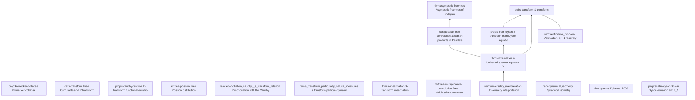

# The formalization ledger

Generated by `tools/ledger.py`; **do not edit by hand** — curated fields (`bucket`, `nl_status_override`, `decls`, `notes`) live in `ledger.json` and survive a rebuild.

Paper `main.tex` at `8856a85`; Lean `/home/maxbrain/Dropbox/LeanArticles/lean` at `24f4c85`.

**18 statements.** Natural language: 10 proved or definitional. Lean: **0 stated**, of which **0 closed** and 0 partial.

**Closure: 0 of 18.** The target is the 18 in-scope statements less the 0 terminal ones (bucket `T`, each with its reason); a row counts as done only when it is closed in Lean **in bucket A**.

## How to read a row

| column | says |
|---|---|
| **natural language** | the paper's own status, and where its proof is. `proved` — a `proof` environment discharges it here; `cited` — it is quoted from the literature; `partial` — the paper itself discloses a gap; `open` — asserted and not proved; `informal` — a remark that argues rather than proves. |
| **Lean stated** | a declaration carries the statement. `strict` — in `DynIso/`, where `sorry` is a compile error; `scaffold` — in `scaffold/DynIsoScaffold/`, where it is permitted and audited. |
| **Lean proved** | **yes** — closed, no `sorry` anywhere beneath it; `partial` — some items of a multi-part statement, or a disclosed weakening; `no` — stated only. |
| **lvl** | height in the dependency DAG: 0 depends on nothing in the paper. Formalize upwards. |
| **bucket** | how far the rest is. `A` nothing left; certified in full · `B` routine on the layers already built · `C` hard --- attempted and blocked on a named obstruction · `D` deferred --- needs a layer not built, or the paper itself does not prove it · `T` terminal --- not certifiable by design; out of the closure target, with a reason |

A row is marked ⚠️ **stale** when its LaTeX changed after the Lean was written: the certificate may no longer certify the statement the paper makes.

The DAG's edges are **references**, not always logical dependencies: a statement that says *see Lemma 7* gets an edge to Lemma 7 even when it does not stand on it. That is why the graph has cycles, and why `lvl` is a reading order rather than a proof order. Where the two disagree, the proof is the authority.

## The roadmap

**In scope: 18 statements**, of which 0 are closed in Lean and 0 partial. Out of scope: 0.

### Behind an obstruction — 0 statements, in scope

`C` is attempted-and-blocked, `D` is deferred; each row's `notes` field in `ledger.json` names the obstruction.

## Where it stands, by appendix

| appendix | statements | NL proved | Lean stated | Lean closed |
|---|---:|---:|---:|---:|
| body | 18 | 10 | 0 | 0 |

## body

| lvl | statement | natural language | Lean stated | Lean proved | bucket |
|---:|---|---|---|---|---|
| 0 | **Proposition** — Kronecker collapse `prop:kronecker-collapse` — [`rigorous_dyson_theorem/sections/03_spectral_theory.tex:25`](rigorous_dyson_theorem/sections/03_spectral_theory.tex#L25) | open | — | — | — |
| 0 | **Definition** — Free Cumulants and R-transform `def:r-transform` — [`rigorous_dyson_theorem/appendices/C_free_probability.tex:11`](rigorous_dyson_theorem/appendices/C_free_probability.tex#L11) | def | — | — | — |
| 0 | **Proposition** — R-transform functional equation `prop:r-cauchy-relation` — [`rigorous_dyson_theorem/appendices/C_free_probability.tex:22`](rigorous_dyson_theorem/appendices/C_free_probability.tex#L22) | proved — [`rigorous_dyson_theorem/appendices/C_free_probability.tex:34`](rigorous_dyson_theorem/appendices/C_free_probability.tex#L34) | — | — | — |
| 0 | **Example** — Free Poisson distribution `ex:free-poisson` — [`rigorous_dyson_theorem/appendices/C_free_probability.tex:38`](rigorous_dyson_theorem/appendices/C_free_probability.tex#L38) | cited — `marchenko1967distribution` | — | — | — |
| 0 | **Definition** — S-transform `def:s-transform` — [`rigorous_dyson_theorem/appendices/C_free_probability.tex:51`](rigorous_dyson_theorem/appendices/C_free_probability.tex#L51) | def | — | — | — |
| 0 | **Remark** — Reconciliation with the Cauchy--S-transform relation `rem:reconciliation_cauchy__s_transform_relation` — [`rigorous_dyson_theorem/appendices/C_free_probability.tex:62`](rigorous_dyson_theorem/appendices/C_free_probability.tex#L62) | informal | — | — | — |
| 0 | **Remark** `rem:s_transform_particularly_natural_measures` — [`rigorous_dyson_theorem/appendices/C_free_probability.tex:70`](rigorous_dyson_theorem/appendices/C_free_probability.tex#L70) | informal | — | — | — |
| 0 | **Theorem** — S-transform linearization `thm:s-linearization` — [`rigorous_dyson_theorem/appendices/C_free_probability.tex:76`](rigorous_dyson_theorem/appendices/C_free_probability.tex#L76) | proved — [`rigorous_dyson_theorem/appendices/C_free_probability.tex:88`](rigorous_dyson_theorem/appendices/C_free_probability.tex#L88) | — | — | — |
| 0 | **Definition** — Free multiplicative convolution `def:free-multiplicative-convolution` — [`rigorous_dyson_theorem/appendices/C_free_probability.tex:94`](rigorous_dyson_theorem/appendices/C_free_probability.tex#L94) | def | — | — | — |
| 0 | **Theorem** — Asymptotic freeness of independent matrices `thm:asymptotic-freeness` — [`rigorous_dyson_theorem/appendices/C_free_probability.tex:103`](rigorous_dyson_theorem/appendices/C_free_probability.tex#L103) | proved — [`rigorous_dyson_theorem/appendices/C_free_probability.tex:114`](rigorous_dyson_theorem/appendices/C_free_probability.tex#L114) | — | — | — |
| 1 | **Corollary** — Jacobian products in ResNets `cor:jacobian-free-convolution` — [`rigorous_dyson_theorem/appendices/C_free_probability.tex:118`](rigorous_dyson_theorem/appendices/C_free_probability.tex#L118) | proved — [`rigorous_dyson_theorem/appendices/C_free_probability.tex:129`](rigorous_dyson_theorem/appendices/C_free_probability.tex#L129) | — | — | — |
| 1 | **Proposition** — S-transform from Dyson equation `prop:s-from-dyson` — [`rigorous_dyson_theorem/appendices/C_free_probability.tex:137`](rigorous_dyson_theorem/appendices/C_free_probability.tex#L137) | proved — [`rigorous_dyson_theorem/appendices/C_free_probability.tex:155`](rigorous_dyson_theorem/appendices/C_free_probability.tex#L155) | — | — | — |
| 2 | **Theorem** — Universal spectral equation via S-transform `thm:universal-via-s` — [`rigorous_dyson_theorem/appendices/C_free_probability.tex:161`](rigorous_dyson_theorem/appendices/C_free_probability.tex#L161) | proved — [`rigorous_dyson_theorem/appendices/C_free_probability.tex:174`](rigorous_dyson_theorem/appendices/C_free_probability.tex#L174) | — | — | — |
| 3 | **Remark** — Universality interpretation `rem:universality_interpretation` — [`rigorous_dyson_theorem/appendices/C_free_probability.tex:222`](rigorous_dyson_theorem/appendices/C_free_probability.tex#L222) | informal | — | — | — |
| 0 | **Remark** — Dynamical isometry `rem:dynamical_isometry` — [`rigorous_dyson_theorem/appendices/C_free_probability.tex:233`](rigorous_dyson_theorem/appendices/C_free_probability.tex#L233) | informal | — | — | — |
| 0 | **Theorem** — Dykema, 2006 `thm:dykema` — [`rigorous_dyson_theorem/appendices/C_free_probability.tex:245`](rigorous_dyson_theorem/appendices/C_free_probability.tex#L245) | open | — | — | — |
| 0 | **Proposition** — Scalar Dyson equation and z_1-mapping `prop:scalar-dyson` — [`rigorous_dyson_theorem/appendices/C_free_probability.tex:268`](rigorous_dyson_theorem/appendices/C_free_probability.tex#L268) | open | — | — | — |
| 1 | **Remark** — Verification: q = 1 recovery `rem:verification_recovery` — [`rigorous_dyson_theorem/appendices/C_free_probability.tex:421`](rigorous_dyson_theorem/appendices/C_free_probability.tex#L421) | proved — [`rigorous_dyson_theorem/appendices/D_numerical_details.tex:8`](rigorous_dyson_theorem/appendices/D_numerical_details.tex#L8) | — | — | — |

dependency graph — body

## Formalization order

The DAG, flattened dependencies-first. A statement is ready when every row above it that it depends on is closed.

### Ready now — every dependency is closed in Lean, and nothing is stated yet

| lvl | statement | where | deps |
|---:|---|---|---:|
| 0 | `def:r-transform` — Free Cumulants and R-transform | `rigorous_dyson_theorem/appendices/C_free_probability.tex:11` | 0 |
| 0 | `prop:r-cauchy-relation` — R-transform functional equation | `rigorous_dyson_theorem/appendices/C_free_probability.tex:22` | 0 |
| 0 | `ex:free-poisson` — Free Poisson distribution | `rigorous_dyson_theorem/appendices/C_free_probability.tex:38` | 0 |
| 0 | `def:s-transform` — S-transform | `rigorous_dyson_theorem/appendices/C_free_probability.tex:51` | 0 |
| 0 | `thm:s-linearization` — S-transform linearization | `rigorous_dyson_theorem/appendices/C_free_probability.tex:76` | 0 |
| 0 | `def:free-multiplicative-convolution` — Free multiplicative convolution | `rigorous_dyson_theorem/appendices/C_free_probability.tex:94` | 0 |
| 0 | `thm:asymptotic-freeness` — Asymptotic freeness of independent matrices | `rigorous_dyson_theorem/appendices/C_free_probability.tex:103` | 0 |

