# The formalization ledger

Generated by `tools/ledger.py`; **do not edit by hand** — curated fields (`bucket`, `nl_status_override`, `decls`, `notes`) live in `ledger.json` and survive a rebuild.

Paper `main.tex` at `snapshot`; Lean `/home/maxbrain/Dropbox/LeanArticles/lean-egf` at `b2446d2`.

**16 statements.** Natural language: 7 proved or definitional. Lean: **5 stated**, of which **2 closed** and 3 partial.

**Closure: 2 of 16.** The target is the 16 in-scope statements less the 0 terminal ones (bucket `T`, each with its reason); a row counts as done only when it is closed in Lean **in bucket A**.

## How to read a row

| column | says |
|---|---|
| **natural language** | the paper's own status, and where its proof is. `proved` — a `proof` environment discharges it here; `cited` — it is quoted from the literature; `partial` — the paper itself discloses a gap; `open` — asserted and not proved; `informal` — a remark that argues rather than proves. |
| **Lean stated** | a declaration carries the statement. `strict` — in `EGF/`, where `sorry` is a compile error; `scaffold` — in `scaffold/EGFScaffold/`, where it is permitted and audited. |
| **Lean proved** | **yes** — closed, no `sorry` anywhere beneath it; `partial` — some items of a multi-part statement, or a disclosed weakening; `no` — stated only. |
| **lvl** | height in the dependency DAG: 0 depends on nothing in the paper. Formalize upwards. |
| **bucket** | how far the rest is. `A` nothing left; certified in full · `B` routine on the layers already built · `C` hard --- attempted and blocked on a named obstruction · `D` deferred --- needs a layer not built, or the paper itself does not prove it · `T` terminal --- not certifiable by design; out of the closure target, with a reason |

A row is marked ⚠️ **stale** when its LaTeX changed after the Lean was written: the certificate may no longer certify the statement the paper makes.

The DAG's edges are **references**, not always logical dependencies: a statement that says *see Lemma 7* gets an edge to Lemma 7 even when it does not stand on it. That is why the graph has cycles, and why `lvl` is a reading order rather than a proof order. Where the two disagree, the proof is the authority.

## What formalizing found in the paper

Formalizing is a proof-reading pass with a machine holding the pen. These are the places where writing the Lean turned up something about the **paper** — a hypothesis used but not stated, a constant that needs a side condition, a step that does not go through as written. None is a refutation; each is a sentence the author may want to change. Entries marked **APPLIED** were applied through `/writer` on the date given; the rest are the author's call, and edits to the `.tex` go through `/writer`.

### `def:egf` — Ergodic Generative Flows

*main.tex:216*

- main.tex:219-221: the sentence says the GROUP generated by the Phi_i is topologically ergodic, but its 'That is' clause uses only words in the Phi_i (no inverses). The clause is strictly stronger: on Z (a 0-manifold) the translation by 1 generates a group whose orbits are all of Z, while its forward words never decrease (EGF.shiftZ_group_not_forward). The same can happen for translations of R^d, a state space the paper names (main.tex:155): +1 and +sqrt 2 on R have dense group orbits and forward orbits in [x, infinity), though not every family does (+1, -sqrt 2 has dense forward orbits). Z and R^d carry infinite volume, outside the standing finite lambda of main.tex:161, but the clause compared is purely topological.
- main.tex:219: alpha is declared S -> [0,1]^p; that its coordinates sum to 1 is not written but is forced by pi being a Markov kernel. Measurability of alpha is not forced (a non-measurable split of the weights between two identical maps gives a measurable kernel); IsEGF assumes it, a mild condition, without loss of generality on standard Borel spaces.
- Whether the empty word (t = 0) is allowed is immaterial as soon as p >= 1 (EGF.isTopologicallyErgodic_iff_pos).

### `def:universal_family` — definition

*main.tex:249*

- main.tex:250: read with unnormalized distributions (the paper's other use of the word, main.tex:163 and :180), the definition is never satisfied on a finite non-zero lambda: flow matching forces F_init(S) = F_term(S) (EGF.not_isUniversalFamilyUnnormalized).
- main.tex:251 asks exact flow matching, while the master theorem (main.tex:775) only gives deltaF_init(S) + deltaF_term(S) < eps, and theo:universality (main.tex:277) assumes the set of f_out only dense; so 'The following theorem implies Theorem theo:universality' (main.tex:774) does not hold with this definition as printed; an eps-version of universality is what is proved.
- main.tex:277 (theo:universality, not this target): 'the set of f_out is dense in L2(S, lambda)' cannot hold for non-negative outflows, which are not dense in L2; presumably dense in the non-negative cone.

### `def:summably_mixing` — definition

*main.tex:262*

- main.tex:267: the condition 'int_{s in S} phi(s) = 0' names no measure; main.tex:273 ('the subspace {phi | int phi d lambda = 0}') and the proof of theo:universality_true (main.tex:788: eps_t(S) = 0) fix it as lambda, which is what is formalized.
- main.tex:264-267 integrates (phi pi^n)^2 against lambda-hat while H normalizes in L2(lambda); the proof of theo:universality_true (main.tex:789) integrates against lambda, i.e. treats lambda-hat = lambda.
- The definition is inhabited: on any probability space the resampling kernel pi(x) = lambda is summably L2-mixing with lambda-hat = lambda (EGF.isSummablyL2Mixing_const), so EGF.main_universality is not vacuous (EGF.main_universality_const).

### `theo:backward_policy` — theorem

*main.tex:733*

- main.tex:731-732 (the setting of theo:backward_policy): 'a background measure lambda absolutely continuous with respect to Lebesgue measure' does not make F_in = F_out pi* absolutely continuous with respect to lambda, so f_in = dF_in/d lambda (main.tex:196, :737) need not exist, whatever |J_s Phi_i^{-1}| means. On R with the finite lambda = 1_[0,1) Lebesgue, Phi(x) = x + 1, alpha = 1, f_out = 1, F_in = 1_[1,2) Lebesgue is singular to lambda (EGF.printed_inflow_not_ac). The change of variables of the proof (main.tex:754, d lambda(s) -> |J_u Phi_i^{-1}| d lambda(u)) needs Phi_i_* lambda = |J Phi_i^{-1}| lambda, in particular Phi_i_* lambda << lambda. That holds when lambda is equivalent to Lebesgue (a positive density, EGF.map_ac_of_equiv_addHaar) and for the Riemannian volume of def:egf (main.tex:217).
- main.tex:735-737 with main.tex:230 ('J_s denotes the Jacobian matrix at s'): with |J_s Phi_i^{-1}| the coordinate Jacobian determinant, the formulas for f_in and beta^i are false for a background measure other than Lebesgue, even a finite one equivalent to Lebesgue. On R take lambda with density 1 on [-1,0), 2 on [0,1) and exp(-x^2) elsewhere, Phi_0 = id, Phi_1 = x -> x + 1, alpha = (1/2, 1/2), f_out = 1_[-1,1). Then the printed f_in is not dF_in/d lambda and the printed kernel is not a backward policy (EGF.printed_backward_policy_false): on [0,1) the true weights are (2/3, 1/3) and the printed ones (1/2, 1/2). The formulas hold with |J_s Phi_i^{-1}| read as the Jacobian of Phi_i^{-1} relative to lambda, d(Phi_i_* lambda)/d lambda (s), which for lambda = rho Lebesgue is rho(Phi_i^{-1} s)|det J_s Phi_i^{-1}|/rho(s) (EGF.backward_policy_rnDeriv, EGF.backward_policy_equiv_addHaar; on this example EGF.cx_rnDeriv_reading). They also hold with the coordinate Jacobian when lambda is Lebesgue (or Haar) measure, the body's setting at main.tex:225 (EGF.backward_policy_addHaar, EGF.backward_policy_diffeomorph; on this example EGF.cx_lebesgue). Every application in the paper takes lambda Lebesgue, Haar or a Riemannian volume, where the two readings agree.
- The two counterexamples use translations of R, which are not topologically ergodic. The appendix's definition of an EGF (main.tex:731-732) does not ask for ergodicity, so they meet it. An ergodic counterexample to the coordinate reading exists and is not formalized: on the circle, Phi_0 = id and Phi_1 an irrational rotation (dense forward orbits), lambda with a positive non-constant density, alpha = (1/2, 1/2), f_out = 1. The printed weights are (1/2, 1/2), the true ones rho(s)/(rho(s) + rho(s - theta)) and its complement, and these differ on a set of positive measure unless rho is rotation-invariant, hence constant. (AUDIT-1: both findings survive ergodicity, by examples checked by hand and not formalized: for finding 1, Φ = (x + 1, x − √2), α = (½, ½), λ = 𝟙_[0,1)·Leb, f_out = 1, dense forward orbits, F_in singular to λ; for finding 2, an irrational rotation of the circle. Under a Riemannian volume in place of « λ ≪ Lebesgue » (def:egf, l.217) finding 1 disappears and finding 2 holds only for the coordinate Jacobian.)
- main.tex:736-737 and main.tex:754-764 write |J_s Phi_i^{-1}| for what main.tex:233 writes |det J_s Phi_i^{-1}|, the absolute value of the Jacobian determinant. It is formalized as the determinant (EGF.coordJac).
- main.tex:758: the proof environment closes before the deduction that yields the formula (main.tex:759-766, 'Since this formula is true for any Y ... The result follows.'). The ledger's proof span [740, 758] misses that deduction.
- main.tex:736: beta^i(s) divides by f_in(s), which is undefined where f_in(s) = 0 (and where f_in(s) is infinite). Both sets are F_in-null, and a backward policy is only defined F_in-a.e., since main.tex:744 is a Radon-Nikodym derivative. The formalization sets the quotient to 0 there. The resulting kernel is Markov F_in-a.e. and is the unique backward policy up to F_in-null sets (EGF.backward_policy, conclusions 3-4).

### `theo:universality_true` — theorem

*main.tex:775*

- main.tex:775: the theorem holds without the Polish structure and without the L2 densities of F_init and F_term; f_out can be taken bounded; and summability of (gamma_n) can be weakened to gamma_n -> 0 with gamma_0 < infinity (EGF.main_universality_of_tendsto). Ergodicity proper is not an extra assumption: gamma_0 < infinity and gamma_n -> 0 already force (pi, lambda-hat) to be ergodic (sketch, not formalized: an invariant set A with 0 < lambda-hat(A) < lambda-hat(S) gives phi = (1_A - c) d lambda-hat/d lambda with phi pi^n = phi, and gamma_0 < infinity makes d lambda-hat/d lambda essentially bounded, so phi is in L2(lambda)). What the Lean theorem genuinely drops is the invariance of lambda (next finding). Where lambda is invariant (every application in the paper, main.tex:819 and :836, and the Walters reading of the next finding), the submultiplicativity argument of the finding on main.tex:789 makes gamma_n -> 0 imply summability, so this weakening can be strict only for a non-invariant lambda; no example is given.
- main.tex:793 uses lambda*pi = lambda ('H(nu_inf + eta*lambda) = H(nu_inf) + eta*lambda*pi = nu_inf + eta*lambda'), and main.tex:779 uses that pi maps L2(lambda) densities to L2(lambda) densities. If 'pi is ergodic on (S, lambda)' is read in Walters' sense, as the paper uses the word (main.tex:211: 0-flows are measures for which pi is ergodic, i.e. invariant ones; main.tex:819 applies the theorem right after noting that each Phi_i keeps lambda invariant), it includes lambda*pi = lambda and both steps follow from the theorem's own hypothesis (main.tex:779 by Jensen). If it is not, they are gaps, since def:summably_mixing (main.tex:262) only provides an invariant lambda-hat equivalent to lambda. Either way the Lean theorem does not assume lambda invariant: it lifts by the invariant lambda-hat, and shows lambda-hat is finite unless lambda is trivial (EGF.trivial_of_lamHat_univ_eq_top).
- main.tex:789: 'sum_t int (d eps_t/d lambda)^2 d lambda < +infinity. Therefore nu_T converges' does not follow as written: summable squared L2 norms do not by themselves make sum_t eps_t converge in L2 (it would follow from sum_t ||d eps_t/d lambda||_2 < infinity), and the bound |nu_inf|_2 <= sum_t int (d eps_t/d lambda)^2 mixes norms and squared norms. The argument fails as written, not the conclusion: with lambda-hat = lambda invariant, gamma_n is the squared norm of T^n on the mean-zero subspace H_0 (T the transfer, a contraction of L2(lambda) preserving H_0), so sum gamma_n < infinity gives ||T^N on H_0|| <= 1/2 for some N, hence geometric decay and absolute convergence. Under the Walters reading of the finding on main.tex:793, lambda is invariant and ergodic, so lambda-hat = c lambda and the step is fully repaired; only if 'ergodic' excludes lambda pi = lambda is lambda-hat != lambda a genuine gap: the step integrates against lambda where gamma_n integrates against lambda-hat. The Lean proof avoids the series altogether (truncated Neumann series, EGF.tvMass_construction, plus TV-mixing from gamma_n -> 0, EGF.exists_tvMass_pushIter_lt_of_tendsto).
- main.tex:790: 'nu_inf = nu_inf pi* - R + F_init': R stands for F_term.
- main.tex:774: 'The following theorem implies Theorem theo:universality' does not follow for def:universal_family as printed (main.tex:249-252), which asks a flow that is exactly flow matching; theo:universality_true gives only deltaF_init(S) + deltaF_term(S) < eps.

## The roadmap

The library is `EGF` in the package `lean-egf/` (DEC-133), Mathlib-only at wave 0; `GFNBounds.Core` (kernels, mixing sums, the sampling theorem) is its template until a ruling on requiring the `lean/` submodule. Anchors are assembly theorems, one per story fragment; everything else is Lean-side.

**In scope: 16 statements** (the whole paper: one file, one namespace), of which 2 are closed in Lean and 3 partial. Out of scope: 0.

### Behind an obstruction — 0 statements, in scope

`C` is attempted-and-blocked, `D` is deferred; each row's `notes` field in `ledger.json` names the obstruction.

## Where it stands, by appendix

| appendix | statements | NL proved | Lean stated | Lean closed |
|---|---:|---:|---:|---:|
| Ergodic Generative Flows (body and appendices, one file) | 16 | 7 | 5 | 2 |

## Ergodic Generative Flows (body and appendices, one file)

| lvl | statement | natural language | Lean stated | Lean proved | bucket |
|---:|---|---|---|---|---|
| 0 | **Theorem** — [bengio2021flow] `theo:sampling_theorem` — [`main.tex:178`](main.tex#L178) | cited — `bengio2021flow` | — | — | — |
| 0 | **Definition** — Ergodic Generative Flows `def:egf` — [`main.tex:216`](main.tex#L216) | def | strict (Defs.lean, Universality.lean) | partial | B |
| 0 | **Definition** `def:universal_family` — [`main.tex:249`](main.tex#L249) | def | strict (Defs.lean, Universality.lean) | partial | B |
| 0 | **Definition** `def:summably_mixing` — [`main.tex:262`](main.tex#L262) | def | strict (Defs.lean, Universality.lean) | **yes** | A |
| 0 | **Theorem** `theo:universality` — [`main.tex:277`](main.tex#L277) | open | — | — | — |
| 0 | **Theorem** `theo:universality_tori` — [`main.tex:291`](main.tex#L291) | open | — | — | — |
| 0 | **Theorem** `theo:universality_sphere` — [`main.tex:305`](main.tex#L305) | open | — | — | — |
| 0 | **Definition** — Virtual initial and terminal flow `def:virtual_flows` — [`main.tex:316`](main.tex#L316) | def | — | — | — |
| 0 | **Theorem** — Quantitative Sampling of Generative Flows `theo:negative_control` — [`main.tex:321`](main.tex#L321) | open | — | — | — |
| 0 | **Corollary** `cor:sampling_error_control` — [`main.tex:329`](main.tex#L329) | open | — | — | — |
| 0 | **Corollary** `cor:pinsker_negative_control` — [`main.tex:374`](main.tex#L374) | open | — | — | — |
| 0 | **Theorem** `theo:backward_policy` — [`main.tex:733`](main.tex#L733) | proved — [`main.tex:740`](main.tex#L740) | strict (Defs.lean, BackwardPolicy.lean) | partial | B |
| 0 | **Theorem** `theo:universality_true` — [`main.tex:775`](main.tex#L775) | proved — [`main.tex:778`](main.tex#L778) | strict (Universality.lean, Defs.lean) | **yes** | A |
| 0 | **Theorem** — Theorem 5 of [bekka2015spectral] `theo:spectral_gap_tori` — [`main.tex:810`](main.tex#L810) | cited — `bekka2015spectral` | — | — | — |
| 0 | **Theorem** — Reformulation of Theorem 1 of [bourgain2012spectral] `theo:spectral_gap_sphere` — [`main.tex:830`](main.tex#L830) | cited — `bourgain2012spectral` | — | — | — |
| 0 | **Theorem** `theo:negative_control_appendix` — [`main.tex:844`](main.tex#L844) | proved — [`main.tex:852`](main.tex#L852) | — | — | — |

dependency graph — Ergodic Generative Flows (body and appendices, one file)

```mermaid
graph BT
  n0["theo:sampling_theorem [bengio2021flow]"]
  n1["def:egf Ergodic Generative Flows"]
  class n1 part;
  n2["def:universal_family universal family"]
  class n2 part;
  n3["def:summably_mixing summably mixing"]
  class n3 done;
  n4["theo:universality universality"]
  n5["theo:universality_tori universality tori"]
  n6["theo:universality_sphere universality sphere"]
  n7["def:virtual_flows Virtual initial and terminal f"]
  n8["theo:negative_control Quantitative Sampling of Gener"]
  n9["cor:sampling_error_control sampling error control"]
  n10["cor:pinsker_negative_control pinsker negative control"]
  n11["theo:backward_policy backward policy"]
  class n11 part;
  n12["theo:universality_true universality true"]
  class n12 done;
  n13["theo:spectral_gap_tori Theorem 5 of [bekka2015spectra"]
  n14["theo:spectral_gap_sphere Reformulation of Theorem 1 of "]
  n15["theo:negative_control_appendix negative control appendix"]
  classDef done fill:#b7e4c7,stroke:#2d6a4f;
  classDef part fill:#ffe08a,stroke:#b07d00;
  classDef scaf fill:#ffd6a5,stroke:#b35c00;
```

## Formalization order

The DAG, flattened dependencies-first. A statement is ready when every row above it that it depends on is closed.

### Ready now — every dependency is closed in Lean, and nothing is stated yet

| lvl | statement | where | deps |
|---:|---|---|---:|
| 0 | `theo:sampling_theorem` — [bengio2021flow] | `main.tex:178` | 0 |
| 0 | `def:virtual_flows` — Virtual initial and terminal flow | `main.tex:316` | 0 |
| 0 | `theo:spectral_gap_tori` — Theorem 5 of [bekka2015spectral] | `main.tex:810` | 0 |
| 0 | `theo:spectral_gap_sphere` — Reformulation of Theorem 1 of [bourgain2012spectral] | `main.tex:830` | 0 |
| 0 | `theo:negative_control_appendix` — theorem | `main.tex:844` | 0 |

