# The formalization ledger

Generated by `tools/ledger.py`; **do not edit by hand** — curated fields (`bucket`, `nl_status_override`, `decls`, `notes`) live in `ledger.json` and survive a rebuild.

Paper `main.tex` at `snapshot`; Lean `/home/maxbrain/Dropbox/LeanArticles/lean-egf` at `95a2e50`.

**16 statements.** Natural language: 7 proved or definitional. Lean: **16 stated**, of which **11 closed** and 5 partial.

**Closure: 11 of 16.** The target is the 16 in-scope statements less the 0 terminal ones (bucket `T`, each with its reason); a row counts as done only when it is closed in Lean **in bucket A**.

## How to read a row

| column | says |
|---|---|
| **natural language** | the paper's own status, and where its proof is. `proved` — a `proof` environment discharges it here; `cited` — it is quoted from the literature; `partial` — the paper itself discloses a gap; `open` — asserted and not proved; `informal` — a remark that argues rather than proves. |
| **Lean stated** | a declaration carries the statement. `strict` — in `EGF/`, where `sorry` is a compile error; `scaffold` — in `scaffold/EGFScaffold/`, where it is permitted and audited. |
| **Lean proved** | **yes** — closed, no `sorry` anywhere beneath it; `partial` — some items of a multi-part statement, or a disclosed weakening; `no` — stated only. |
| **lvl** | height in the dependency DAG: 0 depends on nothing in the paper. Formalize upwards. |
| **bucket** | how far the rest is. `A` nothing left; certified in full · `B` routine on the layers already built · `C` hard --- attempted and blocked on a named obstruction · `D` deferred --- needs a layer not built, or the paper itself does not prove it · `T` terminal --- not certifiable by design; out of the closure target, with a reason |

A row is marked ⚠️ **stale** when its LaTeX changed after the Lean was written: the certificate may no longer certify the statement the paper makes.

The DAG's edges are **references**, not always logical dependencies: a statement that says *see Lemma 7* gets an edge to Lemma 7 even when it does not stand on it. That is why the graph has cycles, and why `lvl` is a reading order rather than a proof order. Where the two disagree, the proof is the authority.

## What formalizing found in the paper

Formalizing is a proof-reading pass with a machine holding the pen. These are the places where writing the Lean turned up something about the **paper** — a hypothesis used but not stated, a constant that needs a side condition, a step that does not go through as written. None is a refutation; each is a sentence the author may want to change. Entries marked **APPLIED** were applied through `/writer` on the date given; the rest are the author's call, and edits to the `.tex` go through `/writer`.

### `theo:sampling_theorem` — [bengio2021flow]

*main.tex:178*

- The theorem is cited (main.tex:179, bengio2021flow, brunswic2024theory) and proved here on any measurable space, with no named hypothesis. The proof ports GFNBounds.Core.SamplingGeneral: the sampler's occupation measure is dominated by every super-solution, and (F_term + F_out)/F_init(S) is one.
- main.tex:164: the stopping probability dF_term/d(F_term + F_out*)(s_t) is defined only (F_term + F_out*)-a.e. The footnote at main.tex:164 gives its existence. That the version does not matter is not stated, but it holds: under flow matching the sampler's unstopped mass is dominated by (F_term + F_out)/F_init(S) (EGF.GenerativeFlow.occupation_ac_of_isFlowMatching), so every version gives the same sampler law (EGF.GenerativeFlow.pathLaw_hazard_rnDeriv).
- 's_tau ~ F_term' presupposes tau < inf almost surely, which the statement does not list. It follows from E(tau) < inf and is proved as a clause of EGF.sampling_theorem.
- main.tex:163 indexes the chain '(s_t)_{g >= 1}' for '(s_t)_{t >= 1}' (typo).

### `def:egf` — Ergodic Generative Flows

*main.tex:216*

- main.tex:219-221: the sentence says the GROUP generated by the Phi_i is topologically ergodic, but its 'That is' clause uses only words in the Phi_i (no inverses). The clause is strictly stronger: on Z (a 0-manifold) the translation by 1 generates a group whose orbits are all of Z, while its forward words never decrease (EGF.shiftZ_group_not_forward). The same can happen for translations of R^d, a state space the paper names (main.tex:155): +1 and +sqrt 2 on R have dense group orbits and forward orbits in [x, infinity), though not every family does (+1, -sqrt 2 has dense forward orbits). Z and R^d carry infinite volume, outside the standing finite lambda of main.tex:161, but the clause compared is purely topological.
- main.tex:219: alpha is declared S -> [0,1]^p; that its coordinates sum to 1 is not written but is forced by pi being a Markov kernel. Measurability of alpha is not forced (a non-measurable split of the weights between two identical maps gives a measurable kernel); IsEGF assumes it, a mild condition, without loss of generality on standard Borel spaces.
- Whether the empty word (t = 0) is allowed is immaterial as soon as p >= 1 (EGF.isTopologicallyErgodic_iff_pos).

### `def:universal_family` — definition

*main.tex:249*

- main.tex:250: read with unnormalized distributions (the paper's other use of the word, main.tex:163 and :180), the definition is never satisfied on a finite non-zero lambda: flow matching forces F_init(S) = F_term(S) (EGF.not_isUniversalFamilyUnnormalized).
- main.tex:251 asks exact flow matching, while the master theorem (main.tex:775) only gives deltaF_init(S) + deltaF_term(S) < eps, and theo:universality (main.tex:277) assumes the set of f_out only dense; so 'The following theorem implies Theorem theo:universality' (main.tex:774) does not hold with this definition as printed; an eps-version of universality is what is proved. In Lean: on Bool with the uniform lambda, the resampling kernel (the EGF policy of the moves id, not with alpha = 1/2) and outflows with rational values, the family is dense in the non-negative cone and eps-universal, but no member is exactly flow matching from nu (nu{true} = sqrt 2/2) to lambda (EGF.exact_universality_fails); with the counting measure (the volume of def:egf on a 0-manifold) the same family is a counterexample (checked by hand).
- main.tex:277 (theo:universality, not this target): 'the set of f_out is dense in L2(S, lambda)' cannot hold for non-negative outflows, which are not dense in L2; presumably dense in the non-negative cone.

### `def:summably_mixing` — definition

*main.tex:262*

- main.tex:273-274 (the remark after the definition; correction C-30, adopted under DEC-141): in the gloss reading (a spectrum bounded away from 1 on mean-zero functions) both sentences are false: the swap of two points has spectrum {-1} there, is not summably mixing and its iterates do not decay (EGF.Swap.transfer_eq_neg, EGF.Swap.not_isSummablyL2Mixing, EGF.not_spectralGapRemarkPrinted); in the operator reading (spectral radius < 1) l.273 lacks only the invariance of lambda (EGF.not_spectralRadiusCriterionWithoutInvariance) and holds with it (EGF.isSummablyL2Mixing_of_pow_contraction), and l.274 is true. conze2013ergodicity not consulted.
- OQ-47: the alternative reading (H normalized in L2(lambda-hat)) is vacuous if lambda-hat may be infinite (EGF.isSummablyL2MixingHat_of_bind_eq, with lambda-hat = infinity * lambda, not sigma-finite): that reading must take lambda-hat sigma-finite; the swap fails it for every finite lambda-hat (EGF.Swap.not_isSummablyL2MixingHat_of_finite).
- main.tex:267: the condition 'int_{s in S} phi(s) = 0' names no measure; main.tex:273 ('the subspace {phi | int phi d lambda = 0}') and the proof of theo:universality_true (main.tex:788: eps_t(S) = 0) fix it as lambda, which is what is formalized.
- main.tex:264-267 integrates (phi pi^n)^2 against lambda-hat while H normalizes in L2(lambda); the proof of theo:universality_true (main.tex:789) integrates against lambda, i.e. treats lambda-hat = lambda.
- The definition is inhabited: on any probability space the resampling kernel pi(x) = lambda is summably L2-mixing with lambda-hat = lambda (EGF.isSummablyL2Mixing_const), so EGF.main_universality is not vacuous (EGF.main_universality_const).

### `theo:universality` — theorem

*main.tex:277*

- main.tex:277: 'the set of f_out* is dense in L2(S, lambda)' never holds for non-negative outflow densities on a finite lambda != 0: the constant -1 is at L2 distance at least lambda(S)^{1/2} from every a.e.-non-negative function (EGF.not_dense_L2_of_nonneg, EGF.le_eLpNorm_sub_neg_one); the theorem as printed is vacuous (EGF.universalityPrinted). Corrected to the non-negative cone (C-20).
- main.tex:277: 'the set of f_out*' must be the outflows paired with the mixing pi*. Read as all outflows of the family, even the corrected theorem fails for a family of EGFs: on Bool, {(pi, lambda)} together with {(id, f lambda)} (the identity is the EGF policy of the moves id, not with alpha = (1, 0)) has every member with F_out pi = F_out, so its defect from delta_true to delta_false is TV = 2 (EGF.Coin.allOutflows_reading_fails, which proves >= 1; with the counting measure the same family is a counterexample, by hand).
- No proof of Theorem 3.4 is printed beyond main.tex:774. Its derivation from theo:universality_true needs two facts the paper does not state: the defect is 2-Lipschitz in the outflow in total variation, and the bounded outflows of EGF.main_universality are L1-limits of the family's outflows (EGF.isUniversalFamilyEps_of_policy).
- The EGF structure of the family is never used: EGF.universality holds for any family of generative flows.

### `theo:universality_tori` — theorem

*main.tex:291*

- main.tex:291: the printed Theorem 3.5 is false for every satisfiable choice of moves: a family whose heads ignore the state (in particular constant outflows) is never ε-universal (EGF.not_isUniversalFamilyEps_of_constantHeads, EGF.not_isUniversalFamilyEps_constOutflow); the printed statement over models (EGF.UniversalityToriPrinted, l.820's condition at every parameter) is refuted by the constant model (EGF.not_universalityToriPrinted, conditional on moves meeting l.820 existing). With all translations free and d >= 1, l.820 cannot hold at every parameter, so in that reading the theorem is vacuous. Correction C-31.
- main.tex:293, :821: at d = 1 every group satisfies (ii) (EGF.bgConditionII_dim_one), so l.820's condition is never met and the printed theorem is vacuous there (EGF.universalityToriPrinted_one); 'any dimension' (l.293) fails for this route and 'SL(d,Z) contains a free group' (l.821) is false at d = 1. Correction C-28.
- main.tex:818-820: the route needs neither the inverse-stability of l.820 nor aperiodicity: ergodicity of the generated group suffices and is necessary (EGF.universality_tori_of_ergodic, EGF.universality_tori_iff). Aperiodicity is Bekka-Guivarc'h's sufficient condition for a spectral radius < 1; the two-sided gap holds for every group violating (ii) (not formalized).

### `theo:universality_sphere` — theorem

*main.tex:305*

- main.tex:305 with main.tex:836 (Theorem 3.6 as printed, 'technical assumptions' read as l.836 at every parameter of the model): false wherever the condition is satisfiable, because the theorem assumes nothing of the model. On S^1 (d = 1) the condition is satisfiable: the rotation of cosine 3/5 and its inverse have rational entries, form a set stable under inverse and generate a dense subgroup of SO(2) (Niven). The constant-heads model at these frozen rotations is not epsilon-universal (EGF.not_universalitySpherePrinted_one; in general EGF.not_universalitySpherePrinted and EGF.not_isUniversalFamilyEps_sphere_of_constantHeads: any model whose heads ignore the state, for every n >= 1). A one-point model also refutes; the informative statement is the constant-heads one. (C-31, sphere half.)
- main.tex:307: 'The technical assumption is satisfied if the Phi_i have algebraic coefficients and are frozen' omits the density of l.836. The identity rotation has integer entries and is frozen, yet even the family of the L2 model (uniform kernel, every non-negative L2 outflow) is not epsilon-universal on S^{n-1}, n >= 1 (EGF.not_universality_sphere_identity). Proposed for C-28's batch.
- Corrected Theorem 3.6 (C-28 sphere half, C-29, C-31): with C-31's richness, ergodicity of the moves suffices on every sphere (EGF.universality_sphere_of_ergodic), with no algebraic coefficients, no inverse-stability and no spectral gap; for the L2 model it is also necessary (EGF.universality_sphere_iff). On S^1, the density clause of l.836 alone suffices: a dense subgroup of SO(2) generated by finitely many rotations has a generator of irrational angle (EGF.exists_irrational_of_dense), and one irrational rotation is ergodic for sigma (EGF.ergodic_rotSphere_two), so Theorem 3.6 holds on S^1 under l.836's density clause plus richness (EGF.universality_sphere_one_of_dense); an instance is EGF.universality_sphere_one_witness.
- C-28 (b), sphere half: no finite set of rotations of S^1 gives its uniform kernel a spectral gap in Bourgain-Gamburd's one-sided sense (EGF.not_hasBGSpectralGap_sphere_two, any p >= 1 rotations), so the spectral-gap route of l.836 gives nothing on S^1; Theorem 3.6 still holds there by the ergodic route (previous finding).
- The paper's route of main.tex:836 is sound where the reformulation holds: a one-sided spectral gap of the uniform kernel makes the moves ergodic (EGF.ergodic_of_hasBGSpectralGap), and the rich family is then epsilon-universal (EGF.universality_sphere_of_reformulation, with SpectralGapSphereReformulation n as hypothesis, false for n = 2).

### `def:virtual_flows` — Virtual initial and terminal flow

*main.tex:316*

- main.tex:320 (the remark after the definition: any generative flow is flow matching from F_init-hat to F_term-hat) is proved for finite measures and a Markov policy (EGF.isFlowMatching_virtual), with equal virtual masses (EGF.virtualInit_univ). The proof is X + (Y - X) = Y + (X - Y) for finite measures (EGF.add_sub_eq_add_sub).
- main.tex:316 names the generative flow (pi*, f_out*), a density, while the errors use the measure F_out* (main.tex:161). This is notation only.

### `theo:negative_control` — Quantitative Sampling of Generative Flows

*main.tex:321*

- The bound is sharp. On S = Bool with the identity policy, F_out = 0, F_init = delta_true and F_term = delta_false: delta F_init = delta_false, F_term-hat = delta_true + delta_false, the sampler stops at once at true, and TV(s_tau || F_term-hat/2) = 1/2 = delta F_init(S)/F_term-hat(S) (EGF.TwoPoint.negative_control_sharp).
- The 1/2 of the total variation is needed. On the same example the unhalved norm ||law(s_tau) - F_term-hat/F_term-hat(S)|| = 1 exceeds the bound 1/2 (EGF.TwoPoint.negative_control_sharp, second clause). main.tex:327 says only 'TV the total variation'. main.tex:338 rewrites TV as (1/2) sum |.|, and the proof's last step (main.tex:863-866: TV(s_tau, alpha s_tau + (1 - alpha) Q) = (1 - alpha) TV(s_tau, Q) <= 1 - alpha) needs TV <= 1.
- The flow is not flow matching from F_init to F_term-hat, so the sampler's termination is not given by theo:sampling_theorem. The proof takes it for granted (main.tex:853: 'The sampling distribution s_tau of F is then F_init pi^{tau,F}/F_init(S)'). It holds because F_init <= F_init-hat and the flow matches from F_init-hat: the occupation is dominated by F_term-hat + F_out, so E(tau) <= (F_term-hat(S) + F_out(S))/F_init(S) and tau < inf a.s. (clauses 1-2 of EGF.main_quantitative_sampling). The same gap is noted in GFNBounds.Core.SamplingGeneralBounds.
- main.tex:322 writes the flow (pi*, f_out*) with a density, while the sampler and F_term-hat use the measure F_out* (main.tex:161). This is notation only.

### `cor:sampling_error_control` — corollary

*main.tex:329*

- No proof is printed (the ledger row has proof null). The corollary is one application of theo:negative_control: at F_term = kappa-hat = E^+ (E := F_init + F_in - F_out) the terminal error is (E - E^+)^+ = 0, so F-hat_term = kappa-hat, the initial error is E^-, F-hat_term(S) = F_init(S) + delta = 1 + delta, and the bound delta F_init(S)/F-hat_term(S) of main.tex:325 is delta/(1 + delta). The triangle inequality for TV (EGF.tvDist_triangle, from the strict tvMass_triangle) adds the second term.
- The statement holds for every generative flow and every finite kappa: 'trained on the target kappa' (main.tex:329) is context and plays no role in the inequality.

### `cor:pinsker_negative_control` — corollary

*main.tex:374*

- main.tex:418: the printed decomposition KL(κ̂/κ̂(𝒮) ‖ κ) = cross-entropy + log-normalization − H(κ) is false even with both sides finite: on Bool with no outflow, F_init uniform and κ = ¼δ_true + ¾δ_false, the two sides are ¾ log 3 − log 2 and log 2 − ½ log 3, which differ since 2⁸ ≠ 3⁵ (EGF.Null.printed_kl_decomposition_false_finite). It holds for KL(κ ‖ κ̂/κ̂(𝒮)) (EGF.kl_decomposition), the divergence the cross-entropy of Eq. (15) controls, and Corollary 3.10 holds for it too (EGF.pinsker_negative_control_rev). Correction C-5.
- main.tex:366: b > 0 is not enough for the loss to control anything: with ν_train = λ and b < log 2 the loss lies below the entropy (EGF.SwapM.loss_lt_entropy); b ≥ N gives the floor and b ≥ 1 + N the control of the sampling error, N = ‖dλ/dν_train‖_∞ (EGF.loss_ge_entropy, EGF.loss_controls_sampling_essSup; sufficient, not shown necessary). With the printed sign the loss is unbounded below while the defect grows (EGF.SwapM.printed_loss_tendsto_bot). Corrections C-2, C-35 (OQ-84).
- main.tex:396-404 (Algorithm 1): with the printed sign the backward factor of l.400 can be negative (EGF.Swap3.printed_algBackwardFactor_neg; C-3). If the backward buffer holds paths of the sampler run backwards (the reversed flow, flow matching from κ̂ to F_init + δF_init, EGF.reverse_isFlowMatching_iff), its continuation probability is (1 + (f_init + δf_init)/f_in)⁻¹ (EGF.reverse_cont_ae_eq_backwardFactor) and l.400 omits f_init; which law the buffer holds is not printed (l.392): OQ-83.
- False as printed. main.tex:362 defines delta f_init = min(0, f_init + f_in* - f_out*), which is <= 0 (EGF.deltaFinitDensityPrinted_nonpos), so delta = int delta f_init d lambda = -(F_init + F_in - F_out)^-(S) <= 0 (main.tex:379; EGF.integral_deltaFinitDensityPrinted). At the target probability kappa := kappa-hat/kappa-hat(S) the divergence is 0 and the printed right side is -e/(1 - e) < 0 <= TV, for every flow with 0 < e := (F_init + F_in - F_out)^-(S) < 1 whose densities exist (EGF.printed_false_of_mem_Ioo).
- A two-point instance (EGF.Swap.printed_pinsker_negative_control_false): S = Bool, lambda the counting measure, the swap policy b -> not b, F_out = (1/2) delta_false, F_init = delta_true, kappa = kappa-hat/kappa-hat(S) = delta_true. Every presupposition holds (F_init, F_out, F_in << lambda). The printed delta is -1/2, the negative-part delta is 1/2, KL = 0, and the printed bound is -1.
- With delta the negative-part mass, as def:virtual_flows (main.tex:316, (.)^-) and cor:sampling_error_control (main.tex:333, (.)^-(S)) define it, the corollary holds: in measures (EGF.pinsker_negative_control), in the paper's densities with delta f_init := max(0, -(f_init + f_in - f_out)) = -min(0, .) (EGF.pinsker_negative_control_density), in R when KL < inf (EGF.pinsker_negative_control_real), and for an EGF with no named hypothesis (EGF.pinsker_negative_control_isEGF). The proof (none is printed) is cor:sampling_error_control with Pinsker on its second term, kappa being a probability.
- The same sign reaches the loss, outside this target's labels: equ:weakFM (main.tex:363-365) penalizes b E_{nu_train} delta f_init, and Algorithm 1 (main.tex:395, and p_t at main.tex:400 through delta f_init/f_in*) uses delta f_init. With delta f_init <= 0 that penalty rewards the negative part instead of controlling it, against main.tex:368 ('controls only the negative part of the FM defect'). GFNBounds reads delta f_init as e^- = max(-e, 0) (GFNBounds.Core.wklfmLoss, lean/GFNBounds/Core/ILBound.lean), the reading taken here. The dispatch cites the definition at l.363; in papers/egf/legacy/labeled/main.tex it is l.362.
- Pinsker's inequality is cited by name only (main.tex:370) and is absent from Mathlib at fabf563a, which has klDiv. It is proved here: GFNBounds' density statement copied (EGF.Pinsker.pinsker), identified with tvDist (EGF.tvDist_withDensity, equality, via Mathlib's Measure.withDensity_sub) and with klDiv (EGF.klD_rnDeriv_eq_toReal_klDiv), and restated for probability measures (EGF.pinsker).
- F_in* << lambda is presupposed by f_in* := dF_in*/d lambda (main.tex:196). For a general flow it is the named hypothesis EGF.InflowAC. For an EGF it is a theorem under Phi_i push lambda = J_i lambda (OQ-55's form (c), which contains (a) and (b)), so the EGF instance holds whatever OQ-55 rules; only the printed 'lambda << Lebesgue' fails (EGF.printed_inflow_not_ac, OQ-55's own finding).
- main.tex:418 (AUDIT-1): the KL decomposition there is KL(κ ‖ κ̂/κ̂(𝒮)), the reverse of the direction printed at l.377; the cross-entropy of equ:weakFM and the claim at l.413 connect to the corollary only through the reverse direction (the corollary holds in both).
- main.tex:423 (AUDIT-1): ∫ f̂_term = 1 + ∫ δf_init is false under the printed sign (min(0, ·)) and true under the negative-part reading: the paper's own evidence for that reading.

### `theo:backward_policy` — theorem

*main.tex:733*

- main.tex:735-737 hold as printed, with |J| = 1, when every move preserves lambda (EGF.backward_policy_measurePreserving; |J| = 1 a.e. in both readings of the Jacobian, EGF.rnDeriv_map_ae_eq_one and EGF.coordJac_ae_eq_one). Every experiment of the paper uses such moves: translations and SL_2(Z) maps of the torus (main.tex:440), rotations of the sphere (main.tex:496), translations of R^2 (main.tex:1210), and the families of main.tex:284 and :303 (measure preservation checked by hand; formalized by the family targets), so C-8's discrepancy touches no experiment.
- main.tex:196: the presupposition f_in = dF_in/d lambda holds for every EGF policy whose moves are nonsingular, (Phi_i)_# lambda << lambda, with F_out << lambda, on any measurable space and with no inverse (EGF.InflowAC.of_map_ac); for positive weights nonsingularity is necessary (EGF.bind_ac_iff_map_ac), and the strict counterexample to main.tex:731-732 violates exactly it (EGF.not_map_ac_acMap). Correction C-6.
- main.tex:731-732 (the setting of theo:backward_policy): 'a background measure lambda absolutely continuous with respect to Lebesgue measure' does not make F_in = F_out pi* absolutely continuous with respect to lambda, so f_in = dF_in/d lambda (main.tex:196, :737) need not exist, whatever |J_s Phi_i^{-1}| means. On R with the finite lambda = 1_[0,1) Lebesgue, Phi(x) = x + 1, alpha = 1, f_out = 1, F_in = 1_[1,2) Lebesgue is singular to lambda (EGF.printed_inflow_not_ac). The change of variables of the proof (main.tex:754, d lambda(s) -> |J_u Phi_i^{-1}| d lambda(u)) needs Phi_i_* lambda = |J Phi_i^{-1}| lambda, in particular Phi_i_* lambda << lambda. That holds when lambda is equivalent to Lebesgue (a positive density, EGF.map_ac_of_equiv_addHaar) and for the Riemannian volume of def:egf (main.tex:217).
- main.tex:735-737 with main.tex:230 ('J_s denotes the Jacobian matrix at s'): with |J_s Phi_i^{-1}| the coordinate Jacobian determinant, the formulas for f_in and beta^i are false for a background measure other than Lebesgue, even a finite one equivalent to Lebesgue. On R take lambda with density 1 on [-1,0), 2 on [0,1) and exp(-x^2) elsewhere, Phi_0 = id, Phi_1 = x -> x + 1, alpha = (1/2, 1/2), f_out = 1_[-1,1). Then the printed f_in is not dF_in/d lambda and the printed kernel is not a backward policy (EGF.printed_backward_policy_false): on [0,1) the true weights are (2/3, 1/3) and the printed ones (1/2, 1/2). The formulas hold with |J_s Phi_i^{-1}| read as the Jacobian of Phi_i^{-1} relative to lambda, d(Phi_i_* lambda)/d lambda (s), which for lambda = rho Lebesgue is rho(Phi_i^{-1} s)|det J_s Phi_i^{-1}|/rho(s) (EGF.backward_policy_rnDeriv, EGF.backward_policy_equiv_addHaar; on this example EGF.cx_rnDeriv_reading). They also hold with the coordinate Jacobian when lambda is Lebesgue (or Haar) measure, the body's setting at main.tex:225 (EGF.backward_policy_addHaar, EGF.backward_policy_diffeomorph; on this example EGF.cx_lebesgue). Every application in the paper takes lambda Lebesgue, Haar or a Riemannian volume, where the two readings agree.
- The two counterexamples use translations of R, which are not topologically ergodic. The appendix's definition of an EGF (main.tex:731-732) does not ask for ergodicity, so they meet it. An ergodic counterexample to the coordinate reading exists and is not formalized: on the circle, Phi_0 = id and Phi_1 an irrational rotation (dense forward orbits), lambda with a positive non-constant density, alpha = (1/2, 1/2), f_out = 1. The printed weights are (1/2, 1/2), the true ones rho(s)/(rho(s) + rho(s - theta)) and its complement, and these differ on a set of positive measure unless rho is rotation-invariant, hence constant. (AUDIT-1: both findings survive ergodicity, by examples checked by hand and not formalized: for finding 1, Φ = (x + 1, x − √2), α = (½, ½), λ = 𝟙_[0,1)·Leb, f_out = 1, dense forward orbits, F_in singular to λ; for finding 2, an irrational rotation of the circle. Under a Riemannian volume in place of « λ ≪ Lebesgue » (def:egf, l.217) finding 1 disappears and finding 2 holds only for the coordinate Jacobian.)
- main.tex:736-737 and main.tex:754-764 write |J_s Phi_i^{-1}| for what main.tex:233 writes |det J_s Phi_i^{-1}|, the absolute value of the Jacobian determinant. It is formalized as the determinant (EGF.coordJac).
- main.tex:758: the proof environment closes before the deduction that yields the formula (main.tex:759-766, 'Since this formula is true for any Y ... The result follows.'). The ledger's proof span [740, 758] misses that deduction.
- main.tex:736: beta^i(s) divides by f_in(s), which is undefined where f_in(s) = 0 (and where f_in(s) is infinite). Both sets are F_in-null, and a backward policy is only defined F_in-a.e., since main.tex:744 is a Radon-Nikodym derivative. The formalization sets the quotient to 0 there. The resulting kernel is Markov F_in-a.e. and is the unique backward policy up to F_in-null sets (EGF.backward_policy, conclusions 3-4).

### `theo:universality_true` — theorem

*main.tex:775*

- main.tex:775: summable L2-mixing is not needed. For a Markov kernel with a finite invariant measure lambda-hat equivalent to lambda, the conclusion holds if and only if the kernel is ergodic for lambda-hat (EGF.universality_of_ergodic: Cesaro-weighted Neumann series and von Neumann's mean ergodic theorem; EGF.universal_iff_ergodic), and the necessity needs no invariant measure at all (EGF.not_universal_of_not_ergodic). Mixing implies ergodicity (EGF.isKernelErgodic_of_isSummablyL2Mixing, formalizing the sketch below), so the printed 'ergodic' is redundant beside mixing. 'Ergodic' here is for lambda-hat, not the topological ergodicity of def:egf (OQ-48). Correction C-29 (OQ-85).
- main.tex:697-698, :702 ('mixing is needed / essential'): a translation of infinite order of the circle and the swap of two points are universal policies (EGF.isUniversalPolicy_addCircle, EGF.Swap.isUniversalPolicy_policy) and not summably L2-mixing (EGF.Swap.universal_not_summablyMixing, EGF.universal_not_summablyMixing_addCircle; no measure-preserving automorphism of a sigma-finite lambda is, EGF.not_isSummablyL2Mixing_of_map_eq): l.697 and l.702 are false in the reading 'mixing is necessary for universality', not in the reading 'the hypothesis Theorem 3.4 is stated under'; one map suffices on the circle, which sharpens, and does not contradict, l.698's 'two transformations are sufficient'.
- main.tex:775: the theorem holds without the Polish structure and without the L2 densities of F_init and F_term; f_out can be taken bounded; and summability of (gamma_n) can be weakened to gamma_n -> 0 with gamma_0 < infinity (EGF.main_universality_of_tendsto). Ergodicity proper is not an extra assumption: gamma_0 < infinity and gamma_n -> 0 already force (pi, lambda-hat) to be ergodic (sketch, not formalized: an invariant set A with 0 < lambda-hat(A) < lambda-hat(S) gives phi = (1_A - c) d lambda-hat/d lambda with phi pi^n = phi, and gamma_0 < infinity makes d lambda-hat/d lambda essentially bounded, so phi is in L2(lambda)). What the Lean theorem genuinely drops is the invariance of lambda (next finding). Where lambda is invariant (every application in the paper, main.tex:819 and :836, and the Walters reading of the next finding), the submultiplicativity argument of the finding on main.tex:789 makes gamma_n -> 0 imply summability, so this weakening can be strict only for a non-invariant lambda; no example is given.
- main.tex:793 uses lambda*pi = lambda ('H(nu_inf + eta*lambda) = H(nu_inf) + eta*lambda*pi = nu_inf + eta*lambda'), and main.tex:779 uses that pi maps L2(lambda) densities to L2(lambda) densities. If 'pi is ergodic on (S, lambda)' is read in Walters' sense, as the paper uses the word (main.tex:211: 0-flows are measures for which pi is ergodic, i.e. invariant ones; main.tex:819 applies the theorem right after noting that each Phi_i keeps lambda invariant), it includes lambda*pi = lambda and both steps follow from the theorem's own hypothesis (main.tex:779 by Jensen). If it is not, they are gaps, since def:summably_mixing (main.tex:262) only provides an invariant lambda-hat equivalent to lambda. Either way the Lean theorem does not assume lambda invariant: it lifts by the invariant lambda-hat, and shows lambda-hat is finite unless lambda is trivial (EGF.trivial_of_lamHat_univ_eq_top).
- main.tex:789: 'sum_t int (d eps_t/d lambda)^2 d lambda < +infinity. Therefore nu_T converges' does not follow as written: summable squared L2 norms do not by themselves make sum_t eps_t converge in L2 (it would follow from sum_t ||d eps_t/d lambda||_2 < infinity), and the bound |nu_inf|_2 <= sum_t int (d eps_t/d lambda)^2 mixes norms and squared norms. The argument fails as written, not the conclusion: with lambda-hat = lambda invariant, gamma_n is the squared norm of T^n on the mean-zero subspace H_0 (T the transfer, a contraction of L2(lambda) preserving H_0), so sum gamma_n < infinity gives ||T^N on H_0|| <= 1/2 for some N, hence geometric decay and absolute convergence. Under the Walters reading of the finding on main.tex:793, lambda is invariant and ergodic, so lambda-hat = c lambda and the step is fully repaired; only if 'ergodic' excludes lambda pi = lambda is lambda-hat != lambda a genuine gap: the step integrates against lambda where gamma_n integrates against lambda-hat. The Lean proof avoids the series altogether (truncated Neumann series, EGF.tvMass_construction, plus TV-mixing from gamma_n -> 0, EGF.exists_tvMass_pushIter_lt_of_tendsto).
- main.tex:790: 'nu_inf = nu_inf pi* - R + F_init': R stands for F_term.
- main.tex:774: 'The following theorem implies Theorem theo:universality' does not follow for def:universal_family as printed (main.tex:249-252), which asks a flow that is exactly flow matching; theo:universality_true gives only deltaF_init(S) + deltaF_term(S) < eps.

### `theo:spectral_gap_tori` — Theorem 5 of [bekka2015spectral]

*main.tex:810*

- main.tex:810-818 quotes (i) ⟺ (ii) of Bekka-Guivarc'h's Theorem 5 faithfully (the projection of H at l.815 names the same group as their projection of p_a(H)); 'on 𝕋' at l.814 is T^d.

### `theo:spectral_gap_sphere` — Reformulation of Theorem 1 of [bourgain2012spectral]

*main.tex:830*

- main.tex:830-833 is false as printed for SO(2) (C-32): the rotation of cosine 3/5 and its inverse have rational entries, generate a dense subgroup of SO(2) (arccos(3/5)/(2π) is irrational by Niven's theorem) and form a set stable under inverse, while the uniform kernel on S^1 has no spectral gap (EGF.not_spectralGapSphereReformulation_two). Its Markov operator has eigenfunctions Re ζ^k in L2_0(sigma) with eigenvalues cos(kθ) accumulating at 1 (EGF.so2Witness_eigen); and no finite set of rotations of S^1 has a one-sided gap at all (EGF.not_hasBGSpectralGap_sphere_two).
- main.tex:830 calls the statement a 'Reformulation of Theorem 1 of bourgain2012spectral'. Read off arXiv:1108.6264v1, Theorem 1 is about SU(d), d >= 2, acting on itself (the Hecke operator z on L2(SU(d))), not about SO(d) acting on S^{d-1}; it is stated here as the named Prop EGF.BourgainGamburdTheorem1 (DEC-141). The positive reformulation at n = 3 from it (through SO(3) = SU(2)/{±1}) is T-egf-spectral-gap-so3, not done here.
- main.tex:830-833 and l.307 use SO(d), while Theorem 3.6 is about S^d and SO_{d+1} (l.297, l.303): the index slips by one (C-32); SpectralGapSphereReformulation n keeps the printed index (SO(n) on S^{n-1}).

### `theo:negative_control_appendix` — theorem

*main.tex:844*

- The proof (main.tex:852-867) is formalized as written, on measures. The flow is flow matching from F_init-hat to F_term-hat (main.tex:857, EGF.isFlowMatching_virtual). The chains from F_init and from delta F_init share their stopping rule, and their stopped laws add up to F_term-hat (main.tex:858-862, EGF.GenerativeFlow.termLaw_split). A mixture estimate concludes (main.tex:863-866, EGF.tvDist_normalize_add_le). The mass identity of main.tex:854-855 is clause 4 of the anchor.
- main.tex:863 divides by delta F_init(S). That is undefined when delta F_init = 0, where the flow matches from F_init and the bound is 0 (theo:sampling_theorem). The formal mixture estimate (EGF.normalize_add_sub_normalize_le) does not divide by delta F_init(S), so that case needs no separate argument.
- The termination gap and the 1/2 of TV (findings 2-3 of theo:negative_control) concern this proof: main.tex:853 presumes tau < inf a.s., and main.tex:866 needs TV <= 1.
- The ledger links theo:negative_control and theo:negative_control_appendix by no twin, though the statements are identical up to a comma (main.tex:323 vs :846). Both are certified by the one anchor EGF.main_quantitative_sampling. Twinning them is a curation point for the master.

## The roadmap

The library is `EGF` in the package `lean-egf/` (DEC-133), Mathlib-only at wave 0; `GFNBounds.Core` (kernels, mixing sums, the sampling theorem) is its template until a ruling on requiring the `lean/` submodule. Anchors are assembly theorems, one per story fragment; everything else is Lean-side.

**In scope: 16 statements** (the whole paper: one file, one namespace), of which 11 are closed in Lean and 5 partial. Out of scope: 0.

### Behind an obstruction — 2 statements, in scope

`C` is attempted-and-blocked, `D` is deferred; each row's `notes` field in `ledger.json` names the obstruction.

## Where it stands, by appendix

| appendix | statements | NL proved | Lean stated | Lean closed |
|---|---:|---:|---:|---:|
| Ergodic Generative Flows (body and appendices, one file) | 16 | 7 | 16 | 11 |

## Ergodic Generative Flows (body and appendices, one file)

| lvl | statement | natural language | Lean stated | Lean proved | bucket |
|---:|---|---|---|---|---|
| 0 | **Theorem** — [bengio2021flow] `theo:sampling_theorem` — [`main.tex:178`](main.tex#L178) | cited — `bengio2021flow` | strict (Sampling.lean, Defs.lean, Universality.lean) | **yes** | A |
| 0 | **Definition** — Ergodic Generative Flows `def:egf` — [`main.tex:216`](main.tex#L216) | def | strict (Defs.lean, Universality.lean) | partial | B |
| 0 | **Definition** `def:universal_family` — [`main.tex:249`](main.tex#L249) | def | strict (UniversalFamily.lean, Defs.lean, Universality.lean) | **yes** | A |
| 0 | **Definition** `def:summably_mixing` — [`main.tex:262`](main.tex#L262) | def | strict (Defs.lean, Universality.lean, MixingCriteria.lean) | **yes** | A |
| 0 | **Theorem** `theo:universality` — [`main.tex:277`](main.tex#L277) | open | strict (UniversalFamily.lean, Universality.lean, Defs.lean) | **yes** | A |
| 0 | **Theorem** `theo:universality_tori` — [`main.tex:291`](main.tex#L291) | open | strict (TorusFamilies.lean, UniversalityErgodic.lean, UniversalFamily.lean) | partial | B |
| 0 | **Theorem** `theo:universality_sphere` — [`main.tex:305`](main.tex#L305) | open | strict (SphereFamilies.lean, UniversalityErgodic.lean, UniversalFamily.lean) | partial | B |
| 0 | **Definition** — Virtual initial and terminal flow `def:virtual_flows` — [`main.tex:316`](main.tex#L316) | def | strict (Sampling.lean, Defs.lean, Universality.lean) | **yes** | A |
| 0 | **Theorem** — Quantitative Sampling of Generative Flows `theo:negative_control` — [`main.tex:321`](main.tex#L321) | open | strict (Sampling.lean, Defs.lean, Universality.lean) | **yes** | A |
| 0 | **Corollary** `cor:sampling_error_control` — [`main.tex:329`](main.tex#L329) | open | strict (SamplingCorollaries.lean, Sampling.lean, BackwardPolicy.lean) | **yes** | A |
| 0 | **Corollary** `cor:pinsker_negative_control` — [`main.tex:374`](main.tex#L374) | open | strict (SamplingCorollaries.lean, Sampling.lean, BackwardPolicy.lean) +1 | **yes** | A |
| 0 | **Theorem** `theo:backward_policy` — [`main.tex:733`](main.tex#L733) | proved — [`main.tex:740`](main.tex#L740) | strict (BackwardPolicy.lean, Defs.lean, InflowNonsingular.lean) | **yes** | A |
| 0 | **Theorem** `theo:universality_true` — [`main.tex:775`](main.tex#L775) | proved — [`main.tex:778`](main.tex#L778) | strict (Universality.lean, Defs.lean, UniversalityErgodic.lean) | **yes** | A |
| 0 | **Theorem** — Theorem 5 of [bekka2015spectral] `theo:spectral_gap_tori` — [`main.tex:810`](main.tex#L810) | cited — `bekka2015spectral` | strict (TorusFamilies.lean) | partial | C |
| 0 | **Theorem** — Reformulation of Theorem 1 of [bourgain2012spectral] `theo:spectral_gap_sphere` — [`main.tex:830`](main.tex#L830) | cited — `bourgain2012spectral` | strict (SphereFamilies.lean) | partial | C |
| 0 | **Theorem** `theo:negative_control_appendix` — [`main.tex:844`](main.tex#L844) | proved — [`main.tex:852`](main.tex#L852) | strict (Sampling.lean, Defs.lean, Universality.lean) | **yes** | A |

dependency graph — Ergodic Generative Flows (body and appendices, one file)

```mermaid
graph BT
  n0["theo:sampling_theorem [bengio2021flow]"]
  class n0 done;
  n1["def:egf Ergodic Generative Flows"]
  class n1 part;
  n2["def:universal_family universal family"]
  class n2 done;
  n3["def:summably_mixing summably mixing"]
  class n3 done;
  n4["theo:universality universality"]
  class n4 done;
  n5["theo:universality_tori universality tori"]
  class n5 part;
  n6["theo:universality_sphere universality sphere"]
  class n6 part;
  n7["def:virtual_flows Virtual initial and terminal f"]
  class n7 done;
  n8["theo:negative_control Quantitative Sampling of Gener"]
  class n8 done;
  n9["cor:sampling_error_control sampling error control"]
  class n9 done;
  n10["cor:pinsker_negative_control pinsker negative control"]
  class n10 done;
  n11["theo:backward_policy backward policy"]
  class n11 done;
  n12["theo:universality_true universality true"]
  class n12 done;
  n13["theo:spectral_gap_tori Theorem 5 of [bekka2015spectra"]
  class n13 part;
  n14["theo:spectral_gap_sphere Reformulation of Theorem 1 of "]
  class n14 part;
  n15["theo:negative_control_appendix negative control appendix"]
  class n15 done;
  classDef done fill:#b7e4c7,stroke:#2d6a4f;
  classDef part fill:#ffe08a,stroke:#b07d00;
  classDef scaf fill:#ffd6a5,stroke:#b35c00;
```

## Formalization order

The DAG, flattened dependencies-first. A statement is ready when every row above it that it depends on is closed.

### Ready now — every dependency is closed in Lean, and nothing is stated yet

*(none — every statement whose dependencies are closed is already stated)*

