# The formalization ledger

Generated by `tools/ledger.py`; **do not edit by hand** — curated fields (`bucket`, `nl_status_override`, `decls`, `notes`) live in `ledger.json` and survive a rebuild.

Paper `main.tex` at `snapshot`; Lean `/home/maxbrain/Dropbox/LeanArticles/lean` at `2e9865c`.

**16 statements.** Natural language: 7 proved or definitional. Lean: **0 stated**, of which **0 closed** and 0 partial.

**Closure: 0 of 16.** The target is the 16 in-scope statements less the 0 terminal ones (bucket `T`, each with its reason); a row counts as done only when it is closed in Lean **in bucket A**.

## How to read a row

| column | says |
|---|---|
| **natural language** | the paper's own status, and where its proof is. `proved` — a `proof` environment discharges it here; `cited` — it is quoted from the literature; `partial` — the paper itself discloses a gap; `open` — asserted and not proved; `informal` — a remark that argues rather than proves. |
| **Lean stated** | a declaration carries the statement. `strict` — in `EGF/`, where `sorry` is a compile error; `scaffold` — in `scaffold/EGFScaffold/`, where it is permitted and audited. |
| **Lean proved** | **yes** — closed, no `sorry` anywhere beneath it; `partial` — some items of a multi-part statement, or a disclosed weakening; `no` — stated only. |
| **lvl** | height in the dependency DAG: 0 depends on nothing in the paper. Formalize upwards. |
| **bucket** | how far the rest is. `A` nothing left; certified in full · `B` routine on the layers already built · `C` hard --- attempted and blocked on a named obstruction · `D` deferred --- needs a layer not built, or the paper itself does not prove it · `T` terminal --- not certifiable by design; out of the closure target, with a reason |

A row is marked ⚠️ **stale** when its LaTeX changed after the Lean was written: the certificate may no longer certify the statement the paper makes.

The DAG's edges are **references**, not always logical dependencies: a statement that says *see Lemma 7* gets an edge to Lemma 7 even when it does not stand on it. That is why the graph has cycles, and why `lvl` is a reading order rather than a proof order. Where the two disagree, the proof is the authority.

## The roadmap

The library namespace is `EGF`, reusing `GFNBounds.Core` (kernels, mixing sums, the sampling theorem). Anchors are assembly theorems, one per story fragment; everything else is Lean-side.

**In scope: 16 statements** (the whole paper: one file, one namespace), of which 0 are closed in Lean and 0 partial. Out of scope: 0.

### Behind an obstruction — 0 statements, in scope

`C` is attempted-and-blocked, `D` is deferred; each row's `notes` field in `ledger.json` names the obstruction.

## Where it stands, by appendix

| appendix | statements | NL proved | Lean stated | Lean closed |
|---|---:|---:|---:|---:|
| Ergodic Generative Flows (body and appendices, one file) | 16 | 7 | 0 | 0 |

## Ergodic Generative Flows (body and appendices, one file)

| lvl | statement | natural language | Lean stated | Lean proved | bucket |
|---:|---|---|---|---|---|
| 0 | **Theorem** — [bengio2021flow] `theo:sampling_theorem` — [`main.tex:178`](main.tex#L178) | cited — `bengio2021flow` | — | — | — |
| 0 | **Definition** — Ergodic Generative Flows `def:egf` — [`main.tex:216`](main.tex#L216) | def | — | — | — |
| 0 | **Definition** `def:universal_family` — [`main.tex:249`](main.tex#L249) | def | — | — | — |
| 0 | **Definition** `def:summably_mixing` — [`main.tex:262`](main.tex#L262) | def | — | — | — |
| 0 | **Theorem** `theo:universality` — [`main.tex:277`](main.tex#L277) | open | — | — | — |
| 0 | **Theorem** `theo:universality_tori` — [`main.tex:291`](main.tex#L291) | open | — | — | — |
| 0 | **Theorem** `theo:universality_sphere` — [`main.tex:305`](main.tex#L305) | open | — | — | — |
| 0 | **Definition** — Virtual initial and terminal flow `def:virtual_flows` — [`main.tex:316`](main.tex#L316) | def | — | — | — |
| 0 | **Theorem** — Quantitative Sampling of Generative Flows `theo:negative_control` — [`main.tex:321`](main.tex#L321) | open | — | — | — |
| 0 | **Corollary** `cor:sampling_error_control` — [`main.tex:329`](main.tex#L329) | open | — | — | — |
| 0 | **Corollary** `cor:pinsker_negative_control` — [`main.tex:374`](main.tex#L374) | open | — | — | — |
| 0 | **Theorem** `theo:backward_policy` — [`main.tex:733`](main.tex#L733) | proved — [`main.tex:740`](main.tex#L740) | — | — | — |
| 0 | **Theorem** `theo:universality_true` — [`main.tex:775`](main.tex#L775) | proved — [`main.tex:778`](main.tex#L778) | — | — | — |
| 0 | **Theorem** — Theorem 5 of [bekka2015spectral] `theo:spectral_gap_tori` — [`main.tex:810`](main.tex#L810) | cited — `bekka2015spectral` | — | — | — |
| 0 | **Theorem** — Reformulation of Theorem 1 of [bourgain2012spectral] `theo:spectral_gap_sphere` — [`main.tex:830`](main.tex#L830) | cited — `bourgain2012spectral` | — | — | — |
| 0 | **Theorem** `theo:negative_control_appendix` — [`main.tex:844`](main.tex#L844) | proved — [`main.tex:852`](main.tex#L852) | — | — | — |

dependency graph — Ergodic Generative Flows (body and appendices, one file)

```mermaid
graph BT
  n0["theo:sampling_theorem [bengio2021flow]"]
  n1["def:egf Ergodic Generative Flows"]
  n2["def:universal_family universal family"]
  n3["def:summably_mixing summably mixing"]
  n4["theo:universality universality"]
  n5["theo:universality_tori universality tori"]
  n6["theo:universality_sphere universality sphere"]
  n7["def:virtual_flows Virtual initial and terminal f"]
  n8["theo:negative_control Quantitative Sampling of Gener"]
  n9["cor:sampling_error_control sampling error control"]
  n10["cor:pinsker_negative_control pinsker negative control"]
  n11["theo:backward_policy backward policy"]
  n12["theo:universality_true universality true"]
  n13["theo:spectral_gap_tori Theorem 5 of [bekka2015spectra"]
  n14["theo:spectral_gap_sphere Reformulation of Theorem 1 of "]
  n15["theo:negative_control_appendix negative control appendix"]
  classDef done fill:#b7e4c7,stroke:#2d6a4f;
  classDef part fill:#ffe08a,stroke:#b07d00;
  classDef scaf fill:#ffd6a5,stroke:#b35c00;
```

## Formalization order

The DAG, flattened dependencies-first. A statement is ready when every row above it that it depends on is closed.

### Ready now — every dependency is closed in Lean, and nothing is stated yet

| lvl | statement | where | deps |
|---:|---|---|---:|
| 0 | `theo:sampling_theorem` — [bengio2021flow] | `main.tex:178` | 0 |
| 0 | `def:egf` — Ergodic Generative Flows | `main.tex:216` | 0 |
| 0 | `def:universal_family` — definition | `main.tex:249` | 0 |
| 0 | `def:summably_mixing` — definition | `main.tex:262` | 0 |
| 0 | `def:virtual_flows` — Virtual initial and terminal flow | `main.tex:316` | 0 |
| 0 | `theo:backward_policy` — theorem | `main.tex:733` | 0 |
| 0 | `theo:universality_true` — theorem | `main.tex:775` | 0 |
| 0 | `theo:spectral_gap_tori` — Theorem 5 of [bekka2015spectral] | `main.tex:810` | 0 |
| 0 | `theo:spectral_gap_sphere` — Reformulation of Theorem 1 of [bourgain2012spectral] | `main.tex:830` | 0 |
| 0 | `theo:negative_control_appendix` — theorem | `main.tex:844` | 0 |

