# The formalization ledger

Generated by `tools/ledger.py`; **do not edit by hand** — curated fields (`bucket`, `nl_status_override`, `decls`, `notes`) live in `ledger.json` and survive a rebuild.

Paper `ghd_02_19.tex` at `snapshot`; Lean `/home/maxbrain/Dropbox/LeanArticles/lean-causal` at `7a62073`.

**32 statements.** Natural language: 23 proved or definitional. Lean: **22 stated**, of which **0 closed** and 22 partial.

**Closure: 0 of 32.** The target is the 32 in-scope statements less the 0 terminal ones (bucket `T`, each with its reason); a row counts as done only when it is closed in Lean **in bucket A**.

## How to read a row

| column | says |
|---|---|
| **natural language** | the paper's own status, and where its proof is. `proved` — a `proof` environment discharges it here; `cited` — it is quoted from the literature; `partial` — the paper itself discloses a gap; `open` — asserted and not proved; `informal` — a remark that argues rather than proves. |
| **Lean stated** | a declaration carries the statement. `strict` — in `Causal/`, where `sorry` is a compile error; `scaffold` — in `scaffold/CausalScaffold/`, where it is permitted and audited. |
| **Lean proved** | **yes** — closed, no `sorry` anywhere beneath it; `partial` — some items of a multi-part statement, or a disclosed weakening; `no` — stated only. |
| **lvl** | height in the dependency DAG: 0 depends on nothing in the paper. Formalize upwards. |
| **bucket** | how far the rest is. `A` nothing left; certified in full · `B` routine on the layers already built · `C` hard --- attempted and blocked on a named obstruction · `D` deferred --- needs a layer not built, or the paper itself does not prove it · `T` terminal --- not certifiable by design; out of the closure target, with a reason |

A row is marked ⚠️ **stale** when its LaTeX changed after the Lean was written: the certificate may no longer certify the statement the paper makes.

The DAG's edges are **references**, not always logical dependencies: a statement that says *see Lemma 7* gets an edge to Lemma 7 even when it does not stand on it. That is why the graph has cycles, and why `lvl` is a reading order rather than a proof order. Where the two disagree, the proof is the authority.

## The roadmap

**In scope: 32 statements**, of which 0 are closed in Lean and 22 partial. Out of scope: 0.

### Behind an obstruction — 7 statements, in scope

`C` is attempted-and-blocked, `D` is deferred; each row's `notes` field in `ledger.json` names the obstruction.

## Where it stands, by appendix

| appendix | statements | NL proved | Lean stated | Lean closed |
|---|---:|---:|---:|---:|
| Predictability of subluminal and superluminal wave equations (one file) | 32 | 23 | 22 | 0 |

## Predictability of subluminal and superluminal wave equations (one file)

| lvl | statement | natural language | Lean stated | Lean proved | bucket |
|---:|---|---|---|---|---|
| 0 | **Theorem** `ersthm:diffeo_theorem` — [`ghd_02_19.tex:298`](ghd_02_19.tex#L298) | cited — the classical solution of the two-dimensional Born-Infeld equation, cited in the sentence before it (l.297: Barbashov-Chernikov 1966, 1967; Whitham); the paper derives it informally in §3.5 and does not prove it | — | — | — |
| 0 | **Lemma** `erslem:nec_cond` — [`ghd_02_19.tex:304`](ghd_02_19.tex#L304) | proved — [`ghd_02_19.tex:308`](ghd_02_19.tex#L308) | — | — | — |
| 0 | **Lemma** `erslem:lemma_sing` — [`ghd_02_19.tex:319`](ghd_02_19.tex#L319) | proved — [`ghd_02_19.tex:323`](ghd_02_19.tex#L323) | — | — | — |
| 1 | **Lemma** `erslem:grhosigma` — [`ghd_02_19.tex:335`](ghd_02_19.tex#L335) | proved — [`ghd_02_19.tex:343`](ghd_02_19.tex#L343) | strict (CausalIsoInvariance.lean) | partial | D |
| 2 | **Lemma** `erslem:lemma_orientation` — [`ghd_02_19.tex:349`](ghd_02_19.tex#L349) | proved — [`ghd_02_19.tex:353`](ghd_02_19.tex#L353) | strict (CausalIsoInvariance.lean) | partial | B |
| 2 | **Lemma** `erslem:glob_hyp_lemma` — [`ghd_02_19.tex:367`](ghd_02_19.tex#L367) | proved — [`ghd_02_19.tex:371`](ghd_02_19.tex#L371) | strict (CausalIsoInvariance.lean) | partial | D |
| 3 | **Lemma** `erslem:sep_lemma` — [`ghd_02_19.tex:380`](ghd_02_19.tex#L380) | proved — [`ghd_02_19.tex:384`](ghd_02_19.tex#L384) | — | — | — |
| 1 | **Theorem** `ersthm:global_theorem` — [`ghd_02_19.tex:401`](ghd_02_19.tex#L401) | proved — [`ghd_02_19.tex:405`](ghd_02_19.tex#L405) | — | — | — |
| 3 | **Lemma** `erslem:solution_theorem_global_theorem` — [`ghd_02_19.tex:426`](ghd_02_19.tex#L426) | proved — [`ghd_02_19.tex:429`](ghd_02_19.tex#L429) | strict (CausalIsoInvariance.lean) | partial | B |
| 3 | **Theorem** `ersthm:ThmNonUniqueness` — [`ghd_02_19.tex:560`](ghd_02_19.tex#L560) | proved — [`ghd_02_19.tex:564`](ghd_02_19.tex#L564) | — | — | — |
| 4 | **Remark** `ersrem:emphasise_two_ghds_constructed` — [`ghd_02_19.tex:728`](ghd_02_19.tex#L728) | informal | — | — | — |
| 4 | **Remark** `ersrem:note_two_ghds_constructed` — [`ghd_02_19.tex:731`](ghd_02_19.tex#L731) | informal | strict (MaximalZorn.lean, AbstractDev.lean) | partial | B |
| 4 | **Remark** `ersrem:initial_data_constructed_proof` — [`ghd_02_19.tex:734`](ghd_02_19.tex#L734) | informal | — | — | — |
| 0 | **Remark** `ersrem:RemCutOff` — [`ghd_02_19.tex:738`](ghd_02_19.tex#L738) | informal | — | — | — |
| 0 | **Proposition** — Local uniqueness `ersprop:PropLocUniqueness` — [`ghd_02_19.tex:836`](ghd_02_19.tex#L836) | proved — [`ghd_02_19.tex:840`](ghd_02_19.tex#L840) | strict (CausalConvex.lean, Ers464SecondCountable.lean, ErsUnions.lean) | partial | B |
| 1 | **Theorem** `ersthm:ThmUnique` — [`ghd_02_19.tex:858`](ghd_02_19.tex#L858) | proved — [`ghd_02_19.tex:865`](ghd_02_19.tex#L865) | strict (Ers464SecondCountable.lean, ErsUnions.lean, ErsUniqueness.lean) +1 | partial | B |
| 2 | **Remark** `ersrem:RemTime` — [`ghd_02_19.tex:914`](ghd_02_19.tex#L914) | informal | strict (Ers464SecondCountable.lean, ErsUnions.lean, ErsUniqueness.lean) | partial | B |
| 0 | **Corollary** `erscor:CorDisCon` — [`ghd_02_19.tex:921`](ghd_02_19.tex#L921) | proved — an immediate consequence of the preceding theorem, ersthm:ThmUnique, as the sentence before it says (l.919); no proof environment | strict (Ers464SecondCountable.lean, ErsUniqueness.lean) | partial | D |
| 0 | **Corollary** `erscor:globally_defined_globally_hyperbolic` — [`ghd_02_19.tex:926`](ghd_02_19.tex#L926) | proved — a special case of erscor:CorDisCon, introduced by 'In particular' (l.924): U1 = R^{d+1}, so U1 cap U2 = U2 is connected; no proof environment | strict (Ers464SecondCountable.lean, ErsUniqueness.lean, SubExtension.lean) | partial | D |
| 0 | **Lemma** `erslem:LemConnected` — [`ghd_02_19.tex:939`](ghd_02_19.tex#L939) | proved — [`ghd_02_19.tex:945`](ghd_02_19.tex#L945) | strict (Ers464SecondCountable.lean, NestedCausalities.lean) | partial | B |
| 2 | **Corollary** `erscor:CorSupLum` — [`ghd_02_19.tex:959`](ghd_02_19.tex#L959) | proved — [`ghd_02_19.tex:965`](ghd_02_19.tex#L965) | strict (Ers464SecondCountable.lean, ErsUniqueness.lean, NestedCausalities.lean) | partial | D |
| 0 | **Lemma** `erslem:two_ghds_subluminal_quasilinear` — [`ghd_02_19.tex:976`](ghd_02_19.tex#L976) | proved — [`ghd_02_19.tex:980`](ghd_02_19.tex#L980) | strict (ErsSecondCountable.lean, NestedCausalities.lean) | partial | B |
| 0 | **Corollary** `erscor:CorUniqueSub` — [`ghd_02_19.tex:988`](ghd_02_19.tex#L988) | proved — ersthm:ThmUnique together with the lemma just before it, erslem:two_ghds_subluminal_quasilinear, as the sentence before it says (l.986); no proof environment | strict (ErsMughd.lean, ErsSecondCountable.lean, ErsUniqueness.lean) +1 | partial | D |
| 0 | **Remark** `ersrem:us_remark_better_bounds` — [`ghd_02_19.tex:993`](ghd_02_19.tex#L993) | informal | strict (ErsSecondCountable.lean, NestedCausalities.lean, NestedConverse.lean) | partial | D |
| 3 | **Theorem** — Local existence `ersthm:ThmEx` — [`ghd_02_19.tex:1001`](ghd_02_19.tex#L1001) | proved — [`ghd_02_19.tex:1011`](ghd_02_19.tex#L1011) | strict (ErsUnions.lean) | partial | B |
| 4 | **Theorem** `ersthm:ThmUMGHD` — [`ghd_02_19.tex:1031`](ghd_02_19.tex#L1031) | proved — [`ghd_02_19.tex:1037`](ghd_02_19.tex#L1037) | strict (NestedCausalities.lean) | partial | B |
| 0 | **Remark** `ersrem:RemMGHD` — [`ghd_02_19.tex:1047`](ghd_02_19.tex#L1047) | informal | strict (ErsMughd.lean, NestedCausalities.lean) | partial | B |
| 5 | **Theorem** `ersthm:ThmMUGHD` — [`ghd_02_19.tex:1055`](ghd_02_19.tex#L1055) | proved — [`ghd_02_19.tex:1060`](ghd_02_19.tex#L1060) | strict (ErsMughd.lean, ErsSecondCountable.lean, ErsUniqueness.lean) | partial | B |
| 6 | **Theorem** `ersthm:consider_subluminal_quasilinear_wave` — [`ghd_02_19.tex:1066`](ghd_02_19.tex#L1066) | proved — [`ghd_02_19.tex:1071`](ghd_02_19.tex#L1071) | strict (ErsMughd.lean, ErsSecondCountable.lean, ErsUniqueness.lean) | partial | B |
| 0 | **Conjecture** `ersconj:ConUni` — [`ghd_02_19.tex:1078`](ghd_02_19.tex#L1078) | open | — | — | — |
| 3 | **Theorem** `ersthm:ThmNotBlocking` — [`ghd_02_19.tex:1100`](ghd_02_19.tex#L1100) | proved — [`ghd_02_19.tex:1114`](ghd_02_19.tex#L1114) | strict (Ers464SecondCountable.lean, ErsUniqueness.lean, LadderLocal.lean) +1 | partial | B |
| 0 | **Lemma** `erslem:PropertyTimelike` — [`ghd_02_19.tex:1143`](ghd_02_19.tex#L1143) | proved — [`ghd_02_19.tex:1159`](ghd_02_19.tex#L1159) | strict (QuasilinearOneSided.lean) | partial | B |

dependency graph — Predictability of subluminal and superluminal wave equations (one file)

```mermaid
graph BT
  n0["ersthm:diffeo_theorem diffeo theorem"]
  n1["erslem:nec_cond nec cond"]
  n2["erslem:lemma_sing lemma sing"]
  n3["erslem:grhosigma grhosigma"]
  class n3 part;
  n4["erslem:lemma_orientation lemma orientation"]
  class n4 part;
  n5["erslem:glob_hyp_lemma glob hyp lemma"]
  class n5 part;
  n6["erslem:sep_lemma sep lemma"]
  n7["ersthm:global_theorem global theorem"]
  n8["erslem:solution_theorem_global_theorem solution theorem global theore"]
  class n8 part;
  n9["ersthm:ThmNonUniqueness ThmNonUniqueness"]
  n10["ersrem:emphasise_two_ghds_constructed emphasise two ghds constructed"]
  n11["ersrem:note_two_ghds_constructed note two ghds constructed"]
  class n11 part;
  n12["ersrem:initial_data_constructed_proof initial data constructed proof"]
  n13["ersrem:RemCutOff RemCutOff"]
  n14["ersprop:PropLocUniqueness Local uniqueness"]
  class n14 part;
  n15["ersthm:ThmUnique ThmUnique"]
  class n15 part;
  n16["ersrem:RemTime RemTime"]
  class n16 part;
  n17["erscor:CorDisCon CorDisCon"]
  class n17 part;
  n18["erscor:globally_defined_globally_hyperbolic globally defined globally hype"]
  class n18 part;
  n19["erslem:LemConnected LemConnected"]
  class n19 part;
  n20["erscor:CorSupLum CorSupLum"]
  class n20 part;
  n21["erslem:two_ghds_subluminal_quasilinear two ghds subluminal quasilinea"]
  class n21 part;
  n22["erscor:CorUniqueSub CorUniqueSub"]
  class n22 part;
  n23["ersrem:us_remark_better_bounds us remark better bounds"]
  class n23 part;
  n24["ersthm:ThmEx Local existence"]
  class n24 part;
  n25["ersthm:ThmUMGHD ThmUMGHD"]
  class n25 part;
  n26["ersrem:RemMGHD RemMGHD"]
  class n26 part;
  n27["ersthm:ThmMUGHD ThmMUGHD"]
  class n27 part;
  n28["ersthm:consider_subluminal_quasilinear_wave consider subluminal quasilinea"]
  class n28 part;
  n29["ersconj:ConUni ConUni"]
  n30["ersthm:ThmNotBlocking ThmNotBlocking"]
  class n30 part;
  n31["erslem:PropertyTimelike PropertyTimelike"]
  class n31 part;
  n3 --> n0
  n4 --> n0
  n4 --> n3
  n5 --> n0
  n5 --> n3
  n6 --> n5
  n7 --> n0
  n8 --> n7
  n8 --> n5
  n8 --> n4
  n9 --> n0
  n9 --> n5
  n9 --> n2
  n10 --> n9
  n11 --> n9
  n12 --> n9
  n15 --> n14
  n16 --> n15
  n20 --> n19
  n20 --> n15
  n24 --> n15
  n24 --> n16
  n25 --> n24
  n25 --> n20
  n25 --> n16
  n27 --> n24
  n27 --> n22
  n27 --> n25
  n28 --> n27
  n28 --> n22
  n28 --> n26
  n28 --> n25
  n30 --> n15
  n30 --> n16
  classDef done fill:#b7e4c7,stroke:#2d6a4f;
  classDef part fill:#ffe08a,stroke:#b07d00;
  classDef scaf fill:#ffd6a5,stroke:#b35c00;
```

## Formalization order

The DAG, flattened dependencies-first. A statement is ready when every row above it that it depends on is closed.

### Ready now — every dependency is closed in Lean, and nothing is stated yet

| lvl | statement | where | deps |
|---:|---|---|---:|
| 0 | `ersthm:diffeo_theorem` — theorem | `ghd_02_19.tex:298` | 0 |
| 0 | `erslem:nec_cond` — lemma | `ghd_02_19.tex:304` | 0 |
| 0 | `erslem:lemma_sing` — lemma | `ghd_02_19.tex:319` | 0 |

