# The formalization ledger

Generated by `tools/ledger.py`; **do not edit by hand** — curated fields (`bucket`, `nl_status_override`, `decls`, `notes`) live in `ledger.json` and survive a rebuild.

Paper `ETT.tex` at `unknown`; Lean `/home/maxbrain/Dropbox/LeanArticles/lean` at `2e9865c`.

**137 statements.** Natural language: 96 proved or definitional. Lean: **0 stated**, of which **0 closed** and 0 partial.

**Closure: 0 of 137.** The target is the 137 in-scope statements less the 0 terminal ones (bucket `T`, each with its reason); a row counts as done only when it is closed in Lean **in bucket A**.

## How to read a row

| column | says |
|---|---|
| **natural language** | the paper's own status, and where its proof is. `proved` — a `proof` environment discharges it here; `cited` — it is quoted from the literature; `partial` — the paper itself discloses a gap; `open` — asserted and not proved; `informal` — a remark that argues rather than proves. |
| **Lean stated** | a declaration carries the statement. `strict` — in `Causal/`, where `sorry` is a compile error; `scaffold` — in `scaffold/CausalScaffold/`, where it is permitted and audited. |
| **Lean proved** | **yes** — closed, no `sorry` anywhere beneath it; `partial` — some items of a multi-part statement, or a disclosed weakening; `no` — stated only. |
| **lvl** | height in the dependency DAG: 0 depends on nothing in the paper. Formalize upwards. |
| **bucket** | how far the rest is. `A` nothing left; certified in full · `B` routine on the layers already built · `C` hard --- attempted and blocked on a named obstruction · `D` deferred --- needs a layer not built, or the paper itself does not prove it · `T` terminal --- not certifiable by design; out of the closure target, with a reason |

A row is marked ⚠️ **stale** when its LaTeX changed after the Lean was written: the certificate may no longer certify the statement the paper makes.

The DAG's edges are **references**, not always logical dependencies: a statement that says *see Lemma 7* gets an edge to Lemma 7 even when it does not stand on it. That is why the graph has cycles, and why `lvl` is a reading order rather than a proof order. Where the two disagree, the proof is the authority.

## The roadmap

**In scope: 137 statements**, of which 0 are closed in Lean and 0 partial. Out of scope: 0.

### Behind an obstruction — 0 statements, in scope

`C` is attempted-and-blocked, `D` is deferred; each row's `notes` field in `ledger.json` names the obstruction.

## Where it stands, by appendix

| appendix | statements | NL proved | Lean stated | Lean closed |
|---|---:|---:|---:|---:|
| P | 137 | 96 | 0 | 0 |

## P

| lvl | statement | natural language | Lean stated | Lean proved | bucket |
|---:|---|---|---|---|---|
| 0 | **Definition** — The category C `defi:categorie_C` — [`ETT.tex:232`](ETT.tex#L232) | def | — | — | — |
| 0 | **Definition** — Causal structure at a BTZ point `defi:causal_E0` — [`ETT.tex:1344`](ETT.tex#L1344) | def | — | — | — |
| 1 | **Remark** `rem:relation_not_assumed_reflexive` — [`ETT.tex:235`](ETT.tex#L235) | informal | — | — | — |
| 0 | **Definition** — Causality `defi:causalite` — [`ETT.tex:237`](ETT.tex#L237) | def | — | — | — |
| 0 | **Definition** — Category of topological spacetimes `def:category_topological_spacetimes` — [`ETT.tex:254`](ETT.tex#L254) | def | — | — | — |
| 0 | **Example** `ex:open_subset` — [`ETT.tex:259`](ETT.tex#L259) | open | — | — | — |
| 0 | **Example** — Causalities on lines `ex:causalities_lines` — [`ETT.tex:265`](ETT.tex#L265) | open | — | — | — |
| 0 | **Definition** — Causally plain `defi:causalement_plat` — [`ETT.tex:283`](ETT.tex#L283) | def | — | — | — |
| 1 | **Definition** — Continuously reachable future and past `defi:futur_continue` — [`ETT.tex:759`](ETT.tex#L759) | def | — | — | — |
| 0 | **Remark** `rem:suite_croissante` — [`ETT.tex:790`](ETT.tex#L790) | informal | — | — | — |
| 0 | **Lemma** `lem:K_facile` — [`ETT.tex:798`](ETT.tex#L798) | proved — [`ETT.tex:803`](ETT.tex#L803) | — | — | — |
| 1 | **Lemma** `lem:passe_coherent` — [`ETT.tex:837`](ETT.tex#L837) | proved — [`ETT.tex:840`](ETT.tex#L840) | — | — | — |
| 2 | **Proposition** `prop:tarentin_fort_K` — [`ETT.tex:850`](ETT.tex#L850) | proved — [`ETT.tex:854`](ETT.tex#L854) | — | — | — |
| 3 | **Remark** — Why causal plainness is not an axiom `rem:pas_plat` — [`ETT.tex:289`](ETT.tex#L289) | informal | — | — | — |
| 4 | **Remark** `rem:droites_pas_plates` — [`ETT.tex:299`](ETT.tex#L299) | informal | — | — | — |
| 0 | **Definition** — Push-up property `defi:pushup` — [`ETT.tex:307`](ETT.tex#L307) | def | — | — | — |
| 0 | **Remark** `rem:cac_local` — [`ETT.tex:415`](ETT.tex#L415) | informal | — | — | — |
| 1 | **Lemma** — Push-up is local `lem:pushup_local` — [`ETT.tex:557`](ETT.tex#L557) | proved — [`ETT.tex:562`](ETT.tex#L562) | — | — | — |
| 0 | **Proposition** `prop:cac_engendre` — [`ETT.tex:421`](ETT.tex#L421) | proved — [`ETT.tex:428`](ETT.tex#L428) | — | — | — |
| 1 | **Corollary** `cor:causalement_connexe_minimal` — [`ETT.tex:458`](ETT.tex#L458) | proved — [`ETT.tex:462`](ETT.tex#L462) | — | — | — |
| 1 | **Lemma** — Restriction to a causally convex open set `lem:restriction_convexe` — [`ETT.tex:1063`](ETT.tex#L1063) | proved — [`ETT.tex:1070`](ETT.tex#L1070) | — | — | — |
| 2 | **Proposition** `prop:mesure_dieckmann_topo` — [`ETT.tex:1094`](ETT.tex#L1094) | proved — [`ETT.tex:1103`](ETT.tex#L1103) | — | — | — |
| 3 | **Proposition** — K^ as an embedding of ordered sets `prop:K_plongement_ordre` — [`ETT.tex:922`](ETT.tex#L922) | proved — [`ETT.tex:940`](ETT.tex#L940) | — | — | — |
| 1 | **Remark** — Push-up `rem:pushup` — [`ETT.tex:1374`](ETT.tex#L1374) | informal | — | — | — |
| 5 | **Remark** — The two forms are independent `rem:deux_pushup` — [`ETT.tex:314`](ETT.tex#L314) | informal | — | — | — |
| 0 | **Definition** — Causal chain `def:causal_chain` — [`ETT.tex:329`](ETT.tex#L329) | def | — | — | — |
| 0 | **Definition** — Maximal chain `def:maximal_chain` — [`ETT.tex:334`](ETT.tex#L334) | def | — | — | — |
| 0 | **Definition** — Causally connected `def:causally_connected` — [`ETT.tex:337`](ETT.tex#L337) | def | — | — | — |
| 0 | **Definition** — Diamonds `def:diamonds` — [`ETT.tex:342`](ETT.tex#L342) | def | — | — | — |
| 0 | **Definition** — Causally compact `def:causally_compact` — [`ETT.tex:350`](ETT.tex#L350) | def | — | — | — |
| 0 | **Definition** — Causally complete `def:causally_complete` — [`ETT.tex:353`](ETT.tex#L353) | def | — | — | — |
| 0 | **Remark** `rem:causal_completeness_slightly_weaker` — [`ETT.tex:356`](ETT.tex#L356) | informal | — | — | — |
| 0 | **Definition** — Causal/chronological curve `def:causal_chronological_curve` — [`ETT.tex:360`](ETT.tex#L360) | def | — | — | — |
| 1 | **Definition** — Precausality `def:precausality` — [`ETT.tex:364`](ETT.tex#L364) | def | — | — | — |
| 1 | **Lemma** `lem:union_causalite` — [`ETT.tex:367`](ETT.tex#L367) | proved — [`ETT.tex:375`](ETT.tex#L375) | — | — | — |
| 2 | **Definition** `def:precausality_generated_notation_lemma` — [`ETT.tex:393`](ETT.tex#L393) | def | — | — | — |
| 0 | **Definition** `def:topological_space_causality_absolutely` — [`ETT.tex:397`](ETT.tex#L397) | def | — | — | — |
| 0 | **Definition** — Causal arc-connectedness `def:causal_arc_connectedness` — [`ETT.tex:403`](ETT.tex#L403) | def | — | — | — |
| 0 | **Definition** — Local causal arc-connectedness `def:local_causal_arc_connectedness` — [`ETT.tex:411`](ETT.tex#L411) | def | — | — | — |
| 0 | **Counterexample** — A line with a transparent point `cexemple:point_transparent` — [`ETT.tex:472`](ETT.tex#L472) | open | — | — | — |
| 0 | **Remark** `rem:minimalite_non_hereditaire` — [`ETT.tex:485`](ETT.tex#L485) | informal | — | — | — |
| 2 | **Lemma** `lem:precausalite_restriction_minimale` — [`ETT.tex:491`](ETT.tex#L491) | proved — [`ETT.tex:494`](ETT.tex#L494) | — | — | — |
| 2 | **Lemma** `lem:precausalite_engendre_minimale` — [`ETT.tex:498`](ETT.tex#L498) | proved — [`ETT.tex:503`](ETT.tex#L503) | — | — | — |
| 3 | **Theorem** `theo:causalite_engendre` — [`ETT.tex:514`](ETT.tex#L514) | proved — [`ETT.tex:525`](ETT.tex#L525) | — | — | — |
| 4 | **Proposition** `prop:GX_espace_temps_topo` — [`ETT.tex:589`](ETT.tex#L589) | proved — [`ETT.tex:597`](ETT.tex#L597) | — | — | — |
| 5 | **Proposition** `prop:GX_sing_espace_temps_topo` — [`ETT.tex:616`](ETT.tex#L616) | proved — [`ETT.tex:626`](ETT.tex#L626) | — | — | — |
| 6 | **Remark** `rem:hypotheses_proposition_prop_gx` — [`ETT.tex:635`](ETT.tex#L635) | informal | — | — | — |
| 0 | **Definition** — Alexandrov topology `def:alexandrov_topology` — [`ETT.tex:649`](ETT.tex#L649) | def | — | — | — |
| 0 | **Definition** — Causal spacetime `def:causal_spacetime` — [`ETT.tex:653`](ETT.tex#L653) | def | — | — | — |
| 0 | **Definition** — Causal convexity `defi:convexite_causale` — [`ETT.tex:657`](ETT.tex#L657) | def | — | — | — |
| 0 | **Definition** — Strongly causal spacetime `def:strongly_causal_spacetime` — [`ETT.tex:662`](ETT.tex#L662) | def | — | — | — |
| 0 | **Remark** `rem:topological_spacetime_strongly_causal` — [`ETT.tex:667`](ETT.tex#L667) | informal | — | — | — |
| 0 | **Remark** `rem:galileo_spacetime_not_strongly` — [`ETT.tex:670`](ETT.tex#L670) | informal | — | — | — |
| 0 | **Definition** — Tarentin spacetime `def:tarentin_spacetime` — [`ETT.tex:677`](ETT.tex#L677) | def | — | — | — |
| 0 | **Remark** `rem:terminology_borrowed_archytas_tarentum` — [`ETT.tex:681`](ETT.tex#L681) | informal | — | — | — |
| 0 | **Remark** `rem:sing_tarentin` — [`ETT.tex:1364`](ETT.tex#L1364) | informal | — | — | — |
| 0 | **Counterexample** `cexemple:misner_tarentin` — [`ETT.tex:1368`](ETT.tex#L1368) | cited — `thesis` | — | — | — |
| 1 | **Remark** `rem:tarentin_exemples` — [`ETT.tex:688`](ETT.tex#L688) | informal | — | — | — |
| 0 | **Definition** — Causally open spacetime / open causality `def:causally_open_spacetime_open` — [`ETT.tex:694`](ETT.tex#L694) | def | — | — | — |
| 2 | **Proposition** `prop:topological_spacetime_absolutely_minimal` — [`ETT.tex:698`](ETT.tex#L698) | proved — [`ETT.tex:702`](ETT.tex#L702) | — | — | — |
| 0 | **Proposition** `prop:tarentin_topological_spacetime_causality` — [`ETT.tex:713`](ETT.tex#L713) | proved — [`ETT.tex:720`](ETT.tex#L720) | — | — | — |
| 0 | **Definition** — Causal structure of the model spaces `defi:causal_Ealpha` — [`ETT.tex:1335`](ETT.tex#L1335) | def | — | — | — |
| 0 | **Property** — [brunswic2021cauchy] `prop:GX_sing_dec` — [`ETT.tex:1435`](ETT.tex#L1435) | cited — `brunswic2021cauchy` | — | — | — |
| 1 | **Lemma** — [brunswic2021cauchy] `lem:past_BTZ` — [`ETT.tex:1515`](ETT.tex#L1515) | proved — [`ETT.tex:1527`](ETT.tex#L1527) | — | — | — |
| 3 | **Proposition** `prop:K_calcul` — [`ETT.tex:1557`](ETT.tex#L1557) | proved — [`ETT.tex:1564`](ETT.tex#L1564) | — | — | — |
| 4 | **Remark** `rem:K_ensemble` — [`ETT.tex:768`](ETT.tex#L768) | informal | — | — | — |
| 0 | **Definition** — Strongly tarentin point `def:strongly_tarentin_point` — [`ETT.tex:774`](ETT.tex#L774) | def | — | — | — |
| 0 | **Remark** `rem:absolutely_minimal_topological_spacetime` — [`ETT.tex:780`](ETT.tex#L780) | informal | — | — | — |
| 1 | **Remark** `rem:btz_pas_tarentin` — [`ETT.tex:1358`](ETT.tex#L1358) | informal | — | — | — |
| 2 | **Remark** `rem:lorentz_tarentin` — [`ETT.tex:783`](ETT.tex#L783) | informal | — | — | — |
| 0 | **Remark** `rem:equivalent_lemma_obviously_holds` — [`ETT.tex:827`](ETT.tex#L827) | informal | — | — | — |
| 0 | **Proposition** `prop:cont_ext_cont` — [`ETT.tex:1219`](ETT.tex#L1219) | proved — [`ETT.tex:1224`](ETT.tex#L1224) | — | — | — |
| 2 | **Remark** — Measurability `rem:K_borelien` — [`ETT.tex:829`](ETT.tex#L829) | informal | — | — | — |
| 0 | **Remark** `rem:comparable_property_obviously_holds` — [`ETT.tex:868`](ETT.tex#L868) | informal | — | — | — |
| 4 | **Remark** — Where K^ and I^ part company `rem:K_neq_I` — [`ETT.tex:871`](ETT.tex#L871) | informal | — | — | — |
| 3 | **Corollary** `cor:K_lorentzien` — [`ETT.tex:884`](ETT.tex#L884) | proved — [`ETT.tex:888`](ETT.tex#L888) | — | — | — |
| 0 | **Proposition** `prop:FZenon_injectif` — [`ETT.tex:894`](ETT.tex#L894) | open | — | — | — |
| 0 | **Remark** `rem:manifolds_specialises_brunswic_cauchy` — [`ETT.tex:898`](ETT.tex#L898) | proved — [`ETT.tex:901`](ETT.tex#L901) | — | — | — |
| 0 | **Proposition** `prop:relation_fermee` — [`ETT.tex:1148`](ETT.tex#L1148) | proved — [`ETT.tex:1153`](ETT.tex#L1153) | — | — | — |
| 1 | **Proposition** `prop:GH_Jferme` — [`ETT.tex:1178`](ETT.tex#L1178) | proved — [`ETT.tex:1182`](ETT.tex#L1182) | — | — | — |
| 6 | **Corollary** `cor:massA_cac` — [`ETT.tex:1408`](ETT.tex#L1408) | proved — [`ETT.tex:1411`](ETT.tex#L1411) | — | — | — |
| 2 | **Corollary** `cor:model_minimal` — [`ETT.tex:1386`](ETT.tex#L1386) | proved — [`ETT.tex:1389`](ETT.tex#L1389) | — | — | — |
| 6 | **Corollary** `cor:massA_causalite` — [`ETT.tex:1396`](ETT.tex#L1396) | proved — [`ETT.tex:1399`](ETT.tex#L1399) | — | — | — |
| 7 | **Corollary** `cor:pushup_sing` — [`ETT.tex:1419`](ETT.tex#L1419) | proved — [`ETT.tex:1423`](ETT.tex#L1423) | — | — | — |
| 2 | **Lemma** — Computation of I^ and J^ in the model spaces `lem:IJ_calc` — [`ETT.tex:1441`](ETT.tex#L1441) | proved — [`ETT.tex:1446`](ETT.tex#L1446) | — | — | — |
| 3 | **Lemma** — Density in the model spaces `lem:densite_modele` — [`ETT.tex:1464`](ETT.tex#L1464) | proved — [`ETT.tex:1475`](ETT.tex#L1475) | — | — | — |
| 8 | **Proposition** — Density of K^ `prop:K_densite_sing` — [`ETT.tex:1634`](ETT.tex#L1634) | proved — [`ETT.tex:1639`](ETT.tex#L1639) | — | — | — |
| 9 | **Remark** `rem:K_plongement_hypotheses` — [`ETT.tex:951`](ETT.tex#L951) | informal | — | — | — |
| 0 | **Lemma** `lem:cup_cap` — [`ETT.tex:962`](ETT.tex#L962) | proved — [`ETT.tex:967`](ETT.tex#L967) | — | — | — |
| 0 | **Remark** `rem:same_notation_one_proves` — [`ETT.tex:987`](ETT.tex#L987) | informal | — | — | — |
| 0 | **Definition** — Globally hyperbolic `def:globally_hyperbolic` — [`ETT.tex:995`](ETT.tex#L995) | def | — | — | — |
| 0 | **Definition** — Cauchy surface `def:cauchy_surface` — [`ETT.tex:999`](ETT.tex#L999) | def | — | — | — |
| 0 | **Theorem** — Geroch [MR0270697] `theo:geroch_mr` — [`ETT.tex:1002`](ETT.tex#L1002) | cited — `MR0270697` | — | — | — |
| 0 | **Definition** — Time function `defi:fonction_temps` — [`ETT.tex:1028`](ETT.tex#L1028) | def | — | — | — |
| 0 | **Definition** — Admissible measure `defi:mesure_dieckmann` — [`ETT.tex:1032`](ETT.tex#L1032) | def | — | — | — |
| 0 | **Remark** `rem:mesure_bord` — [`ETT.tex:1042`](ETT.tex#L1042) | informal | — | — | — |
| 2 | **Proposition** `prop:GH_fortement_causal` — [`ETT.tex:1199`](ETT.tex#L1199) | proved — [`ETT.tex:1202`](ETT.tex#L1202) | — | — | — |
| 3 | **Theorem** — Generalised Geroch `theo:geroch` — [`ETT.tex:1256`](ETT.tex#L1256) | proved — [`ETT.tex:1268`](ETT.tex#L1268) | — | — | — |
| 4 | **Remark** — The two senses are incompatible `rem:mesure_unilaterale` — [`ETT.tex:1713`](ETT.tex#L1713) | informal | — | — | — |
| 5 | **Remark** — Why the notion is one-sided `rem:mesure_unilaterale_ptr` — [`ETT.tex:1045`](ETT.tex#L1045) | informal | — | — | — |
| 0 | **Proposition** `prop:mesure_dieckmann_Lorentz` — [`ETT.tex:1054`](ETT.tex#L1054) | proved — [`ETT.tex:1056`](ETT.tex#L1056) | — | — | — |
| 0 | **Remark** `rem:recursion_these` — [`ETT.tex:1140`](ETT.tex#L1140) | informal | — | — | — |
| 0 | **Remark** `rem:proof_uses_neither_causal` — [`ETT.tex:1171`](ETT.tex#L1171) | informal | — | — | — |
| 0 | **Definition** — Cauchy time function `def:cauchy_time_function` — [`ETT.tex:1251`](ETT.tex#L1251) | def | — | — | — |
| 0 | **Definition** — Singular flat spacetime `def:singular_spacetime` — [`ETT.tex:1500`](ETT.tex#L1500) | def | — | — | — |
| 4 | **Remark** `rem:singular_flat_spacetime_therefore` — [`ETT.tex:1508`](ETT.tex#L1508) | informal | — | — | — |
| 4 | **Corollary** `cor:K_injectif` — [`ETT.tex:1575`](ETT.tex#L1575) | proved — [`ETT.tex:1581`](ETT.tex#L1581) | — | — | — |
| 8 | **Proposition** — Monotonicity of K^ `prop:K_monotone` — [`ETT.tex:1608`](ETT.tex#L1608) | proved — [`ETT.tex:1613`](ETT.tex#L1613) | — | — | — |
| 9 | **Corollary** — K^ recovers the causal order `cor:K_ordre` — [`ETT.tex:1692`](ETT.tex#L1692) | proved — [`ETT.tex:1699`](ETT.tex#L1699) | — | — | — |
| 9 | **Proposition** `prop:mesure_admissible` — [`ETT.tex:1726`](ETT.tex#L1726) | proved — [`ETT.tex:1730`](ETT.tex#L1730) | — | — | — |
| 0 | **Lemma** `lem:vecteur` — [`ETT.tex:1751`](ETT.tex#L1751) | proved — [`ETT.tex:1759`](ETT.tex#L1759) | — | — | — |
| 10 | **Theorem** `theo:geroch_sing` — [`ETT.tex:1771`](ETT.tex#L1771) | proved — [`ETT.tex:1780`](ETT.tex#L1780) | — | — | — |
| 3 | **Lemma** `lem:J_int` — [`ETT.tex:1800`](ETT.tex#L1800) | proved — [`ETT.tex:1805`](ETT.tex#L1805) | — | — | — |
| 4 | **Lemma** `lem:cup_cap_sing` — [`ETT.tex:1812`](ETT.tex#L1812) | proved — [`ETT.tex:1818`](ETT.tex#L1818) | — | — | — |
| 4 | **Lemma** `lem:cup_cap_BTZ` — [`ETT.tex:1825`](ETT.tex#L1825) | proved — [`ETT.tex:1831`](ETT.tex#L1831) | — | — | — |
| 0 | **Definition** — Cauchy embedding, Cauchy extension `def:cauchy_embedding_cauchy_extension` — [`ETT.tex:1858`](ETT.tex#L1858) | def | — | — | — |
| 0 | **Lemma** `lem:Cauchy_plongement_toutes` — [`ETT.tex:1865`](ETT.tex#L1865) | proved — [`ETT.tex:1873`](ETT.tex#L1873) | — | — | — |
| 0 | **Remark** — Where the Einstein equations were `rem:CBG_analytique` — [`ETT.tex:1903`](ETT.tex#L1903) | informal | — | — | — |
| 11 | **Lemma** `lem:C_ext_connexe` — [`ETT.tex:1932`](ETT.tex#L1932) | proved — [`ETT.tex:1938`](ETT.tex#L1938) | — | — | — |
| 12 | **Proposition** — Greatest common sub-extension `prop:Cauchy_pgcd` — [`ETT.tex:1945`](ETT.tex#L1945) | proved — [`ETT.tex:1950`](ETT.tex#L1950) | — | — | — |
| 0 | **Remark** `rem:non_separe_cas` — [`ETT.tex:2016`](ETT.tex#L2016) | informal | — | — | — |
| 0 | **Lemma** `lem:image_diamant` — [`ETT.tex:2024`](ETT.tex#L2024) | proved — [`ETT.tex:2029`](ETT.tex#L2029) | — | — | — |
| 4 | **Lemma** `lem:passe_pgcd` — [`ETT.tex:2042`](ETT.tex#L2042) | proved — [`ETT.tex:2050`](ETT.tex#L2050) | — | — | — |
| 11 | **Lemma** — A Cauchy surface separates `lem:Sigma_separe` — [`ETT.tex:2062`](ETT.tex#L2062) | proved — [`ETT.tex:2071`](ETT.tex#L2071) | — | — | — |
| 12 | **Corollary** `cor:K_ordre_Sigma` — [`ETT.tex:2082`](ETT.tex#L2082) | proved — [`ETT.tex:2089`](ETT.tex#L2089) | — | — | — |
| 13 | **Lemma** `lem:corresponding_K` — [`ETT.tex:2100`](ETT.tex#L2100) | proved — [`ETT.tex:2109`](ETT.tex#L2109) | — | — | — |
| 14 | **Corollary** `cor:model_corresponding` — [`ETT.tex:2158`](ETT.tex#L2158) | proved — [`ETT.tex:2163`](ETT.tex#L2163) | — | — | — |
| 15 | **Corollary** `cor:ext_continue` — [`ETT.tex:2144`](ETT.tex#L2144) | proved — [`ETT.tex:2148`](ETT.tex#L2148) | — | — | — |
| 16 | **Proposition** `prop:Cauchy_non_max` — [`ETT.tex:2178`](ETT.tex#L2178) | proved — [`ETT.tex:2183`](ETT.tex#L2183) | — | — | — |
| 16 | **Proposition** `prop:C_connexe` — [`ETT.tex:2240`](ETT.tex#L2240) | proved — [`ETT.tex:2245`](ETT.tex#L2245) | — | — | — |
| 17 | **Proposition** `prop:Cauchy_point_min` — [`ETT.tex:2270`](ETT.tex#L2270) | proved — [`ETT.tex:2275`](ETT.tex#L2275) | — | — | — |
| 18 | **Proposition** — Least common over-extension `prop:ppcm_Cauchy` — [`ETT.tex:1994`](ETT.tex#L1994) | proved — [`ETT.tex:2319`](ETT.tex#L2319) | — | — | — |
| 19 | **Theorem** — Choquet-Bruhat--Geroch `theo:CBG` — [`ETT.tex:1884`](ETT.tex#L1884) | proved — [`ETT.tex:2335`](ETT.tex#L2335) | — | — | — |
| 0 | **Definition** — Common sub-extension `def:common_sub_extension` — [`ETT.tex:1914`](ETT.tex#L1914) | def | — | — | — |
| 0 | **Definition** — Common over-extension `def:common_over_extension` — [`ETT.tex:1970`](ETT.tex#L1970) | def | — | — | — |
| 0 | **Definition** `defi:ppcm` — [`ETT.tex:1987`](ETT.tex#L1987) | def | — | — | — |
| 1 | **Remark** — What is missing `rem:CBG_manquant` — [`ETT.tex:2343`](ETT.tex#L2343) | informal | — | — | — |

dependency graph — P

```mermaid
graph BT
  n0["defi:categorie_C The category C"]
  n1["rem:relation_not_assumed_reflexive relation not assumed reflexive"]
  n2["defi:causalite Causality"]
  n3["def:category_topological_spacetimes Category of topological spacet"]
  n4["ex:open_subset open subset"]
  n5["ex:causalities_lines Causalities on lines"]
  n6["defi:causalement_plat Causally plain"]
  n7["rem:pas_plat Why causal plainness is not an"]
  n8["rem:droites_pas_plates droites pas plates"]
  n9["defi:pushup Push-up property"]
  n10["rem:deux_pushup The two forms are independent"]
  n11["def:causal_chain Causal chain"]
  n12["def:maximal_chain Maximal chain"]
  n13["def:causally_connected Causally connected"]
  n14["def:diamonds Diamonds"]
  n15["def:causally_compact Causally compact"]
  n16["def:causally_complete Causally complete"]
  n17["rem:causal_completeness_slightly_weaker causal completeness slightly w"]
  n18["def:causal_chronological_curve Causal/chronological curve"]
  n19["def:precausality Precausality"]
  n20["lem:union_causalite union causalite"]
  n21["def:precausality_generated_notation_lemma precausality generated notatio"]
  n22["def:topological_space_causality_absolutely topological space causality ab"]
  n23["def:causal_arc_connectedness Causal arc-connectedness"]
  n24["def:local_causal_arc_connectedness Local causal arc-connectedness"]
  n25["rem:cac_local cac local"]
  n26["prop:cac_engendre cac engendre"]
  n27["cor:causalement_connexe_minimal causalement connexe minimal"]
  n28["cexemple:point_transparent A line with a transparent poin"]
  n29["rem:minimalite_non_hereditaire minimalite non hereditaire"]
  n30["lem:precausalite_restriction_minimale precausalite restriction minim"]
  n31["lem:precausalite_engendre_minimale precausalite engendre minimale"]
  n32["theo:causalite_engendre causalite engendre"]
  n33["lem:pushup_local Push-up is local"]
  n34["prop:GX_espace_temps_topo GX espace temps topo"]
  n35["prop:GX_sing_espace_temps_topo GX sing espace temps topo"]
  n36["rem:hypotheses_proposition_prop_gx hypotheses proposition prop gx"]
  n37["def:alexandrov_topology Alexandrov topology"]
  n38["def:causal_spacetime Causal spacetime"]
  n39["defi:convexite_causale Causal convexity"]
  n40["def:strongly_causal_spacetime Strongly causal spacetime"]
  n41["rem:topological_spacetime_strongly_causal topological spacetime strongly"]
  n42["rem:galileo_spacetime_not_strongly galileo spacetime not strongly"]
  n43["def:tarentin_spacetime Tarentin spacetime"]
  n44["rem:terminology_borrowed_archytas_tarentum terminology borrowed archytas "]
  n45["rem:tarentin_exemples tarentin exemples"]
  n46["def:causally_open_spacetime_open Causally open spacetime / open"]
  n47["prop:topological_spacetime_absolutely_minimal topological spacetime absolute"]
  n48["prop:tarentin_topological_spacetime_causality tarentin topological spacetime"]
  n49["defi:futur_continue Continuously reachable future "]
  n50["rem:K_ensemble K ensemble"]
  n51["def:strongly_tarentin_point Strongly tarentin point"]
  n52["rem:absolutely_minimal_topological_spacetime absolutely minimal topological"]
  n53["rem:lorentz_tarentin lorentz tarentin"]
  n54["rem:suite_croissante suite croissante"]
  n55["lem:K_facile K facile"]
  n56["rem:equivalent_lemma_obviously_holds equivalent lemma obviously hol"]
  n57["rem:K_borelien Measurability"]
  n58["lem:passe_coherent passe coherent"]
  n59["prop:tarentin_fort_K tarentin fort K"]
  n60["rem:comparable_property_obviously_holds comparable property obviously "]
  n61["rem:K_neq_I Where K^ and I^ part company"]
  n62["cor:K_lorentzien K lorentzien"]
  n63["prop:FZenon_injectif FZenon injectif"]
  n64["rem:manifolds_specialises_brunswic_cauchy manifolds specialises brunswic"]
  n65["prop:K_plongement_ordre K^ as an embedding of ordered "]
  n66["rem:K_plongement_hypotheses K plongement hypotheses"]
  n67["lem:cup_cap cup cap"]
  n68["rem:same_notation_one_proves same notation one proves"]
  n69["def:globally_hyperbolic Globally hyperbolic"]
  n70["def:cauchy_surface Cauchy surface"]
  n71["theo:geroch_mr Geroch [MR0270697]"]
  n72["defi:fonction_temps Time function"]
  n73["defi:mesure_dieckmann Admissible measure"]
  n74["rem:mesure_bord mesure bord"]
  n75["rem:mesure_unilaterale_ptr Why the notion is one-sided"]
  n76["prop:mesure_dieckmann_Lorentz mesure dieckmann Lorentz"]
  n77["lem:restriction_convexe Restriction to a causally conv"]
  n78["prop:mesure_dieckmann_topo mesure dieckmann topo"]
  n79["rem:recursion_these recursion these"]
  n80["prop:relation_fermee relation fermee"]
  n81["rem:proof_uses_neither_causal proof uses neither causal"]
  n82["prop:GH_Jferme GH Jferme"]
  n83["prop:GH_fortement_causal GH fortement causal"]
  n84["prop:cont_ext_cont cont ext cont"]
  n85["def:cauchy_time_function Cauchy time function"]
  n86["theo:geroch Generalised Geroch"]
  n87["defi:causal_Ealpha Causal structure of the model "]
  n88["defi:causal_E0 Causal structure at a BTZ poin"]
  n89["rem:btz_pas_tarentin btz pas tarentin"]
  n90["rem:sing_tarentin sing tarentin"]
  n91["cexemple:misner_tarentin misner tarentin"]
  n92["rem:pushup Push-up"]
  n93["cor:model_minimal model minimal"]
  n94["cor:massA_causalite massA causalite"]
  n95["cor:massA_cac massA cac"]
  n96["cor:pushup_sing pushup sing"]
  n97["prop:GX_sing_dec [brunswic2021cauchy]"]
  n98["lem:IJ_calc Computation of I^ and J^ in th"]
  n99["lem:densite_modele Density in the model spaces"]
  n100["def:singular_spacetime Singular flat spacetime"]
  n101["rem:singular_flat_spacetime_therefore singular flat spacetime theref"]
  n102["lem:past_BTZ [brunswic2021cauchy]"]
  n103["prop:K_calcul K calcul"]
  n104["cor:K_injectif K injectif"]
  n105["prop:K_monotone Monotonicity of K^"]
  n106["prop:K_densite_sing Density of K^"]
  n107["cor:K_ordre K^ recovers the causal order"]
  n108["rem:mesure_unilaterale The two senses are incompatibl"]
  n109["prop:mesure_admissible mesure admissible"]
  n110["lem:vecteur vecteur"]
  n111["theo:geroch_sing geroch sing"]
  n112["lem:J_int J int"]
  n113["lem:cup_cap_sing cup cap sing"]
  n114["lem:cup_cap_BTZ cup cap BTZ"]
  n115["def:cauchy_embedding_cauchy_extension Cauchy embedding, Cauchy exten"]
  n116["lem:Cauchy_plongement_toutes Cauchy plongement toutes"]
  n117["theo:CBG Choquet-Bruhat--Geroch"]
  n118["rem:CBG_analytique Where the Einstein equations w"]
  n119["def:common_sub_extension Common sub-extension"]
  n120["lem:C_ext_connexe C ext connexe"]
  n121["prop:Cauchy_pgcd Greatest common sub-extension"]
  n122["def:common_over_extension Common over-extension"]
  n123["defi:ppcm ppcm"]
  n124["prop:ppcm_Cauchy Least common over-extension"]
  n125["rem:non_separe_cas non separe cas"]
  n126["lem:image_diamant image diamant"]
  n127["lem:passe_pgcd passe pgcd"]
  n128["lem:Sigma_separe A Cauchy surface separates"]
  n129["cor:K_ordre_Sigma K ordre Sigma"]
  n130["lem:corresponding_K corresponding K"]
  n131["cor:ext_continue ext continue"]
  n132["cor:model_corresponding model corresponding"]
  n133["prop:Cauchy_non_max Cauchy non max"]
  n134["prop:C_connexe C connexe"]
  n135["prop:Cauchy_point_min Cauchy point min"]
  n136["rem:CBG_manquant What is missing"]
  n1 --> n88
  n7 --> n6
  n7 --> n88
  n7 --> n49
  n7 --> n59
  n8 --> n7
  n8 --> n6
  n10 --> n6
  n10 --> n9
  n10 --> n8
  n10 --> n59
  n10 --> n65
  n10 --> n33
  n10 --> n92
  n19 --> n2
  n20 --> n2
  n21 --> n20
  n27 --> n25
  n27 --> n26
  n30 --> n26
  n30 --> n25
  n30 --> n27
  n31 --> n20
  n32 --> n20
  n32 --> n31
  n32 --> n2
  n33 --> n25
  n34 --> n4
  n34 --> n25
  n34 --> n27
  n34 --> n32
  n35 --> n34
  n35 --> n32
  n35 --> n25
  n35 --> n27
  n36 --> n35
  n45 --> n90
  n45 --> n91
  n47 --> n20
  n49 --> n4
  n50 --> n103
  n53 --> n89
  n57 --> n49
  n57 --> n84
  n57 --> n55
  n58 --> n6
  n59 --> n54
  n59 --> n55
  n59 --> n58
  n61 --> n59
  n61 --> n103
  n62 --> n53
  n62 --> n59
  n65 --> n78
  n66 --> n82
  n66 --> n59
  n66 --> n106
  n75 --> n108
  n75 --> n86
  n77 --> n2
  n78 --> n27
  n78 --> n77
  n82 --> n80
  n83 --> n82
  n86 --> n84
  n86 --> n83
  n89 --> n87
  n89 --> n88
  n92 --> n9
  n93 --> n27
  n94 --> n93
  n94 --> n35
  n94 --> n32
  n95 --> n25
  n95 --> n35
  n95 --> n26
  n96 --> n94
  n96 --> n92
  n96 --> n95
  n96 --> n33
  n98 --> n87
  n98 --> n88
  n98 --> n92
  n99 --> n88
  n99 --> n98
  n99 --> n77
  n101 --> n86
  n102 --> n97
  n102 --> n87
  n102 --> n88
  n103 --> n59
  n103 --> n102
  n103 --> n55
  n104 --> n89
  n104 --> n103
  n104 --> n63
  n104 --> n102
  n104 --> n97
  n105 --> n103
  n105 --> n96
  n105 --> n102
  n105 --> n88
  n106 --> n95
  n106 --> n96
  n106 --> n89
  n106 --> n102
  n106 --> n103
  n106 --> n88
  n106 --> n99
  n107 --> n82
  n107 --> n83
  n107 --> n65
  n107 --> n106
  n107 --> n105
  n108 --> n88
  n108 --> n103
  n109 --> n95
  n109 --> n78
  n109 --> n77
  n109 --> n105
  n111 --> n86
  n111 --> n109
  n111 --> n95
  n111 --> n88
  n111 --> n110
  n112 --> n98
  n113 --> n67
  n113 --> n112
  n114 --> n112
  n117 --> n124
  n120 --> n111
  n121 --> n120
  n121 --> n118
  n124 --> n135
  n124 --> n133
  n124 --> n121
  n124 --> n125
  n124 --> n118
  n127 --> n49
  n127 --> n126
  n127 --> n103
  n128 --> n111
  n129 --> n128
  n129 --> n106
  n129 --> n82
  n130 --> n113
  n130 --> n126
  n130 --> n89
  n130 --> n103
  n130 --> n114
  n130 --> n54
  n130 --> n127
  n130 --> n129
  n131 --> n130
  n131 --> n132
  n131 --> n126
  n132 --> n130
  n132 --> n129
  n132 --> n131
  n132 --> n102
  n133 --> n132
  n133 --> n131
  n133 --> n118
  n134 --> n131
  n135 --> n126
  n135 --> n102
  n135 --> n127
  n135 --> n106
  n135 --> n103
  n135 --> n134
  n136 --> n2
  classDef done fill:#b7e4c7,stroke:#2d6a4f;
  classDef part fill:#ffe08a,stroke:#b07d00;
  classDef scaf fill:#ffd6a5,stroke:#b35c00;
```

## Formalization order

The DAG, flattened dependencies-first. A statement is ready when every row above it that it depends on is closed.

**Reference cycles** — 1, broken by document order. Each is a statement pointing forward at one that points back; none is a circular proof, and `proof-checker` owns the question of whether any of them ever becomes one.

- `theo:CBG` → `prop:ppcm_Cauchy` → `prop:Cauchy_non_max` → `cor:ext_continue` → `cor:model_corresponding` → `cor:ext_continue`

### Ready now — every dependency is closed in Lean, and nothing is stated yet

| lvl | statement | where | deps |
|---:|---|---|---:|
| 0 | `defi:categorie_C` — The category C | `ETT.tex:232` | 0 |
| 0 | `defi:causalite` — Causality | `ETT.tex:237` | 0 |
| 0 | `def:category_topological_spacetimes` — Category of topological spacetimes | `ETT.tex:254` | 0 |
| 0 | `defi:causalement_plat` — Causally plain | `ETT.tex:283` | 0 |
| 0 | `defi:pushup` — Push-up property | `ETT.tex:307` | 0 |
| 0 | `def:causal_chain` — Causal chain | `ETT.tex:329` | 0 |
| 0 | `def:maximal_chain` — Maximal chain | `ETT.tex:334` | 0 |
| 0 | `def:causally_connected` — Causally connected | `ETT.tex:337` | 0 |
| 0 | `def:diamonds` — Diamonds | `ETT.tex:342` | 0 |
| 0 | `def:causally_compact` — Causally compact | `ETT.tex:350` | 0 |
| 0 | `def:causally_complete` — Causally complete | `ETT.tex:353` | 0 |
| 0 | `def:causal_chronological_curve` — Causal/chronological curve | `ETT.tex:360` | 0 |
| 0 | `def:topological_space_causality_absolutely` — definition | `ETT.tex:397` | 0 |
| 0 | `def:causal_arc_connectedness` — Causal arc-connectedness | `ETT.tex:403` | 0 |
| 0 | `def:local_causal_arc_connectedness` — Local causal arc-connectedness | `ETT.tex:411` | 0 |
| 0 | `prop:cac_engendre` — proposition | `ETT.tex:421` | 0 |
| 0 | `def:alexandrov_topology` — Alexandrov topology | `ETT.tex:649` | 0 |
| 0 | `def:causal_spacetime` — Causal spacetime | `ETT.tex:653` | 0 |
| 0 | `defi:convexite_causale` — Causal convexity | `ETT.tex:657` | 0 |
| 0 | `def:strongly_causal_spacetime` — Strongly causal spacetime | `ETT.tex:662` | 0 |
| 0 | `def:tarentin_spacetime` — Tarentin spacetime | `ETT.tex:677` | 0 |
| 0 | `def:causally_open_spacetime_open` — Causally open spacetime / open causality | `ETT.tex:694` | 0 |
| 0 | `prop:tarentin_topological_spacetime_causality` — proposition | `ETT.tex:713` | 0 |
| 0 | `def:strongly_tarentin_point` — Strongly tarentin point | `ETT.tex:774` | 0 |
| 0 | `lem:K_facile` — lemma | `ETT.tex:798` | 0 |
| 0 | `rem:manifolds_specialises_brunswic_cauchy` — remark | `ETT.tex:898` | 0 |
| 0 | `lem:cup_cap` — lemma | `ETT.tex:962` | 0 |
| 0 | `def:globally_hyperbolic` — Globally hyperbolic | `ETT.tex:995` | 0 |
| 0 | `def:cauchy_surface` — Cauchy surface | `ETT.tex:999` | 0 |
| 0 | `theo:geroch_mr` — Geroch [MR0270697] | `ETT.tex:1002` | 0 |
| 0 | `defi:fonction_temps` — Time function | `ETT.tex:1028` | 0 |
| 0 | `defi:mesure_dieckmann` — Admissible measure | `ETT.tex:1032` | 0 |
| 0 | `prop:mesure_dieckmann_Lorentz` — proposition | `ETT.tex:1054` | 0 |
| 0 | `prop:relation_fermee` — proposition | `ETT.tex:1148` | 0 |
| 0 | `prop:cont_ext_cont` — proposition | `ETT.tex:1219` | 0 |
| 0 | `def:cauchy_time_function` — Cauchy time function | `ETT.tex:1251` | 0 |
| 0 | `defi:causal_Ealpha` — Causal structure of the model spaces | `ETT.tex:1335` | 0 |
| 0 | `defi:causal_E0` — Causal structure at a BTZ point | `ETT.tex:1344` | 0 |
| 0 | `cexemple:misner_tarentin` — counterexample | `ETT.tex:1368` | 0 |
| 0 | `prop:GX_sing_dec` — [brunswic2021cauchy] | `ETT.tex:1435` | 0 |
| 0 | `def:singular_spacetime` — Singular flat spacetime | `ETT.tex:1500` | 0 |
| 0 | `lem:vecteur` — lemma | `ETT.tex:1751` | 0 |
| 0 | `def:cauchy_embedding_cauchy_extension` — Cauchy embedding, Cauchy extension | `ETT.tex:1858` | 0 |
| 0 | `lem:Cauchy_plongement_toutes` — lemma | `ETT.tex:1865` | 0 |
| 0 | `def:common_sub_extension` — Common sub-extension | `ETT.tex:1914` | 0 |
| 0 | `def:common_over_extension` — Common over-extension | `ETT.tex:1970` | 0 |
| 0 | `defi:ppcm` — definition | `ETT.tex:1987` | 0 |
| 0 | `lem:image_diamant` — lemma | `ETT.tex:2024` | 0 |

