# The formalization ledger

Generated by `tools/ledger.py`; **do not edit by hand** — curated fields (`bucket`, `nl_status_override`, `decls`, `notes`) live in `ledger.json` and survive a rebuild.

Paper `ETT.tex` at `snapshot`; Lean `/home/maxbrain/Dropbox/LeanArticles/lean-causal` at `524cc76`.

**137 statements.** Natural language: 96 proved or definitional. Lean: **131 stated**, of which **60 closed** and 71 partial.

**Closure: 60 of 136.** The target is the 137 in-scope statements less the 1 terminal ones (bucket `T`, each with its reason); a row counts as done only when it is closed in Lean **in bucket A**.

## How to read a row

| column | says |
|---|---|
| **natural language** | the paper's own status, and where its proof is. `proved` — a `proof` environment discharges it here; `cited` — it is quoted from the literature; `partial` — the paper itself discloses a gap; `open` — asserted and not proved; `informal` — a remark that argues rather than proves. |
| **Lean stated** | a declaration carries the statement. `strict` — in `Causal/`, where `sorry` is a compile error; `scaffold` — in `scaffold/CausalScaffold/`, where it is permitted and audited. |
| **Lean proved** | **yes** — closed, no `sorry` anywhere beneath it; `partial` — some items of a multi-part statement, or a disclosed weakening; `no` — stated only. |
| **lvl** | height in the dependency DAG: 0 depends on nothing in the paper. Formalize upwards. |
| **bucket** | how far the rest is. `A` nothing left; certified in full · `B` routine on the layers already built · `C` hard --- attempted and blocked on a named obstruction · `D` deferred --- needs a layer not built, or the paper itself does not prove it · `T` terminal --- not certifiable by design; out of the closure target, with a reason |

A row is marked ⚠️ **stale** when its LaTeX changed after the Lean was written: the certificate may no longer certify the statement the paper makes.

The DAG's edges are **references**, not always logical dependencies: a statement that says *see Lemma 7* gets an edge to Lemma 7 even when it does not stand on it. That is why the graph has cycles, and why `lvl` is a reading order rather than a proof order. Where the two disagree, the proof is the authority.

## What formalizing found in the paper

Formalizing is a proof-reading pass with a machine holding the pen. These are the places where writing the Lean turned up something about the **paper** — a hypothesis used but not stated, a constant that needs a side condition, a step that does not go through as written. None is a refutation; each is a sentence the author may want to change. Entries marked **APPLIED** were applied through `/writer` on the date given; the rest are the author's call, and edits to the `.tex` go through `/writer`.

### Triage

**Would change a sentence.** A reader following the proof as written can be misled, or the statement is one reading away from false.

- `theo:causalite_engendre` — hypothesis (C) is not needed, and two steps of the Baire argument do not go through as written
- `prop:GH_fortement_causal` — the causal convexity of the open diamond, on which the proof ends, is not proved
- `def:causally_open_spacetime_open` — the definition is one-sided; the proof of prop:tarentin_topological_spacetime_causality uses both sides
- `def:causal_chronological_curve` — an embedding cannot be constant, and two proofs need a causal curve from a point to itself
- `ex:causalities_lines` — the spacelike line is written (R, empty, empty); axiom (a) asks the causal relation reflexive
- `lem:past_BTZ` — « parametrisable by ℝ » misses a compact singular component, possible in a non-causal singular spacetime; the lemma survives through DEC-6 with a periodic parametrisation
- `ex:open_subset` — both uniqueness claims are false as written: the diagonal causality, and a non-local one
- `rem:mesure_unilaterale_ptr` — false as stated: the lightlike line carries a measure admissible in both directions
- `rem:non_separe_cas` — C contains the graph, so "C ≠ ∅" holds even when the gluing is Hausdorff; distinct images are meant
- `rem:galileo_spacetime_not_strongly` — false for n = 0, where Galileo is the timelike line
- `prop:K_calcul` — cites prop:tarentin_fort_K, whose causal plainness is never established for E_{≥0}-manifolds; push-up suffices
- `defi:fonction_temps` — under DEC-10 a time function is open; the Geroch sketch never argues it (it holds: isOpenMap_gerochTime)
- `rem:K_borelien` — "hence Borel" needs J^-(p) Borel
- `def:cauchy_surface` — read literally, no set is a Cauchy surface: constant curves force S = M; inextensible curves are meant
- `theo:geroch` — S = T⁻¹(0) fails for a time function that is not strictly increasing (a null segment in 1+1 Minkowski); t^± have the wrong sign
- `def:maximal_chain` — maximal among subset chains, a maximal chain is dense, so none exists in Minkowski space of dimension ≥ 2
- `rem:causal_completeness_slightly_weaker` — "compact ⇒ complete" fails for a non-local causality; a local counterexample (two null lines) is in prose
- `prop:GX_espace_temps_topo` — uniqueness holds among absolutely minimal causalities; without gluing it fails on ℝ ⊔ ℝ
- `defi:causal_E0` — the metric printed at l.1330 makes the singular line timelike, not lightlike; the flat extreme-BTZ metric has the form −2dτdρ+ρ²dθ²
- `defi:causal_E0` — I^+(p) = J^+(p) \ sing_0 (l.1352-1355, flagged at l.1351 'asserted without proof -- verify') is FALSE in E_0: the radial null ray from a BTZ point is in J^+(p) \ sing_0 but not in I^+(p); true form: p < p' on the line ⇒ J^+(p') \ sing_0 ⊂ I^+(p) (DEC-64)
- `rem:pushup` — the concatenation of a causal and a chronological curve is not itself chronological; its endpoints are chronologically related
- `rem:singular_flat_spacetime_therefore` — nothing makes a singular flat spacetime strongly causal (E_α modulo a translation along its singular line); ruled DEC-18
- `lem:cup_cap_BTZ` — false with strong causality only, refuted in Lean at E_0 minus a point of its BTZ line (CupCapBTZCounterexample.not_cupCapBTZAsPrinted); true for globally hyperbolic M, as used; ruled DEC-19
- `prop:Cauchy_pgcd` — φ is never shown injective, and the Cauchy inclusion into the union is not argued
- `lem:image_diamant` — compactness of J⁺(Σ) ∩ J⁻(p) does not follow from compact diamonds between two points
- `lem:densite_modele` — the cited fact 'J^±(p) is the closure of its interior' (l.1481) is false for J⁻ at a BTZ point, and the proof's 'p ∈ Z^∓' (l.1482) reaches those points; the statement stands (one proof-level repair)

**Worth knowing; changes nothing.** The paper is correct as written, but something is doing quiet work.

- `prop:tarentin_fort_K` — absolute minimality and the tarentin hypothesis are not used
- `prop:cont_ext_cont` — the measurability of K^-(p) is not needed
- `prop:relation_fermee` — second countability is not used, here or in prop:GH_Jferme and prop:GH_fortement_causal
- `prop:cac_engendre` — local causal arc-connectedness follows from the cover and is not used
- `prop:mesure_dieckmann_topo` — strong causality is unused, second countability is used as Lindelöf, and μ_n(U_n) = 1 is not always possible
- `lem:J_int` — the reduction to a causally convex chart, hence strong causality, is not needed
- `prop:GX_sing_espace_temps_topo` — the second half of (b) is what step (B) needs, and it is not cited there
- `defi:causal_Ealpha` — the period of θ (ℝ/αℤ) is never stated, and it is the only place α enters
- `lem:IJ_calc` — the step I⁻(q) ≠ ∅ ⇒ q ∈ Z⁻ needs absolute minimality (rem:absolutely_minimal_topological_spacetime, cor:model_minimal), not cited

### `defi:categorie_C` — The category C

*ETT.tex:232*

- ETT.tex:233 the objects of C are topological spaces, but its morphisms are only 'non-decreasing maps', with no continuity asked. Formalized as written (no continuity); the author may want 'continuous non-decreasing maps'.

### `defi:causalite` — Causality

*ETT.tex:237*

- The first sentence defines a causality as a sheaf with values in C; the definition then used is the 'equivalently' one, which has no gluing axiom. The equivalence is asserted, not proved, and nothing downstream uses a gluing property.

### `def:category_topological_spacetimes` — Category of topological spacetimes

*ETT.tex:254*

- ETT.tex:255 'an open map inducing a sheaf morphism': continuity is implicit (φ⁻¹U must be open for the component at U to exist). Carried as an explicit field, per DEC-10. Naturality of the sheaf morphism is automatic, since every component is a restriction of φ.
- A strong morphism is a weak morphism (StrongMorphism.weakMorphism); both classes contain the identity and are closed under composition, so the strong morphisms form a category (instCategorySpacetime). Openness of φ is not used for any of this.
- Library, not paper: Causal/Curves.lean's docstring says a causal curve 'is the weak morphism ... from the segment with the causality of the timelike line'. Under reading (a) that is the chronal curve; the causal curve is the weak morphism from the LIGHTLIKE line. Under the ≤-only reading the docstring is correct. Worth one sentence there once (a) is ruled.

### `ex:open_subset` — example

*ETT.tex:259*

- ETT.tex:260 uniqueness is false as written: the diagonal causality (≤_V equality on V, ≪_V empty) also makes the inclusion of any open W a strong morphism, since a strong morphism only asks the relations of W to imply those of M (openSubset_not_unique, on the timelike line). What is true: the restriction is the GREATEST such causality, and the unique one for which the inclusion also reflects the relations (an isomorphism onto W). Suggested wording: 'a unique structure for which the inclusion is an isomorphism onto its image' or 'the largest structure for which ...'.
- ETT.tex:262 uniqueness fails without a gluing property; among absolutely minimal causalities it holds (LocalIsomorphism.unique). Witness (localIsomorphism_not_unique): id : ℝ → ℝ is a local isomorphism to the timelike line both from the timelike line and from timelikeLineTop, which relates every pair of ℝ in ℝ itself. timelikeLineTop is a causality only because the library, like the paper's 'equivalently' form, has no gluing axiom: it is not causal (timelikeLineTop_not_isCausal), not absolutely minimal (timelikeLineTop_not_absolutelyMinimal), and not local in the sheaf sense. The paper's own use at ETT.tex:599 (X causally arc-connected, hence absolutely minimal) supplies the hypothesis under which uniqueness holds.
- ETT.tex:262 'local isomorphism of topological spacetimes' needs N second countable and Hausdorff, and the paper says nothing about N: the line with two origins mapping to ℝ is a local homeomorphism from a non-Hausdorff space. The formalization asks nothing of N (the pull-back exists regardless), so N is a topological spacetime only if those hypotheses are added.
- ETT.tex:262 existence holds for every local homeomorphism with no hypothesis on M (Causality.pullback, pullback_localIsomorphism): chains of relations read through φ in open sets on which φ is injective.
- ETT.tex:262 'local isomorphism of topological spacetimes' is not defined in the paper.

### `ex:causalities_lines` — Causalities on lines

*ETT.tex:265*

- Item 3 writes the spacelike line (R, empty, empty). Axiom (a) of defi:causalite asks the causal relation reflexive, so it cannot be empty: the diagonal is meant.

### `rem:pas_plat` — Why causal plainness is not an axiom

*ETT.tex:289*

- ETT.tex:290 and 294-295: the BTZ defect of (ii) is not a violation of defi:causalement_plat. J^-(p) ⊂ sing_0 (lem:past_BTZ) and sing_0 has empty interior (prop:GX_sing_dec), so Int J^-(p) = ∅ ⊂ closure I^-(p); more generally Int J^-_U(A) = ∅ for every open U and every A ⊂ sing_0 (Lean: SingularFlatAxioms.interior_Jminus_eq_empty, btz_causallyPlain_past). rem:deux_pushup (ETT.tex:318-320) says the same thing ('silent at a point whose causal future or past has empty interior'). In the readings DEC-25, OQ-18, OQ-34/OQ-35 and OQ-82, every E≥0-manifold is causally plain. Its causality is absolutely minimal with an isomorphic chart at each point, the natural one included (Causal.SFALocal.causallyPlain, Causal.SingularRowsLocal.causallyPlain; witnessed with BTZ points at E₀), and it has the relational push-up (SFALocal.pushUp, cor:pushup_sing). The claim 'it fails in the two families' (l.290) is therefore refuted for the E≥0-manifolds, the singular family of the abstract (l.127–128), and holds for (i) only. The same applies to the abstract, 'it fails in both families of spacetimes we wish to cover' (l.131–132, with 'at a BTZ point, I^-(p) is empty while J^-(p) is not', l.134), and to the introduction, 'it fails again, in degenerate form, at the BTZ points of a singular flat spacetime' (l.214–216). What remains at a BTZ point is the pointwise defect I^-(p) = ∅ ≠ J^-(p) ∖ {p}, which causal plainness does not see because J^-(p) has empty interior. This is evidence for OQ-16, not a ruling. Suggested wording for l.290: 'This is the topological form of push-up. It fails in low regularity; at the BTZ points of an E≥0-manifold a degenerate relative of the defect appears, which causal plainness does not detect:', and the abstract and the introduction accordingly.
- ETT.tex:290 opens with 'This is the push-up property', naming defi:causalement_plat; the relational push-up of defi:pushup does hold on E≥0-manifolds (cor:pushup_sing). Suggested wording: 'This is the topological form of push-up'.

### `rem:deux_pushup` — The two forms are independent

*ETT.tex:314*

- ETT.tex:316 (and 303-304, 'logically independent'): 'neither implies the other' holds in the 'equivalently' form of defi:causalite (ETT.tex:245-251) only through a causality that is not absolutely minimal. On a T1 (a fortiori Hausdorff) space, an absolutely minimal causally plain causality has the push-up property of defi:pushup (Lean: Causality.pushUp_of_causallyPlain_of_absolutelyMinimal; on an open subset, pushUpOn_of_causallyPlainOn_of_absolutelyMinimalOn). Proof: absolute minimality against the cover {M∖{y}, M∖{z}} makes y ≪_U z factor as y ≪_U w ≪_U z (interpolatesOn_of_absolutelyMinimalOn); given x ≤_U y ≪_U z, the open set I^+_U(y) ∩ I^-_U(z) ∋ w lies in Int J^+_U(x) ⊂ closure I^+_U(x) by plainness, so some v has x ≪_U v ≪_U z (pushUpOn_of_causallyPlainOn_of_interpolatesOn). The paper's examples (Minkowski space, the static spacetimes and E_alpha, every causality generated from local ones by theo:causalite_engendre, hence the singular flat spacetimes) are absolutely minimal, so on all of them causal plainness implies push-up. If 'sheaf' (ETT.tex:238) carries a gluing condition, which for these covariant (extension-map) data means the relations on U are generated by those on any open cover of U, i.e. absolute minimality of every open subset, then the converse half of the remark is false for every topological spacetime. Witness of the true half in the gluing-free reading: deuxPushup on ℝ, causal, causally plain, -2 ≤ -1 ≪ 1 and not -2 ≪ 1 (deuxPushup_causallyPlain, deuxPushup_not_pushUp, deuxPushup_isCausal, deuxPushup_not_absolutelyMinimal).
- ETT.tex:318-320 ('silent at a point whose causal future or past has empty interior'): this is not the mechanism and does not yield an example. At a point x with Int J^+_U(x) = ∅ the future clauses of defi:pushup at x hold too, vacuously (I^+_U(x) = ∅ = I^+_U(J^+_U(x)); Causality.pushUp_future_of_interior_Jplus_eq_empty, past: pushUp_past_of_interior_Jminus_eq_empty). Any failure x ≤_U y ≪_U z, not x ≪_U z, has z ∈ Int J^+_U(x) and y ∈ Int J^-_U(z) (mem_interior_Jplus_of_le_of_lt, mem_interior_Jminus_of_lt_of_le). What plainness leaves open is the gap between I^+_U(x) and its closure (it gives z ∈ closure I^+_U(x), mem_closure_Iplus_of_le_of_lt_of_causallyPlain), and only a chronological relation without interpolation (y ≪ z with I^+(y) ∩ I^-(z) = ∅) reaches into it. Suggested wording: exhibit the example, or say 'causal plainness only places I^+(J^+(x)) in the closure of I^+(x)'.

### `def:causal_chain` — Causal chain

*ETT.tex:329*

- ETT.tex:331 'causal morphism' is not defined; it is read as the weak morphism of def:category_topological_spacetimes (DEC-6), with (X,≤) given the lightlike causality of its order (no ≪). Then a chain map from ℝ is exactly an injective DEC-6 causal curve which is an embedding (isCausalChainMap_real_iff).
- ETT.tex:330-332 the paper gives two notions under one name and never relates them. Image ⇒ subset chain holds when X is conditionally complete and densely ordered (isCausalChain_range); for a general linearly ordered X (e.g. ℚ) the proof needs to chain local relations of ≤_V across [y,z], which needs compact connected intervals, and I could not exclude a counterexample built from a non-local causality. Subset chain ⇒ image of a chain map holds when S carries a linear order reflected by ≤_M whose order topology is the subspace topology; without that hypothesis S need not even be globally comparable (two disjoint timelike lines, or X minus its vertex below).
- Every subset of the timelike line is a causal chain (timelikeLine_isCausalChain): def (2) is a purely local condition, so discrete sets, Cantor sets etc. are chains. In the spacelike line exactly the subsets whose points are all isolated are chains.

### `def:maximal_chain` — Maximal chain

*ETT.tex:334*

- ETT.tex:335 with the subset notion (2), a maximal chain of a T1 space is DENSE (IsMaximalChain.dense): any point outside the closure of a chain can be added to it.
- Abstract consequence, proved (not_isMaximalChain_of_hasUnrelatedOpensIn): in a nonempty T1 space, if every point has an open neighbourhood U such that every non-empty open O ⊆ U contains two non-empty open sets with no ≤_U relation between their points, there is no maximal chain. Proof: the dense maximal chain S meets both unrelated sets inside the V ⊆ U where S ∩ V is totally ordered for ≤_V, and ≤_V ⊆ ≤_U by axiom (b). The global form (U = ⊤) is not_isMaximalChain_of_hasUnrelatedOpensIn_top; the spacelike line satisfies it (spacelikeLine_hasUnrelatedOpensIn_top), which re-derives spacelikeLine_not_isMaximalChain.
- Application to Lorentzian manifolds (prose; no Lorentzian manifold is in the library): let M have dimension ≥ 2, chronology and causality conditions arbitrary (vicious spacetimes included). Take at each x a convex normal neighbourhood U, with ≤_U the relation 'joined by a causal curve in U'. Every non-empty open O ⊆ U contains two points spacelike-separated in U (e.g. on a short spacelike geodesic), and since J_U is closed in U × U for a convex normal U, small balls around them are ≤_U-unrelated. So the hypothesis holds with local U, and there is NO maximal causal chain. Because only ≤_U for small U is used, no global causality condition is needed. Consequently, as written, causal completeness holds vacuously in every Lorentzian manifold of dimension ≥ 2 and causal connectedness fails there. The paper presumably means maximal among CONNECTED chains, or among chain maps / curves maximal under extension (DEC-11).
- Superseded by DEC-20: Causal.Chains keeps the literal definition (IsMaximalChain) as the record of the finding (a maximal chain is dense; none exists in Minkowski space). Relation proved here: the image of an inextensible causal curve over ℝ which is an embedding is a subset causal chain (CausalCurveIn.isCausalChain_range), and in ℝ^{1,n}, n ≥ 1, through every p ≤ q passes such a curve whose image is a chain and is not maximal (minkowski_curveChain_not_maximal).
- Witness only (the definition is Causal/Chains.lean's, OQ-17). As written, Minkowski space R^{1,n}, n >= 1 (indeed every static R x X with X geodesic with two points), has NO maximal causal chain: every open set contains two small balls at one time, spatially apart, with no causal relation between them (hasUnrelatedOpensIn), and not_isMaximalChain_of_hasUnrelatedOpensIn applies. Hence def:causally_connected fails in Minkowski space and def:causally_complete holds vacuously there (minkowski_not_causallyConnected, minkowski_causallyComplete). This is with the local causality of curves, so it is not an artefact of non-local causalities (kb/0019).
- Lean declarations of this witness (not row decls, so as not to overwrite Causal/Chains.lean's def:maximal_chain row): Causal.minkowski_not_isMaximalChain, Causal.minkowski_not_causallyConnected, Causal.minkowski_causallyComplete, Causal.staticCausality.not_isMaximalChain, Causal.staticCausality.hasUnrelatedOpensIn.

### `def:causally_connected` — Causally connected

*ETT.tex:337*

- ETT.tex:339 as written (maximal among all subset chains), causal connectedness fails in every spacetime with no maximal chain, Minkowski space of dimension ≥ 2 included (see def:maximal_chain); the condition holds for the timelike line only because its unique maximal chain is the whole line.
- Under DEC-20 Minkowski space ℝ^{1,n} is causally connected for every n (minkowski_causallyConnectedCurves), where the literal definition fails for n ≥ 1 (minkowski_not_causallyConnected, CausalScaffold.Minkowski). More generally every static spacetime ℝ × X over a geodesic metric space is: through p ≤ q passes the graph of a 1-Lipschitz map — the geodesic segment from p to q prolonged by the vertical lines through p and q — which is inextensible because time is unbounded along it (staticCausality.exists_inextensible_graph).
- Negative example (audit): ℚ with the causality of its order (linearCausality ℚ) is not causally connected: ℚ is totally disconnected, so every causal curve is constant (rat_not_causallyConnectedCurves). It is non-local and not causally arc-connected, both proved: rat_not_absolutelyMinimal (the cover by the two sides of √2), rat_not_causallyArcConnected (kb/0019). Under causal arc-connectedness and causality, connectedness follows from CurvesExtend (CauchyExtension.lean:82), here as a hypothesis (causallyConnectedCurves_of_curvesExtend).

### `def:causally_complete` — Causally complete

*ETT.tex:353*

- ETT.tex:354 a maximal chain is only locally totally ordered, so 'Dedekind-complete' (a notion for linear orders) needs an order on a set which need not be linear. Read for the preorder ≤_M induced on S: every non-empty subset bounded above has an IsLUB (mathlib vocabulary). The IsGLB half then follows in any preorder (DedekindComplete.exists_isGLB), so the reading is time-symmetric (dual_dedekindComplete).
- The master's reading of DEC-21 and the author's literal sentence agree on causal spacetimes: requiring every 'author-chain' (totally ordered; a point cutting S into two NON-EMPTY pieces, strictly below and strictly above, lies in S) to be Dedekind-complete is equivalent to CausallyCompleteOrder (causallyCompleteOrder_iff_author, due to the WP-6b audit).
- Under DEC-21 the notion is neither vacuous nor trivial. Maximal chains of (M, ≤) exist through every chain (Zorn, exists_isMaxChain_le) and are not dense. Every maximal chain of Minkowski space ℝ^{1,n} (every n) and of the timelike line is Dedekind-complete (minkowski_causallyCompleteOrder, timelikeLine_causallyCompleteOrder), as is every static spacetime over a complete geodesic space, proper or not (staticCausality.causallyCompleteOrder).
- LOCAL negative example: the half-plane ℝ × ]0,∞[ (an open subset of 1+1 Minkowski, its causality of curves; causal, tarentin, strongly causal, causally arc-connected, absolutely minimal). The two null rays t + x = 1 and t − x = 1 form a maximal chain of (M, ≤) (halfPlaneWedge_isMaxChain) whose cut at the missing corner (1, 0) has no bound (halfPlane_not_causallyCompleteOrder).
- Relation with the curve reading (b) (CausallyCompleteCurves, ChainsCurves): reading (b) does NOT imply the DEC-21 notion — ℚ with its order is complete for curves (all causal curves constant, rat_causallyCompleteCurves) and not order-complete (ℚ is its own maximal chain, cut at √2, rat_not_causallyCompleteOrder); the witness is non-local and not causally arc-connected (rat_not_absolutelyMinimal, rat_not_causallyArcConnected). Whether the DEC-21 notion implies (b), in general or under DEC-22's hypotheses, is open: both follow from causal compactness under them, both fail on the half-plane, both hold over ℝ × C([0,1], ℝ).

### `rem:causal_completeness_slightly_weaker` — remark

*ETT.tex:356*

- ETT.tex:357 'slightly weaker' asserts two things: (i) causally compact ⇒ causally complete, and (ii) not conversely. Half (ii) is CONFIRMED (not_causallyComplete_imp_causallyCompact): the fan, ℕ discrete with 0 below and 1 above every other event, is causal, T2, second countable, causally complete, and J(0,1) = ℕ is not compact. The fan is non-local (ofRelation).
- Half (i) is refuted only for NON-LOCAL causalities (not_causallyCompact_imp_causallyComplete): the bowtie, four discrete events a1,a2 < b1,b2 with the restrictions of a global order (ofRelation), is causal, T2, second countable, causally compact (finite diamonds), and {a1,a2} is bounded above with no least upper bound. The refutation rests on non-locality: on a discrete space an absolutely minimal causality has ≤ the diagonal (AbsolutelyMinimalOn.eq_of_discrete), hence is causally compact and causally complete (AbsolutelyMinimalOn.causallyCompact_of_discrete, …causallyComplete_of_discrete). Correction to the audit's wording: ≪ is then contained in the diagonal but need NOT be empty — diagonalCausality (≤ = ≪ = diagonal) is absolutely minimal with x ≪ x (diagonalCausality_absolutelyMinimalOn, diagonalCausality_lt). Compactness and completeness depend on ≤ only, so the conclusion stands.
- A LOCAL witness against (i), in prose only (not formalized: not cheap — it needs the induced causality on a subtype of ℝ², the comparability case analysis inside its diamonds for transitivity, absolute minimality via a subdivision along the two branches, and compactness of diamonds as images of segments; estimated several hundred lines). X = the two null lines |x| = |t| of 1+1 Minkowski space through the origin o, with x ≤_U y iff y is in the Minkowski causal future of x and the diamond {z ∈ X : x ≤ z ≤ y} — a segment, or two half-segments through o — lies in U. This is absolutely minimal (relations are generated along segments), causal, T2, second countable, and its diamonds are compact. X minus o is a chain; o cannot be added (every neighbourhood of o meets both future branches, which are ≤-incomparable), and any other missing point can, so X \ {o} is the unique maximal chain. One past branch is bounded above by every point of both future branches and has no least upper bound in X \ {o}. If this is accepted, (i) fails for local causalities too: compactness fills a gap with a point of M, but nothing forces that point into the chain, and the chain need not be linearly ordered.
- totalLine (any two points related, ofRelation) is kept only as a NON-CAUSAL sanity example and is not a witness for the remark.
- Under DEC-21 and DEC-22 the remark is proved in both halves for second countable Hausdorff spacetimes. 'Compact ⇒ complete' needs only T2, tarentin and causal. The witness of strictness is local and second countable but not locally compact; a locally compact one is not known (the half-plane fails both properties).
- Audit correction: the first witness ℝ × (ℕ →ᵇ ℝ) is not second countable (indicators of subsets of ℕ form an uncountable 1-separated set); replaced by ℝ × C([0,1], ℝ) in both not_causallyCompleteOrder_imp_causallyCompact and not_causallyCompleteCurves_imp_causallyCompact, whose quantified class now includes [SecondCountableTopology N].

### `def:causal_chronological_curve` — Causal/chronological curve

*ETT.tex:360*

- A causal curve is 'a connected causal chain', and a causal chain is an embedding. An embedding is injective, so no causal curve joins a point to itself; but the proof of lem:restriction_convexe takes a future causal curve from y to x for y <= x, equality allowed, and that of lem:pushup_local considers 'y = z' if s = 0'. def:causal_arc_connectedness, read with embeddings, fails at p = q.
- 'Causal morphism' is not defined; def:category_topological_spacetimes defines strong and weak morphisms.

### `prop:cac_engendre` — proposition

*ETT.tex:421*

- That M is locally causally arc-connected follows from the cover by causally arc-connected open subsets and rem:cac_local; it is not used.

### `rem:minimalite_non_hereditaire` — remark

*ETT.tex:485*

- ETT.tex:486, 'quantifying over arbitrarily fine covers of U this forces closure(U) ∩ (M∖U) = ∅' is an argument sketch: no precausality is exhibited, and the transparent-point construction of cexemple:point_transparent needs a boundary point of U with points of U on both sides (it does not apply to U = ]0,+∞[ ⊂ ℝ). Proved: restriction commutes with generation; clopen ⇒ hereditary. The per-precausality reading (P|_U absolutely minimal ⇒ U clopen) is not the paper's intent — it would contradict lem:precausalite_restriction_minimale (ETT.tex:491) — and is formally ruled out by timelikeLine_rules_out_per_precausality_reading.

### `theo:causalite_engendre` — theorem

*ETT.tex:514*

- Hypothesis (C), M is a Baire space, is not needed, nor is the reduction to a countable index set.
- The Baire argument does not go through as written. The sets J^+_{U_i}(A_{i,n}) are neither open nor closed in general, and the boundary of such a set may have non-empty interior, so the union of the boundaries is not a countable union of closed sets with empty interior.
- The identity closure(union I^+_{U_i}(A_{i,n})) = closure(I^+_U(A)) is asserted with the sets A_{i,n} of the decomposition of J^+_U(A), which are causal iterates: a point of I^+_{U_i}(A_{i,n}) is reached by a causal chain followed by one chronological step, and is not in I^+_U(A) without push-up.
- Another route proves the clause: J^+_U(A) cap U_i is its own causal future in U cap U_i, so local plainness applies to it directly; and the chronological future of a causal future lies in the closure of the chronological future, by absolute minimality of the charts, (B), and the fact that points are closed.
- The statement takes M a topological space, and the proof uses that M is second countable: the hypothesis on M should be stated.

### `prop:GX_espace_temps_topo` — proposition

*ETT.tex:589*

- ETT.tex:592-594, uniqueness, under DEC-16's maximal atlas: FALSE as stated in the library's reading, TRUE outright when some chart of the maximal atlas covers M. Counterexample (GX_maximal_not_unique): M = ℝ ⊔ ℝ, X = ℝ with the timelike line, G = translations. Every chart of the maximal atlas is, along each copy, a single translation onto ℝ, so none is injective on all of M (twoLines_source_ne_univ). The absolutely minimal causality C has ¬ (inl 1 ≤_M inl 0) (twoLines_not_le), and C.topEnlarge (≤_M enlarged to all pairs, non-local by kb/0014) still makes every chart of the maximal atlas an isomorphism, since no chart sees M itself. The defect is in the claimed equivalence of the 'Equivalently' form of defi:causalite (ETT.tex:237, implemented without gluing) with the sheaf form, not in the proposition: under gluing (≤ generated by covers, i.e. absolute minimality) uniqueness holds, which is what the proof's last sentence ('minimality gives uniqueness', ETT.tex:613) establishes (existsUnique_causality_GX_maximal). The earlier interval witness (GX_not_unique_without_minimality) used a non-maximal atlas and disappears under DEC-16, the identity of ℝ forcing timelikeLine (eq_of_chartIso_refl). Not settled: connected M covered by no chart (e.g. a cylinder); on the timelike circle ≤_M is already total, so the enlargement there changes nothing.
- ETT.tex:606-608, hypothesis (B): 'transition maps are restrictions of elements of G, hence the transported causalities agree on overlaps' is immediate only if each transition is the restriction of ONE element of G on the whole overlap. In the usual definition the element is constant only on components (or, in the groupoid reading, only locally), and then agreement on an open subset of the overlap needs a relation there to be a chain of local relations: absolute minimality of the model on every open subset, which (A)'s argument (rem:cac_local + cor:causalement_connexe_minimal) supplies. Lean: compatible_of_agree_locally.
- ETT.tex:609-611, (C): the Baire property of X and its locality are not needed (OQ-10).
- Analyticity of (G,X) is used nowhere in the proof.
- The produced causality is, by construction, the one generated by the transported chart causalities (Causality.generated); cor:massA_cac (ETT.tex:1408-1416) relies on this, and it is what the Lean existence witness is.

### `prop:GX_sing_espace_temps_topo` — proposition

*ETT.tex:616*

- ETT.tex:628-632: the second half of (b) ('extends the natural causality of reg(X_α)') is needed at (B) and not cited there. The proof cites (a) and (b) for (A), where causal arc-connectedness of X_α suffices, and cites only 'restrictions of elements of G and of isomorphisms of the model spaces' for (B). The transitions between a chart into X and a chart into X_α are neither; they are (G,X)-charts of reg(X_α) composed with elements of G, and agreement across them is exactly (b)'s second half (Lean: agreeOn_of_regular).
- Uniqueness: as for prop:GX_espace_temps_topo, false in the gluing-free 'Equivalently' form, true under the gluing reading (absolute minimality).
- (C) Baire not needed (OQ-10); analyticity not used.
- 'Analytic singular structure', '(G,X,X_A)-manifold', reg(X_α) and its (G,X)-structure are used but not defined in this paper (cited to the thesis).
- Non-vacuity: causality_singularGX_line states the hypotheses of existsUnique_causality_singularGX, instantiated, as conjuncts, for M = ℝ with two model spaces, a regular chart with target ]0,∞[ ≠ X, one X-chart on ]0,∞[ and two Y-charts on ]-∞,1[ (overlaps ]0,1[ and ]-∞,1[), and proves the produced causality is the timelike line.
- ETT.tex:631-632: hypothesis (B) is justified by 'transition maps are restrictions of elements of G and of isomorphisms of the model spaces', which treats the isomorphisms of the model spaces as isomorphisms of topological spacetimes; neither (a) nor (b) (l.619-620) says so, (b) fixing the causality of X_alpha on reg(X_alpha) only. Under DEC-25 the transition between two X_A-charts at a singular point is an a.e. isomorphism between open subsets of models (IsAEChart.trans, IsAEChart.symm). Lean: under (a) and (b), the proposition's existence half holds for every singular (G,X)-manifold whose singular points lie in X_A-charts iff every such isomorphism is an isomorphism of topological spacetimes (forall_exists_causality_singularGX_iff; take M = X_alpha with its identity chart). Suggested addition to (b): 'and every isomorphism between open subsets of the model spaces is an isomorphism of topological spacetimes'. No Lean counterexample to the printed form: lean-causal has no singular (G,X)-structure with a singular point (gx's BTZ models are not ported). Informally (not formalized): one singular model carrying two causal arc-connected causalities which agree on its regular part and differ at a singular point gives two models satisfying (b) with the identity an a.e. isomorphism between them and no causality making both identity charts isomorphisms; an analytic family (gx's def:family_singular_manifolds_endowed) forbids that between distinct models at points of S_alpha, but constrains neither the automorphisms of one model nor the points of sing(X_alpha) outside S_alpha.
- ETT.tex:628-632 (carried over from Causal.GXSingular, now over gx's atlases): the second half of (b) is what (B) needs across a chart into X and an X_A-chart (ChartIso.agreeOn_of_isAEChart: at a regular point the X_A-chart reads, in charts of the maximal atlases, as an element of G), and the proof cites (b) for (A) only.
- Uniqueness: as for prop:GX_espace_temps_topo, false in the library's gluing-free reading of defi:causalite, proved among absolutely minimal causalities (OQ-18).
- (C) Baire is not needed (OQ-10); the analyticity of (G,X) is used only as local connectedness of X (and T2 + rigidity for the bridge to gx's subtype notion); the analyticity of the family of models is not used.
- Non-vacuity: singularGX_dec25_line instantiates every hypothesis (a), (b), (b'), the covering of the singular locus, on M = R with one model R (translations, timelike line) and proves the causality produced is the timelike line; its singular locus is empty, so (b') is exercised only at regular points.

### `rem:hypotheses_proposition_prop_gx` — remark

*ETT.tex:635*

- 'Branched (G,X)-morphism' is not defined in the paper and the remark gives no proof. Proved for unbranched maps at regular points only: an open continuous map which reads, near every point, in charts into X, as an element of G is a strong morphism when the source causality is absolutely minimal (strongMorphism_of_gxMorphism; general form strongMorphism_of_locally). At singular and branch points the argument says nothing.
- ETT.tex:635-637: the remark gives no proof. Under DEC-25 it holds for every a.e. (G,X)-morphism which is a local homeomorphism, singular points included: near x, f is an a.e. isomorphism chart e, and e followed by a chart of N at f(x) (of the maximal atlas if f(x) is regular, an X_A-chart if not) is a chart of M at x, so the proposition's causalities make f a local isomorphism (strongMorphism_of_isAEMorphism_of_isLocalHomeomorph). At a branch point f is not a local homeomorphism, does not read in charts as an isomorphism of model spaces, and nothing in (a), (b) or (b') constrains it; weakMorphism_iff_of_isAEMorphism reduces the remark exactly to the points outside Reg(f) = Reg(M) cap f^-1(Reg(N)) (lem:regf1). The printed remark, branch points included, is neither proved nor refuted; it would follow from a condition on the models like (b') for branched maps (every a.e. morphism between open subsets of model spaces is a morphism of topological spacetimes), which the paper does not state.

### `rem:galileo_spacetime_not_strongly` — remark

*ETT.tex:670*

- ETT.tex:273 / 670: Galileo's spacetime R^{n+1} is written with n unrestricted; for n = 0 it is the timelike line, which is strongly causal (galileo_zero_stronglyCausal; also timelikeLine_stronglyCausal in Causal.Lines). The remark holds for n ≥ 1 only.
- ETT.tex:274-275: 'p ≤_U q if p ≪_U q or p = q' needs p ∈ U in the second case (relations of a causality on U hold between points of U); carried so.
- ETT.tex:672-673: the last sentence (flat model spacetimes are strongly causal) holds for the model spaces E_κ, κ ≥ 0, read as the models of subsec:sing_spacetime_defi's first subsection (models_stronglyCausal), E₀ in the reading OQ-34/OQ-35.
- The sentence 'the flat model spacetimes ... are strongly causal' (l.672-674) holds for Minkowski space: the vertical diamonds J((t-e,x),(t+e,x)) are causally convex and lie in the closed e-ball (stronglyCausal).

### `rem:terminology_borrowed_archytas_tarentum` — remark

*ETT.tex:681*

- ETT.tex:684-685: read weakly (p ≤ x ≤ q with p, q in any neighbourhood, p = x allowed) the gloss 'has a future and a past' is the definition; read as J^-(x) ≠ {x} and J^+(x) ≠ {x} it does not follow from tarentin. Lean evidence for non-local causalities only (kb/0014, kb/0019): Causal.no_past_not_enough (radialLine on ℝ, built with Causality.ofRelation; it is tarentin at 0 only because its relation crosses the origin). For the paper's local causalities the finding rests on a planar argument (the auditor's, by hand, not formalized): on ℝ² let x ≤_U y iff x = y or a curve in U along which |·| strictly increases joins them, and x ≪_U y iff such a curve does; it is causally arc-connected, hence absolutely minimal, causal, and tarentin (at 0 take p = 0, |q| = ε/2, so J(0,q) contains the open disc of radius ε/2; at x ≠ 0 take p = (1-t)x, q = (1+t)x), with J^-(0) = {0} and J^+(0) = ℝ².

### `def:causally_open_spacetime_open` — Causally open spacetime / open causality

*ETT.tex:694*

- The definition asks J^+_U(V) open only. The proof of prop:tarentin_topological_spacetime_causality, (ii) implies (i), uses J^-(Int J^-(b_i)) = Int J^-(b_i), which needs J^-_U(V) open as well. Either the definition is meant with J^pm, or that proposition needs the time-reversed hypothesis.

### `prop:tarentin_topological_spacetime_causality` — proposition

*ETT.tex:713*

- (ii) implies (i) uses J^-(Int J^-(b_i)) = Int J^-(b_i): causal openness in the past, which def:causally_open_spacetime_open does not state.
- (i) implies (ii) uses neither causal openness nor second countability; (ii) implies (i) does not use the tarentin hypothesis.

### `lem:K_facile` — lemma

*ETT.tex:798*

- The tarentin hypothesis is not used by the proof: it is what provides a sequence with p in Int J^+(p_n), which the statement assumes anyway. The proof here avoids the identity Int(cap Int A_n) = Int(cap A_n).

### `rem:K_borelien` — Measurability

*ETT.tex:829*

- ETT.tex:833-834: 'a countable union of sets open in J^±(p), hence a Borel subset of M' needs J^-(p) Borel: a relatively open subset of a non-Borel set need not be Borel. Proved: K^-(p) = J^-(p) ∩ O with O open (the countable union is itself open in J^-(p)), hence Borel whenever J^-(p) is, in particular in the setting of prop:cont_ext_cont where J^-(p) is closed. 'open in J^±(p)' should read J^-(p).
- The library's prop:cont_ext_cont (Causal/Measure.lean) does not need this remark at all: it applies inner regularity to a measurable subset of K^-(p) of full measure.
- ETT.tex:833-834, 'a countable union of sets open in J^±(p), hence a Borel subset of M': false. There is a tarentin topological spacetime, with a local (absolutely minimal) and causal causality, in which K^-(p) is not Borel (not_kBorelienAsPrinted, with locality recorded in spokes_counterexample). The future form is refuted the same way (not_kBorelienPlusAsPrinted): the time-reversed witness is tarentin, causal and absolutely minimal, and K^+(p) is not Borel (spokes_counterexample_future). Both printed-form Props quantify over every library causality, so the claim that the refutation holds for local causal spacetimes rests on these two companion theorems. The witness is 'Minkowski space with spokes' on R x C: ≪ is Minkowski's, and ≤ adds, in the slice t = 0, the spacelike radial steps (0,z) ≤ (0,cz) for z in a cone A and c in [0,1]. At p = (1,0), K^-(p) restricted to the slice outside the unit ball is exactly A (spokes_Kminus_slice); with A the cone over {x + i : x ∈ T} for a non-Borel T ⊆ R, neither K^-(p) nor J^-(p) is Borel (spokes_counterexample).
- Strongest true forms: K^-(p) is Borel whenever J^-(p) is (existing measurableSet_Kminus), which covers prop:cont_ext_cont, the one place the remark is used (ETT.tex:1219: tarentin and globally hyperbolic, so J^-(p) is closed; existing measurableSet_K_of_globallyHyperbolic). With no hypothesis on J^-(p), K^-(p) is Borel when M is causally plain or has push-up and p ∈ Z^-(M), because K^-(p) = I^-(p) is then open (measurableSet_Kminus_of_causallyPlain, measurableSet_Kminus_of_pushUp, new). The witness is necessarily neither causally plain nor push-up, and this is proved in spokes_counterexample. A repair the author may consider: '... hence Borel as soon as J^-(p) is, for instance when M is globally hyperbolic (Proposition prop:GH_Jferme)'.

### `prop:tarentin_fort_K` — proposition

*ETT.tex:850*

- Absolute minimality and the tarentin hypothesis are not used: causal plainness, a countable basis of neighbourhoods at p, and p strongly tarentin in the past suffice.

### `rem:K_neq_I` — Where K^ and I^ part company

*ETT.tex:871*

- ETT.tex:872-875: the conclusion (causal plainness cannot be dropped from prop:tarentin_fort_K) is certified by halfChronoLine (timelike causal relation, chronology only after −1): tarentin, absolutely minimal, causal, 0 ∈ Z^-, not causally plain, ]−∞,−1[ a bubble of J^-(0), −2 ∈ K^-(0) ∖ I^-(0).
- ETT.tex:875-877: the BTZ sentence rests on prop:K_calcul and the model space E_0, absent from the library; not stated.
- ETT.tex:872-877: the BTZ point does not show a second time that causal plainness cannot be dropped from prop:tarentin_fort_K. At E₀ the hypothesis that fails is 'p strongly tarentin in the past' (p ∉ Z⁻, rem:btz_pas_tarentin, l.1358-1361). E₀ is causally plain, absolutely minimal, tarentin, causal, Hausdorff and second countable, and K⁻(p) ≠ I⁻(p) at every BTZ point (Causal.E0.Zminus_cannot_be_dropped, Causal.E0.causallyPlain). So the BTZ point witnesses that the Z⁻ hypothesis of prop:tarentin_fort_K cannot be dropped. 'In degenerate form' is compatible with this. Placed right after 'Causal plainness cannot be dropped', though, the sentence reads as another instance of that. Suggested wording: '... at a BTZ point, which is not strongly tarentin in the past (Remark rem:btz_pas_tarentin), where I⁻(p) = ∅ while ...'. This rests on OQ-34. (AUDIT-1: this is the claim rem:pas_plat (ii), ETT.tex:294–295, calls « degenerate »; it is the same error as the recorded rem:pas_plat finding and kb 0029, not a second one.)
- ETT.tex:876-877 with l.1561: K⁻(p) = J⁻(p) ∖ {p} is prop:K_calcul (c), which assumes M causal; the remark does not say so. At E₀ (causal) nothing is omitted. If 'a BTZ point' is read in an arbitrary E≥0-manifold, as rem:pas_plat (l.294) and rem:btz_pas_tarentin (l.1358-1361) use the phrase, the hypothesis is missing from the equality. The paper states it itself at l.769: 'for a BTZ point p of a causal E≥0-manifold, p ∉ K⁻(p) = J⁻(p) ∖ {p}'. It is not needed for the separation: K⁻(p) ≠ I⁻(p) holds under BTZAxioms with no causality (Causal.Causality.BTZAxioms.Kminus_ne_Iminus). NOT FORMALIZED, a sketch only: in the non-causal quotient E₀/⟨τ ↦ τ+1⟩, J⁻(p) is the whole BTZ circle and lies in J⁻(u) for every u, so p ∈ K⁻(p) and the equality fails while I⁻(p) = ∅ still holds. Suggested wording: '... at a BTZ point of a causal E≥0-manifold' or '... of E₀'.
- ETT.tex:872–875 (T-ett-bubble-kplus): the bubble sentence is false as printed, under every hypothesis of prop:tarentin_fort_K (l.851–852) except causal plainness, which is the setting the remark places it in. Minkowski space with one spoke (spokesCausality (Ioi 0) on ℝ × ℝ at o = (0,0)) is tarentin, absolutely minimal, causal, Hausdorff, second countable, o ∈ Z⁻ ∩ Z⁺; B = {t < 0, −t < x} is a causal bubble of J⁻(o), yet B ∩ K⁻(o) = ∅ and K⁻(o) = I⁻(o) (Causal.not_bubbleKminusAsPrinted, not_bubbleKminusNeAsPrinted; the printed K⁺ form by time reversal, not_bubbleKplusAsPrinted). A bubble neither forces nor forbids K ≠ I; the remark's first sentence (causal plainness cannot be dropped) remains true through halfChronoLine. Suggested wording (the closer's, for the author): « … A causal bubble B of J⁺(p) … violates it. If B persists near p, i.e. contains a non-empty open set contained in J⁺(pₙ) for all large n, for a sequence pₙ → p with p ∈ Int J⁻(pₙ), then B meets K⁺(p) (Lemma lem:K_facile, Remark rem:equivalent_lemma_obviously_holds) while B∩I⁺(p)=∅, so K⁺(p)≠I⁺(p). A bubble that does not persist may miss K⁺(p), and K⁺(p)=I⁺(p) can hold at a point whose causal future contains a bubble. » (Causality.inter_Kplus_nonempty_iff.)
- ETT.tex:140–141 (introduction, no label; T-ett-bubble-kplus): « K^± coincides with I^± exactly where push-up holds », read pointwise, is false in its « only where » half: at the origin o of Minkowski space with one spoke, K⁻(o) = I⁻(o) while push-up fails at o in both senses (Causal.spokes_not_plain_at_origin, spokes_not_pushUp_at_origin). Suggested: « wherever push-up holds », as l.297 already says. The global reading is not addressed.

### `cor:K_lorentzien` — corollary

*ETT.tex:884*

- ETT.tex:889-891: the proof checks tarentin and absolute minimality, which prop:tarentin_fort_K assumes but does not need, and omits causal plainness, which it needs (l.851). For a smooth (or C^{1,1}) Lorentzian manifold plainness/push-up is classical and should be cited; below Lipschitz regularity it can fail (rem:pas_plat (i), rem:K_neq_I), so 'Lorentzian manifold' must be read with at least that regularity.

### `prop:K_plongement_ordre` — K^ as an embedding of ordered sets

*ETT.tex:922*

- That M is causal is used for the injectivity of x -> K^pm(x) only; the two implications and the two equivalences hold without it.

### `rem:K_plongement_hypotheses` — remark

*ETT.tex:951*

- ETT.tex:952 'Neither hypothesis can be dispensed with' is certified by two counterexamples: (a) the punctured null plane (ℝ²∖{0}, product order with the null rays through the puncture blocked) is causal, satisfies (b) at every point for both signs, J^-((1,0)) is not closed, and K^-((−1,0)) ⊂ K^-((1,0)), K^+((1,0)) ⊂ K^+((−1,0)) while (−1,0) ≰ (1,0); (b) the spacelike line is causal, satisfies (a), K^± ≡ ∅, and both the order conclusion and injectivity fail.
- ETT.tex:323-324 (rem:deux_pushup) and 953: imprecise rather than false. The paper uses 'push-up' for two properties: ETT.tex:290 calls causal plainness 'the push-up property', defi:pushup defines a relational one. With defi:pushup, density of I^-(x) in J^-(x) needs J^-(x) ⊆ Z^- as well (Jminus_subset_closure_Iminus_of_pushUp); without it the spacelike line has defi:pushup (vacuously) and fails density and (b) everywhere (pushUp_does_not_give_hypothesis_b). At ETT.tex:953 the sentence reasons through prop:tarentin_fort_K, so its 'push-up' is causal plainness, which the spacelike line lacks: that sentence is not contradicted. Suggest naming one property per word.
- ETT.tex:954 'around which M is causally plain': prop:tarentin_fort_K is for a causally plain M; a local version is not proved anywhere. Certified with global plainness.

### `lem:cup_cap` — lemma

*ETT.tex:962*

- Absolute minimality is used for the inclusion in Z^+(M) only, through rem:absolutely_minimal_topological_spacetime; the two other inclusions hold in every topological spacetime.

### `def:cauchy_surface` — Cauchy surface

*ETT.tex:999*

- Ruled by DEC-14 (2026-10-30): the definition is 'every inextensible causal curve meets S exactly once'.
- ETT.tex:1000 read literally, def:cauchy_surface admits no Cauchy surface once some causal curve is non-constant: constant curves are causal curves (DEC-6), so S must contain every point, and a non-constant curve then meets S twice (not_isCauchySurfaceLiteral; on the timelike line, timelikeLine_not_isCauchySurfaceLiteral). Suggested wording: 'every inextensible causal curve of M meets S exactly once'.
- ETT.tex:1005 and 1265 say 'Cauchy hypersurface' while def:cauchy_surface defines 'Cauchy surface'; the theorem never asks S to be a hypersurface (which would need a manifold structure).
- Witness: on the timelike line {0} is a Cauchy surface in the reading taken (timelikeLine_isCauchySurface_zero).

### `defi:fonction_temps` — Time function

*ETT.tex:1028*

- Under DEC-10 a time function must be an OPEN map. The Geroch sketch ETT.tex:1272-1276 shows only that t^± = ±μ_±(J^±(x)) are continuous ('time functions (hence continuous)') and never argues that t^±, or T = log(-t^-/t^+), is open; nor, under the within-components reading (b), that [T x, T y] ⊆ U whenever x ≤_{T⁻¹U} y. The second point is automatic there, because Geroch assumes causal arc-connectedness (isTimeFunction_iff_order); the openness is a gap in (i)⇒(ii) of theo:geroch.
- Notation: ETT.tex:267 calls the timelike line '(ℝ,≤,≤)' while ETT.tex:1029 calls the target of a time function '(ℝ,≤,<)'; the relations defined at l.267-268 are ≤ and <, so l.267 should read (ℝ,≤,<).

### `rem:mesure_unilaterale_ptr` — Why the notion is one-sided

*ETT.tex:1045*

- ETT.tex:1047-1049 is false in the generality stated: the lightlike line (ex:causalities_lines, item 2) is a causal chain along which every chronological past is empty, and the standard Gaussian measure on it is admissible in the past AND in the future (Lean: lightlikeLine_admissible_past_and_future; there K^-(p) = ]-∞,p[, K^+(p) = ]p,+∞[, so J^±(A) \ K^±(A) has at most one point). The computation of rem:mesure_unilaterale also uses K^+(p) = I^+(p) at the lower end p (prop:K_calcul (b)), which fails on the lightlike line; with it the obstruction is proved. Suggested wording: 'a BTZ line, along which chronological pasts are empty while K^+ = I^+ (as at a BTZ point of an E_{≥0}-manifold)'. At E≥0-manifolds the parenthesis holds at every point, not only at BTZ points: K⁺(p) = I⁺(p) everywhere (Causal.SingularRowsGeroch.Kplus_eq_Iplus), and a point has empty chronological past iff it is a BTZ point (Iminus_eq_empty_iff). So at E≥0-manifolds the remark holds as printed, with no Hausdorff, countability or causality hypothesis (not_admissible_both_of_chain); such a chain lies in sing₀(M) (chain_subset_sing).
- Satisfiability (audit request): every hypothesis of not_admissiblePast_and_admissibleFuture holds on the pointed line (rebuilt locally as pointedLineMR from WP-2's pointedLine) at p = 0, q = 1: J^-(1) \ J^-(0) = {1} ⊂ J^+(0), I^- = ∅, K^+(0) = ∅ = I^+(0); hence no measure on it is admissible in both senses (pointedLineMR_not_admissible). The _of_pushUp form needs a second direction: p ∈ Z^+(M) forces points r ≫ p arbitrarily close to p, with I^-(r) ∋ p, hence off the chain ]p,q]. Its hypotheses hold on the axis of E₀ (Causal.SingularRowsGeroch.nonvacuous_e0_chain), and at every BTZ segment of a causal Hausdorff E≥0-manifold (pushUp_obstruction_hypotheses).

### `prop:mesure_dieckmann_Lorentz` — proposition

*ETT.tex:1054*

- l.1058-1059 'one then checks easily that conditions 3. and 4. hold': condition 4 for an ARBITRARY A rests on the classical theorem that achronal boundaries are Lipschitz hypersurfaces (Hawking-Ellis, Prop. 6.3.1), hence Lebesgue-null; the paper's sentence stands once that fact is cited. Concretely, with K^pm(A) = I^pm(A) (push-up and Z^pm = M) condition 4 asks that mu not charge J^pm(A) \ I^pm(A), a subset of the frontier of the open past/future set I^pm(A). Condition 3 is elementary (J^-(q) \ J^-(p) contains a non-empty open set, exists_isOpen_subset_Jminus_diff). The existence statement (proved) is true for every n, n = 0 included (a Gaussian), so it is not vacuous.
- Row status for the ledger: stated, on the Minkowski instance only (hypothesis strengthened).

### `prop:mesure_dieckmann_topo` — proposition

*ETT.tex:1094*

- ETT.tex:1094: 'strongly causal' is not used by the proof (l.1103-1139); hypothesis (i) already provides causally convex neighbourhoods. It can be dropped from the statement.
- ETT.tex:1104: 'Since M is second countable' — only the Lindelöf property is used (a countable subcover of (U_p)).
- ETT.tex:1106-1107: 'normalised so that mu_n(U_n)=1' is not always possible: a measure admissible in the past on U_n may be the zero measure (when U_n contains no pair p <_{U_n} q, property 3 is vacuous). Weights 2^{-n-1}/(1+mu_n(U_n)), or simply dropping zero terms, repair it.
- ETT.tex:1110: 'Since each mu_n is a normalised regular Borel measure, mu is a regular Borel measure' is true but not immediate: outer regularity is not stable under the countable intersection of open sets the termwise argument would produce. It holds because the total mass is finite: inner regularity by closed sets passes to the sum (finite unions), and for a finite measure that gives outer regularity; this uses Hausdorff (R1). Proved as Causal.regular_sum.
- ETT.tex:1111-1113: the existence of n_0, q' with p in U_{n_0}, p <_{U_{n_0}} q', q' <= q is correct: take the first link of the chain given by cor:causalement_connexe_minimal that leaves p (Causal.transGen_exists_first_ne).
- Hypothesis (i) is necessary (admissiblePast_local_of_admissiblePast: U_p = M), so the proposition says that, under (ii), admissibility in the past is a local property for causally convex covers.

### `rem:recursion_these` — remark

*ETT.tex:1140*

- ETT.tex:1144: the hypotheses 'A ⊂ U₅' and 'A ∩ (U₂ ∪ U₃ ∪ U₄) = ∅' are not needed: A ∩ U₁ = ∅ alone empties every K^{-,(n)}(A), as the remark's own reason ('A enters only through U₁') says. Mis-seeding is witnessed: on the timelike line with U₁ = ⋯ = U₄ = ]-∞,0[, U₅ = ℝ, A = {1}, every K^{-,(n)}(A) is empty while 0 ∈ K^-(A) (recursion_these_misseeded).

### `prop:relation_fermee` — proposition

*ETT.tex:1148*

- Second countability is not used: the passage through sequential closedness can be replaced by an argument on neighbourhoods. The same holds for prop:GH_Jferme and prop:GH_fortement_causal, where the decreasing sequence of compact sets becomes a directed family.

### `prop:GH_fortement_causal` — proposition

*ETT.tex:1199*

- The proof ends: 'The open set Int J_M(a,b) contains p, is contained in U and is causally convex in M.' Causal convexity of the open diamond is not proved: for x, y in the interior of J(a,b) and x <= z <= y one gets z in J(a,b), not z in its interior. The full diamond J(a,b) is causally convex and is a neighbourhood of p, which proves the statement if the neighbourhood V of def:strongly_causal_spacetime need not be open; an open V is obtained under two-sided causal openness.

### `prop:cont_ext_cont` — proposition

*ETT.tex:1219*

- The measurability of K^-(p), which rem:K_borelien establishes, is not needed: property 4. gives a measurable null set Z containing J^-(p) minus K^-(p), and inner regularity applied to J^-(p) minus Z, a measurable subset of K^-(p) with the measure of J^-(p), does what the proof asks.
- Property 4. is used for A = {p} only.
- ETT.tex:1219, past half (T-ett-geroch-iii-i): its proof uses 'tarentin and globally hyperbolic' only through the closedness of J^-(p) and of J^+(K), K compact. With the causal relation closed, p ↦ μ(J^-(p)) is continuous and strictly increasing along ≤ without global hyperbolicity (AdmissiblePast.continuous_measure_Jminus_of_isClosed_le, AdmissiblePast.exists_strict_continuous_of_isClosed_le). It is not shown to be a time function in the sense of DEC-10, a strong morphism.

### `def:cauchy_time_function` — Cauchy time function

*ETT.tex:1251*

- Ruled by DEC-13 (2026-10-30): the strict-extension definition is confirmed, and past-/future-inextensibility are defined (StrictlyExtendsPast/Future: the image of φ is a final/initial segment of I'); Inextensible ↔ PastInextensible ∧ FutureInextensible (inextensible_iff), exchanged by time reversal (dual_pastInextensible_iff, dual_futureInextensible_iff).
- Inextensible (used ~20 times, ruled DEC-11 as maximal under extension): with DEC-6 the naive 'larger domain, same values' extension makes every curve extensible by a constant piece (exists_naive_extension), so nothing would be inextensible and every time function would be a Cauchy time function. Formalized: (I', c') strictly extends (I, c) iff c' is a causal curve over the interval I', some strictly increasing φ : I → I' with interval image has c' ∘ φ = c on I, and the image grows (c' takes a value c does not).
- Reparametrisation must be allowed: with domain inclusion alone every curve over ℝ (constant ones included) is inextensible, because no interval strictly contains ℝ, and no Cauchy time function could exist.
- Sanity: on the timelike line id : ℝ → ℝ is inextensible, id : [0,1] → ℝ is not, and t ↦ min t 0 over ℝ is not (timelikeLine_inextensible_id, timelikeLine_not_inextensible_Icc, timelikeLine_not_inextensible_min); the last exercises the reparametrisation clause: its constant tail is squeezed by φ into [0,1[ and the extension rises after it, which no extension with φ = id can do. id is a Cauchy time function (timelikeLine_isCauchyTimeFunction_id).
- def:cauchy_time_function quantifies over curves c : ℝ → M, def:cauchy_surface over curves on intervals. They see the same curves only when inextensible curves have open domains: under causal arc-connectedness, causality and J^±(p) ≠ {p}, every inextensible curve over an interval is a reparametrised inextensible curve over ℝ (Inextensible.reparam). Without these hypotheses an inextensible curve can have a closed end (a point with J^-(p) = {p}).
- φ is automatically a homeomorphism onto its image (strictly increasing, interval onto interval, hence an order isomorphism); it is not asked to be continuous. 'The image grows' differs from parametrised maximality in non-causal spacetimes: a surjective curve, or a closed causal loop run forever, is inextensible under it although a longer parametrisation exists. Both are disclosed in Inextensible's SCOPE.

### `theo:geroch` — Generalised Geroch

*ETT.tex:1256*

- ETT.tex:1300 (ii)⇒(iii) 'take S = T⁻¹(0)' is false for a Cauchy time function in the sense of DEC-10 alone (≤ ↦ ≤, ≪ ↦ <): on 1+1 Minkowski space T(t,x) = t − g(x), with g smooth bounded, |g'| ≤ 1 and g(x) = x on [0,1], is continuous, open, non-decreasing along ≤, increasing along ≪, and tends to ±∞ along every inextensible causal curve, yet T⁻¹(0) contains the null segment from (0,0) to (1,1), which the inextensible null line t = x meets infinitely often. Not formalized (no Minkowski plane in the library). This is why the author ruled DEC-15 ((ii) asks T strictly increasing along ≤); with it the step is proved (geroch_ii_imp_iii), and the T of (i)⇒(ii) is strict (gerochTime_lt). The DEC-10-only form of (ii)⇒(iii) and its sorry were removed.
- The open-map gap WP-1 found in (i)⇒(ii) is closed (isOpenMap_gerochTime), with no added hypothesis: in a causally arc-connected causal T1 spacetime with J^-(x) ≠ {x}, J^+(x) is never a neighbourhood of x (Jplus_not_mem_nhds), so the tarentin diamond J(p,q) ⊂ V around x (V causally convex, from strong causality) has p ≠ x ≠ q, T(p) < T(x) < T(q), and [T p, T q] ⊂ T(V) by the intermediate value theorem along a causal curve from p to q. The same lemma gives chronology, x ≪ y ⇒ x ≠ y (ne_of_lt_top), which ≪ ↦ < needs.
- ETT.tex:1274 't⁺ : x ↦ μ₊(J⁺(x)) and t⁻ : x ↦ −μ₋(J⁻(x)) are time functions': both are non-increasing along ≤ (J⁺(x) shrinks and J⁻(x) grows as x moves to the future), so neither is a time function as stated. T = log(−t⁻/t⁺) has the right sign and is the one formalized; the time-function property of −t^± is not proved here.
- ETT.tex:1291 'If I = ]0,1] then c is extensible by setting c(0) = p' needs two repairs, both available in the sketch: (a) the adjoined point must be causally related to the curve inside small open sets, which is proved from closed causal pasts, strong causality and causal arc-connectedness (causalCurveIn_insert); in a general spacetime it fails; (b) if c is constant near 0 then p is already on the curve and nothing is extended; prepending a curve from q' ∈ J⁻(p) ∖ {p} (the I = [0,1] step) repairs it (extensible_of_tendsto).
- ETT.tex:1287–1290 the uniqueness-of-the-accumulation-point step needs neither Hausdorffness nor a second accumulation point: one causally convex neighbourhood of an accumulation point that the curve visits arbitrarily far in the past contains the whole tail (tendsto_of_mapClusterPt). T2 is still used upstream in (i)⇒(ii), for strong causality (prop:GH_fortement_causal) and for the closedness of J⁻(x) (prop:GH_Jferme); only this step avoids it.
- (i)⇒(ii) uses neither local compactness nor strong causality as a hypothesis (strong causality follows from global hyperbolicity, prop:GH_fortement_causal); (ii)⇒(iii) uses neither the measures, nor tarentin, nor local compactness, and only T1.
- The sketch takes 'a decreasing sequence (x_n) converging to 0' for curves over I = [0,1] or ]0,1], while def:cauchy_time_function is about curves over ℝ; formalized over ℝ with x_n = −n and a log reparametrisation onto ]0, ∞[.
- The hypotheses of theo:geroch are jointly satisfiable: on the timelike line the standard Gaussian measure is admissible in the past and in the future (timelikeLine_admissible_past_and_future; K⁻(a) ⊇ ]−∞,a[, so J⁻(A)∖K⁻(A) has at most one point and is null, the argument of lightlikeLine_admissible_past_and_future in Causal/MeasureRemarks.lean). geroch_i_imp_ii then gives a strict Cauchy time function (timelikeLine_exists_strict_isCauchyTimeFunction), and timelikeLine_geroch_tfae instantiates geroch_tfae. The construction is due to the WP-7 audit; the earlier claim that no admissible measure exists in the library was wrong.
- (i)⇒(ii) is proved in the one-sided form of the sketch (ETT.tex:1295–1296, DEC-13): T → −∞ along every past-inextensible causal curve over ℝ (tendsto_atBot_gerochTime_of_pastInextensible) and T → +∞ along every future-inextensible one (tendsto_atTop_gerochTime_of_futureInextensible); the extension built is at the past end (pastExtensible_of_forall_le).
- Witness only (the theorem is WP-7's). DEC-15's counterexample is now a Lean theorem, with a LOCAL (absolutely minimal) causality, not Causality.ofRelation: on R^{1,n}, n >= 1 (n = 1: minkowski2_dec15), T(t,x) = t - g(x) with g(x) = max(0, min(<x,e>, 1)) (bounded, 1-Lipschitz, g(tau e) = tau on [0,1]) is a Cauchy time function in the DEC-10 sense, is not strictly increasing along <= ((0,0) <= (1,e), same T), and T^{-1}(0) contains the null segment {(tau, tau e)} and is not a Cauchy surface (DEC-14): the null line tau -> (tau, tau e), inextensible, meets it at least twice. This confirms why l.1300 'it suffices to take S = T^{-1}(0)' needs DEC-15. The time coordinate is a strictly increasing Cauchy time function (minkowski_time_strict), so (ii) as ruled is satisfiable there.
- Lean declarations of this witness (not row decls, so as not to overwrite WP-7's theo:geroch row): Causal.minkowski_dec15, Causal.minkowski2_dec15, Causal.staticCausality.not_strict_and_not_isCauchySurface, Causal.staticCausality.isCauchyTimeFunction_sub, Causal.staticCausality.isTimeFunction_sub, Causal.staticCausality.tendsto_time_atTop, Causal.staticCausality.tendsto_time_atBot, Causal.staticCausality.inextensible_nullLine, Causal.minkowski_inextensible_nullLine, Causal.minkowski_time_strict, Causal.Causality.Inextensible.not_tendsto_atBot, Causal.Causality.Inextensible.not_tendsto_atTop, Causal.Causality.inextensible_of_unbounded.
- ETT.tex:1256–1267 with 1301–1306 (and the abstract, l.142–146): (iii)⇒(i) of theo:geroch is FALSE as printed. Lean, sorry-free: Causal.not_gerochIIIImpIAsPrinted. Witness: chronological Minkowski space ℝ^{1,n}, n ≥ 1 (Causal.chronoMinkowski n). Its causal relation is x ≤_U y iff x = y ∈ U or x ≪_U y, with ≪_U that of Minkowski space unchanged, so the null directions are removed. It is metrizable, locally compact, second countable and Hausdorff. It is tarentin, causally arc-connected, strongly causal in both readings, with J^±(p) ≠ {p}, and carries one measure admissible in the past and in the future. The time t is a Cauchy time function strictly increasing along ≤ (ii), and {t = 0} is a Cauchy surface (iii). But J((0,x),(2L,x)) is I⁺ ∩ I⁻ plus its two vertices: not closed, not compact, so (i) fails (Causal.chronoMinkowski_counterexample).
- The counterexample is not an artefact of the library's reading. It is absolutely minimal (a local causality, kb/0014), causally plain, causally open (DEC-8) and has push-up (Causal.chronoMinkowski_robust). Hence none of these properties, used elsewhere in the paper, rescues the step.
- ETT.tex:1304–1306 says O'Neill's proof 'carries over verbatim under the hypotheses of metrizability and local compactness'. It does not: a quasi-limit of causal curves is causal because a Lorentzian causal relation is closed near every point. A topological spacetime's causal relation need not be closed, even locally, and the counterexample is exactly that failure.
- Consequently the equivalence theo:geroch is false as printed (Causal.not_geroch_tfae). (ii)⇒(i) fails too: (ii) and (iii) hold on the counterexample and (i) does not. In the scaffold, GerochEquiv's geroch_iii_imp_i, geroch_tfae_strict and geroch all state false propositions. A throwaway check (/tmp, not committed) derived False from each of geroch_iii_imp_i and geroch with these refutations. The scaffold sorry can never be discharged.
- The SCOPE worry of CausalScaffold.GerochEquiv (a vacuous Cauchy surface S = ∅) is not what fails here: on the counterexample every inextensible causal curve crosses {t = 0}. With the causal relation closed and one measure admissible in the past, a vacuous Cauchy surface cannot occur. Every point then lies on an inextensible causal curve, every point is in J^+(S) ∪ J^-(S), and S is acausal (LimitCurves: exists_inextensible_mem_of_isClosed_le, IsCauchySurface.exists_le_or_le_of_isClosed_le, IsCauchySurface.isAcausal_of_isClosed_le).

### `defi:causal_Ealpha` — Causal structure of the model spaces

*ETT.tex:1335*

- l.1327-1329 gives the metric -dt^2+dr^2+r^2 dtheta^2 for every alpha without saying that theta runs over R/alphaZ: the angle alpha enters only through the period of theta, which the sentence should state ('theta in R/alpha Z').
- For alpha > 0, E_alpha = R x C_alpha with C_alpha the Euclidean cone over the circle of length alpha, d^2 = r1^2 + r2^2 - 2 r1 r2 cos(min(delta, pi)); proper and geodesic for every alpha > 0, alpha > 2pi included (there geodesics between directions >= pi apart run through the apex and are not unique). The relations defined by curves in every open set form a causality, I^pm_U(A) open, and the singular line {r = 0} is a chronal curve in every open set containing it ('timelike, hence locally chronal', l.1341, confirmed).
- Formalized for Minkowski space R^{1,n} (and every static R x X over a geodesic space): the relations defined by curves in every open set form a causality (axioms (a)-(c), << transitive, I^pm_U(x) open), as l.1336-1339 assert; the openness of I^pm needs the geodesic hypothesis (a perturbed endpoint is reached by a geodesic segment inside a ball of U).
- l.1337 does not define 'future chronological curve'. The uniform reading (c-Lipschitz for one c < 1) and the pointwise one (speed < 1 at every point, supremum possibly 1) define the same <<_U in every open U, so no question to the author is needed: a pointwise-timelike curve has strict chords d(gamma s, gamma s') < |s - s'|; a fine enough inscribed polygon of geodesic segments stays in a thickening of the compact graph, hence in U, and its finitely many slopes have a maximum c < 1. The argument is in prose (Static.lean SCOPE), not formalized; causallyArcConnected independently proves that staticLt U is equivalent to a chronal curve of Causal/Curves.lean in U. (Question withdrawn after audit.)
- ETT.tex:1331-1333 ('reg(E_alpha) [...] is an (Isom(E), E)-manifold') holds for every alpha > 0, alpha > 2pi included, and the paper gives no construction. A construction: take the polar chart (r, theta_1 + phi) -> r e^{i phi} of a sector of half-opening w = min(pi/2, alpha/4) about a direction theta_1, and restrict it to the ball B(p, r_p sin w) of the cone around a regular point p. These charts cover reg(E_alpha), and any two differ on their whole overlap by one rotation about the time axis. The bound on the opening matters for the distance: in C_{pi/2}, the polar map of a sector of opening 9pi/20 < min(pi, alpha) (containing the directions 0 and 2pi/5) does not preserve the cone distance (fromPlane_wide_not_isometric). It does not matter for the conclusion, because every chart compatible with the discs is an isomorphism (chartIso_of_compatible).
- The second half of (b) of prop:GX_sing_espace_temps_topo holds at X_alpha = E_alpha, alpha > 0. It says that the causality of E_alpha extends the causality reg(E_alpha) receives from its (Isom(E), E)-structure. The proof of cor:massA_causalite (ETT.tex:1400-1405) does not check it (finding of T-ett-unanchored, Causal/Remarks/MassiveManifold.lean SCOPE). It holds because every chart of reg(E_alpha) compatible with the sector atlas is an isomorphism of topological spacetimes onto an open subset of E^{1,2} (chartIso_of_compatible, regPart_isomAtlas). For kappa > 0 the proof can cite this fact; at kappa = 0 it holds too (E0GX.chartIso_of_mem_aeAtlas; hreg_massAModel).
- ETT.tex:1332, a wording note: the paper writes sing(E_α) for the line {r = 0} for every α > 0, but under DEC-25 the line of E_{2π} is not singular: the identification E_{2π} → E^{1,2} (massiveTwoPiToMinkowski) is a chart of the maximal a.e. atlas through the line (twoPiChart_mem_aeAtlas), so Sing(E_{2π}) = ∅ and Reg(E_{2π}) = E_{2π} (sing_eq_empty_two_pi, reg_eq_univ_two_pi). The paper itself reads E_{2π} as regular (l.1328 « E_{2π} = E », l.2185 « α = 2π if p is regular »; DEC-74), so « for α ≠ 2π » at l.1332 would align the notation; no argument of the paper is affected. For every α ≠ 2π the printed sing(E_α) and DEC-25's Sing agree (sing_eq).
- ETT.tex:1327-1328 ('a cone singularity of angle α along a timelike line'), confirmed under DEC-25 for every α ≠ 2π: no chart of the maximal a.e. atlas meets the line (source_inter_singLine_eq_empty), and a chart compatible with the sector charts reaches the line only at α = 2π (eq_two_pi_of_mem_source). The obstruction has two kinds (Causal.EAlphaContinuation): the holonomy rotIsom α about the line must be trivial (exp_mul_I_eq_one_of_ringBox), and the angles 0 and 2π of a small circle about the line must give one point (coe_two_pi_eq_zero_of_ringBox, by injectivity). At α = 2πn, n ≥ 2, the linear holonomy is trivial and only injectivity (the branching) sees the singularity (by hand); the paper does not say so.
- ETT.tex:1339-1341 and 1399-1406: the model hypothesis hreg of existsUnique_causality_singularGX_dec25 holds at every E_κ, κ > 0 (chartIso_of_mem_aeAtlas; hreg_family); at κ = 2π the maximal atlas covers the line and hreg needs the agreement there (kb 0108), supplied by twoPiChart. (b′) holds between any two models at regular sources (chartIso_of_isAEChart_of_subset_reg) and from E_{2π} at every source (chartIso_of_isAEChart_two_pi), and through the line by chartIso_of_isAEChart (T-ett-bprime-ealpha).
- brunswic2021cauchy prop:isom (BTZ_1.tex:378-383), case α, β > 0, is confirmed in local form under DEC-25's reading (an a.e. isomorphism chart through the line): κ′ = κ, and near the line the chart is a rotation about the line after a translation along it (prop_isom_local). Each conclusion of the proof's α > 0 case has a Lean counterpart on a slit-box route: l.457 (gΔ = Δ, smul_timeAxis), l.459 (the stabiliser, isom_of_timeAxis), l.460 (the 2kπ, exists_slitBox) and l.462 (α = β, eq_of_isAEChart). The branched cover E_∞ (l.449-451) is not built.
- BTZ_1.tex:459 (« Since the direction of Δ is timelike, g is an elliptic isometry of axis Δ ») holds in SO₀(1,2) ⋉ ℝ³ and uses the determinant: in O↑(1,2) ⋉ ℝ³ the reflections in timelike planes through Δ also preserve Δ. At E_κ the reflection θ ↦ −θ is a chart isomorphism (chartIso_conjE), and under SO₀ it is not an a.e. isomorphism chart (not_isAEChart_conjE). Under O↑ it would be one (by hand), and BTZ_1's Isom(E_α) (l.373) would have to contain it. This is OQ-82 evidence, as at E₀; as far as the reflections go, (b′) is unaffected.
- ETT.tex:1339-1340 (« On any E≥0-manifold M there is then a unique causal structure inducing that of E_α in every chart ») holds for E_{>0}-manifolds in DEC-25's reading, and at every E≥0-manifold (EModelsBPrime.causal_Ealpha_manifolds), with uniqueness among absolutely minimal causalities (existsUnique_causality_ealpha). Its model hypothesis (b′) at E_κ, κ > 0, follows from brunswic2021cauchy prop:isom in local form, since rotation-translations are causal isomorphisms and isomorphism is local for absolutely minimal causalities. ETT.tex:1325 promises « the precise reference for each »: the paper may cite prop:isom at l.1339-1340, at step (B) of prop:GX_sing_espace_temps_topo (l.631-632), or in the proof of cor:massA_causalite (l.1399-1406).
- ETT.tex:1339–1340: the definition asserts a theorem. « On any E≥0-manifold M there is then a unique causal structure inducing that of E_α in every chart » is cor:massA_causalite (l.1396, existence) with the uniqueness of prop:GX_sing_espace_temps_topo (l.622), and the definition states it 57 lines before the corollary, without a reference. It rests on hreg and (b′) at the models, which the definition does not mention. In Lean it holds at every E≥0-manifold (causal_Ealpha_manifolds, existsUnique_isAtlasCausalityDEC25), « unique » read as in OQ-18. The paper may want a forward reference to cor:massA_causalite at l.1339.
- ETT.tex:1339 'unique', at a model: unique outright, absolutely minimal or not. Any causality on E_kappa, kappa >= 0, that makes every X_A-chart an isomorphism is the model's own, because the identity is such a chart (eq_massAModelCausality_of_chartIso). At a general manifold it is unique among absolutely minimal causalities. OQ-18 records that outright uniqueness fails in the gluing-free reading of defi:causalite when no chart covers M. That was shown on R u R, not on an E_{>=0}-manifold, and no E_{>=0}-manifold counterexample is built here.
- ETT.tex:1340 'I^pm(x) is always an open -- possibly empty -- subset of M': openness is a standing assumption of every causality (defi:causalite, l.243; Causality.isOpen_Iplus/Iminus), so it needs no argument at E_{>=0}-manifolds (causal_Ealpha_manifolds). 'Possibly empty' happens at BTZ points: I^-_U(p) = empty for p on E_0's axis and every open U, E0.causality being E_0's natural causality over the whole family (causal_Ealpha_e0_Iminus_eq_empty).
- ETT.tex:1341 'For alpha>0 the singular line is timelike, hence locally chronal': confirmed at every E_{>=0}-manifold. If an X_A-chart into E_kappa, kappa > 0, sends x to the line, the points of M read on the line near e x are chronologically ordered in every open W containing x (causal_Ealpha_lt_singLine). It holds for every causality with an isomorphic chart at each point (Causal.SFAMassiveLine.sing_locallyChronal), and globally: at every Hausdorff E≥0-manifold two points of one component of sing_α(M), α > 0, are equal or chronologically related in M (component_timelike).
- ETT.tex:899, 1339-1340, 1437 (citation only): sing_α(M), hence « BTZ point », presupposes that a singular point is locally modelled on exactly one E_α, brunswic2021cauchy Cor. 1.5 (BTZ_1.tex:388-389). ETT cites Cor. 1.7, Lem. 1.9 and Prop. 1.10 of that paper but not Cor. 1.5, and the existence of the causality of defi:causal_Ealpha rests on it between E₀ and the E_κ (Causal.MassAModelsInstance.source_subset_reg_of_isAEChart_e0_massive). Given that causality, rem:btz_pas_tarentin needs nothing more: two isomorphic charts through a BTZ point, one into E₀ and one into an E_κ, would disagree on I⁻(p) in their common domain. Suggested: cite [brunswic2021cauchy, Cor. 1.5] at defi:causal_Ealpha or at the first use of sing_α(M). (T-ett-sfa-local, AUDIT-1)

### `defi:causal_E0` — Causal structure at a BTZ point

*ETT.tex:1344*

- l.1329-1331 (the sentence before the definition; the audit cited l.1327) give E_0 the metric −dτ² + dρ² + ρ²dθ² and call its singular locus {ρ = 0} a lightlike line. With that metric ∂_τ has norm −1 on {ρ = 0}, so the line is timelike, contradicting 'lightlike' (and defi:causal_E0's I^-(p) = ∅). Most likely a transcription error: the flat extreme-BTZ metric has the form −2 dτ dρ + ρ² dθ², for which {ρ = 0} is lightlike. (Auditor's side observation, by hand; nothing in WP-11 depends on the metric.)
- The sentence I^+(p) = J^+(p) \ sing_0 (l.1352-1355) is flagged in the source at l.1351 as quoted from the thesis where it is asserted without proof; WP-11's field Iplus_eq assumes it, globally, and lt_of_le_of_not_mem, K_monotone, K_densite_sing, K_ordre and mesure_admissible rest on it.
- DEC-64 (2026-11-02), the l.1351 'verify' answered: the sentence I^+(p) = J^+(p) \ sing_0 is FALSE in E_0 (gx review of the CBG geometry interface, C1; by hand, not formalized: the library has no E_0). For the metric −2dτdr + dr² + r²dθ² a future causal vector has r' ≥ 0 and 2τ'r' ≥ r'² + r²θ'², so f = τ − r/2 is non-decreasing along causal and strictly increasing along timelike curves; the radial null ray t ↦ (t/2, t, θ₀) from p = (0,0) reaches x = (s/2, s, θ₀), s > 0, so x ∈ J^+(p) \ sing_0 while f(x) = f(p) gives x ∉ I^+(p) (locally I^+(p) = {r > 0, τ − τ(p) > r/2}). 'Every non-BTZ point of the causal future of p lies in its chronological future' fails along the null ray. The true statement, now the field Iplus_of_lt of BTZAxioms: for p < p' on the BTZ line, J^+(p') \ sing_0 ⊂ I^+(p) (a regular y ≥ p' has r(y) > 0 and f(y) ≥ f(p') > f(p)). Every use the paper makes of the sentence (prop:K_monotone l.1630, prop:K_densite_sing) needs only that form, at a point strictly below a BTZ point; the statements of those propositions are unaffected. The thesis states the sentence the same way.
- ETT.tex:1348-1349: 'In particular a BTZ point is strongly tarentin in the future' does not follow from the displayed facts, which are about the past (I^-(p) = ∅, J^-(p) the half-line). It needs I^+(p) ∩ U ≠ ∅ for every neighbourhood U, i.e. the shape of the future cone of p ({r > 0, f > τ_p}, Causal.E0.Iplus_axis), which the definition only states afterwards (l.1353-1355), and wrongly. The claim itself is true (Causal.E0.mem_Zplus); only 'in particular' overstates the derivation for the future half.
- ETT.tex:1344–1356, a proof-level remark on how Section 3 uses the definition at the BTZ points of an E≥0-manifold (prop:K_calcul l.1565–1573, prop:K_monotone l.1626–1630, prop:K_densite_sing l.1663–1669). Two global forms are used there, and both hold at every BTZ point of every E≥0-manifold, causal or not: p is approached from below along sing₀(M), with p ∈ Int J⁺(p_n) (SingularPastAt; Causal.SFABTZ.singularPastAt), and, for p < p′ both BTZ, J⁺(p′) ∖ sing₀(M) ⊂ I⁺(p), DEC-64's corrected form of l.1352–1355 (Causal.SFABTZ.Iplus_of_lt). The proofs here read one chart into E₀ at a time and use causal arc-connectedness of M (cor:massA_cac, l.1408) and, for the second, push-up (cor:pushup_sing, l.1419), both resting on absolute minimality (cor:massA_causalite, l.1396). All three are stated after the definition. The paper may want to say that the definition's facts pass to M through these corollaries.
- ETT.tex:294 (introduction), sentence-level. « At a BTZ point p of a E≥0-manifold, I⁻(p) = ∅ while J⁻(p) is the singular half-line below p (Definition defi:causal_E0) » states at every E≥0-manifold what the definition states in the model E₀ (l.1346–1348). At M it holds when M is causal (Causal.SFALine.Jminus_eq_image, M Hausdorff with its generated causality) and can fail otherwise, but only at a BTZ point whose component of sing₀(M) is compact: there γ is periodic and J⁻(p) = γ(]−∞, 0]) is the whole circle (by hand; with a non-compact component the set equation and the half-line hold with no causality, by hand, not formalized). In E₀ modulo a translation along the axis (by hand, not formalized) the BTZ line closes into a circle, and J⁻(p) is the whole circle. Every use in the body is in a causal M: prop:K_calcul (c), l.1565–1573, and theo:geroch_sing, l.1783–1785, which needs only J⁻(p) ≠ {p}. Suggested wording: « At a BTZ point p of a causal E≥0-manifold, … ».

### `rem:btz_pas_tarentin` — remark

*ETT.tex:1358*

- ETT.tex:1358-1362, a proof-level remark: « immediate from Definitions defi:causal_Ealpha and defi:causal_E0 read in a chart » holds for Z⁺ = M and for M ∖ sing₀(M) ⊆ Z⁻, which are chart facts (SFATransfer), but not in general for 'a BTZ point is not strongly tarentin in the past' (I⁻(p) = ∅ in M). A chart isomorphism constrains the relations of the open subsets of its source, hence ≪_M only when one chart's source is all of M (on E₀, any causality making the identity an isomorphism has I⁻(p) = ∅ on the axis). With one isomorphic chart into E₀ at each point it fails without absolute minimality: e0_topTotal_separates, a causality on E₀ that agrees with E₀'s on every proper open set and relates every pair at E₀ itself (no gluing, kb/0014; not causal, and the identity of E₀ is not an isomorphism for it), has Z⁺ = E₀, is tarentin, and has every point, the axis included, in Z⁻. In the paper's every-chart form it can fail only on an E₀-manifold that no single chart covers (two disjoint copies of E₀; not formalized). The BTZ half holds through the absolute minimality of cor:massA_causalite (l.1396) or the uniqueness of l.1339-1340 (OQ-18), both stated after the remark (SFALocalE0.Iminus_eq_empty). Suggested wording: add « the causality being the natural one of cor:massA_causalite ».

### `cexemple:misner_tarentin` — counterexample

*ETT.tex:1368*

- ETT.tex:1370-1371: 'a singular point has no past. Hence M is not tarentin' is not a valid inference by itself. Tarentin at x gives p ≤ x ≤ q near x with x ∈ Int J(p,q); with no past p = x, so only J^+(x) ∈ 𝓝 x follows, a contradiction only if the causal future of the Misner singular point is not a neighbourhood of it, which the paper does not say. Lean: not_tarentin_of_no_past (with that hypothesis; its hypotheses witnessed by sourceLine_no_past, non-local). That 'no past' alone does not exclude tarentin is proved in Lean for non-local causalities only: no_past_not_enough (radialLine on ℝ, y ≤ z ⇔ y = z ∨ |y| < |z|, Causality.ofRelation; tarentin at 0 only because its relation crosses the origin, kb/0019). For the paper's local causalities the finding rests on a planar argument (the auditor's, by hand, not formalized): on ℝ² let x ≤_U y iff x = y or a curve in U along which |·| strictly increases joins them, and x ≪_U y iff such a curve does; it is causally arc-connected, hence absolutely minimal, causal, and tarentin (at 0 take p = 0, |q| = ε/2, so J(0,q) contains the open disc of radius ε/2; at x ≠ 0 take p = (1-t)x, q = (1+t)x), with J^-(0) = {0} and J^+(0) = ℝ². It refutes the inference, not the counter-example.

### `rem:pushup` — Push-up

*ETT.tex:1374*

- The wording finding of WP-9 applies verbatim to E_alpha: the concatenation itself is not chronological; its end points are joined by a chronological curve in the same open set (Static.staticLt_of_staticLt_of_staticLe).
- l.1375-1376 'the concatenation of a future causal curve with a future chronological one is future chronological' is false for the concatenated curve itself: a chronological curve followed by a null segment is not chronological (it has a null piece). What holds, and what the 'Equivalently' formula and defi:pushup need, is that the END POINTS are chronologically related in the same open set, through another curve: Lean re-times the concatenation (the chronological part sped up, the causal part slowed down) inside a tube of U (staticLt_of_staticLt_of_staticLe). Suggested wording: '...the end points of the concatenation of a future causal curve with a future chronological one are joined by a future chronological curve in the same open set.'
- ETT.tex:1375-1376 at κ = 0, with a Lean witness: the axis segment [−1, 0] ending at a BTZ point p (a future causal curve, E0.axis_causalCurveOn) followed by a future chronological curve from p (e0_exists_chronalCurveOn) is a future causal curve that is not chronological, since its points at −1 and 0 lie on the axis and nothing is ≪ a point of the axis (pushup_concat_counterexample, e0_concat_not_chronal). The refutation uses only what defi:causal_E0 prints (l.1345-1347: the singular line is causal and not locally chronal, I^-(p) is empty), not the reading of E₀. A statement-level wording error, as for κ > 0; the 'Equivalently' inclusions, which defi:pushup needs, are proved at E₀ (pushup).

### `cor:model_minimal` — corollary

*ETT.tex:1386*

- For alpha > 0 the paper's proof is the formal one: causal arc-connectedness of E_alpha (which the paper cites to [thesis, brunswic:hal-01317447]) is proved here, and cor:causalement_connexe_minimal concludes.
- The graphs of 1-Lipschitz (resp. c-Lipschitz, c<1) maps are causal (resp. chronal) curves of Causal/Curves.lean (DEC-6), which is the bridge between defi:causal_Ealpha's curves and def:causal_arc_connectedness.

### `cor:massA_causalite` — corollary

*ETT.tex:1396*

- ETT.tex:1400-1405: the proof checks absolute minimality of the models (cor:model_minimal) and Baire, but prop:GX_sing_espace_temps_topo asks causal arc-connectedness of X and of each X_α ((a), (b)) — the premise of cor:model_minimal, not its conclusion — and the second half of (b) (the causality of X_α extends that of reg(X_α)), which the proof does not check. Baire is not needed (OQ-10).
- ETT.tex:1396 « natural », read through prop:GX_sing_espace_temps_topo's « unique » (l.622): the uniqueness of the natural causality needs no hypothesis on the models and no argument on transition maps. Two absolutely minimal causalities that make the same chart an isomorphism agree on its domain, so if one makes every chart an isomorphism and the other some chart at each point, they are equal (massA_causalite_unique_dec25, by eq_of_agreeOn_locally). Without absolute minimality the uniqueness is false under DEC-25 too: on ℝ ⊔ ℝ with one model ℝ, a second causality that is not absolutely minimal makes every chart an isomorphism (twoLines_dec25_not_unique; library's gluing-free reading of defi:causalite, OQ-18). The printed « natural absolutely minimal » agrees with this. The paper may want to write « the unique absolutely minimal causality for which every chart is an isomorphism ». (The counterexample twoLines_dec25_not_unique is on ℝ ⊔ ℝ, in the general DEC-25 setting, not an E≥0-manifold.)
- ETT.tex:1399-1406 (the proof), extending the ledger's finding (it checks absolute minimality of the models and Baire, not causal arc-connectedness and not the second half of (b)): under DEC-25 the existence half also needs (b′) at the models E_κ, E₀ (OQ-64). Given (a), (b) and hreg, every E≥0-manifold carries a natural causality if and only if every a.e. isomorphism between open subsets of the E_κ (κ ≥ 0, E₀ included) is an isomorphism of topological spacetimes (forall_exists_massA_dec25_models_iff; for the Lean's class of manifolds and its maximal-atlas reading of the charts, as OQ-64 does). The proof checks neither hreg nor (b′).
- ETT.tex:1399-1406 with l.631-632, at the models E₀ → E₀: (b′), which the existence half needs and the proof does not check (OQ-64), holds there in the readings OQ-34/35, OQ-64 and OQ-82 = SO₀ (chartIso_of_isAEChart). It is not a formality. (b′) follows from prop:isom of brunswic2021cauchy at α = β = 0 (BTZ_1.tex:378-383) in its local form, since rotations and translations of E₀ are causal isomorphisms: near an axis point every a.e. isomorphism between open subsets of E₀ is a rotation about the axis after a translation along it (exists_eqOn_rotE0_tauShift), and every such map is one (isAEChart_rotE0_tauShift). ETT.tex:1325 promises « the precise reference for each »; the proof of cor:massA_causalite (l.1399-1406), or step (B) of prop:GX_sing_espace_temps_topo (l.631-632), may want to cite prop:isom for (b′) at the models.
- ETT.tex:1396 at the models E₀ only: on an E₀-manifold the natural absolutely minimal causality exists and is unique with no model hypothesis left (existsUnique_causality_e0: existsUnique_causality_singularGX_dec25 with (a), (b), hreg and (b′) discharged). In these readings the existence half of cor:massA_causalite is not refuted at E₀.
- In the cited source (brunswic2021cauchy, BTZ_1.tex:447 and l.453-462; not ETT): the proof of prop:isom is written for α > 0 and carried to α = 0 « mutatis mutandis » (l.447). One step does not carry over word for word: at α = 0 the developed singular line Δ is null, not timelike, so l.459 (« Since the direction of Δ is timelike, g is an elliptic isometry of axis Δ ») has no α = 0 analogue as written. The isometries of SO₀(1,2) ⋉ ℝ³ preserving the null line are a boost B_μ, μ > 0, after a parabolic H_u, then a translation along Δ (isom_of_null_line); the developed map is ψ(τ, re^{iθ}) = (μτ + (r/μ − μr)/2 + s/2, (r/μ)e^{iμ(θ+u)}) (eq_of_dev), the paper's own h_ℓ (l.369; l.442 generates Isom(E_{0∞}) with the h_ℓ, ℓ ∈ ℝ₊*) with ℓ = μ. In place of l.462, μ < 1 is excluded by continuity across a slit (e^{2πiμ} ≠ 1) and μ > 1 by injectivity (the paper's own l.370, « injective iff ℓ = 1 ») (mu_eq_one). The paper prepares both ingredients; with this step written out the proof carries over.
- ETT.tex:1331 and l.1401 (OQ-82): the reflection θ ↦ −θ of E₀ (conjE0) is a chart isomorphism of E0.causality (chartIso_conjE0: the closed forms see the angle only through δ²), and under SO₀(1,2) ⋉ ℝ³ it is not an a.e. isomorphism chart (not_isAEChart_conjE0). The reflection also preserves the developed axis, in O↑(1,2) ⋉ ℝ³, and only the determinant excludes it (at α > 0 as well). So OQ-82's answer changes the class of a.e. isomorphisms of E₀; the maps the O↑ reading adds are still causal isomorphisms, so as far as the reflection goes the choice does not decide (b′) at E₀. The O↑ statement is not proved.
- ETT.tex:1399-1406 (existence half), at the pairs of models E_0 <-> E_kappa, kappa > 0: (b'), which the proof does not check (OQ-64), holds there in the readings OQ-34/35, OQ-64, OQ-82. No a.e. isomorphism chart joins a point of E_0's axis to a point of an E_kappa (notMem_axis_of_isAEChart), so every such chart, either way, has a regular source and is a chart isomorphism (chartIso_models_none_some, chartIso_models_some_none). The argument is causal and uses no holonomy or developing map: J^-(p) of a BTZ point lies on the axis (defi:causal_E0, l.1345-1347; E0.le_axis_iff'); every point of E_kappa, the line included, is the limit of regular points g(u) = (tau - u, (u/2) e^{i0}) that all lie in the causal future of g(eps) inside the regular part; and J^+ is closed in E_0 (E0.isClosed_Jplus). The source brunswic2021cauchy's prop:isom (BTZ_1.tex:378-383, alpha = 0 or beta = 0) also gives it, and ETT does not cite it here.
- ETT.tex:1396-1406, 1408-1417, 1419-1428 at E_0-manifolds (every singular point a BTZ point, in a chart into E_0), with every model of E_{>=0} admitted as a chart target: the natural causality exists, is unique among absolutely minimal causalities with an isomorphic chart at each point, is causally arc-connected and has push-up. No hypothesis is left in the readings DEC-25, OQ-18, OQ-34/35, OQ-64, OQ-82 (massA_dec25_e0_manifolds). It is the causality of BPrimeE0.existsUnique_causality_e0 (A = {0}). So for E_0-manifolds (from the uniqueness clause of massA_dec25_e0_manifolds) the causality generated by the X_A-atlas (def:singular_spacetime, l.1501-1504) is the same for A = {0} and A = [0, oo). The three corollaries are not refuted there.
- ETT.tex:1399-1406, what the existence half owes at a general E≥0-manifold once hreg is discharged: existence for every manifold ⇔ (b′) between two massive models E_κ ⇀ E_κ′ at sources meeting the line (forall_exists_massA_models_iff_sing; unreduced, forall_exists_massA_models_iff). That case is implied by brunswic2021cauchy's prop:isom at α, β > 0, α ≠ 2π (not equivalent to it), which the proof does not cite; it is proved in Lean in local form (BPrimeEAlpha.hiso_family), and the existence half holds at every E≥0-manifold (EModelsBPrime.massA_causalite_models, forall_exists_massA_models).
- ETT.tex:1396-1406: the corollary holds at every E_{>=0}-manifold with no hypothesis added, in DEC-25's reading of the manifolds and the open readings OQ-18, OQ-34/OQ-35, OQ-64 and OQ-82 (massA_causalite_models, massA_singular_all; existence for every manifold at once, forall_exists_massA_models). The two model facts that the proof (l.1399-1406) does not check both hold: hreg, the second half of (b) of prop:GX_sing_espace_temps_topo (l.620), at every model; and (b'), the 'isomorphisms of the model spaces' of step (B) (l.631-632, OQ-64), at every pair of models (hiso_massAModel). So the gap is a missing citation, not an error. The proof, or step (B) of prop:GX_sing_espace_temps_topo, may want to cite brunswic2021cauchy's prop:isom (BTZ_1.tex:378-383). It gives E_0 -> E_0 and E_kappa -> E_kappa', kappa, kappa' > 0, in local form, and its first step (BTZ_1.tex:446) gives E_0 <-> E_kappa (at κ ∈ 2πℤ the holonomy is trivial rather than elliptic; the step's conclusion holds, a trivial holonomy not being parabolic). The library proves that last case by a causal argument (MassAModelsInstance.notMem_axis_of_isAEChart).
- ETT.tex:1396 « natural », and def:singular_spacetime (l.1501–1504): at an E₀-manifold, resp. an E_{>0}-manifold, a causality is natural over E_{≥0} iff it is natural over {E₀} (isAtlasCausalityDEC25_iff_e0), resp. over {E_κ}_{κ>0} (isAtlasCausalityDEC25_iff_ealpha). So for A = {0} and A = (0, ∞) the causality generated by the X_A-atlas is the same as for A = [0, ∞); for a general A ⊂ ℝ₊ the same argument applies (the uniqueness clause of massA_singular_all), not formalized.

### `cor:massA_cac` — corollary

*ETT.tex:1408*

- ETT.tex:1408-1417 and 1419-1428: neither proof uses the transition maps, the action of Isom(E), the second half of (b) or (b′). Both corollaries hold for every absolutely minimal causality with an isomorphic chart at each point, whatever the singular structures of the models (massA_dec25_models_of_isoChartsCover, no hypothesis on the models). They depend on cor:massA_causalite only for the existence of that causality, so OQ-64 bears on existence alone.
- ETT.tex:1408-1417 at E_0-manifolds, every model admitted as a chart target: holds with no hypothesis left (massA_dec25_e0_manifolds). At a general E_{>=0}-manifold it holds for every natural causality (Causal.Remarks.MassADEC25), and that causality exists at every E_{>=0}-manifold ((b') at every pair of models, EModelsBPrime.hiso_massAModel; EModelsBPrime.massA_cac_models).
- ETT.tex:1408-1417: holds at every E_{>=0}-manifold with no hypothesis left, in the readings DEC-25, OQ-18, OQ-34/OQ-35, OQ-64, OQ-82. The natural causality exists and every natural causality is causally arc-connected (massA_cac_models). Witnessed with a singular point at E_0 and E_pi, and at every model, each with its own causality (massA_dec25_models_e0_sing, massA_dec25_models_epi, massA_singular_model). The proof's dependence on cor:massA_causalite, the existence of the causality, is discharged.

### `cor:pushup_sing` — corollary

*ETT.tex:1419*

- Same as for cor:massA_cac: the proof (ETT.tex:1423-1428) needs the existence of the natural causality only through cor:massA_causalite. Given such a causality, push-up follows with no hypothesis on the models beyond their causal arc-connectedness and push-up, both now discharged in Lean for E^{1,2}, E_κ and E₀.
- ETT.tex:1419-1428 at E_0-manifolds, every model admitted as a chart target: holds with no hypothesis left (massA_dec25_e0_manifolds). At a general E_{>=0}-manifold it holds for every natural causality, and that causality exists at every E_{>=0}-manifold ((b') at every pair of models, EModelsBPrime.hiso_massAModel; EModelsBPrime.pushup_sing_models).
- ETT.tex:1419-1428: holds at every E_{>=0}-manifold with no hypothesis left, in the readings DEC-25, OQ-18, OQ-34/OQ-35, OQ-64, OQ-82 (pushup_sing_models). The witnesses are those of cor:massA_cac.

### `lem:IJ_calc` — Computation of I^ and J^ in the model spaces

*ETT.tex:1441*

- Missing citation, not an error. The proof (l.1446-1447, l.1452-1454) passes from 'I^-(q) is non-empty' to 'q in Z^-' (and from non-empty chronological futures to Z^+ = E_kappa). That step is rem:absolutely_minimal_topological_spacetime (l.780-782), which applies because the models are absolutely minimal by cor:model_minimal (l.1386); Lean's proof goes the same way (AbsolutelyMinimal.mem_Zminus_iff). Suggested wording: '... so I^-(q) is non-empty and therefore, by Remark rem:absolutely_minimal_topological_spacetime and Corollary cor:model_minimal, q in Z^-(E_kappa).' For the static models Z^pm = M is also proved directly (mem_Zplus, mem_Zminus).

### `lem:densite_modele` — Density in the model spaces

*ETT.tex:1464*

- For alpha > 0 the proof's appeal to [brunswic2021cauchy, Section 1.2] for 'J^pm(p) is the closure of its interior' (l.1480-1482) is not needed: Z^mp(E_alpha) = E_alpha, and J^pm(p) = closure I^pm(p) follows from the vertical time shift (Static.closure_Iplus). The citation is needed only for kappa = 0.
- ETT.tex:1480-1482: the cited fact 'for every p the set J^±(p) is the closure of its interior' is false for J⁻(p) at a BTZ point of E₀: there J⁻(p) is the half-line {r = 0, τ ≤ τ(p)}, with empty interior (e0_Jminus_axis_ne_closure_interior). This already contradicts defi:causal_E0 itself (l.1347 gives that half-line), so the finding stands whatever OQ-34 rules. The fact holds for J⁺(p) at every point and for J⁻(p) off the axis (e0_Jplus_eq_closure_interior, e0_Jminus_eq_closure_interior).
- ETT.tex:1480-1491, one proof-level repair (the statement is unchanged). The condition 'if p ∈ Z^∓(E_κ)' (l.1482) lets the J⁻ case reach BTZ points (Z⁺(E₀) = E₀), where J⁻(p) ≠ closure I⁻(p) = ∅ (e0_Jminus_axis_ne_closure_Iminus); statement (b) excludes them, so it is the proof that overreaches. The paragraph for (a) at BTZ points (l.1488-1491) argues from I⁺(p) = reg(J⁺(p)), false at every BTZ point (DEC-64; E0.Iplus_ne_Jplus_diff), though (a) holds there (e0_densite_a). A repair: take p ∈ Z^±(E_κ) at l.1482, restrict the cited fact of l.1481 to the points where it holds, adjust l.1488 and delete l.1488-1491; with Z^± the main argument covers (a) at BTZ points too. It is not a misprint: the printed Z^∓ fits l.1488, and it is why l.1488-1491 exist.
- At κ = 0 the closure-of-interior fact is not needed: push-up, Z⁺ = E₀, Z⁻ = reg(E₀) and the closedness of J^±(p) suffice (for (b), with an axis step: the axis points just below an axis point q of J⁻(p) are ≪ p when p is regular (E0.lt_axis_iff), and they tend to q). The closedness of J^±(p) is stated nowhere in the paper and would come from the same description of the cones in [brunswic2021cauchy, §1.2]: an observation, not an error.

### `def:singular_spacetime` — Singular flat spacetime

*ETT.tex:1500*

- ETT.tex:1331-1333 writes sing(E_alpha) for the singular line and reg(E_alpha) for its complement, an (Isom(E),E)-manifold. Read through DEC-25, sing(E_0) is the singular locus of the singular (G,X)-structure only if the (Isom(E),E)-structure does not extend across the line. That holds: the holonomy of a loop about the line is the parabolic isometry hol(2pi), which is not the identity (Causal.E0GX.source_inter_axis_eq_empty, reg_eq). ETT.tex:1331 asserts it (« its singular locus {r=0} is a lightlike line »), and l.1322–1324 give blanket sources, but without an argument or the precise reference l.1324 promises; one sentence would do.
- ETT.tex:1502, « connected »: nothing Section 3 derives for singular flat spacetimes uses it. Every field of SingularFlatAxioms holds at every Hausdorff, second countable E≥0-manifold with its natural causality, connected or not (Causal.SFAManifolds.singularFlatAxioms). The abstraction adds connectedness only (singularFlatSpacetime_iff), and no theorem of the library under SingularFlatSpacetime uses that field. The statements of Section 3.3 written for « a singular flat spacetime » therefore hold for every E≥0-manifold, as prop:K_calcul (l.1557) and prop:mesure_admissible (l.1726) are already stated. Section 4 states « connected » again where it wants it (l.1933). The definition may stay as it is.

### `rem:singular_flat_spacetime_therefore` — remark

*ETT.tex:1508*

- The reason for DEC-18. As printed (no strong causality), the remark overclaims: theo:geroch asks local causal convexity and a pair of admissible measures, and prop:mesure_admissible gives the measures only for strongly causal M; nothing in Section 3 makes a singular flat spacetime strongly causal (l.1216 reads 'locally causally convex => strongly causal'). By hand, not formalized (no E_alpha in the library): for alpha > 0, E_alpha modulo a translation along its timelike singular line is a connected singular flat spacetime with a non-empty singular locus (so the example does not depend on whether A = R_+ allows an empty one); its singular line closes into a closed timelike curve, it is totally vicious (J^-(q) = M for every q), and it carries no measure admissible in the past (property 3 fails). E^{1,2} modulo a timelike translation is the same example if an empty singular locus is allowed. None of (i)-(iii) holds there, so theo:geroch_sing without strong causality is not refuted, but its proof (l.1781-1785) needs strong causality for (ii)=>(iii) and (iii)=>(i). The example is local (not a kb/0014 artefact). Since line/massive_line ask the closed embedding only when M is causal, the structure does not exclude such a quotient. Under DEC-18 the remark and theo:geroch_sing assume M strongly causal.
- J^±(p) ≠ {p} (l.1783-1785) follows abstractly: I^±(p) is non-empty and open (or J^-(p) accumulates at p at a BTZ point) and M has no isolated point; the '3-dimensional J^+(p)' is not needed.

### `lem:past_BTZ` — [brunswic2021cauchy]

*ETT.tex:1515*

- ETT.tex:1529–1530, « By Property prop:GX_sing_dec it is a connected 1-dimensional submanifold; since M is a differential manifold, it is parametrisable by ℝ »: this misses a compact component, a circle, which is not parametrisable by ℝ as a line (no closed embedding ℝ → ℝ/Pℤ exists, Causal.LineDevelopment.not_isClosedEmbedding_circle). Such a component occurs only when M is not causal, since in a causal M a locally injective causal curve over ℝ is injective (injective_of_isCausal). def:singular_spacetime allows it, e.g. E₀ or E_κ modulo a translation along the singular line (by hand, not formalized). The statement of (a) survives under DEC-6, since a causal curve need not be injective: the component is then the image of a periodic, inextensible causal curve, as on the circle (circle_isLineDevelopment, circle_line). Suggested wording: « it is the image of a continuous, locally injective map ℝ → M, periodic when Δ is compact and an embedding when M is causal ».
- ETT.tex:1530, « since M is a differential manifold, it is parametrisable by ℝ »: the step is the classification of connected 1-manifolds (ℝ or the circle), which is not cited. It needs Hausdorff and second countability, which M has as a manifold; the long line shows that the countability is used. The formalization does without the classification and without second countability. The charts of E₀ and E_κ make the transitions along the line translations, and the development of the line (Causal.LineDevelopment.exists_development) needs only M Hausdorff and Δ closed. At α = 0 the translations come from brunswic2021cauchy prop:isom at α = β = 0 (BTZ_1.tex:378–384): near the axis, two X_A-charts at a BTZ point differ by a rotation about the axis after a translation along it (Causal.BPrimeE0.exists_eqOn_rotE0_tauShift). With the development, this gives (a) at α = 0 at every Hausdorff E≥0-manifold (Causal.SFALine.line). A citation of the classification, or of prop:isom together with the development argument, would close the step. At α > 0 the same replacement holds. The X_A-charts into E_κ make sing_κ(M) a translation line, because two of them differ near the line by a translation along it after a rotation about it (brunswic2021cauchy prop:isom, α = β > 0, in local form; Causal.BPrimeEAlpha.prop_isom_local, used in Causal.SFAMassiveLine.isTranslationAtlas). So a citation of prop:isom at l.1530 closes the step for every α ∈ ℝ₊, with Hausdorff alone. The same fact supplies the orientation that l.1531–1533 leave implicit: « locally chronal » yields « a chronal curve » for a parametrisation that is future-directed in every chart, and the transitions never reverse the chart time.

### `prop:K_calcul` — proposition

*ETT.tex:1557*

- ETT.tex:1565: (a) and (b) are derived from prop:tarentin_fort_K, whose hypothesis 'causally plain' is established for E_{≥0}-manifolds nowhere in the paper (l.303-305 presents push-up as 'the form that singular flat spacetimes do satisfy'). Repair, proved here: under push-up lem:passe_coherent is immediate (J^-(I^-(p)) ⊂ I^-(p) is push-up itself, at every point and in every open set, no Z^- needed), and the proof of prop:tarentin_fort_K then goes through unchanged (PushUp.Kminus_eq_Iminus). The paper may want a push-up variant of prop:tarentin_fort_K and to cite cor:pushup_sing here.
- ETT.tex:1571: '⊃ J^-(p_0)' is false as written: on the half-line J^-(p) the relative interior of J^-(p_0) is J^-(p_0) \ {p_0}. The conclusion survives because p_0 is arbitrary (x < p_0 gives x ∈ Int_{J^-(p)} J^-(p_0)).
- ETT.tex:1570: applying lem:K_facile needs p ∈ Int J^+(p_n) for every n, which the proof does not check; at a BTZ point it rests on the shape of the future cone of the singular line (defi:causal_E0, whose description of I^+ at a BTZ point is flagged in the source as asserted without proof). At every BTZ point of every E≥0-manifold such a sequence exists: p_n → p in J⁻(p) ∖ {p}, non-decreasing, with p ∈ Int J⁺(p_n) for every n and, for any given x < p, x ∈ Int_{J⁻(p)} J⁻(p_0) (Causal.SFABTZ.singularPastAt); so (c) holds (Causal.SFABTZ.K_calcul).
- ETT.tex:1567-1570: the inclusion K^-(p) ⊂ J^-(p) \ {p} uses only one sequence p_n → p with p_n < p and causality; 'J^-(p_n) is contained in the BTZ line' (lem:past_BTZ) is not needed.

### `prop:K_monotone` — Monotonicity of K^

*ETT.tex:1608*

- ETT.tex:1630: case 'q ∈ sing_0, p ∉ sing_0' rests on I^+(x) = J^+(x) \ sing_0 for x BTZ (defi:causal_E0, l.1352-1356, marked in the source '[editorial] asserted without proof -- verify'); push-up is not needed in that case once that is granted. DEC-64: that identity is false in E_0 (see defi:causal_E0); the case needs it only for x ∈ J^-(q) \ {q}, x strictly below the BTZ point q ≤ p, where the true form p < p' ⇒ J^+(p') \ sing_0 ⊂ I^+(p) gives x ≪ p; the proposition stands. The case is valid at every E≥0-manifold in that form, which Causal.SFABTZ.Iplus_of_lt proves there; the proposition holds at every causal E≥0-manifold (Causal.SFABTZ.K_monotone).
- The future half uses K^+ = I^+ at every point, i.e. prop:K_calcul (a)(b), hence inherits the causal-plainness gap reported there; it holds under push-up.

### `prop:K_densite_sing` — Density of K^

*ETT.tex:1634*

- The proof l.1640-1690 can be replaced by three lines, given I^+(p) = J^+(p) \ sing_0 at BTZ points in its global form (the field Iplus_eq): every point is strongly tarentin in the future, so push-up gives J^+(x) in closure I^+(x) = closure K^+(x); in the past a regular y <= x is strongly tarentin in the past (push-up again), a BTZ y <= x with x regular has y << x by I^+(y) = J^+(y) \ sing_0, and at a BTZ x the half-line accumulates at x. Strong causality and lem:densite_modele (l.1464) are not needed. Causal arc-connectedness is unneeded only because Iplus_eq is assumed globally: the paper states it in the model (l.1352), and deriving the global form in M is the chart plus causal arc-connectedness argument of l.1663-1669.
- DEC-64: the identity I^+(p) = J^+(p) \ sing_0 used in the shortcut above is false in E_0 (defi:causal_E0); the shortcut survives with the true form (Iplus_of_lt): a BTZ y <= x with x regular is the limit of the points u_n < y of its BTZ line (lem:past_BTZ / SingularPastAt), each u_n << x, so y lies in the closure of I^-(x). Causal arc-connectedness is now used (u_n ∈ sing_0, via lem:past_BTZ (b)); strong causality and lem:densite_modele are still not needed. At M (T-ett-singular-rows): DEC-64's global field is a theorem at every E≥0-manifold (Causal.SFABTZ.Iplus_of_lt). So « strongly causal » can be dropped from the statement of l.1634 itself (Causal.SingularRowsK.K_densite_sing_local, which needs no Hausdorff axiom or second countability either). The paper's proof uses strong causality for chart neighbourhoods causally convex in M (l.1659–1660, l.1665–1666, l.1677–1678, l.1683–1684); the formalization reads one chart at a time and needs none.

### `cor:K_ordre` — K^ recovers the causal order

*ETT.tex:1692*

- ETT.tex:1700–1701, « and M is strongly causal by Proposition prop:GH_fortement_causal »: the appeal is superfluous. Strong causality serves only to meet prop:K_densite_sing's hypothesis, which can be dropped (finding on prop:K_densite_sing). The proof needs (a) from prop:GH_Jferme, (b) from prop:K_densite_sing, prop:K_monotone, and M causal (Causal.SingularRowsK.K_ordre_of_t2).

### `rem:mesure_unilaterale` — The two senses are incompatible

*ETT.tex:1713*

- ETT.tex:1716, « Let M be a causal E≥0-manifold »: the conclusion does not need « causal ». Read property 3 of defi:mesure_dieckmann with p < q meaning p ≤ q and p ≠ q, as the paper uses it at l.1275. Then a causality carrying a measure admissible in the past, or in the future, is causal: for x ≤ y ≤ x with x ≠ y the set J⁻(y) ∖ J⁻(x) is empty, so property 3 fails (Causal.SingularRowsGeroch.isCausal_of_admissiblePast, isCausal_of_admissibleFuture; model-free). Hence the remark holds at every Hausdorff E≥0-manifold with a BTZ point (mesure_unilaterale). The computation uses causality for the segment ]p, q], so the word may stay. The totally vicious example behind DEC-18 (rem:singular_flat_spacetime_therefore) is an instance.

### `prop:mesure_admissible` — proposition

*ETT.tex:1726*

- ETT.tex:1742-1743, proof-level: « Lemma restriction_convexe turns properties 3 and 4 of the model into properties 3 and 4 of U_p » holds for property 4 (restriction_convexe, Causal/ArcConnected.lean) but not for bare property 3, which asks the mass of J⁻(q) ∖ J⁻(p) (resp. J⁺(p) ∖ J⁺(q)) to lie inside U_p. It does for the paper's measures, and for every measure in their class, because that set meets every neighbourhood of q (resp. p) in a non-empty open set or, in the past at a BTZ point, in a segment of the singular line (pos_past_inter, pos_future_inter). The bare inference fails (by hand, not formalized): on Minkowski space a finite measure equivalent to λ₃ restricted to {t < −1} is admissible in the past and vanishes on every U_p inside {t > −1}. Suggested wording: « … turns properties 3 and 4 of the model into properties 3 and 4 of U_p, since J⁻(q) ∖ J⁻(p) (resp. J⁺(p) ∖ J⁺(q)) meets every neighbourhood of q (resp. p) in a non-empty open set or, in the past at a BTZ point, in a segment of the singular line ». At E_κ, κ > 0, the local form holds for every measure positive on non-empty open sets (Causal.MeasuresEAlpha.static_pos_past_inter, static_pos_future_inter).
- ETT.tex:1734-1743, proof-level, distinct from the property-3 finding above. That one is about what lem:restriction_convexe delivers once the set is causally convex in the model; this one is about whether it is. « Strong causality provides a relatively compact open neighbourhood U_p of p, causally convex in M and contained in a chart with model E_κ », then « Lemma restriction_convexe turns properties 3 and 4 of the model into properties 3 and 4 of U_p ». Applied in the model, the lemma needs φ(U_p) causally convex in E_κ, and U_p causally convex in M does not give it. Lean witness: Causal.MeasuresManifolds.cutDiamond_separates. Take M = E^{1,2} ∖ {(0,0)}, the chart the inclusion (a chart isomorphism), and U_p the open diamond I((−2,0),(2,0)) with its centre removed. U_p is open, inside the chart and causally convex in M, with compact closure in E^{1,2}. Its image is not causally convex in E^{1,2}, since (0,0) lies between (−1,0) and (1,0). That U_p is not relatively compact in M, because its closure in M misses the centre. The paper's relative compactness does not save the step (by hand, not formalized). Take M = E^{1,2} ∖ K, with K the closed disc {t = 0, |x| ≤ 3}, and U_p the union of the open diamonds I((−1.1,0),(−0.9,0)) and I((0.9,0),(1.1,0)). U_p is open, relatively compact in M and inside the chart (the inclusion). It is causally convex in M: no causal curve of M joins the two diamonds, because one would cross t = 0 at |x| < 1.2. Its image is not causally convex in E^{1,2}, again because (0,0) lies between (−1,0) and (1,0). The proposition is not affected. Choose U′ causally convex in the model first and put U_p = φ⁻¹(U′), which is causally convex in M by strong causality and causal arc-connectedness of M (ChartIso.causallyConvexIn_source_inter_preimage). The chart carries the measure back with no convexity (ChartIso.admissiblePastOn). Suggested wording for l.1734-1743, which also takes in the property-3 finding above: « Strong causality provides a neighbourhood V of p, causally convex in M and contained in a chart φ with model E_κ. Let U′ ⊂ φ(V) be a relatively compact open neighbourhood of φ(p), causally convex in E_κ, and U_p = φ^{-1}(U′). Since V is causally convex in M and M is causally arc-connected, x ≤ y ≤ z in M with x, z ∈ U_p gives φ(x) ≤ φ(y) ≤ φ(z) in E_κ, so U_p is causally convex in M. [...] Restricted to the relatively compact U′ these measures are finite, so property 2 holds too. Lemma restriction_convexe turns property 4 of the model into property 4 of U′. Property 3 holds on U′ since J⁻(q) ∖ J⁻(p) (resp. J⁺(p) ∖ J⁺(q)) meets every neighbourhood of q (resp. p) in a non-empty open set or, in the past at a BTZ point, in a segment of the singular line. The chart φ carries properties 1 to 4 from U′ to U_p. »

### `theo:geroch_sing` — theorem

*ETT.tex:1771*

- See rem:singular_flat_spacetime_therefore: the proof's 'direct consequence of theo:geroch and prop:mesure_admissible' needs strong causality, which, without DEC-18, is available only in direction (i)=>(ii)/(iii). The E_alpha-modulo-a-translation example is the reason for DEC-18. The former paper-form geroch_sing and its tagged sorry stronglyCausal_of_ii_or_iii are removed; no form without strong causality is stated.
- The formalized statement of theo:geroch_sing is false: CausalScaffold.SingularGeroch's geroch_sing_of_stronglyCausal (SingularFlatAxioms, strong causality, ModelMeasures ⇒ TFAE[(i),(ii),(iii)]). Witness: chronological Minkowski space with an empty singular locus (Causal.not_geroch_sing_of_stronglyCausal, sorry-free). A throwaway check derived False from geroch_sing_of_stronglyCausal with it. This refutes the abstraction, not the paper. ETT.tex:1781 'a direct consequence of Theorem theo:geroch' inherits the gap of theo:geroch's (iii)⇒(i). A true singular flat spacetime may still satisfy the theorem through the local closedness of its model relations (lem:densite_modele, ETT.tex:1464), which SingularFlatAxioms does not carry. Stated at genuine E≥0-manifolds (IsoChartsCoverDEC25; CausalScaffold.SingularRowsGerochEquiv: Causal.SingularRowsGeroch.geroch_sing), the theorem is out of this witness's reach. Chronological Minkowski space has an isomorphic chart at no point, for any singular structure. By hand: a chart isomorphism carries ≤_U and ≪_U onto a model's; every non-empty open set of a model contains x ≤ y with x ≠ y and not x ≪ y; and the reflexive chronological causality has no such pair. Not formalized.
- ETT.tex:1792 (T-ett-geroch-split-flow): « ψ is a local diffeomorphism » needs Σ a smooth hypersurface transverse to X, while Σ is only a topological Cauchy surface. Topologically the step is J^±(Σ) closed, which the paper derives afterwards from ψ (l.2067, l.2079) but which holds without ψ (lem:Sigma_separe's « In particular », Causal.SingularRowsCauchy.sigma_separe_of_isCausal). With it the « Moreover » holds for any causal flow: no C¹, no transversality, no global hyperbolicity, no connectedness (Causal.SingularRowsSplitting.geroch_sing_split_of_isCausalFlow).
- ETT.tex:1763 (T-ett-geroch-split-flow; not an error, the paper says « future causal »): at E₀, read under OQ-34 (the metric −2dτdr + dr² + r²dθ²; under the printed −dτ² + dr² + r²dθ², ∂_τ is timelike), the vertical field's flow is null at every point, not only on the singular line (Causal.SingularRowsSplitting.not_lt_tauFlow), and no flow of a singular flat spacetime with a BTZ point is chronal (Causal.Causality.SingularFlatAxioms.not_hasChronalCausalFlow), so the classical « a timelike flow closes J^±(Σ) » argument is unavailable as soon as there is a BTZ point.

### `lem:J_int` — lemma

*ETT.tex:1800*

- ETT.tex:1805-1809: the reduction to a causally convex chart (hence strong causality) is not needed: the proof of lem:IJ_calc (l.1449-1461) works verbatim in any T1, absolutely minimal topological spacetime with push-up. lem:J_int therefore holds for every E_{≥0}-manifold, strongly causal or not. Note that the step 'I^-(q) ≠ ∅, therefore q ∈ Z^-' of lem:IJ_calc is rem:absolutely_minimal_topological_spacetime.

### `lem:cup_cap_sing` — lemma

*ETT.tex:1812*

- The proof's appeal to strong causality (l.1820) is unnecessary; the statement for '-' needs only J^+(x) closed for every x (and for '+' only J^-(x) closed), plus the three class properties.

### `lem:cup_cap_BTZ` — lemma

*ETT.tex:1825*

- The reason for DEC-19, formalized (Causal/Port/CupCapBTZCounterexample.lean): lem:cup_cap_BTZ as printed (M strongly causal, ETT.tex:1825–1829) is false. Witness: M = E_0 ∖ {w}, w = (0,0) on the BTZ line, with the structure pulled back along the inclusion (opensSingularGXStructure, DEC-25) and its natural causality C (unique, absolutely minimal, causal; by MassAModelsInstance.massA_dec25_e0_manifolds also the natural causality over the whole family E_{≥0}). M is a connected, Hausdorff, second countable E_0-manifold, a singular flat spacetime (SingularFlatSpacetime, sing_0(M) the punctured axis), strongly causal in DEC-7's form and with open neighbourhoods. Causal.CupCapBTZCounterexample.not_cupCapBTZAsPrinted proves ¬ C.CupCapBTZAsPrinted (SFALocalE0.sing M), the strict Prop itself (packaged: exists_counterexample, not_forall_cupCapBTZAsPrinted). Data: p = (1,0) ∈ sing_0(M); p_n = (1, 1/(n+1)) → p, regular, with p ∉ J^-(p_n); z = (−1,0). Then z << p_n for every n: the straight chronal segment from z to p_n meets the axis only at z, so it avoids w. Meanwhile J^-(p) = ]w,p] (Jminus_p). So z, and with it the whole half-line of the axis below w (halfLine_subset_diff), lies in ⋃_N ⋂_{n≥N} J^-(p_n) and not in J^-(p) ∖ {p}. No proviso is left: E_0's strong causality is proved (E0.stronglyCausal) and carried to every open subset, and p ∈ Int J^+(z) is not used. What fails is the closedness of J^+(z) (not_isClosed_Jplus_z), the hypothesis of cup_cap_BTZ_of_isClosed; M is not globally hyperbolic (not_globallyHyperbolic). So the proof 'as for lem:J_int' (l.1832) cannot work. That proof (l.1805–1809) reduces to a chart at p causally convex in M, while the inclusion ⊂ needs z ≤ p_n ⇒ z ≤ p for z outside every such chart, a global property strong causality does not give. The witness is a singular flat spacetime of the paper in the library's readings of E_0 (OQ-34, OQ-35), of its causality (OQ-18) and of the group (OQ-82). Its only use (l.2122) is in a globally hyperbolic setting, where it holds: under DEC-19 the lemma is stated for globally hyperbolic M, its certificate cupCapBTZAsPrinted_of_globallyHyperbolic unchanged, and the printed strongly causal form stays the Prop Causal.Causality.CupCapBTZAsPrinted, now refuted. The certificate is instantiated at a BTZ point of E_0, its antecedents holding (Causal.SingularRowsK.nonvacuous_e0_certificate): at p = (0,0), with p_n = (−1/(n+1), 0) → p along the axis from below, p ∉ J^-(p_n) and ⋃_N ⋂_{n≥N} J^-(p_n) = J^-(p) ∖ {p} ≠ ∅ (nonvacuous_e0_cup_cap). So the printed form holds at E_0, which is globally hyperbolic, and fails at E_0 ∖ {w}.

### `lem:Cauchy_plongement_toutes` — lemma

*ETT.tex:1865*

- ETT.tex:1874 (T-ett-sigma-separe): « Only (i)⇒(ii) requires an argument »: (ii)⇒(i) needs a Cauchy surface of M, which is theo:geroch_sing (i)⇒(iii) (l.1771–1777), M being globally hyperbolic; now proved at every globally hyperbolic, Hausdorff, second countable E≥0-manifold (Causal.SingularRowsGeroch.geroch_sing_i_imp_iii), so the lemma has no Lean hypothesis left there (Causal.SingularRowsCauchy.cauchy_plongement_toutes). Suggest: « (ii)⇒(i) holds because M, being globally hyperbolic, has a Cauchy surface by Theorem theo:geroch_sing ».

### `theo:CBG` — Choquet-Bruhat--Geroch

*ETT.tex:1884*

- ETT.tex:2336-2340 (proof of theo:CBG): 'the family of Cauchy extensions is directed, hence admits an inductive limit in the category of Hausdorff spaces endowed with a 𝕄≥0-structure; the limit is maximal' is not argued: a directed colimit of Hausdorff spaces need not be Hausdorff, the family is a proper class (rem:CBG_manquant (ii)), and the compatibility (cocycle) of the pairwise common over-extensions is not shown. The library replaces it by Sbierski's gluing of all small developments along their pairwise MCGHDs (maxGlueData, mcghd_cocycle, maxSpace_t2 from pairs, maxStr_globallyHyperbolic) — consistent with CBG-DESIGN §1 'ETT gaps filled'.
- ETT.tex:1885: 'M₀ globally hyperbolic' gives a Cauchy surface only through theo:geroch_sing (i)⇒(iii), which rests on the model measures (DEC-18, the theo:geroch_sing row): the theorem's proof fixes a Cauchy surface Σ₀ (l.2008) without saying where it comes from.

### `rem:CBG_analytique` — Where the Einstein equations were

*ETT.tex:1903*

- ETT.tex:1904-1907 says the Hausdorffness of the glued object follows from rigidity alone ('there is no unreasonable morphism'). The formal proof needs, besides rigidity (A1), the germ extension at corresponding boundary points (A3, Sbierski Lemma 3.8, used by cor:ext_continue) and the slice (A4, Sbierski Thm 3.6, used by prop:Cauchy_non_max); ETT gets them from the chart argument of prop:Cauchy_non_max, which at BTZ points is open (gx's GermExtFutureBTZ/GermExtPastBTZ/SliceFutureBTZ, CBG-DESIGN §6). Rigidity of the abstract 𝕄≥0-morphisms (IsEMorphism) is false (timelikeLine_not_isRigid), and rigidity fails into a non-Hausdorff target (not_isRigidFor_branchingLine): the remark's sentence holds for the structure morphisms with Hausdorff target only.

### `lem:C_ext_connexe` — lemma

*ETT.tex:1932*

- ETT.tex:1940-1941: 'The map M → A∩B is a Cauchy embedding, so φ(Σ) is a Cauchy surface of A∩B' is asserted without argument. That φ(Σ) meets each causal curve of A∩B at most once is proved (eq_of_mem_image_inter); that it meets every inextensible curve of A∩B is the open step. In the Lorentzian case it holds by an end-point argument (the future end points of the two extensions coincide and would lie in (A∖B) ∩ (B∖A)).
- ETT.tex:1941-1942: 'every point of A∩B lies on an inextensible causal curve' — the existence of inextensible causal curves through every point is proved nowhere (GerochEquiv's SCOPE notes the same gap); carried as a model fact.
- ETT.tex:1939-1940: the appeal to theo:geroch_sing (M homeomorphic to Sigma x R, to make Sigma connected) is not needed. A ∩ B contains the connected set phi(M), and every point of A ∩ B lies on an inextensible causal curve of A ∩ B meeting phi(Sigma) ⊆ phi(M) (ett_c_ext_connexe_curves, ETT.tex:1941-1942), so A ∩ B is connected for any Cauchy surface Sigma (c_ext_connexe_of_connectedSpace). Suggest: 'every point of A ∩ B is joined inside A ∩ B to the connected set phi(M)'.
- ETT.tex:1940-1941: 'the map M -> A ∩ B is a Cauchy embedding, so phi(Sigma) is a Cauchy surface of A ∩ B' is not needed for the conclusion, and it stays unproved even over the geometry. Proved: phi(Sigma) meets every causal curve at most once (ett_c_ext_connexe_curves), and A ∩ B is causally convex in N and globally hyperbolic (ett_c_ext_connexe_convex). The existence half needs an inextensible curve of A ∩ B to lie, through a reparametrisation, on inextensible curves of A and of B. The abstract form (exists_mem_image_inf) is neither proved nor refuted (SubExtensionAbstract SCOPE).

### `prop:Cauchy_pgcd` — Greatest common sub-extension

*ETT.tex:1945*

- ETT.tex:1953-1960 (confirms WP-4): ℰ's condition (b) does not ask φ_M injective, so the step '(∧, φ) ∈ ℰ, hence ∧ is a common sub-extension' does not show ∧ → M₂ injective. A gap in the argument, not a refutation: no counterexample is known, and injectivity is plausibly recoverable.
- ETT.tex:1960-1961: 'Thus (∧, φ) ∈ ℰ' needs that the inclusion of i₁(M₀) into the union ∧ is a Cauchy embedding (global hyperbolicity of ∧ and the Cauchy property of i₁(Σ₀) in ∧), which does not follow from the same facts for each M; it is not argued.
- ETT.tex:1960-1965: the proof gives more than the statement, and it is proved: the maximal common sub-extension receives a unique morphism from every common sub-extension (ett_cauchy_pgcd), and every maximal one has image the union of ℰ in M1 (ett_cauchy_pgcd_range). Suggest stating it as 'a greatest common sub-extension', which makes 'unique up to equivalence' immediate. The two gaps already recorded for this row are about the paper's text, which still argues neither point: φ is not shown injective (ETT.tex:1953-1960), and the union is not shown Cauchy-included (ETT.tex:1960-1961). Over the geometry both are proved from interface fields: A2 timeFunction (Sbierski Lemma 3.3) gives IsCGHD.injOn, and A2 curvesExtend with causal arc-connectedness gives isCGHD_mcghd. Their E₀ discharge is owed (T-ett-cbg-e0). The recorded paper_findings stay.
- ETT.tex:1945-1949, abstract reading (not the paper's setting, DEC-60): the scaffold's abstract statement (CausalScaffold.SubExtension.cauchy_pgcd: abstract 𝕄≥0-morphisms, rigidity as the causal IsRigid) is false for non-local causalities. (a) not_cauchyPgcdAbstract refutes it as formalized. The witness on ℝ has two causalities that agree on every open set of diameter < 1 and are not absolutely minimal (not_absolutelyMinimalOn_witness), and rigidity holds (bigCausality_isRigid). Of two maximal common sub-extensions, bigSub is not Equivalent to the base. The converse DOES hold (base_equivalent_bigSub: a bijective morphism whose inverse is not one). So (a) rests on the library's Equivalent being directional, and under the paper's symmetric 'equivalent' (ETT.tex:1927-1928) those two ARE equivalent. (b) cauchyPgcdAbstract_counterexample_symm refutes it under every reading of 'equivalent' that asks for a morphism between the two: directional, one-step symmetric, isomorphism. In the same setting, two maximal common sub-extensions (ℝ, C', id, id, id) and (ℝ, C'', id, id, id), with C', C'' incomparable between C₀ and C₁, admit no morphism in either direction. (c) NOT refuted: the equivalence relation generated by bijective morphisms. Here i₁ = id is bijective, so the base maps bijectively onto every common sub-extension (via Y.a), and the two witnesses are equivalent through the base (kernel-checked by the AUDIT-2 probe, not stated in the files). Abstractly the one-step symmetric relation is not transitive, and this witness shows it: base ~ C', base ~ C'', C' ≁ C''. So in the abstract setting 'unique up to equivalence' (ETT.tex:1948) needs its reading fixed. Whether the generated reading is refutable is open; it would need i₁ not bijective. Over the geometry all readings coincide (isMor_inv). What this shows: the abstract statement fails without a locality hypothesis, because a carrier's causality is not determined by local isomorphisms. Whether a hypothesis such as absolute minimality (which is not a gluing axiom, kb/0014) suffices is open. It says nothing about the paper's singular flat spacetimes, where the statement holds over the geometry (ett_cauchy_pgcd).

### `defi:ppcm` — definition

*ETT.tex:1987*

- ETT.tex:1990 the relation ∼ is not reflexive (p ∼ p only for p in the image of M1∧M2), so it is not an equivalence relation; the quotient is meant by the equivalence relation it generates, which is 'p = q or p ∼ q' when both maps are injective (Gluing.mk_eq_mk_iff). Suggest: 'the equivalence relation generated by …', or add 'p = q or'.
- ETT.tex:1953-1960 (prop:Cauchy_pgcd, not this package): condition (b) of ℰ asks φ_M only to be a 𝕄≥0-morphism, not injective nor a Cauchy embedding, so (M1∧M2, φ) ∈ ℰ does not by itself make M1∧M2 a common sub-extension. defi:ppcm needs φ injective: if φ is not, M1 → M1∨M2 is not injective (Gluing.injective_j₂_of_injective_ι₁: ι₁ injective and j₁ injective force j₂ injective).

### `prop:ppcm_Cauchy` — Least common over-extension

*ETT.tex:1994*

- ETT.tex:2324 'and it is a singular flat spacetime': global hyperbolicity of ppcm with ι(Σ₀) Cauchy is not argued in ETT; proved in the library (ppcm_globallyHyperbolic, ppcm_isCauchySurface; same finding as Causal/CBG/Ppcm.lean checklist).

### `rem:non_separe_cas` — remark

*ETT.tex:2016*

- ETT.tex:2011 C is defined as the pairs (p,q) ∈ M1×M2 with π(p), π(q) not separated. Two equal points are never separated, so C contains every (j₁(x), j₂(x)) (Gluing.graph_subset_C) and C ≠ ∅ as soon as N ≠ ∅, even when the quotient is Hausdorff (Gluing.t2Space_and_C_nonempty). The last sentence of rem:non_separe_cas ('it is the case C ≠ ∅') is therefore false as written, and so is prop:Cauchy_point_min's hypothesis 'C ≠ ∅' in its literal reading. Every use of C (lem:corresponding_K, cor:model_corresponding, prop:C_connexe 'C is closed', prop:Cauchy_point_min, proof of prop:ppcm_Cauchy at l.2320-2324) needs the pairs with DISTINCT non-separated images. Suggest: add 'distinct' (or π(p) ≠ π(q)) to the definition of C. With that reading (Gluing.Cdist) the remark is proved: Cdist = closure(graph) ∖ graph ⊆ ∂j₁(N) × ∂j₂(N), and the quotient is Hausdorff iff Cdist = ∅.
- The literal C is exactly the closure in M1×M2 of the graph {(j₁(x), j₂(x))} (Gluing.C_eq_closure, no separation axiom): this is the neighbourhood form of the sentence 'a sequence (a_n) with j₁(a_n) → p and j₂(a_n) → q exists because π(p) and π(q) are not separated' in the proof of lem:corresponding_K (l.2111). A cleaner statement of the whole remark: the gluing is Hausdorff iff M1, M2 are and the graph of f = j₂∘j₁⁻¹ is closed in M1×M2 (Gluing.t2Space_iff).
- The remark is a necessary condition only: a pair in ∂j₁(N)×∂j₂(N) need not be non-separated; 'only the last case obstructs' is proved as: for Hausdorff M1, M2 the quotient is Hausdorff iff every pair of ∂j₁(N)×∂j₂(N) has separated images (Gluing.t2Space_iff_frontier). The line with two origins (two copies of ℝ glued along ℝ∖{0}) is the example: (0,0) ∈ Cdist and the gluing is not Hausdorff.

### `lem:image_diamant` — lemma

*ETT.tex:2024*

- ETT.tex:2031-2032: 'Since M is globally hyperbolic K is compact' — def:globally_hyperbolic gives compact diamonds J(p,q) between two points, not the compactness of J_M(Σ,p) = J⁺(Σ) ∩ J⁻(p); this needs an argument (carried as a hypothesis). T-ett-diamant-rows: the sentence is at l.2032–2033. The compactness holds at every E≥0-manifold, by a route the paper does not give (J⁻ of open sets open, J^±(Σ) closed, a time function, Zorn on time graphs, a finite cover by diamonds: Causal.SingularRowsDiamond.isCompact_Jplus_inter_Jminus): a gap in the argument, not in the statement. The compactness rests on lem:Sigma_separe's « In particular » (stated later, l.2062, editorial), so moving it before lem:image_diamant would need that part stated first.
- ETT.tex:2035-2037: 'it stays above Σ because c(1)=q lies above i(Σ) and Σ is a Cauchy surface' — the relation σ' ≤ q holds in N, not in M. The step uses M = J⁺(Σ) ∪ J⁻(Σ) (lem:Sigma_separe, stated later) and the acausality of i(Σ) in N (from lem:Cauchy_plongement_toutes and the extension of curves): a point of the pulled-back curve in J⁻_M(Σ) is then forced onto Σ. T-ett-diamant-rows: the cover M = J⁺(Σ) ∪ J⁻(Σ) holds on every T1, second countable space for any causality (Causal.Causality.IsCauchySurface.cover_of_t1_secondCountable), so the step at l.2036–2037 needs neither lem:Sigma_separe nor ψ, only i(Σ) acausal in N.

### `lem:passe_pgcd` — lemma

*ETT.tex:2042*

- ETT.tex:2058–2059 (recorded earlier as l.2054–2055; T-ett-diamant-rows: now covered by Causal.SingularRowsDiamond.diamond_subset_range, which has no hypothesis): lem:image_diamant is applied to p_n ∈ i(M), but it requires i⁻¹(p_n) ∈ J⁺_M(Σ); points below i(Σ) need a separate (easy) argument, the diamond J_N(i(Σ), p_n) being {p_n} by acausality of i(Σ) (diamond_subset_range).
- ETT.tex:2044 (T-ett-diamant-rows): neither half of the hypothesis on p (p ∈ ∂ i(M), p ∈ J⁺(i(Σ))) is used; p ∈ closure i(M) suffices (Causal.SingularRowsDiamond.passe_pgcd). Where the lemma is applied, prop:Cauchy_point_min (l.2294, l.2301), P₀ = p is never stated to lie in J⁺(Σ₁) (implicit at l.2280–2281); the closure form needs no such check.
- ETT.tex:2059 (T-ett-diamant-rows): the explicit forms do follow from prop:K_calcul; the BTZ branch uses N causal, which it is (Causal.SingularRowsDiamond.passe_pgcd_explicit).

### `lem:Sigma_separe` — A Cauchy surface separates

*ETT.tex:2062*

- Minor, aimed at the EDITORIAL proof ('[editorial] supplied 2026-08-22 -- verify', l.2068), not the author's: an omitted standard step. ETT.tex:2071-2074 concatenates a causal curve from σ to ψ(x,t) with the flow segment and invokes the Cauchy property, but a Cauchy surface constrains inextensible causal curves only (DEC-14), so the finite concatenated curve must first be extended to an inextensible one (existence of inextensible extensions, standard in the Lorentzian setting); the curve from σ to ψ(x,t) also uses causal arc-connectedness. What is used is the acausality of Σ.
- lem:Sigma_separe (l.2062) is stated after lem:image_diamant (l.2024), whose proof uses its consequence M = J⁺(Σ) ∪ J⁻(Σ). T-ett-sigma-separe: the cover M = J⁺(Σ) ∪ J⁻(Σ) needs neither ψ nor causality (Causal.Causality.IsCauchySurface.cover_of_t1_secondCountable, T1 and second countable), so the « In particular » can be stated as its own lemma before lem:image_diamant (l.2024).
- ETT.tex:2067–2068 (T-ett-sigma-separe): the proof of the « In particular » needs neither ψ nor global hyperbolicity: causality, Hausdorffness, Z⁺ = M, chronology at the points of Σ and the BTZ lines suffice, and the time-reversed neighbourhood fact, the cover M = J⁺(Σ) ∪ J⁻(Σ) and the closedness of Σ hold too (Causal.Causality.SingularFlatAxioms.sigma_separe_of_isCausal; at E≥0-manifolds, Causal.SingularRowsCauchy.sigma_separe_of_isCausal). So it does not depend on lem:vecteur, on theo:geroch_sing's splitting or on compact diamonds. The gain is in the route, not in the class of spacetimes: by theo:geroch_sing (iii)⇒(i) (l.1771–1777) a singular flat spacetime with a Cauchy surface is globally hyperbolic in the paper (in Lean that direction is OQ-32's tagged sorry, so the causal-only form is the one proved without it).
- ETT.tex:2071–2080 (the editorial proof), for a ψ-free rewrite (T-ett-sigma-separe): at a BTZ point p ∈ J⁺(Σ) ∖ Σ, I⁻(p) = ∅, so no q ≪ p gives an open I⁺(q) ⊆ J⁺(Σ); the neighbourhood comes from tarentin and the BTZ half-line J⁻(p) = γ(]−∞,0]), which meets Σ at γ(s₀), s₀ < 0, giving a = γ(t), s₀ < t ≤ 0, with p ∈ Int J⁺(a) ⊆ J⁺(Σ) ∖ Σ. The case cannot be avoided: every Cauchy surface of a causal singular flat spacetime with sing₀ ≠ ∅ has BTZ points in J⁺(Σ) ∖ Σ (Causal.Causality.SingularFlatAxioms.exists_mem_sing_zero_Jplus_diff).
- ETT.tex:2062–2064 against l.1778–1795 (T-ett-geroch-split-flow): lem:Sigma_separe takes ψ from theo:geroch_sing, but topologically the dependency runs the other way: the « Moreover »'s ψ is a homeomorphism because J^±(Σ) are closed, which is the ψ-free « In particular ». The equalities need neither global hyperbolicity nor a homeomorphism: acausality of Σ replaces the editorial proof's concatenated curve (l.2075–2077) (Causal.Causality.IsCausalFlow.Jplus_eq_image). For singular flat spacetimes the gain is in the route, not the class (by (iii)⇒(i) a spacetime with a Cauchy surface is globally hyperbolic in the paper).

### `cor:K_ordre_Sigma` — corollary

*ETT.tex:2082*

- The proof (l.2090–2097) uses of prop:K_densite_sing only x ∈ closure K^-(x), and of lem:Sigma_separe only that J^+(Σ) is a neighbourhood of x; the hypothesis on y is needed only for injectivity. So Σ need not be a Cauchy surface: any S with J^+(S) a neighbourhood of each point of J^+(S) ∖ S will do (Causal.Causality.K_ordre_Sigma; at E≥0-manifolds, Causal.SingularRowsK.K_ordre_Sigma). Example: S = J^+(q) ∖ I^+(q) for any q with q ≪ q false, e.g. a BTZ point, where J^+(S) ∖ S = I^+(q) is open and non-empty (Causal.SingularRowsK.cone_shell, btz_cone_shell; at E₀, nonvacuous_e0_Sigma).
- ETT.tex:2090 (T-ett-sigma-separe): the proof takes from lem:Sigma_separe only « J⁺(Σ) is a neighbourhood of x », which holds with no ψ, so cor:K_ordre_Sigma depends neither on theo:geroch_sing's splitting nor on lem:vecteur (Causal.SingularRowsCauchy.K_ordre_Sigma).

### `lem:corresponding_K` — lemma

*ETT.tex:2100*

- The statement is proved as printed, with the literal C (no Cdist needed: p ∈ ∂j₁(N) excludes graph pairs). The past-side form (K⁺(p) ∩ J⁻(Σ₁) → K⁺(q) ∩ J⁻(Σ₂)) is not printed but is what the proof of cor:ext_continue needs at points below Σ₁ (ETT.tex:2148-2156); proved here (ett_corresponding_K_past). The paper's proof via lem:cup_cap_sing / lem:cup_cap_BTZ is replaced by Sbierski's interpolation argument (Corresponding SCOPE).

### `cor:ext_continue` — corollary

*ETT.tex:2144*

- ETT.tex:2148-2156 (editorial proof, flagged 'verify'): it applies lem:corresponding_K, which assumes p ∈ J⁺(Σ₁) and the accumulation point q'' ∈ J⁺(Σ₂), though the corollary assumes neither (a point below Σ₁ needs the K⁺ form, ett_corresponding_K_past); and 'it eventually lies in a compact diamond of M₂ by Lemma image_diamant' is unsupported (the x_m → p are not shown to lie below one point of j₁(N)). Same finding as Causal/CBG/Corresponding.lean SCOPE; the statement is proved by another route (A3).

### `prop:Cauchy_non_max` — proposition

*ETT.tex:2178*

- ETT.tex:2179-2180 is FALSE as printed with C as defined at l.2011-2012: a graph pair (j₁(x), j₂(x)) lies in C (Gluing.graph_subset_C) and satisfies J(Σ₁,p) ∖ {p} ⊂ j₁(N) (j₁(N) is causally convex in M₁), while N = pgcd is maximal. ett_cauchy_non_max_literal_false proves this for every pair of developments of a non-empty connected M₀ over any geometry; ett_cauchy_non_max_literal_false_flat inhabits it (flat geometry, M₀ = 𝕄^{1,d}). With C read as the pairs with distinct images (Cdist, equivalently p ∉ j₁(N)), the proposition holds and its diamond hypothesis is superfluous (ett_cauchy_non_max). Consistent with the rem:non_separe_cas finding (curation): suggest 'C := pairs with π(p) ≠ π(q)' or 'with p ∉ j₁(N)'.

### `prop:C_connexe` — proposition

*ETT.tex:2240*

- ETT.tex:2242 'C is closed in ∂j₁(N) × ∂j₂(N)': with the literal C (l.2011-2012) C is the closure of the graph of f (Gluing.C_eq_closure), so it is closed in M₁ × M₂ and the proof at l.2264-2267 is not needed.
- ETT.tex:2303 (proof of prop:Cauchy_point_min) uses prop:C_connexe to conclude that the connected curve c_n ⊂ ∂j₁(N) lies in C₁; that needs C₁ ∩ c_n closed in c_n, which does not follow from 'C closed in ∂j₁(N) × ∂j₂(N)' without keeping the partners q in a compact set (projection of a closed set). The conclusion is true by another route: a boundary point q ≤ p₀ with p₀ ∈ C₁ is in C₁ (IsCorrPair.exists_corresponds_of_le, with the compact J⁺(Σ₂) ∩ J⁻(q₀)).

### `prop:Cauchy_point_min` — proposition

*ETT.tex:2270*

- ETT.tex:2271-2272 with the literal C is true but carries no information: every graph pair (j₁(x), j₂(x)) is in C and satisfies the conclusion (ett_cauchy_point_min_literal), so the proposition can return such a pair, which is useless to prop:Cauchy_non_max. The intended statement (C read as Cdist, the distinct pairs) is proved. Consistent with the rem:non_separe_cas finding (the hypothesis C ≠ ∅ is not the intended one).

### `rem:CBG_manquant` — What is missing

*ETT.tex:2343*

- Both gaps the remark lists are closed in the library over a geometry: (ii) by SmallDev / Sbierski's gluing instead of a categorical inductive limit, (i) by maxSpace_secondCountable after global hyperbolicity of M̄ (maxStr_globallyHyperbolic), whose remaining input for E₀ is the geometry field secondCountable_of_cauchy. The remark could be updated once the E₀ instance exists.
- ETT.tex:2346–2350 (rem:CBG_manquant (i); T-ett-sc-cauchy-e0): the limit's second countability, « which should follow Geroch's argument », follows under DEC-25 for any Hausdorff, connected E≥0-manifold with a second countable Cauchy surface, with no global hyperbolicity and no Geroch argument beyond the flat theorem used for Reg M (Causal.SingularRowsSecondCountable.secondCountableTopology_of_isCauchySurface). The proof uses Hausdorffness, so second countability comes after the Hausdorff property. Not a defect in any stated result. Applied to the limit of theo:CBG, the theorem needs two inputs the remark does not state: the limit is connected, and φ(Σ₀) is second countable (AUDIT-1).

## The roadmap

**In scope: 137 statements**, of which 60 are closed in Lean and 71 partial. Out of scope: 0.

### Behind an obstruction — 61 statements, in scope

`C` is attempted-and-blocked, `D` is deferred; each row's `notes` field in `ledger.json` names the obstruction.

## Where it stands, by appendix

| appendix | statements | NL proved | Lean stated | Lean closed |
|---|---:|---:|---:|---:|
| P | 137 | 96 | 131 | 60 |

## P

| lvl | statement | natural language | Lean stated | Lean proved | bucket |
|---:|---|---|---|---|---|
| 0 | **Definition** — The category C `defi:categorie_C` — [`ETT.tex:232`](ETT.tex#L232) | def | strict (Morphism.lean) | **yes** | A |
| 0 | **Definition** — Causal structure at a BTZ point `defi:causal_E0` — [`ETT.tex:1344`](ETT.tex#L1344) | def | strict (SingularFlat.lean, E0Model.lean, E0Causality.lean) +3 | partial | B |
| 1 | **Remark** `rem:relation_not_assumed_reflexive` — [`ETT.tex:235`](ETT.tex#L235) | informal | strict (Achronal.lean, BTZPoints.lean, E0ModelRows.lean) +1 | partial | D |
| 0 | **Definition** — Causality `defi:causalite` — [`ETT.tex:237`](ETT.tex#L237) | def | strict (Causality.lean) | **yes** | A |
| 0 | **Definition** — Category of topological spacetimes `def:category_topological_spacetimes` — [`ETT.tex:254`](ETT.tex#L254) | def | strict (Morphism.lean) | **yes** | A |
| 0 | **Example** `ex:open_subset` — [`ETT.tex:259`](ETT.tex#L259) | open | strict (Morphism.lean) | partial | B |
| 0 | **Example** — Causalities on lines `ex:causalities_lines` — [`ETT.tex:265`](ETT.tex#L265) | open | strict (Lines.lean) | partial | D |
| 0 | **Definition** — Causally plain `defi:causalement_plat` — [`ETT.tex:283`](ETT.tex#L283) | def | strict (Properties.lean) | **yes** | A |
| 1 | **Definition** — Continuously reachable future and past `defi:futur_continue` — [`ETT.tex:759`](ETT.tex#L759) | def | strict (Reachable.lean) | **yes** | A |
| 0 | **Remark** `rem:suite_croissante` — [`ETT.tex:790`](ETT.tex#L790) | informal | strict (Reachable.lean) | **yes** | A |
| 0 | **Lemma** `lem:K_facile` — [`ETT.tex:798`](ETT.tex#L798) | proved — [`ETT.tex:803`](ETT.tex#L803) | strict (Reachable.lean) | **yes** | A |
| 1 | **Lemma** `lem:passe_coherent` — [`ETT.tex:837`](ETT.tex#L837) | proved — [`ETT.tex:840`](ETT.tex#L840) | strict (Reachable.lean) | **yes** | A |
| 2 | **Proposition** `prop:tarentin_fort_K` — [`ETT.tex:850`](ETT.tex#L850) | proved — [`ETT.tex:854`](ETT.tex#L854) | strict (Reachable.lean) | **yes** | A |
| 3 | **Remark** — Why causal plainness is not an axiom `rem:pas_plat` — [`ETT.tex:289`](ETT.tex#L289) | informal | strict (BTZPoints.lean, SingularRowsLocal.lean) | partial | D |
| 4 | **Remark** `rem:droites_pas_plates` — [`ETT.tex:299`](ETT.tex#L299) | informal | strict (Lines.lean) | **yes** | A |
| 0 | **Definition** — Push-up property `defi:pushup` — [`ETT.tex:307`](ETT.tex#L307) | def | strict (Properties.lean) | **yes** | A |
| 0 | **Remark** `rem:cac_local` — [`ETT.tex:415`](ETT.tex#L415) | informal | strict (ArcConnected.lean) | **yes** | A |
| 1 | **Lemma** — Push-up is local `lem:pushup_local` — [`ETT.tex:557`](ETT.tex#L557) | proved — [`ETT.tex:562`](ETT.tex#L562) | strict (ArcConnected.lean) | **yes** | A |
| 1 | **Lemma** `lem:union_causalite` — [`ETT.tex:367`](ETT.tex#L367) | proved — [`ETT.tex:375`](ETT.tex#L375) | strict (Generated.lean, Local.lean) | **yes** | A |
| 2 | **Lemma** `lem:precausalite_engendre_minimale` — [`ETT.tex:498`](ETT.tex#L498) | proved — [`ETT.tex:503`](ETT.tex#L503) | strict (Generated.lean) | **yes** | A |
| 3 | **Theorem** `theo:causalite_engendre` — [`ETT.tex:514`](ETT.tex#L514) | proved — [`ETT.tex:525`](ETT.tex#L525) | strict (Generated.lean) | partial | B |
| 4 | **Proposition** `prop:cac_engendre` — [`ETT.tex:421`](ETT.tex#L421) | proved — [`ETT.tex:428`](ETT.tex#L428) | strict (ArcConnected.lean) | **yes** | A |
| 5 | **Corollary** `cor:causalement_connexe_minimal` — [`ETT.tex:458`](ETT.tex#L458) | proved — [`ETT.tex:462`](ETT.tex#L462) | strict (ArcConnected.lean) | **yes** | A |
| 1 | **Lemma** — Restriction to a causally convex open set `lem:restriction_convexe` — [`ETT.tex:1063`](ETT.tex#L1063) | proved — [`ETT.tex:1070`](ETT.tex#L1070) | strict (ArcConnected.lean) | **yes** | A |
| 6 | **Proposition** `prop:mesure_dieckmann_topo` — [`ETT.tex:1094`](ETT.tex#L1094) | proved — [`ETT.tex:1103`](ETT.tex#L1103) | strict (MeasureLocal.lean) | **yes** | A |
| 7 | **Proposition** — K^ as an embedding of ordered sets `prop:K_plongement_ordre` — [`ETT.tex:922`](ETT.tex#L922) | proved — [`ETT.tex:940`](ETT.tex#L940) | strict (Reachable.lean) | **yes** | A |
| 1 | **Remark** — Push-up `rem:pushup` — [`ETT.tex:1374`](ETT.tex#L1374) | informal | strict (Massive.lean, Static.lean, LinesReachable.lean) +3 | partial | D |
| 8 | **Remark** — The two forms are independent `rem:deux_pushup` — [`ETT.tex:314`](ETT.tex#L314) | informal | strict (Lines.lean, DeuxPushup.lean) | partial | B |
| 0 | **Definition** — Causal chain `def:causal_chain` — [`ETT.tex:329`](ETT.tex#L329) | def | strict (Chains.lean) | partial | B |
| 0 | **Definition** — Maximal chain `def:maximal_chain` — [`ETT.tex:334`](ETT.tex#L334) | def | — | — | T |
| 0 | **Definition** — Causally connected `def:causally_connected` — [`ETT.tex:337`](ETT.tex#L337) | def | strict (ChainsCurves.lean, Chains.lean) | **yes** | A |
| 0 | **Definition** — Diamonds `def:diamonds` — [`ETT.tex:342`](ETT.tex#L342) | def | strict (Properties.lean) | **yes** | A |
| 0 | **Definition** — Causally compact `def:causally_compact` — [`ETT.tex:350`](ETT.tex#L350) | def | strict (Properties.lean) | **yes** | A |
| 0 | **Definition** — Causally complete `def:causally_complete` — [`ETT.tex:353`](ETT.tex#L353) | def | strict (ChainsOrder.lean, Chains.lean, ChainsCurves.lean) | **yes** | A |
| 0 | **Remark** `rem:causal_completeness_slightly_weaker` — [`ETT.tex:356`](ETT.tex#L356) | informal | strict (ChainsOrder.lean, Chains.lean, ChainsCurves.lean) | **yes** | A |
| 0 | **Definition** — Causal/chronological curve `def:causal_chronological_curve` — [`ETT.tex:360`](ETT.tex#L360) | def | strict (Curves.lean) | **yes** | A |
| 1 | **Definition** — Precausality `def:precausality` — [`ETT.tex:364`](ETT.tex#L364) | def | strict (Causality.lean) | **yes** | A |
| 2 | **Definition** `def:precausality_generated_notation_lemma` — [`ETT.tex:393`](ETT.tex#L393) | def | strict (Generated.lean) | **yes** | A |
| 0 | **Definition** `def:topological_space_causality_absolutely` — [`ETT.tex:397`](ETT.tex#L397) | def | strict (Generated.lean) | **yes** | A |
| 0 | **Definition** — Causal arc-connectedness `def:causal_arc_connectedness` — [`ETT.tex:403`](ETT.tex#L403) | def | strict (ArcConnected.lean) | **yes** | A |
| 0 | **Definition** — Local causal arc-connectedness `def:local_causal_arc_connectedness` — [`ETT.tex:411`](ETT.tex#L411) | def | strict (ArcConnected.lean) | **yes** | A |
| 0 | **Counterexample** — A line with a transparent point `cexemple:point_transparent` — [`ETT.tex:472`](ETT.tex#L472) | open | strict (TransparentLine.lean) | **yes** | A |
| 0 | **Remark** `rem:minimalite_non_hereditaire` — [`ETT.tex:485`](ETT.tex#L485) | informal | strict (TransparentLine.lean, Galileo.lean, LinesReachable.lean) | partial | C |
| 6 | **Lemma** `lem:precausalite_restriction_minimale` — [`ETT.tex:491`](ETT.tex#L491) | proved — [`ETT.tex:494`](ETT.tex#L494) | strict (ArcConnected.lean) | **yes** | A |
| 6 | **Proposition** `prop:GX_espace_temps_topo` — [`ETT.tex:589`](ETT.tex#L589) | proved — [`ETT.tex:597`](ETT.tex#L597) | strict (GXStructure.lean) | partial | B |
| 7 | **Proposition** `prop:GX_sing_espace_temps_topo` — [`ETT.tex:616`](ETT.tex#L616) | proved — [`ETT.tex:626`](ETT.tex#L626) | strict (GXSingular.lean, GXSingularDEC25.lean, SingularAtlas.lean) +1 | partial | B |
| 8 | **Remark** `rem:hypotheses_proposition_prop_gx` — [`ETT.tex:635`](ETT.tex#L635) | informal | strict (GXSingular.lean, GXSingularDEC25.lean, SingularAtlas.lean) +1 | partial | C |
| 0 | **Definition** — Alexandrov topology `def:alexandrov_topology` — [`ETT.tex:649`](ETT.tex#L649) | def | strict (Properties.lean) | **yes** | A |
| 0 | **Definition** — Causal spacetime `def:causal_spacetime` — [`ETT.tex:653`](ETT.tex#L653) | def | strict (Properties.lean) | **yes** | A |
| 0 | **Definition** — Causal convexity `defi:convexite_causale` — [`ETT.tex:657`](ETT.tex#L657) | def | strict (Properties.lean) | **yes** | A |
| 0 | **Definition** — Strongly causal spacetime `def:strongly_causal_spacetime` — [`ETT.tex:662`](ETT.tex#L662) | def | strict (Properties.lean) | **yes** | A |
| 0 | **Remark** `rem:topological_spacetime_strongly_causal` — [`ETT.tex:667`](ETT.tex#L667) | informal | strict (StrongCausality.lean) | **yes** | A |
| 0 | **Remark** `rem:galileo_spacetime_not_strongly` — [`ETT.tex:670`](ETT.tex#L670) | informal | strict (Galileo.lean, Minkowski.lean, Static.lean) +4 | partial | D |
| 0 | **Definition** — Tarentin spacetime `def:tarentin_spacetime` — [`ETT.tex:677`](ETT.tex#L677) | def | strict (Properties.lean) | **yes** | A |
| 0 | **Remark** `rem:terminology_borrowed_archytas_tarentum` — [`ETT.tex:681`](ETT.tex#L681) | informal | — | — | — |
| 0 | **Remark** `rem:sing_tarentin` — [`ETT.tex:1364`](ETT.tex#L1364) | informal | strict (Massive.lean, SFATransfer.lean, SFALocalE0.lean) +1 | partial | D |
| 0 | **Counterexample** `cexemple:misner_tarentin` — [`ETT.tex:1368`](ETT.tex#L1368) | cited — `thesis` | strict (Tarentin.lean) | partial | D |
| 1 | **Remark** `rem:tarentin_exemples` — [`ETT.tex:688`](ETT.tex#L688) | informal | strict (Minkowski.lean, Massive.lean, Tarentin.lean) +1 | partial | D |
| 0 | **Definition** — Causally open spacetime / open causality `def:causally_open_spacetime_open` — [`ETT.tex:694`](ETT.tex#L694) | def | strict (Properties.lean) | **yes** | A |
| 2 | **Proposition** `prop:topological_spacetime_absolutely_minimal` — [`ETT.tex:698`](ETT.tex#L698) | proved — [`ETT.tex:702`](ETT.tex#L702) | strict (Minimal.lean) | **yes** | A |
| 0 | **Proposition** `prop:tarentin_topological_spacetime_causality` — [`ETT.tex:713`](ETT.tex#L713) | proved — [`ETT.tex:720`](ETT.tex#L720) | strict (StrongCausality.lean) | **yes** | A |
| 0 | **Definition** — Causal structure of the model spaces `defi:causal_Ealpha` — [`ETT.tex:1335`](ETT.tex#L1335) | def | strict (Massive.lean, Cone.lean, Static.lean) +8 | partial | D |
| 0 | **Property** — [brunswic2021cauchy] `prop:GX_sing_dec` — [`ETT.tex:1435`](ETT.tex#L1435) | cited — `brunswic2021cauchy` | — | — | D |
| 1 | **Lemma** — [brunswic2021cauchy] `lem:past_BTZ` — [`ETT.tex:1515`](ETT.tex#L1515) | proved — [`ETT.tex:1527`](ETT.tex#L1527) | strict (SingularFlat.lean, LineDevelopment.lean, SFALine.lean) +2 | partial | D |
| 3 | **Proposition** `prop:K_calcul` — [`ETT.tex:1557`](ETT.tex#L1557) | proved — [`ETT.tex:1564`](ETT.tex#L1564) | strict (PushUp.lean, MeasureRemarks.lean, SFABTZ.lean) | partial | D |
| 4 | **Remark** `rem:K_ensemble` — [`ETT.tex:768`](ETT.tex#L768) | informal | strict (Reachable.lean) | partial | D |
| 0 | **Definition** — Strongly tarentin point `def:strongly_tarentin_point` — [`ETT.tex:774`](ETT.tex#L774) | def | strict (Properties.lean) | **yes** | A |
| 0 | **Remark** `rem:absolutely_minimal_topological_spacetime` — [`ETT.tex:780`](ETT.tex#L780) | informal | strict (Minimal.lean) | **yes** | A |
| 1 | **Remark** `rem:btz_pas_tarentin` — [`ETT.tex:1358`](ETT.tex#L1358) | informal | strict (Massive.lean, SFATransfer.lean, SFALocalE0.lean) +1 | partial | D |
| 2 | **Remark** `rem:lorentz_tarentin` — [`ETT.tex:783`](ETT.tex#L783) | informal | strict (BTZPoints.lean, SingularRowsLocal.lean) | partial | D |
| 0 | **Remark** `rem:equivalent_lemma_obviously_holds` — [`ETT.tex:827`](ETT.tex#L827) | informal | strict (Reachable.lean) | **yes** | A |
| 0 | **Proposition** `prop:cont_ext_cont` — [`ETT.tex:1219`](ETT.tex#L1219) | proved — [`ETT.tex:1224`](ETT.tex#L1224) | strict (Measure.lean) | **yes** | A |
| 2 | **Remark** — Measurability `rem:K_borelien` — [`ETT.tex:829`](ETT.tex#L829) | informal | strict (PushUp.lean, MeasureRemarks.lean, KBorelien.lean) | partial | D |
| 0 | **Remark** `rem:comparable_property_obviously_holds` — [`ETT.tex:868`](ETT.tex#L868) | informal | strict (Reachable.lean) | **yes** | A |
| 4 | **Remark** — Where K^ and I^ part company `rem:K_neq_I` — [`ETT.tex:871`](ETT.tex#L871) | informal | strict (TransparentLine.lean, Galileo.lean, LinesReachable.lean) +3 | partial | D |
| 3 | **Corollary** `cor:K_lorentzien` — [`ETT.tex:884`](ETT.tex#L884) | proved — [`ETT.tex:888`](ETT.tex#L888) | strict (Tarentin.lean) | partial | D |
| 0 | **Proposition** `prop:FZenon_injectif` — [`ETT.tex:894`](ETT.tex#L894) | proved — its proof is the proof environment at ETT.tex:901, after rem:manifolds_specialises_brunswic_cauchy | strict (StrongCausality.lean) | **yes** | A |
| 0 | **Remark** `rem:manifolds_specialises_brunswic_cauchy` — [`ETT.tex:898`](ETT.tex#L898) | informal — [`ETT.tex:901`](ETT.tex#L901) | — | — | — |
| 0 | **Proposition** `prop:relation_fermee` — [`ETT.tex:1148`](ETT.tex#L1148) | proved — [`ETT.tex:1153`](ETT.tex#L1153) | strict (GlobalHyperbolicity.lean) | **yes** | A |
| 1 | **Proposition** `prop:GH_Jferme` — [`ETT.tex:1178`](ETT.tex#L1178) | proved — [`ETT.tex:1182`](ETT.tex#L1182) | strict (GlobalHyperbolicity.lean) | **yes** | A |
| 8 | **Corollary** `cor:massA_cac` — [`ETT.tex:1408`](ETT.tex#L1408) | proved — [`ETT.tex:1411`](ETT.tex#L1411) | strict (MassiveManifold.lean, MassADEC25.lean, MassAModelsInstance.lean) +1 | partial | D |
| 6 | **Corollary** `cor:model_minimal` — [`ETT.tex:1386`](ETT.tex#L1386) | proved — [`ETT.tex:1389`](ETT.tex#L1389) | strict (Massive.lean, Static.lean, Minkowski.lean) +2 | partial | D |
| 8 | **Corollary** `cor:massA_causalite` — [`ETT.tex:1396`](ETT.tex#L1396) | proved — [`ETT.tex:1399`](ETT.tex#L1399) | strict (MassiveManifold.lean, MassADEC25.lean, BPrimeE0.lean) +2 | partial | D |
| 9 | **Corollary** `cor:pushup_sing` — [`ETT.tex:1419`](ETT.tex#L1419) | proved — [`ETT.tex:1423`](ETT.tex#L1423) | strict (MassiveManifold.lean, MassADEC25.lean, MassAModelsInstance.lean) +1 | partial | D |
| 2 | **Lemma** — Computation of I^ and J^ in the model spaces `lem:IJ_calc` — [`ETT.tex:1441`](ETT.tex#L1441) | proved — [`ETT.tex:1446`](ETT.tex#L1446) | strict (Massive.lean, PushUp.lean, Static.lean) +4 | partial | D |
| 3 | **Lemma** — Density in the model spaces `lem:densite_modele` — [`ETT.tex:1464`](ETT.tex#L1464) | proved — [`ETT.tex:1475`](ETT.tex#L1475) | strict (Massive.lean, Static.lean, Minkowski.lean) +1 | partial | D |
| 10 | **Proposition** — Density of K^ `prop:K_densite_sing` — [`ETT.tex:1634`](ETT.tex#L1634) | proved — [`ETT.tex:1639`](ETT.tex#L1639) | strict (SingularFlat.lean, SingularRowsK.lean) | partial | D |
| 11 | **Remark** `rem:K_plongement_hypotheses` — [`ETT.tex:951`](ETT.tex#L951) | informal | strict (TransparentLine.lean, Galileo.lean, LinesReachable.lean) +1 | partial | D |
| 0 | **Lemma** `lem:cup_cap` — [`ETT.tex:962`](ETT.tex#L962) | proved — [`ETT.tex:967`](ETT.tex#L967) | strict (Minimal.lean) | **yes** | A |
| 0 | **Remark** `rem:same_notation_one_proves` — [`ETT.tex:987`](ETT.tex#L987) | informal | strict (Minimal.lean) | **yes** | A |
| 0 | **Definition** — Globally hyperbolic `def:globally_hyperbolic` — [`ETT.tex:995`](ETT.tex#L995) | def | strict (Properties.lean) | **yes** | A |
| 0 | **Definition** — Cauchy surface `def:cauchy_surface` — [`ETT.tex:999`](ETT.tex#L999) | def | strict (Cauchy.lean, Geroch.lean) | **yes** | A |
| 0 | **Theorem** — Geroch [MR0270697] `theo:geroch_mr` — [`ETT.tex:1002`](ETT.tex#L1002) | cited — `MR0270697` | — | — | D |
| 0 | **Definition** — Time function `defi:fonction_temps` — [`ETT.tex:1028`](ETT.tex#L1028) | def | strict (Morphism.lean) | **yes** | A |
| 0 | **Definition** — Admissible measure `defi:mesure_dieckmann` — [`ETT.tex:1032`](ETT.tex#L1032) | def | strict (Measure.lean) | **yes** | A |
| 0 | **Remark** `rem:mesure_bord` — [`ETT.tex:1042`](ETT.tex#L1042) | informal | strict (Measure.lean) | **yes** | A |
| 2 | **Proposition** `prop:GH_fortement_causal` — [`ETT.tex:1199`](ETT.tex#L1199) | proved — [`ETT.tex:1202`](ETT.tex#L1202) | strict (GlobalHyperbolicity.lean) | **yes** | A |
| 3 | **Theorem** — Generalised Geroch `theo:geroch` — [`ETT.tex:1256`](ETT.tex#L1256) | proved — [`ETT.tex:1268`](ETT.tex#L1268) | strict (GerochEquiv.lean, Geroch.lean) | partial | D |
| 4 | **Remark** — The two senses are incompatible `rem:mesure_unilaterale` — [`ETT.tex:1713`](ETT.tex#L1713) | informal | strict (BTZPoints.lean, MeasuresE0.lean, SingularRowsGeroch.lean) | partial | D |
| 5 | **Remark** — Why the notion is one-sided `rem:mesure_unilaterale_ptr` — [`ETT.tex:1045`](ETT.tex#L1045) | informal | strict (PushUp.lean, MeasureRemarks.lean, SingularRowsGeroch.lean) | partial | D |
| 0 | **Proposition** `prop:mesure_dieckmann_Lorentz` — [`ETT.tex:1054`](ETT.tex#L1054) | proved — [`ETT.tex:1056`](ETT.tex#L1056) | strict (MinkowskiMeasure.lean, Static.lean, GerochFlat.lean) | partial | D |
| 0 | **Remark** `rem:recursion_these` — [`ETT.tex:1140`](ETT.tex#L1140) | informal | strict (Tarentin.lean) | partial | D |
| 0 | **Remark** `rem:proof_uses_neither_causal` — [`ETT.tex:1171`](ETT.tex#L1171) | informal | strict (GlobalHyperbolicity.lean, Tarentin.lean) | partial | — |
| 0 | **Definition** — Cauchy time function `def:cauchy_time_function` — [`ETT.tex:1251`](ETT.tex#L1251) | def | strict (Cauchy.lean, Inextensible.lean, Geroch.lean) | **yes** | A |
| 0 | **Definition** — Singular flat spacetime `def:singular_spacetime` — [`ETT.tex:1500`](ETT.tex#L1500) | def | strict (SingularGeroch.lean, SingularFlat.lean, E0SingularFlat.lean) +3 | partial | D |
| 4 | **Remark** `rem:singular_flat_spacetime_therefore` — [`ETT.tex:1508`](ETT.tex#L1508) | informal | strict (SingularGeroch.lean, Static.lean, MeasuresE0.lean) +3 | partial | D |
| 4 | **Corollary** `cor:K_injectif` — [`ETT.tex:1575`](ETT.tex#L1575) | proved — [`ETT.tex:1581`](ETT.tex#L1581) | strict (SingularFlat.lean, SingularRowsK.lean) | partial | D |
| 10 | **Proposition** — Monotonicity of K^ `prop:K_monotone` — [`ETT.tex:1608`](ETT.tex#L1608) | proved — [`ETT.tex:1613`](ETT.tex#L1613) | strict (PushUp.lean, MeasureRemarks.lean, SFABTZ.lean) | partial | D |
| 11 | **Corollary** — K^ recovers the causal order `cor:K_ordre` — [`ETT.tex:1692`](ETT.tex#L1692) | proved — [`ETT.tex:1699`](ETT.tex#L1699) | strict (SingularFlat.lean, PushUp.lean, SingularRowsK.lean) | partial | D |
| 11 | **Proposition** `prop:mesure_admissible` — [`ETT.tex:1726`](ETT.tex#L1726) | proved — [`ETT.tex:1730`](ETT.tex#L1730) | strict (SingularGeroch.lean, MeasuresE0.lean, MeasuresEAlpha.lean) +3 | partial | D |
| 0 | **Lemma** `lem:vecteur` — [`ETT.tex:1751`](ETT.tex#L1751) | proved — [`ETT.tex:1759`](ETT.tex#L1759) | — | — | D |
| 12 | **Theorem** `theo:geroch_sing` — [`ETT.tex:1771`](ETT.tex#L1771) | proved — [`ETT.tex:1780`](ETT.tex#L1780) | scaffold (SingularGeroch.lean, SingularGeroch.lean, SingularRowsGeroch.lean) +3 | partial | D |
| 3 | **Lemma** `lem:J_int` — [`ETT.tex:1800`](ETT.tex#L1800) | proved — [`ETT.tex:1805`](ETT.tex#L1805) | strict (PushUp.lean, MeasureRemarks.lean, SingularRowsLocal.lean) | partial | D |
| 4 | **Lemma** `lem:cup_cap_sing` — [`ETT.tex:1812`](ETT.tex#L1812) | proved — [`ETT.tex:1818`](ETT.tex#L1818) | strict (PushUp.lean, MeasureRemarks.lean, SingularRowsLocal.lean) | partial | D |
| 4 | **Lemma** `lem:cup_cap_BTZ` — [`ETT.tex:1825`](ETT.tex#L1825) | proved — [`ETT.tex:1831`](ETT.tex#L1831) | strict (SingularGeroch.lean, SingularFlat.lean, CupCapBTZCounterexample.lean) +1 | partial | D |
| 0 | **Definition** — Cauchy embedding, Cauchy extension `def:cauchy_embedding_cauchy_extension` — [`ETT.tex:1858`](ETT.tex#L1858) | def | strict (CauchyExtension.lean, SingularRowsCauchyExt.lean) | partial | B |
| 0 | **Lemma** `lem:Cauchy_plongement_toutes` — [`ETT.tex:1865`](ETT.tex#L1865) | proved — [`ETT.tex:1873`](ETT.tex#L1873) | strict (CauchyExtension.lean, SingularRowsCauchy.lean, SingularRowsCauchyExt.lean) | partial | B |
| 0 | **Remark** — Where the Einstein equations were `rem:CBG_analytique` — [`ETT.tex:1903`](ETT.tex#L1903) | informal | strict (ETTSection4.lean, Geometry.lean, NoCorresponding.lean) +5 | partial | D |
| 13 | **Lemma** `lem:C_ext_connexe` — [`ETT.tex:1932`](ETT.tex#L1932) | proved — [`ETT.tex:1938`](ETT.tex#L1938) | strict (SubExtension.lean, SubExtension.lean, ETTSubExtension.lean) +1 | partial | D |
| 14 | **Proposition** — Greatest common sub-extension `prop:Cauchy_pgcd` — [`ETT.tex:1945`](ETT.tex#L1945) | proved — [`ETT.tex:1950`](ETT.tex#L1950) | strict (SubExtension.lean, SubExtension.lean, ETTSubExtension.lean) +2 | partial | D |
| 0 | **Remark** `rem:non_separe_cas` — [`ETT.tex:2016`](ETT.tex#L2016) | informal | strict (Pushout.lean) | partial | B |
| 0 | **Lemma** `lem:image_diamant` — [`ETT.tex:2024`](ETT.tex#L2024) | proved — [`ETT.tex:2029`](ETT.tex#L2029) | strict (CauchyDiamond.lean, SingularRowsDiamond.lean, SingularRowsCauchyExt.lean) | partial | D |
| 4 | **Lemma** `lem:passe_pgcd` — [`ETT.tex:2042`](ETT.tex#L2042) | proved — [`ETT.tex:2050`](ETT.tex#L2050) | strict (CauchyDiamond.lean, SingularRowsDiamond.lean, SingularRowsCauchyExt.lean) | partial | D |
| 13 | **Lemma** — A Cauchy surface separates `lem:Sigma_separe` — [`ETT.tex:2062`](ETT.tex#L2062) | proved — [`ETT.tex:2071`](ETT.tex#L2071) | strict (CauchyDiamond.lean, CauchyExtension.lean, SingularCauchy.lean) +4 | partial | D |
| 14 | **Corollary** `cor:K_ordre_Sigma` — [`ETT.tex:2082`](ETT.tex#L2082) | proved — [`ETT.tex:2089`](ETT.tex#L2089) | strict (PushUp.lean, MeasureRemarks.lean, SingularRowsK.lean) +2 | partial | D |
| 15 | **Lemma** `lem:corresponding_K` — [`ETT.tex:2100`](ETT.tex#L2100) | proved — [`ETT.tex:2109`](ETT.tex#L2109) | strict (Corresponding.lean, ETTSection4.lean, NoCorresponding.lean) +3 | partial | D |
| 16 | **Corollary** `cor:model_corresponding` — [`ETT.tex:2158`](ETT.tex#L2158) | proved — [`ETT.tex:2163`](ETT.tex#L2163) | strict (Corresponding.lean, ETTSection4.lean, CorrespondingPoints.lean) | partial | D |
| 17 | **Corollary** `cor:ext_continue` — [`ETT.tex:2144`](ETT.tex#L2144) | proved — [`ETT.tex:2148`](ETT.tex#L2148) | strict (Corresponding.lean, ETTSection4.lean) | partial | D |
| 18 | **Proposition** `prop:Cauchy_non_max` — [`ETT.tex:2178`](ETT.tex#L2178) | proved — [`ETT.tex:2183`](ETT.tex#L2183) | strict (ETTSection4.lean, NoCorresponding.lean, Pgcd.lean) +1 | partial | D |
| 18 | **Proposition** `prop:C_connexe` — [`ETT.tex:2240`](ETT.tex#L2240) | proved — [`ETT.tex:2245`](ETT.tex#L2245) | strict (Corresponding.lean, ETTSection4.lean, CorrespondingSpacelike.lean) +1 | partial | D |
| 19 | **Proposition** `prop:Cauchy_point_min` — [`ETT.tex:2270`](ETT.tex#L2270) | proved — [`ETT.tex:2275`](ETT.tex#L2275) | strict (ETTSection4.lean, NoCorresponding.lean, CorrespondingSpacelike.lean) +1 | partial | D |
| 20 | **Proposition** — Least common over-extension `prop:ppcm_Cauchy` — [`ETT.tex:1994`](ETT.tex#L1994) | proved — [`ETT.tex:2319`](ETT.tex#L2319) | strict (Bound.lean, ETTSection4.lean, NoCorresponding.lean) +4 | partial | D |
| 21 | **Theorem** — Choquet-Bruhat--Geroch `theo:CBG` — [`ETT.tex:1884`](ETT.tex#L1884) | proved — [`ETT.tex:2335`](ETT.tex#L2335) | strict (ETTSection4.lean, Geometry.lean, Maximal.lean) +8 | partial | D |
| 0 | **Definition** — Common sub-extension `def:common_sub_extension` — [`ETT.tex:1914`](ETT.tex#L1914) | def | strict (SubExtension.lean, SubExtension.lean) | partial | B |
| 0 | **Definition** — Common over-extension `def:common_over_extension` — [`ETT.tex:1970`](ETT.tex#L1970) | def | strict (SubExtension.lean, SubExtension.lean) | partial | B |
| 0 | **Definition** `defi:ppcm` — [`ETT.tex:1987`](ETT.tex#L1987) | def | strict (Pushout.lean) | **yes** | A |
| 1 | **Remark** — What is missing `rem:CBG_manquant` — [`ETT.tex:2343`](ETT.tex#L2343) | informal | strict (Bound.lean, ETTSection4.lean, Maximal.lean) +1 | partial | D |

dependency graph — P

```mermaid
graph BT
  n0["defi:categorie_C The category C"]
  class n0 done;
  n1["rem:relation_not_assumed_reflexive relation not assumed reflexive"]
  class n1 part;
  n2["defi:causalite Causality"]
  class n2 done;
  n3["def:category_topological_spacetimes Category of topological spacet"]
  class n3 done;
  n4["ex:open_subset open subset"]
  class n4 part;
  n5["ex:causalities_lines Causalities on lines"]
  class n5 part;
  n6["defi:causalement_plat Causally plain"]
  class n6 done;
  n7["rem:pas_plat Why causal plainness is not an"]
  class n7 part;
  n8["rem:droites_pas_plates droites pas plates"]
  class n8 done;
  n9["defi:pushup Push-up property"]
  class n9 done;
  n10["rem:deux_pushup The two forms are independent"]
  class n10 part;
  n11["def:causal_chain Causal chain"]
  class n11 part;
  n12["def:maximal_chain Maximal chain"]
  n13["def:causally_connected Causally connected"]
  class n13 done;
  n14["def:diamonds Diamonds"]
  class n14 done;
  n15["def:causally_compact Causally compact"]
  class n15 done;
  n16["def:causally_complete Causally complete"]
  class n16 done;
  n17["rem:causal_completeness_slightly_weaker causal completeness slightly w"]
  class n17 done;
  n18["def:causal_chronological_curve Causal/chronological curve"]
  class n18 done;
  n19["def:precausality Precausality"]
  class n19 done;
  n20["lem:union_causalite union causalite"]
  class n20 done;
  n21["def:precausality_generated_notation_lemma precausality generated notatio"]
  class n21 done;
  n22["def:topological_space_causality_absolutely topological space causality ab"]
  class n22 done;
  n23["def:causal_arc_connectedness Causal arc-connectedness"]
  class n23 done;
  n24["def:local_causal_arc_connectedness Local causal arc-connectedness"]
  class n24 done;
  n25["rem:cac_local cac local"]
  class n25 done;
  n26["prop:cac_engendre cac engendre"]
  class n26 done;
  n27["cor:causalement_connexe_minimal causalement connexe minimal"]
  class n27 done;
  n28["cexemple:point_transparent A line with a transparent poin"]
  class n28 done;
  n29["rem:minimalite_non_hereditaire minimalite non hereditaire"]
  class n29 part;
  n30["lem:precausalite_restriction_minimale precausalite restriction minim"]
  class n30 done;
  n31["lem:precausalite_engendre_minimale precausalite engendre minimale"]
  class n31 done;
  n32["theo:causalite_engendre causalite engendre"]
  class n32 part;
  n33["lem:pushup_local Push-up is local"]
  class n33 done;
  n34["prop:GX_espace_temps_topo GX espace temps topo"]
  class n34 part;
  n35["prop:GX_sing_espace_temps_topo GX sing espace temps topo"]
  class n35 part;
  n36["rem:hypotheses_proposition_prop_gx hypotheses proposition prop gx"]
  class n36 part;
  n37["def:alexandrov_topology Alexandrov topology"]
  class n37 done;
  n38["def:causal_spacetime Causal spacetime"]
  class n38 done;
  n39["defi:convexite_causale Causal convexity"]
  class n39 done;
  n40["def:strongly_causal_spacetime Strongly causal spacetime"]
  class n40 done;
  n41["rem:topological_spacetime_strongly_causal topological spacetime strongly"]
  class n41 done;
  n42["rem:galileo_spacetime_not_strongly galileo spacetime not strongly"]
  class n42 part;
  n43["def:tarentin_spacetime Tarentin spacetime"]
  class n43 done;
  n44["rem:terminology_borrowed_archytas_tarentum terminology borrowed archytas "]
  n45["rem:tarentin_exemples tarentin exemples"]
  class n45 part;
  n46["def:causally_open_spacetime_open Causally open spacetime / open"]
  class n46 done;
  n47["prop:topological_spacetime_absolutely_minimal topological spacetime absolute"]
  class n47 done;
  n48["prop:tarentin_topological_spacetime_causality tarentin topological spacetime"]
  class n48 done;
  n49["defi:futur_continue Continuously reachable future "]
  class n49 done;
  n50["rem:K_ensemble K ensemble"]
  class n50 part;
  n51["def:strongly_tarentin_point Strongly tarentin point"]
  class n51 done;
  n52["rem:absolutely_minimal_topological_spacetime absolutely minimal topological"]
  class n52 done;
  n53["rem:lorentz_tarentin lorentz tarentin"]
  class n53 part;
  n54["rem:suite_croissante suite croissante"]
  class n54 done;
  n55["lem:K_facile K facile"]
  class n55 done;
  n56["rem:equivalent_lemma_obviously_holds equivalent lemma obviously hol"]
  class n56 done;
  n57["rem:K_borelien Measurability"]
  class n57 part;
  n58["lem:passe_coherent passe coherent"]
  class n58 done;
  n59["prop:tarentin_fort_K tarentin fort K"]
  class n59 done;
  n60["rem:comparable_property_obviously_holds comparable property obviously "]
  class n60 done;
  n61["rem:K_neq_I Where K^ and I^ part company"]
  class n61 part;
  n62["cor:K_lorentzien K lorentzien"]
  class n62 part;
  n63["prop:FZenon_injectif FZenon injectif"]
  class n63 done;
  n64["rem:manifolds_specialises_brunswic_cauchy manifolds specialises brunswic"]
  n65["prop:K_plongement_ordre K^ as an embedding of ordered "]
  class n65 done;
  n66["rem:K_plongement_hypotheses K plongement hypotheses"]
  class n66 part;
  n67["lem:cup_cap cup cap"]
  class n67 done;
  n68["rem:same_notation_one_proves same notation one proves"]
  class n68 done;
  n69["def:globally_hyperbolic Globally hyperbolic"]
  class n69 done;
  n70["def:cauchy_surface Cauchy surface"]
  class n70 done;
  n71["theo:geroch_mr Geroch [MR0270697]"]
  n72["defi:fonction_temps Time function"]
  class n72 done;
  n73["defi:mesure_dieckmann Admissible measure"]
  class n73 done;
  n74["rem:mesure_bord mesure bord"]
  class n74 done;
  n75["rem:mesure_unilaterale_ptr Why the notion is one-sided"]
  class n75 part;
  n76["prop:mesure_dieckmann_Lorentz mesure dieckmann Lorentz"]
  class n76 part;
  n77["lem:restriction_convexe Restriction to a causally conv"]
  class n77 done;
  n78["prop:mesure_dieckmann_topo mesure dieckmann topo"]
  class n78 done;
  n79["rem:recursion_these recursion these"]
  class n79 part;
  n80["prop:relation_fermee relation fermee"]
  class n80 done;
  n81["rem:proof_uses_neither_causal proof uses neither causal"]
  class n81 part;
  n82["prop:GH_Jferme GH Jferme"]
  class n82 done;
  n83["prop:GH_fortement_causal GH fortement causal"]
  class n83 done;
  n84["prop:cont_ext_cont cont ext cont"]
  class n84 done;
  n85["def:cauchy_time_function Cauchy time function"]
  class n85 done;
  n86["theo:geroch Generalised Geroch"]
  class n86 part;
  n87["defi:causal_Ealpha Causal structure of the model "]
  class n87 part;
  n88["defi:causal_E0 Causal structure at a BTZ poin"]
  class n88 part;
  n89["rem:btz_pas_tarentin btz pas tarentin"]
  class n89 part;
  n90["rem:sing_tarentin sing tarentin"]
  class n90 part;
  n91["cexemple:misner_tarentin misner tarentin"]
  class n91 part;
  n92["rem:pushup Push-up"]
  class n92 part;
  n93["cor:model_minimal model minimal"]
  class n93 part;
  n94["cor:massA_causalite massA causalite"]
  class n94 part;
  n95["cor:massA_cac massA cac"]
  class n95 part;
  n96["cor:pushup_sing pushup sing"]
  class n96 part;
  n97["prop:GX_sing_dec [brunswic2021cauchy]"]
  n98["lem:IJ_calc Computation of I^ and J^ in th"]
  class n98 part;
  n99["lem:densite_modele Density in the model spaces"]
  class n99 part;
  n100["def:singular_spacetime Singular flat spacetime"]
  class n100 part;
  n101["rem:singular_flat_spacetime_therefore singular flat spacetime theref"]
  class n101 part;
  n102["lem:past_BTZ [brunswic2021cauchy]"]
  class n102 part;
  n103["prop:K_calcul K calcul"]
  class n103 part;
  n104["cor:K_injectif K injectif"]
  class n104 part;
  n105["prop:K_monotone Monotonicity of K^"]
  class n105 part;
  n106["prop:K_densite_sing Density of K^"]
  class n106 part;
  n107["cor:K_ordre K^ recovers the causal order"]
  class n107 part;
  n108["rem:mesure_unilaterale The two senses are incompatibl"]
  class n108 part;
  n109["prop:mesure_admissible mesure admissible"]
  class n109 part;
  n110["lem:vecteur vecteur"]
  n111["theo:geroch_sing geroch sing"]
  class n111 scaf;
  n112["lem:J_int J int"]
  class n112 part;
  n113["lem:cup_cap_sing cup cap sing"]
  class n113 part;
  n114["lem:cup_cap_BTZ cup cap BTZ"]
  class n114 part;
  n115["def:cauchy_embedding_cauchy_extension Cauchy embedding, Cauchy exten"]
  class n115 part;
  n116["lem:Cauchy_plongement_toutes Cauchy plongement toutes"]
  class n116 part;
  n117["theo:CBG Choquet-Bruhat--Geroch"]
  class n117 part;
  n118["rem:CBG_analytique Where the Einstein equations w"]
  class n118 part;
  n119["def:common_sub_extension Common sub-extension"]
  class n119 part;
  n120["lem:C_ext_connexe C ext connexe"]
  class n120 part;
  n121["prop:Cauchy_pgcd Greatest common sub-extension"]
  class n121 part;
  n122["def:common_over_extension Common over-extension"]
  class n122 part;
  n123["defi:ppcm ppcm"]
  class n123 done;
  n124["prop:ppcm_Cauchy Least common over-extension"]
  class n124 part;
  n125["rem:non_separe_cas non separe cas"]
  class n125 part;
  n126["lem:image_diamant image diamant"]
  class n126 part;
  n127["lem:passe_pgcd passe pgcd"]
  class n127 part;
  n128["lem:Sigma_separe A Cauchy surface separates"]
  class n128 part;
  n129["cor:K_ordre_Sigma K ordre Sigma"]
  class n129 part;
  n130["lem:corresponding_K corresponding K"]
  class n130 part;
  n131["cor:ext_continue ext continue"]
  class n131 part;
  n132["cor:model_corresponding model corresponding"]
  class n132 part;
  n133["prop:Cauchy_non_max Cauchy non max"]
  class n133 part;
  n134["prop:C_connexe C connexe"]
  class n134 part;
  n135["prop:Cauchy_point_min Cauchy point min"]
  class n135 part;
  n136["rem:CBG_manquant What is missing"]
  class n136 part;
  n1 --> n88
  n7 --> n6
  n7 --> n88
  n7 --> n49
  n7 --> n59
  n8 --> n7
  n8 --> n6
  n10 --> n6
  n10 --> n9
  n10 --> n8
  n10 --> n59
  n10 --> n65
  n10 --> n33
  n10 --> n92
  n19 --> n2
  n20 --> n2
  n21 --> n20
  n26 --> n32
  n27 --> n25
  n27 --> n26
  n30 --> n26
  n30 --> n25
  n30 --> n27
  n31 --> n20
  n32 --> n20
  n32 --> n31
  n32 --> n2
  n33 --> n25
  n34 --> n4
  n34 --> n25
  n34 --> n27
  n34 --> n32
  n35 --> n34
  n35 --> n32
  n35 --> n25
  n35 --> n27
  n36 --> n35
  n45 --> n90
  n45 --> n91
  n47 --> n20
  n49 --> n4
  n50 --> n103
  n53 --> n89
  n57 --> n49
  n57 --> n84
  n57 --> n55
  n58 --> n6
  n59 --> n54
  n59 --> n55
  n59 --> n58
  n61 --> n59
  n61 --> n103
  n62 --> n53
  n62 --> n59
  n65 --> n78
  n66 --> n82
  n66 --> n59
  n66 --> n106
  n75 --> n108
  n75 --> n86
  n77 --> n2
  n78 --> n27
  n78 --> n77
  n82 --> n80
  n83 --> n82
  n86 --> n84
  n86 --> n83
  n89 --> n87
  n89 --> n88
  n92 --> n9
  n93 --> n27
  n94 --> n93
  n94 --> n35
  n94 --> n32
  n95 --> n25
  n95 --> n35
  n95 --> n26
  n96 --> n94
  n96 --> n92
  n96 --> n95
  n96 --> n33
  n98 --> n87
  n98 --> n88
  n98 --> n92
  n99 --> n88
  n99 --> n98
  n99 --> n77
  n101 --> n86
  n102 --> n97
  n102 --> n87
  n102 --> n88
  n103 --> n59
  n103 --> n102
  n103 --> n55
  n104 --> n89
  n104 --> n103
  n104 --> n63
  n104 --> n102
  n104 --> n97
  n105 --> n103
  n105 --> n96
  n105 --> n102
  n105 --> n88
  n106 --> n95
  n106 --> n96
  n106 --> n89
  n106 --> n102
  n106 --> n103
  n106 --> n88
  n106 --> n99
  n107 --> n82
  n107 --> n83
  n107 --> n65
  n107 --> n106
  n107 --> n105
  n108 --> n88
  n108 --> n103
  n109 --> n95
  n109 --> n78
  n109 --> n77
  n109 --> n105
  n111 --> n86
  n111 --> n109
  n111 --> n95
  n111 --> n88
  n111 --> n110
  n112 --> n98
  n113 --> n67
  n113 --> n112
  n114 --> n112
  n117 --> n124
  n120 --> n111
  n121 --> n120
  n121 --> n118
  n124 --> n135
  n124 --> n133
  n124 --> n121
  n124 --> n125
  n124 --> n118
  n127 --> n49
  n127 --> n126
  n127 --> n103
  n128 --> n111
  n129 --> n128
  n129 --> n106
  n129 --> n82
  n130 --> n113
  n130 --> n126
  n130 --> n89
  n130 --> n103
  n130 --> n114
  n130 --> n54
  n130 --> n127
  n130 --> n129
  n131 --> n130
  n131 --> n132
  n131 --> n126
  n132 --> n130
  n132 --> n129
  n132 --> n131
  n132 --> n102
  n133 --> n132
  n133 --> n131
  n133 --> n118
  n134 --> n131
  n135 --> n126
  n135 --> n102
  n135 --> n127
  n135 --> n106
  n135 --> n103
  n135 --> n134
  n136 --> n2
  classDef done fill:#b7e4c7,stroke:#2d6a4f;
  classDef part fill:#ffe08a,stroke:#b07d00;
  classDef scaf fill:#ffd6a5,stroke:#b35c00;
```

## Formalization order

The DAG, flattened dependencies-first. A statement is ready when every row above it that it depends on is closed.

**Reference cycles** — 1, broken by document order. Each is a statement pointing forward at one that points back; none is a circular proof, and `proof-checker` owns the question of whether any of them ever becomes one.

- `theo:CBG` → `prop:ppcm_Cauchy` → `prop:Cauchy_non_max` → `cor:ext_continue` → `cor:model_corresponding` → `cor:ext_continue`

### Ready now — every dependency is closed in Lean, and nothing is stated yet

| lvl | statement | where | deps |
|---:|---|---|---:|
| 0 | `def:maximal_chain` — Maximal chain | `ETT.tex:334` | 0 |
| 0 | `theo:geroch_mr` — Geroch [MR0270697] | `ETT.tex:1002` | 0 |
| 0 | `prop:GX_sing_dec` — [brunswic2021cauchy] | `ETT.tex:1435` | 0 |
| 0 | `lem:vecteur` — lemma | `ETT.tex:1751` | 0 |

