# The formalization ledger

Generated by `tools/ledger.py`; **do not edit by hand** — curated fields (`bucket`, `nl_status_override`, `decls`, `notes`) live in `ledger.json` and survive a rebuild.

Paper `ETT.tex` at `snapshot`; Lean `/home/maxbrain/Dropbox/LeanArticles/lean-causal` at `315cd9f`.

**137 statements.** Natural language: 96 proved or definitional. Lean: **83 stated**, of which **54 closed** and 29 partial.

**Closure: 54 of 137.** The target is the 137 in-scope statements less the 0 terminal ones (bucket `T`, each with its reason); a row counts as done only when it is closed in Lean **in bucket A**.

## How to read a row

| column | says |
|---|---|
| **natural language** | the paper's own status, and where its proof is. `proved` — a `proof` environment discharges it here; `cited` — it is quoted from the literature; `partial` — the paper itself discloses a gap; `open` — asserted and not proved; `informal` — a remark that argues rather than proves. |
| **Lean stated** | a declaration carries the statement. `strict` — in `Causal/`, where `sorry` is a compile error; `scaffold` — in `scaffold/CausalScaffold/`, where it is permitted and audited. |
| **Lean proved** | **yes** — closed, no `sorry` anywhere beneath it; `partial` — some items of a multi-part statement, or a disclosed weakening; `no` — stated only. |
| **lvl** | height in the dependency DAG: 0 depends on nothing in the paper. Formalize upwards. |
| **bucket** | how far the rest is. `A` nothing left; certified in full · `B` routine on the layers already built · `C` hard --- attempted and blocked on a named obstruction · `D` deferred --- needs a layer not built, or the paper itself does not prove it · `T` terminal --- not certifiable by design; out of the closure target, with a reason |

A row is marked ⚠️ **stale** when its LaTeX changed after the Lean was written: the certificate may no longer certify the statement the paper makes.

The DAG's edges are **references**, not always logical dependencies: a statement that says *see Lemma 7* gets an edge to Lemma 7 even when it does not stand on it. That is why the graph has cycles, and why `lvl` is a reading order rather than a proof order. Where the two disagree, the proof is the authority.

## What formalizing found in the paper

Formalizing is a proof-reading pass with a machine holding the pen. These are the places where writing the Lean turned up something about the **paper** — a hypothesis used but not stated, a constant that needs a side condition, a step that does not go through as written. None is a refutation; each is a sentence the author may want to change. Entries marked **APPLIED** were applied through `/writer` on the date given; the rest are the author's call, and edits to the `.tex` go through `/writer`.

### Triage

**Would change a sentence.** A reader following the proof as written can be misled, or the statement is one reading away from false.

- `theo:causalite_engendre` — hypothesis (C) is not needed, and two steps of the Baire argument do not go through as written
- `prop:GH_fortement_causal` — the causal convexity of the open diamond, on which the proof ends, is not proved
- `def:causally_open_spacetime_open` — the definition is one-sided; the proof of prop:tarentin_topological_spacetime_causality uses both sides
- `def:causal_chronological_curve` — an embedding cannot be constant, and two proofs need a causal curve from a point to itself
- `ex:causalities_lines` — the spacelike line is written (R, empty, empty); axiom (a) asks the causal relation reflexive
- `ex:open_subset` — both uniqueness claims are false as written: the diagonal causality, and a non-local one
- `rem:mesure_unilaterale_ptr` — false as stated: the lightlike line carries a measure admissible in both directions
- `rem:non_separe_cas` — C contains the graph, so "C ≠ ∅" holds even when the gluing is Hausdorff; distinct images are meant
- `rem:galileo_spacetime_not_strongly` — false for n = 0, where Galileo is the timelike line
- `prop:K_calcul` — cites prop:tarentin_fort_K, whose causal plainness is never established for E_{≥0}-manifolds; push-up suffices
- `defi:fonction_temps` — under DEC-10 a time function is open; the Geroch sketch never argues it (it holds: isOpenMap_gerochTime)
- `rem:K_borelien` — "hence Borel" needs J^-(p) Borel
- `def:cauchy_surface` — read literally, no set is a Cauchy surface: constant curves force S = M; inextensible curves are meant
- `theo:geroch` — S = T⁻¹(0) fails for a time function that is not strictly increasing (a null segment in 1+1 Minkowski); t^± have the wrong sign
- `def:maximal_chain` — maximal among subset chains, a maximal chain is dense, so none exists in Minkowski space of dimension ≥ 2
- `rem:causal_completeness_slightly_weaker` — "compact ⇒ complete" fails for a non-local causality; a local counterexample (two null lines) is in prose
- `prop:GX_espace_temps_topo` — uniqueness holds among absolutely minimal causalities; without gluing it fails on ℝ ⊔ ℝ

**Worth knowing; changes nothing.** The paper is correct as written, but something is doing quiet work.

- `prop:tarentin_fort_K` — absolute minimality and the tarentin hypothesis are not used
- `prop:cont_ext_cont` — the measurability of K^-(p) is not needed
- `prop:relation_fermee` — second countability is not used, here or in prop:GH_Jferme and prop:GH_fortement_causal
- `prop:cac_engendre` — local causal arc-connectedness follows from the cover and is not used
- `prop:mesure_dieckmann_topo` — strong causality is unused, second countability is used as Lindelöf, and μ_n(U_n) = 1 is not always possible
- `lem:J_int` — the reduction to a causally convex chart, hence strong causality, is not needed
- `prop:GX_sing_espace_temps_topo` — the second half of (b) is what step (B) needs, and it is not cited there

### `defi:categorie_C` — The category C

*ETT.tex:232*

- ETT.tex:233 the objects of C are topological spaces, but its morphisms are only 'non-decreasing maps', with no continuity asked. Formalized as written (no continuity); the author may want 'continuous non-decreasing maps'.

### `defi:causalite` — Causality

*ETT.tex:237*

- The first sentence defines a causality as a sheaf with values in C; the definition then used is the 'equivalently' one, which has no gluing axiom. The equivalence is asserted, not proved, and nothing downstream uses a gluing property.

### `def:category_topological_spacetimes` — Category of topological spacetimes

*ETT.tex:254*

- ETT.tex:255 'an open map inducing a sheaf morphism': continuity is implicit (φ⁻¹U must be open for the component at U to exist). Carried as an explicit field, per DEC-10. Naturality of the sheaf morphism is automatic, since every component is a restriction of φ.
- A strong morphism is a weak morphism (StrongMorphism.weakMorphism); both classes contain the identity and are closed under composition, so the strong morphisms form a category (instCategorySpacetime). Openness of φ is not used for any of this.
- Library, not paper: Causal/Curves.lean's docstring says a causal curve 'is the weak morphism ... from the segment with the causality of the timelike line'. Under reading (a) that is the chronal curve; the causal curve is the weak morphism from the LIGHTLIKE line. Under the ≤-only reading the docstring is correct. Worth one sentence there once (a) is ruled.

### `ex:open_subset` — example

*ETT.tex:259*

- ETT.tex:260 uniqueness is false as written: the diagonal causality (≤_V equality on V, ≪_V empty) also makes the inclusion of any open W a strong morphism, since a strong morphism only asks the relations of W to imply those of M (openSubset_not_unique, on the timelike line). What is true: the restriction is the GREATEST such causality, and the unique one for which the inclusion also reflects the relations (an isomorphism onto W). Suggested wording: 'a unique structure for which the inclusion is an isomorphism onto its image' or 'the largest structure for which ...'.
- ETT.tex:262 uniqueness fails without a gluing property; among absolutely minimal causalities it holds (LocalIsomorphism.unique). Witness (localIsomorphism_not_unique): id : ℝ → ℝ is a local isomorphism to the timelike line both from the timelike line and from timelikeLineTop, which relates every pair of ℝ in ℝ itself. timelikeLineTop is a causality only because the library, like the paper's 'equivalently' form, has no gluing axiom: it is not causal (timelikeLineTop_not_isCausal), not absolutely minimal (timelikeLineTop_not_absolutelyMinimal), and not local in the sheaf sense. The paper's own use at ETT.tex:599 (X causally arc-connected, hence absolutely minimal) supplies the hypothesis under which uniqueness holds.
- ETT.tex:262 'local isomorphism of topological spacetimes' needs N second countable and Hausdorff, and the paper says nothing about N: the line with two origins mapping to ℝ is a local homeomorphism from a non-Hausdorff space. The formalization asks nothing of N (the pull-back exists regardless), so N is a topological spacetime only if those hypotheses are added.
- ETT.tex:262 existence holds for every local homeomorphism with no hypothesis on M (Causality.pullback, pullback_localIsomorphism): chains of relations read through φ in open sets on which φ is injective.
- ETT.tex:262 'local isomorphism of topological spacetimes' is not defined in the paper.

### `ex:causalities_lines` — Causalities on lines

*ETT.tex:265*

- Item 3 writes the spacelike line (R, empty, empty). Axiom (a) of defi:causalite asks the causal relation reflexive, so it cannot be empty: the diagonal is meant.

### `def:causal_chain` — Causal chain

*ETT.tex:329*

- ETT.tex:331 'causal morphism' is not defined; it is read as the weak morphism of def:category_topological_spacetimes (DEC-6), with (X,≤) given the lightlike causality of its order (no ≪). Then a chain map from ℝ is exactly an injective DEC-6 causal curve which is an embedding (isCausalChainMap_real_iff).
- ETT.tex:330-332 the paper gives two notions under one name and never relates them. Image ⇒ subset chain holds when X is conditionally complete and densely ordered (isCausalChain_range); for a general linearly ordered X (e.g. ℚ) the proof needs to chain local relations of ≤_V across [y,z], which needs compact connected intervals, and I could not exclude a counterexample built from a non-local causality. Subset chain ⇒ image of a chain map holds when S carries a linear order reflected by ≤_M whose order topology is the subspace topology; without that hypothesis S need not even be globally comparable (two disjoint timelike lines, or X minus its vertex below).
- Every subset of the timelike line is a causal chain (timelikeLine_isCausalChain): def (2) is a purely local condition, so discrete sets, Cantor sets etc. are chains. In the spacelike line exactly the subsets whose points are all isolated are chains.

### `def:maximal_chain` — Maximal chain

*ETT.tex:334*

- ETT.tex:335 with the subset notion (2), a maximal chain of a T1 space is DENSE (IsMaximalChain.dense): any point outside the closure of a chain can be added to it.
- Abstract consequence, proved (not_isMaximalChain_of_hasUnrelatedOpensIn): in a nonempty T1 space, if every point has an open neighbourhood U such that every non-empty open O ⊆ U contains two non-empty open sets with no ≤_U relation between their points, there is no maximal chain. Proof: the dense maximal chain S meets both unrelated sets inside the V ⊆ U where S ∩ V is totally ordered for ≤_V, and ≤_V ⊆ ≤_U by axiom (b). The global form (U = ⊤) is not_isMaximalChain_of_hasUnrelatedOpensIn_top; the spacelike line satisfies it (spacelikeLine_hasUnrelatedOpensIn_top), which re-derives spacelikeLine_not_isMaximalChain.
- Application to Lorentzian manifolds (prose; no Lorentzian manifold is in the library): let M have dimension ≥ 2, chronology and causality conditions arbitrary (vicious spacetimes included). Take at each x a convex normal neighbourhood U, with ≤_U the relation 'joined by a causal curve in U'. Every non-empty open O ⊆ U contains two points spacelike-separated in U (e.g. on a short spacelike geodesic), and since J_U is closed in U × U for a convex normal U, small balls around them are ≤_U-unrelated. So the hypothesis holds with local U, and there is NO maximal causal chain. Because only ≤_U for small U is used, no global causality condition is needed. Consequently, as written, causal completeness holds vacuously in every Lorentzian manifold of dimension ≥ 2 and causal connectedness fails there. The paper presumably means maximal among CONNECTED chains, or among chain maps / curves maximal under extension (DEC-11).

### `def:causally_connected` — Causally connected

*ETT.tex:337*

- ETT.tex:339 as written (maximal among all subset chains), causal connectedness fails in every spacetime with no maximal chain, Minkowski space of dimension ≥ 2 included (see def:maximal_chain); the condition holds for the timelike line only because its unique maximal chain is the whole line.

### `def:causally_complete` — Causally complete

*ETT.tex:353*

- ETT.tex:354 a maximal chain is only locally totally ordered, so 'Dedekind-complete' (a notion for linear orders) needs an order on a set which need not be linear. Read for the preorder ≤_M induced on S: every non-empty subset bounded above has an IsLUB (mathlib vocabulary). The IsGLB half then follows in any preorder (DedekindComplete.exists_isGLB), so the reading is time-symmetric (dual_dedekindComplete).

### `rem:causal_completeness_slightly_weaker` — remark

*ETT.tex:356*

- ETT.tex:357 'slightly weaker' asserts two things: (i) causally compact ⇒ causally complete, and (ii) not conversely. Half (ii) is CONFIRMED (not_causallyComplete_imp_causallyCompact): the fan, ℕ discrete with 0 below and 1 above every other event, is causal, T2, second countable, causally complete, and J(0,1) = ℕ is not compact. The fan is non-local (ofRelation).
- Half (i) is refuted only for NON-LOCAL causalities (not_causallyCompact_imp_causallyComplete): the bowtie, four discrete events a1,a2 < b1,b2 with the restrictions of a global order (ofRelation), is causal, T2, second countable, causally compact (finite diamonds), and {a1,a2} is bounded above with no least upper bound. The refutation rests on non-locality: on a discrete space an absolutely minimal causality has ≤ the diagonal (AbsolutelyMinimalOn.eq_of_discrete), hence is causally compact and causally complete (AbsolutelyMinimalOn.causallyCompact_of_discrete, …causallyComplete_of_discrete). Correction to the audit's wording: ≪ is then contained in the diagonal but need NOT be empty — diagonalCausality (≤ = ≪ = diagonal) is absolutely minimal with x ≪ x (diagonalCausality_absolutelyMinimalOn, diagonalCausality_lt). Compactness and completeness depend on ≤ only, so the conclusion stands.
- A LOCAL witness against (i), in prose only (not formalized: not cheap — it needs the induced causality on a subtype of ℝ², the comparability case analysis inside its diamonds for transitivity, absolute minimality via a subdivision along the two branches, and compactness of diamonds as images of segments; estimated several hundred lines). X = the two null lines |x| = |t| of 1+1 Minkowski space through the origin o, with x ≤_U y iff y is in the Minkowski causal future of x and the diamond {z ∈ X : x ≤ z ≤ y} — a segment, or two half-segments through o — lies in U. This is absolutely minimal (relations are generated along segments), causal, T2, second countable, and its diamonds are compact. X minus o is a chain; o cannot be added (every neighbourhood of o meets both future branches, which are ≤-incomparable), and any other missing point can, so X \ {o} is the unique maximal chain. One past branch is bounded above by every point of both future branches and has no least upper bound in X \ {o}. If this is accepted, (i) fails for local causalities too: compactness fills a gap with a point of M, but nothing forces that point into the chain, and the chain need not be linearly ordered.
- totalLine (any two points related, ofRelation) is kept only as a NON-CAUSAL sanity example and is not a witness for the remark.

### `def:causal_chronological_curve` — Causal/chronological curve

*ETT.tex:360*

- A causal curve is 'a connected causal chain', and a causal chain is an embedding. An embedding is injective, so no causal curve joins a point to itself; but the proof of lem:restriction_convexe takes a future causal curve from y to x for y <= x, equality allowed, and that of lem:pushup_local considers 'y = z' if s = 0'. def:causal_arc_connectedness, read with embeddings, fails at p = q.
- 'Causal morphism' is not defined; def:category_topological_spacetimes defines strong and weak morphisms.

### `prop:cac_engendre` — proposition

*ETT.tex:421*

- That M is locally causally arc-connected follows from the cover by causally arc-connected open subsets and rem:cac_local; it is not used.

### `rem:minimalite_non_hereditaire` — remark

*ETT.tex:485*

- ETT.tex:486, 'quantifying over arbitrarily fine covers of U this forces closure(U) ∩ (M∖U) = ∅' is an argument sketch: no precausality is exhibited, and the transparent-point construction of cexemple:point_transparent needs a boundary point of U with points of U on both sides (it does not apply to U = ]0,+∞[ ⊂ ℝ). Proved: restriction commutes with generation; clopen ⇒ hereditary. The per-precausality reading (P|_U absolutely minimal ⇒ U clopen) is not the paper's intent — it would contradict lem:precausalite_restriction_minimale (ETT.tex:491) — and is formally ruled out by timelikeLine_rules_out_per_precausality_reading.

### `theo:causalite_engendre` — theorem

*ETT.tex:514*

- Hypothesis (C), M is a Baire space, is not needed, nor is the reduction to a countable index set.
- The Baire argument does not go through as written. The sets J^+_{U_i}(A_{i,n}) are neither open nor closed in general, and the boundary of such a set may have non-empty interior, so the union of the boundaries is not a countable union of closed sets with empty interior.
- The identity closure(union I^+_{U_i}(A_{i,n})) = closure(I^+_U(A)) is asserted with the sets A_{i,n} of the decomposition of J^+_U(A), which are causal iterates: a point of I^+_{U_i}(A_{i,n}) is reached by a causal chain followed by one chronological step, and is not in I^+_U(A) without push-up.
- Another route proves the clause: J^+_U(A) cap U_i is its own causal future in U cap U_i, so local plainness applies to it directly; and the chronological future of a causal future lies in the closure of the chronological future, by absolute minimality of the charts, (B), and the fact that points are closed.
- The statement takes M a topological space, and the proof uses that M is second countable: the hypothesis on M should be stated.

### `prop:GX_espace_temps_topo` — proposition

*ETT.tex:589*

- ETT.tex:592-594, uniqueness, under DEC-16's maximal atlas: FALSE as stated in the library's reading, TRUE outright when some chart of the maximal atlas covers M. Counterexample (GX_maximal_not_unique): M = ℝ ⊔ ℝ, X = ℝ with the timelike line, G = translations. Every chart of the maximal atlas is, along each copy, a single translation onto ℝ, so none is injective on all of M (twoLines_source_ne_univ). The absolutely minimal causality C has ¬ (inl 1 ≤_M inl 0) (twoLines_not_le), and C.topEnlarge (≤_M enlarged to all pairs, non-local by kb/0014) still makes every chart of the maximal atlas an isomorphism, since no chart sees M itself. The defect is in the claimed equivalence of the 'Equivalently' form of defi:causalite (ETT.tex:237, implemented without gluing) with the sheaf form, not in the proposition: under gluing (≤ generated by covers, i.e. absolute minimality) uniqueness holds, which is what the proof's last sentence ('minimality gives uniqueness', ETT.tex:613) establishes (existsUnique_causality_GX_maximal). The earlier interval witness (GX_not_unique_without_minimality) used a non-maximal atlas and disappears under DEC-16, the identity of ℝ forcing timelikeLine (eq_of_chartIso_refl). Not settled: connected M covered by no chart (e.g. a cylinder); on the timelike circle ≤_M is already total, so the enlargement there changes nothing.
- ETT.tex:606-608, hypothesis (B): 'transition maps are restrictions of elements of G, hence the transported causalities agree on overlaps' is immediate only if each transition is the restriction of ONE element of G on the whole overlap. In the usual definition the element is constant only on components (or, in the groupoid reading, only locally), and then agreement on an open subset of the overlap needs a relation there to be a chain of local relations: absolute minimality of the model on every open subset, which (A)'s argument (rem:cac_local + cor:causalement_connexe_minimal) supplies. Lean: compatible_of_agree_locally.
- ETT.tex:609-611, (C): the Baire property of X and its locality are not needed (OQ-10).
- Analyticity of (G,X) is used nowhere in the proof.
- The produced causality is, by construction, the one generated by the transported chart causalities (Causality.generated); cor:massA_cac (ETT.tex:1408-1416) relies on this, and it is what the Lean existence witness is.

### `prop:GX_sing_espace_temps_topo` — proposition

*ETT.tex:616*

- ETT.tex:628-632: the second half of (b) ('extends the natural causality of reg(X_α)') is needed at (B) and not cited there. The proof cites (a) and (b) for (A), where causal arc-connectedness of X_α suffices, and cites only 'restrictions of elements of G and of isomorphisms of the model spaces' for (B). The transitions between a chart into X and a chart into X_α are neither; they are (G,X)-charts of reg(X_α) composed with elements of G, and agreement across them is exactly (b)'s second half (Lean: agreeOn_of_regular).
- Uniqueness: as for prop:GX_espace_temps_topo, false in the gluing-free 'Equivalently' form, true under the gluing reading (absolute minimality).
- (C) Baire not needed (OQ-10); analyticity not used.
- 'Analytic singular structure', '(G,X,X_A)-manifold', reg(X_α) and its (G,X)-structure are used but not defined in this paper (cited to the thesis).
- Non-vacuity: causality_singularGX_line states the hypotheses of existsUnique_causality_singularGX, instantiated, as conjuncts, for M = ℝ with two model spaces, a regular chart with target ]0,∞[ ≠ X, one X-chart on ]0,∞[ and two Y-charts on ]-∞,1[ (overlaps ]0,1[ and ]-∞,1[), and proves the produced causality is the timelike line.

### `rem:hypotheses_proposition_prop_gx` — remark

*ETT.tex:635*

- 'Branched (G,X)-morphism' is not defined in the paper and the remark gives no proof. Proved for unbranched maps at regular points only: an open continuous map which reads, near every point, in charts into X, as an element of G is a strong morphism when the source causality is absolutely minimal (strongMorphism_of_gxMorphism; general form strongMorphism_of_locally). At singular and branch points the argument says nothing.

### `rem:galileo_spacetime_not_strongly` — remark

*ETT.tex:670*

- ETT.tex:273 / 670: Galileo's spacetime R^{n+1} is written with n unrestricted; for n = 0 it is the timelike line, which is strongly causal (galileo_zero_stronglyCausal; also timelikeLine_stronglyCausal in Causal.Lines). The remark holds for n ≥ 1 only.
- ETT.tex:274-275: 'p ≤_U q if p ≪_U q or p = q' needs p ∈ U in the second case (relations of a causality on U hold between points of U); carried so.
- ETT.tex:672-673: the last sentence (flat model spacetimes are strongly causal) is about the model spaces of subsec:sing_spacetime_defi, absent from the library; not stated.

### `def:causally_open_spacetime_open` — Causally open spacetime / open causality

*ETT.tex:694*

- The definition asks J^+_U(V) open only. The proof of prop:tarentin_topological_spacetime_causality, (ii) implies (i), uses J^-(Int J^-(b_i)) = Int J^-(b_i), which needs J^-_U(V) open as well. Either the definition is meant with J^pm, or that proposition needs the time-reversed hypothesis.

### `prop:tarentin_topological_spacetime_causality` — proposition

*ETT.tex:713*

- (ii) implies (i) uses J^-(Int J^-(b_i)) = Int J^-(b_i): causal openness in the past, which def:causally_open_spacetime_open does not state.
- (i) implies (ii) uses neither causal openness nor second countability; (ii) implies (i) does not use the tarentin hypothesis.

### `lem:K_facile` — lemma

*ETT.tex:798*

- The tarentin hypothesis is not used by the proof: it is what provides a sequence with p in Int J^+(p_n), which the statement assumes anyway. The proof here avoids the identity Int(cap Int A_n) = Int(cap A_n).

### `rem:K_borelien` — Measurability

*ETT.tex:829*

- ETT.tex:833-834: 'a countable union of sets open in J^±(p), hence a Borel subset of M' needs J^-(p) Borel: a relatively open subset of a non-Borel set need not be Borel. Proved: K^-(p) = J^-(p) ∩ O with O open (the countable union is itself open in J^-(p)), hence Borel whenever J^-(p) is, in particular in the setting of prop:cont_ext_cont where J^-(p) is closed. 'open in J^±(p)' should read J^-(p).
- The library's prop:cont_ext_cont (Causal/Measure.lean) does not need this remark at all: it applies inner regularity to a measurable subset of K^-(p) of full measure.

### `prop:tarentin_fort_K` — proposition

*ETT.tex:850*

- Absolute minimality and the tarentin hypothesis are not used: causal plainness, a countable basis of neighbourhoods at p, and p strongly tarentin in the past suffice.

### `rem:K_neq_I` — Where K^ and I^ part company

*ETT.tex:871*

- ETT.tex:872-875: the conclusion (causal plainness cannot be dropped from prop:tarentin_fort_K) is certified by halfChronoLine (timelike causal relation, chronology only after −1): tarentin, absolutely minimal, causal, 0 ∈ Z^-, not causally plain, ]−∞,−1[ a bubble of J^-(0), −2 ∈ K^-(0) ∖ I^-(0).
- ETT.tex:875-877: the BTZ sentence rests on prop:K_calcul and the model space E_0, absent from the library; not stated.

### `prop:K_plongement_ordre` — K^ as an embedding of ordered sets

*ETT.tex:922*

- That M is causal is used for the injectivity of x -> K^pm(x) only; the two implications and the two equivalences hold without it.

### `rem:K_plongement_hypotheses` — remark

*ETT.tex:951*

- ETT.tex:952 'Neither hypothesis can be dispensed with' is certified by two counterexamples: (a) the punctured null plane (ℝ²∖{0}, product order with the null rays through the puncture blocked) is causal, satisfies (b) at every point for both signs, J^-((1,0)) is not closed, and K^-((−1,0)) ⊂ K^-((1,0)), K^+((1,0)) ⊂ K^+((−1,0)) while (−1,0) ≰ (1,0); (b) the spacelike line is causal, satisfies (a), K^± ≡ ∅, and both the order conclusion and injectivity fail.
- ETT.tex:323-324 (rem:deux_pushup) and 953: imprecise rather than false. The paper uses 'push-up' for two properties: ETT.tex:290 calls causal plainness 'the push-up property', defi:pushup defines a relational one. With defi:pushup, density of I^-(x) in J^-(x) needs J^-(x) ⊆ Z^- as well (Jminus_subset_closure_Iminus_of_pushUp); without it the spacelike line has defi:pushup (vacuously) and fails density and (b) everywhere (pushUp_does_not_give_hypothesis_b). At ETT.tex:953 the sentence reasons through prop:tarentin_fort_K, so its 'push-up' is causal plainness, which the spacelike line lacks: that sentence is not contradicted. Suggest naming one property per word.
- ETT.tex:954 'around which M is causally plain': prop:tarentin_fort_K is for a causally plain M; a local version is not proved anywhere. Certified with global plainness.
- ETT.tex:957-958: prop:K_densite_sing belongs to the singular model spaces, absent from the library; not stated.

### `lem:cup_cap` — lemma

*ETT.tex:962*

- Absolute minimality is used for the inclusion in Z^+(M) only, through rem:absolutely_minimal_topological_spacetime; the two other inclusions hold in every topological spacetime.

### `def:cauchy_surface` — Cauchy surface

*ETT.tex:999*

- Ruled by DEC-14 (2026-10-30): the definition is 'every inextensible causal curve meets S exactly once'.
- ETT.tex:1000 read literally, def:cauchy_surface admits no Cauchy surface once some causal curve is non-constant: constant curves are causal curves (DEC-6), so S must contain every point, and a non-constant curve then meets S twice (not_isCauchySurfaceLiteral; on the timelike line, timelikeLine_not_isCauchySurfaceLiteral). Suggested wording: 'every inextensible causal curve of M meets S exactly once'.
- ETT.tex:1005 and 1265 say 'Cauchy hypersurface' while def:cauchy_surface defines 'Cauchy surface'; the theorem never asks S to be a hypersurface (which would need a manifold structure).
- Witness: on the timelike line {0} is a Cauchy surface in the reading taken (timelikeLine_isCauchySurface_zero).

### `defi:fonction_temps` — Time function

*ETT.tex:1028*

- Under DEC-10 a time function must be an OPEN map. The Geroch sketch ETT.tex:1272-1276 shows only that t^± = ±μ_±(J^±(x)) are continuous ('time functions (hence continuous)') and never argues that t^±, or T = log(-t^-/t^+), is open; nor, under the within-components reading (b), that [T x, T y] ⊆ U whenever x ≤_{T⁻¹U} y. The second point is automatic there, because Geroch assumes causal arc-connectedness (isTimeFunction_iff_order); the openness is a gap in (i)⇒(ii) of theo:geroch.
- Notation: ETT.tex:267 calls the timelike line '(ℝ,≤,≤)' while ETT.tex:1029 calls the target of a time function '(ℝ,≤,<)'; the relations defined at l.267-268 are ≤ and <, so l.267 should read (ℝ,≤,<).

### `rem:mesure_unilaterale_ptr` — Why the notion is one-sided

*ETT.tex:1045*

- ETT.tex:1047-1049 is false in the generality stated: the lightlike line (ex:causalities_lines, item 2) is a causal chain along which every chronological past is empty, and the standard Gaussian measure on it is admissible in the past AND in the future (Lean: lightlikeLine_admissible_past_and_future; there K^-(p) = ]-∞,p[, K^+(p) = ]p,+∞[, so J^±(A) \ K^±(A) has at most one point). The computation of rem:mesure_unilaterale also uses K^+(p) = I^+(p) at the lower end p (prop:K_calcul (b)), which fails on the lightlike line; with it the obstruction is proved. Suggested wording: 'a BTZ line, along which chronological pasts are empty while K^+ = I^+ (as at a BTZ point of an E_{≥0}-manifold)'.
- Satisfiability (audit request): every hypothesis of not_admissiblePast_and_admissibleFuture holds on the pointed line (rebuilt locally as pointedLineMR from WP-2's pointedLine) at p = 0, q = 1: J^-(1) \ J^-(0) = {1} ⊂ J^+(0), I^- = ∅, K^+(0) = ∅ = I^+(0); hence no measure on it is admissible in both senses (pointedLineMR_not_admissible). The _of_pushUp form has NO Lean witness: p ∈ Z^+(M) forces points r ≫ p arbitrarily close to p, with I^-(r) ∋ p, hence off the chain ]p,q]; a witness needs a second direction (dimension ≥ 2, as in the BTZ model) and is not built.

### `prop:mesure_dieckmann_topo` — proposition

*ETT.tex:1094*

- ETT.tex:1094: 'strongly causal' is not used by the proof (l.1103-1139); hypothesis (i) already provides causally convex neighbourhoods. It can be dropped from the statement.
- ETT.tex:1104: 'Since M is second countable' — only the Lindelöf property is used (a countable subcover of (U_p)).
- ETT.tex:1106-1107: 'normalised so that mu_n(U_n)=1' is not always possible: a measure admissible in the past on U_n may be the zero measure (when U_n contains no pair p <_{U_n} q, property 3 is vacuous). Weights 2^{-n-1}/(1+mu_n(U_n)), or simply dropping zero terms, repair it.
- ETT.tex:1110: 'Since each mu_n is a normalised regular Borel measure, mu is a regular Borel measure' is true but not immediate: outer regularity is not stable under the countable intersection of open sets the termwise argument would produce. It holds because the total mass is finite: inner regularity by closed sets passes to the sum (finite unions), and for a finite measure that gives outer regularity; this uses Hausdorff (R1). Proved as Causal.regular_sum.
- ETT.tex:1111-1113: the existence of n_0, q' with p in U_{n_0}, p <_{U_{n_0}} q', q' <= q is correct: take the first link of the chain given by cor:causalement_connexe_minimal that leaves p (Causal.transGen_exists_first_ne).
- Hypothesis (i) is necessary (admissiblePast_local_of_admissiblePast: U_p = M), so the proposition says that, under (ii), admissibility in the past is a local property for causally convex covers.

### `prop:relation_fermee` — proposition

*ETT.tex:1148*

- Second countability is not used: the passage through sequential closedness can be replaced by an argument on neighbourhoods. The same holds for prop:GH_Jferme and prop:GH_fortement_causal, where the decreasing sequence of compact sets becomes a directed family.

### `prop:GH_fortement_causal` — proposition

*ETT.tex:1199*

- The proof ends: 'The open set Int J_M(a,b) contains p, is contained in U and is causally convex in M.' Causal convexity of the open diamond is not proved: for x, y in the interior of J(a,b) and x <= z <= y one gets z in J(a,b), not z in its interior. The full diamond J(a,b) is causally convex and is a neighbourhood of p, which proves the statement if the neighbourhood V of def:strongly_causal_spacetime need not be open; an open V is obtained under two-sided causal openness.

### `prop:cont_ext_cont` — proposition

*ETT.tex:1219*

- The measurability of K^-(p), which rem:K_borelien establishes, is not needed: property 4. gives a measurable null set Z containing J^-(p) minus K^-(p), and inner regularity applied to J^-(p) minus Z, a measurable subset of K^-(p) with the measure of J^-(p), does what the proof asks.
- Property 4. is used for A = {p} only.

### `def:cauchy_time_function` — Cauchy time function

*ETT.tex:1251*

- Ruled by DEC-13 (2026-10-30): the strict-extension definition is confirmed, and past-/future-inextensibility are defined (StrictlyExtendsPast/Future: the image of φ is a final/initial segment of I'); Inextensible ↔ PastInextensible ∧ FutureInextensible (inextensible_iff), exchanged by time reversal (dual_pastInextensible_iff, dual_futureInextensible_iff).
- Inextensible (used ~20 times, ruled DEC-11 as maximal under extension): with DEC-6 the naive 'larger domain, same values' extension makes every curve extensible by a constant piece (exists_naive_extension), so nothing would be inextensible and every time function would be a Cauchy time function. Formalized: (I', c') strictly extends (I, c) iff c' is a causal curve over the interval I', some strictly increasing φ : I → I' with interval image has c' ∘ φ = c on I, and the image grows (c' takes a value c does not).
- Reparametrisation must be allowed: with domain inclusion alone every curve over ℝ (constant ones included) is inextensible, because no interval strictly contains ℝ, and no Cauchy time function could exist.
- Sanity: on the timelike line id : ℝ → ℝ is inextensible, id : [0,1] → ℝ is not, and t ↦ min t 0 over ℝ is not (timelikeLine_inextensible_id, timelikeLine_not_inextensible_Icc, timelikeLine_not_inextensible_min); the last exercises the reparametrisation clause: its constant tail is squeezed by φ into [0,1[ and the extension rises after it, which no extension with φ = id can do. id is a Cauchy time function (timelikeLine_isCauchyTimeFunction_id).
- def:cauchy_time_function quantifies over curves c : ℝ → M, def:cauchy_surface over curves on intervals. They see the same curves only when inextensible curves have open domains: under causal arc-connectedness, causality and J^±(p) ≠ {p}, every inextensible curve over an interval is a reparametrised inextensible curve over ℝ (Inextensible.reparam). Without these hypotheses an inextensible curve can have a closed end (a point with J^-(p) = {p}).
- φ is automatically a homeomorphism onto its image (strictly increasing, interval onto interval, hence an order isomorphism); it is not asked to be continuous. 'The image grows' differs from parametrised maximality in non-causal spacetimes: a surjective curve, or a closed causal loop run forever, is inextensible under it although a longer parametrisation exists. Both are disclosed in Inextensible's SCOPE.

### `theo:geroch` — Generalised Geroch

*ETT.tex:1256*

- ETT.tex:1300 (ii)⇒(iii) 'take S = T⁻¹(0)' is false for a Cauchy time function in the sense of DEC-10 alone (≤ ↦ ≤, ≪ ↦ <): on 1+1 Minkowski space T(t,x) = t − g(x), with g smooth bounded, |g'| ≤ 1 and g(x) = x on [0,1], is continuous, open, non-decreasing along ≤, increasing along ≪, and tends to ±∞ along every inextensible causal curve, yet T⁻¹(0) contains the null segment from (0,0) to (1,1), which the inextensible null line t = x meets infinitely often. Not formalized (no Minkowski plane in the library). This is why the author ruled DEC-15 ((ii) asks T strictly increasing along ≤); with it the step is proved (geroch_ii_imp_iii), and the T of (i)⇒(ii) is strict (gerochTime_lt). The DEC-10-only form of (ii)⇒(iii) and its sorry were removed.
- The open-map gap WP-1 found in (i)⇒(ii) is closed (isOpenMap_gerochTime), with no added hypothesis: in a causally arc-connected causal T1 spacetime with J^-(x) ≠ {x}, J^+(x) is never a neighbourhood of x (Jplus_not_mem_nhds), so the tarentin diamond J(p,q) ⊂ V around x (V causally convex, from strong causality) has p ≠ x ≠ q, T(p) < T(x) < T(q), and [T p, T q] ⊂ T(V) by the intermediate value theorem along a causal curve from p to q. The same lemma gives chronology, x ≪ y ⇒ x ≠ y (ne_of_lt_top), which ≪ ↦ < needs.
- ETT.tex:1274 't⁺ : x ↦ μ₊(J⁺(x)) and t⁻ : x ↦ −μ₋(J⁻(x)) are time functions': both are non-increasing along ≤ (J⁺(x) shrinks and J⁻(x) grows as x moves to the future), so neither is a time function as stated. T = log(−t⁻/t⁺) has the right sign and is the one formalized; the time-function property of −t^± is not proved here.
- ETT.tex:1291 'If I = ]0,1] then c is extensible by setting c(0) = p' needs two repairs, both available in the sketch: (a) the adjoined point must be causally related to the curve inside small open sets, which is proved from closed causal pasts, strong causality and causal arc-connectedness (causalCurveIn_insert); in a general spacetime it fails; (b) if c is constant near 0 then p is already on the curve and nothing is extended; prepending a curve from q' ∈ J⁻(p) ∖ {p} (the I = [0,1] step) repairs it (extensible_of_tendsto).
- ETT.tex:1287–1290 the uniqueness-of-the-accumulation-point step needs neither Hausdorffness nor a second accumulation point: one causally convex neighbourhood of an accumulation point that the curve visits arbitrarily far in the past contains the whole tail (tendsto_of_mapClusterPt). T2 is still used upstream in (i)⇒(ii), for strong causality (prop:GH_fortement_causal) and for the closedness of J⁻(x) (prop:GH_Jferme); only this step avoids it.
- (i)⇒(ii) uses neither local compactness nor strong causality as a hypothesis (strong causality follows from global hyperbolicity, prop:GH_fortement_causal); (ii)⇒(iii) uses neither the measures, nor tarentin, nor local compactness, and only T1.
- The sketch takes 'a decreasing sequence (x_n) converging to 0' for curves over I = [0,1] or ]0,1], while def:cauchy_time_function is about curves over ℝ; formalized over ℝ with x_n = −n and a log reparametrisation onto ]0, ∞[.
- The hypotheses of theo:geroch are jointly satisfiable: on the timelike line the standard Gaussian measure is admissible in the past and in the future (timelikeLine_admissible_past_and_future; K⁻(a) ⊇ ]−∞,a[, so J⁻(A)∖K⁻(A) has at most one point and is null, the argument of lightlikeLine_admissible_past_and_future in Causal/MeasureRemarks.lean). geroch_i_imp_ii then gives a strict Cauchy time function (timelikeLine_exists_strict_isCauchyTimeFunction), and timelikeLine_geroch_tfae instantiates geroch_tfae. The construction is due to the WP-7 audit; the earlier claim that no admissible measure exists in the library was wrong.
- (i)⇒(ii) is proved in the one-sided form of the sketch (ETT.tex:1295–1296, DEC-13): T → −∞ along every past-inextensible causal curve over ℝ (tendsto_atBot_gerochTime_of_pastInextensible) and T → +∞ along every future-inextensible one (tendsto_atTop_gerochTime_of_futureInextensible); the extension built is at the past end (pastExtensible_of_forall_le).

### `prop:K_calcul` — proposition

*ETT.tex:1557*

- ETT.tex:1565: (a) and (b) are derived from prop:tarentin_fort_K, whose hypothesis 'causally plain' is established for E_{≥0}-manifolds nowhere in the paper (l.303-305 presents push-up as 'the form that singular flat spacetimes do satisfy'). Repair, proved here: under push-up lem:passe_coherent is immediate (J^-(I^-(p)) ⊂ I^-(p) is push-up itself, at every point and in every open set, no Z^- needed), and the proof of prop:tarentin_fort_K then goes through unchanged (PushUp.Kminus_eq_Iminus). The paper may want a push-up variant of prop:tarentin_fort_K and to cite cor:pushup_sing here.
- ETT.tex:1571: '⊃ J^-(p_0)' is false as written: on the half-line J^-(p) the relative interior of J^-(p_0) is J^-(p_0) \ {p_0}. The conclusion survives because p_0 is arbitrary (x < p_0 gives x ∈ Int_{J^-(p)} J^-(p_0)).
- ETT.tex:1570: applying lem:K_facile needs p ∈ Int J^+(p_n) for every n, which the proof does not check; at a BTZ point it rests on the shape of the future cone of the singular line (defi:causal_E0, whose description of I^+ at a BTZ point is flagged in the source as asserted without proof).
- ETT.tex:1567-1570: the inclusion K^-(p) ⊂ J^-(p) \ {p} uses only one sequence p_n → p with p_n < p and causality; 'J^-(p_n) is contained in the BTZ line' (lem:past_BTZ) is not needed.

### `prop:K_monotone` — Monotonicity of K^

*ETT.tex:1608*

- ETT.tex:1630: case 'q ∈ sing_0, p ∉ sing_0' rests on I^+(x) = J^+(x) \ sing_0 for x BTZ (defi:causal_E0, l.1352-1356, marked in the source '[editorial] asserted without proof -- verify'); push-up is not needed in that case once that is granted.
- The future half uses K^+ = I^+ at every point, i.e. prop:K_calcul (a)(b), hence inherits the causal-plainness gap reported there; it holds under push-up.

### `lem:J_int` — lemma

*ETT.tex:1800*

- ETT.tex:1805-1809: the reduction to a causally convex chart (hence strong causality) is not needed: the proof of lem:IJ_calc (l.1449-1461) works verbatim in any T1, absolutely minimal topological spacetime with push-up. lem:J_int therefore holds for every E_{≥0}-manifold, strongly causal or not. Note that the step 'I^-(q) ≠ ∅, therefore q ∈ Z^-' of lem:IJ_calc is rem:absolutely_minimal_topological_spacetime.

### `lem:cup_cap_sing` — lemma

*ETT.tex:1812*

- The proof's appeal to strong causality (l.1820) is unnecessary; the statement for '-' needs only J^+(x) closed for every x (and for '+' only J^-(x) closed), plus the three class properties.

### `defi:ppcm` — definition

*ETT.tex:1987*

- ETT.tex:1990 the relation ∼ is not reflexive (p ∼ p only for p in the image of M1∧M2), so it is not an equivalence relation; the quotient is meant by the equivalence relation it generates, which is 'p = q or p ∼ q' when both maps are injective (Gluing.mk_eq_mk_iff). Suggest: 'the equivalence relation generated by …', or add 'p = q or'.
- ETT.tex:1953-1960 (prop:Cauchy_pgcd, not this package): condition (b) of ℰ asks φ_M only to be a 𝕄≥0-morphism, not injective nor a Cauchy embedding, so (M1∧M2, φ) ∈ ℰ does not by itself make M1∧M2 a common sub-extension. defi:ppcm needs φ injective: if φ is not, M1 → M1∨M2 is not injective (Gluing.injective_j₂_of_injective_ι₁: ι₁ injective and j₁ injective force j₂ injective).

### `rem:non_separe_cas` — remark

*ETT.tex:2016*

- ETT.tex:2011 C is defined as the pairs (p,q) ∈ M1×M2 with π(p), π(q) not separated. Two equal points are never separated, so C contains every (j₁(x), j₂(x)) (Gluing.graph_subset_C) and C ≠ ∅ as soon as N ≠ ∅, even when the quotient is Hausdorff (Gluing.t2Space_and_C_nonempty). The last sentence of rem:non_separe_cas ('it is the case C ≠ ∅') is therefore false as written, and so is prop:Cauchy_point_min's hypothesis 'C ≠ ∅' in its literal reading. Every use of C (lem:corresponding_K, cor:model_corresponding, prop:C_connexe 'C is closed', prop:Cauchy_point_min, proof of prop:ppcm_Cauchy at l.2320-2324) needs the pairs with DISTINCT non-separated images. Suggest: add 'distinct' (or π(p) ≠ π(q)) to the definition of C. With that reading (Gluing.Cdist) the remark is proved: Cdist = closure(graph) ∖ graph ⊆ ∂j₁(N) × ∂j₂(N), and the quotient is Hausdorff iff Cdist = ∅.
- The literal C is exactly the closure in M1×M2 of the graph {(j₁(x), j₂(x))} (Gluing.C_eq_closure, no separation axiom): this is the neighbourhood form of the sentence 'a sequence (a_n) with j₁(a_n) → p and j₂(a_n) → q exists because π(p) and π(q) are not separated' in the proof of lem:corresponding_K (l.2111). A cleaner statement of the whole remark: the gluing is Hausdorff iff M1, M2 are and the graph of f = j₂∘j₁⁻¹ is closed in M1×M2 (Gluing.t2Space_iff).
- The remark is a necessary condition only: a pair in ∂j₁(N)×∂j₂(N) need not be non-separated; 'only the last case obstructs' is proved as: for Hausdorff M1, M2 the quotient is Hausdorff iff every pair of ∂j₁(N)×∂j₂(N) has separated images (Gluing.t2Space_iff_frontier). The line with two origins (two copies of ℝ glued along ℝ∖{0}) is the example: (0,0) ∈ Cdist and the gluing is not Hausdorff.

### `cor:K_ordre_Sigma` — corollary

*ETT.tex:2082*

- The proof uses of prop:K_densite_sing only x ∈ closure K^-(x), and of lem:Sigma_separe only that J^+(Σ) is a neighbourhood of x; the hypothesis on y is needed only for injectivity.

## The roadmap

**In scope: 137 statements**, of which 54 are closed in Lean and 29 partial. Out of scope: 0.

### Behind an obstruction — 19 statements, in scope

`C` is attempted-and-blocked, `D` is deferred; each row's `notes` field in `ledger.json` names the obstruction.

## Where it stands, by appendix

| appendix | statements | NL proved | Lean stated | Lean closed |
|---|---:|---:|---:|---:|
| P | 137 | 96 | 83 | 54 |

## P

| lvl | statement | natural language | Lean stated | Lean proved | bucket |
|---:|---|---|---|---|---|
| 0 | **Definition** — The category C `defi:categorie_C` — [`ETT.tex:232`](ETT.tex#L232) | def | strict (Morphism.lean) | **yes** | A |
| 0 | **Definition** — Causal structure at a BTZ point `defi:causal_E0` — [`ETT.tex:1344`](ETT.tex#L1344) | def | — | — | — |
| 1 | **Remark** `rem:relation_not_assumed_reflexive` — [`ETT.tex:235`](ETT.tex#L235) | informal | — | — | — |
| 0 | **Definition** — Causality `defi:causalite` — [`ETT.tex:237`](ETT.tex#L237) | def | strict (Causality.lean) | **yes** | A |
| 0 | **Definition** — Category of topological spacetimes `def:category_topological_spacetimes` — [`ETT.tex:254`](ETT.tex#L254) | def | strict (Morphism.lean) | **yes** | A |
| 0 | **Example** `ex:open_subset` — [`ETT.tex:259`](ETT.tex#L259) | open | strict (Morphism.lean) | partial | B |
| 0 | **Example** — Causalities on lines `ex:causalities_lines` — [`ETT.tex:265`](ETT.tex#L265) | open | strict (Lines.lean) | partial | D |
| 0 | **Definition** — Causally plain `defi:causalement_plat` — [`ETT.tex:283`](ETT.tex#L283) | def | strict (Properties.lean) | **yes** | A |
| 1 | **Definition** — Continuously reachable future and past `defi:futur_continue` — [`ETT.tex:759`](ETT.tex#L759) | def | strict (Reachable.lean) | **yes** | A |
| 0 | **Remark** `rem:suite_croissante` — [`ETT.tex:790`](ETT.tex#L790) | informal | strict (Reachable.lean) | **yes** | A |
| 0 | **Lemma** `lem:K_facile` — [`ETT.tex:798`](ETT.tex#L798) | proved — [`ETT.tex:803`](ETT.tex#L803) | strict (Reachable.lean) | **yes** | A |
| 1 | **Lemma** `lem:passe_coherent` — [`ETT.tex:837`](ETT.tex#L837) | proved — [`ETT.tex:840`](ETT.tex#L840) | strict (Reachable.lean) | **yes** | A |
| 2 | **Proposition** `prop:tarentin_fort_K` — [`ETT.tex:850`](ETT.tex#L850) | proved — [`ETT.tex:854`](ETT.tex#L854) | strict (Reachable.lean) | **yes** | A |
| 3 | **Remark** — Why causal plainness is not an axiom `rem:pas_plat` — [`ETT.tex:289`](ETT.tex#L289) | informal | — | — | — |
| 4 | **Remark** `rem:droites_pas_plates` — [`ETT.tex:299`](ETT.tex#L299) | informal | strict (Lines.lean) | **yes** | A |
| 0 | **Definition** — Push-up property `defi:pushup` — [`ETT.tex:307`](ETT.tex#L307) | def | strict (Properties.lean) | **yes** | A |
| 0 | **Remark** `rem:cac_local` — [`ETT.tex:415`](ETT.tex#L415) | informal | strict (ArcConnected.lean) | **yes** | A |
| 1 | **Lemma** — Push-up is local `lem:pushup_local` — [`ETT.tex:557`](ETT.tex#L557) | proved — [`ETT.tex:562`](ETT.tex#L562) | strict (ArcConnected.lean) | **yes** | A |
| 0 | **Proposition** `prop:cac_engendre` — [`ETT.tex:421`](ETT.tex#L421) | proved — [`ETT.tex:428`](ETT.tex#L428) | strict (ArcConnected.lean) | **yes** | A |
| 1 | **Corollary** `cor:causalement_connexe_minimal` — [`ETT.tex:458`](ETT.tex#L458) | proved — [`ETT.tex:462`](ETT.tex#L462) | strict (ArcConnected.lean) | **yes** | A |
| 1 | **Lemma** — Restriction to a causally convex open set `lem:restriction_convexe` — [`ETT.tex:1063`](ETT.tex#L1063) | proved — [`ETT.tex:1070`](ETT.tex#L1070) | strict (ArcConnected.lean) | **yes** | A |
| 2 | **Proposition** `prop:mesure_dieckmann_topo` — [`ETT.tex:1094`](ETT.tex#L1094) | proved — [`ETT.tex:1103`](ETT.tex#L1103) | strict (MeasureLocal.lean) | **yes** | A |
| 3 | **Proposition** — K^ as an embedding of ordered sets `prop:K_plongement_ordre` — [`ETT.tex:922`](ETT.tex#L922) | proved — [`ETT.tex:940`](ETT.tex#L940) | strict (Reachable.lean) | **yes** | A |
| 1 | **Remark** — Push-up `rem:pushup` — [`ETT.tex:1374`](ETT.tex#L1374) | informal | — | — | — |
| 5 | **Remark** — The two forms are independent `rem:deux_pushup` — [`ETT.tex:314`](ETT.tex#L314) | informal | strict (Lines.lean) | partial | B |
| 0 | **Definition** — Causal chain `def:causal_chain` — [`ETT.tex:329`](ETT.tex#L329) | def | strict (Chains.lean) | partial | B |
| 0 | **Definition** — Maximal chain `def:maximal_chain` — [`ETT.tex:334`](ETT.tex#L334) | def | strict (Chains.lean) | partial | C |
| 0 | **Definition** — Causally connected `def:causally_connected` — [`ETT.tex:337`](ETT.tex#L337) | def | strict (Chains.lean) | partial | C |
| 0 | **Definition** — Diamonds `def:diamonds` — [`ETT.tex:342`](ETT.tex#L342) | def | strict (Properties.lean) | **yes** | A |
| 0 | **Definition** — Causally compact `def:causally_compact` — [`ETT.tex:350`](ETT.tex#L350) | def | strict (Properties.lean) | **yes** | A |
| 0 | **Definition** — Causally complete `def:causally_complete` — [`ETT.tex:353`](ETT.tex#L353) | def | strict (Chains.lean) | partial | C |
| 0 | **Remark** `rem:causal_completeness_slightly_weaker` — [`ETT.tex:356`](ETT.tex#L356) | informal | strict (Chains.lean) | partial | C |
| 0 | **Definition** — Causal/chronological curve `def:causal_chronological_curve` — [`ETT.tex:360`](ETT.tex#L360) | def | strict (Curves.lean) | **yes** | A |
| 1 | **Definition** — Precausality `def:precausality` — [`ETT.tex:364`](ETT.tex#L364) | def | strict (Causality.lean) | **yes** | A |
| 1 | **Lemma** `lem:union_causalite` — [`ETT.tex:367`](ETT.tex#L367) | proved — [`ETT.tex:375`](ETT.tex#L375) | strict (Generated.lean, Local.lean) | **yes** | A |
| 2 | **Definition** `def:precausality_generated_notation_lemma` — [`ETT.tex:393`](ETT.tex#L393) | def | strict (Generated.lean) | **yes** | A |
| 0 | **Definition** `def:topological_space_causality_absolutely` — [`ETT.tex:397`](ETT.tex#L397) | def | strict (Generated.lean) | **yes** | A |
| 0 | **Definition** — Causal arc-connectedness `def:causal_arc_connectedness` — [`ETT.tex:403`](ETT.tex#L403) | def | strict (ArcConnected.lean) | **yes** | A |
| 0 | **Definition** — Local causal arc-connectedness `def:local_causal_arc_connectedness` — [`ETT.tex:411`](ETT.tex#L411) | def | strict (ArcConnected.lean) | **yes** | A |
| 0 | **Counterexample** — A line with a transparent point `cexemple:point_transparent` — [`ETT.tex:472`](ETT.tex#L472) | open | strict (TransparentLine.lean) | **yes** | A |
| 0 | **Remark** `rem:minimalite_non_hereditaire` — [`ETT.tex:485`](ETT.tex#L485) | informal | strict (TransparentLine.lean, Galileo.lean, LinesReachable.lean) | partial | C |
| 2 | **Lemma** `lem:precausalite_restriction_minimale` — [`ETT.tex:491`](ETT.tex#L491) | proved — [`ETT.tex:494`](ETT.tex#L494) | strict (ArcConnected.lean) | **yes** | A |
| 2 | **Lemma** `lem:precausalite_engendre_minimale` — [`ETT.tex:498`](ETT.tex#L498) | proved — [`ETT.tex:503`](ETT.tex#L503) | strict (Generated.lean) | **yes** | A |
| 3 | **Theorem** `theo:causalite_engendre` — [`ETT.tex:514`](ETT.tex#L514) | proved — [`ETT.tex:525`](ETT.tex#L525) | strict (Generated.lean) | partial | B |
| 4 | **Proposition** `prop:GX_espace_temps_topo` — [`ETT.tex:589`](ETT.tex#L589) | proved — [`ETT.tex:597`](ETT.tex#L597) | strict (GXStructure.lean) | partial | B |
| 5 | **Proposition** `prop:GX_sing_espace_temps_topo` — [`ETT.tex:616`](ETT.tex#L616) | proved — [`ETT.tex:626`](ETT.tex#L626) | scaffold (GXSingular.lean) | partial | B |
| 6 | **Remark** `rem:hypotheses_proposition_prop_gx` — [`ETT.tex:635`](ETT.tex#L635) | informal | scaffold (GXSingular.lean) | partial | C |
| 0 | **Definition** — Alexandrov topology `def:alexandrov_topology` — [`ETT.tex:649`](ETT.tex#L649) | def | strict (Properties.lean) | **yes** | A |
| 0 | **Definition** — Causal spacetime `def:causal_spacetime` — [`ETT.tex:653`](ETT.tex#L653) | def | strict (Properties.lean) | **yes** | A |
| 0 | **Definition** — Causal convexity `defi:convexite_causale` — [`ETT.tex:657`](ETT.tex#L657) | def | strict (Properties.lean) | **yes** | A |
| 0 | **Definition** — Strongly causal spacetime `def:strongly_causal_spacetime` — [`ETT.tex:662`](ETT.tex#L662) | def | strict (Properties.lean) | partial | B |
| 0 | **Remark** `rem:topological_spacetime_strongly_causal` — [`ETT.tex:667`](ETT.tex#L667) | informal | strict (StrongCausality.lean) | **yes** | A |
| 0 | **Remark** `rem:galileo_spacetime_not_strongly` — [`ETT.tex:670`](ETT.tex#L670) | informal | strict (TransparentLine.lean, Galileo.lean, LinesReachable.lean) | partial | D |
| 0 | **Definition** — Tarentin spacetime `def:tarentin_spacetime` — [`ETT.tex:677`](ETT.tex#L677) | def | strict (Properties.lean) | **yes** | A |
| 0 | **Remark** `rem:terminology_borrowed_archytas_tarentum` — [`ETT.tex:681`](ETT.tex#L681) | informal | — | — | — |
| 0 | **Remark** `rem:sing_tarentin` — [`ETT.tex:1364`](ETT.tex#L1364) | informal | — | — | — |
| 0 | **Counterexample** `cexemple:misner_tarentin` — [`ETT.tex:1368`](ETT.tex#L1368) | cited — `thesis` | — | — | — |
| 1 | **Remark** `rem:tarentin_exemples` — [`ETT.tex:688`](ETT.tex#L688) | informal | — | — | — |
| 0 | **Definition** — Causally open spacetime / open causality `def:causally_open_spacetime_open` — [`ETT.tex:694`](ETT.tex#L694) | def | strict (Properties.lean) | **yes** | A |
| 2 | **Proposition** `prop:topological_spacetime_absolutely_minimal` — [`ETT.tex:698`](ETT.tex#L698) | proved — [`ETT.tex:702`](ETT.tex#L702) | strict (Minimal.lean) | **yes** | A |
| 0 | **Proposition** `prop:tarentin_topological_spacetime_causality` — [`ETT.tex:713`](ETT.tex#L713) | proved — [`ETT.tex:720`](ETT.tex#L720) | strict (StrongCausality.lean) | partial | B |
| 0 | **Definition** — Causal structure of the model spaces `defi:causal_Ealpha` — [`ETT.tex:1335`](ETT.tex#L1335) | def | — | — | — |
| 0 | **Property** — [brunswic2021cauchy] `prop:GX_sing_dec` — [`ETT.tex:1435`](ETT.tex#L1435) | cited — `brunswic2021cauchy` | — | — | — |
| 1 | **Lemma** — [brunswic2021cauchy] `lem:past_BTZ` — [`ETT.tex:1515`](ETT.tex#L1515) | proved — [`ETT.tex:1527`](ETT.tex#L1527) | — | — | — |
| 3 | **Proposition** `prop:K_calcul` — [`ETT.tex:1557`](ETT.tex#L1557) | proved — [`ETT.tex:1564`](ETT.tex#L1564) | strict (PushUp.lean, MeasureRemarks.lean) | partial | D |
| 4 | **Remark** `rem:K_ensemble` — [`ETT.tex:768`](ETT.tex#L768) | informal | strict (Reachable.lean) | partial | D |
| 0 | **Definition** — Strongly tarentin point `def:strongly_tarentin_point` — [`ETT.tex:774`](ETT.tex#L774) | def | strict (Properties.lean) | **yes** | A |
| 0 | **Remark** `rem:absolutely_minimal_topological_spacetime` — [`ETT.tex:780`](ETT.tex#L780) | informal | strict (Minimal.lean) | **yes** | A |
| 1 | **Remark** `rem:btz_pas_tarentin` — [`ETT.tex:1358`](ETT.tex#L1358) | informal | — | — | — |
| 2 | **Remark** `rem:lorentz_tarentin` — [`ETT.tex:783`](ETT.tex#L783) | informal | — | — | — |
| 0 | **Remark** `rem:equivalent_lemma_obviously_holds` — [`ETT.tex:827`](ETT.tex#L827) | informal | strict (Reachable.lean) | **yes** | A |
| 0 | **Proposition** `prop:cont_ext_cont` — [`ETT.tex:1219`](ETT.tex#L1219) | proved — [`ETT.tex:1224`](ETT.tex#L1224) | strict (Measure.lean) | **yes** | A |
| 2 | **Remark** — Measurability `rem:K_borelien` — [`ETT.tex:829`](ETT.tex#L829) | informal | strict (PushUp.lean, MeasureRemarks.lean) | partial | C |
| 0 | **Remark** `rem:comparable_property_obviously_holds` — [`ETT.tex:868`](ETT.tex#L868) | informal | strict (Reachable.lean) | **yes** | A |
| 4 | **Remark** — Where K^ and I^ part company `rem:K_neq_I` — [`ETT.tex:871`](ETT.tex#L871) | informal | strict (TransparentLine.lean, Galileo.lean, LinesReachable.lean) | partial | D |
| 3 | **Corollary** `cor:K_lorentzien` — [`ETT.tex:884`](ETT.tex#L884) | proved — [`ETT.tex:888`](ETT.tex#L888) | — | — | — |
| 0 | **Proposition** `prop:FZenon_injectif` — [`ETT.tex:894`](ETT.tex#L894) | proved — its proof is the proof environment at ETT.tex:901, after rem:manifolds_specialises_brunswic_cauchy | strict (StrongCausality.lean) | **yes** | A |
| 0 | **Remark** `rem:manifolds_specialises_brunswic_cauchy` — [`ETT.tex:898`](ETT.tex#L898) | informal — [`ETT.tex:901`](ETT.tex#L901) | — | — | — |
| 0 | **Proposition** `prop:relation_fermee` — [`ETT.tex:1148`](ETT.tex#L1148) | proved — [`ETT.tex:1153`](ETT.tex#L1153) | strict (GlobalHyperbolicity.lean) | **yes** | A |
| 1 | **Proposition** `prop:GH_Jferme` — [`ETT.tex:1178`](ETT.tex#L1178) | proved — [`ETT.tex:1182`](ETT.tex#L1182) | strict (GlobalHyperbolicity.lean) | **yes** | A |
| 6 | **Corollary** `cor:massA_cac` — [`ETT.tex:1408`](ETT.tex#L1408) | proved — [`ETT.tex:1411`](ETT.tex#L1411) | — | — | — |
| 2 | **Corollary** `cor:model_minimal` — [`ETT.tex:1386`](ETT.tex#L1386) | proved — [`ETT.tex:1389`](ETT.tex#L1389) | — | — | — |
| 6 | **Corollary** `cor:massA_causalite` — [`ETT.tex:1396`](ETT.tex#L1396) | proved — [`ETT.tex:1399`](ETT.tex#L1399) | — | — | — |
| 7 | **Corollary** `cor:pushup_sing` — [`ETT.tex:1419`](ETT.tex#L1419) | proved — [`ETT.tex:1423`](ETT.tex#L1423) | — | — | — |
| 2 | **Lemma** — Computation of I^ and J^ in the model spaces `lem:IJ_calc` — [`ETT.tex:1441`](ETT.tex#L1441) | proved — [`ETT.tex:1446`](ETT.tex#L1446) | — | — | — |
| 3 | **Lemma** — Density in the model spaces `lem:densite_modele` — [`ETT.tex:1464`](ETT.tex#L1464) | proved — [`ETT.tex:1475`](ETT.tex#L1475) | — | — | — |
| 8 | **Proposition** — Density of K^ `prop:K_densite_sing` — [`ETT.tex:1634`](ETT.tex#L1634) | proved — [`ETT.tex:1639`](ETT.tex#L1639) | — | — | — |
| 9 | **Remark** `rem:K_plongement_hypotheses` — [`ETT.tex:951`](ETT.tex#L951) | informal | strict (TransparentLine.lean, Galileo.lean, LinesReachable.lean) | partial | D |
| 0 | **Lemma** `lem:cup_cap` — [`ETT.tex:962`](ETT.tex#L962) | proved — [`ETT.tex:967`](ETT.tex#L967) | strict (Minimal.lean) | **yes** | A |
| 0 | **Remark** `rem:same_notation_one_proves` — [`ETT.tex:987`](ETT.tex#L987) | informal | strict (Minimal.lean) | **yes** | A |
| 0 | **Definition** — Globally hyperbolic `def:globally_hyperbolic` — [`ETT.tex:995`](ETT.tex#L995) | def | strict (Properties.lean) | **yes** | A |
| 0 | **Definition** — Cauchy surface `def:cauchy_surface` — [`ETT.tex:999`](ETT.tex#L999) | def | strict (Cauchy.lean, Geroch.lean) | **yes** | A |
| 0 | **Theorem** — Geroch [MR0270697] `theo:geroch_mr` — [`ETT.tex:1002`](ETT.tex#L1002) | cited — `MR0270697` | — | — | — |
| 0 | **Definition** — Time function `defi:fonction_temps` — [`ETT.tex:1028`](ETT.tex#L1028) | def | strict (Morphism.lean) | **yes** | A |
| 0 | **Definition** — Admissible measure `defi:mesure_dieckmann` — [`ETT.tex:1032`](ETT.tex#L1032) | def | strict (Measure.lean) | **yes** | A |
| 0 | **Remark** `rem:mesure_bord` — [`ETT.tex:1042`](ETT.tex#L1042) | informal | strict (Measure.lean) | **yes** | A |
| 2 | **Proposition** `prop:GH_fortement_causal` — [`ETT.tex:1199`](ETT.tex#L1199) | proved — [`ETT.tex:1202`](ETT.tex#L1202) | strict (GlobalHyperbolicity.lean) | partial | B |
| 3 | **Theorem** — Generalised Geroch `theo:geroch` — [`ETT.tex:1256`](ETT.tex#L1256) | proved — [`ETT.tex:1268`](ETT.tex#L1268) | strict (GerochEquiv.lean, Geroch.lean) | partial | D |
| 4 | **Remark** — The two senses are incompatible `rem:mesure_unilaterale` — [`ETT.tex:1713`](ETT.tex#L1713) | informal | — | — | — |
| 5 | **Remark** — Why the notion is one-sided `rem:mesure_unilaterale_ptr` — [`ETT.tex:1045`](ETT.tex#L1045) | informal | strict (PushUp.lean, MeasureRemarks.lean) | partial | D |
| 0 | **Proposition** `prop:mesure_dieckmann_Lorentz` — [`ETT.tex:1054`](ETT.tex#L1054) | proved — [`ETT.tex:1056`](ETT.tex#L1056) | — | — | — |
| 0 | **Remark** `rem:recursion_these` — [`ETT.tex:1140`](ETT.tex#L1140) | informal | — | — | — |
| 0 | **Remark** `rem:proof_uses_neither_causal` — [`ETT.tex:1171`](ETT.tex#L1171) | informal | — | — | — |
| 0 | **Definition** — Cauchy time function `def:cauchy_time_function` — [`ETT.tex:1251`](ETT.tex#L1251) | def | strict (Cauchy.lean, Inextensible.lean, Geroch.lean) | **yes** | A |
| 0 | **Definition** — Singular flat spacetime `def:singular_spacetime` — [`ETT.tex:1500`](ETT.tex#L1500) | def | — | — | — |
| 4 | **Remark** `rem:singular_flat_spacetime_therefore` — [`ETT.tex:1508`](ETT.tex#L1508) | informal | — | — | — |
| 4 | **Corollary** `cor:K_injectif` — [`ETT.tex:1575`](ETT.tex#L1575) | proved — [`ETT.tex:1581`](ETT.tex#L1581) | — | — | — |
| 8 | **Proposition** — Monotonicity of K^ `prop:K_monotone` — [`ETT.tex:1608`](ETT.tex#L1608) | proved — [`ETT.tex:1613`](ETT.tex#L1613) | strict (PushUp.lean, MeasureRemarks.lean) | partial | D |
| 9 | **Corollary** — K^ recovers the causal order `cor:K_ordre` — [`ETT.tex:1692`](ETT.tex#L1692) | proved — [`ETT.tex:1699`](ETT.tex#L1699) | — | — | — |
| 9 | **Proposition** `prop:mesure_admissible` — [`ETT.tex:1726`](ETT.tex#L1726) | proved — [`ETT.tex:1730`](ETT.tex#L1730) | — | — | — |
| 0 | **Lemma** `lem:vecteur` — [`ETT.tex:1751`](ETT.tex#L1751) | proved — [`ETT.tex:1759`](ETT.tex#L1759) | — | — | — |
| 10 | **Theorem** `theo:geroch_sing` — [`ETT.tex:1771`](ETT.tex#L1771) | proved — [`ETT.tex:1780`](ETT.tex#L1780) | — | — | — |
| 3 | **Lemma** `lem:J_int` — [`ETT.tex:1800`](ETT.tex#L1800) | proved — [`ETT.tex:1805`](ETT.tex#L1805) | strict (PushUp.lean, MeasureRemarks.lean) | partial | D |
| 4 | **Lemma** `lem:cup_cap_sing` — [`ETT.tex:1812`](ETT.tex#L1812) | proved — [`ETT.tex:1818`](ETT.tex#L1818) | strict (PushUp.lean, MeasureRemarks.lean) | partial | D |
| 4 | **Lemma** `lem:cup_cap_BTZ` — [`ETT.tex:1825`](ETT.tex#L1825) | proved — [`ETT.tex:1831`](ETT.tex#L1831) | — | — | — |
| 0 | **Definition** — Cauchy embedding, Cauchy extension `def:cauchy_embedding_cauchy_extension` — [`ETT.tex:1858`](ETT.tex#L1858) | def | — | — | — |
| 0 | **Lemma** `lem:Cauchy_plongement_toutes` — [`ETT.tex:1865`](ETT.tex#L1865) | proved — [`ETT.tex:1873`](ETT.tex#L1873) | — | — | — |
| 0 | **Remark** — Where the Einstein equations were `rem:CBG_analytique` — [`ETT.tex:1903`](ETT.tex#L1903) | informal | — | — | — |
| 11 | **Lemma** `lem:C_ext_connexe` — [`ETT.tex:1932`](ETT.tex#L1932) | proved — [`ETT.tex:1938`](ETT.tex#L1938) | — | — | — |
| 12 | **Proposition** — Greatest common sub-extension `prop:Cauchy_pgcd` — [`ETT.tex:1945`](ETT.tex#L1945) | proved — [`ETT.tex:1950`](ETT.tex#L1950) | — | — | — |
| 0 | **Remark** `rem:non_separe_cas` — [`ETT.tex:2016`](ETT.tex#L2016) | informal | strict (Pushout.lean) | partial | B |
| 0 | **Lemma** `lem:image_diamant` — [`ETT.tex:2024`](ETT.tex#L2024) | proved — [`ETT.tex:2029`](ETT.tex#L2029) | — | — | — |
| 4 | **Lemma** `lem:passe_pgcd` — [`ETT.tex:2042`](ETT.tex#L2042) | proved — [`ETT.tex:2050`](ETT.tex#L2050) | — | — | — |
| 11 | **Lemma** — A Cauchy surface separates `lem:Sigma_separe` — [`ETT.tex:2062`](ETT.tex#L2062) | proved — [`ETT.tex:2071`](ETT.tex#L2071) | — | — | — |
| 12 | **Corollary** `cor:K_ordre_Sigma` — [`ETT.tex:2082`](ETT.tex#L2082) | proved — [`ETT.tex:2089`](ETT.tex#L2089) | strict (PushUp.lean, MeasureRemarks.lean) | partial | D |
| 13 | **Lemma** `lem:corresponding_K` — [`ETT.tex:2100`](ETT.tex#L2100) | proved — [`ETT.tex:2109`](ETT.tex#L2109) | — | — | — |
| 14 | **Corollary** `cor:model_corresponding` — [`ETT.tex:2158`](ETT.tex#L2158) | proved — [`ETT.tex:2163`](ETT.tex#L2163) | — | — | — |
| 15 | **Corollary** `cor:ext_continue` — [`ETT.tex:2144`](ETT.tex#L2144) | proved — [`ETT.tex:2148`](ETT.tex#L2148) | — | — | — |
| 16 | **Proposition** `prop:Cauchy_non_max` — [`ETT.tex:2178`](ETT.tex#L2178) | proved — [`ETT.tex:2183`](ETT.tex#L2183) | — | — | — |
| 16 | **Proposition** `prop:C_connexe` — [`ETT.tex:2240`](ETT.tex#L2240) | proved — [`ETT.tex:2245`](ETT.tex#L2245) | — | — | — |
| 17 | **Proposition** `prop:Cauchy_point_min` — [`ETT.tex:2270`](ETT.tex#L2270) | proved — [`ETT.tex:2275`](ETT.tex#L2275) | — | — | — |
| 18 | **Proposition** — Least common over-extension `prop:ppcm_Cauchy` — [`ETT.tex:1994`](ETT.tex#L1994) | proved — [`ETT.tex:2319`](ETT.tex#L2319) | — | — | — |
| 19 | **Theorem** — Choquet-Bruhat--Geroch `theo:CBG` — [`ETT.tex:1884`](ETT.tex#L1884) | proved — [`ETT.tex:2335`](ETT.tex#L2335) | — | — | — |
| 0 | **Definition** — Common sub-extension `def:common_sub_extension` — [`ETT.tex:1914`](ETT.tex#L1914) | def | — | — | — |
| 0 | **Definition** — Common over-extension `def:common_over_extension` — [`ETT.tex:1970`](ETT.tex#L1970) | def | — | — | — |
| 0 | **Definition** `defi:ppcm` — [`ETT.tex:1987`](ETT.tex#L1987) | def | strict (Pushout.lean) | **yes** | A |
| 1 | **Remark** — What is missing `rem:CBG_manquant` — [`ETT.tex:2343`](ETT.tex#L2343) | informal | — | — | — |

dependency graph — P

```mermaid
graph BT
  n0["defi:categorie_C The category C"]
  class n0 done;
  n1["rem:relation_not_assumed_reflexive relation not assumed reflexive"]
  n2["defi:causalite Causality"]
  class n2 done;
  n3["def:category_topological_spacetimes Category of topological spacet"]
  class n3 done;
  n4["ex:open_subset open subset"]
  class n4 part;
  n5["ex:causalities_lines Causalities on lines"]
  class n5 part;
  n6["defi:causalement_plat Causally plain"]
  class n6 done;
  n7["rem:pas_plat Why causal plainness is not an"]
  n8["rem:droites_pas_plates droites pas plates"]
  class n8 done;
  n9["defi:pushup Push-up property"]
  class n9 done;
  n10["rem:deux_pushup The two forms are independent"]
  class n10 part;
  n11["def:causal_chain Causal chain"]
  class n11 part;
  n12["def:maximal_chain Maximal chain"]
  class n12 part;
  n13["def:causally_connected Causally connected"]
  class n13 part;
  n14["def:diamonds Diamonds"]
  class n14 done;
  n15["def:causally_compact Causally compact"]
  class n15 done;
  n16["def:causally_complete Causally complete"]
  class n16 part;
  n17["rem:causal_completeness_slightly_weaker causal completeness slightly w"]
  class n17 part;
  n18["def:causal_chronological_curve Causal/chronological curve"]
  class n18 done;
  n19["def:precausality Precausality"]
  class n19 done;
  n20["lem:union_causalite union causalite"]
  class n20 done;
  n21["def:precausality_generated_notation_lemma precausality generated notatio"]
  class n21 done;
  n22["def:topological_space_causality_absolutely topological space causality ab"]
  class n22 done;
  n23["def:causal_arc_connectedness Causal arc-connectedness"]
  class n23 done;
  n24["def:local_causal_arc_connectedness Local causal arc-connectedness"]
  class n24 done;
  n25["rem:cac_local cac local"]
  class n25 done;
  n26["prop:cac_engendre cac engendre"]
  class n26 done;
  n27["cor:causalement_connexe_minimal causalement connexe minimal"]
  class n27 done;
  n28["cexemple:point_transparent A line with a transparent poin"]
  class n28 done;
  n29["rem:minimalite_non_hereditaire minimalite non hereditaire"]
  class n29 part;
  n30["lem:precausalite_restriction_minimale precausalite restriction minim"]
  class n30 done;
  n31["lem:precausalite_engendre_minimale precausalite engendre minimale"]
  class n31 done;
  n32["theo:causalite_engendre causalite engendre"]
  class n32 part;
  n33["lem:pushup_local Push-up is local"]
  class n33 done;
  n34["prop:GX_espace_temps_topo GX espace temps topo"]
  class n34 part;
  n35["prop:GX_sing_espace_temps_topo GX sing espace temps topo"]
  class n35 scaf;
  n36["rem:hypotheses_proposition_prop_gx hypotheses proposition prop gx"]
  class n36 scaf;
  n37["def:alexandrov_topology Alexandrov topology"]
  class n37 done;
  n38["def:causal_spacetime Causal spacetime"]
  class n38 done;
  n39["defi:convexite_causale Causal convexity"]
  class n39 done;
  n40["def:strongly_causal_spacetime Strongly causal spacetime"]
  class n40 part;
  n41["rem:topological_spacetime_strongly_causal topological spacetime strongly"]
  class n41 done;
  n42["rem:galileo_spacetime_not_strongly galileo spacetime not strongly"]
  class n42 part;
  n43["def:tarentin_spacetime Tarentin spacetime"]
  class n43 done;
  n44["rem:terminology_borrowed_archytas_tarentum terminology borrowed archytas "]
  n45["rem:tarentin_exemples tarentin exemples"]
  n46["def:causally_open_spacetime_open Causally open spacetime / open"]
  class n46 done;
  n47["prop:topological_spacetime_absolutely_minimal topological spacetime absolute"]
  class n47 done;
  n48["prop:tarentin_topological_spacetime_causality tarentin topological spacetime"]
  class n48 part;
  n49["defi:futur_continue Continuously reachable future "]
  class n49 done;
  n50["rem:K_ensemble K ensemble"]
  class n50 part;
  n51["def:strongly_tarentin_point Strongly tarentin point"]
  class n51 done;
  n52["rem:absolutely_minimal_topological_spacetime absolutely minimal topological"]
  class n52 done;
  n53["rem:lorentz_tarentin lorentz tarentin"]
  n54["rem:suite_croissante suite croissante"]
  class n54 done;
  n55["lem:K_facile K facile"]
  class n55 done;
  n56["rem:equivalent_lemma_obviously_holds equivalent lemma obviously hol"]
  class n56 done;
  n57["rem:K_borelien Measurability"]
  class n57 part;
  n58["lem:passe_coherent passe coherent"]
  class n58 done;
  n59["prop:tarentin_fort_K tarentin fort K"]
  class n59 done;
  n60["rem:comparable_property_obviously_holds comparable property obviously "]
  class n60 done;
  n61["rem:K_neq_I Where K^ and I^ part company"]
  class n61 part;
  n62["cor:K_lorentzien K lorentzien"]
  n63["prop:FZenon_injectif FZenon injectif"]
  class n63 done;
  n64["rem:manifolds_specialises_brunswic_cauchy manifolds specialises brunswic"]
  n65["prop:K_plongement_ordre K^ as an embedding of ordered "]
  class n65 done;
  n66["rem:K_plongement_hypotheses K plongement hypotheses"]
  class n66 part;
  n67["lem:cup_cap cup cap"]
  class n67 done;
  n68["rem:same_notation_one_proves same notation one proves"]
  class n68 done;
  n69["def:globally_hyperbolic Globally hyperbolic"]
  class n69 done;
  n70["def:cauchy_surface Cauchy surface"]
  class n70 done;
  n71["theo:geroch_mr Geroch [MR0270697]"]
  n72["defi:fonction_temps Time function"]
  class n72 done;
  n73["defi:mesure_dieckmann Admissible measure"]
  class n73 done;
  n74["rem:mesure_bord mesure bord"]
  class n74 done;
  n75["rem:mesure_unilaterale_ptr Why the notion is one-sided"]
  class n75 part;
  n76["prop:mesure_dieckmann_Lorentz mesure dieckmann Lorentz"]
  n77["lem:restriction_convexe Restriction to a causally conv"]
  class n77 done;
  n78["prop:mesure_dieckmann_topo mesure dieckmann topo"]
  class n78 done;
  n79["rem:recursion_these recursion these"]
  n80["prop:relation_fermee relation fermee"]
  class n80 done;
  n81["rem:proof_uses_neither_causal proof uses neither causal"]
  n82["prop:GH_Jferme GH Jferme"]
  class n82 done;
  n83["prop:GH_fortement_causal GH fortement causal"]
  class n83 part;
  n84["prop:cont_ext_cont cont ext cont"]
  class n84 done;
  n85["def:cauchy_time_function Cauchy time function"]
  class n85 done;
  n86["theo:geroch Generalised Geroch"]
  class n86 part;
  n87["defi:causal_Ealpha Causal structure of the model "]
  n88["defi:causal_E0 Causal structure at a BTZ poin"]
  n89["rem:btz_pas_tarentin btz pas tarentin"]
  n90["rem:sing_tarentin sing tarentin"]
  n91["cexemple:misner_tarentin misner tarentin"]
  n92["rem:pushup Push-up"]
  n93["cor:model_minimal model minimal"]
  n94["cor:massA_causalite massA causalite"]
  n95["cor:massA_cac massA cac"]
  n96["cor:pushup_sing pushup sing"]
  n97["prop:GX_sing_dec [brunswic2021cauchy]"]
  n98["lem:IJ_calc Computation of I^ and J^ in th"]
  n99["lem:densite_modele Density in the model spaces"]
  n100["def:singular_spacetime Singular flat spacetime"]
  n101["rem:singular_flat_spacetime_therefore singular flat spacetime theref"]
  n102["lem:past_BTZ [brunswic2021cauchy]"]
  n103["prop:K_calcul K calcul"]
  class n103 part;
  n104["cor:K_injectif K injectif"]
  n105["prop:K_monotone Monotonicity of K^"]
  class n105 part;
  n106["prop:K_densite_sing Density of K^"]
  n107["cor:K_ordre K^ recovers the causal order"]
  n108["rem:mesure_unilaterale The two senses are incompatibl"]
  n109["prop:mesure_admissible mesure admissible"]
  n110["lem:vecteur vecteur"]
  n111["theo:geroch_sing geroch sing"]
  n112["lem:J_int J int"]
  class n112 part;
  n113["lem:cup_cap_sing cup cap sing"]
  class n113 part;
  n114["lem:cup_cap_BTZ cup cap BTZ"]
  n115["def:cauchy_embedding_cauchy_extension Cauchy embedding, Cauchy exten"]
  n116["lem:Cauchy_plongement_toutes Cauchy plongement toutes"]
  n117["theo:CBG Choquet-Bruhat--Geroch"]
  n118["rem:CBG_analytique Where the Einstein equations w"]
  n119["def:common_sub_extension Common sub-extension"]
  n120["lem:C_ext_connexe C ext connexe"]
  n121["prop:Cauchy_pgcd Greatest common sub-extension"]
  n122["def:common_over_extension Common over-extension"]
  n123["defi:ppcm ppcm"]
  class n123 done;
  n124["prop:ppcm_Cauchy Least common over-extension"]
  n125["rem:non_separe_cas non separe cas"]
  class n125 part;
  n126["lem:image_diamant image diamant"]
  n127["lem:passe_pgcd passe pgcd"]
  n128["lem:Sigma_separe A Cauchy surface separates"]
  n129["cor:K_ordre_Sigma K ordre Sigma"]
  class n129 part;
  n130["lem:corresponding_K corresponding K"]
  n131["cor:ext_continue ext continue"]
  n132["cor:model_corresponding model corresponding"]
  n133["prop:Cauchy_non_max Cauchy non max"]
  n134["prop:C_connexe C connexe"]
  n135["prop:Cauchy_point_min Cauchy point min"]
  n136["rem:CBG_manquant What is missing"]
  n1 --> n88
  n7 --> n6
  n7 --> n88
  n7 --> n49
  n7 --> n59
  n8 --> n7
  n8 --> n6
  n10 --> n6
  n10 --> n9
  n10 --> n8
  n10 --> n59
  n10 --> n65
  n10 --> n33
  n10 --> n92
  n19 --> n2
  n20 --> n2
  n21 --> n20
  n27 --> n25
  n27 --> n26
  n30 --> n26
  n30 --> n25
  n30 --> n27
  n31 --> n20
  n32 --> n20
  n32 --> n31
  n32 --> n2
  n33 --> n25
  n34 --> n4
  n34 --> n25
  n34 --> n27
  n34 --> n32
  n35 --> n34
  n35 --> n32
  n35 --> n25
  n35 --> n27
  n36 --> n35
  n45 --> n90
  n45 --> n91
  n47 --> n20
  n49 --> n4
  n50 --> n103
  n53 --> n89
  n57 --> n49
  n57 --> n84
  n57 --> n55
  n58 --> n6
  n59 --> n54
  n59 --> n55
  n59 --> n58
  n61 --> n59
  n61 --> n103
  n62 --> n53
  n62 --> n59
  n65 --> n78
  n66 --> n82
  n66 --> n59
  n66 --> n106
  n75 --> n108
  n75 --> n86
  n77 --> n2
  n78 --> n27
  n78 --> n77
  n82 --> n80
  n83 --> n82
  n86 --> n84
  n86 --> n83
  n89 --> n87
  n89 --> n88
  n92 --> n9
  n93 --> n27
  n94 --> n93
  n94 --> n35
  n94 --> n32
  n95 --> n25
  n95 --> n35
  n95 --> n26
  n96 --> n94
  n96 --> n92
  n96 --> n95
  n96 --> n33
  n98 --> n87
  n98 --> n88
  n98 --> n92
  n99 --> n88
  n99 --> n98
  n99 --> n77
  n101 --> n86
  n102 --> n97
  n102 --> n87
  n102 --> n88
  n103 --> n59
  n103 --> n102
  n103 --> n55
  n104 --> n89
  n104 --> n103
  n104 --> n63
  n104 --> n102
  n104 --> n97
  n105 --> n103
  n105 --> n96
  n105 --> n102
  n105 --> n88
  n106 --> n95
  n106 --> n96
  n106 --> n89
  n106 --> n102
  n106 --> n103
  n106 --> n88
  n106 --> n99
  n107 --> n82
  n107 --> n83
  n107 --> n65
  n107 --> n106
  n107 --> n105
  n108 --> n88
  n108 --> n103
  n109 --> n95
  n109 --> n78
  n109 --> n77
  n109 --> n105
  n111 --> n86
  n111 --> n109
  n111 --> n95
  n111 --> n88
  n111 --> n110
  n112 --> n98
  n113 --> n67
  n113 --> n112
  n114 --> n112
  n117 --> n124
  n120 --> n111
  n121 --> n120
  n121 --> n118
  n124 --> n135
  n124 --> n133
  n124 --> n121
  n124 --> n125
  n124 --> n118
  n127 --> n49
  n127 --> n126
  n127 --> n103
  n128 --> n111
  n129 --> n128
  n129 --> n106
  n129 --> n82
  n130 --> n113
  n130 --> n126
  n130 --> n89
  n130 --> n103
  n130 --> n114
  n130 --> n54
  n130 --> n127
  n130 --> n129
  n131 --> n130
  n131 --> n132
  n131 --> n126
  n132 --> n130
  n132 --> n129
  n132 --> n131
  n132 --> n102
  n133 --> n132
  n133 --> n131
  n133 --> n118
  n134 --> n131
  n135 --> n126
  n135 --> n102
  n135 --> n127
  n135 --> n106
  n135 --> n103
  n135 --> n134
  n136 --> n2
  classDef done fill:#b7e4c7,stroke:#2d6a4f;
  classDef part fill:#ffe08a,stroke:#b07d00;
  classDef scaf fill:#ffd6a5,stroke:#b35c00;
```

## Formalization order

The DAG, flattened dependencies-first. A statement is ready when every row above it that it depends on is closed.

**Reference cycles** — 1, broken by document order. Each is a statement pointing forward at one that points back; none is a circular proof, and `proof-checker` owns the question of whether any of them ever becomes one.

- `theo:CBG` → `prop:ppcm_Cauchy` → `prop:Cauchy_non_max` → `cor:ext_continue` → `cor:model_corresponding` → `cor:ext_continue`

### Ready now — every dependency is closed in Lean, and nothing is stated yet

| lvl | statement | where | deps |
|---:|---|---|---:|
| 0 | `theo:geroch_mr` — Geroch [MR0270697] | `ETT.tex:1002` | 0 |
| 0 | `prop:mesure_dieckmann_Lorentz` — proposition | `ETT.tex:1054` | 0 |
| 0 | `defi:causal_Ealpha` — Causal structure of the model spaces | `ETT.tex:1335` | 0 |
| 0 | `defi:causal_E0` — Causal structure at a BTZ point | `ETT.tex:1344` | 0 |
| 0 | `cexemple:misner_tarentin` — counterexample | `ETT.tex:1368` | 0 |
| 2 | `cor:model_minimal` — corollary | `ETT.tex:1386` | 1 |
| 0 | `prop:GX_sing_dec` — [brunswic2021cauchy] | `ETT.tex:1435` | 0 |
| 0 | `def:singular_spacetime` — Singular flat spacetime | `ETT.tex:1500` | 0 |
| 0 | `lem:vecteur` — lemma | `ETT.tex:1751` | 0 |
| 0 | `def:cauchy_embedding_cauchy_extension` — Cauchy embedding, Cauchy extension | `ETT.tex:1858` | 0 |
| 0 | `lem:Cauchy_plongement_toutes` — lemma | `ETT.tex:1865` | 0 |
| 0 | `def:common_sub_extension` — Common sub-extension | `ETT.tex:1914` | 0 |
| 0 | `def:common_over_extension` — Common over-extension | `ETT.tex:1970` | 0 |
| 0 | `lem:image_diamant` — lemma | `ETT.tex:2024` | 0 |

