# The formalization ledger

Generated by `tools/ledger.py`; **do not edit by hand** — curated fields (`bucket`, `nl_status_override`, `decls`, `notes`) live in `ledger.json` and survive a rebuild.

Paper `gfnbounds_iclr2027.tex` at `b83dd0f`; Lean `/home/maxbrain/Dropbox/LeanArticles/lean` at `9348fb6`.

**131 statements.** Natural language: 107 proved or definitional. Lean: **96 stated**, of which **96 closed** and 0 partial.

**Closure: 96 of 96.** The target is the 100 in-scope statements less the 4 terminal ones (bucket `T`, each with its reason); a row counts as done only when it is closed in Lean **in bucket A**.

## How to read a row

| column | says |
|---|---|
| **natural language** | the paper's own status, and where its proof is. `proved` — a `proof` environment discharges it here; `cited` — it is quoted from the literature; `partial` — the paper itself discloses a gap; `open` — asserted and not proved; `informal` — a remark that argues rather than proves. |
| **Lean stated** | a declaration carries the statement. `strict` — in `GFNBounds/`, where `sorry` is a compile error; `scaffold` — in `scaffold/GFNBoundsScaffold/`, where it is permitted and audited. |
| **Lean proved** | **yes** — closed, no `sorry` anywhere beneath it; `partial` — some items of a multi-part statement, or a disclosed weakening; `no` — stated only. |
| **lvl** | height in the dependency DAG: 0 depends on nothing in the paper. Formalize upwards. |
| **bucket** | how far the rest is. `A` nothing left; certified in full · `B` routine on the layers already built · `C` hard --- attempted and blocked on a named obstruction · `D` deferred --- needs a layer not built, or the paper itself does not prove it · `T` terminal --- not certifiable by design; out of the closure target, with a reason |

A row is marked ⚠️ **stale** when its LaTeX changed after the Lean was written: the certificate may no longer certify the statement the paper makes.

The DAG's edges are **references**, not always logical dependencies: a statement that says *see Lemma 7* gets an edge to Lemma 7 even when it does not stand on it. That is why the graph has cycles, and why `lvl` is a reading order rather than a proof order. Where the two disagree, the proof is the authority.

## What formalizing found in the paper

Formalizing is a proof-reading pass with a machine holding the pen. These are the places where writing the Lean turned up something about the **paper** — a hypothesis used but not stated, a constant that needs a side condition, a step that does not go through as written. None is a refutation; each is a sentence the author may want to change. Entries marked **APPLIED** were applied through `/writer` on the date given; the rest are the author's call, and edits to the `.tex` go through `/writer`.

### Triage

**Would change a sentence.** A reader following the proof as written can be misled, or the statement is one reading away from false.

- `rem:cycle_no_stalemate` — **APPLIED 2026-09-08.** claim 1's number was wrong — `3/(1−p)`, not `(1+2p)/(1−p)`; with the printed value `λ` was not even a probability measure
- `rem:cycle_no_stalemate` — **APPLIED 2026-09-13.** claim 4's transient is `Θ(M²)`, not `O(M/log M)` — by homogeneity of degree −1; `proofs.tex:381`'s third value ('linear in the overload') moved with it
- `rem:cycle_no_stalemate` — **APPLIED 2026-09-13.** claim 3 is on the paper's own `u := dμ/dλ` throughout: `r(s₀) = M` exactly, `r(x₃) = p + (1−p)/M`, force `2 log M`
- `cor:gradient_formulas` — **APPLIED 2026-09-13.** the case now carries `r` essentially bounded away from 1, with a typeset smoothing witness; a second pass repaired the clause naming what the hypothesis excludes, which was false as first written
- `prop:nonlinear_freezing` — **APPLIED 2026-09-08.** the hypothesis on `m` was unsatisfiable, so the proposition was vacuous; repaired to the closures
- `rem:loop_closure_necessary` — **APPLIED 2026-09-13.** the remark now fixes `pi_forward` as a probability row at every state of `V`, `s_f` included, not required to be supported on `E`
- `lem:lift_wellposed` — **APPLIED 2026-09-13.** the proof now names the forward conditional, which is the one the map is
- `prop:silva_no_uniform` — **APPLIED 2026-09-13.** the impossibility clause now asks `F` non-decreasing in its third argument
- `theo:RL_CV_bound_full` — **APPLIED 2026-09-13.** the first inequality is stated for any `a > 0`, the mass hypothesis named where the second consumes it
- `prop:morozov_rate` — **APPLIED 2026-09-13**, half of it. `N(s_0) = N(s_f) = 1` now follows from where the count begins and ends; verified pointwise against the Lean's `IsGreen` on three graphs. Item (2)'s adjoint step stands and is correct --- a shorter duality route exists but **not on this proof's construction**, which solves `(I−Q)u = (I−Q)h` where the pairing needs `(I−Q)w = h − Πh`, so adopting it restructures the proof rather than shortening it
- `prop:nonlinear_freezing` — the repair makes the existence claim TRUE but it is still not MADE — `theo:global_dichotomy_full`(2)'s “exist” is discharged by a conditional; needs a witness clause or a named appeal to smooth Urysohn. NOT applied
- `rem:visit_ratio` — **APPLIED 2026-09-13 (`da20153`).** **the displayed inequality is FALSE as stated** -- no range on delta; refuted on the five-vertex cycle at delta = 10 (0.54498 < 0.56818), true for delta <= 1.
- `rem:doubling_two_constants` — **APPLIED 2026-09-13 (`da20153`).** **'numerically distinct' is FALSE in general** -- B-hat = sum beta-hat on the two-state chain (both 1) and on every reversible chain with beta_2 >= |beta_min|.
- `rem:freezing` — **APPLIED 2026-09-13 (`da20153`).** **(iv) contradicts theo:global_dichotomy_full(1)** -- 'settles the global question for all strictly unimodal generators', where only (log x)^2 is proved and bounded unimodal g can stall.
- `rem:tb_vs_db` — **APPLIED 2026-09-13 (`da20153`).** 'every rate in this section degenerates to 0 at c = 1/4' claims the DB/TB rates, which app_doubling.tex:338-340 disclaims; sigma-bar = 6 needs j-bar = 4.5, never fixed.
- `rem:silva_model_constant` — **APPLIED 2026-09-13 (`da20153`).** 'grows exponentially in the horizon' holds for trajectory distributions only; Markov forward policies give exp(sqrt(nE/p_min)).
- `rem:cycle_no_stalemate` — **APPLIED 2026-09-13 (`da20153`).** 'as p -> 1 every rate degenerates' is false for the coercivity constant |S| (rises only to 1.618), which is admissible in the rate.
- `rem:partial_support` — **APPLIED 2026-09-13 (`da20153`).** the induced ancestor subgraph keeps terminating edges with R(y) = 0, where the theorem needs a positive sink row -- delete them.
- `rem:path_space` — **APPLIED 2026-09-13 (`da20153`).** 1/w_min >= max P(x)/p(x) needs a full-support p_B; 'acyclicity is necessary' transfers theo:no_bound_divergence outside its loss class.
- `theo:global_dichotomy` — **APPLIED 2026-09-13 (`da20153`).** **body turns one example into a claim about every band generator** -- one-sided bands, and misaligned bands on the two-state chain, freeze nothing.
- `theo:gd_diffusion` — **APPLIED 2026-09-13 (`da20153`).** **'square of the heat flow' is false for the DB edge lift** -- true for FM with a reversible policy only.
- `theo:local_convergence` — **APPLIED 2026-09-13 (`da20153`).** **rate is rho/c^2 near c*lambda, not rho/2**; and it is not the paper's one discrete statement.
- `theo:db_stable_frozen` — **APPLIED 2026-09-13 (`da20153`).** **'above the cap need not contract' is false between cap and 2 cap**.
- `theo:first_variation` — **APPLIED 2026-09-13 (`da20153`).** **unconditional differentiability is false** -- refuted by |x-1|; needs C^1 g and a ratio bounded away from 0 and inf.
- `prop:frozen_unstable` — **APPLIED 2026-09-13 (`da20153`).** the admissible-generator parenthetical omits g > 0 off 1, which the proof uses.
- `theo:global_dichotomy_full` — **APPLIED 2026-09-13 (`da20153`).** the (x-1)^2 case is true but its proof cites prop:no_distant_equilibrium(3), stated for (log x)^2 only -- the two-line computation is written nowhere.
- `theo:first_variation` — **APPLIED 2026-09-13 (`da20153`).** cv_divergence.tex:111-112 'every statement below holds for any nu' -- the full forms need d nu/d mu in L^inf and w in L^inf, automatic only on a finite space.
- `theo:training_speed` — **NOT applied (2026-09-24), for /writer.** The DB sentence (cv_divergence.tex:79-81) is true but undersells: 'the lifted mixing sum is finite' is exactly aperiodicity of the loop closure (Lean `lifted_summable_iff_aperiodic`), so it brings back for DB the hypothesis the clause before it avoids, and fails on every leveled graph; prop:morozov_rate(3) already gives DB a local rate at 1 + B-hat_sigma with no aperiodicity (`MorozovDB.local_convergence_full_DB_sigma`). Rewording to cite it re-certifies by adding those declarations.
- `theo:lean_main` — **NOT applied (2026-09-24), for /writer.** def:lean_setting never names the truncation's state set {s_0, 1, ..., K, s_f} (K + 2 states, `main_truncation_states`), which item (5)'s 'irreducible on its states' reads; the p_* qualifier (c > 0, c != 1/ln 2) of def:doubling_setting is dropped; and app_lean.tex's scope prose (645-702) still denies uniqueness of lambda, the recurrence labels and the K + 2 count, all proved since 2026-09-19.
- `prop:backward_replay` — **NOT applied; C–F review, 2026-09-24.** body text, `cv_stable.tex:39–41`: 'backward replay [is optimal] for the training rate' — the appendix proves it optimal for the rate *guarantee* (its own title), and its numerics put the exact rate's peak at α = 0.45, or at α = 1 (`app_replay.tex:332–341`)
- `prop:blur_vs_drop` — **NOT applied; C–F review, 2026-09-24.** the reading after it (`app_finit.tex:270–272`, and `:214–216`) — 'the preference for overshoot is not a bound artifact' — is false for peaked targets: with 97% of the target on one of 10 states, the exact sampled law has TV 0.030 at z = t − s against 0.041–0.358 at z = t + s, s from 0.05 to 0.7
- `prop:dual_floor` — **NOT applied; C–F review, 2026-09-24.** the equality clause fails at q = ∞, where D_∞ = ‖g‖_{L¹(ν_T)} = ν_B(𝒮) = C₀ for every g (ν_T = (½,½), g = (1,2): 1.5 = 1.5); the proof's equality step needs q* − 1 > 0 — state it on q ∈ (1, ∞)
- `cor:separation` — **NOT applied; C–F review, 2026-09-24.** 'its entire footprint is on the outflow mass' is proved at z = t (`:127–129`) and stated for every z; at z < t the shape moves the sampled law (z = 0.6, t = 1, equal loss 0.3077: TV 0.1058 / 0.1118 / 0.1041 for three shapes)
- `prop:shape_cost` — **NOT applied; C–F review, 2026-09-24.** (2) rests on 'the absorbing-chain solve is unique' (`:340`), the step the retraction register records as false in general; it holds here because π⋆ is ν_B-ergodic and κ ≠ 0 (no closed κ-null set), which the proof must say
- `prop:alpha_star` — **NOT applied; C–F review, 2026-09-24.** the envelope J_T is a model, not a consequence of the chain it cites: the entry time, m₁, ‖w‖∞ and L(μ₀) move with α, so K and c are not α-independent; α = 1 carries no certificate (w_min(ν₁) = 0); q ≤ 2 is needed. Its numerics mix λ with the uniform measure on all vertices, not ν_B/ν_B(𝒮) (`audit_replay.py:181–203`, `:288–297`)
- `lem:transfer` — **NOT applied; C–F review, 2026-09-24.** the proof uses π̂(s_f → ·) = κ/t (`:205–206`), which the statement never assumes — without it the identity is off by O(1) — and 'c_g(a) > 0' needs g″(1) > 0 (g = (x−1)⁴ gives c_g = 0)
- `prop:stable_uniform` — **NOT applied; C–F review, 2026-09-24.** (1)'s equality case fails at q = ∞, where A_∞ ≡ 1 for every ν_T; (2) rests on lem:sigma_mixing, which needs ν_B invariant under the star policy — a hypothesis `prop:floor_exact` states and this proposition does not
- `prop:backward_replay` — **NOT applied; C–F review, 2026-09-24.** (2)'s proof treats κ as a function of (w_min, ‖w‖∞), but M contains L_{g,ν_T}(μ₀); one line repairs it (L_ν ≥ w_min·L_λ, so κ(ν) ≤ κ(λ)·w_min/‖w‖∞). (3)'s biased-buffer formula omits the visits to s₀ and s_f, which the audit counts
- `prop:interpolation` — **NOT applied; C–F review, 2026-09-24.** item (2) needs g″(1) > 0 and C² near 1 — g = (x−1)⁴ meets every stated hypothesis, makes the right side 0 and has tr Σ > 0 — and ν a probability; item (3) borrows lem:local_pl, a PL inequality for the quadratic model, with no localization of the iterates
- `prop:additive_floor` — **NOT applied; C–F review, 2026-09-24.** item (3)'s 'ker H is exactly the scale direction' is proved only as span(1) ⊆ ker H; 'exactly' rests on one instance whose imitation term is a proxy (softmax cross-entropy, `audit_sgd.py:137`), not the −log f_term of `:71–75`
- `prop:additive_floor` — **NOT applied; C–F review, 2026-09-24.** `app_sgd.tex:218–224` credits the SDE with the 0.03% agreement, but the value it matches is the discrete ½tr(HS_d) of item (4); the review's re-run puts the SDE's own ½tr(HS) 3.5% below the empirical value, about 15 standard errors
- `prop:additive_floor` — **NOT applied; C–F review, 2026-09-24.** Appendix G's (F3), `app_program.tex:108–116`, predicts equal loss floors within ~5%: true of the continuous model, but at the §num_sgd step (εζ_max = 0.2) the exact discrete floors differ by 8–11%, so F3 run there would refute a correct theory
- `prop:soft_ssp` — **NOT applied; C–F review, 2026-09-24.** (3)'s 'certified floor' omits w_min: `prop:morozov_rate`(3) gives ϱ_σ = g″(1)·w_min·N_min/(σ_*²(2+σ̄)) (`proofs.tex:1019`), and w_min ≤ 1 with equality only at ν_T = λ; on the paper's own two-route instance, μ = 0.5 and w_min = 0.20 give ϱ_σ = 1.95e-4 below the displayed 4.92e-4 — insert w_min, or assume ν_T = λ
- `prop:soft_ssp` — **NOT applied; C–F review, 2026-09-24.** §num_pb (`app_pbtrain.tex:429–436`) and the Fig. A6 caption call the floor 'exactly tight … to three digits', but the curve checked is g″(1)·p_min/((2+σ̄)σ_*²) with the realized p_min (`fig_appendix.py:381`, `audit_pb_spectral.py:535`), not the displayed e^{−Δ_V/μ}/d_max floor, which the review puts at about ϱ_σ/2 on that instance
- `prop:soft_ssp` — **NOT applied; C–F review, 2026-09-24.** the reading after it (`:343–346`) states bounds as rates — excess trajectory length 'linear in μ', log ϱ_σ 'Θ(−1/μ)' — while (2)–(4) give only one side: on a diamond with equal-length routes Δ_V = 0 and ϱ_σ does not move with μ
- `lem:eq10_occupation` — **NOT applied; C–F review, 2026-09-24.** `F(𝒮) = (2+σ̄)Z` (`:67`) is false with 𝒮 the internal states, as `proofs.tex` defines it — there F(𝒮) = σ̄Z, the lemma's own first display — and holds for the full vertex set 𝒱
- `lem:balanced_min` — **NOT applied; C–F review, 2026-09-24.** the kernel clause (`:42–43`) — the balance Hessian's kernel is the tangent space of the balanced manifold — is unproved, and false unless ν̂ > 0 on every edge
- `prop:two_timescale` — **NOT applied; C–F review, 2026-09-24.** the tracking bound holds only while the trajectory stays in the region, which is unstated; hypothesis (i) is not what lem:local_pl delivers (a quadratic FM model in L²(λ) on densities, where the flow runs in (F, P_B)); the shadow-ODE clause rests on 'standard singular perturbation' and is not proved
- `rem:lp_degeneracy` — **NOT applied; C–F review, 2026-09-24.** the 'collapsed planner' pointer (`:284`) refers to the Appendix E withdrawn on 2026-09-05, and 'traps' need a directed cycle among zero-flow states, which the two-route instance cannot have

**Worth knowing; changes nothing.** The paper is correct as written, but something is doing quiet work.

- `theo:RL_CV_bound_full` — **APPLIED 2026-09-13.** the second step is named an `L^inf` bound, with the `q = 1` case called out
- `theo:IL_CV_bound` — the loss's `+inf` value is doing real work — a real-valued reading makes `equ:il_tv_explicit` false rather than vacuous where `kappa` charges `{kappa-hat = 0}`
- `prop:silva_no_uniform` — **APPLIED 2026-09-13.** the parenthetical carries `K >= 2`, with the `K = 1` value given
- `theo:universality_graphs` — item (3)'s sampler clause and the closing paragraph rest on `theo:sampling_theorem`, which the paper cites rather than proves
- `cor:global_lojasiewicz` — `2δ²/(1+δ)² ≥ δ²/2` is correct but not tight — the route gives `8δ²/9`; a free improvement to a constant that propagates into `ϱ_σ`
- `prop:no_distant_equilibrium` — item (3)'s display needs `λ(𝒮̂) = 1` (the paper says so at `:809`), where item (1) does not — the two items have different hypotheses
- `rem:silva_vs_ours` — **APPLIED 2026-09-13 (`da20153`).** |X| and chi^2 do not degenerate on the proof's C_N -- only M' and w_min do.
- `rem:visit_ratio` — **APPLIED 2026-09-13 (`da20153`).** 'equilibrating on times of order (2+sigma-bar)/N(x)' is a two-sided dynamical claim, not proved; and B-hat_sigma bounds |S|, not the mixing sum B-hat.
- `theo:no_bound_divergence` — **APPLIED 2026-09-13 (`da20153`).** cv_divergence.tex:45 and app_doubling.tex:507 state sigma-bar = 9 exactly without fixing the target-row mean j-bar = 4.5.
- `prop:blur_vs_drop` — **NOT applied; C–F review, 2026-09-24.** 'the sampler incurs the term-(i) error' should read 'is subject to the term-(i) bound': the actual term-(i) part is exactly 0 in 66 instances with E⁻ > 0, e.g. whenever κ̂ is a point mass
- `lem:coverage` — **NOT applied; C–F review, 2026-09-24.** the proof delivers the sharper commute time (2 + σ̄)/p_x = E_{s₀}τ_x + E_xτ_{s₀} (to 4e-15 on 50 graphs); and 'every constant … vanishes with w_min' (`:53–54`) is false for the step cap (4g″(1)‖w‖∞)⁻¹
- `prop:buffer_robust` — **NOT applied; C–F review, 2026-09-24.** 'retains the guarantee-optimality … unchanged under sampling' is proved only as 'no ν_T-dependent floor'; the SGD rate is not addressed
- `rem:replay_rescue` — **NOT applied; C–F review, 2026-09-24.** 'the speed loss is intrinsic' (`:242–244`) holds for the explicit certificates only: along the paper's path the exact gap stays 0.76 → 0.40 while ϱ_σ → 2.8e-6
- `lem:local_pl` — **NOT applied; C–F review, 2026-09-24.** it holds for every h, with no spectral argument, and it is an FM statement while the objective it serves (equ:hse_objective) is DB, whose constant is g″(1)w_min/(1+B̂_σ)²; `app_sgd.tex:48` applies it to the actual loss, which it does not cover
- `lem:normalization` — **NOT applied; C–F review, 2026-09-24.** the optimal-transport step is an attribution (maksimov2026ot, Thm 3.2), and the closure step (`:168–170`) needs a feasible flow with positive throughput everywhere; in the learned-row case the objective uses, inf_L OT = Σ_x R(x)d(x), elementary shortest-path dynamic programming

**Not about the paper.** What the formalization cost, recorded so the price is visible.

- `theo:universality_graphs` — no `HasSolidNorm` instance for a `Pi` type, so bridging the finite results to `Core`'s Banach-lattice predicates needs a new global instance
- `theo:IL_CV_bound` — no Pinsker inequality and no total-variation distance at this Mathlib pin
- `theo:universality_L2_full` — three `Measure.bind` gaps found and filled locally; all clean upstream candidates

### `theo:universality_L2_full` — full form of Theorem 2

*proofs.tex:65*

- **Three small gaps in Mathlib v4.31.0 were found and filled locally**, all clean upstream candidates and none of them blocking: `Measure.bind` has no absolute-continuity lemma (`mu << nu -> mu.bind kappa << nu.bind kappa`); binary additivity of `bind` in the measure is absent (only the countable `Measure.bind_sum`); and there is no `SigmaFinite (mu.bind kappa)` instance even for a Markov kernel and a finite `mu`. Not a paper finding -- recorded here because it is what the formalization of `theo:universality_L2_full` cost.

### `theo:RL_CV_bound_full` — full form of Theorem 3

*proofs.tex:148*

- **Term (i) of the proof invokes `theo:negative_control`, which the paper quotes from `brunswicEGF` and does not prove** (`proofs.tex:52-64`, used at `proofs.tex:213`). Any Lean certificate of item (1) must carry it as an external hypothesis. This is not a defect -- citing is legitimate -- but it means `equ:stable_bound` is not self-contained in the way `equ:mass_floor` is, and the two are displayed side by side as if they were.
- **`equ:normalization_lemma`'s first inequality does not need `a = alpha(S)`.** It holds for any `a > 0` with `b = beta(S) > 0` and `beta >= 0`; the hypothesis is consumed only by the SECOND inequality, through `|a - b| <= ||alpha - beta||_{L^1}`. The Lean splits them accordingly (`tvD_normalization` without it, `tvD_normalization_le` with it). A generalization, not a correction -- nothing in the paper is wrong, but the lemma is stated less generally than it holds.
- **Step 3 is called \"two applications of Hoelder\" but the second is a plain `L^infty` bound**, and at `q = 1` the stated conjugate pair `(q, q/(q-1))` is degenerate while the display stays true trivially (`nu_B(S)^0 = 1`). The Lean case-splits at `q = 1`. Cosmetic, but a reader following the proof at `q = 1` stalls.

### `theo:IL_CV_bound` — theorem

*proofs.tex:271*

- **The weak-FM loss is `(-inf, +inf]`-valued and is `+inf` exactly when `kappa` charges `{kappa-hat = 0}`; a real-valued formalization cannot see that.** Lean's `Real.log 0 = 0` would read the paper's `+inf` as a finite number and make equ:il_tv_explicit FALSE rather than vacuous there. The Lean therefore adds `kappa << kappa-hat` as an explicit hypothesis and restricts to the finite-loss case. Not an error in the paper -- the extended-real convention makes the statement true as written -- but it is a place where the appendix's `+inf` is doing real work that a reader could miss, and it is the reason this theorem needed a hypothesis its siblings did not.
- **Mathlib v4.31.0 has no Pinsker inequality and no total-variation distance.** It has `InformationTheory.klDiv`, `llr` and Gibbs' inequality, but TV exists only as `SignedMeasure.totalVariation` and `VectorMeasure.variation`, which are measures, not metrics. Both gaps are clean upstream candidates and are the reason theo:IL_CV_bound is the most hypothesis-laden statement in Appendix A.

### `theo:first_variation_full` — theorem

*proofs.tex:457*

- **Almost every hypothesis of `theo:first_variation_full` is free in the finite model**, and one is not used at all. Vacuous on a `Fintype`: `d mu/d lambda in L^2(lambda)`, `mu T << mu`, `r` essentially bounded above, `nu` finite, `d nu/d mu in L^inf(mu)`, `lambda` finite. Derived rather than assumed: `0 < r` (`ratio_pos`). Replaced by the finite-dimensional chain rule: `g'` locally Lipschitz and continuous -- only `HasDerivAt g (gd y) y` for `y > 0` is used. And **`T` is never required to be a Markov kernel**: row-stochasticity is used nowhere, only `K >= 0`, and only in the adjoint step. Invariance of `lambda` is carried but spent only inside `lem:adjoint`(3) -- the derivative formula itself holds for an arbitrary matrix. Worth knowing: it says the first-variation formula is insensitive to the chain, and everything specific to `T` enters through the reversal.

### `cor:gradient_formulas` — FM gradients

*proofs.tex:495*

- **The `|x-1|` sentence of `cor:gradient_formulas` is not a corollary of the theorem above it.** `proofs.tex:497` says the case is \"analogous, with `g'(r)` replaced by the sign of `r-1`\", and `:501` that `g'(r) = eps(r)` almost everywhere. But `theo:first_variation_full` hypothesizes `g` continuously differentiable with locally Lipschitz derivative, and `|x-1|` is not differentiable at `1` -- so the corollary's third sentence does not follow from its stated premise. The Lean closes the case under `r(x) != 1` for every `x`, where the sign IS a genuine derivative and the display holds with no reinterpretation. **The restriction is not cosmetic and not removable by better tactics**: the excluded set `{r == 1}` is exactly the BALANCED FLOW (`ratio_eq_one_iff_balanced`) -- the minimiser, and the one point the surrounding theory cares about -- and near it `|r_t(x) - 1| ~ |t . rdot(x)|`, so the non-differentiability is real. The honest general form is a subgradient statement, which needs a non-smooth first variation the library does not have. Either the corollary should carry `r != 1`, or the `|x-1|` case needs its own argument.

### `lem:lift_wellposed` — lemma

*proofs.tex:522*

- **The contraction step of `lem:lift_wellposed` names the wrong conditional** (`proofs.tex:521`). The proof says '*since under lambda_2 the conditional law of s given s' is pi_back(s' -> .), the map d mu/d lambda_2 |-> d(m_1 mu)/d lambda is a conditional expectation*'. Both halves are true but they are about different conditionals: averaging against `pi_back(s' -> .)` produces the SECOND marginal `m_2 mu`. The map `eq:muK2_density` actually needs is `d(m_1 mu)/d lambda (x) = sum_w (d mu/d lambda_2)(x,w) pi_forward^lambda(x -> w)` -- the conditional expectation given the FIRST coordinate, against the FORWARD conditional, which the same lemma introduces one sentence later. The conclusion is unaffected: both conditional expectations are L^2 contractions, and 'both marginals of lambda_2 equal lambda', which the paper does state, closes either route. A slip in the proof's citation, not an error in the result -- the formalization takes the forward route.

### `theo:db_stable_frozen_full` — full form of Theorem 9

*proofs.tex:640*

- **Mathlib's Gronwall lemma that the name suggests is the wrong one for this proof.** `norm_le_gronwallBound_of_norm_deriv_right_le` bounds `||f'|| <= K||f|| + eps`, which for a DECAYING quantity forces `K < 0` and asks a norm to be below a negative number -- vacuous. The right one is the scalar `le_gronwallBound_of_liminf_deriv_right_le` applied to the SQUARED norm with `K = -2 rho`, `eps = 0`. Not a paper finding -- recorded because it is the shape question that decides whether the rest of the frozen-policy block is reachable, and the answer is yes.

### `prop:nonlinear_freezing` — nonlinear freezing: local stability is sharp

*proofs.tex:840*

- **APPLIED 2026-09-08 (proofs.tex:760).** The hypothesis on `m` was unsatisfiable as literally written: `m == 0` on the open `U^- u U^+` and `m > 0` elsewhere makes the zero set of a continuous function open, hence clopen in the connected `(0, +inf)`, hence everything, contradicting `m(1) = 2`. The proposition was therefore VACUOUS. Repaired to `closure(U^-) subset (0,1)`, `closure(U^+) subset (1,+inf)`, `m == 0` on the closures, `m > 0` elsewhere; 'nonempty bounded open intervals' was retained, because closure containment does NOT bound `U^+` above (`closure((2,+inf)) = [2,+inf) subset (1,+inf)`) and boundedness is consumed twice -- directly at :780 for a finite `C'`, and indirectly in item (1) where `r` band-valued must be essentially bounded to meet theo:first_variation_full's hypothesis. The proof needed no change: every step consumes only `m` in C^inf, `m >= 0`, `m` bounded, `m` continuous with `m(1) = 2`, and `m == 0` on the bands. The clause `m > 0 elsewhere` -- the one the edit weakened -- is consumed nowhere, which is what makes the weakening harmless. Both instantiations (item (2)'s bands, rem:freezing(ii)) satisfy the repaired hypothesis with margin.
- **The existence claim is now POSSIBLE but still not MADE.** NOT YET APPLIED, and this is the residue of the repair rather than a new defect. `prop:nonlinear_freezing` is a 'Let m ... Then ...' statement: it asserts what follows FROM such an `m` and nowhere asserts that such an `m` exists. Before the repair the class was empty and two claims were false; after it the class is nonempty and both are true, but neither the statement nor either proof supplies the witness, so the justification chain for an EXISTENCE claim still ends at a conditional. The two claims: theo:global_dichotomy_full(2) at proofs.tex:824 ('admissible C^inf generators of this kind with g''(1)=2 EXIST', discharged at :829 by citing this proposition) and prop:nonlinear_freezing's own closing sentence at :766 ('In particular, no bound ... can hold'), an impossibility claim that needs a witness. Also now supported where it was previously vacuous: prop:no_distant_equilibrium(1)'s closing prose at :790. WHAT CLOSES IT: one clause, either a typeset witness -- `m = 2 u_- u_+ / (u_-(1) u_+(1))` with `u_pm(t) = chi(a_pm - t) + chi(t - b_pm)`, `chi(s) = e^{-1/s} 1_{s>0}`, verified at 60 digits -- or a named appeal to smooth Urysohn. THE AUTHOR'S CALL: whether 'a smooth function vanishing exactly on two disjoint compact intervals' is standard enough to invoke without typesetting the witness.
- **`closure(U^-) subset (0,1)` is unambiguous only if the closure is taken in R.** NOT APPLIED, low severity. The same sentence names `R_+^*` as the ambient space (`m : R_+^* -> R_+`), and under the RELATIVE closure `U^- = (0,b)` is admissible: its closure in `(0,inf)` is `(0,b] subset (0,1)`, it is bounded, and `m == 0` on `(0,b]` is realizable -- whereupon `r` band-valued is NOT essentially bounded away from 0, which is exactly what theo:first_variation_full consumes and item (1)'s proof invokes at :772. The R-reading is plainly intended and has in-file precedent (`closure(Z^p(I))` at :180, :253), which is why this is low. Closed by writing `U^- = (a^-, b^-)` with `0 < a^- < b^- < 1` and `U^+ = (a^+, b^+)` with `1 < a^+ < b^+ < inf`, or by restating theo:first_variation_full's hypotheses in item (1) -- which is already on the register.
- **`rem:freezing`(ii)'s `delta` is unquantified, and the repair narrowed what it may be.** NOT APPLIED, very low. `U^mp = (1 -+ 2 delta, 1 -+ delta)`: the OLD clause admitted `delta = 1/2` (`U^- = (0, 1/2) subset (0,1)`), the new one does not (`closure = [0, 1/2]` is not a subset of `(0,1)`). The remark's own regime is `delta -> 0`, so nothing it says is touched; the fix is 'for `0 < delta < 1/2`'.

### `rem:cycle_no_stalemate` — a five-vertex cycle: no stalemate between constraint and inflation

*proofs.tex:910*

- **APPLIED 2026-09-08 (proofs.tex:817, both occurrences).** Claim 1's number was wrong: the expected backward-trajectory length is `3/(1-p)`, not the printed `(1+2p)/(1-p)`. `sigma_bar` is `E_{x ~ pihat(s_f -> .)} E(sigma | X_0 = x)`; the target row is the point mass at `x_3`, so `sigma_bar = E(sigma | X_0 = x_3) = 3/(1-p)`, while the printed value is `E(sigma | X_0 = x_1)` -- the MINIMUM of the four hitting times, so neither `sigma_bar` nor `sigma_*`. Verified three ways: exact rational arithmetic, 200,000-trajectory Monte-Carlo at three values of `p`, and the Lean (`sigmaBar_eq`). **And it was worse than a wrong number.** With the printed value, `prop:morozov_rate`(1) forces `lambda(x_i) = 1/3` and `lambda(s_0) = (1-p)/3`, total mass `1 + 2(1-p)/3 != 1` -- so `lambda` was not a probability measure, contradicting the proposition's own hypothesis AND the remark's own next sentence. The correction removes an internal contradiction, not just an inaccuracy.
- **Claim 3's `r(s_0) ~ M(1-p)` is on the wrong convention.** On the paper's own `u := d mu / d lambda`, set two lines earlier in prop:no_distant_equilibrium, `r(s_0) = M` **exactly** -- the `(1-p)` cancels because `lambda(s_0)` already carries it. `M(1-p)` is what the *counting*-measure reading gives, and on that reading `r(x_3) = p + 1/M` rather than `p + (1-p)/M`. Both readings are certified in the Lean. Since the remark writes `~` and both give `r(s_0)` linear in `M`, this is a notational slip and not an error -- but the two readings are not interchangeable.
- **Claim 4's transient is `Theta(M^2)`, not `O(M/log M)`** -- wrong by `Theta(M log M)`, and in the optimistic direction. NOT YET APPLIED. The remark names the force as `|g'(r) r| = 2 log r(s_0)` but drops the `d nu / d mu = w/u` factor, which equals 1 only at `t = 0`: at `p = 1/2, M = 100` the speed is `9.2103 = 2 log M` at `u(s_0) = 1` and `0.0277` at `u(s_0) = 50`. Dividing a deficit of order `M` by the INITIAL speed is what produces `M/log M`. A one-line argument using what `prop:no_distant_equilibrium`'s own proof already uses (proofs.tex:813, 'changes the gradient field by the factor 1/m'): the field is homogeneous of degree -1, so the trajectory from `c u_0` runs at speed `c^{-2}`; with `||u_0|| = Theta(M)` and a finite transient for the normalized shape, that is `Theta(M^2)`. Measured `T/M^2` = 0.72003, 0.72025, 0.72018, 0.72015, 0.72013, 0.72013 for `M` = 10..320 (fitted exponent 2.0000); `T log M / M^2` is not constant, so there is no `1/log M` either. **The paper's own certified bound already says so**: proofs.tex:813's `L(mu_0)/c(delta)^2 ~ ||u_0||^2 L(mu_0)` scales as `M^2 log^2 M`, so the remark claims a transient SMALLER than the proposition it illustrates guarantees. Second location, also wrong and not even agreeing with the remark it cites: `proofs.tex:381`, 'a transient linear in the overload'.
- **The closing sentence's 'every rate degenerates' is true only of the CERTIFIED rates.** `rho = g''(1) w_min / B-hat^2 ~ w_min (1-p)^2/2 -> 0` and `kappa ~ lambda_min^{1/2} -> 0`, so as a statement about what the theorems guarantee it is right as written. But the ACTUAL local exponential rate does not degenerate: the true coercivity constant `||sum_n (P^n - Pi)||` rises only to the golden ratio (1.10535, 1.48383, 1.60367, 1.61659, 1.61789, 1.61802 at `p` = 0.5 ... 0.99999), giving `>= 0.7639 w_min` uniformly in `p` against a certified `5e-11 w_min` at `p = 0.99999` -- six orders of magnitude. Note also that `B-hat` blows up at the OTHER endpoint too (722.8 at `p` = 0.01), where the narrative suggests nothing. Costs one line to dismiss; worth dismissing explicitly, because the sentence invites the reading that convergence itself stalls, which is false. Related: the clause is true under `lem:sigma_mixing`'s `B-hat = sum_n beta-hat_n` (sum of norms) but NOT under the headline's `||sum_n (P^n - Pi)||` (norm of the sum), which saturates at 1.618 here -- a pre-existing definitional matter worth one look.
- **The range of `p` is never stated.** The example needs `p` in `(0,1)`: at `p = 1` the backward policy is not positive on `s_0 -> x_1` and the chain is reducible; at `p = 0` not positive on `x_3 -> x_1`. Either way `prop:morozov_rate`'s hypothesis 'a backward policy positive on its edges' fails and the chain becomes periodic, so `B-hat = +inf`.

### `prop:morozov_rate` — the training rate in the variables of Morozov et al

*proofs.tex:930*

- **`N(s_0) = N(s_f) = 1` is stated in the paper as a *convention* (`proofs.tex:840`, 'with the convention N(s_0) = N(s_f) = 1') but comes out as a THEOREM.** Once `N` is characterized as the killed occupation measure of one excursion, both values are forced. The convention is sound but it is not a choice.
- **The proof of item (2) transfers coercivity from `I - Q` to `I - P` by 'their restricted inverses have the same norm'** (`proofs.tex:870`), which is an operator-adjoint argument. On a finite space it has a shorter route that is NOT available on this proof's construction: the duality pairing `<h,h> = <h,(I-Q)w> = <(I-P)h,w> <= ||(I-P)h|| ||w||` gives the same conclusion in two lines using only pointwise adjointness. Worth a footnote if the appendix ever wants to be self-contained at the finite level.
- **2026-09-13, `proof-checker`.** The adjoint transfer step is CORRECT: both `P` and `Q` preserve the mean-zero subspace by invariance of `lambda`, item (2)'s own coercivity makes `(I-Q)` injective hence invertible there in finite dimension, `(I-P)` restricted is its adjoint, and the inverse of an adjoint is the adjoint of the inverse. The Lean declined the operator-norm layer, not the argument. The duality two-liner needs `w` with `(I-Q)w = h - Pi h`; the proof's `u` solves `(I-Q)u = (I-Q)h` and is then consumed by the harmonicity step, so the shorter route means re-running the construction at a different input and deleting two steps -- a restructuring of a certified proof. NOT a detour within the printed argument.

### `cor:global_lojasiewicz` — global ojasiewicz inequality for (log x)^2

*proofs.tex:974*

- **The paper's `2 delta^2/(1+delta)^2 >= delta^2/2` for `delta <= 1/2` is correct but not tight** (`proofs.tex:809`): the route actually gives `8 delta^2/9` on the right branch and `2 delta^2` on the left, so `delta^2/2` is a valid common floor with room to spare. All four of the elementary bounds behind it check out exactly as stated. Not a defect -- recorded because the constant propagates into `rho_sigma` and a tighter floor is available for free if the paper ever wants it.

### `theo:universality_graphs` — universality on finite graphs with frozen backward policy

*proofs.tex:1125*

- **Item (3)'s sampler clause is conditional on a theorem the paper cites rather than proves.** \"in particular its sampler satisfies `s_tau ~ kappa/Z` by Theorem `theo:sampling_theorem`\" rests on `theo:sampling_theorem` (`proofs.tex:28-51`), quoted from `bengio2021flow`. The flow-matching identity itself is finite algebra and is being formalized; the sampler consequence can only ever be carried as a hypothesis in Lean. The same applies to the concluding paragraph at `proofs.tex:981`. Worth a word in the appendix saying which half is self-contained.
- **Bridging the finite-graph result to `Core`'s universality predicates is blocked on a Mathlib gap, not on plumbing.** `GFNBounds.Core.StronglyUniversalAt` lives on a Banach lattice, and Mathlib v4.31.0 has **no `HasSolidNorm` instance for a `Pi` type** -- the only instances in the tree are `R`, `Q`, `Z`, `bounded continuous functions` and `Lp`. Instantiating at `S -> R` would mean declaring a new global order-lattice-norm instance. This is `CLAUDE.md`'s obstruction 2 in its finite-dimensional guise, where nobody expects it. What is proved instead is strictly STRONGER than what the bridge would give: the defect vanishes POINTWISE on the internal state space, which subsumes the paper's 'simultaneously for every p in [1, infinity]'.

### `rem:loop_closure_necessary` — the loop closure is necessary

*proofs.tex:1173*

- **`rem:loop_closure_necessary` is one reading away from being false, and the reading it needs is not stated.** The remark's proof turns on 'summing over v gives `f_out(u) = sum_v f_out(v) pi_back(v->u)`', which silently requires `pi_forward(u -> .)` to be a probability row at EVERY state u -- including s_f. On the loop closure that is automatic (every vertex has an out-edge), but the remark is explicitly about G *without* the wrap edge, where s_f has no outgoing edge at all and so carries no row. Under the symmetric reading -- `pi_forward` undefined at s_f, just as `pi_back` is undefined at s_0 -- the remark FAILS. Counterexample, checked by hand and against the Lean definition: G = (s_0 -> s_f), `pi_back(s_f -> s_0) = 1`, `pi_forward(s_0 -> s_f) = 1`, `pi_forward(s_f -> .) = 0`. Then every constant `f_out(s_0) = f_out(s_f) = c` satisfies the constraint `f_out(u) pi_forward(u->v) = pi_back(v->u) f_out(v)` at all four pairs, so the frozen-backward family is a RAY, not {0}. The row sum of `pi_forward` at s_f is 0, not 1, which is exactly where the marginal argument breaks. Nothing in item (2) of `theo:universality_graphs` is affected -- that is stated on the loop closure. But the remark as written could use a clause fixing the convention at s_f.

### `prop:silva_no_uniform` — the state-space dependence is unavoidable

*silva_comparison.tex:82*

- **The parenthetical `M = max_x p_F(s_o -> x) = 3/8` in the proof of item (ii) (`silva_comparison.tex:95`) needs `K >= 2`.** At `K = 1` the filler weight `1/(2K) = 1/2` is the largest forward probability, so `M = 1/2`. This does not touch the proposition: what the statement claims is `M' <= 1`, and that holds for every `K >= 1`. Found while formalizing `star_Mprime`; the Lean carries the correct value at every `K`.
- **The final clause leaves a monotonicity hypothesis implicit** (`silva_comparison.tex:86`): \"no bound `TV <= F(E, chi^2, M')` with `F` independent of the state space and `F(E, 0, 1) -> 0` as `E -> 0` can hold\". The witness family has `M' = 3/8`, not `1`, so `F(E, 0, 1) -> 0` alone does not contradict it unless `F` is non-decreasing in its third argument. The Lean `no_three_argument_bound` therefore feeds `F`'s third slot any `c` with `M' <= c` (so in particular `c = 1`), which is the reading the paper means; the literal reading needs the monotonicity said out loud. A companion `no_state_space_free_bound` avoids the question by quantifying only over `F : R -> R`.

### `prop:dual_floor` — dual mass floor

*app_finit.tex:26*

- **Endpoint error.** `app_finit.tex:36–40` says the floors agree at q = 1 and that for q > 1 the comparison is strict unless g is two-valued. At q = ∞, q* = 1 and D_∞ = ∫g dν_T = ν_B(𝒮) = ν_B(𝒮)^{1−0}·‖g‖^0_∞ = C₀, always. The proof's equality case (`:58–59`) uses q* − 1 > 0. Fix: 'agree at q ∈ {1, ∞}; strict for q ∈ (1, ∞) unless …'. Also: `:84–86` asserts that the resolvent S agrees with Σ(Pⁿ − Π) under summable mixing without proof (one line closes it: both solve (I−P)X = I − Π with ΠX = 0). (Read-only review of Appendices C–F, 2026-09-24; not yet re-checked by `proof-checker`.)

### `cor:separation` — separation of roles

*app_finit.tex:115*

- **Overreach.** `app_finit.tex:117–121` states the footprint clause for every z; the proof restricts it to z = t. It holds whenever E⁻ = 0 at the minimizer, which covers z ≥ t; at z < t the sampled law of the minimal-loss flow depends on the shape of F_init. Also: the corollary cites `prop:shape_cost`, which comes after it. (Read-only review of Appendices C–F, 2026-09-24; not yet re-checked by `proof-checker`.)

### `prop:blur_vs_drop` — at the floor: overshoot blurs, undershoot truncates

*app_finit.tex:218*

- **The prose conclusion is refuted; the propositions stand.** In the exact setting of `prop:blur_vs_drop` (minimal-loss flow, uniform ν_T), overshoot blurs at a cost ((z−t)/z)·TV(unif‖κ/t), while undershoot past the water level drops only the target mass below it. For a peaked target the drop is cheaper: 10 states, 97% of κ on one — once the level passes the low states, κ̂ is a point mass, the sampler can stop only there, and TV = 0.030 for every s in [0.05, 0.7], against 0.041–0.358 for overshoot (recomputed independently). Below the threshold (s = 0.02) overshoot is marginally better (0.0171 vs 0.0178). A random sweep of 1,500 ergodic chains found undershoot better in 373/375 cases with Dirichlet(0.1) targets and 5/375 with Dirichlet(3). `prop:overshoot` is about the certificate and stands; the sentences crediting the sampled law with the same preference do not. Appendix G's refutation criterion (C1) is met by exact computation. (Read-only review of Appendices C–F, 2026-09-24; not yet re-checked by `proof-checker`.)
- **Imprecision.** `app_finit.tex:243–245`: equ:term_i is an upper bound, not an incurred error. Also `:173–177` calls B_δ 'the best certified error at mass z', while for z < t theo:RL_CV_bound_full already certifies 2Δ/t, smaller (as `prop:z_bound`'s own remark concedes); `prop:overshoot`'s conclusions survive under the sharper member. And `:153`: with t = 1 the constant is 2, so 'normalized target' should go. (Read-only review of Appendices C–F, 2026-09-24; not yet re-checked by `proof-checker`.)

### `prop:shape_cost` — exact inference cost of a shape mismatch

*app_finit.tex:283*

- **Gap in a proof whose statement is true.** The visit identity of item (2) uses uniqueness of the absorbing-chain solve. The register's retraction (`E(τ) = F*_out(𝒮)/F_init(𝒮) + 1`) is exactly the failure of that step; the Lean has it as `Core.Sampling.Parked.strict`. Under ν_B-ergodicity of π⋆ and κ ≠ 0 there is no closed κ-null set and uniqueness holds; the identity checks to 1e-12 on 600 instances, periodic chains included. (Read-only review of Appendices C–F, 2026-09-24; not yet re-checked by `proof-checker`.)

### `lem:coverage` — coverage, and its clock

*app_replay.tex:35*

- **Worth knowing.** Also: 'no finite constant can hold' (`:50–51`) needs a flow in the family with residual inside A and positive TV — free outflow with a finite ergodic star policy supplies one, unsaid; A_∞ = (+∞)⁰ is meaningless at q = ∞ though the conclusion holds; and ν_T means a measure on internal states for the stable bound and on all vertices for the rate, so a ν_T carried by the internal states has w_min = 0 whatever its coverage. (Read-only review of Appendices C–F, 2026-09-24; not yet re-checked by `proof-checker`.)

### `prop:backward_replay` — λ is the guarantee-optimal training measure, and backward replay samples it

*app_replay.tex:86*

- **The body credits backward replay with more than the appendix proves.** `cv_stable.tex:39–41` reads 'uniform reweighting is optimal for the certificate's constant, … backward replay for the training rate'. `prop:backward_replay` is titled and proved as *guarantee*-optimality: ϱ_σ, κ and the step cap are maximized at λ. Its own numerics (`app_replay.tex:332–341`, Figure A3) report the exact linearized rate peaking at the interior α = 0.45 and, on other graphs, at α = 1. Smallest fix: 'backward replay for the rate guarantee'. The W2 class: a body sentence that outruns its appendix. (Read-only review of Appendices C–F, 2026-09-24; not yet re-checked by `proof-checker`.)
- **Gap in a true statement, and an imprecise formula.** (2): 0 violations in 60,000 draws on 30 graphs once the repair is made; `audit_replay.py:108–112` fixes loss0 = 1 for every ν, so its evidence for the Łojasiewicz factor tests the incomplete reading. (3): 'the chain killed at s₀ started from μ_buf' never visits s₀ or s_f; the realized measure is (1_{s₀} + 1_{s_f} + G_{μ_buf})/(2 + |G_{μ_buf}|), which is what the audit's `visit_counts` computes; the literal reading gives w = 0 at s₀ and s_f. The renewal–reward theorem behind (3) is not named. (Read-only review of Appendices C–F, 2026-09-24; not yet re-checked by `proof-checker`.)

### `prop:stable_uniform` — stable pipeline: uniform reweighting is bound-optimal, with no tension

*app_replay.tex:131*

- **Endpoint error and a hypothesis by dependency.** At q = ∞, A_∞ = ‖·‖⁰ = 1 = ν_B(𝒮)⁰, so 'the same equality case' fails, and the constant (2/t)ν_B(𝒮) does not depend on ν_T at all; the item is right for q < ∞. In (2), without ν_B-invariance P⋆1 ≠ 1, 'transverse' is undefined and the constant shift that frees the non-negativity constraint fails. Minor: 'gradient descent at rate …' is a statement about the flow; discrete descent needs ε ≤ (8‖dν_T/dν_B‖∞)⁻¹. (Read-only review of Appendices C–F, 2026-09-24; not yet re-checked by `proof-checker`.)

### `lem:transfer` — transfer: balance loss to stable loss, exactly

*app_replay.tex:174*

- **Two hidden hypotheses.** The residual identity holds to 1.8e-15 on 40 graphs when the sink row is frozen at κ/t, and is off by 0.85 on the test family without it; the attribution to `prop:tb_gradient` is, per the 2026-09-18 map ruling, a recall of theo:universality_graphs' closing paragraph. c_g(½) = (2 log 1.5)² for (log x)² is confirmed. The band hypothesis on r is used only by the second inequality. (Read-only review of Appendices C–F, 2026-09-24; not yet re-checked by `proof-checker`.)

### `prop:alpha_star` — the certificate-optimal mixture: uniform mixed into backward replay at weight ~1/T

*app_replay.tex:229*

- **Overreach.** `app_replay.tex:237–247` (proof `:260–262`) presents J_T(α) = K(ν_B(𝒮)/α)^{1/q}e^{−c(1−α)T} as the certified error, with K 'collecting the T- and α-independent factors'. The chain through theo:training_speed_full does not give that: the entry time t₁ ≤ T₀(ν_α) has w_min²ε₀⁴ in its denominator, the local rate carries a trajectory-dependent m₁, and ‖w(ν_α)‖∞ and L_{g,ν_α}(μ₀) depend on α. With ν_B carried by the internal states, w_min(ν_α) = 1 − α exactly (at s₀ and s_f), so at α = 1 — where α* sits for small T — the theorem certifies nothing. Using the transfer lemma at q = 2 inside a general-q envelope needs q ≤ 2. Strongest supported form: for q ∈ [1, 2] and α ≤ α_max < 1, TV_T ≤ K(α_max)(ν_B(𝒮)/α)^{1/q}e^{−c(1−α)T}, minimized at min(α_max, 1/(qcT)). The audit's family is λ mixed with `ones(n)/n` over all vertices, s₀ and s_f included, which is also what Figure A3's caption prints ('unif'); per the review, 'the exact-rate optimum can sit at α = 1' holds for that family (13/40 graphs) and for none of the stated one (0/40). (Read-only review of Appendices C–F, 2026-09-24; not yet re-checked by `proof-checker`.)

### `lem:balanced_min` — balanced points are critical in all variables

*app_pbtrain.tex:35*

- **An unproved clause with a hidden hypothesis.** In edge-flow coordinates log r = log f^F − log f^B is a submersion, so a direction moving a single residual lies in ker H without being tangent whenever ν̂_e = 0. Also: the variable list omits P_F, which the objective contains; 'exactly' is never used. (Read-only review of Appendices C–F, 2026-09-24; not yet re-checked by `proof-checker`.)

### `lem:eq10_occupation` — their Eq.~10 is the occupation identity, summed

*app_pbtrain.tex:58*

- **Notational slip, off by exactly 2Z.** The regularizer identity downstream uses the total, which is right. Unstated hypothesis: κ > 0 on every terminating state. Checked on 300 random graphs to 6e-12. (Read-only review of Appendices C–F, 2026-09-24; not yet re-checked by `proof-checker`.)

### `lem:local_pl` — local Polyak--ojasiewicz inequality

*app_pbtrain.tex:92*

- **Worth knowing.** ⟨h,Hh⟩ = ⟨h − Πh, Hh⟩ ≤ ‖h − Πh‖·‖Hh‖ ≤ (⟨h,Hh⟩/ϱ_σ)^{1/2}‖Hh‖ gives the inequality on all of L²(λ). Across 300 graphs ζ⁺_min − ϱ_σ ≥ 1.6e-2. (Read-only review of Appendices C–F, 2026-09-24; not yet re-checked by `proof-checker`.)

### `prop:two_timescale` — quasi-static tracking, and the shadow drift

*app_pbtrain.tex:115*

- **Conditional as proved; the rest is unproved.** The Young/Grönwall step is correct as a conditional statement. Adding variables adds gradient terms only under a product metric, unstated. In (F, P_B) the constant becomes ≥ ϱ_σ/m² (Euclidean F, m = Z(2+σ̄)) or ≈ λ_min·ϱ_σ (log F). ϱ_min > 0 fails as the drift nears its target (`prop:constants_path`). The argument is deterministic, not stochastic approximation. On slow time scales Tikhonov gives trajectory error O(λ_reg); O(λ_reg²) is the vector-field error (reasoned in the review, not tested). (Read-only review of Appendices C–F, 2026-09-24; not yet re-checked by `proof-checker`.)

### `lem:normalization` — normalization reconciliation

*app_pbtrain.tex:152*

- **Worth knowing.** Relatedly, `prop:drift_target`(ii) does not say whether the initial row is fixed or learned, and `:196`'s 'the endpoint' presupposes the convergence (iii) leaves open; interior critical points of σ̄ are global minima (∂σ̄/∂p(u|s) = N(s)h(u)), so a stall happens at the boundary. (Read-only review of Appendices C–F, 2026-09-24; not yet re-checked by `proof-checker`.)

### `rem:replay_rescue` — replay repairs the cap, not the rate

*app_pbtrain.tex:238*

- **Worth knowing.** On an aperiodic variant the mixing sum diverges (> 3.9e3) while the exact gap stays 0.76. 'No training measure can buy it back' amounts to w_min ≤ 1, which is `prop:backward_replay`(1), cited only as 'Appendix D'. (Read-only review of Appendices C–F, 2026-09-24; not yet re-checked by `proof-checker`.)

### `rem:lp_degeneracy` — minimum flow is adjacent to collapse

*app_pbtrain.tex:279*

- **An orphan pointer.** The retraction register records the old Appendix E (planner collapse) as withdrawn by the author on 2026-09-05; this remark still points at it. (Read-only review of Appendices C–F, 2026-09-24; not yet re-checked by `proof-checker`.)

### `prop:soft_ssp` — soft-SSP keeps the constants alive

*app_pbtrain.tex:311*

- **A displayed bound that is false as printed.** The appendix keeps ν_T general (w ≥ w_min > 0 at `app_pbtrain.tex:94`; 'any fixed full-support ν_T' at `:211`), while the floor at `:330–336` carries no w_min. Its numerics ran under adaptive replay, where w ≡ 1 to 1e-14 (`:422`), which is why they could not see it. Counterexample from the review: ν_T(s₀) = ν_T(s_f) = 0.05, uniform elsewhere. Also: 'one soft choice off the hard path' needs 'from a state with N ≥ 1', and 'its optimizer is π_μ' is asserted, not proved (standard; V_μ matches π_μ's value to 5e-15). (Read-only review of Appendices C–F, 2026-09-24; not yet re-checked by `proof-checker`.)
- **The tightness claim is about a different curve.** Both scripts instantiate N_min = π(b₃|x) ≥ p_min and plot g″(1)p_min/((2+σ̄)σ_*²) — tight to three digits, as printed. The proposition's floor replaces p_min by e^{−Δ_V/μ}/d_max ≤ p_min; its ratio to ϱ_σ is 0.509 at μ = 0.5 and 0.500 for μ ≤ 0.2 (review figures, not re-run here). (Read-only review of Appendices C–F, 2026-09-24; not yet re-checked by `proof-checker`.)
- **Bounds read as asymptotics.** (4) bounds the excess above by μ·log d_max·σ̄(μ); (3) bounds ϱ_σ below by an e^{−Δ_V/μ} term. Neither is two-sided, and the equal-routes diamond has ϱ_σ ≡ 2.78e-2 for every μ. (Read-only review of Appendices C–F, 2026-09-24; not yet re-checked by `proof-checker`.)

### `prop:interpolation` — balance losses are at interpolation

*app_sgd.tex:36*

- **Missing hypotheses and a proof that proves less.** The proof of (2) expands g′(r)² = g″(1)²(r−1)²(1+o(1)), which is empty when g″(1) = 0. For a finite ν, 'x ∼ ν' samples ν/ν(𝒮) and the bound needs a factor 1/ν(𝒮). In (3), lem:local_pl (`app_pbtrain.tex:92–104`) is a PL inequality for ½⟨h, Hh⟩ in L²(λ), not for the nonlinear loss; the expected-descent line holds only while the iterates stay in the neighbourhood, and nothing confines them; and it needs w_min > 0, though (3) follows 'for every training measure'. What the one-line proof establishes is the quadratic-model statement, where the contraction is global. Naming: a bound of the form Var ≤ c·L is Vaswani et al.'s *weak* growth condition (not checked against the source). (Read-only review of Appendices C–F, 2026-09-24; not yet re-checked by `proof-checker`.)

### `prop:additive_floor` — additive floor

*app_sgd.tex:82*

- **Overreach.** For the proxy the kernel claim is automatic (its Hessian is positive definite on 1^⊥). The repair: assume the mixed optimum minimizes both terms, ν_T has full support and the chain is irreducible; then H ⪰ g″(1)(P−I)ᵀdiag(ν)(P−I), whose kernel is span(1). Also item (4)'s 'S_d = S + O(ε)' says nothing, both being O(ε/b); the content is relative, |S_d − S|_ij ≤ (εζ_max/2)/(1 − εζ_max/2)·|S_ij| for 0 < εζ_i < 2. The TV clause '≲ C_lip' has no constant. (Read-only review of Appendices C–F, 2026-09-24; not yet re-checked by `proof-checker`.)
- **The measured law is the discrete recursion's, not the SDE's.** The paragraph titled 'The diffusion presentation is the observed stationary law' compares against ½tr(HS_d) and concludes that equ:sme 'is the measured stationary law'. Exactly, ½tr(HS_d) = (ε/4b)Σ_i Σ̃_ii/(1 − εζ_i/2), which at ε = 0.2/ζ_max differs from the SDE's (ε/4b)tr Σ⊥ by up to ~11% per mode. Same slip at `:180–181` ('verified at 0.03%'). (Read-only review of Appendices C–F, 2026-09-24; not yet re-checked by `proof-checker`.)
- **A protocol tolerance tighter than a known correction.** Fix: compare against ½tr(HS_d), or run at εζ_max ≤ 0.05, where the discretization effect is about 2%. Figures from the review's instances, not re-run here. (Read-only review of Appendices C–F, 2026-09-24; not yet re-checked by `proof-checker`.)

### `prop:buffer_robust` — the replay answer is noise-robust

*app_sgd.tex:124*

- **Worth knowing.** The stronger reading would follow once prop:interpolation(3) has explicit constants: K does not depend on ν, ϱ increases with w_min, Λ ≤ 4g″(1)‖w‖∞, and prop:backward_replay(1) puts all three at their best at λ. Also `app_sgd.tex:71–78`: 'only its mean vanishes' holds at the imitation term's own optimum, not at the mixed one, and 'Σ is the Fisher information' holds in logit coordinates (in network parameters it is the pullback JᵀFJ). (Read-only review of Appendices C–F, 2026-09-24; not yet re-checked by `proof-checker`.)

## The roadmap

The Lean library `lean/` (GFNBoundsLean, in-tree since DEC-157) covers **Appendices A, B and H** — widened from H alone on 2026-09-08. Appendices C–G are tracked here but are **not** formalization targets. Bucket `B` is what is reachable with Mathlib as it stands; grouped into milestones, dependencies first:

### Milestone 1 — the core: L^p universality (App. A) — 4/4 closed

The paper's headline, and the layer everything measure-theoretic reuses. `Core/Mixing.lean` (the mixing sum and the Poisson equation), `Core/Universality.lean` (the lifted outflow, the defect identity, the quantitative bound), `Core/UniversalityLp.lean` (Step 3, by dominated convergence), `Core/Flow.lean` (the mean projection, and the intertwining identities derived rather than assumed).

- ✅ `def:universality` — definition *(universality.tex:10, bucket A)*
- ✅ `lem:sigma_mixing` — mixing controls coercivity *(proofs.tex:628, bucket A)*
- ✅ `theo:universality_L2_full` — full form of Theorem 2 *(proofs.tex:65, bucket A)*
- ✅ `theo:universality_L2` — theorem *(universality.tex:36, bucket A)*

### Milestone 2 — the finite-graph layer (App. A) — 6/6 closed

Finite marked graphs, their loop closure, and the balanced flow — the discrete half of the universality theory. `GFNBounds/Doubling/Kac.lean` already proves the doubling instance of `prop:morozov_rate` without a chain; this generalizes that argument.

- ✅ `def:path_connected` — path-connectedness *(proofs.tex:1110, bucket A)*
- ✅ `def:loop_closure` — loop closure *(proofs.tex:1114, bucket A)*
- ✅ `theo:universality_graphs` — universality on finite graphs with frozen backward policy *(proofs.tex:1125, bucket A)*
- ✅ `prop:morozov_rate` — the training rate in the variables of Morozov et al *(proofs.tex:930, bucket A)*
- ✅ `prop:frozen_unstable_full` — full form of Proposition 11 *(proofs.tex:729, bucket A)*
- ✅ `prop:frozen_unstable` — freezing does not restore stability *(cv_divergence.tex:190, bucket A)*

### Milestone 3 — the stable bounds (App. A) — 4/4 closed

Section 3's convergence bound and its imitation-learning twin. Needs Core/Flow's defect algebra and the dual norm `A_q`; no chain, no calculus.

- ✅ `theo:RL_CV_bound_full` — full form of Theorem 3 *(proofs.tex:148, bucket A)*
- ✅ `theo:RL_CV_bound` — theorem *(cv_stable.tex:3, bucket A)*
- ✅ `theo:IL_CV_bound` — theorem *(proofs.tex:271, bucket A)*
- ✅ `theo:IL_CV_bound_body` — theorem *(cv_stable.tex:42, bucket A)*

### Milestone 4 — Appendix B, the Silva comparison — 2/2 closed

Finite state space, finite sums, explicit constants and an explicit counter-family. The whole appendix is two propositions and four remarks.

- ✅ `prop:silva_explicit` — explicit-constant form of Prop.\ 4.2 of [silvageneralization] *(silva_comparison.tex:29, bucket A)*
- ✅ `prop:silva_no_uniform` — the state-space dependence is unavoidable *(silva_comparison.tex:82, bucket A)*

### Milestone 5 — the balance and lift block (App. A) — 8/8 closed

The edge lift and the mass identity: the parts of the frozen-policy theory that do not need a calculus of variations. `prop:no_distant_equilibrium`(1) and `theo:global_dichotomy_full`(1) are sign arguments once the loss is written.

- ✅ `lem:adjoint` — L^2(λ)-conjugation and the λ-reversal *(proofs.tex:412, bucket A)*
- ✅ `def:edge_lift` — edge lift *(proofs.tex:514, bucket A)*
- ✅ `lem:lift_wellposed` — lemma *(proofs.tex:522, bucket A)*
- ✅ `prop:db_lift` — DB as a lifted balance loss *(proofs.tex:534, bucket A)*
- ✅ `lem:lift_mixing` — mixing transfer *(proofs.tex:560, bucket A)*
- ✅ `prop:no_distant_equilibrium` — strictly unimodal generators admit no distant equilibrium *(proofs.tex:874, bucket A)*
- ✅ `theo:global_dichotomy_full` — full form of Theorem 12 *(proofs.tex:914, bucket A)*
- ✅ `theo:global_dichotomy` — global dichotomy for frozen-backward training *(cv_divergence.tex:221, bucket A)*

**In scope: 100 statements** (Appendices A, B, H and the body theorems whose full forms live there), of which 96 are closed in Lean and 0 partial. Out of scope: 31.

### Behind an obstruction — 0 statements, in scope

`C` is attempted-and-blocked, `D` is deferred; each row's `notes` field in `ledger.json` names the obstruction. The three that recur: **a Markov chain** (Mathlib v4.31 has no discrete-time chain theory), **a calculus of variations on measures** (the first-variation block and everything downstream of it), and **an SDE layer** (Appendix F's noise floor).

## Where it stands, by appendix

| appendix | statements | NL proved | Lean stated | Lean closed |
|---|---:|---:|---:|---:|
| Body §2 --- $L^p$-universality | 2 | 2 | 2 | 2 |
| Body §3 --- Convergence bounds for stable losses | 2 | 2 | 2 | 2 |
| Body §4 --- Convergence bounds for divergence losses | 8 | 8 | 8 | 8 |
| A --- Proofs | 39 | 30 | 39 | 39 |
| B --- Comparison with Silva et al. | 7 | 2 | 5 | 5 |
| C --- The initial flow | 8 | 7 | 0 | 0 |
| D --- The replay buffer and the training measure | 6 | 6 | 0 | 0 |
| E --- Trained backward policies | 14 | 10 | 0 | 0 |
| F --- Stochastic gradients | 3 | 3 | 0 | 0 |
| H --- The doubling graph | 40 | 35 | 38 | 38 |
| I --- The doubling graph, certified | 2 | 2 | 2 | 2 |

## Body §2 --- $L^p$-universality

| lvl | statement | natural language | Lean stated | Lean proved | bucket |
|---:|---|---|---|---|---|
| 0 | **Definition 1** `def:universality` — [`universality.tex:10`](universality.tex#L10) | def | strict (FamilyUniversality.lean, StrongUniversality.lean, Universality.lean) | **yes** | A |
| 2 | **Theorem 2** `theo:universality_L2` — [`universality.tex:36`](universality.tex#L36) *(full form: `theo:universality_L2_full`)* | proved — [`proofs.tex:76`](proofs.tex#L76) *(via `theo:universality_L2_full`)* | strict (Flow.lean, Kernel.lean, Mixing.lean) +4 | **yes** | A |

dependency graph — Body §2 --- $L^p$-universality

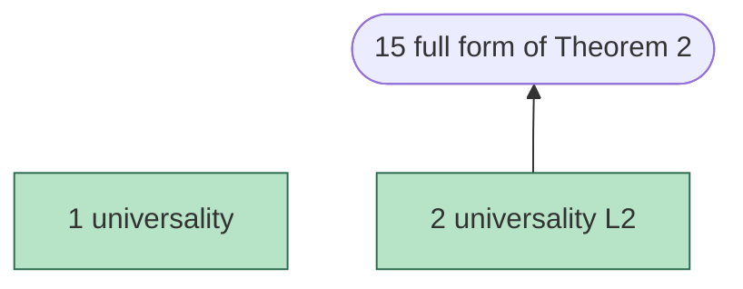

## Body §3 --- Convergence bounds for stable losses

| lvl | statement | natural language | Lean stated | Lean proved | bucket |
|---:|---|---|---|---|---|
| 2 | **Theorem 3** `theo:RL_CV_bound` — [`cv_stable.tex:3`](cv_stable.tex#L3) *(full form: `theo:RL_CV_bound_full`)* | proved — [`proofs.tex:188`](proofs.tex#L188) *(via `theo:RL_CV_bound_full`)* | strict (StableBound.lean, RLBound.lean, NegativeControl.lean) +2 | **yes** | A |
| 2 | **Theorem 4** `theo:IL_CV_bound_body` — [`cv_stable.tex:42`](cv_stable.tex#L42) *(full form: `theo:IL_CV_bound`)* | proved — [`proofs.tex:289`](proofs.tex#L289) *(via `theo:IL_CV_bound`)* | strict (ILBoundFull.lean, ILBound.lean, StableBound.lean) +2 | **yes** | A |

dependency graph — Body §3 --- Convergence bounds for stable losses

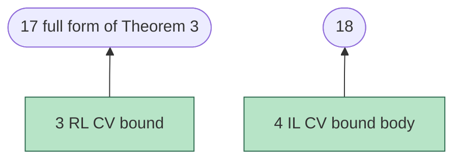

## Body §4 --- Convergence bounds for divergence losses

| lvl | statement | natural language | Lean stated | Lean proved | bucket |
|---:|---|---|---|---|---|
| 2 | **Theorem 5** `theo:no_bound_divergence` — [`cv_divergence.tex:7`](cv_divergence.tex#L7) | proved — [`proofs.tex:406`](proofs.tex#L406) | strict (CycleDivergence.lean, SamplerWiring.lean) | **yes** | A |
| 6 | **Theorem 9** — convergence speed under frozen backward policy `theo:db_stable_frozen` — [`cv_divergence.tex:159`](cv_divergence.tex#L159) *(full form: `theo:db_stable_frozen_full`)* | proved — [`proofs.tex:656`](proofs.tex#L656) *(via `theo:db_stable_frozen_full`)* | strict (StableFrozenGeneral.lean, Flow.lean, Discrete.lean) +1 | **yes** | A |
| 5 | **Theorem 10** — local exponential convergence `theo:local_convergence` — [`cv_divergence.tex:170`](cv_divergence.tex#L170) *(full form: `theo:local_convergence_full`)* | proved — [`proofs.tex:674`](proofs.tex#L674) *(via `theo:local_convergence_full`)* | strict (Expansion.lean, L2Toolkit.lean, LocalEnergy.lean) +7 | **yes** | A |
| 10 | **Theorem 6** — training speed under a frozen backward policy `theo:training_speed` — [`cv_divergence.tex:69`](cv_divergence.tex#L69) *(full form: `theo:training_speed_full`)* | proved — [`proofs.tex:1037`](proofs.tex#L1037) *(via `theo:training_speed_full`)* | strict (DiscreteGlobal.lean, RatioBridge.lean, TrainingSpeed.lean) +2 | **yes** | A |
| 3 | **Theorem 7** `theo:first_variation` — [`cv_divergence.tex:122`](cv_divergence.tex#L122) *(full form: `theo:first_variation_full`)* | proved — [`proofs.tex:465`](proofs.tex#L465) *(via `theo:first_variation_full`)* | strict (FirstVariationGeneral.lean, FirstVariation.lean, Flow.lean) | **yes** | A |
| 4 | **Theorem 8** — gradient descent as backward diffusion `theo:gd_diffusion` — [`cv_divergence.tex:147`](cv_divergence.tex#L147) *(full form: `theo:gd_diffusion_full`)* | proved — [`proofs.tex:616`](proofs.tex#L616) *(via `theo:gd_diffusion_full`)* | strict (GdDiffusionGeneral.lean, Expansion.lean) | **yes** | A |
| 2 | **Proposition 11** — freezing does not restore stability `prop:frozen_unstable` — [`cv_divergence.tex:190`](cv_divergence.tex#L190) *(full form: `prop:frozen_unstable_full`)* | proved — [`proofs.tex:741`](proofs.tex#L741) *(via `prop:frozen_unstable_full`)* | strict (FrozenUnstable.lean, FrozenUnstableDB.lean) | **yes** | A |
| 9 | **Theorem 12** — global dichotomy for frozen-backward training `theo:global_dichotomy` — [`cv_divergence.tex:221`](cv_divergence.tex#L221) *(full form: `theo:global_dichotomy_full`)* | proved — [`proofs.tex:922`](proofs.tex#L922) *(via `theo:global_dichotomy_full`)* | strict (FreezingGeneral2.lean, FreezingGradientBridge.lean, MassIdentity.lean) +4 | **yes** | A |

dependency graph — Body §4 --- Convergence bounds for divergence losses

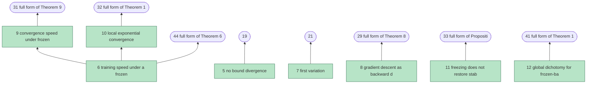

## A --- Proofs

| lvl | statement | natural language | Lean stated | Lean proved | bucket |
|---:|---|---|---|---|---|
| 0 | **Lemma 30** — mixing controls coercivity `lem:sigma_mixing` — [`proofs.tex:628`](proofs.tex#L628) | proved — [`proofs.tex:636`](proofs.tex#L636) | strict (Mixing.lean, MixingBase.lean, SigmaMixing.lean) +1 | **yes** | A |
| 1 | **Theorem 15** — full form of Theorem 2 `theo:universality_L2_full` — [`proofs.tex:65`](proofs.tex#L65) | proved — [`proofs.tex:76`](proofs.tex#L76) | strict (Flow.lean, Kernel.lean, Mixing.lean) +4 | **yes** | A |
| 0 | **Theorem 14** — [brunswicEGF] `theo:negative_control` — [`proofs.tex:52`](proofs.tex#L52) | cited — `brunswicEGF` | strict (NegativeControl.lean, SamplingGeneralBounds.lean) | **yes** | A |
| 1 | **Theorem 17** — full form of Theorem 3 `theo:RL_CV_bound_full` — [`proofs.tex:148`](proofs.tex#L148) | proved — [`proofs.tex:188`](proofs.tex#L188) | strict (RLBound.lean, SamplingGeneralBounds.lean, StableBound.lean) +2 | **yes** | A |
| 1 | **Theorem 18** `theo:IL_CV_bound` — [`proofs.tex:271`](proofs.tex#L271) | proved — [`proofs.tex:289`](proofs.tex#L289) | strict (ILBound.lean, ILBoundFull.lean, SamplingGeneralBounds.lean) +2 | **yes** | A |
| 0 | **Theorem 13** — [bengio2021flow] `theo:sampling_theorem` — [`proofs.tex:28`](proofs.tex#L28) | cited — `bengio2021flow` | strict (Sampling.lean, SamplingGeneral.lean, Sampling.lean) | **yes** | A |
| 1 | **Lemma 19** `lem:cycle_counterexample` — [`proofs.tex:385`](proofs.tex#L385) | proved — [`proofs.tex:393`](proofs.tex#L393) | strict (CycleRemarks.lean, SamplerWiring.lean, CycleDivergence.lean) | **yes** | A |
| 0 | **Definition 23** — edge lift `def:edge_lift` — [`proofs.tex:514`](proofs.tex#L514) | def | strict (Lift.lean, LiftGeneral.lean) | **yes** | A |
| 0 | **Definition 47** — loop closure `def:loop_closure` — [`proofs.tex:1114`](proofs.tex#L1114) | def | strict (Setting.lean) | **yes** | A |
| 1 | **Lemma 20** — L^2(λ)-conjugation and the λ-reversal `lem:adjoint` — [`proofs.tex:412`](proofs.tex#L412) | proved — [`proofs.tex:422`](proofs.tex#L422) | strict (Adjoint.lean, AdjointGeneral.lean) | **yes** | A |
| 2 | **Lemma 24** `lem:lift_wellposed` — [`proofs.tex:522`](proofs.tex#L522) | proved — [`proofs.tex:526`](proofs.tex#L526) | strict (Lift.lean, LiftGeneral.lean) | **yes** | A |
| 3 | **Lemma 27** — mixing transfer `lem:lift_mixing` — [`proofs.tex:560`](proofs.tex#L560) | proved — [`proofs.tex:564`](proofs.tex#L564) | strict (Lift.lean, LiftFinite.lean, LiftGeneralMixing.lean) +1 | **yes** | A |
| 2 | **Theorem 21** `theo:first_variation_full` — [`proofs.tex:457`](proofs.tex#L457) | proved — [`proofs.tex:465`](proofs.tex#L465) | strict (FirstVariationGeneral.lean, FirstVariation.lean, Flow.lean) | **yes** | A |
| 3 | **Theorem 29** — full form of Theorem 8 `theo:gd_diffusion_full` — [`proofs.tex:591`](proofs.tex#L591) | proved — [`proofs.tex:616`](proofs.tex#L616) | strict (Expansion.lean, GdDiffusionGeneral.lean, LocalConvergenceClauses.lean) | **yes** | A |
| 4 | **Theorem 32** — full form of Theorem 10 `theo:local_convergence_full` — [`proofs.tex:666`](proofs.tex#L666) | proved — [`proofs.tex:674`](proofs.tex#L674) | strict (C3Wrappers.lean, Expansion.lean, L2Toolkit.lean) +7 | **yes** | A |
| 5 | **Theorem 31** — full form of Theorem 9 `theo:db_stable_frozen_full` — [`proofs.tex:640`](proofs.tex#L640) | proved — [`proofs.tex:656`](proofs.tex#L656) | strict (Discrete.lean, Flow.lean, StableFrozenGeneral.lean) +1 | **yes** | A |
| 6 | **Proposition 37** — nonlinear freezing: local stability is sharp `prop:nonlinear_freezing` — [`proofs.tex:840`](proofs.tex#L840) | proved — [`proofs.tex:854`](proofs.tex#L854) | strict (Freezing.lean, FreezingGeneral.lean, FreezingGeneral2.lean) +2 | **yes** | A |
| 7 | **Proposition 39** — strictly unimodal generators admit no distant equilibrium `prop:no_distant_equilibrium` — [`proofs.tex:874`](proofs.tex#L874) | proved — [`proofs.tex:887`](proofs.tex#L887) | strict (BoundaryBlowup.lean, Flow.lean, FlowExistence.lean) +9 | **yes** | A |
| 3 | **Lemma 28** — coercivity transfer `lem:lift_coercivity` — [`proofs.tex:572`](proofs.tex#L572) | proved — [`proofs.tex:579`](proofs.tex#L579) | strict (LiftFinite.lean, LiftGeneralMixing.lean, LiftGeneral.lean) | **yes** | A |
| 8 | **Proposition 42** — the training rate in the variables of Morozov et al `prop:morozov_rate` — [`proofs.tex:930`](proofs.tex#L930) | proved — [`proofs.tex:955`](proofs.tex#L955) | strict (Morozov.lean, MorozovConsume.lean, MorozovDB.lean) +2 | **yes** | A |
| 8 | **Corollary 43** — global ojasiewicz inequality for (log x)^2 `cor:global_lojasiewicz` — [`proofs.tex:974`](proofs.tex#L974) | proved — [`proofs.tex:986`](proofs.tex#L986) | strict (Flow.lean, Lojasiewicz.lean, MassAscent.lean) +1 | **yes** | A |
| 2 | **Theorem 48** — universality on finite graphs with frozen backward policy `theo:universality_graphs` — [`proofs.tex:1125`](proofs.tex#L1125) | proved — [`proofs.tex:1143`](proofs.tex#L1143) | strict (SamplerWiring.lean, Setting.lean, Universality.lean) +1 | **yes** | A |
| 9 | **Theorem 44** — full form of Theorem 6 `theo:training_speed_full` — [`proofs.tex:999`](proofs.tex#L999) | proved — [`proofs.tex:1037`](proofs.tex#L1037) | strict (C3Wrappers.lean, DiscreteGlobal.lean, RatioBridge.lean) +2 | **yes** | A |
| 0 | **Proposition 25** — DB as a lifted balance loss `prop:db_lift` — [`proofs.tex:534`](proofs.tex#L534) | proved — [`proofs.tex:543`](proofs.tex#L543) | strict (Lift.lean, LiftGeneralMixing.lean, LiftGeneral.lean) | **yes** | A |
| 1 | **Proposition 33** — full form of Proposition 11 `prop:frozen_unstable_full` — [`proofs.tex:729`](proofs.tex#L729) | proved — [`proofs.tex:741`](proofs.tex#L741) | strict (FrozenUnstable.lean, FrozenUnstableDB.lean) | **yes** | A |
| 8 | **Theorem 41** — full form of Theorem 12 `theo:global_dichotomy_full` — [`proofs.tex:914`](proofs.tex#L914) | proved — [`proofs.tex:922`](proofs.tex#L922) | strict (FreezingGeneral2.lean, FreezingGradientBridge.lean, GlobalConvergence.lean) +5 | **yes** | A |
| 2 | **Theorem 16** `theo:universality_L2_body` — [`proofs.tex:119`](proofs.tex#L119) | proved — [`proofs.tex:126`](proofs.tex#L126) | strict (UniversalityBody.lean, Kernel.lean, Universality.lean) +1 | **yes** | A |
| 3 | **Corollary 22** — FM gradients `cor:gradient_formulas` — [`proofs.tex:495`](proofs.tex#L495) | proved — [`proofs.tex:510`](proofs.tex#L510) | strict (FirstVariationGeneral.lean, GradientFormulas.lean) | **yes** | A |
| 3 | **Corollary 26** — DB gradient `cor:db_gradient` — [`proofs.tex:547`](proofs.tex#L547) | proved — [`proofs.tex:556`](proofs.tex#L556) | strict (GdDiffusionGeneral.lean, GradientFormulas.lean) | **yes** | A |
| 4 | **Proposition 34** — TB gradient `prop:tb_gradient` — [`proofs.tex:755`](proofs.tex#L755) | proved — [`proofs.tex:774`](proofs.tex#L774) | strict (TBGradient.lean) | **yes** | A |
| 5 | **Proposition 35** — TB Hessian `prop:tb_hessian` — [`proofs.tex:790`](proofs.tex#L790) | proved — [`proofs.tex:811`](proofs.tex#L811) | strict (TBHessian.lean, C3Wrappers.lean) | **yes** | A |
| 15 | **Remark 36** `rem:tb_vs_db` — [`proofs.tex:834`](proofs.tex#L834) | informal | strict (TBvsDB.lean, TBvsDBClose.lean, TBHessian.lean) | **yes** | A |
| 8 | **Remark 38** `rem:freezing` — [`proofs.tex:870`](proofs.tex#L870) | informal | strict (FreezingGeneral2.lean, FreezingGradientBridge.lean, GlobalConvergenceFinite.lean) +1 | **yes** | A |
| 9 | **Remark 40** — a five-vertex cycle: no stalemate between constraint and inflation `rem:cycle_no_stalemate` — [`proofs.tex:910`](proofs.tex#L910) | informal | strict (CycleBlowup.lean, CycleExample.lean, CycleRemarks.lean) | **yes** | A |
| 10 | **Remark 45** — the speed is carried by visit ratios, then by mixing `rem:visit_ratio` — [`proofs.tex:1095`](proofs.tex#L1095) | informal | strict (RemarksA.lean) | **yes** | A |
| 0 | **Definition 46** — path-connectedness `def:path_connected` — [`proofs.tex:1110`](proofs.tex#L1110) | def | strict (Setting.lean) | **yes** | A |
| 5 | **Remark 49** — the loop closure is necessary `rem:loop_closure_necessary` — [`proofs.tex:1173`](proofs.tex#L1173) | informal | strict (FrozenUnstable.lean) | **yes** | A |
| 9 | **Remark 50** — relation to Theorem 2 and to training `rem:graphs_vs_L2` — [`proofs.tex:1177`](proofs.tex#L1177) | informal | strict (RemarksA.lean) | **yes** | A |
| 3 | **Remark 51** — targets vanishing at a terminating state `rem:partial_support` — [`proofs.tex:1181`](proofs.tex#L1181) | informal | strict (FamilyUniversality.lean, PartialSupportClose.lean) | **yes** | A |

dependency graph — A --- Proofs

```mermaid
graph BT
  n0["13 [bengio2021flow]"]
  class n0 done;
  n1["14 [brunswicEGF]"]
  class n1 done;
  n2["15 full form of Theorem 2"]
  class n2 done;
  n3["16 universality L2 body"]
  class n3 done;
  n4["17 full form of Theorem 3"]
  class n4 done;
  n5["18 IL CV bound"]
  class n5 done;
  n6["19 cycle counterexample"]
  class n6 done;
  n7["20 L^2(λ)-conjugation and the λ-r"]
  class n7 done;
  n8["21 first variation full"]
  class n8 done;
  n9["22 FM gradients"]
  class n9 done;
  n10["23 edge lift"]
  class n10 done;
  n11["24 lift wellposed"]
  class n11 done;
  n12["25 DB as a lifted balance loss"]
  class n12 done;
  n13["26 DB gradient"]
  class n13 done;
  n14["27 mixing transfer"]
  class n14 done;
  n15["28 coercivity transfer"]
  class n15 done;
  n16["29 full form of Theorem 8"]
  class n16 done;
  n17["30 mixing controls coercivity"]
  class n17 done;
  n18["31 full form of Theorem 9"]
  class n18 done;
  n19["32 full form of Theorem 10"]
  class n19 done;
  n20["33 full form of Proposition 11"]
  class n20 done;
  n21["34 TB gradient"]
  class n21 done;
  n22["35 TB Hessian"]
  class n22 done;
  n23["36 tb vs db"]
  class n23 done;
  n24["37 nonlinear freezing: local stab"]
  class n24 done;
  n25["38 freezing"]
  class n25 done;
  n26["39 strictly unimodal generators a"]
  class n26 done;
  n27["40 a five-vertex cycle: no stalem"]
  class n27 done;
  n28["41 full form of Theorem 12"]
  class n28 done;
  n29["42 the training rate in the varia"]
  class n29 done;
  n30["43 global ojasiewicz inequality f"]
  class n30 done;
  n31["44 full form of Theorem 6"]
  class n31 done;
  n32["45 the speed is carried by visit "]
  class n32 done;
  n33["46 path-connectedness"]
  class n33 done;
  n34["47 loop closure"]
  class n34 done;
  n35["48 universality on finite graphs "]
  class n35 done;
  n36["49 the loop closure is necessary"]
  class n36 done;
  n37["50 relation to Theorem 2 and to t"]
  class n37 done;
  n38["51 targets vanishing at a termina"]
  class n38 done;
  n39(["1 "])
  n40(["125 the diffusion operator"])
  n41(["100 closed-form backward l"])
  n42(["96 the doubling graph in "])
  n43(["94 the diffusion operator"])
  n44(["2 "])
  n45(["10 local exponential conv"])
  n2 --> n17
  n3 --> n2
  n4 --> n1
  n4 --> n39
  n5 --> n39
  n5 --> n1
  n6 --> n0
  n7 --> n34
  n8 --> n7
  n9 --> n8
  n11 --> n7
  n13 --> n8
  n13 --> n11
  n13 --> n12
  n14 --> n10
  n14 --> n11
  n14 --> n7
  n15 --> n10
  n15 --> n11
  n15 --> n7
  n16 --> n7
  n16 --> n8
  n18 --> n16
  n18 --> n10
  n18 --> n14
  n18 --> n19
  n18 --> n17
  n19 --> n18
  n19 --> n10
  n19 --> n16
  n20 --> n34
  n20 --> n12
  n21 --> n10
  n21 --> n11
  n21 --> n35
  n21 --> n13
  n21 --> n7
  n22 --> n21
  n22 --> n14
  n22 --> n12
  n22 --> n11
  n22 --> n7
  n22 --> n10
  n23 --> n22
  n23 --> n40
  n23 --> n41
  n23 --> n18
  n23 --> n42
  n23 --> n17
  n23 --> n43
  n23 --> n15
  n23 --> n44
  n23 --> n29
  n23 --> n19
  n23 --> n26
  n24 --> n18
  n24 --> n8
  n24 --> n7
  n25 --> n26
  n25 --> n24
  n25 --> n19
  n26 --> n24
  n26 --> n8
  n27 --> n34
  n27 --> n26
  n27 --> n45
  n27 --> n29
  n27 --> n18
  n27 --> n30
  n28 --> n24
  n28 --> n26
  n29 --> n34
  n29 --> n18
  n29 --> n19
  n29 --> n26
  n29 --> n10
  n29 --> n15
  n30 --> n26
  n31 --> n19
  n31 --> n35
  n31 --> n29
  n31 --> n26
  n31 --> n30
  n31 --> n8
  n31 --> n7
  n32 --> n31
  n32 --> n29
  n32 --> n30
  n32 --> n18
  n32 --> n19
  n32 --> n17
  n35 --> n7
  n35 --> n0
  n36 --> n21
  n37 --> n35
  n37 --> n44
  n37 --> n18
  n37 --> n29
  n37 --> n26
  n38 --> n35
  classDef done fill:#b7e4c7,stroke:#2d6a4f;
  classDef part fill:#ffe08a,stroke:#b07d00;
  classDef scaf fill:#ffd6a5,stroke:#b35c00;
```

## B --- Comparison with Silva et al.

| lvl | statement | natural language | Lean stated | Lean proved | bucket |
|---:|---|---|---|---|---|
| 0 | **Proposition 52** — explicit-constant form of Prop.\ 4.2 of [silvageneralization] `prop:silva_explicit` — [`silva_comparison.tex:29`](silva_comparison.tex#L29) | proved — [`silva_comparison.tex:40`](silva_comparison.tex#L40) | strict (Explicit.lean, Basic.lean) | **yes** | A |
| 0 | **Proposition 55** — the state-space dependence is unavoidable `prop:silva_no_uniform` — [`silva_comparison.tex:82`](silva_comparison.tex#L82) | proved — [`silva_comparison.tex:96`](silva_comparison.tex#L96) | strict (NoUniform.lean, Basic.lean) | **yes** | A |
| 2 | **Remark 57** — the hidden size is the path space `rem:path_space` — [`silva_comparison.tex:110`](silva_comparison.tex#L110) | informal | strict (SamplerWiring.lean, PathSpaceMarkov.lean, PathSpaceMarkovGeneral.lean) +2 | **yes** | A |
| 3 | **Remark 54** — the constant is not uniform in the depth `rem:silva_model_constant` — [`silva_comparison.tex:64`](silva_comparison.tex#L64) | informal | strict (SamplerWiring.lean, Remarks.lean) | **yes** | A |
| 4 | **Remark 53** — hypotheses used by the bound `rem:silva_hypotheses` — [`silva_comparison.tex:52`](silva_comparison.tex#L52) | informal | strict (Remarks.lean) | **yes** | A |
| 4 | **Remark 56** — the two degeneracy channels `rem:silva_two_channels` — [`silva_comparison.tex:106`](silva_comparison.tex#L106) | informal | — | — | T |
| 7 | **Remark 58** — relation to the bounds of this paper `rem:silva_vs_ours` — [`silva_comparison.tex:118`](silva_comparison.tex#L118) | informal | — | — | T |

dependency graph — B --- Comparison with Silva et al.

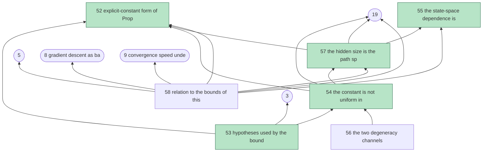

## C --- The initial flow

| lvl | statement | natural language | Lean stated | Lean proved | bucket |
|---:|---|---|---|---|---|
| 2 | **Proposition 59** — dual mass floor `prop:dual_floor` — [`app_finit.tex:26`](app_finit.tex#L26) | proved — [`app_finit.tex:43`](app_finit.tex#L43) | — | — | B |
| 3 | **Proposition 60** — exactness; the minimal loss sees only the mass `prop:floor_exact` — [`app_finit.tex:70`](app_finit.tex#L70) | proved — [`app_finit.tex:92`](app_finit.tex#L92) | — | — | B |
| 4 | **Proposition 65** — exact inference cost of a shape mismatch `prop:shape_cost` — [`app_finit.tex:283`](app_finit.tex#L283) | proved — [`app_finit.tex:325`](app_finit.tex#L325) | — | — | B |
| 5 | **Corollary 61** — separation of roles `cor:separation` — [`app_finit.tex:115`](app_finit.tex#L115) | proved — [`app_finit.tex:124`](app_finit.tex#L124) | — | — | B |
| 2 | **Proposition 62** — z-carried bound `prop:z_bound` — [`app_finit.tex:144`](app_finit.tex#L144) | proved — [`app_finit.tex:159`](app_finit.tex#L159) | — | — | B |
| 0 | **Proposition 63** — the certificate-optimal mass overshoots, and undershoot is dearer `prop:overshoot` — [`app_finit.tex:180`](app_finit.tex#L180) | proved — [`app_finit.tex:197`](app_finit.tex#L197) | — | — | B |
| 4 | **Proposition 64** — at the floor: overshoot blurs, undershoot truncates `prop:blur_vs_drop` — [`app_finit.tex:218`](app_finit.tex#L218) | proved — [`app_finit.tex:251`](app_finit.tex#L251) | — | — | B |
| 3 | **Remark 66** — training does not see a frozen F_init `rem:training` — [`app_finit.tex:358`](app_finit.tex#L358) | informal | — | — | T |

dependency graph — C --- The initial flow

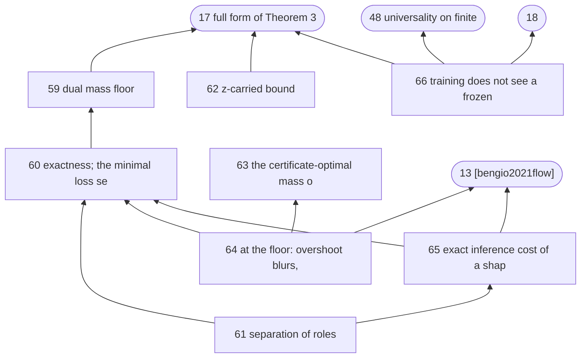

## D --- The replay buffer and the training measure

| lvl | statement | natural language | Lean stated | Lean proved | bucket |
|---:|---|---|---|---|---|
| 0 | **Definition 67** `def:buffer` — [`app_replay.tex:21`](app_replay.tex#L21) | def | — | — | B |
| 9 | **Lemma 68** — coverage, and its clock `lem:coverage` — [`app_replay.tex:35`](app_replay.tex#L35) | proved — [`app_replay.tex:47`](app_replay.tex#L47) | — | — | B |
| 9 | **Proposition 69** — λ is the guarantee-optimal training measure, and backward replay samples it `prop:backward_replay` — [`app_replay.tex:86`](app_replay.tex#L86) | proved — [`app_replay.tex:111`](app_replay.tex#L111) | — | — | B |
| 1 | **Proposition 70** — stable pipeline: uniform reweighting is bound-optimal, with no tension `prop:stable_uniform` — [`app_replay.tex:131`](app_replay.tex#L131) | proved — [`app_replay.tex:154`](app_replay.tex#L154) | — | — | B |
| 5 | **Lemma 71** — transfer: balance loss to stable loss, exactly `lem:transfer` — [`app_replay.tex:174`](app_replay.tex#L174) | proved — [`app_replay.tex:199`](app_replay.tex#L199) | — | — | B |
| 10 | **Proposition 72** — the certificate-optimal mixture: uniform mixed into backward replay at weight ~1/T `prop:alpha_star` — [`app_replay.tex:229`](app_replay.tex#L229) | proved — [`app_replay.tex:257`](app_replay.tex#L257) | — | — | D |

dependency graph — D --- The replay buffer and the training measure

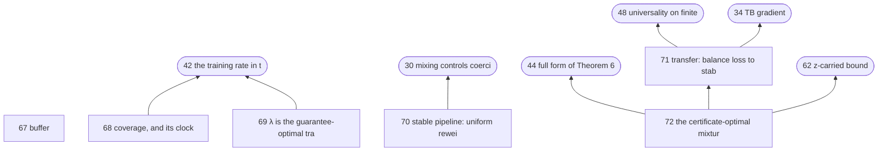

## E --- Trained backward policies

| lvl | statement | natural language | Lean stated | Lean proved | bucket |
|---:|---|---|---|---|---|
| 0 | **Lemma 73** — balanced points are critical in all variables `lem:balanced_min` — [`app_pbtrain.tex:35`](app_pbtrain.tex#L35) | proved — [`app_pbtrain.tex:46`](app_pbtrain.tex#L46) | — | — | B |
| 9 | **Lemma 74** — their Eq.~10 is the occupation identity, summed `lem:eq10_occupation` — [`app_pbtrain.tex:58`](app_pbtrain.tex#L58) | proved — [`app_pbtrain.tex:78`](app_pbtrain.tex#L78) | — | — | B |
| 7 | **Proposition 79** — the constants along the path to minimum flow `prop:constants_path` — [`app_pbtrain.tex:202`](app_pbtrain.tex#L202) | proved — [`app_pbtrain.tex:221`](app_pbtrain.tex#L221) | — | — | B |
| 9 | **Lemma 75** — local Polyak--ojasiewicz inequality `lem:local_pl` — [`app_pbtrain.tex:92`](app_pbtrain.tex#L92) | proved — [`app_pbtrain.tex:106`](app_pbtrain.tex#L106) | — | — | B |
| 10 | **Proposition 76** — quasi-static tracking, and the shadow drift `prop:two_timescale` — [`app_pbtrain.tex:115`](app_pbtrain.tex#L115) | proved — [`app_pbtrain.tex:132`](app_pbtrain.tex#L132) | — | — | D |
| 11 | **Proposition 78** — the drift target `prop:drift_target` — [`app_pbtrain.tex:177`](app_pbtrain.tex#L177) | proved — [`app_pbtrain.tex:187`](app_pbtrain.tex#L187) | — | — | D |
| 12 | **Lemma 77** — normalization reconciliation `lem:normalization` — [`app_pbtrain.tex:152`](app_pbtrain.tex#L152) | proved — [`app_pbtrain.tex:163`](app_pbtrain.tex#L163) | — | — | D |
| 0 | **Remark 80** — replay repairs the cap, not the rate `rem:replay_rescue` — [`app_pbtrain.tex:238`](app_pbtrain.tex#L238) | informal | — | — | B |
| 0 | **Proposition 81** — gap collapse at a two-component limit `prop:gap_collapse` — [`app_pbtrain.tex:249`](app_pbtrain.tex#L249) | proved — [`app_pbtrain.tex:257`](app_pbtrain.tex#L257) | — | — | B |
| 0 | **Remark 82** — the positivity hypothesis is necessary, measured `rem:one_leak` — [`app_pbtrain.tex:266`](app_pbtrain.tex#L266) | informal | — | — | T |
| 0 | **Remark 83** — minimum flow is adjacent to collapse `rem:lp_degeneracy` — [`app_pbtrain.tex:279`](app_pbtrain.tex#L279) | informal | — | — | T |
| 9 | **Proposition 85** — soft-SSP keeps the constants alive `prop:soft_ssp` — [`app_pbtrain.tex:311`](app_pbtrain.tex#L311) | proved — [`app_pbtrain.tex:349`](app_pbtrain.tex#L349) | — | — | B |
| 10 | **Remark 86** — relation to entropic OT `rem:entropic_ot` — [`app_pbtrain.tex:373`](app_pbtrain.tex#L373) | informal | — | — | T |
| 11 | **Lemma 84** — trajectory-likelihood regularization `lem:traj_entropy` — [`app_pbtrain.tex:291`](app_pbtrain.tex#L291) | proved — [`app_pbtrain.tex:305`](app_pbtrain.tex#L305) | — | — | B |

dependency graph — E --- Trained backward policies

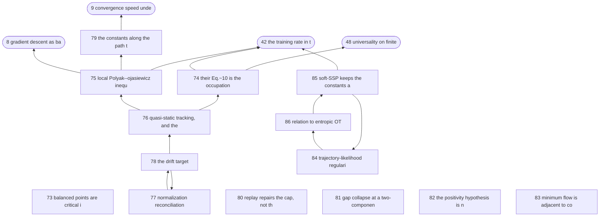

## F --- Stochastic gradients

| lvl | statement | natural language | Lean stated | Lean proved | bucket |
|---:|---|---|---|---|---|
| 10 | **Proposition 87** — balance losses are at interpolation `prop:interpolation` — [`app_sgd.tex:36`](app_sgd.tex#L36) | proved — [`app_sgd.tex:59`](app_sgd.tex#L59) | — | — | B |
| 5 | **Proposition 88** — additive floor `prop:additive_floor` — [`app_sgd.tex:82`](app_sgd.tex#L82) | proved — [`app_sgd.tex:110`](app_sgd.tex#L110) | — | — | B |
| 11 | **Proposition 89** — the replay answer is noise-robust `prop:buffer_robust` — [`app_sgd.tex:124`](app_sgd.tex#L124) | proved — [`app_sgd.tex:131`](app_sgd.tex#L131) | — | — | B |

dependency graph — F --- Stochastic gradients

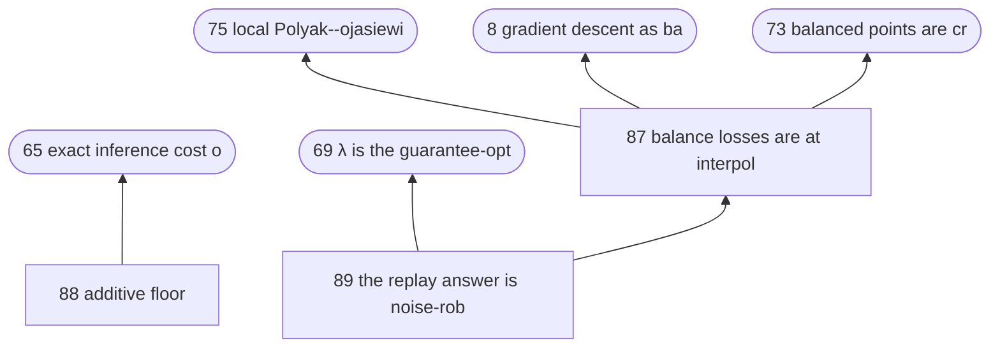

## H --- The doubling graph

| lvl | statement | natural language | Lean stated | Lean proved | bucket |
|---:|---|---|---|---|---|
| 1 | **Lemma 93** — the fixed points of the function action are the constants `lem:doubling_fixed_points` — [`app_doubling.tex:130`](app_doubling.tex#L130) | proved — [`app_doubling.tex:142`](app_doubling.tex#L142) | strict (FixedPoints.lean, FixedPointsP.lean, LpLayer.lean) +1 | **yes** | A |
| 2 | **Lemma 94** — the diffusion operator `lem:doubling_operator` — [`app_doubling.tex:166`](app_doubling.tex#L166) | proved — [`app_doubling.tex:193`](app_doubling.tex#L193) | strict (OperatorGeneral.lean, Operator.lean, LpContraction.lean) +9 | **yes** | A |
| 1 | **Lemma 91** — the standing range `lem:doubling_range` — [`app_doubling.tex:86`](app_doubling.tex#L86) | proved — [`app_doubling.tex:93`](app_doubling.tex#L93) | strict (Range.lean) | **yes** | A |
| 1 | **Lemma 92** — positive edges make the loop closure irreducible `lem:doubling_irreducible` — [`app_doubling.tex:101`](app_doubling.tex#L101) | proved — [`app_doubling.tex:108`](app_doubling.tex#L108) | strict (Irreducible.lean) | **yes** | A |
| 1 | **Proposition 103** — the decay exponent is a Cram\'er root `prop:doubling_exponent` — [`app_doubling.tex:703`](app_doubling.tex#L703) | proved — [`app_doubling.tex:711`](app_doubling.tex#L711) | strict (Exponent.lean) | **yes** | A |
| 0 | **Lemma 104** — the Cram\'er root `lem:doubling_cramer_root` — [`app_doubling.tex:721`](app_doubling.tex#L721) | proved — [`app_doubling.tex:743`](app_doubling.tex#L743) | strict (Cramer.lean) | **yes** | A |
| 3 | **Lemma 123** — the truncation is a finite irreducible chain `lem:doubling_truncation_irreducible` — [`app_doubling.tex:1785`](app_doubling.tex#L1785) | proved — [`app_doubling.tex:1794`](app_doubling.tex#L1794) | strict (Irreducible.lean, TruncationStat.lean, OperatorL2.lean) | **yes** | A |
| 4 | **Definition 90** — standing notation and hypotheses of this appendix `def:doubling_setting` — [`app_doubling.tex:13`](app_doubling.tex#L13) | def | strict (PointwiseInv.lean, Setting.lean) | **yes** | A |
| 5 | **Proposition 97** — the drift, and when it is constant `prop:doubling_drift` — [`app_doubling.tex:387`](app_doubling.tex#L387) | proved — [`app_doubling.tex:396`](app_doubling.tex#L396) | strict (Drift.lean) | **yes** | A |
| 5 | **Lemma 98** — the excursion maximum is bounded by the hitting time `lem:doubling_excursion` — [`app_doubling.tex:406`](app_doubling.tex#L406) | proved — [`app_doubling.tex:419`](app_doubling.tex#L419) | strict (Excursion.lean) | **yes** | A |
| 6 | **Lemma 99** — the linear supersolution `lem:doubling_supersolution` — [`app_doubling.tex:434`](app_doubling.tex#L434) | proved — [`app_doubling.tex:450`](app_doubling.tex#L450) | strict (Supersolution.lean) | **yes** | A |
| 7 | **Proposition 100** — closed-form backward length `prop:doubling_length` — [`app_doubling.tex:484`](app_doubling.tex#L484) | proved — [`app_doubling.tex:490`](app_doubling.tex#L490) | strict (Length.lean) | **yes** | A |
| 8 | **Proposition 101** — the phase diagram of the family `prop:doubling_phase` — [`app_doubling.tex:520`](app_doubling.tex#L520) | proved — [`app_doubling.tex:535`](app_doubling.tex#L535) | strict (PhaseRecurrence.lean, RecurrenceClass.lean, Summable.lean) +7 | **yes** | A |
| 5 | **Proposition 102** — cut balance `prop:doubling_cut` — [`app_doubling.tex:651`](app_doubling.tex#L651) | proved — [`app_doubling.tex:670`](app_doubling.tex#L670) | strict (CutBalance.lean, Ratios.lean) | **yes** | A |
| 5 | **Definition 105** — notation for the decay estimates `def:doubling_decay_notation` — [`app_doubling.tex:798`](app_doubling.tex#L798) | def | strict (DecayNotation.lean) | **yes** | A |
| 6 | **Lemma 106** — the averaging form of the cut balance `lem:doubling_averaging` — [`app_doubling.tex:823`](app_doubling.tex#L823) | proved — [`app_doubling.tex:843`](app_doubling.tex#L843) | strict (DecayNotation.lean) | **yes** | A |
| 7 | **Lemma 109** — the descent chain `lem:doubling_descent` — [`app_doubling.tex:979`](app_doubling.tex#L979) | proved — [`app_doubling.tex:1009`](app_doubling.tex#L1009) | strict (Descent.lean, DescentStatement.lean, R0Bound.lean) +1 | **yes** | A |
| 8 | **Lemma 110** — the descent halves at a uniform rate `lem:doubling_escape` — [`app_doubling.tex:1040`](app_doubling.tex#L1040) | proved — [`app_doubling.tex:1063`](app_doubling.tex#L1063) | strict (Escape.lean, Sojourn.lean, DescentLaw.lean) | **yes** | A |
| 9 | **Lemma 111** — the weight of a descent is 1+O(1/ℓ) in expectation `lem:doubling_product` — [`app_doubling.tex:1124`](app_doubling.tex#L1124) | proved — [`app_doubling.tex:1138`](app_doubling.tex#L1138) | strict (Product.lean) | **yes** | A |
| 10 | **Theorem 112** — the invariant measure decays at the Cram\'er exponent `theo:doubling_decay` — [`app_doubling.tex:1169`](app_doubling.tex#L1169) | proved — [`app_doubling.tex:1195`](app_doubling.tex#L1195) | strict (Descent.lean, Summable.lean, Product.lean) | **yes** | A |
| 10 | **Lemma 116** — the weight of a descent deviates from 1 by O(1/ℓ) in mean `lem:doubling_weight` — [`app_doubling.tex:1323`](app_doubling.tex#L1323) | proved — [`app_doubling.tex:1337`](app_doubling.tex#L1337) | strict (Weight.lean, WeightChain.lean, WeightFull.lean) | **yes** | A |
| 11 | **Lemma 117** — the exit from a block charges a fixed fraction of one reference law `lem:doubling_doeblin` — [`app_doubling.tex:1365`](app_doubling.tex#L1365) | proved — [`app_doubling.tex:1383`](app_doubling.tex#L1383) | strict (DescentLaw.lean, Doeblin.lean, HarmonicWindow.lean) | **yes** | A |
| 12 | **Theorem 115** — the sharp asymptotic `theo:doubling_sharp` — [`app_doubling.tex:1303`](app_doubling.tex#L1303) | proved — [`app_doubling.tex:1515`](app_doubling.tex#L1515) | strict (Sharp.lean, SharpFull.lean, SharpRate.lean) +1 | **yes** | A |
| 13 | **Corollary 120** — the tail, with the constant `cor:doubling_tail_sharp` — [`app_doubling.tex:1652`](app_doubling.tex#L1652) | proved — [`app_doubling.tex:1667`](app_doubling.tex#L1667) | strict (Tail.lean) | **yes** | A |
| 13 | **Proposition 121** — the constant is a linear functional of the boundary data `prop:doubling_constant` — [`app_doubling.tex:1682`](app_doubling.tex#L1682) | proved — [`app_doubling.tex:1699`](app_doubling.tex#L1699) | strict (Constant.lean, ConstantFunctional.lean, Main.lean) | **yes** | A |
| 6 | **Lemma 124** — the per-cut inequality `lem:doubling_percut` — [`app_doubling.tex:1828`](app_doubling.tex#L1828) | proved — [`app_doubling.tex:1866`](app_doubling.tex#L1866) | strict (PerCutIdentity.lean, PerCutNorms.lean) | **yes** | A |
| 7 | **Theorem 125** — the diffusion operator is unbounded `theo:doubling_unbounded` — [`app_doubling.tex:1925`](app_doubling.tex#L1925) | proved — [`app_doubling.tex:1949`](app_doubling.tex#L1949) | strict (Unbounded.lean, UnboundedL2.lean, RayleighBridge.lean) | **yes** | A |
| 5 | **Lemma 126** — the clipped ramp `lem:doubling_ramp` — [`app_doubling.tex:2001`](app_doubling.tex#L2001) | proved — [`app_doubling.tex:2024`](app_doubling.tex#L2024) | strict (Ramp.lean) | **yes** | A |
| 6 | **Corollary 113** — the tail, and its ratio to the mass at the cut `cor:doubling_tail` — [`app_doubling.tex:1244`](app_doubling.tex#L1244) | proved — [`app_doubling.tex:1264`](app_doubling.tex#L1264) | strict (Tail.lean) | **yes** | A |
| 11 | **Corollary 127** — an explicit divergent family `cor:doubling_family` — [`app_doubling.tex:2067`](app_doubling.tex#L2067) | proved — [`app_doubling.tex:2081`](app_doubling.tex#L2081) | strict (Family.lean, Main.lean) | **yes** | A |
| 8 | **Proposition 128** — an L^2 pair with no exact L^2 outflow `prop:doubling_unsolvable` — [`app_doubling.tex:2106`](app_doubling.tex#L2106) | proved — [`app_doubling.tex:2119`](app_doubling.tex#L2119) | strict (Unsolvable.lean) | **yes** | A |
| 11 | **Corollary 130** — the truncation, and a proved K `cor:doubling_truncation` — [`app_doubling.tex:2179`](app_doubling.tex#L2179) | proved — [`app_doubling.tex:2203`](app_doubling.tex#L2203) | strict (Truncation.lean, TruncationBhat.lean, Kac.lean) +2 | **yes** | A |
| 14 | **Theorem 96** — the doubling graph in one statement `theo:doubling_main` — [`app_doubling.tex:279`](app_doubling.tex#L279) | proved — [`app_doubling.tex:2318`](app_doubling.tex#L2318) | strict (Main.lean, MainPackaging.lean, PhaseRecurrence.lean) +5 | **yes** | A |
| 3 | **Remark 95** — the two constants written ^ B, and the trajectory reading `rem:doubling_two_constants` — [`app_doubling.tex:264`](app_doubling.tex#L264) | informal | strict (OperatorFiniteSum.lean, Remarks.lean, Operator.lean) | **yes** | A |
| 6 | **Lemma 107** — the expansion of R_α `lem:doubling_expansion` — [`app_doubling.tex:857`](app_doubling.tex#L857) | proved — [`app_doubling.tex:878`](app_doubling.tex#L878) | strict (Expansion.lean, ExpansionSecond.lean, ExpansionTrapezoid.lean) | **yes** | A |
| 7 | **Remark 108** — the parity of the window `rem:doubling_parity` — [`app_doubling.tex:964`](app_doubling.tex#L964) | informal | strict (Expansion.lean, ExpansionSecond.lean, ExpansionTrapezoid.lean) | **yes** | A |
| 12 | **Lemma 118** — two descents from one block reach the base block with nearly the same law `lem:doubling_coupling` — [`app_doubling.tex:1455`](app_doubling.tex#L1455) | proved — [`app_doubling.tex:1471`](app_doubling.tex#L1471) | strict (Coupling.lean, DescentLaw.lean, TotalVariation.lean) | **yes** | A |
| 13 | **Remark 119** — no log-periodic term `rem:doubling_no_logperiodic` — [`app_doubling.tex:1639`](app_doubling.tex#L1639) | informal | — | — | T |
| 13 | **Remark 122** — the second order, and the parity wobble --- a formal expansion `rem:doubling_second_order` — [`app_doubling.tex:1749`](app_doubling.tex#L1749) | informal | — | — | T |
| 0 | **Remark 129** — the condition 222 indicts the family, not the graph `rem:doubling_geometric` — [`app_doubling.tex:2163`](app_doubling.tex#L2163) | informal | strict (Unbounded.lean) | **yes** | A |

dependency graph — H --- The doubling graph

```mermaid
graph BT
  n0["90 standing notation and hypothes"]
  class n0 done;
  n1["91 the standing range"]
  class n1 done;
  n2["92 positive edges make the loop c"]
  class n2 done;
  n3["93 the fixed points of the functi"]
  class n3 done;
  n4["94 the diffusion operator"]
  class n4 done;
  n5["95 the two constants written ^ B,"]
  class n5 done;
  n6["96 the doubling graph in one stat"]
  class n6 done;
  n7["97 the drift, and when it is cons"]
  class n7 done;
  n8["98 the excursion maximum is bound"]
  class n8 done;
  n9["99 the linear supersolution"]
  class n9 done;
  n10["100 closed-form backward length"]
  class n10 done;
  n11["101 the phase diagram of the famil"]
  class n11 done;
  n12["102 cut balance"]
  class n12 done;
  n13["103 the decay exponent is a Cram\'"]
  class n13 done;
  n14["104 the Cram\'er root"]
  class n14 done;
  n15["105 notation for the decay estimat"]
  class n15 done;
  n16["106 the averaging form of the cut "]
  class n16 done;
  n17["107 the expansion of R_α"]
  class n17 done;
  n18["108 the parity of the window"]
  class n18 done;
  n19["109 the descent chain"]
  class n19 done;
  n20["110 the descent halves at a unifor"]
  class n20 done;
  n21["111 the weight of a descent is 1+O"]
  class n21 done;
  n22["112 the invariant measure decays a"]
  class n22 done;
  n23["113 the tail, and its ratio to the"]
  class n23 done;
  n24["115 the sharp asymptotic"]
  class n24 done;
  n25["116 the weight of a descent deviat"]
  class n25 done;
  n26["117 the exit from a block charges "]
  class n26 done;
  n27["118 two descents from one block re"]
  class n27 done;
  n28["119 no log-periodic term"]
  n29["120 the tail, with the constant"]
  class n29 done;
  n30["121 the constant is a linear funct"]
  class n30 done;
  n31["122 the second order, and the pari"]
  n32["123 the truncation is a finite irr"]
  class n32 done;
  n33["124 the per-cut inequality"]
  class n33 done;
  n34["125 the diffusion operator is unbo"]
  class n34 done;
  n35["126 the clipped ramp"]
  class n35 done;
  n36["127 an explicit divergent family"]
  class n36 done;
  n37["128 an L^2 pair with no exact L^2 "]
  class n37 done;
  n38["129 the condition 222 indicts the "]
  class n38 done;
  n39["130 the truncation, and a proved K"]
  class n39 done;
  n40(["47 loop closure"])
  n41(["20 L^2(λ)-conjugation and"])
  n42(["30 mixing controls coerci"])
  n0 --> n40
  n0 --> n1
  n0 --> n2
  n0 --> n13
  n0 --> n41
  n0 --> n4
  n0 --> n14
  n0 --> n32
  n1 --> n0
  n2 --> n0
  n3 --> n4
  n4 --> n3
  n5 --> n42
  n5 --> n4
  n6 --> n0
  n6 --> n22
  n6 --> n11
  n6 --> n14
  n6 --> n12
  n6 --> n24
  n6 --> n29
  n6 --> n30
  n6 --> n1
  n6 --> n34
  n6 --> n4
  n6 --> n35
  n6 --> n10
  n6 --> n36
  n6 --> n37
  n6 --> n32
  n6 --> n39
  n7 --> n0
  n8 --> n0
  n9 --> n0
  n9 --> n8
  n10 --> n0
  n10 --> n9
  n10 --> n8
  n10 --> n7
  n11 --> n0
  n11 --> n1
  n11 --> n2
  n11 --> n7
  n11 --> n10
  n11 --> n8
  n12 --> n0
  n13 --> n0
  n15 --> n0
  n15 --> n14
  n16 --> n0
  n16 --> n15
  n17 --> n0
  n17 --> n15
  n17 --> n14
  n18 --> n15
  n18 --> n17
  n19 --> n0
  n19 --> n15
  n19 --> n16
  n20 --> n0
  n20 --> n15
  n20 --> n19
  n21 --> n0
  n21 --> n15
  n21 --> n20
  n21 --> n19
  n22 --> n0
  n22 --> n15
  n22 --> n19
  n22 --> n20
  n22 --> n21
  n23 --> n0
  n23 --> n15
  n24 --> n0
  n24 --> n15
  n24 --> n22
  n24 --> n25
  n24 --> n26
  n24 --> n19
  n24 --> n20
  n24 --> n16
  n25 --> n0
  n25 --> n15
  n25 --> n19
  n25 --> n20
  n25 --> n21
  n26 --> n0
  n26 --> n15
  n26 --> n25
  n26 --> n19
  n26 --> n20
  n27 --> n0
  n27 --> n15
  n27 --> n26
  n27 --> n19
  n28 --> n15
  n28 --> n27
  n29 --> n0
  n29 --> n15
  n29 --> n24
  n30 --> n0
  n30 --> n15
  n30 --> n24
  n30 --> n22
  n31 --> n15
  n31 --> n24
  n31 --> n17
  n32 --> n0
  n32 --> n4
  n33 --> n0
  n33 --> n2
  n33 --> n32
  n33 --> n41
  n33 --> n12
  n34 --> n0
  n34 --> n2
  n34 --> n12
  n34 --> n33
  n34 --> n4
  n35 --> n0
  n35 --> n2
  n36 --> n0
  n36 --> n11
  n36 --> n22
  n36 --> n12
  n36 --> n23
  n36 --> n33
  n37 --> n0
  n37 --> n4
  n37 --> n2
  n37 --> n3
  n37 --> n34
  n39 --> n0
  n39 --> n32
  n39 --> n12
  n39 --> n33
  n39 --> n22
  n39 --> n19
  n39 --> n20
  n39 --> n15
  n39 --> n9
  classDef done fill:#b7e4c7,stroke:#2d6a4f;
  classDef part fill:#ffe08a,stroke:#b07d00;
  classDef scaf fill:#ffd6a5,stroke:#b35c00;
```

## I --- The doubling graph, certified

| lvl | statement | natural language | Lean stated | Lean proved | bucket |
|---:|---|---|---|---|---|
| 5 | **Definition** — standing notation and hypotheses of this appendix `def:lean_setting` — [`app_lean.tex:17`](app_lean.tex#L17) | def — The standing setting of Appendix I, which is Setting.lean. | strict (Setting.lean, TBGradient.lean, Adjoint.lean) +13 | **yes** | A |
| 6 | **Theorem** — the doubling graph, in the form the certificate carries `theo:lean_main` — [`app_lean.tex:68`](app_lean.tex#L68) | proved — discharged by the Lean library, not by a proof environment: `GFNBounds/Doubling/Main.lean` in `~/GFNBoundsLean` | strict (Main.lean, Cramer.lean, Irreducible.lean) +1 | **yes** | A |

dependency graph — I --- The doubling graph, certified

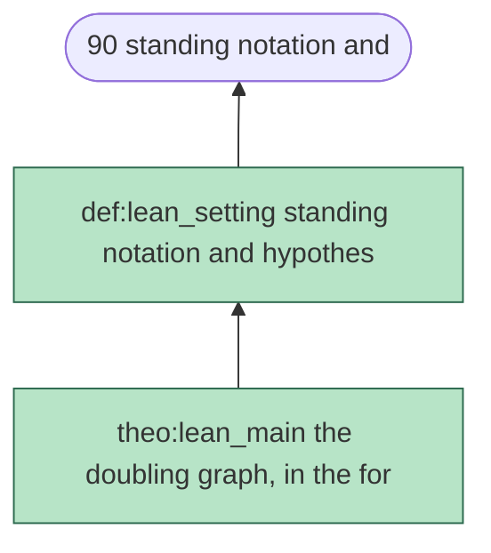

## Formalization order

The DAG, flattened dependencies-first. A statement is ready when every row above it that it depends on is closed.

**Reference cycles** — 8, broken by document order. Each is a statement pointing forward at one that points back; none is a circular proof, and `proof-checker` owns the question of whether any of them ever becomes one.

- `theo:training_speed` → `theo:db_stable_frozen` → `theo:db_stable_frozen_full` → `theo:local_convergence_full` → `theo:db_stable_frozen_full`
- `rem:tb_vs_db` → `lem:doubling_operator` → `lem:doubling_fixed_points` → `lem:doubling_operator`
- `rem:tb_vs_db` → `theo:doubling_main` → `def:doubling_setting` → `lem:doubling_range` → `def:doubling_setting`
- `rem:tb_vs_db` → `theo:doubling_main` → `def:doubling_setting` → `lem:doubling_irreducible` → `def:doubling_setting`
- `rem:tb_vs_db` → `theo:doubling_main` → `def:doubling_setting` → `prop:doubling_exponent` → `def:doubling_setting`
- `rem:tb_vs_db` → `theo:doubling_main` → `def:doubling_setting` → `lem:doubling_truncation_irreducible` → `def:doubling_setting`
- `lem:normalization` → `prop:drift_target` → `lem:normalization`
- `lem:traj_entropy` → `rem:entropic_ot` → `prop:soft_ssp` → `lem:traj_entropy`

### Ready now — every dependency is closed in Lean, and nothing is stated yet

| lvl | statement | where | deps |
|---:|---|---|---:|
| 2 | `prop:dual_floor` — dual mass floor | `app_finit.tex:26` | 1 |
| 2 | `prop:z_bound` — z-carried bound | `app_finit.tex:144` | 1 |
| 0 | `prop:overshoot` — the certificate-optimal mass overshoots, and undershoot is dearer | `app_finit.tex:180` | 0 |
| 0 | `def:buffer` — definition | `app_replay.tex:21` | 0 |
| 9 | `lem:coverage` — coverage, and its clock | `app_replay.tex:35` | 1 |
| 9 | `prop:backward_replay` — λ is the guarantee-optimal training measure, and backward replay samples it | `app_replay.tex:86` | 1 |
| 1 | `prop:stable_uniform` — stable pipeline: uniform reweighting is bound-optimal, with no tension | `app_replay.tex:131` | 1 |
| 5 | `lem:transfer` — transfer: balance loss to stable loss, exactly | `app_replay.tex:174` | 2 |
| 0 | `lem:balanced_min` — balanced points are critical in all variables | `app_pbtrain.tex:35` | 0 |
| 9 | `lem:eq10_occupation` — their Eq.~10 is the occupation identity, summed | `app_pbtrain.tex:58` | 2 |
| 7 | `prop:constants_path` — the constants along the path to minimum flow | `app_pbtrain.tex:202` | 1 |
| 0 | `prop:gap_collapse` — gap collapse at a two-component limit | `app_pbtrain.tex:249` | 0 |

