# The formalization ledger

Generated by `tools/ledger.py`; **do not edit by hand** — curated fields (`bucket`, `nl_status_override`, `decls`, `notes`) live in `ledger.json` and survive a rebuild.

Paper `RamcovGX.tex` at `unknown`; Lean `/home/maxbrain/Dropbox/LeanArticles/lean` at `2e9865c`.

**85 statements.** Natural language: 53 proved or definitional. Lean: **0 stated**, of which **0 closed** and 0 partial.

**Closure: 0 of 85.** The target is the 85 in-scope statements less the 0 terminal ones (bucket `T`, each with its reason); a row counts as done only when it is closed in Lean **in bucket A**.

## How to read a row

| column | says |
|---|---|
| **natural language** | the paper's own status, and where its proof is. `proved` — a `proof` environment discharges it here; `cited` — it is quoted from the literature; `partial` — the paper itself discloses a gap; `open` — asserted and not proved; `informal` — a remark that argues rather than proves. |
| **Lean stated** | a declaration carries the statement. `strict` — in `GX/`, where `sorry` is a compile error; `scaffold` — in `scaffold/GXScaffold/`, where it is permitted and audited. |
| **Lean proved** | **yes** — closed, no `sorry` anywhere beneath it; `partial` — some items of a multi-part statement, or a disclosed weakening; `no` — stated only. |
| **lvl** | height in the dependency DAG: 0 depends on nothing in the paper. Formalize upwards. |
| **bucket** | how far the rest is. `A` nothing left; certified in full · `B` routine on the layers already built · `C` hard --- attempted and blocked on a named obstruction · `D` deferred --- needs a layer not built, or the paper itself does not prove it · `T` terminal --- not certifiable by design; out of the closure target, with a reason |

A row is marked ⚠️ **stale** when its LaTeX changed after the Lean was written: the certificate may no longer certify the statement the paper makes.

The DAG's edges are **references**, not always logical dependencies: a statement that says *see Lemma 7* gets an edge to Lemma 7 even when it does not stand on it. That is why the graph has cycles, and why `lvl` is a reading order rather than a proof order. Where the two disagree, the proof is the authority.

## The roadmap

**In scope: 85 statements**, of which 0 are closed in Lean and 0 partial. Out of scope: 0.

### Behind an obstruction — 0 statements, in scope

`C` is attempted-and-blocked, `D` is deferred; each row's `notes` field in `ledger.json` names the obstruction.

## Where it stands, by appendix

| appendix | statements | NL proved | Lean stated | Lean closed |
|---|---:|---:|---:|---:|
| P | 85 | 53 | 0 | 0 |

## P

| lvl | statement | natural language | Lean stated | Lean proved | bucket |
|---:|---|---|---|---|---|
| 0 | **Definition** `def:spread_continuous_map_connected` — [`RamcovGX.tex:275`](RamcovGX.tex#L275) | def | — | — | — |
| 0 | **Remark** `rem:spread_open_respectively_co` — [`RamcovGX.tex:285`](RamcovGX.tex#L285) | informal | — | — | — |
| 0 | **Definition** `def:spread_ordinary_locus_set` — [`RamcovGX.tex:288`](RamcovGX.tex#L288) | def | — | — | — |
| 0 | **Remark** `rem:ordinary_locii_open_but` — [`RamcovGX.tex:291`](RamcovGX.tex#L291) | informal | — | — | — |
| 0 | **Lemma** `lem:ord_iso` — [`RamcovGX.tex:295`](RamcovGX.tex#L295) | proved — [`RamcovGX.tex:298`](RamcovGX.tex#L298) | — | — | — |
| 0 | **Definition** — Portly/skeletal subset `def:portly_skeletal_subset` — [`RamcovGX.tex:309`](RamcovGX.tex#L309) | def | — | — | — |
| 0 | **Example** `ex:skeleton_pure_dimensional_simplicial` — [`RamcovGX.tex:312`](RamcovGX.tex#L312) | open | — | — | — |
| 0 | **Definition** `def:subset_locally_connected_all` — [`RamcovGX.tex:331`](RamcovGX.tex#L331) | def | — | — | — |
| 0 | **Definition** `def:spread_consider_set_maps` — [`RamcovGX.tex:335`](RamcovGX.tex#L335) | def | — | — | — |
| 0 | **Theorem** — [MR0123298] `theo:Fox_completion_functor` — [`RamcovGX.tex:346`](RamcovGX.tex#L346) | cited — `MR0123298` | — | — | — |
| 0 | **Proposition** — [MR2198590] `prop:spread_fiber` — [`RamcovGX.tex:355`](RamcovGX.tex#L355) | proved — [`RamcovGX.tex:361`](RamcovGX.tex#L361) | — | — | — |
| 0 | **Corollary** — [MR2198590] `cor:totdiscont` — [`RamcovGX.tex:372`](RamcovGX.tex#L372) | cited — `MR2198590` | — | — | — |
| 0 | **Definition** — Automorphisms of a spread `def:automorphisms_spread` — [`RamcovGX.tex:375`](RamcovGX.tex#L375) | def | — | — | — |
| 0 | **Lemma** `lem:group_action` — [`RamcovGX.tex:381`](RamcovGX.tex#L381) | proved — [`RamcovGX.tex:385`](RamcovGX.tex#L385) | — | — | — |
| 0 | **Lemma** `lem:path_covering` — [`RamcovGX.tex:397`](RamcovGX.tex#L397) | proved — [`RamcovGX.tex:400`](RamcovGX.tex#L400) | — | — | — |
| 0 | **Definition** — Branched covering `def:branched_covering` — [`RamcovGX.tex:407`](RamcovGX.tex#L407) | def | — | — | — |
| 0 | **Remark** `rem:branching_locii_branched_covering` — [`RamcovGX.tex:413`](RamcovGX.tex#L413) | informal | — | — | — |
| 1 | **Lemma** `lem:complete_path_carac` — [`RamcovGX.tex:417`](RamcovGX.tex#L417) | proved — [`RamcovGX.tex:429`](RamcovGX.tex#L429) | — | — | — |
| 2 | **Remark** `rem:lemma_lem_complete_path` — [`RamcovGX.tex:434`](RamcovGX.tex#L434) | informal | — | — | — |
| 0 | **Lemma** `lem:spread_connected_image` — [`RamcovGX.tex:442`](RamcovGX.tex#L442) | proved — [`RamcovGX.tex:445`](RamcovGX.tex#L445) | — | — | — |
| 1 | **Lemma** — [MR2198590] `lem:branched_covering_restriction` — [`RamcovGX.tex:461`](RamcovGX.tex#L461) | proved — [`RamcovGX.tex:464`](RamcovGX.tex#L464) | — | — | — |
| 1 | **Corollary** `cor:branched_covering_portly_subset` — [`RamcovGX.tex:478`](RamcovGX.tex#L478) | proved — [`RamcovGX.tex:481`](RamcovGX.tex#L481) | — | — | — |
| 0 | **Remark** `rem:branched_covering_spread_induced` — [`RamcovGX.tex:488`](RamcovGX.tex#L488) | informal | — | — | — |
| 0 | **Remark** `rem:composition_branched_coverings_branched` — [`RamcovGX.tex:490`](RamcovGX.tex#L490) | informal | — | — | — |
| 1 | **Lemma** `rem:completion_covering` — [`RamcovGX.tex:495`](RamcovGX.tex#L495) | proved — [`RamcovGX.tex:497`](RamcovGX.tex#L497) | — | — | — |
| 0 | **Proposition** `prop:universality` — [`RamcovGX.tex:506`](RamcovGX.tex#L506) | open | — | — | — |
| 1 | **Remark** `rem:one_could_sum_up` — [`RamcovGX.tex:512`](RamcovGX.tex#L512) | proved — [`RamcovGX.tex:515`](RamcovGX.tex#L515) | — | — | — |
| 0 | **Definition** — Almost trivial loop `def:almost_trivial_loop` — [`RamcovGX.tex:531`](RamcovGX.tex#L531) | def | — | — | — |
| 0 | **Example** `ex:consider_denote_origin_fundamental` — [`RamcovGX.tex:535`](RamcovGX.tex#L535) | open | — | — | — |
| 0 | **Definition** — Almost homotopic paths `def:almost_homotopic_paths` — [`RamcovGX.tex:539`](RamcovGX.tex#L539) | def | — | — | — |
| 0 | **Remark** `rem:implicitely_two_almost_homotopic` — [`RamcovGX.tex:545`](RamcovGX.tex#L545) | informal | — | — | — |
| 0 | **Lemma** `lem:almost_homotopic_carac` — [`RamcovGX.tex:548`](RamcovGX.tex#L548) | proved — [`RamcovGX.tex:557`](RamcovGX.tex#L557) | — | — | — |
| 1 | **Lemma** `lem:hausdorff_first_countable_connected` — [`RamcovGX.tex:567`](RamcovGX.tex#L567) | proved — [`RamcovGX.tex:573`](RamcovGX.tex#L573) | — | — | — |
| 1 | **Lemma** `lem:almost_homotopic_carac2` — [`RamcovGX.tex:580`](RamcovGX.tex#L580) | proved — [`RamcovGX.tex:586`](RamcovGX.tex#L586) | — | — | — |
| 2 | **Proposition** `prop:ramified_covering_path` — [`RamcovGX.tex:597`](RamcovGX.tex#L597) | proved — [`RamcovGX.tex:604`](RamcovGX.tex#L604) | — | — | — |
| 0 | **Definition** `def:covering_branched_two_paths` — [`RamcovGX.tex:656`](RamcovGX.tex#L656) | def | — | — | — |
| 0 | **Proposition** `prop:general_fiber_path` — [`RamcovGX.tex:661`](RamcovGX.tex#L661) | open | — | — | — |
| 0 | **Proposition** `prop:general_fiber_path_universal` — [`RamcovGX.tex:670`](RamcovGX.tex#L670) | open | — | — | — |
| 1 | **Example** `ex:consider_fiber_above_homeomorphic` — [`RamcovGX.tex:680`](RamcovGX.tex#L680) | proved — [`RamcovGX.tex:682`](RamcovGX.tex#L682) | — | — | — |
| 1 | **Example** `ex:consider_denote_absolute_galois` — [`RamcovGX.tex:686`](RamcovGX.tex#L686) | proved — [`RamcovGX.tex:690`](RamcovGX.tex#L690) | — | — | — |
| 0 | **Definition** `def:branched_covering_galoisian_group` — [`RamcovGX.tex:698`](RamcovGX.tex#L698) | def | — | — | — |
| 0 | **Remark** `rem:branched_covering_galoisian_induces` — [`RamcovGX.tex:703`](RamcovGX.tex#L703) | informal | — | — | — |
| 0 | **Lemma** `lem:branched_covering_group_automorphisms` — [`RamcovGX.tex:707`](RamcovGX.tex#L707) | proved — [`RamcovGX.tex:711`](RamcovGX.tex#L711) | — | — | — |
| 0 | **Corollary** `cor:branched_covering` — [`RamcovGX.tex:714`](RamcovGX.tex#L714) | open | — | — | — |
| 0 | **Definition** `def:hausdorff_connected_locally_path` — [`RamcovGX.tex:724`](RamcovGX.tex#L724) | def | — | — | — |
| 0 | **Remark** `rem:definition_semi_locally_simply_connected` — [`RamcovGX.tex:728`](RamcovGX.tex#L728) | informal | — | — | — |
| 0 | **Remark** `rem:simple_cases` — [`RamcovGX.tex:732`](RamcovGX.tex#L732) | informal | — | — | — |
| 1 | **Lemma** `lem:dense_orbits` — [`RamcovGX.tex:744`](RamcovGX.tex#L744) | proved — [`RamcovGX.tex:747`](RamcovGX.tex#L747) | — | — | — |
| 1 | **Proposition** `cor:Galoisian_fiber` — [`RamcovGX.tex:753`](RamcovGX.tex#L753) | proved — [`RamcovGX.tex:762`](RamcovGX.tex#L762) | — | — | — |
| 0 | **Lemma** `lem:alternative_countable` — [`RamcovGX.tex:767`](RamcovGX.tex#L767) | proved — [`RamcovGX.tex:778`](RamcovGX.tex#L778) | — | — | — |
| 2 | **Proposition** `prop:Galoisian_semilocal` — [`RamcovGX.tex:793`](RamcovGX.tex#L793) | proved — [`RamcovGX.tex:802`](RamcovGX.tex#L802) | — | — | — |
| 0 | **Theorem** — Galois correspondance `theo:galois_correspondance` — [`RamcovGX.tex:831`](RamcovGX.tex#L831) | open | — | — | — |
| 0 | **Definition** `def:subset_topological_space_portly` — [`RamcovGX.tex:882`](RamcovGX.tex#L882) | def | — | — | — |
| 0 | **Definition** `def:almost_everywhere_atlas_topological` — [`RamcovGX.tex:886`](RamcovGX.tex#L886) | def | — | — | — |
| 0 | **Lemma** `lem:GX_atlas_union` — [`RamcovGX.tex:889`](RamcovGX.tex#L889) | proved — [`RamcovGX.tex:900`](RamcovGX.tex#L900) | — | — | — |
| 1 | **Corollary** `cor:maximal_atlas` — [`RamcovGX.tex:939`](RamcovGX.tex#L939) | proved — [`RamcovGX.tex:946`](RamcovGX.tex#L946) | — | — | — |
| 0 | **Definition** `def:structure_topological_space_atlas` — [`RamcovGX.tex:950`](RamcovGX.tex#L950) | def | — | — | — |
| 2 | **Definition** `def:singular_manifold_locally_connected` — [`RamcovGX.tex:953`](RamcovGX.tex#L953) | def | — | — | — |
| 0 | **Definition** — a.e.(G,X)-morphism `def:morphism` — [`RamcovGX.tex:957`](RamcovGX.tex#L957) | def | — | — | — |
| 0 | **Remark** `rem:composition_morphisms_morphisms_category` — [`RamcovGX.tex:964`](RamcovGX.tex#L964) | informal | — | — | — |
| 0 | **Remark** `rem:morphisms_analytical_two_equal` — [`RamcovGX.tex:968`](RamcovGX.tex#L968) | informal | — | — | — |
| 0 | **Remark** `prop:GX_sing_morph_local` — [`RamcovGX.tex:974`](RamcovGX.tex#L974) | informal | — | — | — |
| 0 | **Lemma** `lem:singular_manifolds_morphism_set` — [`RamcovGX.tex:984`](RamcovGX.tex#L984) | proved — [`RamcovGX.tex:991`](RamcovGX.tex#L991) | — | — | — |
| 0 | **Definition** `def:singular_manifolds_morphism_maximal` — [`RamcovGX.tex:995`](RamcovGX.tex#L995) | def | — | — | — |
| 0 | **Proposition** `prop:singular_manifold_morphism` — [`RamcovGX.tex:999`](RamcovGX.tex#L999) | proved — [`RamcovGX.tex:1003`](RamcovGX.tex#L1003) | — | — | — |
| 0 | **Proposition** `prop:GX_sing_homeo_reg` — [`RamcovGX.tex:1012`](RamcovGX.tex#L1012) | proved — [`RamcovGX.tex:1016`](RamcovGX.tex#L1016) | — | — | — |
| 0 | **Corollary** `cor:both_regular_singular_locii` — [`RamcovGX.tex:1026`](RamcovGX.tex#L1026) | open | — | — | — |
| 0 | **Remark** `rem:consequence_isomorphism_singular_manifolds` — [`RamcovGX.tex:1030`](RamcovGX.tex#L1030) | informal | — | — | — |
| 1 | **Proposition** `prop:singular_manifold_branched_covering` — [`RamcovGX.tex:1035`](RamcovGX.tex#L1035) | proved — [`RamcovGX.tex:1042`](RamcovGX.tex#L1042) | — | — | — |
| 0 | **Corollary** `cor:singular_manifold_skeletal_subset` — [`RamcovGX.tex:1053`](RamcovGX.tex#L1053) | open | — | — | — |
| 0 | **Definition** — developing map `def:developing_map` — [`RamcovGX.tex:1081`](RamcovGX.tex#L1081) | def | — | — | — |
| 0 | **Lemma** `lem:holonomy` — [`RamcovGX.tex:1096`](RamcovGX.tex#L1096) | open | — | — | — |
| 1 | **Definition** `def:quasi_galoisian_branched_covering_singular` — [`RamcovGX.tex:1103`](RamcovGX.tex#L1103) | def | — | — | — |
| 0 | **Remark** `rem:developing_map_quasi_galoisian_covering` — [`RamcovGX.tex:1106`](RamcovGX.tex#L1106) | informal | — | — | — |
| 0 | **Remark** `rem:singular_manifold_holonomy_indeed` — [`RamcovGX.tex:1110`](RamcovGX.tex#L1110) | informal | — | — | — |
| 0 | **Lemma** `lem:quasi_galoisian_branched_covering_singular` — [`RamcovGX.tex:1113`](RamcovGX.tex#L1113) | open | — | — | — |
| 2 | **Lemma** `lem:descend_developing_map` — [`RamcovGX.tex:1122`](RamcovGX.tex#L1122) | proved — [`RamcovGX.tex:1124`](RamcovGX.tex#L1124) | — | — | — |
| 3 | **Proposition** `prop:family_model_spaces_manifold` — [`RamcovGX.tex:1133`](RamcovGX.tex#L1133) | proved — [`RamcovGX.tex:1141`](RamcovGX.tex#L1141) | — | — | — |
| 0 | **Definition** — BTZ topology `defi:BTZtop` — [`RamcovGX.tex:1198`](RamcovGX.tex#L1198) | def | — | — | — |
| 0 | **Proposition** `prop:quotient_chart` — [`RamcovGX.tex:1201`](RamcovGX.tex#L1201) | proved — [`RamcovGX.tex:1204`](RamcovGX.tex#L1204) | — | — | — |
| 0 | **Proposition** `prop:manifold_admits_galoisian_universal` — [`RamcovGX.tex:1214`](RamcovGX.tex#L1214) | open | — | — | — |
| 0 | **Lemma** `lem:increasing_map` — [`RamcovGX.tex:1222`](RamcovGX.tex#L1222) | proved — [`RamcovGX.tex:1225`](RamcovGX.tex#L1225) | — | — | — |
| 0 | **Corollary** `cor:increasing_map` — [`RamcovGX.tex:1229`](RamcovGX.tex#L1229) | open | — | — | — |
| 0 | **Remark** `rem:noteworthy_though_not_usuful` — [`RamcovGX.tex:1232`](RamcovGX.tex#L1232) | informal | — | — | — |
| 1 | **Theorem** `theo:globally_hyperbolic_cauchy_complete_cauchy_maximal` — [`RamcovGX.tex:1238`](RamcovGX.tex#L1238) | proved — [`RamcovGX.tex:1252`](RamcovGX.tex#L1252) | — | — | — |

dependency graph — P

```mermaid
graph BT
  n0["def:spread_continuous_map_connected spread continuous map connecte"]
  n1["rem:spread_open_respectively_co spread open respectively co"]
  n2["def:spread_ordinary_locus_set spread ordinary locus set"]
  n3["rem:ordinary_locii_open_but ordinary locii open but"]
  n4["lem:ord_iso ord iso"]
  n5["def:portly_skeletal_subset Portly/skeletal subset"]
  n6["ex:skeleton_pure_dimensional_simplicial skeleton pure dimensional simp"]
  n7["def:subset_locally_connected_all subset locally connected all"]
  n8["def:spread_consider_set_maps spread consider set maps"]
  n9["theo:Fox_completion_functor [MR0123298]"]
  n10["prop:spread_fiber [MR2198590]"]
  n11["cor:totdiscont [MR2198590]"]
  n12["def:automorphisms_spread Automorphisms of a spread"]
  n13["lem:group_action group action"]
  n14["lem:path_covering path covering"]
  n15["def:branched_covering Branched covering"]
  n16["rem:branching_locii_branched_covering branching locii branched cover"]
  n17["lem:complete_path_carac complete path carac"]
  n18["rem:lemma_lem_complete_path lemma lem complete path"]
  n19["lem:spread_connected_image spread connected image"]
  n20["lem:branched_covering_restriction [MR2198590]"]
  n21["cor:branched_covering_portly_subset branched covering portly subse"]
  n22["rem:branched_covering_spread_induced branched covering spread induc"]
  n23["rem:composition_branched_coverings_branched composition branched coverings"]
  n24["rem:completion_covering completion covering"]
  n25["prop:universality universality"]
  n26["rem:one_could_sum_up one could sum up"]
  n27["def:almost_trivial_loop Almost trivial loop"]
  n28["ex:consider_denote_origin_fundamental consider denote origin fundame"]
  n29["def:almost_homotopic_paths Almost homotopic paths"]
  n30["rem:implicitely_two_almost_homotopic implicitely two almost homotop"]
  n31["lem:almost_homotopic_carac almost homotopic carac"]
  n32["lem:hausdorff_first_countable_connected hausdorff first countable conn"]
  n33["lem:almost_homotopic_carac2 almost homotopic carac2"]
  n34["prop:ramified_covering_path ramified covering path"]
  n35["def:covering_branched_two_paths covering branched two paths"]
  n36["prop:general_fiber_path general fiber path"]
  n37["prop:general_fiber_path_universal general fiber path universal"]
  n38["ex:consider_fiber_above_homeomorphic consider fiber above homeomorp"]
  n39["ex:consider_denote_absolute_galois consider denote absolute galoi"]
  n40["def:branched_covering_galoisian_group branched covering galoisian gr"]
  n41["rem:branched_covering_galoisian_induces branched covering galoisian in"]
  n42["lem:branched_covering_group_automorphisms branched covering group automo"]
  n43["cor:branched_covering branched covering"]
  n44["def:hausdorff_connected_locally_path hausdorff connected locally pa"]
  n45["rem:definition_semi_locally_simply_connected definition semi locally simply"]
  n46["rem:simple_cases simple cases"]
  n47["lem:dense_orbits dense orbits"]
  n48["cor:Galoisian_fiber Galoisian fiber"]
  n49["lem:alternative_countable alternative countable"]
  n50["prop:Galoisian_semilocal Galoisian semilocal"]
  n51["theo:galois_correspondance Galois correspondance"]
  n52["def:subset_topological_space_portly subset topological space portl"]
  n53["def:almost_everywhere_atlas_topological almost everywhere atlas topolo"]
  n54["lem:GX_atlas_union GX atlas union"]
  n55["cor:maximal_atlas maximal atlas"]
  n56["def:structure_topological_space_atlas structure topological space at"]
  n57["def:singular_manifold_locally_connected singular manifold locally conn"]
  n58["def:morphism a.e.(G,X)-morphism"]
  n59["rem:composition_morphisms_morphisms_category composition morphisms morphism"]
  n60["rem:morphisms_analytical_two_equal morphisms analytical two equal"]
  n61["prop:GX_sing_morph_local GX sing morph local"]
  n62["lem:singular_manifolds_morphism_set singular manifolds morphism se"]
  n63["def:singular_manifolds_morphism_maximal singular manifolds morphism ma"]
  n64["prop:singular_manifold_morphism singular manifold morphism"]
  n65["prop:GX_sing_homeo_reg GX sing homeo reg"]
  n66["cor:both_regular_singular_locii both regular singular locii"]
  n67["rem:consequence_isomorphism_singular_manifolds consequence isomorphism singul"]
  n68["prop:singular_manifold_branched_covering singular manifold branched cov"]
  n69["cor:singular_manifold_skeletal_subset singular manifold skeletal sub"]
  n70["def:developing_map developing map"]
  n71["lem:holonomy holonomy"]
  n72["def:quasi_galoisian_branched_covering_singular quasi galoisian branched cover"]
  n73["rem:developing_map_quasi_galoisian_covering developing map quasi galoisian"]
  n74["rem:singular_manifold_holonomy_indeed singular manifold holonomy ind"]
  n75["lem:quasi_galoisian_branched_covering_singular quasi galoisian branched cover"]
  n76["lem:descend_developing_map descend developing map"]
  n77["prop:family_model_spaces_manifold family model spaces manifold"]
  n78["defi:BTZtop BTZ topology"]
  n79["prop:quotient_chart quotient chart"]
  n80["prop:manifold_admits_galoisian_universal manifold admits galoisian univ"]
  n81["lem:increasing_map increasing map"]
  n82["cor:increasing_map increasing map"]
  n83["rem:noteworthy_though_not_usuful noteworthy though not usuful"]
  n84["theo:globally_hyperbolic_cauchy_complete_cauchy_maximal globally hyperbolic cauchy com"]
  n17 --> n14
  n18 --> n17
  n20 --> n19
  n21 --> n19
  n24 --> n9
  n26 --> n9
  n32 --> n31
  n33 --> n19
  n34 --> n33
  n38 --> n37
  n39 --> n36
  n47 --> n10
  n48 --> n10
  n50 --> n47
  n50 --> n49
  n50 --> n17
  n50 --> n19
  n55 --> n54
  n57 --> n55
  n68 --> n65
  n72 --> n71
  n76 --> n47
  n76 --> n19
  n77 --> n20
  n77 --> n25
  n77 --> n9
  n77 --> n76
  n84 --> n82
  classDef done fill:#b7e4c7,stroke:#2d6a4f;
  classDef part fill:#ffe08a,stroke:#b07d00;
  classDef scaf fill:#ffd6a5,stroke:#b35c00;
```

## Formalization order

The DAG, flattened dependencies-first. A statement is ready when every row above it that it depends on is closed.

### Ready now — every dependency is closed in Lean, and nothing is stated yet

| lvl | statement | where | deps |
|---:|---|---|---:|
| 0 | `def:spread_continuous_map_connected` — definition | `RamcovGX.tex:275` | 0 |
| 0 | `def:spread_ordinary_locus_set` — definition | `RamcovGX.tex:288` | 0 |
| 0 | `lem:ord_iso` — lemma | `RamcovGX.tex:295` | 0 |
| 0 | `def:portly_skeletal_subset` — Portly/skeletal subset | `RamcovGX.tex:309` | 0 |
| 0 | `def:subset_locally_connected_all` — definition | `RamcovGX.tex:331` | 0 |
| 0 | `def:spread_consider_set_maps` — definition | `RamcovGX.tex:335` | 0 |
| 0 | `theo:Fox_completion_functor` — [MR0123298] | `RamcovGX.tex:346` | 0 |
| 0 | `prop:spread_fiber` — [MR2198590] | `RamcovGX.tex:355` | 0 |
| 0 | `cor:totdiscont` — [MR2198590] | `RamcovGX.tex:372` | 0 |
| 0 | `def:automorphisms_spread` — Automorphisms of a spread | `RamcovGX.tex:375` | 0 |
| 0 | `lem:group_action` — lemma | `RamcovGX.tex:381` | 0 |
| 0 | `lem:path_covering` — lemma | `RamcovGX.tex:397` | 0 |
| 0 | `def:branched_covering` — Branched covering | `RamcovGX.tex:407` | 0 |
| 0 | `lem:spread_connected_image` — lemma | `RamcovGX.tex:442` | 0 |
| 0 | `def:almost_trivial_loop` — Almost trivial loop | `RamcovGX.tex:531` | 0 |
| 0 | `def:almost_homotopic_paths` — Almost homotopic paths | `RamcovGX.tex:539` | 0 |
| 0 | `lem:almost_homotopic_carac` — lemma | `RamcovGX.tex:548` | 0 |
| 0 | `def:covering_branched_two_paths` — definition | `RamcovGX.tex:656` | 0 |
| 0 | `def:branched_covering_galoisian_group` — definition | `RamcovGX.tex:698` | 0 |
| 0 | `lem:branched_covering_group_automorphisms` — lemma | `RamcovGX.tex:707` | 0 |
| 0 | `def:hausdorff_connected_locally_path` — definition | `RamcovGX.tex:724` | 0 |
| 0 | `lem:alternative_countable` — lemma | `RamcovGX.tex:767` | 0 |
| 0 | `def:subset_topological_space_portly` — definition | `RamcovGX.tex:882` | 0 |
| 0 | `def:almost_everywhere_atlas_topological` — definition | `RamcovGX.tex:886` | 0 |
| 0 | `lem:GX_atlas_union` — lemma | `RamcovGX.tex:889` | 0 |
| 0 | `def:structure_topological_space_atlas` — definition | `RamcovGX.tex:950` | 0 |
| 0 | `def:morphism` — a.e.(G,X)-morphism | `RamcovGX.tex:957` | 0 |
| 0 | `lem:singular_manifolds_morphism_set` — lemma | `RamcovGX.tex:984` | 0 |
| 0 | `def:singular_manifolds_morphism_maximal` — definition | `RamcovGX.tex:995` | 0 |
| 0 | `prop:singular_manifold_morphism` — proposition | `RamcovGX.tex:999` | 0 |
| 0 | `prop:GX_sing_homeo_reg` — proposition | `RamcovGX.tex:1012` | 0 |
| 0 | `def:developing_map` — developing map | `RamcovGX.tex:1081` | 0 |
| 0 | `defi:BTZtop` — BTZ topology | `RamcovGX.tex:1198` | 0 |
| 0 | `prop:quotient_chart` — proposition | `RamcovGX.tex:1201` | 0 |
| 0 | `lem:increasing_map` — lemma | `RamcovGX.tex:1222` | 0 |

