# The formalization ledger

Generated by `tools/ledger.py`; **do not edit by hand** — curated fields (`bucket`, `nl_status_override`, `decls`, `notes`) live in `ledger.json` and survive a rebuild.

Paper `RamcovGX.tex` at `snapshot`; Lean `/home/maxbrain/Dropbox/LeanArticles/lean-gx` at `4628a29`.

**162 statements.** Natural language: 90 proved or definitional. Lean: **132 stated**, of which **108 closed** and 11 partial.

**Closure: 108 of 149.** The target is the 162 in-scope statements less the 13 terminal ones (bucket `T`, each with its reason); a row counts as done only when it is closed in Lean **in bucket A**.

## How to read a row

| column | says |
|---|---|
| **natural language** | the paper's own status, and where its proof is. `proved` — a `proof` environment discharges it here; `cited` — it is quoted from the literature; `partial` — the paper itself discloses a gap; `open` — asserted and not proved; `informal` — a remark that argues rather than proves. |
| **Lean stated** | a declaration carries the statement. `strict` — in `GX/`, where `sorry` is a compile error; `scaffold` — in `scaffold/GXScaffold/`, where it is permitted and audited. |
| **Lean proved** | **yes** — closed, no `sorry` anywhere beneath it; `partial` — some items of a multi-part statement, or a disclosed weakening; `no` — stated only. |
| **lvl** | height in the dependency DAG: 0 depends on nothing in the paper. Formalize upwards. |
| **bucket** | how far the rest is. `A` nothing left; certified in full · `B` routine on the layers already built · `C` hard --- attempted and blocked on a named obstruction · `D` deferred --- needs a layer not built, or the paper itself does not prove it · `T` terminal --- not certifiable by design; out of the closure target, with a reason |

A row is marked ⚠️ **stale** when its LaTeX changed after the Lean was written: the certificate may no longer certify the statement the paper makes.

The DAG's edges are **references**, not always logical dependencies: a statement that says *see Lemma 7* gets an edge to Lemma 7 even when it does not stand on it. That is why the graph has cycles, and why `lvl` is a reading order rather than a proof order. Where the two disagree, the proof is the authority.

## What formalizing found in the paper

Formalizing is a proof-reading pass with a machine holding the pen. These are the places where writing the Lean turned up something about the **paper** — a hypothesis used but not stated, a constant that needs a side condition, a step that does not go through as written. None is a refutation; each is a sentence the author may want to change. Entries marked **APPLIED** were applied through `/writer` on the date given; the rest are the author's call, and edits to the `.tex` go through `/writer`.

### `ex:conical` — example

*RamcovGX.tex:347*

- l.347, printed slip (DEC-47 reads angle α): with θ ∈ R/Z the metric dz²+dr²+α r² dθ² has cone angle √α (a circle r = r0 has length √α·r0), not α. Lean witness: read as the cone C_{√α}, its apex is Euclidean iff α = 4π² and NOT Euclidean at the paper's α = 2π (GX.conical_printed_metric, GX.conical_printed_metric_two_pi), against 'cannot be extended … except for α = 2π'. The rest of the example (holonomy = rotation of angle α) and ex:consider_identifying need angle α, i.e. α² r² dθ² on R/Z (or r² dθ² on R/αZ). The corrected object is built: E^n_α = C_α × R^{n-2} (GX.ConicalSpace, ℓ²), C_α ported from lean-causal, proper and geodesic, C_2π ≅ ℂ, apex not Euclidean for α ≠ 2π; its metric topology is the quotient topology of Γ_1\(D_inf × R^{n-2}) (GX.conicalMetricHomeo) and it is Euclidean along the developing map on {r>0} (GX.conical_locally_euclidean_prod).
- l.350–351: the holonomy is offered by the paper only as 'an obstruction', and it is one only for α ∉ 2πN*: for α ∈ 2πN*, α ≠ 2π, the holonomy is trivial and does not obstruct, so the argument as written does not cover those angles. The claim itself is true there as well (the developing map is k-to-1 around the axis, so no chart covers it): GX.conical proves support = univ ↔ α = 2π, and the whole axis singular for α ≠ 2π. The metric side agrees: Cone.apex_not_euclidean for every α ≠ 2π (GX.conical_metric).

### `ex:following_example_skeletal_itemize` — example

*RamcovGX.tex:367*

- Item 3 (l.372) is false as written: the bow-tie (two triangles sharing a vertex) is a pure 2-complex whose 0-skeleton is not skeletal (GX.bowtie_counterexample, pre-existing). With local strong connectivity in codimension >= 2 added, the corrected statement is now proved in full (no sorry).

### `lem:GX_atlas_union` — lemma

*RamcovGX.tex:412*

- l.412-418: for an empty family the union is the empty atlas, not an a.e. atlas on a nonempty space (GX.not_isAEAtlas_iUnion_empty); the statement needs K nonempty, the reading DEC-46 (a) accepts.

### `cor:locally_connected_hausdorff_topological` — corollary

*RamcovGX.tex:558*

- l.558-561: the corollary states no hypothesis under which the pullbacks of def:notations_lemma_lem_aepullback are defined; read with g^*A, f^*g^*A defined (DEC-46 (c)).

### `ex:consider_identifying_point_wise_stabilizer` — example

*RamcovGX.tex:629*

- l.635 'as a metric space Γ\M ≅ E^n_{2π/p}' holds with the cone angle of ex:conical read as α (DEC-47; with the printed metric the angle would be √(2π/p) and the claim false); proved for every n.
- l.637 read as ruled by DEC-54(a); the row closes under it.

### `prop:GXquotient` — proposition

*RamcovGX.tex:639*

- l.639 is false as written: a free, properly discontinuous action by homeomorphisms that are not (G,X)-morphisms admits NO structure on the quotient making the projection a (G,X)-morphism. Counterexample GX.gxQuotient_counterexample: Z/2 acting on the (translations of R)-manifold R ⊕ R by inl x ↦ inr 2x, inr x ↦ inl x/2 (free, properly discontinuous in the full reading IsProperlyDiscontinuous, continuous; ℝ ⊕ ℝ a (G,X)-manifold, all certified as conjuncts); no charted structure at all on the quotient makes the projection a (G,X)-morphism. Corrected form GX.gxQuotient adds 'by (G,X)-morphisms' (which prop:aeGXquotient does state). DEC-51 rules the reading; the row closes under it, the missing hypothesis recorded.

### `prop:aeGXquotient` — proposition

*RamcovGX.tex:642*

- l.647 'By assumption, the quotient is Hausdorff': Hausdorffness of Gamma\M does not follow from the neighbourhood form of proper discontinuity alone (free wandering actions with non-Hausdorff quotients exist); it needs the separating form (IsProperlyDiscontinuous.separates, or local compactness with mathlib's definition). The structure itself needs neither Hausdorffness nor invariance of U.

### `ex:quotient_base` — example

*RamcovGX.tex:660*

- l.667 'Its singular locus is sing(M) = {r=0}' is false in general: GX.quotientBase_counterexample (alpha = 2π, X = C, G = translations, D(r,θ) = r e^{iθ}, every hypothesis of the example) has EMPTY singular locus while {r=0} is the apex. True: sing(M) ⊆ π{r=0} (GX.quotientBase_sing_subset).
- l.664–667 dimension slip: cyl{n} := D_inf × R^n is (n+2)-dimensional and is said to have a local homeomorphism {r>0} → X ⊆ R^n and a quotient homeomorphic to R^n; read cyl{n} = D_inf × R^{n-2} (the Minkowski case uses (r,θ,z), z ∈ R, X = R^3), or the quotient as R^{n+2}. Formalized for D_inf × Z, with M ≅ C × Z (GX.cylHomeomorph).
- l.673 (massive particle), printed slip (DEC-47): with D(r,θ,z) = (z+σθ/α, r cos(θ/α), r sin(θ/α)) the deck generator θ ↦ θ+α of Γ_α acts by D ↦ (time translation by σ) ∘ (rotation of angle 1 radian), whatever α (GX.massiveDev_smul with c = 1/α). The cone angle is therefore 1 and the mass 1 − 1/2π, not m = 1 − α/2π, unless α = 1. The intended D = (z+σθ/α, r cos θ, r sin θ) (DEC-47) is GX.massive_particle_intended: angle α.
- l.674–678 (extreme BTZ white hole): formalized in the paper's generality (GX.btz_whitehole_isom0: every x0, future lightlike u, <v|u> < 0, G = Isom_0); D is even a homeomorphism of {r>0} onto a half-space, holonomy P_α.
- l.678, printed slip (DEC-47): 'Choosing D'(r,θ,t) = D(r,θ,−t) gives an extreme BTZ blackhole instead' — D' = D ∘ T with T(r,θ,t) = (r,θ,−t) a Γ_α-equivariant homeomorphism of the cylinder, so the printed black hole is isomorphic, as a singular (G,X)-manifold, to the white hole (GX.btz_blackhole_iso_whitehole, GX.btz_blackhole_isom0). The intended black hole takes u past lightlike (DEC-47): GX.btz_blackhole_past_isom0, which develops {r>0} into the past side of the null plane through the singular line, where the white hole develops into the future side (GX.btzDevGen_future_side).
- l.679 (Misner/BTZ variations, u spacelike): 'v spacelike' does not suffice: for u = (0,0,1) and the spacelike v = (1,0,1) (null coordinates, Q(v) = 1) the image of D lies in a plane, so D is not a local homeomorphism (GX.misnerDev_spacelike_counterexample). Needed: v not in the plane spanned by u and one null eigendirection of the boosts (v_a v_b ≠ 0), automatic for timelike v. Formalized with that condition (GX.misner_btz, GX.misner_isom0).
- l.679 (variations): the condition on v, stated intrinsically, is: ⟨v|w⟩ ≠ 0 for every nonzero null w ⊥ u (v off the two null planes spanned by u and a null eigenline of the boosts); automatic for timelike v (GX.misner_isom0_general, first disjunct), and 'v spacelike' alone allows a degenerate D (GX.misnerDev_spacelike_counterexample).
- STATUS: closed under DEC-52 (sing(M) ⊆ π{r=0}; <v|w> != 0 for every nonzero null w ⊥ u) and DEC-47 (massive particle (r cos θ, r sin θ); past lightlike u for the black hole); the printed forms stay recorded as findings with their counterexamples. The dimension slip (cyl{n} = D_inf × R^n homeomorphic to R^n) is absorbed by the generality in Z (M ≅ ℂ × Z, GX.cylHomeomorph).
- l.682 (tachyons, photons) and l.684 (polyhedral gluings) are informal remarks, not formalized (SCOPE (c)): no developing map, no element of PSL(2,R) nor which lift to the universal cover of RP^1 generates Γ (a lift fixing a lift of a fixed point acts on {r>0} with fixed points, the other lifts freely, so the choice decides freeness), 'tachyon'/'photon' undefined in the paper; no polyhedra or gluing maps given for l.684.

### `rem:previous_examples_instances_developing` — remark

*RamcovGX.tex:684*

- l.685 'branched over its singular locus' is false as printed: the branching locus is exactly π{r=0} (GX.branchingLocus_orbitMk_cyl) and can strictly contain sing(M) (GX.quotientBase_counterexample, α = 2π, sing(M) = ∅). DEC-52's corrected form 'branched over π{r=0} ⊇ sing(M)' is proved in full by GX.previous_examples_instances_developing_ruled; the certificate spans GX.Branched.Universality and GX.Singular.Quotient.

### `cex:topology_chose_same_quotient` — counterexample

*RamcovGX.tex:722*

- l.723: the neighbourhoods are written U_f := {(x,r) | r < f(r)}; it should read r < f(x).
- l.725: g(n) := ½ min(f_k : k ≤ n) should read ½ min(f_k(n) : k ≤ n), and the proof does not say how g is made continuous nor why the U_f form a basis; the Lean proof bypasses both with the locally finite closed set ⋃_n {n} × [t_n, ∞[ (t_n > 0 chosen inside the n-th basic neighbourhood).

### `prop:susp_portly` — proposition

*RamcovGX.tex:745*

- l.774: the proof's lower-semicontinuity step uses 'since Σ is first countable', which is not a hypothesis of prop:susp_portly (l.745). The statement is nevertheless true without it: the Lean proof (local connectedness criterion, GX.isPreconnected_of_local) needs at O only the ball {r < ε} ⊆ W, whose trace on susp(U)∖O is π(U × ]0,ε[), connected because U is (Σ connected, U portly). Neither first countability nor the function f nor lem:connected_union is needed for the paper's topology.

### `lem:connected_union` — lemma

*RamcovGX.tex:749*

- l.752: 'The ⋃ U_i is connected' — typo for 'Then'. The paper omits the proof; it is proved here from mathlib's IsPreconnected.transGen_of_iUnion and IsConnected.iUnion_of_reflTransGen.

### `rem:proof_above_works_quotient` — remark

*RamcovGX.tex:784*

- For the quotient topology the apex step is genuinely different (a quotient neighbourhood of O need not contain a ball): the Lean proof uses the tube neighbourhood π(⋃_σ B_σ × [0,δ_σ[) with B_σ connected open and chains the pieces π((B_σ ∩ U) × ]0,δ_σ[) by lem:connected_union-style reflexive-transitive chaining over the connected Σ — so lem:connected_union is where the quotient version needs it; still no first countability.

### `rem:ordinary_locii_open_but` — remark

*RamcovGX.tex:843*

- Under DEC-40 the restriction ord(X) → ord(Y) is ALWAYS a surjective covering map over a locally connected source (GX.isCoveringMap_surjective_restrict_ordX), connected or not. This proves the positive reading of 'the only obstruction ... is the connectedness of ord(X)' (connected ord(X) ⇒ covering) in a stronger form. The negative reading (a disconnected ord(X) prevents a covering) is FALSE under DEC-40: GX.abs_ordX_not_isPreconnected_covering (x ↦ |x|, ord(X) = ℝ ∖ 0 disconnected, restriction still a surjective covering map). GX.isCoveringMap_restrict_ordX_connected_iff only restates the remark for a connected total space; its docstring now says so.

### `lem:spread_partial_covering` — lemma

*RamcovGX.tex:851*

- Surjectivity of the covering is used for Y₁ ⊆ ord(Y): for a covering map in mathlib's sense (possibly non-surjective) one gets p(X₁) ⊆ ord(Y), X₁ ⊆ ord(X), p⁻¹(Y₁) = X₁ (GX.spread_partial_covering'), and Y₁ ⊆ ord(Y) fails for unitTrue : Unit → Bool, X₁ = Unit, Y₁ = Bool (GX.spread_partial_covering_surjective_needed). Consistent with DEC-40's 'covering = surjective covering map'.
- Necessity of portlyness (density) is now witnessed with every other hypothesis of the Lean statement, including T2Space and LocallyConnectedSpace X (even LocPathConnectedSpace, second countable) and X₁ locally connected in X: GX.cex_portlyness_paper.

### `cex:portlyness` — Portlyness of X_1

*RamcovGX.tex:874*

- Item 2 is proved as written for the paper's own space, with every listed property (GX.cex_portlyness_paper): the topology generated by the subspace components of X ∩ U (GX.portlyTop) makes the injection a spread (GX.isSpread_portlyι) and is the coarsest such topology (GX.le_portlyTop_of_isSpread: every topology making the injection a spread is finer), so the paper's 'coarsest topology' exists and is this one; X is Hausdorff, second countable, locally path-connected; the inner rays are homeomorphic to ∐_ℕ (0,1); p is a spread; X₁ = Y₁ open, X₁ locally connected in X (GX.IsLocallyConnectedIn), X₁ → Y₁ a homeomorphism; ord(Y) = ord(X) = ∅. Since LocallyConnectedSpace and T2Space hold, the example refutes the density-free form of the Lean lem:spread_partial_covering exactly as the paper intends.
- The read-only audit's suggested route (subspace components of X ∩ U are portlyTop-connected) is FALSE for this X: for U = ℝ² ∖ {μu} (u a rational unit vector, 0 < μ < 1) the segment (0,μ)u lies in the subspace closure of the rest of X ∩ U, so X ∩ U is subspace-connected, but the segment is clopen for portlyTop. The proofs avoid this: local path-connectedness from explicit bases (Euclidean balls off the disc, ray segments, truncated cones GX.portlyCone at circle points), then 'spread' from local connectedness. The counterexample to the audit's route is recorded in SCOPE as prose, not formalized.
- Item 1 now has a cheap inhabitant (GX.cex_portlyness_fst): p = Prod.fst : ℝ² → ℝ, X₁ = ℝ × {0} (not open), Y₁ = ℝ; X₁ → Y₁ a homeomorphism (surjective covering map) and (0,0) ∉ ord(X), 0 ∉ ord(Y).

### `theo:Fox_completion_functor` — [MR0123298]

*RamcovGX.tex:914*

- l.915 existence is false as written: the inclusion of ℂ ∖ {1/(n+1)} into ℂ is a spread (Hausdorff, second countable, locally path-connected source, GX.locPathConnectedSpace_compl_countable) with NO completion in the paper's sense (GX.not_exists_isSpreadCompletion_foxSeq; in every universe: GX.not_isSpreadCompletion_foxSeq, and in general GX.not_isSpreadCompletion_of_not_isOpen): by uniqueness every completion is id_ℂ, and the image ℂ ∖ {1/(n+1)} is not open (0 is a limit of removed points). What is true: Fox's completion (space of ends) always exists with a dense, locally-connected-in image (Fox's own notion; IsFoxCompletion), and it is a completion in the paper's sense iff that image is open (GX.exists_isSpreadCompletion_iff) — e.g. when p lands in an open subset of its ordinary locus (the completion of a covering of a portly subset, the case l.1147/l.1170/l.1439 use).
- l.915 uniqueness holds, in the strong form: any two completions (even in Fox's sense) are isomorphic by a UNIQUE homeomorphism over Y and under X (GX.IsFoxCompletion.existsUnique_homeomorph).
- l.915 'fully faithful' is false (as the 2021 draft): the completion functor is faithful but not full (GX.not_full_foxCompletionFunctor: ℂ∖{0} and ℂ∖{1} both complete to ℂ, and the identity between the completions extends no morphism ℂ∖{0} → ℂ∖{1}; also GX.completion_not_full for the paper's completions id_ℂ). What l.1170 and l.1439 actually use is true and proved: every spread morphism (f, g) extends uniquely and continuously to the completions (GX.SpreadEnd.map, GX.SpreadEnd.eq_map), functorially (map_id, map_comp), and the extension determines g (map_injective); the same holds between ARBITRARY completions (Fox's or the paper's), as l.1170/l.1439 use it (GX.IsFoxCompletion.existsUnique_extend: a unique continuous ḡ with p₂'∘ḡ = f∘p₁' and ḡ∘ι₁ = ι₂∘g).
- Local path-connectedness of the completion (needed for 'completion is a functor from Spread to itself' under the §3 standing assumptions, and used by lem:complete_path_carac l.1033 via lem:path_covering on the completion) is proved: GX.SpreadEnd.locPathConnectedSpace (paths to an end are infinite concatenations through e(W_n), W_n a decreasing basis at the base).

### `prop:spread_fiber` — [MR2198590]

*RamcovGX.tex:924*

- l.928 'injective open': injective and an embedding (open onto its image) is proved (GX.isEmbedding_fiberMap); the literal 'open map into the inverse limit' is equivalent to the image being open (GX.isOpenMap_fiberMap_iff) and is FALSE, proved by GX.not_isOpenMap_fiberMap_comb: X = GX.combSet ⊆ ℝ², the x-axis with the arms {(t, r_n − t) : 0 < t ≤ r_n}, r_n = 2⁻ⁿ (Hausdorff, second countable, locally path-connected — instance), p = first projection (a spread, GX.isSpread_combProj), b = 0, 𝓤 = {(−ρ, ρ)}: p⁻¹(0) is the origin, and the arm-n thread (GX.combThread) agrees with the origin's on every (−ρ, ρ) with ρ > r_n (combThread_eq_of_lt) but is unrealised (combThread_ne), so every cylinder around φ(origin) leaves the image. The proof's identity φ(V ∩ p⁻¹(b)) = π_U⁻¹(V) (l.940) holds only when every thread through V is realised.
- l.929 'homeomorphism iff complete' is false for a fixed b: exp : ℝ → ℝ at b = 1 has the natural map a homeomorphism for every basis while exp is not complete (GX.fiberMap_exp_bijective_not_complete). True forms: for fixed b, onto iff every thread (equivalently every end at b) has a point (surjective_fiberMap_iff_threads, surjective_fiberMap_iff_ends); complete iff onto for every b and every basis (GX.isCompleteSpread_iff_forall_surjective_fiberMap), equivalently for one basis at each b (GX.isCompleteSpread_iff_forall_exists_surjective_fiberMap), and then a homeomorphism (GX.fiberHomeomorph).

### `lem:complete_path_carac` — lemma

*RamcovGX.tex:1014*

- l.1031: the proof applies lem:path_covering in Y, which needs Y connected, but the lemma does not assume Y connected. It follows (Y1 is dense and lies in p(X), which is connected since X is), so the statement is true; the proof should say so.
- l.1032-1033: the proof embeds X in 'the completion' X̄ with X portly in X̄; by WP-25c a completion in the paper's sense need not exist (theo:Fox_completion_functor existence is false in general). The argument is repaired with Fox's space of ends, in which only the image of X1 = p^{-1}(Y1) needs to be portly; it is, being base^{-1}(Y1) (ends over ordinary points are realised).

### `prop:branched_covering_composition` — proposition

*RamcovGX.tex:1091*

- unchanged; stays partial by DEC-48

### `rem:completion_covering` — lemma

*RamcovGX.tex:1147*

- unchanged by WP-27c

### `prop:universality` — proposition

*RamcovGX.tex:1158*

- unchanged by WP-27c

### `rem:one_could_sum_up` — remark

*RamcovGX.tex:1164*

- unchanged by WP-27c (DEC-46(d))

### `rem:considering_maximal_covering_possibly` — remark

*RamcovGX.tex:1176*

- unchanged by WP-27c

### `cex:proposition_prop_branched_covering` — to Proposition prop:branched_covering_composition

*RamcovGX.tex:1181*

- l.1184 'S is skeletal' is false: the apex is in the closure of S (GX.cexS_not_isSkeletal); with S ∪ {apex} (DEC-53) the counterexample holds in full (GX.cex_branched_covering_composition). The row closes under DEC-53, the correction recorded. 'Y∖S semilocally simply connected' for the printed S (also false at the apex) is not formalized; it is superseded by the ruled S ∪ {apex}.
- l.1186: 'q(Y∖ord_p(Y)) = q(S)' is false as printed. The branching locus Y∖ord_p(Y) is closed (ord_p open) and contains S, hence the apex (in the closure of S); with branchingLocus ⊆ S ∪ {apex} it is exactly S ∪ {apex}, so q(Y∖ord_p(Y)) = q(S) ∪ {0} ≠ q(S) (0 ∉ q(S) since r_n > 0). The equality holds with S ∪ {apex} in place of S (DEC-53); the density argument and the conclusion are unaffected. Proved in GX.cex_branched_covering_composition (conjuncts branchingLocus = insert apex S, q-image = insert 0 (q '' S), q-image ≠ q '' S).

### `def:almost_trivial_loop` — Almost trivial loop

*RamcovGX.tex:1210*

- l.1201 calls 'same connected component of the compact-open Omega(x,y,U)' and 'homotopic with respect to U' equivalent. Homotopic => same component holds in general (GX.OmegaHomotopic.mem_connectedComponentIn); for almost triviality the converse is proved when U is open and semilocally simply connected and X locally path-connected (GX.almostTrivialCC_iff: for each open V the set of loops homotopic w.r.t. U to a loop of Omega(x,x,V cap U) is clopen in Omega(x,x,U), being decided by the middle of the loop, whose compact-open perturbations are homotopies in U up to short end connections, by homotopy lifting in the universal cover of U). Without semilocal simple connectivity of U the 'equivalently' is not established (the clopen argument needs it: without it a compact-open perturbation of the middle of a loop need not be homotopic to it; no counterexample to the 'equivalently' is proved).

### `ex:consider_carthesian_coordinates_usual` — example

*RamcovGX.tex:1214*

- l.1216: S2 is printed as {y = sin(1/x)} union a segment, which in R^3 is a surface (z free); read with z = 0 on the graph (the planar topologist's sine curve), as the proof's 'plane {z=0}' and claim 1 require
- l.1243-1244: H'(s,t) = (0, lambda_s t, 0) lies on the segment of S2; with gamma(t) = (0,0,t) near the ends it should read (0, 0, lambda_s t) and (0, 0, -lambda_s t)
- l.1218: 'The isomorphism is given by the number of turns around S_i' — for S1 this is GX.cartDeg (winding of y + iz), proved bijective
- l.1229-1257 (fourth claim): the mod 2 intersection numbers can be replaced by windings around 0 of psi + i z, psi a signed distance to the planar curve P: globally psi > 0 above P; locally psi* > 0 only on the finitely many pockets of A+ met at an intermediate time (they are cut off at x = 1/(pi/2 + 2 pi k) and x = -1/(3 pi/2 + 2 pi k), where sin(1/x) = 1). The winding of psi + i z along the reparametrised homotopy stays -pi, that of psi* + i z is +pi near the end of the homotopy, and the two agree at the intermediate time. Formalized as GX.not_isHomTrivial_cartγ for the loop t -> (0, 4 sin^2(pi t), sin(pi t) cos(pi t)) (it leaves O upwards over the limit segment, crosses z = 0 once at (0,4,0) in A+, and returns from below); the paper's normalisation through c (l.1236-1241) is replaced by an explicit frame reparametrisation (GX.cartM).
- l.1222: the paper's loop 'gamma(t) = (0,0,t) for t < 1/4' is not needed; any loop leaving O over the limit segment and crossing the plane only in A+ works
- l.1218, l.1224 ('left to the reader', first claim for S2): proof supplied by an explicit homotopy equivalence R^3 minus S2 ~ R^3 minus S1 (GX.cartHE): (x,y,z) -> (x, y + 2s psi/(|psi|+|z|), z) pushes the plane points above/below P off the strip R x [-1,1] x {0}, and the radial expansion (x,w) -> (x, (1 + s/|w|) w) of w = (y,z) maps R^3 minus S1 into the complement of that strip; the transfer to pi_1 is Mathlib's equivalence of fundamental groupoids
- l.1225-1228 (third claim): the paper's step 'Y minus closed B(S2,eps) is homeomorphic to Y minus S1' is not used; instead the middle of the loop is homotopic in Y minus S2 to a path of B minus S2 because pi_1(Y minus S2) = Z is generated by a small circle around an arc of S2 inside B (in the plane x = 1/(2 pi k)), and B minus S2 is path-connected (GX.cart_middle_homotopic)
- l.1216 (ruled, DEC-68 (a)): as printed {y = sin(1/x)} is a surface of R^3 and S2 is not closed; certified for S2 = sine curve x {0}

### `lem:almost_homotopic_carac` — lemma

*RamcovGX.tex:1271*

- l.1277: item (ii) prints gamma_{|[0,t_0]} * omega * gamma_{|[t_1,t_0]}; the last factor is gamma_{|[t_1,1]}
- l.1278-1279 (ruled, DEC-68 (b)): the proof of (i) => (ii) uses the homotopy form of l.1201, which the literal component form (DEC-55) implies when U is semilocally simply connected (GX.almostTrivialCC_iff); certified with U slsc.
- Item (ii)'s 'homotopic in Omega(x,x,U)' is certified in both readings: literal (same compact-open component, GX.almost_homotopic_carac_cc_component) and homotopy form (stronger, GX.almost_homotopic_carac_cc).

### `lem:hausdorff_first_countable_connected` — lemma

*RamcovGX.tex:1290*

- l.1298-1303: the proof's indices drift (gamma_2^{-1}*gamma_1 for gamma_2^{-1}*gamma_3, gamma_{2|[0,t_1]} for gamma_{2|[0,t_2]}, omega_3 for omega_2, t_0 for t_1); the argument is sound once corrected, for the homotopy form
- Under DEC-55 the proof rests on lem:almost_homotopic_carac (i) => (ii), certified with U slsc (DEC-68 (b)).

### `lem:almost_homotopic_carac2` — lemma

*RamcovGX.tex:1306*

- l.1313, l.1318: 'standard neighborhood' is used but never defined in the paper (reading (c), DEC-56: GX.IsStandardNbhd)
- l.1307 (ruled, DEC-79 (a)): widetilde Y^S is prop:universality's covering, so S skeletal and Y minus S slsc; the proof at l.1316 uses that p^{-1}(Y minus S) is simply connected, a property of that covering. Certified in full under the ruling, marked; the Lean is unchanged since WP-35a.
- WP-40a: row re-marked and closed under DEC-79 (a) (module list, checklist row '✓ read (DEC-79 (a))', SCOPE (i), docstring of GX.almost_homotopic_carac2_cc).

### `theo:ramified_covering_path` — theorem

*RamcovGX.tex:1322*

- l.1322 (ruled, DEC-70): the statement omits 'Y minus S semilocally simply connected', which its proof uses at l.1349 and without which widetilde Y^S is not available; the omission is recorded, the row closes

### `prop:general_fiber_path` — proposition

*RamcovGX.tex:1390*

- 'left to the reader' (l.1383): proof supplied

### `prop:general_fiber_path_universal` — proposition

*RamcovGX.tex:1399*

- 'left to the reader' (l.1383): proof supplied

### `ex:consider_fiber_above_homeomorphic` — example

*RamcovGX.tex:1409*

- l.1414: 'the natural map pi_1(a,D_{n+1}) -> pi_1(a,D_n) has an infinite fiber above every point' is asserted without proof; it is supplied
- l.1415: 'the result follows' also needs the sets pi_1(a,D_n) countable and pi_1(a,D_1) countable nonempty; the limit is pi_1(a,D_1) x N^N, homeomorphic to Z^N
- l.1409: 'answers positively Problem 10.8 of MR2198590' is bibliographic and not formalized

### `rem:definition_semi_locally_simply_connected` — remark

*RamcovGX.tex:1455*

- RamcovGX.tex:1455-1457: 'X is semi-locally simply connected iff it is semi-locally simply connected in itself' holds only in the direction slsc ⇒ slsc in itself (GX.isSLSCInCC_univ_of_semilocallySimplyConnected, literal DEC-55 form; the corrected statement). The converse is false, now FORMALIZED (DEC-27): GX.not_semilocallySimplyConnected_of_isSLSCInCC_univ refutes the printed 'iff' over all Hausdorff, connected, locally path-connected X, with witness GX.harmonicArchipelago_counterexample.
- The harmonic archipelago is built as the graph over the open half-plane Re z > 0 (coordinate w = 1/z; the Hawaiian-earring circles Re w = k/2 pass through the base point 0) of h(w) = sin²(2π Re w)/(1 + (Im w)²), plus the base point. Slsc in itself: every loop at the base point is homotopic rel ends into any neighbourhood (GX.archPush pushes the hills Re w < n onto the circle Re w = n; a compact loop climbs no far hill, GX.arch_compact_bound); off the base point the space is a surface (radial contraction through the chart GX.isOpenEmbedding_archPt). Not slsc: the loops Re w = N/2 (GX.archLoop, inside the 2/N-ball) are not null-homotopic (GX.archLoop_not_homotopic): a null-homotopy has compact image, misses the summit (1/c, 1), c = M/2 + 1/4, of a far hill, and off that summit GX.archF : 𝔸 → ℂ ∖ {0} is continuous and carries the loop to a loop of winding number 1 (GX.cWinding of GX.Branched.Paths).
- The space formalized is NOT compact (the summits accumulate at the missing point (0,1)), so it is not a 'Peano continuum' as WP-27e's report and the WP-35b dispatch call it; compactness is not needed for the counterexample, and the remark's hypotheses (Hausdorff, connected, locally path-connected) are all proved. No compact variant is formalized. The row stays partial as a corrected statement (no ruling accepts the one-directional form).

### `rem:simple_cases` — remark

*RamcovGX.tex:1459*

- RamcovGX.tex:1462: the codimension ≥ 2 condition is not needed for semi-local simple connectedness in X: for any closed proper linear subspace L of ℝⁿ (codimension 1 included) ℝⁿ ∖ L is slsc in ℝⁿ by radial contraction (GX.isSLSCInCC_compl_submodule); the codimension condition only matters for U being connected / X∖U skeletal.
- RamcovGX.tex:1465: 'then U is locally simply connected at every point of X' is read as 'semi-locally simply connected at every point of X' (the notion just defined).
- RamcovGX.tex:1462: the simplicial case needs no dimension condition either: for a locally finite simplicial complex K and S a union of closed faces with |K|∖S dense, |K|∖S is slsc in |K| by radial contraction inside the closed star of the base point (GX.isSLSCInCC_compl_faces_of_locallyFinite).

### `prop:Galoisian_fiber` — proposition

*RamcovGX.tex:1478*

- RamcovGX.tex:1488: 'Γ(X/Y) acts transitively on the connected components of p⁻¹(U) for every open U' is false for disconnected U (components over different components of U); true, and what the proof needs, for connected open U (GX.IsQuasiGaloisian.exists_image_eq).

### `prop:Galoisian_semilocal` — proposition

*RamcovGX.tex:1514*

- RamcovGX.tex:1524: the proof of (ii) ⇒ (i) writes Ω(y, ord(Y)) where (ii) is about Y ∖ S; the argument goes through with paths whose interior lies in p⁻¹(Y∖S) (GX.discreteTopology_fiber_of_isSLSCAt).
- RamcovGX.tex:1536: the proof of (i) ⇒ (ii) lifts a loop γ ∈ Ω(y,U) from the possibly singular point y, where lifts are neither guaranteed nor unique; the formal proof lifts the two halves of γ from its midpoint γ(1/2) ∈ Y∖S and applies lem:almost_homotopic_carac2 (GX.isSLSCAt_of_discreteTopology_fiber).

### `theo:Galois_cor` — Galois correspondance

*RamcovGX.tex:1550*

- RamcovGX.tex:1551-1553: the statement omits 'Y ∖ S semi-locally simply connected', the hypothesis of prop:universality under which the maximal covering Ỹ^S exists. Carried under DEC-70 (the row closes); the omission stays recorded. 'Y ∖ S semi-locally simply connected in Y' does not imply it, now formally: GX.harmonicArchipelago_compl_empty (Y = GX.HarmonicArchipelago: connected, LPC, T2, first countable; S = ∅ skeletal; Y ∖ S slsc in Y in both forms; Y ∖ S not semi-locally simply connected).
- RamcovGX.tex:1548: 'a direct consequence of Propositions prop:Galoisian_semilocal and prop:universality' silently drops second countability, which prop:Galoisian_semilocal assumes. The theorem holds without it: (ii) ⇒ (i) of prop:Galoisian_semilocal does not use countability (discrete fibres + dense orbits give transitivity, GX.maxBranched_isGaloisian). The second and third assertions need an argument the paper does not give: H is the automorphism group of the universal map Φ : Ỹ^S → X, which acts transitively on the Φ-fibres because they are discrete (subsets of the discrete fibres of Ỹ^S) and its orbits are dense (Φ is quasi-Galoisian through the ordinary part); normality ⇔ X Galoisian uses the uniqueness of maps over Y agreeing at one ordinary point (GX.eq_of_comp_eq_of_mem_portly). The normality equivalence is proved for every H with H\\Ỹ^S ≃ X over Y.

### `ex:following_situations_semi_locally_simply` — example

*RamcovGX.tex:1560*

- l.1564 (item 3) is false as written (a connected complex of dimension n with a maximal face of dimension <= n-2: GX.following_situations_simplicial_false); the corrected form accepted by DEC-68 (d) is proved.
- l.1562 (item 1): n >= 2 is not needed; n >= 1 suffices (GX.following_situations_finite_euclidean).
- l.1563 (item 2): neither dimension 3 nor being a knot is used: any locally polygonal closed set in a manifold of dimension >= 2 works.

### `ex:consider_denote_absolute_galois` — example

*RamcovGX.tex:1570*

- l.1571, first claim, proved in the literal reading (DEC-55): C minus S is not semi-locally simply connected in C (GX.absGal_not_isSLSCInCC).
- l.1572-1573 as printed is refuted (record, DEC-69): the printed Gamma_2 is Gamma; for the normal closure of the squares of the (lollipop) simple loops the fibre over 0 is not compact (GX.absGal_Y₂_fiber_not_cantor_simple).
- l.1572-1573 corrected (DEC-69), PROVED sorry-free: for Gamma_2' = kernel of the mod-2 windings around the 1/n the fibre above (0,0) of Y_2' is a Cantor set (GX.absGal_Y₂_fiber_cantor_corrected). Proof: square roots s_n of p - 1/(n+1) on the universal cover; deck signs eps_n = (-1)^winding; over D_k the components of the preimage are exactly the 2^k sign classes of sigma_0..sigma_{k-1} (GX.cantZ_comp), the hard half realising every eventually constant sign pattern (eventual constancy: a loop stays away from 0, GX.cant_eps_eventually) by small circles around the 1/(n+1), n >= k, and the circle of radius R_k around 0, inside D_k; ends over 0 = sign sequences, a continuous bijection from the compact {0,1}^N onto the Hausdorff fibre.
- l.1573: 'This answers positively Problem 10.7 of MR2198590' is bibliographic and not formalized; with the corrected Gamma_2' the example does exhibit a Cantor fibre over a point of the branching locus.

### `ex:wild_cantor_general_antoine` — example

*RamcovGX.tex:1578*

- Under DEC-58/DEC-68 (f) the example is about one explicit Antoine necklace, constructed, proved a Cantor set and (DEC-82) proved wild from the residual; the general wild-Cantor reading fails as soon as some wild Cantor set has simply connected, locally non-separating complement (GX.wild_cantor_claim_false_of_exists, proved).
- l.1578: the conclusion does not depend on wildness; for the necklace it reduces (proved) to Antoine's lemma for the top link (GX.AntoineMeridianEssentialTop), at ONE point of S (the fixed point of g_0). Conversely wildness follows from the conclusion: the complement of a Cantor subset of a great circle (a tame Cantor set) IS semi-locally simply connected (GX.tameCantorSLSC, proved), so a Cantor set satisfying the conclusion is automatically wild.

### `lem:analytical_structure_locally_unloopable` — lemma

*RamcovGX.tex:1653*

- F1 (l.1653–1658), resolved by DEC-66 (a): the conclusion is prop:universality, which needs M locally path-connected and first countable; §3's standing assumption (l.810) covers §2.5. Recorded: the proof's 'unloopable' (l.1656) is read as semilocally simply connected, what is proved (with connectedness) for M ∖ S.

### `prop:singular_manifold_branched_covering` — proposition

*RamcovGX.tex:1677*

- F2 (l.1680), resolved by DEC-67 (a): the printed Γ(M̃^S/M) is read Γ(N/M), as the proof (l.1688) argues; recorded also that l.1688 cites 'Proposition \ref{lem:aepullback}' (a lemma).

### `cor:singular_manifold_skeletal_subset` — corollary

*RamcovGX.tex:1693*

- F3 (l.1693), resolved by DEC-66 (b): M̃^S is defined (prop:universality, l.1158) only for M connected; the notation presupposes it.

### `prop:branched_devmap` — proposition

*RamcovGX.tex:1807*

- (kept from WP-27h, not a defect) l.1812–1819: the formal proof does not use \widehat M' nor lem:descend_developing_map; it compares D ∘ Φ and F ∘ Ψ on the connected \widehat M ∖ \widehat S and descends along the open map Ψ (SCOPE (c)).

### `lem:embedding_tame` — lemma

*RamcovGX.tex:1831*

- l.1834 (proof of lem:embedding_tame): 'The morphism M -> N lifts to a morphism \widetilde M -> \widetilde N' fails when f sends regular points to singular ones: for the k-fold quotient R^2 -> E^2_{2pi/k} (an a.e. morphism, regular off 0), a lift R^2 -> \widetilde N over f would restrict to a lift of R^2\{0} -> cone\{apex} to its universal cover, impossible since the generator of pi_1 maps to k times a generator (sketch, not formalized). The statement is true: the Lean proof lifts from \widehat M = \widetilde M^{M\U}, U portly with f regular on U, into \widetilde{reg N}, extends the lift to the Fox completions (IsFoxCompletion.existsUnique_extend), composes with the developing map of \widetilde N (lem:morphism_singular_manifolds_branched) and concludes by prop:branched_devmap.

### `cor:open_subsets_tame_singular` — corollary

*RamcovGX.tex:1839*

- l.1839 (cor:open_subsets_tame_singular): only connected open subsets can be tame (def:developing_map asks a branched covering, whose target is connected); the row is read under the standing convention l.1712 with DEC-66(b), and closes.

### `rem:tamely_singular_manifold_admits` — remark

*RamcovGX.tex:1869*

- l.1869 (rem:tamely_singular_manifold_admits): the identification M ≅ Γ(N/M)\D(N) needs Γ(N/M) to act transitively on the fibres of N -> M (otherwise the map [D x] ↦ p x is not injective); DEC-71 rules the reading 'N Galoisian', under which the remark is certified in full.

### `ex:take_closed_unit_disc` — example

*RamcovGX.tex:1877*

- l.1879 'finite volume complete hyperbolic metric': completeness of the metric is exactly Thurston-Goldman completeness of the (Isom H, H)-structure (proved, GX.IsHyperbolicMetric.completeSpace_iff), so the example's 'complete' may be read either way; finite volume is used in the paper's argument only through the cusp shape of the ends (thick-thin), which is the one step not formalized.
- Carried over from WP-35i: l.1880 'injective developing map' holds for every developing map; l.1881 the neighbourhoods U ≅ {r<r0} exist arbitrarily small (not every open neighbourhood); l.1882 D(U) is a horodisc together with its centre D(x) on the circle.

### `def:atlas` — X_A-atlas

*RamcovGX.tex:1905*

- The round-3 question on the reading of 'X_A-atlas' (literal cover vs a chart centred at every singular point) is answered by DEC-67 (e): the printed def:atlas is kept literal (IsXAAtlas, IsXAManifoldPrinted) and X_A-manifolds have a chart centred at every singular point (IsXAManifold). Closed.

### `rem:singular_point_manifold_has` — remark

*RamcovGX.tex:1921*

- l.1921: under the printed def:atlas (charts covering M) a singular point need not be the centre of a chart, so 'has exactly one type' fails in its existence half (e.g. the singular lines of the paper's own cex l.1930 with S = {O}); DEC-67 (e) reads X_A-manifolds as having a chart centred at every singular point, under which the remark holds (GX.existsUnique_hasXAType).

### `rem:theorem_theo_local_tame` — remark

*RamcovGX.tex:1924*

- Closed under DEC-80 (b) (WP-40c): the remark is the GLOBAL equivalence, proved both ways (GX.forall_isTame_iff_printed, no added hypothesis; GX.forall_isTame_iff for the DEC-67 (e) notion, models X_A-manifolds as the paper presumes at l.2086). Marked.
- Kept for the author: read per manifold, l.1924 'a X_A-manifold is tame iff all models are tame' is false (a tame X_A-manifold need not use every model; the 'if' per manifold is GX.isTame_of_isXAAtlas). Under DEC-67 (e) without the presumption that models are X_A-manifolds, 'only if' fails (informal: a model with a non-tame singular point q of no type; by analyticity no X_A-manifold contains a copy of a neighbourhood of q, since its preimage would need a type β, forcing β = α and q ∈ Aut(X_α)·S_α); not formalized, the library has no non-tame singular manifold.

### `cex:start_singular_manifold_homeomorphic` — counterexample

*RamcovGX.tex:1930*

- Proved from the named external result (DEC-69): for every s ≥ 3 pairwise distinct angles satisfying Troyanov's condition there is a connected singular (G,X)-manifold M with O ∈ sing M and some other singular point, such that for S ⊆ sing M, (M,S) is analytic iff S = {O}, and (M, sing M) is not analytic (GX.cex_start_singular_manifold_homeomorphic), 0 sorry.
- Round-4 audit major 1 fixed by option (a) at its 'at least' level: SuspensionCexFacts gains exists_ne (∃ s ∈ sing M, s ≠ O) and connected, so the sphere (sing = {O}) no longer witnesses it and the cex conclusion is informative. Re-witnessed with every field exercised (GX.exists_suspensionCexFacts): ℂ with the a.e. structure pulled back by the Joukowski map z ↦ z + z⁻¹ on ℂ ∖ {0, ±1}, G trivial; sing = {0, 1, −1} (0 a pole, ±1 branch points, GX.sing_joukowskiStructure); O = 0 rigid (GX.joukowski_eq_of_isAEMorphism: z + z⁻¹ unbounded and injective near 0, then the identity theorem IsAEMorphism.eq_of_eqOn); at ±1 the flip z ↦ z⁻¹ of B(±1,1/2) is an a.e. isomorphism (GX.isAEMorphism_joukowskiFlip) which no automorphism extends, since every automorphism is the identity by rigidity at 0. The old sphere witness GX.suspensionCexFacts_sphere is removed (it does not satisfy exists_ne).
- Disclosed (round-4 audit major 1, option (b) part, which (a) cannot remove): the named Prop is not tied to θ — SuspensionCexFacts mentions no cone angle (the library has none) — so over a general (G,X) it asserts only the existence of a manifold carrying the facts, and for a trivial group acting on ℂ it holds outright for every θ (GX.troyanovSuspensionTheorem_of_subsingleton, proved). The angle-dependent content (the s singular rays, Aut(Σ) ≅ Aut(M), the (SO(4),S³)-structure) is the paper's instance, not stated here. Not built: spherical cone surfaces, the (SO(4),S³)-structure of the Thurston suspension (GX.Singular.Suspension is topological), Aut(Σ) ≅ Aut(M).

### `def:singular_manifold_virtually_tame` — definition

*RamcovGX.tex:1960*

- Not a defect: (A) and (C) force a tamifying topology to coincide with the weak one on p⁻¹(reg M) (IsTamifyingTopology.induced_reg_eq). The proof of theo:local_virt_tame (l.2096) needs exactly this to apply lem:spread_top ('R … on which strong and weak topologies agree') and does not check it; it holds.

### `theo:local_virt_tame` — theorem

*RamcovGX.tex:1974*

- l.2128–2133 ((D) of the proof): 'r⁻¹(R) is strongly portly' is lem:spread_top (c) for r : Ṽ → V̂, which is false in general (WP-27k's sector counterexample, GX.cex_spread_top_sector) and equivalent to the local condition GX.StrongLocallyConnectedOrd; the tamifying hypotheses on T_α are not shown to give it. The proof is complete whenever r^*T_α is not needed, i.e. when V̂ → V dominates Û → U (in particular r an isomorphism, ℓ arbitrary): formalized, GX.isVirtuallyTame_of_descending, 0 sorry, with ALL the theorem's hypotheses including local Galoisianity. In general the theorem is neither proved nor refuted here.
- l.2096 ('consider the quotient topology on Û'): built, as the quotient of T_α by a descent V̂ → Û (GX.descTop, neighbourhoods GX.nhds_descTop); it does not depend on the descent (GX.descNhds_eq), which is the paper's 'does not depend on r, φ̃ or ℓ' (l.2097) for the descending charts.
- l.2101: the gluing ('the topology generated by … all X_A-charts') uses that T_{U,V,φ} restricts to T_{W,φ(W),φ|W} on p⁻¹(W) for W ⊆ U, which the paper neither states nor proves (only independence of (V,φ) for fixed U, l.2104–2107); proved for descending charts (GX.nhds_descTop_le_of_aut) and for liftable ones (GX.nhds_chartTop_le_of_aut), any open W, no connectedness needed.
- l.2025, l.2093: the Galoisianity of the sub-coverings M̃^S → N, Ũ → Û, Ṽ → V̂ is asserted without argument; WP-27k proves it (GX.isGaloisian_of_comp, SpreadTop) under reg U slsc in U; for the descents V̂ → Û used here it is GX.IsChartDescent.exists_deck (two descents taking the same value differ by a deck transformation of X̃_α), from the discreteness of the fibres of X̃_α → X_α (the model's local Galoisianity).
- l.2101–2103: under the printed def:atlas the gluing has a gap at singular points centring no chart (no counterexample known); DEC-67 (e) removes it, and the proved forms use only charts centred at singular points.
- l.1974: (i) ⇒ (ii) holds trivially — the hypothesis (a tamifying T_α) already makes each model virtually tame — and under DEC-67 (e) a model need not be an X_A-manifold; the equivalence is degenerate (GX.local_virt_tame, GX.local_virt_tame_descending, GX.local_virt_tame_liftable).
- WP-40c (DEC-82): the gap of l.2128–2133 cannot be closed by choosing another topology: any tamifying topology T on M̃ satisfies, at every point s fixed by a deck transformation f and for every natural neighbourhood W of s and neighbourhood E of D(s), that some regular z is joined to f z inside W ∩ reg ∩ D⁻¹(E) (GX.IsTamifyingTopology.exists_joinedIn_devSmall: (C) makes N ∩ f⁻¹N a neighbourhood, (D) and local path-connectedness make its regular part path-connected). So the theorem implies, already for M = V an open subset of a model with typed singular points, that the loops of reg(V̂) local at singular points be carried by the D_α-small regular regions; the hypotheses on T_α do not mention these loops. Contrapositive criterion GX.not_isVirtuallyTame_of_forall_not_joinedIn.
- WP-40c: at a point of finite local degree (a natural neighbourhood met by its deck translates only through finitely many transformations fixing the point), every tamifying topology is natural, given M̃ → M Galoisian (GX.IsTamifyingTopology.nhds_eq_of_finite_stab, GX.IsTamifyingTopology.nhds_eq_of_free) — the claim 'at finite local degree (A)+(C) force T_α natural' of WP-35f, now proved. Consequence (informal): WP-35f's proposed counterexample mechanism (two crossing singular planes, dying meridian of one) is NOT a counterexample — the paper's construction works whenever the local loops of reg(V̂) are generated by meridians of strata of finite local degree. The general case remains open: the theorem is neither proved nor refuted.

### `lem:spread_top` — lemma

*RamcovGX.tex:1990*

- l.1990–2004: lem:spread_top is false as printed. Counterexample (formal, GX.cex_spread_top_halfCut / GX.not_spreadTopPrinted): M = N = ℂ, S = ∅, q = id, p: M̃^∅ → ℂ the universal covering, R = {Im ≠ 0}, T = the topology of ℂ generated by the usual one and {Im ≥ 0}. All hypotheses hold; p⁻¹{Im ≥ 0} and p⁻¹{Im < 0} are p^*T-open, so p^*T is disconnected and (a), (e) fail. The proof uses 'N strongly connected' (l.2018) and 'R̂ weakly connected' (l.2047), neither of which is a hypothesis.
- l.2047: 'R̂ is weakly connected' does not follow even when T is connected (informal, not formalized; the formal correction only needs the half-cut counterexample): M = N = ℂ*, S = ∅, p the universal covering (log), T cutting ℂ* along the positive real ray with the ray glued to the upper bank; p^*T splits M̃ into strips. Corrected form: assume p⁻¹(R) connected (true when R is portly for the natural topology, as in the application l.2096).
- l.2029/2034: the Claim's 'We may assume that Ô ∩ R̂ is connected' is unproved (the argument lifts a path from x̂ to some point over z, not to ẑ) and is exactly (c): GX.isPortly_strongPullTop_iff_local. It fails (FORMAL, GX.cex_spread_top_sector, GX.not_spreadTopConnCE): M = N = ℂ, S = {0}, M̃^{0} ≅ 𝔻_∞ the logarithmic covering completed at 0 (GX.exists_homeomorph_maxBranched_qDisc), q = id, R = ℂ∖{0} (portly for both topologies, p⁻¹R connected), T = usual ⊓ generateFrom{{0} ∪ {Re > 0}} (first countable, LPC, agreeing with the usual topology on R). The preimage of the sector is p^*T-open and p^*T-connected through the branch point, its regular part p⁻¹{Re > 0} is not connected: (c), (e) and the Claim's local hypothesis all fail. theo:local_virt_tame uses (c)/(e) through (D) and the strong branched covering; its proof inherits the gap.
- l.2025: 'M̃^S → M is Galoisian and thus so is M̃^S → N' is asserted without argument; it is true (GX.isGaloisian_of_comp: deck transitivity over q⁻¹(M∖S) by uniqueness of lifts, dense orbits, discrete fibres from M∖S slsc in M), using N Hausdorff, LPC, first countable and M∖S ⊆ ord_q (GX.compl_subset_ordY_of_comp).
- l.2017–2018 'lem:path_covering' is applied relative to an open connected O (GX.exists_path_of_isPortly_of_isOpen), and the Claim's second part needs fibres of p discrete (from M∖S slsc in M) to pick Ô ∩ p⁻¹(y) = {ŷ}.
- Proof BUILT (WP-35g) for all five clauses: GX.spread_top_of_local proves (a) first countable+connected+LPC, (b), (c), (d), (e) exactly as printed under three added hypotheses (N → M Galoisian; p⁻¹(R) connected; StrongLocallyConnectedOrd). Both topological added hypotheses are now shown necessary in the presence of all the others (in both counterexamples q = id is Galoisian): the half-cut example satisfies the local hypothesis (GX.strongLocallyConnectedOrd_halfCut, via GX.exists_homeomorph_maxBranched_empty: M̃^∅ → ℂ is a homeomorphism) and p^*T is disconnected; the sector example satisfies p⁻¹R connected and (c), (e) fail.
- (d) without 'N → M Galoisian' is not formalized either way. Informal counterexample sketch: N a non-normal finite intermediate covering of a space with non-abelian π₁ (e.g. ℂ minus two points, S = ∅) has Γ(N/M) trivial, so any T is allowed; take T cut (as in halfCutTop) at one point n₀ of a fibre and natural elsewhere; a deck transformation γ of M̃ sending a point over n₁ ≠ n₀ to a point over n₀ (exists, M̃ → M Galoisian) is not p^*T-continuous there.
- The dispatch cites the proof as l.2068–2136; that range is the proof of theo:local_virt_tame. The proof of lem:spread_top is l.2010–2061 (it follows rem:intuitively_spread_thinner_than).
- WP-40d: row CLOSED under DEC-80(c) (GX.spread_top_of_local is the lemma); the counterexamples to the printed form are kept as the record of the correction. Docstring mark applied in the module docstring and on GX.spread_top_of_local.

### `rem:intuitively_spread_thinner_than` — remark

*RamcovGX.tex:2006*

- l.2006: read literally, 'p^*T is the coarsest topology on M such that (M,p^*T) → (N,T) is a spread' is false in general — p^*T need not be a spread (GX.not_isSpread_strongPullTop_ratTop: p = id on ℝ, T generated by the usual topology and ℚ), and the comparison must be restricted to topologies finer than T_M (GX.not_isGreatest_strongPullTop_unrestricted: p : ℝ → point, the indiscrete topology also makes p a spread).
- WP-40d: in the lemma the remark accompanies the intuition HOLDS: under lem:spread_top's hypotheses in the ruled form (DEC-80(c)), p^*T is the coarsest spread topology finer than that of M̃^S (GX.intuitively_spread_thinner_of_local, from (e)). In general: every spread topology finer than T_M is finer than p^*T (GX.le_strongPullTop_of_isSpread), and p^*T is the coarsest one exactly when it is locally connected (GX.isSpread_strongPullTop_iff, GX.isGreatest_strongPullTop). The 'However' sentence is GX.cex_component_not_strongPull_connected (ℝ cut at 0).

### `rem:hypothesis_model_spaces_necessary` — remark

*RamcovGX.tex:2137*

- l.2137: 'Hypothesis (C) for the model spaces' is theo:local_virt_tame's hypothesis 'Aut(X̃_α) acts T_α-continuously' (l.1975), not item (C) of def:singular_manifold_virtually_tame (Γ(M̃/M) T-continuous, l.1965), which the messed-up T' satisfies: the label collides with the definition's item.
- l.2141: the assertion that T' is again tamifying is made without argument; it is TRUE and now proved (first countable; locally path-connected also at the boundary points (apex, 0) — paths go radially to the axis then along it; (A) since a Γ_α-invariant T'-open set is open; (B) as E_θ is tame; (C) as Γ(Ẽ_θ/E_θ) = Γ_α; (D)). The WP-35g concern about local path-connectedness at ∂{t>0} is WITHDRAWN.
- l.2148: 'V ⊂ {t>0} or V ⊂ {t>0}' — the second should read {t<0}.
- The time translation by 2 is an a.e. automorphism of Ẽ_θ (its developing map reads it as screw 2 1 ∈ Isom₀) which is continuous for the BTZ topology T and not for T' (GX.massCyl_timeShift_continuity).

### `rem:quotient_virtually_tame` — remark

*RamcovGX.tex:2154*

- l.2154: the identification uses that the fibres of N → M are Γ(N/M)-orbits (Galoisian N), which the remark does not state. WP-40d proves the remark under exactly that hypothesis, without assuming M̃ → M Galoisian (earlier forms GX.quotient_virtually_tame_cover / _of_slsc carry 'M̃ → M Galoisian', which with D injective implies N Galoisian, GX.descend_mem_deckMapsOf). No counterexample for a non-Galoisian N is known: a narrowing, not a refutation.

## The roadmap

**In scope: 162 statements**, of which 108 are closed in Lean and 11 partial. Out of scope: 0.

### Behind an obstruction — 11 statements, in scope

`C` is attempted-and-blocked, `D` is deferred; each row's `notes` field in `ledger.json` names the obstruction.

## Where it stands, by appendix

| appendix | statements | NL proved | Lean stated | Lean closed |
|---|---:|---:|---:|---:|
| P | 162 | 90 | 132 | 108 |

## P

| lvl | statement | natural language | Lean stated | Lean proved | bucket |
|---:|---|---|---|---|---|
| 0 | **Example** `ex:conical` — [`RamcovGX.tex:347`](RamcovGX.tex#L347) | open | strict (Quotient.lean) | **yes** | A |
| 0 | **Definition** — Portly/skeletal subset `def:portly_skeletal_subset` — [`RamcovGX.tex:364`](RamcovGX.tex#L364) | def | strict (Portly.lean) | **yes** | A |
| 0 | **Example** `ex:following_example_skeletal_itemize` — [`RamcovGX.tex:367`](RamcovGX.tex#L367) | open | strict (PortlyExamples.lean) | partial | C |
| 0 | **Definition** `def:almost_everywhere_atlas_topological` — [`RamcovGX.tex:402`](RamcovGX.tex#L402) | def | strict (Atlas.lean) | **yes** | A |
| 0 | **Lemma** `lem:GX_atlas_union` — [`RamcovGX.tex:412`](RamcovGX.tex#L412) | proved — [`RamcovGX.tex:419`](RamcovGX.tex#L419) | strict (Atlas.lean) | **yes** | A |
| 1 | **Corollary** `cor:maximal_atlas` — [`RamcovGX.tex:458`](RamcovGX.tex#L458) | proved — [`RamcovGX.tex:465`](RamcovGX.tex#L465) | strict (Atlas.lean) | **yes** | A |
| 0 | **Definition** `def:structure_topological_space_atlas` — [`RamcovGX.tex:471`](RamcovGX.tex#L471) | def | strict (Atlas.lean) | **yes** | A |
| 2 | **Definition** `def:singular_manifold_locally_connected` — [`RamcovGX.tex:474`](RamcovGX.tex#L474) | def | strict (Atlas.lean) | **yes** | A |
| 0 | **Definition** — a.e.(G,X)-morphism `def:morphism` — [`RamcovGX.tex:480`](RamcovGX.tex#L480) | def | strict (Atlas.lean) | **yes** | A |
| 0 | **Remark** `rem:composition_morphisms_morphisms_category` — [`RamcovGX.tex:487`](RamcovGX.tex#L487) | informal | strict (Atlas.lean) | **yes** | A |
| 0 | **Remark** `rem:morphisms_analytical_two_equal` — [`RamcovGX.tex:491`](RamcovGX.tex#L491) | informal | strict (Atlas.lean) | **yes** | A |
| 0 | **Remark** `prop:GX_sing_morph_local` — [`RamcovGX.tex:497`](RamcovGX.tex#L497) | informal | strict (Atlas.lean) | **yes** | A |
| 0 | **Lemma** `lem:singular_manifolds_morphism_set` — [`RamcovGX.tex:507`](RamcovGX.tex#L507) | proved — [`RamcovGX.tex:514`](RamcovGX.tex#L514) | strict (Atlas.lean) | **yes** | A |
| 0 | **Definition** `def:singular_manifolds_morphism_maximal` — [`RamcovGX.tex:518`](RamcovGX.tex#L518) | def | strict (Atlas.lean) | **yes** | A |
| 0 | **Lemma** `lem:regf1` — [`RamcovGX.tex:523`](RamcovGX.tex#L523) | proved — [`RamcovGX.tex:527`](RamcovGX.tex#L527) | strict (Atlas.lean) | **yes** | A |
| 0 | **Remark** `rem:though_may_tempted_include` — [`RamcovGX.tex:538`](RamcovGX.tex#L538) | informal | strict (Atlas.lean) | **yes** | A |
| 2 | **Lemma** `lem:aepullback` — [`RamcovGX.tex:541`](RamcovGX.tex#L541) | proved — [`RamcovGX.tex:546`](RamcovGX.tex#L546) | strict (Atlas.lean) | **yes** | A |
| 3 | **Definition** `def:notations_lemma_lem_aepullback` — [`RamcovGX.tex:554`](RamcovGX.tex#L554) | def | strict (Atlas.lean) | **yes** | A |
| 0 | **Corollary** `cor:locally_connected_hausdorff_topological` — [`RamcovGX.tex:558`](RamcovGX.tex#L558) | open | strict (Atlas.lean) | **yes** | A |
| 3 | **Lemma** `lem:GX_sing_homeo_reg` — [`RamcovGX.tex:592`](RamcovGX.tex#L592) | proved — [`RamcovGX.tex:596`](RamcovGX.tex#L596) | strict (Atlas.lean) | **yes** | A |
| 0 | **Corollary** `cor:morphisms_also_local_homemorphism` — [`RamcovGX.tex:603`](RamcovGX.tex#L603) | open | strict (Atlas.lean) | **yes** | A |
| 0 | **Remark** `rem:consequence_isomorphism_singular_manifolds` — [`RamcovGX.tex:606`](RamcovGX.tex#L606) | informal | strict (Atlas.lean) | **yes** | A |
| 1 | **Example** `ex:consider_identifying_point_wise_stabilizer` — [`RamcovGX.tex:629`](RamcovGX.tex#L629) | open | strict (Quotient.lean) | **yes** | A |
| 0 | **Proposition** `prop:GXquotient` — [`RamcovGX.tex:639`](RamcovGX.tex#L639) | open | strict (Quotient.lean) | **yes** | A |
| 1 | **Proposition** `prop:aeGXquotient` — [`RamcovGX.tex:642`](RamcovGX.tex#L642) | proved — [`RamcovGX.tex:647`](RamcovGX.tex#L647) | strict (Quotient.lean) | **yes** | A |
| 0 | **Example** `ex:quotient_base` — [`RamcovGX.tex:660`](RamcovGX.tex#L660) | cited — `Particules_1` | strict (Quotient.lean) | **yes** | A |
| 0 | **Remark** `rem:previous_examples_instances_developing` — [`RamcovGX.tex:684`](RamcovGX.tex#L684) | informal | strict (Universality.lean) | **yes** | A |
| 0 | **Definition** — Topological suspension `def:topological_suspension` — [`RamcovGX.tex:710`](RamcovGX.tex#L710) | def | strict (Suspension.lean) | **yes** | A |
| 0 | **Remark** `rem:one_may_check_suspension` — [`RamcovGX.tex:716`](RamcovGX.tex#L716) | informal | strict (Suspension.lean) | **yes** | A |
| 0 | **Remark** `rem:infinite_angle_disc_suspension` — [`RamcovGX.tex:718`](RamcovGX.tex#L718) | informal | strict (Suspension.lean) | **yes** | A |
| 0 | **Counterexample** `cex:topology_chose_same_quotient` — [`RamcovGX.tex:722`](RamcovGX.tex#L722) | open | strict (Suspension.lean) | **yes** | A |
| 0 | **Remark** `rem:topological_suspension_fact_functor` — [`RamcovGX.tex:729`](RamcovGX.tex#L729) | informal | strict (Suspension.lean) | **yes** | A |
| 0 | **Proposition** `prop:susp_portly` — [`RamcovGX.tex:745`](RamcovGX.tex#L745) | open | strict (Suspension.lean) | **yes** | A |
| 0 | **Lemma** `lem:connected_union` — [`RamcovGX.tex:749`](RamcovGX.tex#L749) | proved — [`RamcovGX.tex:756`](RamcovGX.tex#L756) | strict (Suspension.lean) | **yes** | A |
| 0 | **Remark** `rem:proof_above_works_quotient` — [`RamcovGX.tex:784`](RamcovGX.tex#L784) | informal | strict (Suspension.lean) | **yes** | A |
| 0 | **Definition** — Category of spreads `def:category_spreads` — [`RamcovGX.tex:825`](RamcovGX.tex#L825) | def | strict (Basic.lean) | **yes** | A |
| 0 | **Remark** `rem:spread_open_respectively_co` — [`RamcovGX.tex:835`](RamcovGX.tex#L835) | informal | strict (Basic.lean) | **yes** | A |
| 0 | **Definition** `def:continuous_map_ordinary_locus` — [`RamcovGX.tex:838`](RamcovGX.tex#L838) | def | strict (Basic.lean) | **yes** | A |
| 0 | **Remark** `rem:ordinary_locii_open_but` — [`RamcovGX.tex:843`](RamcovGX.tex#L843) | informal | strict (Basic.lean) | **yes** | A |
| 0 | **Remark** `rem:singular_on_singular` — [`RamcovGX.tex:846`](RamcovGX.tex#L846) | informal | strict (Basic.lean) | **yes** | A |
| 0 | **Lemma** `lem:spread_partial_covering` — [`RamcovGX.tex:851`](RamcovGX.tex#L851) | proved — [`RamcovGX.tex:858`](RamcovGX.tex#L858) | strict (Basic.lean) | **yes** | A |
| 0 | **Counterexample** — Openess of Y_1 `cex:openess` — [`RamcovGX.tex:870`](RamcovGX.tex#L870) | open | strict (Basic.lean) | **yes** | A |
| 0 | **Counterexample** — Portlyness of X_1 `cex:portlyness` — [`RamcovGX.tex:874`](RamcovGX.tex#L874) | open | strict (Basic.lean) | **yes** | A |
| 0 | **Lemma** `lem:ord_iso` — [`RamcovGX.tex:889`](RamcovGX.tex#L889) | proved — [`RamcovGX.tex:892`](RamcovGX.tex#L892) | strict (Basic.lean) | **yes** | A |
| 0 | **Definition** — Complete spread, spread completion `def:complete_spread_spread_completion` — [`RamcovGX.tex:903`](RamcovGX.tex#L903) | def | strict (Completion.lean) | **yes** | A |
| 0 | **Theorem** — [MR0123298] `theo:Fox_completion_functor` — [`RamcovGX.tex:914`](RamcovGX.tex#L914) | cited — `MR0123298` | strict (Completion.lean) | partial | C |
| 0 | **Proposition** — [MR2198590] `prop:spread_fiber` — [`RamcovGX.tex:924`](RamcovGX.tex#L924) | proved — [`RamcovGX.tex:932`](RamcovGX.tex#L932) | strict (Completion.lean) | partial | C |
| 0 | **Corollary** — [MR2198590] `cor:totdiscont` — [`RamcovGX.tex:947`](RamcovGX.tex#L947) | cited — `MR2198590` | strict (Completion.lean) | **yes** | A |
| 0 | **Lemma** `lem:path_covering` — [`RamcovGX.tex:967`](RamcovGX.tex#L967) | proved — [`RamcovGX.tex:970`](RamcovGX.tex#L970) | strict (Portly.lean) | **yes** | A |
| 1 | **Lemma** `lem:portly_first_countable` — [`RamcovGX.tex:974`](RamcovGX.tex#L974) | proved — [`RamcovGX.tex:976`](RamcovGX.tex#L976) | strict (Portly.lean) | **yes** | A |
| 0 | **Definition** — Branched covering `def:branched_covering` — [`RamcovGX.tex:988`](RamcovGX.tex#L988) | def | strict (Basic.lean) | **yes** | A |
| 0 | **Remark** `rem:branching_locii_branched_covering` — [`RamcovGX.tex:998`](RamcovGX.tex#L998) | informal | strict (Basic.lean) | **yes** | A |
| 0 | **Remark** `rem:ordinary_part_branched_covering` — [`RamcovGX.tex:1000`](RamcovGX.tex#L1000) | informal | strict (Basic.lean) | **yes** | A |
| 0 | **Lemma** `lem:portly_preimage_branched` — [`RamcovGX.tex:1003`](RamcovGX.tex#L1003) | proved — [`RamcovGX.tex:1005`](RamcovGX.tex#L1005) | strict (Basic.lean) | **yes** | A |
| 1 | **Lemma** `lem:complete_path_carac` — [`RamcovGX.tex:1014`](RamcovGX.tex#L1014) | proved — [`RamcovGX.tex:1026`](RamcovGX.tex#L1026) | strict (Basic.lean) | **yes** | A |
| 2 | **Lemma** — [MR2198590] `lem:branched_covering_restriction` — [`RamcovGX.tex:1041`](RamcovGX.tex#L1041) | proved — [`RamcovGX.tex:1044`](RamcovGX.tex#L1044) | strict (Basic.lean) | **yes** | A |
| 3 | **Corollary** `cor:spread_connected_image` — [`RamcovGX.tex:1053`](RamcovGX.tex#L1053) | proved — [`RamcovGX.tex:1057`](RamcovGX.tex#L1057) | strict (Basic.lean) | **yes** | A |
| 3 | **Corollary** `cor:subcovering_portly` — [`RamcovGX.tex:1062`](RamcovGX.tex#L1062) | proved — [`RamcovGX.tex:1065`](RamcovGX.tex#L1065) | strict (Basic.lean) | **yes** | A |
| 4 | **Lemma** `lem:subcovering_general` — [`RamcovGX.tex:1069`](RamcovGX.tex#L1069) | proved — [`RamcovGX.tex:1072`](RamcovGX.tex#L1072) | strict (Basic.lean) | **yes** | A |
| 4 | **Proposition** `prop:branched_covering_composition` — [`RamcovGX.tex:1091`](RamcovGX.tex#L1091) | proved — [`RamcovGX.tex:1099`](RamcovGX.tex#L1099) | strict (Universality.lean) | partial | C |
| 1 | **Lemma** `rem:completion_covering` — [`RamcovGX.tex:1147`](RamcovGX.tex#L1147) | proved — [`RamcovGX.tex:1149`](RamcovGX.tex#L1149) | strict (Universality.lean) | **yes** | A |
| 0 | **Proposition** `prop:universality` — [`RamcovGX.tex:1158`](RamcovGX.tex#L1158) | open | strict (Universality.lean) | **yes** | A |
| 1 | **Remark** `rem:one_could_sum_up` — [`RamcovGX.tex:1164`](RamcovGX.tex#L1164) | proved — [`RamcovGX.tex:1167`](RamcovGX.tex#L1167) | strict (Universality.lean) | **yes** | A |
| 0 | **Remark** `rem:considering_maximal_covering_possibly` — [`RamcovGX.tex:1176`](RamcovGX.tex#L1176) | informal | strict (Universality.lean) | **yes** | A |
| 1 | **Counterexample** — to Proposition prop:branched_covering_composition `cex:proposition_prop_branched_covering` — [`RamcovGX.tex:1181`](RamcovGX.tex#L1181) | open | strict (Universality.lean) | **yes** | A |
| 0 | **Definition** — Almost trivial loop `def:almost_trivial_loop` — [`RamcovGX.tex:1210`](RamcovGX.tex#L1210) | def | strict (Paths.lean) | **yes** | A |
| 0 | **Example** `ex:consider_carthesian_coordinates_usual` — [`RamcovGX.tex:1214`](RamcovGX.tex#L1214) | proved — [`RamcovGX.tex:1224`](RamcovGX.tex#L1224) | strict (Paths.lean) | **yes** | A |
| 0 | **Definition** — Almost homotopic paths `def:almost_homotopic_paths` — [`RamcovGX.tex:1262`](RamcovGX.tex#L1262) | def | strict (Paths.lean) | **yes** | A |
| 0 | **Remark** `rem:implicitely_two_almost_homotopic` — [`RamcovGX.tex:1268`](RamcovGX.tex#L1268) | informal | strict (Paths.lean) | **yes** | A |
| 0 | **Lemma** `lem:almost_homotopic_carac` — [`RamcovGX.tex:1271`](RamcovGX.tex#L1271) | proved — [`RamcovGX.tex:1280`](RamcovGX.tex#L1280) | strict (Paths.lean) | **yes** | A |
| 1 | **Lemma** `lem:hausdorff_first_countable_connected` — [`RamcovGX.tex:1290`](RamcovGX.tex#L1290) | proved — [`RamcovGX.tex:1296`](RamcovGX.tex#L1296) | strict (Paths.lean) | **yes** | A |
| 4 | **Lemma** `lem:almost_homotopic_carac2` — [`RamcovGX.tex:1306`](RamcovGX.tex#L1306) | proved — [`RamcovGX.tex:1312`](RamcovGX.tex#L1312) | strict (Paths.lean) | **yes** | A |
| 5 | **Theorem** `theo:ramified_covering_path` — [`RamcovGX.tex:1322`](RamcovGX.tex#L1322) | proved — [`RamcovGX.tex:1329`](RamcovGX.tex#L1329) | strict (Paths.lean) | **yes** | A |
| 0 | **Definition** `def:covering_branched_two_paths` — [`RamcovGX.tex:1385`](RamcovGX.tex#L1385) | def | strict (Paths.lean) | **yes** | A |
| 0 | **Proposition** `prop:general_fiber_path` — [`RamcovGX.tex:1390`](RamcovGX.tex#L1390) | open | strict (Paths.lean) | **yes** | A |
| 0 | **Proposition** `prop:general_fiber_path_universal` — [`RamcovGX.tex:1399`](RamcovGX.tex#L1399) | open | strict (Paths.lean) | **yes** | A |
| 1 | **Example** `ex:consider_fiber_above_homeomorphic` — [`RamcovGX.tex:1409`](RamcovGX.tex#L1409) | proved — [`RamcovGX.tex:1411`](RamcovGX.tex#L1411) | strict (Paths.lean) | **yes** | A |
| 0 | **Definition** — Automorphisms of a spread `def:automorphisms_spread` — [`RamcovGX.tex:1420`](RamcovGX.tex#L1420) | def | strict (Galois.lean) | **yes** | A |
| 0 | **Definition** `def:branched_covering_galoisian_group` — [`RamcovGX.tex:1426`](RamcovGX.tex#L1426) | def | strict (Galois.lean) | **yes** | A |
| 0 | **Remark** `rem:galois_quotient` — [`RamcovGX.tex:1431`](RamcovGX.tex#L1431) | informal | strict (Galois.lean) | **yes** | A |
| 0 | **Lemma** `lem:branched_covering_group_automorphisms` — [`RamcovGX.tex:1435`](RamcovGX.tex#L1435) | proved — [`RamcovGX.tex:1438`](RamcovGX.tex#L1438) | strict (Galois.lean) | **yes** | A |
| 0 | **Corollary** `cor:branched_covering` — [`RamcovGX.tex:1441`](RamcovGX.tex#L1441) | open | strict (Galois.lean) | **yes** | A |
| 0 | **Definition** — semi-locally simple connectedness `def:semi_locally_simple_connectedness` — [`RamcovGX.tex:1451`](RamcovGX.tex#L1451) | def | strict (Galois.lean) | **yes** | A |
| 0 | **Remark** `rem:definition_semi_locally_simply_connected` — [`RamcovGX.tex:1455`](RamcovGX.tex#L1455) | informal | strict (Galois.lean) | partial | C |
| 0 | **Remark** `rem:simple_cases` — [`RamcovGX.tex:1459`](RamcovGX.tex#L1459) | informal | strict (Galois.lean) | **yes** | A |
| 1 | **Lemma** `lem:dense_orbits` — [`RamcovGX.tex:1469`](RamcovGX.tex#L1469) | proved — [`RamcovGX.tex:1472`](RamcovGX.tex#L1472) | strict (Galois.lean) | **yes** | A |
| 1 | **Proposition** `prop:Galoisian_fiber` — [`RamcovGX.tex:1478`](RamcovGX.tex#L1478) | proved — [`RamcovGX.tex:1487`](RamcovGX.tex#L1487) | strict (Galois.lean) | **yes** | A |
| 2 | **Lemma** `lem:alternative_countable` — [`RamcovGX.tex:1492`](RamcovGX.tex#L1492) | proved — [`RamcovGX.tex:1503`](RamcovGX.tex#L1503) | strict (Galois.lean) | **yes** | A |
| 4 | **Proposition** `prop:Galoisian_semilocal` — [`RamcovGX.tex:1514`](RamcovGX.tex#L1514) | proved — [`RamcovGX.tex:1522`](RamcovGX.tex#L1522) | strict (Galois.lean) | **yes** | A |
| 0 | **Theorem** — Galois correspondance `theo:Galois_cor` — [`RamcovGX.tex:1550`](RamcovGX.tex#L1550) | open | strict (Galois.lean) | **yes** | A |
| 0 | **Example** `ex:following_situations_semi_locally_simply` — [`RamcovGX.tex:1560`](RamcovGX.tex#L1560) | open | scaffold (GaloisExamples.lean) | no | B |
| 0 | **Example** `ex:consider_denote_absolute_galois` — [`RamcovGX.tex:1570`](RamcovGX.tex#L1570) | cited — `MR2198590` | scaffold (GaloisExamples.lean) | no | B |
| 0 | **Example** `ex:wild_cantor_general_antoine` — [`RamcovGX.tex:1578`](RamcovGX.tex#L1578) | cited — `general_antoine` | scaffold (GaloisExamples.lean) | partial | C |
| 0 | **Example** `ex:Tame` — [`RamcovGX.tex:1616`](RamcovGX.tex#L1616) | open | strict (Unloopable.lean) | **yes** | A |
| 1 | **Example** `ex:WTame` — [`RamcovGX.tex:1625`](RamcovGX.tex#L1625) | open | strict (Unloopable.lean) | **yes** | A |
| 0 | **Example** `ex:eucl_sphere` — [`RamcovGX.tex:1640`](RamcovGX.tex#L1640) | open | strict (Unloopable.lean) | **yes** | A |
| 0 | **Definition** `def:topological_space_locally_unloopable` — [`RamcovGX.tex:1650`](RamcovGX.tex#L1650) | def | strict (Unloopable.lean) | **yes** | A |
| 0 | **Lemma** `lem:analytical_structure_locally_unloopable` — [`RamcovGX.tex:1653`](RamcovGX.tex#L1653) | proved — [`RamcovGX.tex:1655`](RamcovGX.tex#L1655) | strict (Unloopable.lean) | **yes** | A |
| 3 | **Proposition** `prop:singular_manifold_branched_covering` — [`RamcovGX.tex:1677`](RamcovGX.tex#L1677) | proved — [`RamcovGX.tex:1684`](RamcovGX.tex#L1684) | strict (Unloopable.lean) | **yes** | A |
| 0 | **Corollary** `cor:singular_manifold_skeletal_subset` — [`RamcovGX.tex:1693`](RamcovGX.tex#L1693) | open | strict (Unloopable.lean) | **yes** | A |
| 0 | **Definition** — developing map `def:developing_map` — [`RamcovGX.tex:1726`](RamcovGX.tex#L1726) | def | strict (Developing.lean) | **yes** | A |
| 0 | **Lemma** `lem:MtoXG` — [`RamcovGX.tex:1748`](RamcovGX.tex#L1748) | open | strict (Developing.lean) | **yes** | A |
| 0 | **Lemma** `lem:holonomy` — [`RamcovGX.tex:1753`](RamcovGX.tex#L1753) | open | strict (Developing.lean) | **yes** | A |
| 1 | **Definition** `def:quasi_galoisian_branched_covering_singular` — [`RamcovGX.tex:1761`](RamcovGX.tex#L1761) | def | strict (Developing.lean) | **yes** | A |
| 0 | **Remark** `rem:developing_map_quasi_galoisian_covering` — [`RamcovGX.tex:1764`](RamcovGX.tex#L1764) | informal | strict (Developing.lean) | **yes** | A |
| 0 | **Remark** `rem:singular_manifold_holonomy_indeed` — [`RamcovGX.tex:1768`](RamcovGX.tex#L1768) | informal | strict (Developing.lean) | **yes** | A |
| 0 | **Lemma** `lem:quasi_galoisian_branched_covering_singular` — [`RamcovGX.tex:1771`](RamcovGX.tex#L1771) | open | strict (Developing.lean) | **yes** | A |
| 4 | **Lemma** `lem:descend_developing_map` — [`RamcovGX.tex:1780`](RamcovGX.tex#L1780) | proved — [`RamcovGX.tex:1786`](RamcovGX.tex#L1786) | strict (Developing.lean) | **yes** | A |
| 0 | **Lemma** `lem:morphism_singular_manifolds_branched` — [`RamcovGX.tex:1799`](RamcovGX.tex#L1799) | proved — [`RamcovGX.tex:1803`](RamcovGX.tex#L1803) | strict (Developing.lean) | **yes** | A |
| 5 | **Proposition** `prop:branched_devmap` — [`RamcovGX.tex:1807`](RamcovGX.tex#L1807) | proved — [`RamcovGX.tex:1813`](RamcovGX.tex#L1813) | strict (Developing.lean) | **yes** | A |
| 0 | **Definition** `def:singular_manifold_tame_admits` — [`RamcovGX.tex:1826`](RamcovGX.tex#L1826) | def | strict (Tame.lean) | **yes** | A |
| 0 | **Lemma** `lem:embedding_tame` — [`RamcovGX.tex:1831`](RamcovGX.tex#L1831) | proved — [`RamcovGX.tex:1834`](RamcovGX.tex#L1834) | strict (Tame.lean) | **yes** | A |
| 0 | **Corollary** `cor:branched_covering_tame_singular` — [`RamcovGX.tex:1837`](RamcovGX.tex#L1837) | open | strict (Tame.lean) | **yes** | A |
| 0 | **Corollary** `cor:open_subsets_tame_singular` — [`RamcovGX.tex:1839`](RamcovGX.tex#L1839) | open | strict (Tame.lean) | **yes** | A |
| 6 | **Theorem** `theo:local_tame` — [`RamcovGX.tex:1844`](RamcovGX.tex#L1844) | proved — [`RamcovGX.tex:1855`](RamcovGX.tex#L1855) | strict (Tame.lean) | **yes** | A |
| 0 | **Remark** `rem:tamely_singular_manifold_admits` — [`RamcovGX.tex:1869`](RamcovGX.tex#L1869) | informal | strict (Tame.lean) | **yes** | A |
| 1 | **Example** `ex:take_closed_unit_disc` — [`RamcovGX.tex:1877`](RamcovGX.tex#L1877) | open | strict (Plane.lean) | partial | C |
| 0 | **Definition** `def:singular_manifold_automorphisms_group` — [`RamcovGX.tex:1895`](RamcovGX.tex#L1895) | def | scaffold (Models.lean) | no | B |
| 0 | **Definition** `def:family_singular_manifolds_endowed` — [`RamcovGX.tex:1899`](RamcovGX.tex#L1899) | def | scaffold (Models.lean) | no | B |
| 0 | **Definition** — X_A-atlas `def:atlas` — [`RamcovGX.tex:1905`](RamcovGX.tex#L1905) | def | scaffold (Models.lean) | no | B |
| 0 | **Definition** `def:analytic_family_model_spaces` — [`RamcovGX.tex:1913`](RamcovGX.tex#L1913) | def | scaffold (Models.lean) | no | B |
| 0 | **Remark** `rem:singular_point_manifold_has` — [`RamcovGX.tex:1921`](RamcovGX.tex#L1921) | informal | scaffold (Models.lean) | no | B |
| 7 | **Remark** `rem:theorem_theo_local_tame` — [`RamcovGX.tex:1924`](RamcovGX.tex#L1924) | informal | scaffold (Models.lean) | no | B |
| 0 | **Example** `ex:follows_proposition_brunswic_cauchy` — [`RamcovGX.tex:1927`](RamcovGX.tex#L1927) | cited — `brunswic2021cauchy` | — | — | — |
| 1 | **Counterexample** `cex:start_singular_manifold_homeomorphic` — [`RamcovGX.tex:1930`](RamcovGX.tex#L1930) | cited — `MR1005085` | scaffold (Models.lean) | partial | C |
| 0 | **Definition** `def:singular_manifold_virtually_tame` — [`RamcovGX.tex:1960`](RamcovGX.tex#L1960) | def | scaffold (Models.lean) | no | B |
| 0 | **Definition** `def:singular_manifold_locally_galoisian` — [`RamcovGX.tex:1969`](RamcovGX.tex#L1969) | def | scaffold (Models.lean) | no | B |
| 0 | **Theorem** `theo:local_virt_tame` — [`RamcovGX.tex:1974`](RamcovGX.tex#L1974) | open | scaffold (Models.lean) | partial | C |
| 0 | **Definition** `def:topological_spaces_continuous_map` — [`RamcovGX.tex:1984`](RamcovGX.tex#L1984) | def | scaffold (SpreadTop.lean) | no | B |
| 3 | **Lemma** `lem:spread_top` — [`RamcovGX.tex:1990`](RamcovGX.tex#L1990) | proved — [`RamcovGX.tex:2068`](RamcovGX.tex#L2068) | scaffold (SpreadTop.lean) | no | B |
| 5 | **Remark** `rem:intuitively_spread_thinner_than` — [`RamcovGX.tex:2006`](RamcovGX.tex#L2006) | proved — [`RamcovGX.tex:2010`](RamcovGX.tex#L2010) | scaffold (SpreadTop.lean) | partial | C |
| 0 | **Remark** `rem:hypothesis_model_spaces_necessary` — [`RamcovGX.tex:2137`](RamcovGX.tex#L2137) | informal | scaffold (SpreadTop.lean) | no | B |
| 0 | **Remark** `rem:quotient_virtually_tame` — [`RamcovGX.tex:2154`](RamcovGX.tex#L2154) | informal | scaffold (SpreadTop.lean) | partial | C |
| 0 | **Proposition** `prop:BTZ_virt_tame` — [`RamcovGX.tex:2252`](RamcovGX.tex#L2252) | proved — [`RamcovGX.tex:2255`](RamcovGX.tex#L2255) | — | — | — |
| 1 | **Proposition** `prop:BTZ_manifold_virt_tame` — [`RamcovGX.tex:2262`](RamcovGX.tex#L2262) | proved — [`RamcovGX.tex:2264`](RamcovGX.tex#L2264) | — | — | — |
| 0 | **Definition** — BTZ topology `defi:BTZtop` — [`RamcovGX.tex:2281`](RamcovGX.tex#L2281) | def | — | — | — |
| 0 | **Proposition** `prop:quotient_chart` — [`RamcovGX.tex:2286`](RamcovGX.tex#L2286) | open | — | — | — |
| 0 | **Remark** `rem:tamifying_topology_generated_open` — [`RamcovGX.tex:2293`](RamcovGX.tex#L2293) | informal | — | — | — |
| 0 | **Proposition** `prop:manifold_admits_galoisian_maximal` — [`RamcovGX.tex:2308`](RamcovGX.tex#L2308) | open | — | — | — |
| 0 | **Definition** `def:manifolds_future_distinguishing_map` — [`RamcovGX.tex:2317`](RamcovGX.tex#L2317) | def | — | — | — |
| 0 | **Definition** `def:singular_manifold_endowed_causal` — [`RamcovGX.tex:2319`](RamcovGX.tex#L2319) | def | — | — | — |
| 0 | **Lemma** `lem:globally_hyperbolic_manifolds_manifolds` — [`RamcovGX.tex:2325`](RamcovGX.tex#L2325) | open | — | — | — |
| 0 | **Lemma** `lem:manifolds_manifolds_causally_connected` — [`RamcovGX.tex:2329`](RamcovGX.tex#L2329) | open | — | — | — |
| 0 | **Lemma** `lem:increasing_map` — [`RamcovGX.tex:2334`](RamcovGX.tex#L2334) | proved — [`RamcovGX.tex:2338`](RamcovGX.tex#L2338) | — | — | — |
| 0 | **Definition** `def:manifold_future_complete_all` — [`RamcovGX.tex:2343`](RamcovGX.tex#L2343) | def | — | — | — |
| 0 | **Proposition** `prop:globally_hyperbolic_cauchy_complete_manifolds` — [`RamcovGX.tex:2348`](RamcovGX.tex#L2348) | proved — [`RamcovGX.tex:2350`](RamcovGX.tex#L2350) | — | — | — |
| 0 | **Definition** `def:manifolds_future_distinguishing_map_2` — [`RamcovGX.tex:2356`](RamcovGX.tex#L2356) | def | — | — | — |
| 0 | **Lemma** `lem:globally_hyperbolic_manifolds_maximal` — [`RamcovGX.tex:2359`](RamcovGX.tex#L2359) | open | — | — | — |
| 1 | **Theorem** `theo:globally_hyperbolic_cauchy_complete_cauchy_maximal` — [`RamcovGX.tex:2363`](RamcovGX.tex#L2363) | proved — [`RamcovGX.tex:2377`](RamcovGX.tex#L2377) | — | — | — |
| 0 | **Lemma** `lem:spread_hausdorff_locally_connected` — [`RamcovGX.tex:2562`](RamcovGX.tex#L2562) | open | — | — | T |
| 0 | **Definition** — Weak a.e. (G,X)-morphism `def:weak_morphism` — [`RamcovGX.tex:2567`](RamcovGX.tex#L2567) | def | — | — | T |
| 0 | **Lemma** `lem:singular_manifolds_weak_morphism` — [`RamcovGX.tex:2583`](RamcovGX.tex#L2583) | proved — [`RamcovGX.tex:2594`](RamcovGX.tex#L2594) | — | — | T |
| 1 | **Lemma** `lem:Tamecont` — [`RamcovGX.tex:2606`](RamcovGX.tex#L2606) | proved — [`RamcovGX.tex:2613`](RamcovGX.tex#L2613) | — | — | T |
| 2 | **Definition** — Tame domain `def:tame_domain` — [`RamcovGX.tex:2630`](RamcovGX.tex#L2630) | def | — | — | T |
| 2 | **Lemma** `lem:Tame_equ` — [`RamcovGX.tex:2633`](RamcovGX.tex#L2633) | proved — [`RamcovGX.tex:2635`](RamcovGX.tex#L2635) | — | — | T |
| 3 | **Proposition** `prop:weak_morphism_group_acting` — [`RamcovGX.tex:2649`](RamcovGX.tex#L2649) | proved — [`RamcovGX.tex:2658`](RamcovGX.tex#L2658) | — | — | T |
| 0 | **Definition** — Weak developing map `defi:weakdevmap` — [`RamcovGX.tex:2671`](RamcovGX.tex#L2671) | def | — | — | T |
| 0 | **Remark** `rem:same_notations_most_one` — [`RamcovGX.tex:2679`](RamcovGX.tex#L2679) | informal | — | — | T |
| 0 | **Remark** `rem:quasi_galoisian_branched_covering_singular` — [`RamcovGX.tex:2682`](RamcovGX.tex#L2682) | informal | — | — | T |
| 5 | **Lemma** `lem:galoisian_branched_covering_manifolds` — [`RamcovGX.tex:2691`](RamcovGX.tex#L2691) | proved — [`RamcovGX.tex:2699`](RamcovGX.tex#L2699) | — | — | T |
| 0 | **Remark** `rem:weak_dev_map_comp` — [`RamcovGX.tex:2708`](RamcovGX.tex#L2708) | informal | — | — | T |
| 6 | **Proposition** `prop:branched_weak_devmap` — [`RamcovGX.tex:2725`](RamcovGX.tex#L2725) | proved — [`RamcovGX.tex:2732`](RamcovGX.tex#L2732) | — | — | T |

dependency graph — P

```mermaid
graph BT
  n0["ex:conical conical"]
  class n0 done;
  n1["def:portly_skeletal_subset Portly/skeletal subset"]
  class n1 done;
  n2["ex:following_example_skeletal_itemize following example skeletal ite"]
  class n2 part;
  n3["def:almost_everywhere_atlas_topological almost everywhere atlas topolo"]
  class n3 done;
  n4["lem:GX_atlas_union GX atlas union"]
  class n4 done;
  n5["cor:maximal_atlas maximal atlas"]
  class n5 done;
  n6["def:structure_topological_space_atlas structure topological space at"]
  class n6 done;
  n7["def:singular_manifold_locally_connected singular manifold locally conn"]
  class n7 done;
  n8["def:morphism a.e.(G,X)-morphism"]
  class n8 done;
  n9["rem:composition_morphisms_morphisms_category composition morphisms morphism"]
  class n9 done;
  n10["rem:morphisms_analytical_two_equal morphisms analytical two equal"]
  class n10 done;
  n11["prop:GX_sing_morph_local GX sing morph local"]
  class n11 done;
  n12["lem:singular_manifolds_morphism_set singular manifolds morphism se"]
  class n12 done;
  n13["def:singular_manifolds_morphism_maximal singular manifolds morphism ma"]
  class n13 done;
  n14["lem:regf1 regf1"]
  class n14 done;
  n15["rem:though_may_tempted_include though may tempted include"]
  class n15 done;
  n16["lem:aepullback aepullback"]
  class n16 done;
  n17["def:notations_lemma_lem_aepullback notations lemma lem aepullback"]
  class n17 done;
  n18["cor:locally_connected_hausdorff_topological locally connected hausdorff to"]
  class n18 done;
  n19["lem:GX_sing_homeo_reg GX sing homeo reg"]
  class n19 done;
  n20["cor:morphisms_also_local_homemorphism morphisms also local homemorph"]
  class n20 done;
  n21["rem:consequence_isomorphism_singular_manifolds consequence isomorphism singul"]
  class n21 done;
  n22["ex:consider_identifying_point_wise_stabilizer consider identifying point wis"]
  class n22 done;
  n23["prop:GXquotient GXquotient"]
  class n23 done;
  n24["prop:aeGXquotient aeGXquotient"]
  class n24 done;
  n25["ex:quotient_base quotient base"]
  class n25 done;
  n26["rem:previous_examples_instances_developing previous examples instances de"]
  class n26 done;
  n27["def:topological_suspension Topological suspension"]
  class n27 done;
  n28["rem:one_may_check_suspension one may check suspension"]
  class n28 done;
  n29["rem:infinite_angle_disc_suspension infinite angle disc suspension"]
  class n29 done;
  n30["cex:topology_chose_same_quotient topology chose same quotient"]
  class n30 done;
  n31["rem:topological_suspension_fact_functor topological suspension fact fu"]
  class n31 done;
  n32["prop:susp_portly susp portly"]
  class n32 done;
  n33["lem:connected_union connected union"]
  class n33 done;
  n34["rem:proof_above_works_quotient proof above works quotient"]
  class n34 done;
  n35["def:category_spreads Category of spreads"]
  class n35 done;
  n36["rem:spread_open_respectively_co spread open respectively co"]
  class n36 done;
  n37["def:continuous_map_ordinary_locus continuous map ordinary locus"]
  class n37 done;
  n38["rem:ordinary_locii_open_but ordinary locii open but"]
  class n38 done;
  n39["rem:singular_on_singular singular on singular"]
  class n39 done;
  n40["lem:spread_partial_covering spread partial covering"]
  class n40 done;
  n41["cex:openess Openess of Y_1"]
  class n41 done;
  n42["cex:portlyness Portlyness of X_1"]
  class n42 done;
  n43["lem:ord_iso ord iso"]
  class n43 done;
  n44["def:complete_spread_spread_completion Complete spread, spread comple"]
  class n44 done;
  n45["theo:Fox_completion_functor [MR0123298]"]
  class n45 part;
  n46["prop:spread_fiber [MR2198590]"]
  class n46 part;
  n47["cor:totdiscont [MR2198590]"]
  class n47 done;
  n48["lem:path_covering path covering"]
  class n48 done;
  n49["lem:portly_first_countable portly first countable"]
  class n49 done;
  n50["def:branched_covering Branched covering"]
  class n50 done;
  n51["rem:branching_locii_branched_covering branching locii branched cover"]
  class n51 done;
  n52["rem:ordinary_part_branched_covering ordinary part branched coverin"]
  class n52 done;
  n53["lem:portly_preimage_branched portly preimage branched"]
  class n53 done;
  n54["lem:complete_path_carac complete path carac"]
  class n54 done;
  n55["lem:branched_covering_restriction [MR2198590]"]
  class n55 done;
  n56["cor:spread_connected_image spread connected image"]
  class n56 done;
  n57["cor:subcovering_portly subcovering portly"]
  class n57 done;
  n58["lem:subcovering_general subcovering general"]
  class n58 done;
  n59["prop:branched_covering_composition branched covering composition"]
  class n59 part;
  n60["rem:completion_covering completion covering"]
  class n60 done;
  n61["prop:universality universality"]
  class n61 done;
  n62["rem:one_could_sum_up one could sum up"]
  class n62 done;
  n63["rem:considering_maximal_covering_possibly considering maximal covering p"]
  class n63 done;
  n64["cex:proposition_prop_branched_covering to Proposition prop:branched_c"]
  class n64 done;
  n65["def:almost_trivial_loop Almost trivial loop"]
  class n65 done;
  n66["ex:consider_carthesian_coordinates_usual consider carthesian coordinate"]
  class n66 done;
  n67["def:almost_homotopic_paths Almost homotopic paths"]
  class n67 done;
  n68["rem:implicitely_two_almost_homotopic implicitely two almost homotop"]
  class n68 done;
  n69["lem:almost_homotopic_carac almost homotopic carac"]
  class n69 done;
  n70["lem:hausdorff_first_countable_connected hausdorff first countable conn"]
  class n70 done;
  n71["lem:almost_homotopic_carac2 almost homotopic carac2"]
  class n71 done;
  n72["theo:ramified_covering_path ramified covering path"]
  class n72 done;
  n73["def:covering_branched_two_paths covering branched two paths"]
  class n73 done;
  n74["prop:general_fiber_path general fiber path"]
  class n74 done;
  n75["prop:general_fiber_path_universal general fiber path universal"]
  class n75 done;
  n76["ex:consider_fiber_above_homeomorphic consider fiber above homeomorp"]
  class n76 done;
  n77["def:automorphisms_spread Automorphisms of a spread"]
  class n77 done;
  n78["def:branched_covering_galoisian_group branched covering galoisian gr"]
  class n78 done;
  n79["rem:galois_quotient galois quotient"]
  class n79 done;
  n80["lem:branched_covering_group_automorphisms branched covering group automo"]
  class n80 done;
  n81["cor:branched_covering branched covering"]
  class n81 done;
  n82["def:semi_locally_simple_connectedness semi-locally simple connectedn"]
  class n82 done;
  n83["rem:definition_semi_locally_simply_connected definition semi locally simply"]
  class n83 part;
  n84["rem:simple_cases simple cases"]
  class n84 done;
  n85["lem:dense_orbits dense orbits"]
  class n85 done;
  n86["prop:Galoisian_fiber Galoisian fiber"]
  class n86 done;
  n87["lem:alternative_countable alternative countable"]
  class n87 done;
  n88["prop:Galoisian_semilocal Galoisian semilocal"]
  class n88 done;
  n89["theo:Galois_cor Galois correspondance"]
  class n89 done;
  n90["ex:following_situations_semi_locally_simply following situations semi loca"]
  class n90 scaf;
  n91["ex:consider_denote_absolute_galois consider denote absolute galoi"]
  class n91 scaf;
  n92["ex:wild_cantor_general_antoine wild cantor general antoine"]
  class n92 scaf;
  n93["ex:Tame Tame"]
  class n93 done;
  n94["ex:WTame WTame"]
  class n94 done;
  n95["ex:eucl_sphere eucl sphere"]
  class n95 done;
  n96["def:topological_space_locally_unloopable topological space locally unlo"]
  class n96 done;
  n97["lem:analytical_structure_locally_unloopable analytical structure locally u"]
  class n97 done;
  n98["prop:singular_manifold_branched_covering singular manifold branched cov"]
  class n98 done;
  n99["cor:singular_manifold_skeletal_subset singular manifold skeletal sub"]
  class n99 done;
  n100["def:developing_map developing map"]
  class n100 done;
  n101["lem:MtoXG MtoXG"]
  class n101 done;
  n102["lem:holonomy holonomy"]
  class n102 done;
  n103["def:quasi_galoisian_branched_covering_singular quasi galoisian branched cover"]
  class n103 done;
  n104["rem:developing_map_quasi_galoisian_covering developing map quasi galoisian"]
  class n104 done;
  n105["rem:singular_manifold_holonomy_indeed singular manifold holonomy ind"]
  class n105 done;
  n106["lem:quasi_galoisian_branched_covering_singular quasi galoisian branched cover"]
  class n106 done;
  n107["lem:descend_developing_map descend developing map"]
  class n107 done;
  n108["lem:morphism_singular_manifolds_branched morphism singular manifolds br"]
  class n108 done;
  n109["prop:branched_devmap branched devmap"]
  class n109 done;
  n110["def:singular_manifold_tame_admits singular manifold tame admits"]
  class n110 done;
  n111["lem:embedding_tame embedding tame"]
  class n111 done;
  n112["cor:branched_covering_tame_singular branched covering tame singula"]
  class n112 done;
  n113["cor:open_subsets_tame_singular open subsets tame singular"]
  class n113 done;
  n114["theo:local_tame local tame"]
  class n114 done;
  n115["rem:tamely_singular_manifold_admits tamely singular manifold admit"]
  class n115 done;
  n116["ex:take_closed_unit_disc take closed unit disc"]
  class n116 part;
  n117["def:singular_manifold_automorphisms_group singular manifold automorphism"]
  class n117 scaf;
  n118["def:family_singular_manifolds_endowed family singular manifolds endo"]
  class n118 scaf;
  n119["def:atlas X_A-atlas"]
  class n119 scaf;
  n120["def:analytic_family_model_spaces analytic family model spaces"]
  class n120 scaf;
  n121["rem:singular_point_manifold_has singular point manifold has"]
  class n121 scaf;
  n122["rem:theorem_theo_local_tame theorem theo local tame"]
  class n122 scaf;
  n123["ex:follows_proposition_brunswic_cauchy follows proposition brunswic c"]
  n124["cex:start_singular_manifold_homeomorphic start singular manifold homeom"]
  class n124 scaf;
  n125["def:singular_manifold_virtually_tame singular manifold virtually ta"]
  class n125 scaf;
  n126["def:singular_manifold_locally_galoisian singular manifold locally galo"]
  class n126 scaf;
  n127["theo:local_virt_tame local virt tame"]
  class n127 scaf;
  n128["def:topological_spaces_continuous_map topological spaces continuous "]
  class n128 scaf;
  n129["lem:spread_top spread top"]
  class n129 scaf;
  n130["rem:intuitively_spread_thinner_than intuitively spread thinner tha"]
  class n130 scaf;
  n131["rem:hypothesis_model_spaces_necessary hypothesis model spaces necess"]
  class n131 scaf;
  n132["rem:quotient_virtually_tame quotient virtually tame"]
  class n132 scaf;
  n133["prop:BTZ_virt_tame BTZ virt tame"]
  n134["prop:BTZ_manifold_virt_tame BTZ manifold virt tame"]
  n135["defi:BTZtop BTZ topology"]
  n136["prop:quotient_chart quotient chart"]
  n137["rem:tamifying_topology_generated_open tamifying topology generated o"]
  n138["prop:manifold_admits_galoisian_maximal manifold admits galoisian maxi"]
  n139["def:manifolds_future_distinguishing_map manifolds future distinguishin"]
  n140["def:singular_manifold_endowed_causal singular manifold endowed caus"]
  n141["lem:globally_hyperbolic_manifolds_manifolds globally hyperbolic manifolds "]
  n142["lem:manifolds_manifolds_causally_connected manifolds manifolds causally c"]
  n143["lem:increasing_map increasing map"]
  n144["def:manifold_future_complete_all manifold future complete all"]
  n145["prop:globally_hyperbolic_cauchy_complete_manifolds globally hyperbolic cauchy com"]
  n146["def:manifolds_future_distinguishing_map_2 manifolds future distinguishin"]
  n147["lem:globally_hyperbolic_manifolds_maximal globally hyperbolic manifolds "]
  n148["theo:globally_hyperbolic_cauchy_complete_cauchy_maximal globally hyperbolic cauchy com"]
  n149["lem:spread_hausdorff_locally_connected spread hausdorff locally conne"]
  n150["def:weak_morphism Weak a.e. (G,X)-morphism"]
  n151["lem:singular_manifolds_weak_morphism singular manifolds weak morphi"]
  n152["lem:Tamecont Tamecont"]
  n153["def:tame_domain Tame domain"]
  n154["lem:Tame_equ Tame equ"]
  n155["prop:weak_morphism_group_acting weak morphism group acting"]
  n156["defi:weakdevmap Weak developing map"]
  n157["rem:same_notations_most_one same notations most one"]
  n158["rem:quasi_galoisian_branched_covering_singular quasi galoisian branched cover"]
  n159["lem:galoisian_branched_covering_manifolds galoisian branched covering ma"]
  n160["rem:weak_dev_map_comp weak dev map comp"]
  n161["prop:branched_weak_devmap branched weak devmap"]
  n5 --> n4
  n7 --> n5
  n16 --> n5
  n17 --> n16
  n19 --> n16
  n22 --> n0
  n24 --> n23
  n24 --> n4
  n49 --> n48
  n54 --> n40
  n54 --> n48
  n55 --> n54
  n56 --> n55
  n57 --> n53
  n57 --> n55
  n58 --> n53
  n58 --> n49
  n58 --> n57
  n58 --> n54
  n59 --> n56
  n59 --> n40
  n59 --> n54
  n60 --> n45
  n62 --> n45
  n64 --> n25
  n70 --> n69
  n71 --> n56
  n72 --> n71
  n72 --> n56
  n76 --> n75
  n85 --> n46
  n86 --> n46
  n87 --> n85
  n88 --> n87
  n88 --> n54
  n88 --> n46
  n88 --> n56
  n94 --> n25
  n98 --> n16
  n98 --> n14
  n103 --> n102
  n107 --> n85
  n107 --> n56
  n109 --> n61
  n109 --> n107
  n114 --> n55
  n114 --> n61
  n114 --> n109
  n116 --> n25
  n122 --> n114
  n124 --> n32
  n129 --> n55
  n130 --> n48
  n130 --> n88
  n130 --> n54
  n134 --> n133
  n134 --> n127
  n148 --> n143
  n152 --> n48
  n153 --> n152
  n154 --> n152
  n155 --> n101
  n155 --> n152
  n155 --> n154
  n155 --> n102
  n159 --> n107
  n159 --> n156
  n161 --> n109
  n161 --> n61
  n161 --> n160
  n161 --> n88
  n161 --> n79
  n161 --> n107
  classDef done fill:#b7e4c7,stroke:#2d6a4f;
  classDef part fill:#ffe08a,stroke:#b07d00;
  classDef scaf fill:#ffd6a5,stroke:#b35c00;
```

## Formalization order

The DAG, flattened dependencies-first. A statement is ready when every row above it that it depends on is closed.

### Ready now — every dependency is closed in Lean, and nothing is stated yet

| lvl | statement | where | deps |
|---:|---|---|---:|
| 0 | `ex:follows_proposition_brunswic_cauchy` — example | `RamcovGX.tex:1927` | 0 |
| 0 | `prop:BTZ_virt_tame` — proposition | `RamcovGX.tex:2252` | 0 |
| 0 | `defi:BTZtop` — BTZ topology | `RamcovGX.tex:2281` | 0 |
| 0 | `def:manifolds_future_distinguishing_map` — definition | `RamcovGX.tex:2317` | 0 |
| 0 | `def:singular_manifold_endowed_causal` — definition | `RamcovGX.tex:2319` | 0 |
| 0 | `lem:increasing_map` — lemma | `RamcovGX.tex:2334` | 0 |
| 0 | `def:manifold_future_complete_all` — definition | `RamcovGX.tex:2343` | 0 |
| 0 | `prop:globally_hyperbolic_cauchy_complete_manifolds` — proposition | `RamcovGX.tex:2348` | 0 |
| 0 | `def:manifolds_future_distinguishing_map_2` — definition | `RamcovGX.tex:2356` | 0 |
| 0 | `def:weak_morphism` — Weak a.e. (G,X)-morphism | `RamcovGX.tex:2567` | 0 |
| 0 | `lem:singular_manifolds_weak_morphism` — lemma | `RamcovGX.tex:2583` | 0 |
| 1 | `lem:Tamecont` — lemma | `RamcovGX.tex:2606` | 1 |
| 0 | `defi:weakdevmap` — Weak developing map | `RamcovGX.tex:2671` | 0 |

