# The formalization ledger

Generated by `tools/ledger.py`; **do not edit by hand** — curated fields (`bucket`, `nl_status_override`, `decls`, `notes`) live in `ledger.json` and survive a rebuild.

Paper `perforated.tex` at `6c57c10`; Lean `/home/maxbrain/Dropbox/LeanArticles/lean-yamabe` at `749b441`.

**31 statements.** Natural language: 13 proved or definitional. Lean: **12 stated**, of which **5 closed** and 7 partial.

**Closure: 5 of 25.** The target is the 31 in-scope statements less the 6 terminal ones (bucket `T`, each with its reason); a row counts as done only when it is closed in Lean **in bucket A**.

## How to read a row

| column | says |
|---|---|
| **natural language** | the paper's own status, and where its proof is. `proved` — a `proof` environment discharges it here; `cited` — it is quoted from the literature; `partial` — the paper itself discloses a gap; `open` — asserted and not proved; `informal` — a remark that argues rather than proves. |
| **Lean stated** | a declaration carries the statement. `strict` — in `Yamabe/`, where `sorry` is a compile error; `scaffold` — in `scaffold/YamabeScaffold/`, where it is permitted and audited. |
| **Lean proved** | **yes** — closed, no `sorry` anywhere beneath it; `partial` — some items of a multi-part statement, or a disclosed weakening; `no` — stated only. |
| **lvl** | height in the dependency DAG: 0 depends on nothing in the paper. Formalize upwards. |
| **bucket** | how far the rest is. `A` nothing left; certified in full · `B` routine on the layers already built · `C` hard --- attempted and blocked on a named obstruction · `D` deferred --- needs a layer not built, or the paper itself does not prove it · `T` terminal --- not certifiable by design; out of the closure target, with a reason |

A row is marked ⚠️ **stale** when its LaTeX changed after the Lean was written: the certificate may no longer certify the statement the paper makes.

The DAG's edges are **references**, not always logical dependencies: a statement that says *see Lemma 7* gets an edge to Lemma 7 even when it does not stand on it. That is why the graph has cycles, and why `lvl` is a reading order rather than a proof order. Where the two disagree, the proof is the authority.

## What formalizing found in the paper

Formalizing is a proof-reading pass with a machine holding the pen. These are the places where writing the Lean turned up something about the **paper** — a hypothesis used but not stated, a constant that needs a side condition, a step that does not go through as written. None is a refutation; each is a sentence the author may want to change. Entries marked **APPLIED** were applied through `/writer` on the date given; the rest are the author's call, and edits to the `.tex` go through `/writer`.

### `thm:main` — Main theorem

*perforated.tex:179*

- Remark (l.458–460, l.519): the reduction to u ≥ 0 serves eq:star alone; eq:linear already holds for every u with |ū| (Yamabe.eq_linear), so with eq:star for every u, eq:main needs no lattice property (thm_main_signed).
- Remark (l.204, l.82, eq:sandwich l.900): the O(F_g(1)²) of eq:main-asymp is uniform in θ: |R| ≤ (5/7)(ÃF/a_N)² whenever |ÃF/a_N| ≤ 1/4, for every θ > 0 (Yamabe.mainRem_le_uniform).

### `rem:notF1` — remark

*perforated.tex:359*

- Remark: the first-variation formula holds in every W^{1,2} direction (Yamabegap l.732 assumes φ smooth), and λ_∂ < F_g(1) follows from thm:upper's improved form with no derivative.

### `lem:capstar` — Well-posedness

*perforated.tex:376*

- The Euler–Lagrange system as printed (l.386–387) is inconsistent under l.249's convention (−Δ + V, Δ = div∇): with the outward normal the divergence theorem forces μ = 0, while μ = 2 cap* > 0; the inward normal describes −v, and the pairing claim at l.405–406 holds only with Δ = −div∇. The correct system is −Δv = μ/(2V) in Σ with the printed boundary condition (argued; only the weak form is in Lean, Yamabe.euler_lagrange).

### `lem:holder` — Optimally weighted Hölder

*perforated.tex:478*

- Remark (l.497–500): for n components of equal area the optimal weights are already uniform (Yamabe.capWeight_of_equal); the factor n^{1/(N−1)} comes from applying Hölder once over all of ∂Σ (bdryS_of_equal). The uniform choice is the optimal one there; a non-uniform one does lose.

### `thm:star3` — theorem

*perforated.tex:601*

- The proof is wrong (l.635, l.645–647; proved against the paper): « G is non-decreasing » fails, since the cap n₆ = min{C_SP X₀, 2} makes G decrease past 2/C_SP (Yamabe.star3G_not_monotone: G(4) < G(2) at V = λ₁ = C_SP = 1), and case (ii) uses G(X) ≤ G(X₀), which fails e.g. at X = 2/C_SP.
- The printed à (l.607–611) is not a valid constant on the model of record: a two-point model (masses 1/100, 99/100, V = 1) meets every hypothesis and u = (1, 1/5) needs à ≥ 0.27 against ≤ 0.22 printed (thm_star3_printed_false). The model violates lem:csp-lower (C_SP = 0.4595 < 0.538), so against a Riemannian Σ this is argued, not proved: a dumbbell with a neck of conductance κ → 0, every constant scaling like 1/κ, gives 0.211 against 0.270.
- The table at l.660 (λ₁V^{2/3} = 4π², V = 1): the corrected minima are 1.070, 1.509, 2.508, 4.682 and the printed formula's own minima 0.375, 0.490, 1.000, 2.250 at C_SP = 0.539, 0.70, 1.0, 1.5, against 1.073, 1.511, 1.915, 2.250 printed; the first two agree with the corrected minimum, 2.250 only with the printed formula, 1.915 with neither (numerical, not formalized).

### `lem:elem` — lemma

*perforated.tex:673*

- Minor (l.673–677): lem:elem is printed without proof; it is true with c_q = q²·2^q (Lean Yamabe.elem_elemC); the optimal c_6 ≈ 31.37 (numerical).

### `prop:starN` — proposition

*perforated.tex:679*

- Remark: prop:starN's bound has no cap like thm:star3's n₆ (l.612), so its case (ii) is monotone and OQ-109's failure does not reach it (Lean Yamabe.starN_split).
- Minor (l.694–695): the concavity step, stated for A, B ≥ 0, needs A > 0 for q > 2; harmless, A = t^q > 0 since u ≥ 0 with ‖u‖_q = 1 forces ū > 0 (mean_pos_of_nonneg). Minor (l.702–703): « use 1 − t² ≤ 1 − t^q » is true but unused. Ã (l.687–688) is not printed, and t₀ > 0 is needed (OQ-118).

### `thm:upper` — theorem

*perforated.tex:871*

- thm:upper (l.871–889) is true as printed but lossy: since ∫ψ = 0, ∫u_s = V for every s, so Hölder against 1 gives ‖u_s‖_{p*} ≥ V^{1/p*}, replacing the triangle-inequality step at l.885; hence λ_∂ ≤ θ_D/(1+θ_D)·F_g(1), with no (1−ρ)^{-2} and no proviso ρ < 1 (Lean Yamabe.thm_upper_strong). The proviso ρ < 1 does not follow from the model's axioms (ρ = 1 on the two-point toy model); on the Euclidean 3-ball ρ ≈ 0.874 (the auditor's numerical integration). Consequences: eq:sandwich's right side becomes θ_D/(1+θ_D), and thm:sharp needs only θ_D/θ → 1, not ρ → 0.
- Minor (l.862–866): cap_D is defined through a minimiser whose existence the paper does not prove; the Lean statements do not need it (thm_upper for every competitor, thm_upper_capD with the infimum).

### `cor:yamabe` — corollary

*perforated.tex:929*

- Yb(Σ) = 0 (l.925–926), used for « = δ » (l.934), is asserted and proved in neither paper: yamabe's eq:sigma-torus covers T³ only, as an argument that bounds Y_[g] from above, not below; nothing for N ≥ 4. The bound on ∣R_g∣Vol^{2/N} itself needs no Yb.
- M (l.931–932) is never defined in the companion (the letter names a manifold, l.287–288, and the 2×2 matrix, l.529–543); for a non-round B_j at N = 3 Minkowski's inequality makes F_g(1) < 2(N−1)M/Vol^{(N−2)/N}, so the M form does not follow from the argument (argued).
- Minor (l.938): θ → 1 is prop:theta-examples (ii)'s, at N = 3, in the dilute limit, for the scalar-flat collar; the corollary's g has constant negative scalar curvature and θ is not conformally invariant.
- Remark: the inequality holds for every Σ̄ with σ(Σ̄) ≤ 0, and « δ ≥ λ_∂ whenever Yb ≥ 0 » holds in the sharper form δ = Yb + ∣R_g∣Vol^{2/N} ≥ Yb + λ_∂; the O(F_g(1)) is uniform in θ.

## The roadmap

**In scope: 31 statements**, of which 5 are closed in Lean and 7 partial. Out of scope: 0.

### Behind an obstruction — 17 statements, in scope

`C` is attempted-and-blocked, `D` is deferred; each row's `notes` field in `ledger.json` names the obstruction.

## Where it stands, by appendix

| appendix | statements | NL proved | Lean stated | Lean closed |
|---|---:|---:|---:|---:|
| P | 31 | 13 | 12 | 5 |

## P

| lvl | statement | natural language | Lean stated | Lean proved | bucket |
|---:|---|---|---|---|---|
| 0 | **Definition** `def:capstar` — [`perforated.tex:163`](perforated.tex#L163) | def | strict (Capacity.lean) | **yes** | A |
| 0 | **Theorem** — Main theorem `thm:main` — [`perforated.tex:179`](perforated.tex#L179) | proved — [`perforated.tex:518`](perforated.tex#L518) | strict (Main.lean, Capacity.lean, Quotient.lean) +2 | partial | D |
| 0 | **Theorem** — Optimality `thm:sharp` — [`perforated.tex:210`](perforated.tex#L210) | open | — | — | D |
| 0 | **Proposition** `prop:theta-examples` — [`perforated.tex:225`](perforated.tex#L225) | proved — [`perforated.tex:426`](perforated.tex#L426) | — | — | D |
| 0 | **Definition** `def:constants` — [`perforated.tex:316`](perforated.tex#L316) | def | strict (Star3.lean, Poincare.lean) | partial | D |
| 0 | **Lemma** `lem:csp-lower` — [`perforated.tex:332`](perforated.tex#L332) | proved — [`perforated.tex:342`](perforated.tex#L342) | — | — | D |
| 0 | **Remark** `rem:notF1` — [`perforated.tex:359`](perforated.tex#L359) | informal | strict (Upper.lean, Capacity.lean, Quotient.lean) +2 | **yes** | A |
| 0 | **Lemma** — Well-posedness `lem:capstar` — [`perforated.tex:376`](perforated.tex#L376) | proved — [`perforated.tex:392`](perforated.tex#L392) | strict (Capacity.lean) | partial | D |
| 0 | **Remark** — Connectedness is necessary `rem:connected` — [`perforated.tex:409`](perforated.tex#L409) | informal | — | — | — |
| 0 | **Remark** — operatornamecap_* is computable, not closed-form `rem:capcomputable` — [`perforated.tex:417`](perforated.tex#L417) | informal | — | — | T |
| 0 | **Remark** `rem:escobar-trap` — [`perforated.tex:448`](perforated.tex#L448) | informal | — | — | T |
| 0 | **Lemma** — Capacitary trace-Poincaré `lem:capacitary` — [`perforated.tex:468`](perforated.tex#L468) | proved — [`perforated.tex:474`](perforated.tex#L474) | strict (Capacity.lean) | partial | D |
| 0 | **Lemma** — Optimally weighted Hölder `lem:holder` — [`perforated.tex:478`](perforated.tex#L478) | proved — [`perforated.tex:485`](perforated.tex#L485) | strict (Capacity.lean) | **yes** | A |
| 1 | **Remark** — Where the argument is tight `rem:tight` — [`perforated.tex:563`](perforated.tex#L563) | informal | — | — | — |
| 0 | **Theorem** `thm:star3` — [`perforated.tex:601`](perforated.tex#L601) | proved — [`perforated.tex:620`](perforated.tex#L620) | strict (Star3.lean) | partial | D |
| 0 | **Lemma** `lem:elem` — [`perforated.tex:673`](perforated.tex#L673) | open | strict (StarN.lean) | **yes** | A |
| 1 | **Proposition** `prop:starN` — [`perforated.tex:679`](perforated.tex#L679) | proved — [`perforated.tex:691`](perforated.tex#L691) | strict (StarN.lean, Star3.lean, Main.lean) | partial | D |
| 0 | **Remark** `rem:hebey` — [`perforated.tex:706`](perforated.tex#L706) | informal | — | — | D |
| 0 | **Remark** `rem:passing_second_variation_test_necessary` — [`perforated.tex:723`](perforated.tex#L723) | informal | — | — | D |
| 0 | **Proposition** — Sobolev inequality on a flat torus with an explicit second constant `prop:torus-B` — [`perforated.tex:742`](perforated.tex#L742) | proved — [`perforated.tex:754`](perforated.tex#L754) | — | — | D |
| 1 | **Corollary** `cor:csp-torus` — [`perforated.tex:786`](perforated.tex#L786) | open | — | — | D |
| 0 | **Proposition** — Extension across the punctures `prop:extension` — [`perforated.tex:794`](perforated.tex#L794) | proved — [`perforated.tex:813`](perforated.tex#L813) | — | — | D |
| 1 | **Corollary** — The bound is unconditional `cor:unconditional` — [`perforated.tex:829`](perforated.tex#L829) | open | — | — | D |
| 0 | **Remark** — Anisotropy destroys total optimality `rem:anisotropy` — [`perforated.tex:845`](perforated.tex#L845) | informal | — | — | D |
| 0 | **Theorem** `thm:upper` — [`perforated.tex:871`](perforated.tex#L871) | proved — [`perforated.tex:881`](perforated.tex#L881) | strict (Upper.lean, Capacity.lean, Quotient.lean) +2 | **yes** | A |
| 0 | **Corollary** `cor:yamabe` — [`perforated.tex:929`](perforated.tex#L929) | open | strict (CorYamabe.lean, LowerBound.lean, Main.lean) +6 | partial | D |
| 1 | **Remark** — Why a capacity and not a perimeter `rem:mv` — [`perforated.tex:981`](perforated.tex#L981) | informal | — | — | T |
| 1 | **Remark** — A diameter is the wrong quantity `rem:diameter` — [`perforated.tex:1002`](perforated.tex#L1002) | informal | — | — | T |
| 1 | **Remark** — A dichotomy is wasteful `rem:dichotomy` — [`perforated.tex:1019`](perforated.tex#L1019) | informal | — | — | — |
| 1 | **Question** `q:what_sharp_our_value` — [`perforated.tex:1036`](perforated.tex#L1036) | open | — | — | T |
| 0 | **Question** `q:does_admit_variational_characterisation` — [`perforated.tex:1047`](perforated.tex#L1047) | open | — | — | T |

dependency graph — P

```mermaid
graph BT
  n0["def:capstar capstar"]
  class n0 done;
  n1["thm:main Main theorem"]
  class n1 part;
  n2["thm:sharp Optimality"]
  n3["prop:theta-examples theta-examples"]
  n4["def:constants constants"]
  class n4 part;
  n5["lem:csp-lower csp-lower"]
  n6["rem:notF1 notF1"]
  class n6 done;
  n7["lem:capstar Well-posedness"]
  class n7 part;
  n8["rem:connected Connectedness is necessary"]
  n9["rem:capcomputable operatornamecap_* is computabl"]
  n10["rem:escobar-trap escobar-trap"]
  n11["lem:capacitary Capacitary trace-Poincaré"]
  class n11 part;
  n12["lem:holder Optimally weighted Hölder"]
  class n12 done;
  n13["rem:tight Where the argument is tight"]
  n14["thm:star3 star3"]
  class n14 part;
  n15["lem:elem elem"]
  class n15 done;
  n16["prop:starN starN"]
  class n16 part;
  n17["rem:hebey hebey"]
  n18["rem:passing_second_variation_test_necessary passing second variation test "]
  n19["prop:torus-B Sobolev inequality on a flat t"]
  n20["cor:csp-torus csp-torus"]
  n21["prop:extension Extension across the punctures"]
  n22["cor:unconditional The bound is unconditional"]
  n23["rem:anisotropy Anisotropy destroys total opti"]
  n24["thm:upper upper"]
  class n24 done;
  n25["cor:yamabe yamabe"]
  class n25 part;
  n26["rem:mv Why a capacity and not a perim"]
  n27["rem:diameter A diameter is the wrong quanti"]
  n28["rem:dichotomy A dichotomy is wasteful"]
  n29["q:what_sharp_our_value what sharp our value"]
  n30["q:does_admit_variational_characterisation does admit variational charact"]
  n13 --> n12
  n13 --> n11
  n16 --> n15
  n16 --> n14
  n20 --> n5
  n22 --> n21
  n22 --> n14
  n22 --> n1
  n26 --> n1
  n26 --> n11
  n27 --> n24
  n28 --> n1
  n29 --> n17
  n29 --> n23
  classDef done fill:#b7e4c7,stroke:#2d6a4f;
  classDef part fill:#ffe08a,stroke:#b07d00;
  classDef scaf fill:#ffd6a5,stroke:#b35c00;
```

## Formalization order

The DAG, flattened dependencies-first. A statement is ready when every row above it that it depends on is closed.

### Ready now — every dependency is closed in Lean, and nothing is stated yet

| lvl | statement | where | deps |
|---:|---|---|---:|
| 0 | `prop:theta-examples` — proposition | `perforated.tex:225` | 0 |
| 0 | `lem:csp-lower` — lemma | `perforated.tex:332` | 0 |
| 0 | `prop:torus-B` — Sobolev inequality on a flat torus with an explicit second constant | `perforated.tex:742` | 0 |
| 0 | `prop:extension` — Extension across the punctures | `perforated.tex:794` | 0 |

