# The formalization ledger

Generated by `tools/ledger.py`; **do not edit by hand** — curated fields (`bucket`, `nl_status_override`, `decls`, `notes`) live in `ledger.json` and survive a rebuild.

Paper `perforated.tex` at `6c57c10`; Lean `/home/maxbrain/Dropbox/LeanArticles/lean-yamabe` at `fd1141b`.

**31 statements.** Natural language: 13 proved or definitional. Lean: **0 stated**, of which **0 closed** and 0 partial.

**Closure: 0 of 31.** The target is the 31 in-scope statements less the 0 terminal ones (bucket `T`, each with its reason); a row counts as done only when it is closed in Lean **in bucket A**.

## How to read a row

| column | says |
|---|---|
| **natural language** | the paper's own status, and where its proof is. `proved` — a `proof` environment discharges it here; `cited` — it is quoted from the literature; `partial` — the paper itself discloses a gap; `open` — asserted and not proved; `informal` — a remark that argues rather than proves. |
| **Lean stated** | a declaration carries the statement. `strict` — in `Yamabe/`, where `sorry` is a compile error; `scaffold` — in `scaffold/YamabeScaffold/`, where it is permitted and audited. |
| **Lean proved** | **yes** — closed, no `sorry` anywhere beneath it; `partial` — some items of a multi-part statement, or a disclosed weakening; `no` — stated only. |
| **lvl** | height in the dependency DAG: 0 depends on nothing in the paper. Formalize upwards. |
| **bucket** | how far the rest is. `A` nothing left; certified in full · `B` routine on the layers already built · `C` hard --- attempted and blocked on a named obstruction · `D` deferred --- needs a layer not built, or the paper itself does not prove it · `T` terminal --- not certifiable by design; out of the closure target, with a reason |

A row is marked ⚠️ **stale** when its LaTeX changed after the Lean was written: the certificate may no longer certify the statement the paper makes.

The DAG's edges are **references**, not always logical dependencies: a statement that says *see Lemma 7* gets an edge to Lemma 7 even when it does not stand on it. That is why the graph has cycles, and why `lvl` is a reading order rather than a proof order. Where the two disagree, the proof is the authority.

## The roadmap

**In scope: 31 statements**, of which 0 are closed in Lean and 0 partial. Out of scope: 0.

### Behind an obstruction — 0 statements, in scope

`C` is attempted-and-blocked, `D` is deferred; each row's `notes` field in `ledger.json` names the obstruction.

## Where it stands, by appendix

| appendix | statements | NL proved | Lean stated | Lean closed |
|---|---:|---:|---:|---:|
| P | 31 | 13 | 0 | 0 |

## P

| lvl | statement | natural language | Lean stated | Lean proved | bucket |
|---:|---|---|---|---|---|
| 0 | **Definition** `def:capstar` — [`perforated.tex:163`](perforated.tex#L163) | def | — | — | — |
| 0 | **Theorem** — Main theorem `thm:main` — [`perforated.tex:179`](perforated.tex#L179) | proved — [`perforated.tex:518`](perforated.tex#L518) | — | — | — |
| 0 | **Theorem** — Optimality `thm:sharp` — [`perforated.tex:210`](perforated.tex#L210) | open | — | — | — |
| 0 | **Proposition** `prop:theta-examples` — [`perforated.tex:225`](perforated.tex#L225) | proved — [`perforated.tex:426`](perforated.tex#L426) | — | — | — |
| 0 | **Definition** `def:constants` — [`perforated.tex:316`](perforated.tex#L316) | def | — | — | — |
| 0 | **Lemma** `lem:csp-lower` — [`perforated.tex:332`](perforated.tex#L332) | proved — [`perforated.tex:342`](perforated.tex#L342) | — | — | — |
| 0 | **Remark** `rem:notF1` — [`perforated.tex:359`](perforated.tex#L359) | informal | — | — | — |
| 0 | **Lemma** — Well-posedness `lem:capstar` — [`perforated.tex:376`](perforated.tex#L376) | proved — [`perforated.tex:392`](perforated.tex#L392) | — | — | — |
| 0 | **Remark** — Connectedness is necessary `rem:connected` — [`perforated.tex:409`](perforated.tex#L409) | informal | — | — | — |
| 0 | **Remark** — operatornamecap_* is computable, not closed-form `rem:capcomputable` — [`perforated.tex:417`](perforated.tex#L417) | informal | — | — | — |
| 0 | **Remark** `rem:escobar-trap` — [`perforated.tex:448`](perforated.tex#L448) | informal | — | — | — |
| 0 | **Lemma** — Capacitary trace-Poincaré `lem:capacitary` — [`perforated.tex:468`](perforated.tex#L468) | proved — [`perforated.tex:474`](perforated.tex#L474) | — | — | — |
| 0 | **Lemma** — Optimally weighted Hölder `lem:holder` — [`perforated.tex:478`](perforated.tex#L478) | proved — [`perforated.tex:485`](perforated.tex#L485) | — | — | — |
| 1 | **Remark** — Where the argument is tight `rem:tight` — [`perforated.tex:563`](perforated.tex#L563) | informal | — | — | — |
| 0 | **Theorem** `thm:star3` — [`perforated.tex:601`](perforated.tex#L601) | proved — [`perforated.tex:620`](perforated.tex#L620) | — | — | — |
| 0 | **Lemma** `lem:elem` — [`perforated.tex:673`](perforated.tex#L673) | open | — | — | — |
| 1 | **Proposition** `prop:starN` — [`perforated.tex:679`](perforated.tex#L679) | proved — [`perforated.tex:691`](perforated.tex#L691) | — | — | — |
| 0 | **Remark** `rem:hebey` — [`perforated.tex:706`](perforated.tex#L706) | informal | — | — | — |
| 0 | **Remark** `rem:passing_second_variation_test_necessary` — [`perforated.tex:723`](perforated.tex#L723) | informal | — | — | — |
| 0 | **Proposition** — Sobolev inequality on a flat torus with an explicit second constant `prop:torus-B` — [`perforated.tex:742`](perforated.tex#L742) | proved — [`perforated.tex:754`](perforated.tex#L754) | — | — | — |
| 1 | **Corollary** `cor:csp-torus` — [`perforated.tex:786`](perforated.tex#L786) | open | — | — | — |
| 0 | **Proposition** — Extension across the punctures `prop:extension` — [`perforated.tex:794`](perforated.tex#L794) | proved — [`perforated.tex:813`](perforated.tex#L813) | — | — | — |
| 1 | **Corollary** — The bound is unconditional `cor:unconditional` — [`perforated.tex:829`](perforated.tex#L829) | open | — | — | — |
| 0 | **Remark** — Anisotropy destroys total optimality `rem:anisotropy` — [`perforated.tex:845`](perforated.tex#L845) | informal | — | — | — |
| 0 | **Theorem** `thm:upper` — [`perforated.tex:871`](perforated.tex#L871) | proved — [`perforated.tex:881`](perforated.tex#L881) | — | — | — |
| 0 | **Corollary** `cor:yamabe` — [`perforated.tex:929`](perforated.tex#L929) | open | — | — | — |
| 1 | **Remark** — Why a capacity and not a perimeter `rem:mv` — [`perforated.tex:981`](perforated.tex#L981) | informal | — | — | — |
| 1 | **Remark** — A diameter is the wrong quantity `rem:diameter` — [`perforated.tex:1002`](perforated.tex#L1002) | informal | — | — | — |
| 1 | **Remark** — A dichotomy is wasteful `rem:dichotomy` — [`perforated.tex:1019`](perforated.tex#L1019) | informal | — | — | — |
| 1 | **Question** `q:what_sharp_our_value` — [`perforated.tex:1036`](perforated.tex#L1036) | open | — | — | — |
| 0 | **Question** `q:does_admit_variational_characterisation` — [`perforated.tex:1047`](perforated.tex#L1047) | open | — | — | — |

dependency graph — P

```mermaid
graph BT
  n0["def:capstar capstar"]
  n1["thm:main Main theorem"]
  n2["thm:sharp Optimality"]
  n3["prop:theta-examples theta-examples"]
  n4["def:constants constants"]
  n5["lem:csp-lower csp-lower"]
  n6["rem:notF1 notF1"]
  n7["lem:capstar Well-posedness"]
  n8["rem:connected Connectedness is necessary"]
  n9["rem:capcomputable operatornamecap_* is computabl"]
  n10["rem:escobar-trap escobar-trap"]
  n11["lem:capacitary Capacitary trace-Poincaré"]
  n12["lem:holder Optimally weighted Hölder"]
  n13["rem:tight Where the argument is tight"]
  n14["thm:star3 star3"]
  n15["lem:elem elem"]
  n16["prop:starN starN"]
  n17["rem:hebey hebey"]
  n18["rem:passing_second_variation_test_necessary passing second variation test "]
  n19["prop:torus-B Sobolev inequality on a flat t"]
  n20["cor:csp-torus csp-torus"]
  n21["prop:extension Extension across the punctures"]
  n22["cor:unconditional The bound is unconditional"]
  n23["rem:anisotropy Anisotropy destroys total opti"]
  n24["thm:upper upper"]
  n25["cor:yamabe yamabe"]
  n26["rem:mv Why a capacity and not a perim"]
  n27["rem:diameter A diameter is the wrong quanti"]
  n28["rem:dichotomy A dichotomy is wasteful"]
  n29["q:what_sharp_our_value what sharp our value"]
  n30["q:does_admit_variational_characterisation does admit variational charact"]
  n13 --> n12
  n13 --> n11
  n16 --> n15
  n16 --> n14
  n20 --> n5
  n22 --> n21
  n22 --> n14
  n22 --> n1
  n26 --> n1
  n26 --> n11
  n27 --> n24
  n28 --> n1
  n29 --> n17
  n29 --> n23
  classDef done fill:#b7e4c7,stroke:#2d6a4f;
  classDef part fill:#ffe08a,stroke:#b07d00;
  classDef scaf fill:#ffd6a5,stroke:#b35c00;
```

## Formalization order

The DAG, flattened dependencies-first. A statement is ready when every row above it that it depends on is closed.

### Ready now — every dependency is closed in Lean, and nothing is stated yet

| lvl | statement | where | deps |
|---:|---|---|---:|
| 0 | `def:capstar` — definition | `perforated.tex:163` | 0 |
| 0 | `thm:main` — Main theorem | `perforated.tex:179` | 0 |
| 0 | `prop:theta-examples` — proposition | `perforated.tex:225` | 0 |
| 0 | `def:constants` — definition | `perforated.tex:316` | 0 |
| 0 | `lem:csp-lower` — lemma | `perforated.tex:332` | 0 |
| 0 | `lem:capstar` — Well-posedness | `perforated.tex:376` | 0 |
| 0 | `lem:capacitary` — Capacitary trace-Poincaré | `perforated.tex:468` | 0 |
| 0 | `lem:holder` — Optimally weighted Hölder | `perforated.tex:478` | 0 |
| 0 | `thm:star3` — theorem | `perforated.tex:601` | 0 |
| 0 | `prop:torus-B` — Sobolev inequality on a flat torus with an explicit second constant | `perforated.tex:742` | 0 |
| 0 | `prop:extension` — Extension across the punctures | `perforated.tex:794` | 0 |
| 0 | `thm:upper` — theorem | `perforated.tex:871` | 0 |

