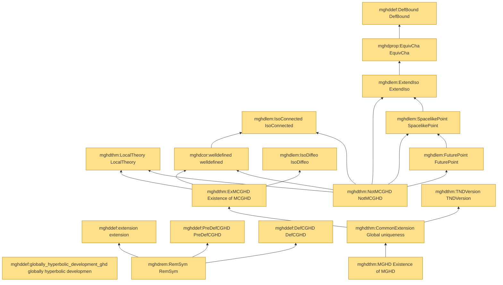

# The formalization ledger

Generated by `tools/ledger.py`; **do not edit by hand** — curated fields (`bucket`, `nl_status_override`, `decls`, `notes`) live in `ledger.json` and survive a rebuild.

Paper `Maximal_GHD2.tex` at `snapshot`; Lean `/home/maxbrain/Dropbox/LeanArticles/lean-causal` at `fd909b6`.

**19 statements.** Natural language: 17 proved or definitional. Lean: **19 stated**, of which **0 closed** and 19 partial.

**Closure: 0 of 19.** The target is the 19 in-scope statements less the 0 terminal ones (bucket `T`, each with its reason); a row counts as done only when it is closed in Lean **in bucket A**.

## How to read a row

| column | says |
|---|---|
| **natural language** | the paper's own status, and where its proof is. `proved` — a `proof` environment discharges it here; `cited` — it is quoted from the literature; `partial` — the paper itself discloses a gap; `open` — asserted and not proved; `informal` — a remark that argues rather than proves. |
| **Lean stated** | a declaration carries the statement. `strict` — in `Causal/`, where `sorry` is a compile error; `scaffold` — in `scaffold/CausalScaffold/`, where it is permitted and audited. |
| **Lean proved** | **yes** — closed, no `sorry` anywhere beneath it; `partial` — some items of a multi-part statement, or a disclosed weakening; `no` — stated only. |
| **lvl** | height in the dependency DAG: 0 depends on nothing in the paper. Formalize upwards. |
| **bucket** | how far the rest is. `A` nothing left; certified in full · `B` routine on the layers already built · `C` hard --- attempted and blocked on a named obstruction · `D` deferred --- needs a layer not built, or the paper itself does not prove it · `T` terminal --- not certifiable by design; out of the closure target, with a reason |

A row is marked ⚠️ **stale** when its LaTeX changed after the Lean was written: the certificate may no longer certify the statement the paper makes.

The DAG's edges are **references**, not always logical dependencies: a statement that says *see Lemma 7* gets an edge to Lemma 7 even when it does not stand on it. That is why the graph has cycles, and why `lvl` is a reading order rather than a proof order. Where the two disagree, the proof is the authority.

## The roadmap

**In scope: 19 statements**, of which 0 are closed in Lean and 19 partial. Out of scope: 0.

### Behind an obstruction — 16 statements, in scope

`C` is attempted-and-blocked, `D` is deferred; each row's `notes` field in `ledger.json` names the obstruction.

## Where it stands, by appendix

| appendix | statements | NL proved | Lean stated | Lean closed |
|---|---:|---:|---:|---:|
| On the existence of a maximal Cauchy development for the Einstein equations: a dezornification (one file) | 19 | 17 | 19 | 0 |

## On the existence of a maximal Cauchy development for the Einstein equations: a dezornification (one file)

| lvl | statement | natural language | Lean stated | Lean proved | bucket |
|---:|---|---|---|---|---|
| 0 | **Definition** `mghddef:globally_hyperbolic_development_ghd` — [`Maximal_GHD2.tex:360`](Maximal_GHD2.tex#L360) | def | strict (Geometry.lean, CauchyExtension.lean) | partial | D |
| 0 | **Definition** `mghddef:extension` — [`Maximal_GHD2.tex:369`](Maximal_GHD2.tex#L369) | def | strict (Geometry.lean) | partial | D |
| 0 | **Definition** `mghddef:PreDefCGHD` — [`Maximal_GHD2.tex:374`](Maximal_GHD2.tex#L374) | def | strict (Pgcd.lean) | partial | D |
| 0 | **Definition** `mghddef:DefCGHD` — [`Maximal_GHD2.tex:383`](Maximal_GHD2.tex#L383) | def | strict (Pgcd.lean) | partial | D |
| 1 | **Remark** `mghdrem:RemSym` — [`Maximal_GHD2.tex:388`](Maximal_GHD2.tex#L388) | informal | strict (Bound.lean, Pgcd.lean) | partial | D |
| 0 | **Theorem** `mghdthm:LocalTheory` — [`Maximal_GHD2.tex:403`](Maximal_GHD2.tex#L403) | cited — local existence and uniqueness (Choquet-Bruhat 1952), cited right after the statement (l.408: 'proven by Choquet-Bruhat in 1952, see [Choquet52]'); the paper takes it as given | strict (Geometry.lean) | partial | D |
| 0 | **Lemma** `mghdlem:IsoConnected` — [`Maximal_GHD2.tex:437`](Maximal_GHD2.tex#L437) | proved — [`Maximal_GHD2.tex:442`](Maximal_GHD2.tex#L442) | strict (Geometry.lean, Pgcd.lean) | partial | D |
| 1 | **Corollary** `mghdcor:welldefined` — [`Maximal_GHD2.tex:452`](Maximal_GHD2.tex#L452) | proved — [`Maximal_GHD2.tex:459`](Maximal_GHD2.tex#L459) | strict (CausalConvex.lean, Pgcd.lean) | partial | D |
| 0 | **Lemma** `mghdlem:IsoDiffeo` — [`Maximal_GHD2.tex:463`](Maximal_GHD2.tex#L463) | proved — [`Maximal_GHD2.tex:472`](Maximal_GHD2.tex#L472) | strict (Injective.lean, CurvesExtend.lean) | partial | D |
| 2 | **Theorem** — Existence of MCGHD `mghdthm:ExMCGHD` — [`Maximal_GHD2.tex:485`](Maximal_GHD2.tex#L485) | proved — [`Maximal_GHD2.tex:494`](Maximal_GHD2.tex#L494) | strict (CausalConvex.lean, Pgcd.lean, CurveComponents.lean) | partial | D |
| 0 | **Theorem** `mghdthm:TNDVersion` — [`Maximal_GHD2.tex:708`](Maximal_GHD2.tex#L708) | proved — argued in the sentence before it (l.706): Theorem NotMCGHD by the tertium non datur, applied to the MCGHD of ExMCGHD; the dependency on mghdthm:NotMCGHD is that sentence's \ref, outside the statement, so the ledger does not draw it | strict (NoCorresponding.lean, GluingHausdorff.lean) | partial | D |
| 3 | **Theorem** — Global uniqueness `mghdthm:CommonExtension` — [`Maximal_GHD2.tex:411`](Maximal_GHD2.tex#L411) | proved — [`Maximal_GHD2.tex:723`](Maximal_GHD2.tex#L723) | strict (NoCorresponding.lean, Ppcm.lean, GluingHausdorff.lean) | partial | D |
| 4 | **Theorem** — Existence of MGHD `mghdthm:MGHD` — [`Maximal_GHD2.tex:417`](Maximal_GHD2.tex#L417) | proved — [`Maximal_GHD2.tex:780`](Maximal_GHD2.tex#L780) | strict (Bound.lean, Maximal.lean, GluingHausdorff.lean) | partial | D |
| 0 | **Definition** `mghddef:DefBound` — [`Maximal_GHD2.tex:527`](Maximal_GHD2.tex#L527) | def | strict (CorrespondingPoints.lean, GluingHausdorff.lean) | partial | B |
| 1 | **Proposition** `mghdprop:EquivCha` — [`Maximal_GHD2.tex:544`](Maximal_GHD2.tex#L544) | proved — [`Maximal_GHD2.tex:563`](Maximal_GHD2.tex#L563) | strict (CorrespondingPoints.lean, SbierskiProp37.lean) | partial | B |
| 2 | **Lemma** `mghdlem:ExtendIso` — [`Maximal_GHD2.tex:585`](Maximal_GHD2.tex#L585) | proved — [`Maximal_GHD2.tex:590`](Maximal_GHD2.tex#L590) | strict (Corresponding.lean, NoCorresponding.lean) | partial | B |
| 3 | **Lemma** `mghdlem:SpacelikePoint` — [`Maximal_GHD2.tex:615`](Maximal_GHD2.tex#L615) | proved — [`Maximal_GHD2.tex:627`](Maximal_GHD2.tex#L627) | strict (NoCorresponding.lean, CompactMinimal.lean, CorrespondingSpacelike.lean) | partial | D |
| 4 | **Lemma** `mghdlem:FuturePoint` — [`Maximal_GHD2.tex:644`](Maximal_GHD2.tex#L644) | proved — [`Maximal_GHD2.tex:652`](Maximal_GHD2.tex#L652) | strict (NoCorresponding.lean, CorrespondingSpacelike.lean) | partial | D |
| 5 | **Theorem** `mghdthm:NotMCGHD` — [`Maximal_GHD2.tex:537`](Maximal_GHD2.tex#L537) | proved — [`Maximal_GHD2.tex:662`](Maximal_GHD2.tex#L662) | strict (NoCorresponding.lean) | partial | D |

dependency graph — On the existence of a maximal Cauchy development for the Einstein equations: a dezornification (one file)

## Formalization order

The DAG, flattened dependencies-first. A statement is ready when every row above it that it depends on is closed.

### Ready now — every dependency is closed in Lean, and nothing is stated yet

*(none — every statement whose dependencies are closed is already stated)*

