# The formalization ledger

Generated by `tools/ledger.py`; **do not edit by hand** — curated fields (`bucket`, `nl_status_override`, `decls`, `notes`) live in `ledger.json` and survive a rebuild.

Paper `InexSchwarzschild2.tex` at `snapshot`; Lean `/home/maxbrain/Dropbox/LeanArticles/lean-causal` at `791b0aa`.

**30 statements.** Natural language: 27 proved or definitional. Lean: **0 stated**, of which **0 closed** and 0 partial.

**Closure: 0 of 30.** The target is the 30 in-scope statements less the 0 terminal ones (bucket `T`, each with its reason); a row counts as done only when it is closed in Lean **in bucket A**.

## How to read a row

| column | says |
|---|---|
| **natural language** | the paper's own status, and where its proof is. `proved` — a `proof` environment discharges it here; `cited` — it is quoted from the literature; `partial` — the paper itself discloses a gap; `open` — asserted and not proved; `informal` — a remark that argues rather than proves. |
| **Lean stated** | a declaration carries the statement. `strict` — in `Causal/`, where `sorry` is a compile error; `scaffold` — in `scaffold/CausalScaffold/`, where it is permitted and audited. |
| **Lean proved** | **yes** — closed, no `sorry` anywhere beneath it; `partial` — some items of a multi-part statement, or a disclosed weakening; `no` — stated only. |
| **lvl** | height in the dependency DAG: 0 depends on nothing in the paper. Formalize upwards. |
| **bucket** | how far the rest is. `A` nothing left; certified in full · `B` routine on the layers already built · `C` hard --- attempted and blocked on a named obstruction · `D` deferred --- needs a layer not built, or the paper itself does not prove it · `T` terminal --- not certifiable by design; out of the closure target, with a reason |

A row is marked ⚠️ **stale** when its LaTeX changed after the Lean was written: the certificate may no longer certify the statement the paper makes.

The DAG's edges are **references**, not always logical dependencies: a statement that says *see Lemma 7* gets an edge to Lemma 7 even when it does not stand on it. That is why the graph has cycles, and why `lvl` is a reading order rather than a proof order. Where the two disagree, the proof is the authority.

## The roadmap

**In scope: 30 statements**, of which 0 are closed in Lean and 0 partial. Out of scope: 0.

### Behind an obstruction — 0 statements, in scope

`C` is attempted-and-blocked, `D` is deferred; each row's `notes` field in `ledger.json` names the obstruction.

## Where it stands, by appendix

| appendix | statements | NL proved | Lean stated | Lean closed |
|---|---:|---:|---:|---:|
| The C^0-inextendibility of the Schwarzschild spacetime and the spacelike diameter in Lorentzian Geometry (one file) | 30 | 27 | 0 | 0 |

## The C^0-inextendibility of the Schwarzschild spacetime and the spacelike diameter in Lorentzian Geometry (one file)

| lvl | statement | natural language | Lean stated | Lean proved | bucket |
|---:|---|---|---|---|---|
| 0 | **Lemma** `schwlem:NormalForm` — [`InexSchwarzschild2.tex:258`](InexSchwarzschild2.tex#L258) | proved — [`InexSchwarzschild2.tex:280`](InexSchwarzschild2.tex#L280) | — | — | — |
| 1 | **Proposition** `schwprop:FutureOpen` — [`InexSchwarzschild2.tex:291`](InexSchwarzschild2.tex#L291) | proved — [`InexSchwarzschild2.tex:296`](InexSchwarzschild2.tex#L296) | — | — | — |
| 2 | **Lemma** `schwlem:ExtensionLemma` — [`InexSchwarzschild2.tex:425`](InexSchwarzschild2.tex#L425) | proved — [`InexSchwarzschild2.tex:430`](InexSchwarzschild2.tex#L430) | — | — | — |
| 3 | **Theorem** `schwthm:MinkInex` — [`InexSchwarzschild2.tex:475`](InexSchwarzschild2.tex#L475) | proved — [`InexSchwarzschild2.tex:480`](InexSchwarzschild2.tex#L480) | — | — | — |
| 4 | **Proposition** `schwprop:ExtFutCon` — [`InexSchwarzschild2.tex:830`](InexSchwarzschild2.tex#L830) | proved — [`InexSchwarzschild2.tex:838`](InexSchwarzschild2.tex#L838) | — | — | — |
| 0 | **Proposition** `schwprop:LengthToInfty` — [`InexSchwarzschild2.tex:1000`](InexSchwarzschild2.tex#L1000) | proved — [`InexSchwarzschild2.tex:1005`](InexSchwarzschild2.tex#L1005) | — | — | — |
| 5 | **Theorem** `schwthm:Exterior` — [`InexSchwarzschild2.tex:785`](InexSchwarzschild2.tex#L785) | proved — [`InexSchwarzschild2.tex:1077`](InexSchwarzschild2.tex#L1077) | — | — | — |
| 2 | **Proposition** `schwprop:UnionPasts` — [`InexSchwarzschild2.tex:310`](InexSchwarzschild2.tex#L310) | proved — [`InexSchwarzschild2.tex:318`](InexSchwarzschild2.tex#L318) | — | — | — |
| 0 | **Definition** `schwdef:DefRegFlowChart` — [`InexSchwarzschild2.tex:1124`](InexSchwarzschild2.tex#L1124) | def | — | — | — |
| 0 | **Theorem** `schwthm:DiamFinite` — [`InexSchwarzschild2.tex:1136`](InexSchwarzschild2.tex#L1136) | proved — [`InexSchwarzschild2.tex:1145`](InexSchwarzschild2.tex#L1145) | — | — | — |
| 0 | **Lemma** `schwlem:BoundsOnReach` — [`InexSchwarzschild2.tex:1457`](InexSchwarzschild2.tex#L1457) | proved — [`InexSchwarzschild2.tex:1476`](InexSchwarzschild2.tex#L1476) | — | — | — |
| 5 | **Proposition** `schwprop:IntFutCon` — [`InexSchwarzschild2.tex:1500`](InexSchwarzschild2.tex#L1500) | proved — [`InexSchwarzschild2.tex:1505`](InexSchwarzschild2.tex#L1505) | — | — | — |
| 6 | **Theorem** `schwthm:Inex` — [`InexSchwarzschild2.tex:790`](InexSchwarzschild2.tex#L790) | proved — [`InexSchwarzschild2.tex:1559`](InexSchwarzschild2.tex#L1559) | — | — | — |
| 7 | **Theorem** `schwthm:MainThm` — [`InexSchwarzschild2.tex:778`](InexSchwarzschild2.tex#L778) | proved — [`InexSchwarzschild2.tex:797`](InexSchwarzschild2.tex#L797) | — | — | — |
| 8 | **Theorem** `schwthm:dimensional_maximal_analytic_schwarzschild` — [`InexSchwarzschild2.tex:96`](InexSchwarzschild2.tex#L96) *(full form: `schwthm:MainThm`)* | proved — [`InexSchwarzschild2.tex:797`](InexSchwarzschild2.tex#L797) *(via `schwthm:MainThm`)* | — | — | — |
| 1 | **Theorem** `schwthm:connected_globally_hyperbolic_lorentzian` — [`InexSchwarzschild2.tex:167`](InexSchwarzschild2.tex#L167) *(full form: `schwthm:DiamFinite`)* | proved — [`InexSchwarzschild2.tex:1145`](InexSchwarzschild2.tex#L1145) *(via `schwthm:DiamFinite`)* | — | — | — |
| 0 | **Definition** `schwdef:timelike_curve` — [`InexSchwarzschild2.tex:235`](InexSchwarzschild2.tex#L235) | def | — | — | — |
| 0 | **Definition** `schwdef:future_past_directed` — [`InexSchwarzschild2.tex:239`](InexSchwarzschild2.tex#L239) | def | — | — | — |
| 0 | **Remark** `schwrem:setting_above_definition_time_oriented` — [`InexSchwarzschild2.tex:248`](InexSchwarzschild2.tex#L248) | informal | — | — | — |
| 2 | **Proposition** `schwprop:FlowChart` — [`InexSchwarzschild2.tex:322`](InexSchwarzschild2.tex#L322) | proved — [`InexSchwarzschild2.tex:334`](InexSchwarzschild2.tex#L334) | — | — | — |
| 0 | **Definition** `schwdef:lorentzian_distance_function` — [`InexSchwarzschild2.tex:349`](InexSchwarzschild2.tex#L349) | def | — | — | — |
| 0 | **Definition** `schwdef:future_past_extendible` — [`InexSchwarzschild2.tex:361`](InexSchwarzschild2.tex#L361) | def | — | — | — |
| 0 | **Remark** `schwrem:note_notion_future_past` — [`InexSchwarzschild2.tex:365`](InexSchwarzschild2.tex#L365) | informal | — | — | — |
| 0 | **Definition** `schwdef:cauchy_hypersurface` — [`InexSchwarzschild2.tex:369`](InexSchwarzschild2.tex#L369) | def | — | — | — |
| 0 | **Definition** `schwdef:timelike_homotopic_fixed_endpoints` — [`InexSchwarzschild2.tex:380`](InexSchwarzschild2.tex#L380) | def | — | — | — |
| 0 | **Definition** `schwdef:timelike_separated_set` — [`InexSchwarzschild2.tex:390`](InexSchwarzschild2.tex#L390) | def | — | — | — |
| 0 | **Definition** `schwdef:extension` — [`InexSchwarzschild2.tex:403`](InexSchwarzschild2.tex#L403) | def | — | — | — |
| 0 | **Remark** `schwrem:course_question_extendibility_also` — [`InexSchwarzschild2.tex:413`](InexSchwarzschild2.tex#L413) | informal | — | — | — |
| 0 | **Definition** `schwdef:spacelike_diameter` — [`InexSchwarzschild2.tex:1114`](InexSchwarzschild2.tex#L1114) | def | — | — | — |
| 3 | **Theorem** `schwthm:time_oriented_lorentzian_manifold` — [`InexSchwarzschild2.tex:1241`](InexSchwarzschild2.tex#L1241) | proved — [`InexSchwarzschild2.tex:1249`](InexSchwarzschild2.tex#L1249) | — | — | — |

dependency graph — The C^0-inextendibility of the Schwarzschild spacetime and the spacelike diameter in Lorentzian Geometry (one file)

```mermaid
graph BT
  n0["schwthm:dimensional_maximal_analytic_schwarzschild dimensional maximal analytic s"]
  n1["schwthm:connected_globally_hyperbolic_lorentzian connected globally hyperbolic "]
  n2["schwdef:timelike_curve timelike curve"]
  n3["schwdef:future_past_directed future past directed"]
  n4["schwrem:setting_above_definition_time_oriented setting above definition time "]
  n5["schwlem:NormalForm NormalForm"]
  n6["schwprop:FutureOpen FutureOpen"]
  n7["schwprop:UnionPasts UnionPasts"]
  n8["schwprop:FlowChart FlowChart"]
  n9["schwdef:lorentzian_distance_function lorentzian distance function"]
  n10["schwdef:future_past_extendible future past extendible"]
  n11["schwrem:note_notion_future_past note notion future past"]
  n12["schwdef:cauchy_hypersurface cauchy hypersurface"]
  n13["schwdef:timelike_homotopic_fixed_endpoints timelike homotopic fixed endpo"]
  n14["schwdef:timelike_separated_set timelike separated set"]
  n15["schwdef:extension extension"]
  n16["schwrem:course_question_extendibility_also course question extendibility "]
  n17["schwlem:ExtensionLemma ExtensionLemma"]
  n18["schwthm:MinkInex MinkInex"]
  n19["schwthm:MainThm MainThm"]
  n20["schwthm:Exterior Exterior"]
  n21["schwthm:Inex Inex"]
  n22["schwprop:ExtFutCon ExtFutCon"]
  n23["schwprop:LengthToInfty LengthToInfty"]
  n24["schwdef:spacelike_diameter spacelike diameter"]
  n25["schwdef:DefRegFlowChart DefRegFlowChart"]
  n26["schwthm:DiamFinite DiamFinite"]
  n27["schwthm:time_oriented_lorentzian_manifold time oriented lorentzian manif"]
  n28["schwlem:BoundsOnReach BoundsOnReach"]
  n29["schwprop:IntFutCon IntFutCon"]
  n0 --> n19
  n1 --> n26
  n6 --> n5
  n7 --> n6
  n8 --> n6
  n17 --> n6
  n18 --> n17
  n18 --> n5
  n19 --> n17
  n19 --> n20
  n19 --> n21
  n20 --> n18
  n20 --> n22
  n20 --> n23
  n21 --> n5
  n21 --> n18
  n21 --> n29
  n21 --> n7
  n21 --> n28
  n21 --> n26
  n21 --> n25
  n22 --> n18
  n27 --> n8
  n27 --> n6
  n27 --> n26
  n29 --> n28
  n29 --> n22
  classDef done fill:#b7e4c7,stroke:#2d6a4f;
  classDef part fill:#ffe08a,stroke:#b07d00;
  classDef scaf fill:#ffd6a5,stroke:#b35c00;
```

## Formalization order

The DAG, flattened dependencies-first. A statement is ready when every row above it that it depends on is closed.

### Ready now — every dependency is closed in Lean, and nothing is stated yet

| lvl | statement | where | deps |
|---:|---|---|---:|
| 0 | `schwdef:timelike_curve` — definition | `InexSchwarzschild2.tex:235` | 0 |
| 0 | `schwdef:future_past_directed` — definition | `InexSchwarzschild2.tex:239` | 0 |
| 0 | `schwlem:NormalForm` — lemma | `InexSchwarzschild2.tex:258` | 0 |
| 0 | `schwdef:lorentzian_distance_function` — definition | `InexSchwarzschild2.tex:349` | 0 |
| 0 | `schwdef:future_past_extendible` — definition | `InexSchwarzschild2.tex:361` | 0 |
| 0 | `schwdef:cauchy_hypersurface` — definition | `InexSchwarzschild2.tex:369` | 0 |
| 0 | `schwdef:timelike_homotopic_fixed_endpoints` — definition | `InexSchwarzschild2.tex:380` | 0 |
| 0 | `schwdef:timelike_separated_set` — definition | `InexSchwarzschild2.tex:390` | 0 |
| 0 | `schwdef:extension` — definition | `InexSchwarzschild2.tex:403` | 0 |
| 0 | `schwprop:LengthToInfty` — proposition | `InexSchwarzschild2.tex:1000` | 0 |
| 0 | `schwdef:spacelike_diameter` — definition | `InexSchwarzschild2.tex:1114` | 0 |
| 0 | `schwdef:DefRegFlowChart` — definition | `InexSchwarzschild2.tex:1124` | 0 |
| 0 | `schwthm:DiamFinite` — theorem | `InexSchwarzschild2.tex:1136` | 0 |
| 0 | `schwlem:BoundsOnReach` — lemma | `InexSchwarzschild2.tex:1457` | 0 |

