# The formalization ledger

Generated by `tools/ledger.py`; **do not edit by hand** — curated fields (`bucket`, `nl_status_override`, `decls`, `notes`) live in `ledger.json` and survive a rebuild.

Paper `syracuse.tex` at `snapshot`; Lean `/home/maxbrain/Dropbox/LeanArticles/lean-syracuse` at `0fe82db`.

**29 statements.** Natural language: 16 proved or definitional. Lean: **20 stated**, of which **3 closed** and 17 partial.

**Closure: 2 of 29.** The target is the 29 in-scope statements less the 0 terminal ones (bucket `T`, each with its reason); a row counts as done only when it is closed in Lean **in bucket A**.

## How to read a row

| column | says |
|---|---|
| **natural language** | the paper's own status, and where its proof is. `proved` — a `proof` environment discharges it here; `cited` — it is quoted from the literature; `partial` — the paper itself discloses a gap; `open` — asserted and not proved; `informal` — a remark that argues rather than proves. |
| **Lean stated** | a declaration carries the statement. `strict` — in `Syracuse/`, where `sorry` is a compile error; `scaffold` — in `scaffold/SyracuseScaffold/`, where it is permitted and audited. |
| **Lean proved** | **yes** — closed, no `sorry` anywhere beneath it; `partial` — some items of a multi-part statement, or a disclosed weakening; `no` — stated only. |
| **lvl** | height in the dependency DAG: 0 depends on nothing in the paper. Formalize upwards. |
| **bucket** | how far the rest is. `A` nothing left; certified in full · `B` routine on the layers already built · `C` hard --- attempted and blocked on a named obstruction · `D` deferred --- needs a layer not built, or the paper itself does not prove it · `T` terminal --- not certifiable by design; out of the closure target, with a reason |

A row is marked ⚠️ **stale** when its LaTeX changed after the Lean was written: the certificate may no longer certify the statement the paper makes.

The DAG's edges are **references**, not always logical dependencies: a statement that says *see Lemma 7* gets an edge to Lemma 7 even when it does not stand on it. That is why the graph has cycles, and why `lvl` is a reading order rather than a proof order. Where the two disagree, the proof is the authority.

## What formalizing found in the paper

Formalizing is a proof-reading pass with a machine holding the pen. These are the places where writing the Lean turned up something about the **paper** — a hypothesis used but not stated, a constant that needs a side condition, a step that does not go through as written. None is a refutation; each is a sentence the author may want to change. Entries marked **APPLIED** were applied through `/writer` on the date given; the rest are the author's call, and edits to the `.tex` go through `/writer`.

### `def:ring_define` — definition

*syracuse.tex:54*

- syracuse.tex:55 — the two cases of f_A are swapped: as printed f_A(x) = 3x+1 for x ∈ 2A and x/2 for x ∉ 2A, but x/2 does not exist for x ∉ 2A, so no such map exists in any Z/2Z-ring (Syracuse.printed_f_not_definable, at x = 1). The formalized f halves on 2A and sends x ↦ 3x+1 off 2A, as in the integer definition l.46–48.
- syracuse.tex:55 — T_A(x) = (3x+1)/2^{nu_2(3x+1)} is undefined at x0 = -1/3 whenever 3 is a unit of A (Z_2 = the 2-adic integers, also Z/2Z; Z_(2) and Z[1/3] are further examples, not formalized here): x0 ∈ 2A+1, 3x0+1 = 0, {n | 0 ∈ 2^n A} has no max, and (when 2 ≠ 0) no odd t and k ∈ N satisfy 2^k t = 3x0+1 (Syracuse.T_undefined_of_isUnit_three; in Z_2: Syracuse.T_undefined_padicInt). It is the only defect: 3x+1 = 0 forces 3 ∈ A^× (Syracuse.three_mul_add_one_ne_zero), so over Z every point is good. Where 3x+1 ≠ 0, T x is odd, 2^{nu_2(3x+1)} T x = 3x+1, and it is the unique such odd element (T_odd, pow_v2_mul_T, T_unique).
- syracuse.tex:50 — 'in such a ring, 2 ≠ 0' is false for A = Z/2Z itself, which is integral, noetherian and has A/2A = A ≅ Z/2Z (Syracuse.instIsZ2RingZMod2, Syracuse.two_eq_zero_zmod2). It is the only exception: in a Z/2Z-ring, 2 = 0 iff A ≅ Z/2Z (Syracuse.IsZ2Ring.two_eq_zero_iff). There halves are not unique; and if 'such a ring' in the last sentence of l.50 means any Z/2Z-ring (it may mean only the rings named just before it, which have characteristic 0), '4 ≠ 0' fails for Z/2Z too; with 2 ≠ 0 the ring has characteristic 0 (Syracuse.IsZ2Ring.charZero_of_two_ne_zero). The claim A_2 ≅ Z_2 (l.52) also fails for Z/2Z (not formalized here; it belongs to T-syr-rep).

### `prop:ring_both_continuous_extends` — proposition

*syracuse.tex:58*

- syracuse.tex:58 — 'T_A … extends continuously to A_2' is false. Take A = Z, where T_Z is the paper's map on all of 2Z+1 (3x+1 ≠ 0 always). No g : Z_2 → Z_2 is continuous on 2Z_2+1 and agrees with T_Z on the odd integers (Syracuse.T_int_not_extends). The printed statement, quantified over all Z/2Z-rings with 2 ≠ 0, is refuted (Syracuse.printed_T_extends_false). In every Z/2Z-ring A with 2 ≠ 0, no extension of T_A to A_2 is continuous at −1/3 ∈ 2A_2+1 within 2A_2+1 (Syracuse.not_continuousWithinAt_extension_T, not_exists_continuousWithinAt_extension_T, not_exists_continuousWithinAt_extension_T_completion). The reason: the odd part of 3x+1 has no limit as x → −1/3. The integers c_j = (4^{j+1} − 1)/3 tend 2-adically to −1/3 with T(c_j) = 1, and d_j = (10·4^{j+1} − 1)/3 tend to −1/3 with T(d_j) = 5. Hence 'their extension is T_{A_2}' fails too: T_{A_2} is undefined at −1/3 (OQ-42 (d)), and no value there makes it continuous on 2A_2+1 (Syracuse.not_continuousWithinAt_T_padicInt for the junk value). Strongest true form (Syracuse.ring_both_continuous_extends): T_{A_2} is continuous on A_2 ∖ {−1/3}, extends T_A, and is the unique continuous extension of T_A : 2A+1 → 2A+1 to (2A_2+1) ∖ {−1/3}. This is the topological face of OQ-42 (d).
- syracuse.tex:58 — 'T_A is continuous' holds wherever T_A is defined. T is continuous at every x with 3x+1 ≠ 0, in every Z/2Z-ring, Z/2Z included (Syracuse.continuousAt_T, continuousOn_T). For y − x ∈ 2^{n+k+1}A with k = ν_2(3x+1), one has T y − T x = 3(y − x)/2^k ∈ 2^{n+1}A. When 3 ∉ A^×, as in Z, T is continuous on all of A, hence on 2A+1 as printed (Syracuse.continuous_T_of_not_isUnit_three). When 3 ∈ A^×, as in Z_2, the printed T_A does not exist at −1/3.
- syracuse.tex:52 — 'for any Z/2Z-ring A, A_2 is naturally isomorphic to Z_2' is false for A = Z/2Z. Its completion has 2 = 0 for every uniform ring structure, so it is not isomorphic to Z_2 (Syracuse.completion_zmod2_not_padicInt; for the 2-adic structure, completion_zmod2_twoAdic_not_padicInt). It holds for every other Z/2Z-ring, i.e. whenever 2 ≠ 0 (Syracuse.completion_ringEquiv, completion_twoAdic). The proof: every x is an integer modulo 2^nA, so Z/2^nZ ≅ A/2^nA (Syracuse.zmodEquivQuotient). The limit is a ring hom ι : A → Z_2 (Syracuse.toZ2). It is injective by Krull, preserves ν_2 and |·|, has dense image, and induces the 2-adic topology, so (Z_2, ι) is a completion of A (Syracuse.completionPkg). The resulting A_2 ≅ Z_2 is a ring isomorphism and a uniform isomorphism extending ι. 'Naturally' is proved in two ways: ι is the only ring hom A → Z_2 (Syracuse.toZ2_unique, toZ2_comp), and the isomorphism is the only ring isomorphism A_2 ≅ Z_2 (Syracuse.ringEquiv_padicInt_unique). The paper prints no proof ('one can show').
- syracuse.tex:50–52 (evidence for OQ-42 (a)) — under the printed definition of l.52 (noetherian, A/2A ≅ Z/2Z, no integrality), the l.52 claim fails even with 2 ≠ 0. ZMod 4 is noetherian, has A/2A ≅ Z/2Z and 2 ≠ 0, and is not a domain. Its completion has 4 = 0 for every uniform ring structure, so it is not Z_2 (Syracuse.zmod4_witness). Integrality, which l.50 states but l.52 omits, is therefore load-bearing.
- syracuse.tex:58 — the f_A half holds in the halve-the-even reading of OQ-42 (c) (the printed f_A does not exist, T-syr-base). f_A is continuous in every Z/2Z-ring (Syracuse.continuous_f). For 2 ≠ 0, f_{A_2} is continuous, extends f_A, and is its only continuous extension (Syracuse.continuous_f_completion, f_coe_completion, eq_f_completion_of_continuous; in Z_2 the same via ι: continuous_f_padicInt, f_toZ2, eq_f_of_continuous). The proof is left to the reader (l.57); none is printed.

### `def:ring_define_2` — definition

*syracuse.tex:61*

- syracuse.tex:62 — a_n : 2A+1 → N is not N-valued on the backward T-orbit of x0 = -1/3 when 3 ∈ A^× (inherits the T_A finding of def:ring_define): there 3T^n(x)+1 = 0 and nu_2(0) is no natural number. Elsewhere a_n(x) = nu_2(3T^n(x)+1) (Syracuse.a_eq_nu2) and a_n(x) ≥ 1 for T^n(x) odd (Syracuse.one_le_a).

### `lem:base` — lemma

*syracuse.tex:67*

- syracuse.tex:67–68 — as printed the lemma covers x0 = -1/3 when 3 ∈ A^×, where T_A(x0) and p_1(x0) do not exist; no assignment of an odd value t to T_A(x0) and of k ∈ N to p_1(x0) satisfies the n = 1 instance 2^k t - 3x0 = 1 (Syracuse.base_printed_fails_padicInt, in Z_2). The strongest true form is proved: the identity holds for every x ∈ A and n for the total maps (Syracuse.base), and on every orbit avoiding -1/3 all its terms are the paper's (Syracuse.base_of_orbit), hence for all x when 3 ∉ A^×, in particular in Z (Syracuse.base_of_not_isUnit_three).
- syracuse.tex:71 and 75 — the proof writes a_1(x) for nu_2(3x+1); by def:ring_define_2 (l.62–63) this is a_0(x) = p_1(x), and p_{n+1}(x) = a_0(x) + p_n(T_A x).
- syracuse.tex:75–77 — the last sums of the proof have shifted indices: Σ_{k=1}^{n} 2^{p_{k+1}(x)} 3^{n-1-k} should read Σ_{k=1}^{n} 2^{p_k(x)} 3^{n-k} (the exponent n-1-k is negative at k = n), and the final Σ_{k=0}^{n} 2^{p_{k+1}(x)} 3^{n-1-k} should read Σ_{k=0}^{n} 2^{p_k(x)} 3^{n-k}, the statement at n+1. The statement itself is correct.

### `lem:ring_maps_rhs_n_` — lemma

*syracuse.tex:84*

- syracuse.tex:84–86 — false as printed: in the Z/2Z-ring Z/2Z, RHS_2(0,1) = 3+2 = 1 = 3+4 = RHS_2(0,2) (Syracuse.ring_maps_rhs_printed_false); RHS_n is not injective for every n ≥ 2 (Syracuse.rhs_zmod2_not_injOn; it is in fact constant, = 3^{n-1} = 1, but only non-injectivity is proved); the printed universal statement is refuted (Syracuse.ring_maps_rhs_printed_statement_false). It holds whenever 2 ≠ 0 (Syracuse.ring_maps_rhs), i.e. for every Z/2Z-ring other than Z/2Z, and then without p_0 = 0 (Syracuse.rhs_injOn_strictMono). The paper prints no proof; the one here peels off the 2-adic valuation p_0 of RHS_n(p) = 2^{p_0}·(odd) and inducts on n. Under the printed definition (l.52, without the integrality of l.50) it also fails for rings with 2 ≠ 0: ZMod 6, RHS_2(0,1) = 5 = 11 = RHS_2(0,3) (Syracuse.rhs_zmod6_not_injOn).

### `theo:rep` — theorem

*syracuse.tex:88*

- syracuse.tex:88–90 — false as printed on 2A_2+1 = 2Z_2+1: x0 = -1/3 is odd but not in the image of the printed inverse φ^{-1} (Syracuse.neg_inv3_not_mem_image), nor is any y_k = -(2^k+3)/9, k ≥ 1, which satisfies T(y_k) = -1/3 with ν_2(3y_k+1) = k (Syracuse.neg_third_preimage). Hence no map φ from 2Z_2+1 to {p | p_0 = 0, p ↗↗} has the printed φ^{-1} as a left inverse, whatever values are given to the undefined p_n on the backward orbit of -1/3 (Syracuse.rep_printed_false). Strongest true form proved (Syracuse.theo_rep): φ: x ↦ (p_n(x)) is a bijection from RepDomain (odd x whose T-orbit avoids -1/3) onto the strictly increasing sequences from 0, its inverse is the printed formula, and the image of the formula is exactly RepDomain (Syracuse.repInv_image). This is the theorem-level form of OQ-42 (d).
- syracuse.tex:92–95 — the proof establishes only φ^{-1} ∘ φ = id (x = -(1/3)Σ 2^{p_k(x)}/3^k, i.e. injectivity of φ); that every strictly increasing p with p_0 = 0 is some φ(x) (surjectivity, and that the printed formula lands in the domain) is not argued. It is proved here: S(q) = Σ 2^{q_n}/3^n satisfies S(q) = 1 + (1/3)2^{q_1}S(q') with q'_n = q_{n+1} - q_1 (Syracuse.repSeries_eq), so 3φ^{-1}(q)+1 = 2^{q_1}φ^{-1}(q') with φ^{-1}(q') odd, whence T(φ^{-1}q) = φ^{-1}q' and a_0(φ^{-1}q) = q_1 (Syracuse.T_repInv) and p_n(φ^{-1}q) = q_n (Syracuse.rep_repInv). The proof's displayed identity (l.93) also writes x ∈ 2A+1 where 2A_2+1 is meant, and holds only on orbits avoiding -1/3.

### `cor:ring_periodic_minimal_period` — corollary

*syracuse.tex:107*

- syracuse.tex:108 — false as printed: '∀ i, j ∈ ⟦1, n⟧' includes i = j, where A_i^n(a(x)) - A_j^n(a(x)) = 0, on every cycle; e.g. the cycle (1) of Z, n = 1, i = j = 1 (Syracuse.cor_ring_periodic_minimal_period_printed_false). For i ≠ j it holds in every Z/2Z-ring, with no 2 ≠ 0 (Syracuse.Aun_sub_ne_zero), for the printed A_u^n and for the off-by-one reading of OQ-43 (Syracuse.AunAlt_sub_ne_zero). Proof (the paper prints none): with x_u = T^u(x), on any orbit A_u^n(a(x)) = 2^{p_n(x_u)}(3x_{u+n}+1) - 3^n(3x_u+1) (Syracuse.Aun_cast_eq, from lem:base at n+1), so on a cycle A_u^n = (2^{p_n} - 3^n)(3x_u+1) as printed and (2^{p_n} - 3^n)x_u with the product to n-2-k (Syracuse.Aun_cast_of_cycle); 2^{p_n} - 3^n is odd since p_n ≥ 1 on a cycle, and x_1, ..., x_n are distinct by minimality. The corrected form is not vacuous: the cycle (-5, -7) of Z has least period 2 (Syracuse.cycle_neg_five).

### `lem:one_has` — lemma

*syracuse.tex:114*

- syracuse.tex:114 — the statement holds as printed (Syracuse.one_has), and in the sharper form p_n(x) log 2 − n log 3 ≤ n log(1 + 1/(3|x|)) for every x ∈ Z*, either sign (Syracuse.one_has_sharp); the hypothesis is needed only for k ≤ n (Syracuse.one_has_of_le). The proof used is the product form of lem:base, 2^{p_n(x)} T^n(x) = 3^n x Π_{k<n}(1 + 1/(3T^k(x))) (Syracuse.pow_p_mul_T_iterate_eq_prod), in place of the Grönwall step.
- syracuse.tex:119 — the displayed equation drops the factor 1/3 that dividing lem:base by 3^n produces (the right side should be (1/3) Σ_{k<n} e^{p_k log 2 − k log 3}); as printed it is false at x = 1, n = 1, where the left side is 4/3 − 1 = 1/3 and the right side is 1 (Syracuse.one_has_proof_l119_false). Harmless: dropping 1/3 only weakens the inequality of l.121.
- syracuse.tex:123 — u_k is defined as exp(log(2) p_k(x) − n log(3)); k log(3) is meant.
- syracuse.tex:124 — the bound (1 + 1/x)^n should read (1 + 1/|x|)^n, as in the statement: as printed it is false at x = −1, n = 1, which satisfies the hypothesis (T(−1) = −1) and has e^{p_1 log 2 − log 3} = 2/3 > 0 = 1 + 1/(−1) (Syracuse.one_has_proof_l124_false).

### `lem:itemize_furthermore_itemize` — lemma

*syracuse.tex:127*

- syracuse.tex:130–131 — the first bullet is false at n = 0 for every x ∈ N*: T^0(x) = x ≤ x and it asks p_0(x) log 2 − 0 = 0 > 0 (Syracuse.itemize_first_fails_at_zero, Syracuse.itemize_first_printed_false). It holds for every n ≥ 1 (Syracuse.itemize_first).
- syracuse.tex:132 — the second bullet is false at x = 1 for every n ≥ 1: T(1) = 1, a_k(1) = 2, p_n(1) = 2n (Syracuse.T_one_int, Syracuse.a_one_int, Syracuse.p_one_int), so p_n(1) log 2 − n log 3 = n log(4/3) < n log 2 = n log(1 + 1/1) (Syracuse.itemize_second_fails_at_one, Syracuse.itemize_second_printed_false). The true bound is n log(1 + 1/(3x)) (Syracuse.itemize_second, hypothesis needed only for k ≤ n), attained at x = 1 for every n (Syracuse.itemize_second_sharp), so the constant 1/3 is sharp. 'Proceed the same way' (l.138): the same product identity gives it, with the inequalities reversed.
- syracuse.tex:132 — whether the printed bound n log(1 + 1/x) holds for every x ≥ 2 is not decided here (it bears on hypothetical positive cycles).

### `cor:corollary_2` — corollary

*syracuse.tex:140*

- syracuse.tex:140 — the corollary has no printed proof; it holds as printed (Syracuse.corollary_2). Proof: by the product form, p_n(x) log 2 − n log 3 = log|x| − log|T^n x| + Σ_{k<n} log(1 + 1/(3T^k x)); the first difference is eventually ≤ 0, and the Cesàro mean of log(1 + 1/(3T^k x)) ≤ 1/(3T^k x) → 0 tends to 0 (Syracuse.corollary_2_eventually).

### `cor:bounds` — corollary

*syracuse.tex:142*

- syracuse.tex:142 — false as printed: at x = 1, n = 1 (min = max = 1, p_1(1) = 2) it asks log_2 2 = 1 ≤ 2 − log_2 3 ≈ 0.415 (Syracuse.bounds_printed_false). More: its lower bound log_2(1 + 1/min) fails on every positive cycle (Syracuse.bounds_printed_lower_false), and its two bounds are in decreasing order (1/min ≥ 1/max), so the printed chain could only hold on a fixed point.
- syracuse.tex:142 — the true form (no printed proof): on every cycle of Z* (either sign), p_n/n − log_2 3 = (1/n) Σ_{k<n} log_2(1 + 1/(3T^k x)) (Syracuse.cycle_mean), hence log_2(1 + 1/(3 max)) ≤ p_n/n − log_2 3 ≤ log_2(1 + 1/(3 min)) (Syracuse.bounds): the printed bounds are swapped and lack the factor 3. On a negative cycle both bounds are negative.

### `prop:have_gcd_n__l_k` — proposition

*syracuse.tex:171*

- syracuse.tex:171–174 — false for every cycle of x < 0. On every cycle of Z the GCD of the n sums is |2^{p_n(x)} − 3^n| (Syracuse.have_gcd), and 2^{p_n(x)} − 3^n has the sign of x, since (2^{p_n(x)} − 3^n)·x = Σ_{k<n} 2^{p_k(x)} 3^{n−1−k} > 0 by lem:base (Syracuse.two_pow_p_sub_three_pow_mul_pos). So the printed equality holds iff x > 0 (have_gcd_of_pos), and for x < 0 the GCD is 3^n − 2^{p_n(x)} (have_gcd_of_neg). The printed statement is refuted at the cycle (−1), n = 1, where 2^1 − 3 = −1 < 0 ≤ GCD (have_gcd_printed_false). The same cycle refutes it in the index convention of l.71 (have_gcd_printed_false_shift). Read up to sign ('a GCD') it holds on every cycle (have_gcd_associated). This confirms the planner's [r] numerics (GCD 1, 1, 1, 139 on the cycles of 1, −1, −5, −17, against 2^{p_n} − 3^n = 1, −1, −1, −139).
- syracuse.tex:62 against 71, 75, 178 — two index conventions for a_i. def:ring_define_2 (l.62) sets a_0(x) = ν₂(3x+1), while the proof of lem:base writes a_1(x) = p_1(x) for it (l.71, l.75). In the convention of l.62 the display of l.178 is off by one: the l-th sum is (2^{p_n(x)} − 3^n)·T^{l+1}(x) for every l ∈ N, in every commutative ring (Syracuse.gcdSum_cycle), and as printed (with T^l(x)) it fails at l = 0 on every cycle that is not a fixed point (gcdSum_ne_display), e.g. the cycle (−5, −7), where the 0-th sum is 7 = (−1)(−7), not (−1)(−5) = 5 (gcd_display_printed_false). In the convention of l.71 (β_{k+1} = a_k(x)) the display holds as printed (gcdSum_cycle_shift). The Bézout step of l.186 holds as printed in both conventions, with a_1(x) read in the same convention (gcd_bezout: a_1(x) = ν₂(3T(x)+1); gcd_bezout_shift: β_1 = a_0(x) = ν₂(3x+1)). The statement is the same in both: the n sums are the same set up to a cyclic shift (have_gcd, have_gcd_shift).
- syracuse.tex:173 — the l-th sum is the OQ-43 sum A'^n_{l+1} = Σ_{k<n} 3^k Π_{i=0}^{n−2−k} 2^{a_{l+1+i}} (Syracuse.gcdSum_eq_AunAlt): the exponent p_n(x) − Σ_{i=l−k}^{l} a_i(x) is the sum of a over the other n − 1 − k terms of the period, never negative. With the printed A_u^n of def:define_n__n_ the sums would be (2^{p_n} − 3^n)(3T^u(x)+1) (Syracuse.Aun_cast_of_cycle), whose GCD is at least 2|2^{p_n} − 3^n|: this proposition's sums side with the OQ-43 reading.

### `lem:periodic_exists_i_a_i_` — lemma

*syracuse.tex:207*

- syracuse.tex:211 — 'A_i − A_j ≠ 0' is false without the minimal period: for a ≡ 1, n = 2, p = 1, i = 0, j = 1 every hypothesis holds and A_0 = A_1, so the printed lemma is refuted, for both readings of OQ-43 (Syracuse.periodic_exists_printed_false, periodic_exists_printed_false_alt). With n the minimal period of a it holds for both readings (Aun_sub_ne_zero_of_minimal, AunAlt_sub_ne_zero_of_minimal), with no use of the agreement or of p. The proof: A_u^n = RHS_n(Σ_{t≤k} a_{u+t})_k (Aun_cast_eq_RHS), lem:ring_maps_rhs_n_ (Syracuse.rhs_injOn_strictMono) gives a_{i+t} = a_{j+t} for t < n (agree_of_Aun_eq), hence j − i is a period (periodic_sub_of_agree). The use of the lemma in the proof of theo:exists_no_circuit_other (l.222, l.227) assumes the minimal period, as OQ-53 does for cor:ring_periodic_minimal_period.
- syracuse.tex:209 — the ν₂ conjunct is false, even for a of minimal period n: a = (1, 2, 2), n = 3, p = 1, i = 0, j = 1 satisfies every hypothesis, and ν₂(A_0 − A_1) = ν₂(74 − 116) = ν₂(−42) = 1 < 2 = a_1 (Syracuse.periodic_exists_nu2_printed_false); for the OQ-43 reading ν₂(A'_0 − A'_1) = ν₂(23 − 37) = 1 (periodic_exists_nu2_printed_false_alt). Since i = 0 the bound read as Σ_{k=1}^p a_{i+k} fails too (periodic_exists_nu2_shifted_bound_false, _alt). The bound is off by an index: an agreement a_{u+t} = a_{v+t} for t < q gives 2^{Σ_{t<q} a_{u+t} + min(a_{u+q}, a_{v+q})} ∣ A_u − A_v, for both readings and without periodicity (two_pow_dvd_Aun_sub, two_pow_dvd_AunAlt_sub). Under the printed agreement (k ∈ ⟦1, p⟧) this gives ν₂(A_{i+1} − A_{j+1}) ≥ Σ_{k=1}^p a_{i+k} (periodic_exists_nu2_shift, _alt). Under the agreement on ⟦0, p−1⟧ it gives ν₂(A_i − A_j) ≥ Σ_{k=0}^{p−1} a_{i+k} (periodic_exists_corrected, _alt). Both confirm the planner's [r] numerics.
- syracuse.tex:209 — the ν₃ conjunct holds as printed for the printed A_u^n of def:define_n__n_ (Syracuse.periodic_exists_nu3): 3^p ∣ A_{p+i} − A_{p+j} needs only a_{i+k} = a_{j+k} for k ∈ ⟦1, p−1⟧ (three_pow_dvd_Aun_sub). It fails for the OQ-43 reading: with a = (1, 2, 2), p = 1, i = 0, j = 1 (minimal period 3), A'_1 − A'_2 = 37 − 29 = 8 is prime to 3 (periodic_exists_nu3_printed_false_alt). The reason: for n-periodic a, A_u − A_v = 3(A'_u − A'_v) (Syracuse.Aun_sub_eq_three_mul, from A_u^n = 3A'^n_u + 2^{Σ_{t<n} a_{u+t}} − 3^n, Aun_eq_three_mul_AunAlt). So ν₃ drops by one in the OQ-43 reading, which needs the agreement on ⟦0, p−1⟧ (three_pow_dvd_AunAlt_sub; periodic_exists_corrected_alt). This bears on OQ-43: this conjunct favours the printed A_u^n, while prop:have_gcd_n__l_k and l.283–284 favour the OQ-43 reading.
- syracuse.tex:207–212 — the lemma has no proof in the draft (ledger nl_status 'open'); the proofs here are new.

### `def:circuit` — ε-circuit

*syracuse.tex:213*

- syracuse.tex:213 — '(x)_{n∈N}' is literally the constant sequence x, x, …, which is n-periodic for every n. Read so, every integer is an ε-circuit for every ε ≤ 1, with n = 1 and p = 0 (Syracuse.isCircuitLiteral_of_le_one); 3 is one, though its orbit 3, 5, 1, 1, … is not periodic (not_isCircuit_three). The orbit (T^n(x))_n is meant, as at l.98–99 and l.107; IsCircuit reads it so.
- syracuse.tex:216 against 222 — the definition asks p ≥ εn − 1, the proof of theo:exists_no_circuit_other takes p ≥ εn. With the printed −1 every cycle is an ε-circuit as soon as εn ≤ 1 (p = 0): the fixed point (1), where a_i = 2, is an ε-circuit iff ε ≤ 1 (Syracuse.isCircuit_one_iff); the fixed point (−1) is an ε-circuit for every ε (isCircuit_neg_one); (−5, −7) is a 1-circuit (isCircuit_neg_five). For ε ≥ 0 the existential n may be taken to be the minimal period (isCircuit_iff_minimalPeriod).
- syracuse.tex:218 — 'Steinitz' is presumably Steiner (theo:steiner, l.150). The remark is commentary. The shape it describes, a point y of the cycle with a_1(y) = ⋯ = a_{n−1}(y) = 1, is a 1-circuit (Syracuse.isCircuit_one_of_run).

### `def:syracuse_cycle_period_denote` — definition

*syracuse.tex:271*

- syracuse.tex:271 — 'a_i := T^i(x_0)' is a misprint for a_i = a_i(x_0) = ν₂(3T^i(x_0)+1). Read literally, 𝒜_Γ = {i | x_i = 1} and 𝒟_Γ = {i | x_i > 1}. On the cycle (−1) both are empty, though a_i(−1) = 1 for every i (Syracuse.literal_neg_one). On the cycle (1) every index is literally 'ascending', though a_i(1) = 2, so every index is descending (Syracuse.literal_one). Read as a_i(x_0), the two sets partition ℤ on every cycle of ℤ (ascIdx_union_descIdx, disjoint_ascIdx_descIdx, one_le_of_cycle). The names fit this reading: for odd y > 0, a_0(y) = 1 iff y < T(y) (a_zero_eq_one_iff_lt_T).

### `lem:syracuse_cycle_n__n_` — lemma

*syracuse.tex:275*

- syracuse.tex:277 — false as printed, for both readings of OQ-43. The exponent a_i + ⋯ + a_{i+k−1} has one term too many. For every a : ℤ → ℕ, A'_{i+1} − A'_i = Σ_{k=1}^{n−1} 3^{n−1−k} 2^{a_{i+1}+⋯+a_{i+k−1}} (2^{a_{i+k}} − 2^{a_i}) (Syracuse.DeltaAlt_eq), no periodicity needed. For n-periodic a the printed A_u^n gives Δ_i = 3Δ'_i, i.e. the same sum with 3^{n−k} (Delta_eq_three_mul, Delta_eq). The printed right-hand side equals 2^{a_i}·Δ'_i (deltaPrinted_eq), and 3 times it equals 2^{a_i}·Δ_i (three_mul_deltaPrinted). So it is off by the factor 2^{a_i} for the OQ-43 reading and by 2^{a_i}/3 for the printed A_u^n, and it equals either difference only where Δ'_i = 0. It fails at every i ∈ ℤ for every periodic a ∈ (ℕ*)^ℤ of minimal period n ≥ 2 (deltaPrinted_ne_of_minimal). It holds on fixed points, where both sides are 0 (deltaPrinted_period_one). Witness: the cycle (−5, −7), a = (1, 2), i = 0, where Δ_0 = 6, Δ'_0 = 2 and the printed side is 4 (syracuse_cycle_n_printed_false). This confirms the planner's [r] numerics.
- syracuse.tex:280 — the case a_i = 1 inherits the error. The true form is Δ'_i = Σ_{k ∈ ⟦1, n−1⟧, i+k ∈ 𝒟} 3^{n−1−k} 2^{a_{i+1}+⋯+a_{i+k−1}} (2^{a_{i+k}} − 2) (Syracuse.DeltaAlt_eq_asc), and the same with 3^{n−k} for Δ_i (Delta_eq_asc). The printed side equals 2Δ'_i (deltaPrintedAsc_eq). It is refuted at the cycle (−5, −7), i = 0 (a_0 = 1), for both readings of OQ-43 and both readings of 'k ∈ 𝒟' (syracuse_cycle_n_asc_printed_false).
- syracuse.tex:275–281 — the lemma has no proof in the draft (ledger nl_status 'open'); the proofs here are new.

### `lem:syracuse_cycle` — lemma

*syracuse.tex:283*

- syracuse.tex:286 — the implication holds, for both readings of OQ-43, on every n-periodic sequence: no cycle is needed. For periodic a, 2^{a_u} A'_{u+1} = 3A'_u + 2^P − 3^n, where P = Σ_{t<n} a_t (Syracuse.two_pow_mul_AunAlt_succ; on a cycle this is 2^{p_n} − 3^n times 2^{a_u} x_{u+1} = 3x_u + 1). Hence a_i = a_{i+1} = b gives 3Δ'_i = 2^b Δ'_{i+1} and 3Δ_i = 2^b Δ_{i+1} (three_mul_DeltaAlt_of_eq, three_mul_Delta_of_eq). With b = 1, Δ_i = (2/3)Δ_{i+1} and 2/3 = 2^1 3^{−1} ∈ S (syracuse_cycle_alt, syracuse_cycle). This confirms the planner's [r] '3Δ_i = 2Δ_{i+1}', for both readings.
- syracuse.tex:284 — 'm = GCD(A_i : i ∈ Z) = 2^{p_n} − 3^n' is false as printed. For the OQ-43 reading it holds up to sign on every cycle of Z: d divides every A'_u (u ∈ ℤ) iff d divides 2^{p_n(x)} − 3^n (Syracuse.dvd_iff_dvd_AunAlt_of_cycle). Normalized, the GCD over one period is |2^{p_n(x)} − 3^n| (gcd_AunAlt_of_cycle). That is the printed value for x > 0 (gcd_AunAlt_of_pos) and is refuted at the cycle (−1), where 2 − 3 = −1 (gcd_AunAlt_printed_false), as for prop:have_gcd_n__l_k (OQ-63 (a)). For the printed A_u^n every A_i = 2^{a_i} A'_{i+1} is even (Aun_eq_two_pow_mul, two_dvd_Aun), while 2^{p_n} − 3^n is odd. So the claim fails on every cycle of Z, signed, normalized and up to sign (gcd_Aun_ne_of_cycle, not_dvd_iff_dvd_Aun_of_cycle). This is OQ-43's observation, proved.
- syracuse.tex:286 — '∼_S' is not defined in the paper; it is also used at l.301, l.318 and l.320.
- syracuse.tex:283–287 — the lemma has no proof in the draft; the proof here is new.

### `cor:intertwined_i_` — corollary

*syracuse.tex:289*

- syracuse.tex:290 — 'intertwined' is not defined and is not needed. For every n-periodic a ∈ (ℕ*)^ℤ, n ≥ 1, and every base point c ∈ ℤ, d divides A_c and every Δ_{i−1} with i ∈ 𝒟 iff d divides every A_u, for both readings of OQ-43 (Syracuse.intertwined_alt, intertwined_aun). So A_c ∧ ⋀_{i∈𝒟} Δ_{i−1} = GCD(A_i : i ∈ ℤ) always (corGcd_eq_gcd_Aun for the printed A_u^n). The case 𝒟 = nℤ used in the proof of theo:steiner_2 (l.298) is included. The proof (none is printed) uses X_u = A'_u and δ = 2^P − 3^n, with 2^{a_u} X_{u+1} = 3X_u + δ. An ascending step has the fixed point −δ, so d ∣ X_c together with the first i ∈ 𝒟 after c forces d ∣ δ (dvd_delta_of_intertwined). For the printed A_u^n, the odd part goes through A_u = 2^{a_u} A'_{u+1} (odd_dvd_Aun_of_intertwined), and the 2-part through ν₂(A_u) = a_u (not_four_dvd_of_intertwined).
- syracuse.tex:291 — false as printed with m = 2^{p_n} − 3^n, for both readings of OQ-43. For the OQ-43 reading, on every cycle of Z the corollary's GCD is |2^{p_n(x)} − 3^n| (Syracuse.corGcdAlt_of_cycle; universal property intertwined_alt_cycle). That is m for x > 0 (corGcdAlt_of_pos) and −m for x < 0 (corGcdAlt_of_neg). For the printed A_u^n it is GCD(A_i), which is even, while m is odd (corGcd_eq_gcd_Aun, gcd_Aun_ne_of_cycle). Witness: the cycle (−5, −7), where 𝒜 = 2ℤ and 𝒟 = 2ℤ + 1 alternate (ascIdx_descIdx_seq12), m = −1, and the GCD is 1 for the OQ-43 reading and 2 for the printed one. The refutation holds for every reading of 'intertwined' that admits this pattern (intertwined_printed_false).
- syracuse.tex:289–292 — the corollary has no proof in the draft; the proofs here are new.

## The roadmap

**In scope: 29 statements**, of which 3 are closed in Lean and 17 partial. Out of scope: 0.

### Behind an obstruction — 0 statements, in scope

`C` is attempted-and-blocked, `D` is deferred; each row's `notes` field in `ledger.json` names the obstruction.

## Where it stands, by appendix

| appendix | statements | NL proved | Lean stated | Lean closed |
|---|---:|---:|---:|---:|
| P | 29 | 16 | 20 | 3 |

## P

| lvl | statement | natural language | Lean stated | Lean proved | bucket |
|---:|---|---|---|---|---|
| 0 | **Definition** `def:ring_define` — [`syracuse.tex:54`](syracuse.tex#L54) | def | strict (Valuation.lean, Base.lean) | partial | B |
| 0 | **Proposition** `prop:ring_both_continuous_extends` — [`syracuse.tex:58`](syracuse.tex#L58) | open | strict (Valuation.lean, Base.lean, Completion.lean) | partial | B |
| 0 | **Definition** `def:ring_define_2` — [`syracuse.tex:61`](syracuse.tex#L61) | def | strict (Valuation.lean, Base.lean) | partial | B |
| 0 | **Lemma** `lem:base` — [`syracuse.tex:67`](syracuse.tex#L67) | proved — [`syracuse.tex:70`](syracuse.tex#L70) | strict (Valuation.lean, Base.lean) | partial | B |
| 0 | **Definition** `def:define_n__n_` — [`syracuse.tex:80`](syracuse.tex#L80) | def | strict (Base.lean, Valuation.lean) | **yes** | — |
| 0 | **Lemma** `lem:ring_maps_rhs_n_` — [`syracuse.tex:84`](syracuse.tex#L84) | open | strict (Valuation.lean, Base.lean) | partial | B |
| 1 | **Theorem** `theo:rep` — [`syracuse.tex:88`](syracuse.tex#L88) | proved — [`syracuse.tex:92`](syracuse.tex#L92) | strict (Valuation.lean, Base.lean, Rep.lean) +1 | partial | B |
| 2 | **Corollary** `cor:ring_following_equivalent_enumerate` — [`syracuse.tex:96`](syracuse.tex#L96) | proved — [`syracuse.tex:102`](syracuse.tex#L102) | strict (Valuation.lean, Base.lean, Rep.lean) +1 | partial | B |
| 0 | **Corollary** `cor:ring_periodic_minimal_period` — [`syracuse.tex:107`](syracuse.tex#L107) | open | strict (Valuation.lean, Base.lean, Rep.lean) +1 | partial | B |
| 0 | **Corollary** `cor:corollary` — [`syracuse.tex:110`](syracuse.tex#L110) | open | — | — | — |
| 1 | **Lemma** `lem:one_has` — [`syracuse.tex:114`](syracuse.tex#L114) | proved — [`syracuse.tex:116`](syracuse.tex#L116) | strict (IntegerBounds.lean, Valuation.lean, Base.lean) +1 | **yes** | A |
| 0 | **Lemma** `lem:itemize_furthermore_itemize` — [`syracuse.tex:127`](syracuse.tex#L127) | proved — [`syracuse.tex:137`](syracuse.tex#L137) | strict (Valuation.lean, Base.lean, Rep.lean) +1 | partial | B |
| 0 | **Corollary** `cor:corollary_2` — [`syracuse.tex:140`](syracuse.tex#L140) | open | strict (IntegerBounds.lean, Valuation.lean, Base.lean) +1 | **yes** | A |
| 0 | **Corollary** `cor:bounds` — [`syracuse.tex:142`](syracuse.tex#L142) | open | strict (Valuation.lean, Base.lean, Rep.lean) +1 | partial | B |
| 0 | **Theorem** — [MR1074572] `theo:mr` — [`syracuse.tex:145`](syracuse.tex#L145) | cited — `MR1074572` | — | — | — |
| 0 | **Theorem** — Steiner [] `theo:steiner` — [`syracuse.tex:150`](syracuse.tex#L150) | open | — | — | — |
| 0 | **Theorem** — Matveev `theo:matveev` — [`syracuse.tex:156`](syracuse.tex#L156) | open | — | — | — |
| 0 | **Corollary** `cor:property_defined_cycles_gcd` — [`syracuse.tex:161`](syracuse.tex#L161) | proved — [`syracuse.tex:166`](syracuse.tex#L166) | — | — | — |
| 1 | **Proposition** `prop:have_gcd_n__l_k` — [`syracuse.tex:171`](syracuse.tex#L171) | proved — [`syracuse.tex:176`](syracuse.tex#L176) | strict (Valuation.lean, Base.lean, Rep.lean) +1 | partial | B |
| 1 | **Proposition** `prop:proposition` — [`syracuse.tex:194`](syracuse.tex#L194) | proved — [`syracuse.tex:200`](syracuse.tex#L200) | — | — | — |
| 0 | **Lemma** `lem:periodic_exists_i_a_i_` — [`syracuse.tex:207`](syracuse.tex#L207) | open | strict (Valuation.lean, Base.lean, Rep.lean) +1 | partial | B |
| 0 | **Definition** — ε-circuit `def:circuit` — [`syracuse.tex:213`](syracuse.tex#L213) | def | strict (Valuation.lean, Base.lean, Rep.lean) +1 | partial | B |
| 0 | **Theorem** `theo:exists_no_circuit_other` — [`syracuse.tex:219`](syracuse.tex#L219) | proved — [`syracuse.tex:221`](syracuse.tex#L221) | — | — | — |
| 0 | **Definition** `def:syracuse_cycle_period_denote` — [`syracuse.tex:271`](syracuse.tex#L271) | def | strict (UpperBounds.lean) | partial | B |
| 0 | **Lemma** `lem:syracuse_cycle_n__n_` — [`syracuse.tex:275`](syracuse.tex#L275) | open | strict (UpperBounds.lean) | partial | B |
| 0 | **Lemma** `lem:syracuse_cycle` — [`syracuse.tex:283`](syracuse.tex#L283) | open | strict (UpperBounds.lean) | partial | B |
| 0 | **Corollary** `cor:intertwined_i_` — [`syracuse.tex:289`](syracuse.tex#L289) | open | strict (UpperBounds.lean) | partial | B |
| 0 | **Theorem** — Steiner `theo:steiner_2` — [`syracuse.tex:294`](syracuse.tex#L294) | proved — [`syracuse.tex:297`](syracuse.tex#L297) | — | — | — |
| 0 | **Theorem** `theo:syracuse_cycle` — [`syracuse.tex:306`](syracuse.tex#L306) | proved — [`syracuse.tex:308`](syracuse.tex#L308) | — | — | — |

dependency graph — P

```mermaid
graph BT
  n0["def:ring_define ring define"]
  class n0 part;
  n1["prop:ring_both_continuous_extends ring both continuous extends"]
  class n1 part;
  n2["def:ring_define_2 ring define 2"]
  class n2 part;
  n3["lem:base base"]
  class n3 part;
  n4["def:define_n__n_ define n  n "]
  class n4 done;
  n5["lem:ring_maps_rhs_n_ ring maps rhs n "]
  class n5 part;
  n6["theo:rep rep"]
  class n6 part;
  n7["cor:ring_following_equivalent_enumerate ring following equivalent enum"]
  class n7 part;
  n8["cor:ring_periodic_minimal_period ring periodic minimal period"]
  class n8 part;
  n9["cor:corollary corollary"]
  n10["lem:one_has one has"]
  class n10 done;
  n11["lem:itemize_furthermore_itemize itemize furthermore itemize"]
  class n11 part;
  n12["cor:corollary_2 corollary 2"]
  class n12 done;
  n13["cor:bounds bounds"]
  class n13 part;
  n14["theo:mr [MR1074572]"]
  n15["theo:steiner Steiner []"]
  n16["theo:matveev Matveev"]
  n17["cor:property_defined_cycles_gcd property defined cycles gcd"]
  n18["prop:have_gcd_n__l_k have gcd n  l k"]
  class n18 part;
  n19["prop:proposition proposition"]
  n20["lem:periodic_exists_i_a_i_ periodic exists i a i "]
  class n20 part;
  n21["def:circuit ε-circuit"]
  class n21 part;
  n22["theo:exists_no_circuit_other exists no circuit other"]
  n23["def:syracuse_cycle_period_denote syracuse cycle period denote"]
  class n23 part;
  n24["lem:syracuse_cycle_n__n_ syracuse cycle n  n "]
  class n24 part;
  n25["lem:syracuse_cycle syracuse cycle"]
  class n25 part;
  n26["cor:intertwined_i_ intertwined i "]
  class n26 part;
  n27["theo:steiner_2 Steiner"]
  n28["theo:syracuse_cycle syracuse cycle"]
  n6 --> n3
  n7 --> n6
  n10 --> n3
  n18 --> n3
  n19 --> n13
  classDef done fill:#b7e4c7,stroke:#2d6a4f;
  classDef part fill:#ffe08a,stroke:#b07d00;
  classDef scaf fill:#ffd6a5,stroke:#b35c00;
```

## Formalization order

The DAG, flattened dependencies-first. A statement is ready when every row above it that it depends on is closed.

### Ready now — every dependency is closed in Lean, and nothing is stated yet

| lvl | statement | where | deps |
|---:|---|---|---:|
| 0 | `theo:mr` — [MR1074572] | `syracuse.tex:145` | 0 |
| 0 | `cor:property_defined_cycles_gcd` — corollary | `syracuse.tex:161` | 0 |
| 0 | `theo:exists_no_circuit_other` — theorem | `syracuse.tex:219` | 0 |
| 0 | `theo:steiner_2` — Steiner | `syracuse.tex:294` | 0 |
| 0 | `theo:syracuse_cycle` — theorem | `syracuse.tex:306` | 0 |

