# The formalization ledger

Generated by `tools/ledger.py`; **do not edit by hand** — curated fields (`bucket`, `nl_status_override`, `decls`, `notes`) live in `ledger.json` and survive a rebuild.

Paper `syracuse.tex` at `snapshot`; Lean `/home/maxbrain/Dropbox/LeanArticles/lean-syracuse` at `0b6a128`.

**29 statements.** Natural language: 16 proved or definitional. Lean: **0 stated**, of which **0 closed** and 0 partial.

**Closure: 0 of 29.** The target is the 29 in-scope statements less the 0 terminal ones (bucket `T`, each with its reason); a row counts as done only when it is closed in Lean **in bucket A**.

## How to read a row

| column | says |
|---|---|
| **natural language** | the paper's own status, and where its proof is. `proved` — a `proof` environment discharges it here; `cited` — it is quoted from the literature; `partial` — the paper itself discloses a gap; `open` — asserted and not proved; `informal` — a remark that argues rather than proves. |
| **Lean stated** | a declaration carries the statement. `strict` — in `Syracuse/`, where `sorry` is a compile error; `scaffold` — in `scaffold/SyracuseScaffold/`, where it is permitted and audited. |
| **Lean proved** | **yes** — closed, no `sorry` anywhere beneath it; `partial` — some items of a multi-part statement, or a disclosed weakening; `no` — stated only. |
| **lvl** | height in the dependency DAG: 0 depends on nothing in the paper. Formalize upwards. |
| **bucket** | how far the rest is. `A` nothing left; certified in full · `B` routine on the layers already built · `C` hard --- attempted and blocked on a named obstruction · `D` deferred --- needs a layer not built, or the paper itself does not prove it · `T` terminal --- not certifiable by design; out of the closure target, with a reason |

A row is marked ⚠️ **stale** when its LaTeX changed after the Lean was written: the certificate may no longer certify the statement the paper makes.

The DAG's edges are **references**, not always logical dependencies: a statement that says *see Lemma 7* gets an edge to Lemma 7 even when it does not stand on it. That is why the graph has cycles, and why `lvl` is a reading order rather than a proof order. Where the two disagree, the proof is the authority.

## The roadmap

**In scope: 29 statements**, of which 0 are closed in Lean and 0 partial. Out of scope: 0.

### Behind an obstruction — 0 statements, in scope

`C` is attempted-and-blocked, `D` is deferred; each row's `notes` field in `ledger.json` names the obstruction.

## Where it stands, by appendix

| appendix | statements | NL proved | Lean stated | Lean closed |
|---|---:|---:|---:|---:|
| P | 29 | 16 | 0 | 0 |

## P

| lvl | statement | natural language | Lean stated | Lean proved | bucket |
|---:|---|---|---|---|---|
| 0 | **Definition** `def:ring_define` — [`syracuse.tex:54`](syracuse.tex#L54) | def | — | — | — |
| 0 | **Proposition** `prop:ring_both_continuous_extends` — [`syracuse.tex:58`](syracuse.tex#L58) | open | — | — | — |
| 0 | **Definition** `def:ring_define_2` — [`syracuse.tex:61`](syracuse.tex#L61) | def | — | — | — |
| 0 | **Lemma** `lem:base` — [`syracuse.tex:67`](syracuse.tex#L67) | proved — [`syracuse.tex:70`](syracuse.tex#L70) | — | — | — |
| 0 | **Definition** `def:define_n__n_` — [`syracuse.tex:80`](syracuse.tex#L80) | def | — | — | — |
| 0 | **Lemma** `lem:ring_maps_rhs_n_` — [`syracuse.tex:84`](syracuse.tex#L84) | open | — | — | — |
| 1 | **Theorem** `theo:rep` — [`syracuse.tex:88`](syracuse.tex#L88) | proved — [`syracuse.tex:92`](syracuse.tex#L92) | — | — | — |
| 2 | **Corollary** `cor:ring_following_equivalent_enumerate` — [`syracuse.tex:96`](syracuse.tex#L96) | proved — [`syracuse.tex:102`](syracuse.tex#L102) | — | — | — |
| 0 | **Corollary** `cor:ring_periodic_minimal_period` — [`syracuse.tex:107`](syracuse.tex#L107) | open | — | — | — |
| 0 | **Corollary** `cor:corollary` — [`syracuse.tex:110`](syracuse.tex#L110) | open | — | — | — |
| 1 | **Lemma** `lem:one_has` — [`syracuse.tex:114`](syracuse.tex#L114) | proved — [`syracuse.tex:116`](syracuse.tex#L116) | — | — | — |
| 0 | **Lemma** `lem:itemize_furthermore_itemize` — [`syracuse.tex:127`](syracuse.tex#L127) | proved — [`syracuse.tex:137`](syracuse.tex#L137) | — | — | — |
| 0 | **Corollary** `cor:corollary_2` — [`syracuse.tex:140`](syracuse.tex#L140) | open | — | — | — |
| 0 | **Corollary** `cor:bounds` — [`syracuse.tex:142`](syracuse.tex#L142) | open | — | — | — |
| 0 | **Theorem** — [MR1074572] `theo:mr` — [`syracuse.tex:145`](syracuse.tex#L145) | cited — `MR1074572` | — | — | — |
| 0 | **Theorem** — Steiner [] `theo:steiner` — [`syracuse.tex:150`](syracuse.tex#L150) | open | — | — | — |
| 0 | **Theorem** — Matveev `theo:matveev` — [`syracuse.tex:156`](syracuse.tex#L156) | open | — | — | — |
| 0 | **Corollary** `cor:property_defined_cycles_gcd` — [`syracuse.tex:161`](syracuse.tex#L161) | proved — [`syracuse.tex:166`](syracuse.tex#L166) | — | — | — |
| 1 | **Proposition** `prop:have_gcd_n__l_k` — [`syracuse.tex:171`](syracuse.tex#L171) | proved — [`syracuse.tex:176`](syracuse.tex#L176) | — | — | — |
| 1 | **Proposition** `prop:proposition` — [`syracuse.tex:194`](syracuse.tex#L194) | proved — [`syracuse.tex:200`](syracuse.tex#L200) | — | — | — |
| 0 | **Lemma** `lem:periodic_exists_i_a_i_` — [`syracuse.tex:207`](syracuse.tex#L207) | open | — | — | — |
| 0 | **Definition** — ε-circuit `def:circuit` — [`syracuse.tex:213`](syracuse.tex#L213) | def | — | — | — |
| 0 | **Theorem** `theo:exists_no_circuit_other` — [`syracuse.tex:219`](syracuse.tex#L219) | proved — [`syracuse.tex:221`](syracuse.tex#L221) | — | — | — |
| 0 | **Definition** `def:syracuse_cycle_period_denote` — [`syracuse.tex:271`](syracuse.tex#L271) | def | — | — | — |
| 0 | **Lemma** `lem:syracuse_cycle_n__n_` — [`syracuse.tex:275`](syracuse.tex#L275) | open | — | — | — |
| 0 | **Lemma** `lem:syracuse_cycle` — [`syracuse.tex:283`](syracuse.tex#L283) | open | — | — | — |
| 0 | **Corollary** `cor:intertwined_i_` — [`syracuse.tex:289`](syracuse.tex#L289) | open | — | — | — |
| 0 | **Theorem** — Steiner `theo:steiner_2` — [`syracuse.tex:294`](syracuse.tex#L294) | proved — [`syracuse.tex:297`](syracuse.tex#L297) | — | — | — |
| 0 | **Theorem** `theo:syracuse_cycle` — [`syracuse.tex:306`](syracuse.tex#L306) | proved — [`syracuse.tex:308`](syracuse.tex#L308) | — | — | — |

dependency graph — P

```mermaid
graph BT
  n0["def:ring_define ring define"]
  n1["prop:ring_both_continuous_extends ring both continuous extends"]
  n2["def:ring_define_2 ring define 2"]
  n3["lem:base base"]
  n4["def:define_n__n_ define n  n "]
  n5["lem:ring_maps_rhs_n_ ring maps rhs n "]
  n6["theo:rep rep"]
  n7["cor:ring_following_equivalent_enumerate ring following equivalent enum"]
  n8["cor:ring_periodic_minimal_period ring periodic minimal period"]
  n9["cor:corollary corollary"]
  n10["lem:one_has one has"]
  n11["lem:itemize_furthermore_itemize itemize furthermore itemize"]
  n12["cor:corollary_2 corollary 2"]
  n13["cor:bounds bounds"]
  n14["theo:mr [MR1074572]"]
  n15["theo:steiner Steiner []"]
  n16["theo:matveev Matveev"]
  n17["cor:property_defined_cycles_gcd property defined cycles gcd"]
  n18["prop:have_gcd_n__l_k have gcd n  l k"]
  n19["prop:proposition proposition"]
  n20["lem:periodic_exists_i_a_i_ periodic exists i a i "]
  n21["def:circuit ε-circuit"]
  n22["theo:exists_no_circuit_other exists no circuit other"]
  n23["def:syracuse_cycle_period_denote syracuse cycle period denote"]
  n24["lem:syracuse_cycle_n__n_ syracuse cycle n  n "]
  n25["lem:syracuse_cycle syracuse cycle"]
  n26["cor:intertwined_i_ intertwined i "]
  n27["theo:steiner_2 Steiner"]
  n28["theo:syracuse_cycle syracuse cycle"]
  n6 --> n3
  n7 --> n6
  n10 --> n3
  n18 --> n3
  n19 --> n13
  classDef done fill:#b7e4c7,stroke:#2d6a4f;
  classDef part fill:#ffe08a,stroke:#b07d00;
  classDef scaf fill:#ffd6a5,stroke:#b35c00;
```

## Formalization order

The DAG, flattened dependencies-first. A statement is ready when every row above it that it depends on is closed.

### Ready now — every dependency is closed in Lean, and nothing is stated yet

| lvl | statement | where | deps |
|---:|---|---|---:|
| 0 | `def:ring_define` — definition | `syracuse.tex:54` | 0 |
| 0 | `def:ring_define_2` — definition | `syracuse.tex:61` | 0 |
| 0 | `lem:base` — lemma | `syracuse.tex:67` | 0 |
| 0 | `def:define_n__n_` — definition | `syracuse.tex:80` | 0 |
| 0 | `lem:itemize_furthermore_itemize` — lemma | `syracuse.tex:127` | 0 |
| 0 | `theo:mr` — [MR1074572] | `syracuse.tex:145` | 0 |
| 0 | `cor:property_defined_cycles_gcd` — corollary | `syracuse.tex:161` | 0 |
| 0 | `def:circuit` — ε-circuit | `syracuse.tex:213` | 0 |
| 0 | `theo:exists_no_circuit_other` — theorem | `syracuse.tex:219` | 0 |
| 0 | `def:syracuse_cycle_period_denote` — definition | `syracuse.tex:271` | 0 |
| 0 | `theo:steiner_2` — Steiner | `syracuse.tex:294` | 0 |
| 0 | `theo:syracuse_cycle` — theorem | `syracuse.tex:306` | 0 |

