# The formalization ledger

Generated by `tools/ledger.py`; **do not edit by hand** — curated fields (`bucket`, `nl_status_override`, `decls`, `notes`) live in `ledger.json` and survive a rebuild.

Paper `Yamabegap.tex` at `6c57c10`; Lean `/home/maxbrain/Dropbox/LeanArticles/lean-yamabe` at `749b441`.

**25 statements.** Natural language: 17 proved or definitional. Lean: **19 stated**, of which **2 closed** and 17 partial.

**Closure: 2 of 20.** The target is the 25 in-scope statements less the 5 terminal ones (bucket `T`, each with its reason); a row counts as done only when it is closed in Lean **in bucket A**.

## How to read a row

| column | says |
|---|---|
| **natural language** | the paper's own status, and where its proof is. `proved` — a `proof` environment discharges it here; `cited` — it is quoted from the literature; `partial` — the paper itself discloses a gap; `open` — asserted and not proved; `informal` — a remark that argues rather than proves. |
| **Lean stated** | a declaration carries the statement. `strict` — in `Yamabe/`, where `sorry` is a compile error; `scaffold` — in `scaffold/YamabeScaffold/`, where it is permitted and audited. |
| **Lean proved** | **yes** — closed, no `sorry` anywhere beneath it; `partial` — some items of a multi-part statement, or a disclosed weakening; `no` — stated only. |
| **lvl** | height in the dependency DAG: 0 depends on nothing in the paper. Formalize upwards. |
| **bucket** | how far the rest is. `A` nothing left; certified in full · `B` routine on the layers already built · `C` hard --- attempted and blocked on a named obstruction · `D` deferred --- needs a layer not built, or the paper itself does not prove it · `T` terminal --- not certifiable by design; out of the closure target, with a reason |

A row is marked ⚠️ **stale** when its LaTeX changed after the Lean was written: the certificate may no longer certify the statement the paper makes.

The DAG's edges are **references**, not always logical dependencies: a statement that says *see Lemma 7* gets an edge to Lemma 7 even when it does not stand on it. That is why the graph has cycles, and why `lvl` is a reading order rather than a proof order. Where the two disagree, the proof is the authority.

## What formalizing found in the paper

Formalizing is a proof-reading pass with a machine holding the pen. These are the places where writing the Lean turned up something about the **paper** — a hypothesis used but not stated, a constant that needs a side condition, a step that does not go through as written. None is a refutation; each is a sentence the author may want to change. Entries marked **APPLIED** were applied through `/writer` on the date given; the rest are the author's call, and edits to the `.tex` go through `/writer`.

### `def:yamabe` — Yamabe energy, Yamabe constant, Yamabe invariant

*Yamabegap.tex:158*

- eq:yamabe-energy's second equality EH = ⟨R_g⟩ Vol^{2/N} (l.163) holds for every volume, both sides 0 when Vol = 0 (closedEH_eq_avg); nothing wrong in the paper.

### `prop:csc-yamabe` — Constant scalar curvature versus Yamabe metrics

*Yamabegap.tex:193*

- prop:csc-yamabe (a), l.195, uniqueness: as printed it does not hold when R_g ≡ 0 and Σ is disconnected. 'Closed' at l.161 is 'compact, without boundary', with no connectedness. Example: flat T³ ⊔ T³ with u = 1 on one torus and u = 2 on the other. The metric u^4 g is flat, so it has constant scalar curvature, lies in [g], and is not homothetic to g (argued on manifolds). In Lean: toyClosedCut_not_cscUnique, the closed two-point model with d = 0 and R ≡ 0, u = (2,1), c' = 0. On the connected closed two-point model it holds (toyClosed_cscUnique). For R_g ≡ c < 0 disconnectedness does no harm. Suggested fix: add 'connected' to the hypotheses of prop:csc-yamabe or to the convention at l.161. The first assertions of (a) and (b) need no connectedness.

### `cor:gap-nonneg` — Non-negativity and rigidity of the Yamabe gap

*Yamabegap.tex:234*

- l.244: « rescaling g_0 to volume V_i gives k = R_{g_0} »: the identity holds for the rescaled metric g_0' = (V_i/Vol(g_0))^{2/N} g_0, which the proof keeps calling g_0; for g_0 itself k = R_{g_0} (Vol(g_0)/V_i)^{2/N}. Notational, no correction of substance (cor_gap_nonneg_b states it for g_0').

### `cor:volume` — Volume comparison

*Yamabegap.tex:246*

- l.255: the proof writes « attain σ(Σ) < 0 »; only σ(Σ) ≤ 0 is used (for thm:extremal (a)). The « if » half of « equality if and only if isometric » (isometric metrics have equal volume) is not argued; trivial on manifolds, carried here.

### `def:yamabe-bdry` — Yamabe energy and relative Yamabe constant with boundary

*Yamabegap.tex:301*

- l.312-313: EHB divides by Vol(dSigma)^{(N-2)/(N-1)}, so it is undefined for dSigma empty, although l.298 and lem:kobayashi (l.615, 'or dSigma = empty') admit that case; in Lean x/0 = 0. Not a falsity, an unstated n >= 1 for EHB and YB.

### `prop:gap-bdry-nonneg` — Non-negativity of the gap with boundary

*Yamabegap.tex:356*

- l.358, l.352: sigma^d(Sigma) is a supremum and the paper never states it is finite; prop:gap-bdry-nonneg holds in the extended reals regardless (prop_gap_bdry_nonneg, EReal), but delta is real-valued, as l.352 and eq:accel-bdry treat it, only when sigma^d(Sigma) < +oo. (AUDIT-1: finiteness is standard — Akutagawa–Botvinnik, cited by the paper, bound σ^∂ by the hemisphere's value — so this is an omission in the writing, not a gap in the argument.)

### `def:reference` — Euclidean reference embedding

*Yamabegap.tex:378*

- l.395 defines k₀ through « the isometric embedding of B_j into E³ » inside a proposition stated at general N (l.394–396), while def:reference (l.379–381) supplies that embedding only at N = 3 via Weyl–Nirenberg. For N ≥ 4 no analogue exists: a generic metric on S^{N−1}, N−1 ≥ 3, has no isometric embedding as a hypersurface of ℝ^N (the Gauss equation is overdetermined), so at N ≥ 4 eq:mass-def and eq:mass-BY need the reference embedding as an extra hypothesis. This is a classical remark with no Lean counterpart: on the model, RefEmbedding reads only the area of B_j and is inhabited at every N ≥ 2 whenever the areas are positive and finite (refEmbedding_of_area_pos), so the Lean neither carries nor refutes the obstruction.

### `prop:brown-york` — Relation to the Brown--York mass

*Yamabegap.tex:390*

- Imprecision, depending on a normalisation (l.396–397, proof l.400): the clause « the contribution of B_j to M equals the mass parameter m_j of the Schwarzschild solution with horizon radius r_j » is true at N = 3 (prop_brown_york_schwarzschild). As printed it is not restricted to N = 3 (the « for N = 3 » of l.396 attaches to « 8π r_j »), while the proof uses the N = 3 horizon r_s = 2Gm. At N ≥ 4, under the ADM-normalised Schwarzschild–Tangherlini horizon r^{N−2} = 16πGm/((N−1)ω_{N−1}) (r_s = 2Gm at N = 3, tangherliniLapse_three), m_BY = 2m_j still holds at every N, but the contribution m_BY/(N−1) is 2m_j/(N−1), equal to m_j iff N = 3 (tangherlini_contribution, tangherlini_contribution_eq_iff); at N = 4 it is 2m_j/3 (tangherlini_contribution_four). Suggested wording: state the clause at N = 3, or as m_BY(B_j) = 2m_j at every N. The normalisation is the open question below and must travel with this finding.
- Consistency check passed: l.467 (M = −∫H_ref = ω_{N−1}Σ r_j^{N−2}) and l.474 (m_j = 4πr_j, M = Σ m_j at N = 3) agree with eq:mass-BY and the round values (mass_round, prop_brown_york_schwarzschild); the sign conventions of l.380 and the caption l.457 (H_ref = −1/r_j w.r.t. the normal into C_j) are confirmed by computation (ballBody_Href).

### `prop:accel-bdry` — Acceleration law for the void

*Yamabegap.tex:407*

- l.411-414 and Appendix A l.588-594: checked as printed, including the sign of the non-minimal term +2(N-1) int_{dSigma} H bvol/(V_i a^N). The identity is independent of sigma^d: (delta - sigma^d) = -EH, so eq:accel-bdry is eq:accel with <R> = EH/V^{2/N} - 2(N-1)/V int H; it needs sigma^d finite only to be written with delta.

### `rem:conformal-gap` — Gap and conformal gap

*Yamabegap.tex:421*

- Imprecise wording, not an error (AUDIT-1 minor): in context the sentence is true, « for which » referring to Sec. torus's metrics (constant scalar curvature, minimal boundary, and R_g ≤ 0 by prop:nonpositive; clause (3) of Mfd.Reads.rem_conformal_gap proves that reading). Read alone: l.423, second sentence « Sec. torus treats minimal boundaries, for which δ = δ_conf »: minimality alone does not give δ = δ_conf, even with constant scalar curvature. On the two-point toy model with one boundary component, toyConst 100 (R_g ≡ 100, H_g ≡ 0) has Y_[g] < EH, hence δ < δ_conf (rem_conformal_gap_toy_strict). The equality needs the sign R_g ≤ 0 (first sentence, fact (iii)); it holds in Sec. torus because its Setting (l.467) adds constant scalar curvature and prop:nonpositive gives Y_[g] ≤ 0, hence R_g ≤ 0. Proved in that form: Mfd.Reads.rem_conformal_gap (3). A wording correction: « Sec. torus treats constant-scalar-curvature metrics with minimal boundary, for which (Proposition prop:nonpositive) δ = δ_conf ».

### `thm:upper-bound` — Upper bound on the relative Yamabe constant

*Yamabegap.tex:493*

- Minor, a citation in the proof (l.724; prop:nonpositive l.477–480; thm:upper-bound l.495). 'By Proposition prop:nonpositive, or directly by hypothesis, R_g ≤ 0 is constant.' prop:nonpositive assumes Σ̄ enlargeable. thm:upper-bound assumes only σ(Σ̄) ≤ 0, which enlargeability implies but which does not imply it (argued, not formalized: the K3 surface, N = 4, has σ = 0 and is simply connected, hence not enlargeable). None of thm:upper-bound's hypotheses states R_g ≤ 0. Without R_g ≤ 0, the limit of l.728 is min(0, R_g) Vol(Σ, g)^{2/N}, not R_g Vol(Σ, g)^{2/N}, and Y_[g](Σ) = R_g Vol^{2/N} (lem:kobayashi (a)) needs R_g ≤ 0. The gap closes inside the proof. The limit gives min(0, R_g) Vol(Σ, g)^{2/N} ≤ −inf F_g (Lean Yamabe.MeasuredModel.kobM_mul_le_neg_infF). lem:positivity gives inf F_g > 0, and the proof already uses it for cor:negative at l.728. Together they force R_g < 0, hence Y_[g](Σ) = R_g Vol^{2/N} ≤ −inf F_g (Yamabe.MeasuredModel.upper_bound_of_limit_of_pos, upper_bound_of_gluings_of_pos). Suggested fix: replace the appeal to prop:nonpositive at l.724 by this argument, or add 'Σ̄ enlargeable' to thm:upper-bound. The theorem's statement is not affected.

### `cor:negative` — Strict negativity

*Yamabegap.tex:502*

- Minor, a missing standing hypothesis (l.465, l.495, l.504, l.717). The setting of § 6 (l.465: « Σ is a compact connected N-manifold with boundary ∂Σ = ⊔_{j=1}^n B_j ») and thm:upper-bound (l.495) do not say n ≥ 1. For n = 0, a flat T³ satisfies every hypothesis of thm:upper-bound: σ(T³) = 0 ≤ 0, R ≡ 0 is constant, and an empty boundary is minimal and has no B_j to be round. thm:upper-bound itself holds (Y = 0 ≤ 0 = −inf F). cor:negative fails: F_g(1) = 0 because there is no boundary term, so inf F_g = 0, Y_[g](Σ) = 0, and R_g ≡ 0 is scalar flat. The proof (l.728) uses lem:positivity, whose statement (l.717) asks for « non-empty boundary ». Model counterexample: Yamabe.toyClosed_counterexample. On the closed two-point model (n = 0) with R ≡ 0 it proves a GluingInput with β = c_N and y = 0, minimal boundary, vol ≠ 0, measurable densities, and also inf F = 0, Y = 0 and R ≡ 0. The flat-T³ instance is argued, not formalized. Suggested fix: state n ≥ 1 at l.465 or in cor:negative. The « punctured torus » sentence (l.504) is not affected, because a punctured torus has n ≥ 1.

### `rem:sign` — What Theorem~thm:upper-bound does and does not say

*Yamabegap.tex:507*

- eq:hoelder (l.609; not a ledger row, in this target's scope; the curation may attach it to lem:positivity, whose proof uses it at l.720): on any B_j with Vol(B_j) < 1 the constant u = 1 (in W^{1,2}(Σ), trace 1) violates the printed boundary line ‖u‖²_{L²(B_j)} ≤ Vol(B_j)^{2/(N−1)} ‖u‖²_{L^{p♯}(B_j)} (Lean: Yamabe.hoelder_boundary_printed_false_of_lt_one, for every measure of mass in (0,1), e.g. a round B_j of radius r_j < ω_{N−1}^{−1/(N−1)}, r_j < 1/√(4π) for N = 3; and Yamabe.hoelder_boundary_printed_false, a point mass 1/2). The exponent is 1/(N−1) = 1 − 2/p♯ (Yamabe.hoelder_boundary), sharp: equality on constants for every mass (Yamabe.hoelder_boundary_eq_one). Of the two citations of eq:hoelder at l.720 only the second, ‖u_k‖_{L²(B_j)} ≤ Vol(B_j)^{1/(N−1)} ‖u_k‖_{L^{p♯}(B_j)} → 0, uses the boundary line; its factor should be Vol(B_j)^{1/(2(N−1))}, and the step survives since only → 0 is used. The first citation at l.720 ('bounded in W^{1,2}') and l.627 (lem:kobayashi) use the interior line l.607, which is correct (Yamabe.hoelder_interior).

### `thm:lower-bound` — Quantitative lower bound on the gap

*Yamabegap.tex:512*

- Missing hypothesis (l.514–524, eq:gap-bdry l.352–353, eq:sigma-torus l.366–369; perforated l.924–925): the proof needs σ^∂(Σ) ≥ 0, which the companion states (« δ ≥ λ_∂ whenever Yb(Σ) ≥ 0 ») and yamabe's theorem does not; thm:upper-bound's σ(Σ̄) ≤ 0 does not imply it. Without a sign the argument gives δ ≥ σ^∂(Σ) + κF_g(1). Smallest fix: add « σ^∂(Σ) ≥ 0 », or restrict to T³ and prove eq:sigma-torus.
- Minor (l.522–524): « κF_g(1) = κ·2(N−1)M/Vol^{(N−2)/N} » holds only for round B_j (the Setting, l.467; eq:F1-torus, l.469); under thm:upper-bound's hypotheses each B_j is only conformally round, and Minkowski's inequality makes F_g(1) strictly smaller for a non-round B_j (argued).
- Minor wording (l.530): Ã depends on V too, not only on the Sobolev–Poincaré and Poincaré constants.
- Minor (l.530): « θ/(1+θ) is optimal » is the companion's thm:sharp, about λ_∂; transferring it to δ needs δ ≤ λ_∂(1 + o(1)), which neither paper states (eq:sandwich gives only δ ≤ F_g(1)).

### `lem:kobayashi` — Lower bound of Kobayashi type

*Yamabegap.tex:613*

- Minor, cross-reference (l.606–610, cited at l.627 and l.720). In the align of the Hölder inequalities the interior line l.607 carries \nonumber, and \label{eq:hoelder} sits on the boundary line (l.608–609). Both citations, '\eqref{eq:conformal-energy-bdry} and \eqref{eq:hoelder} give, since m ≤ 0' (l.627, lem:kobayashi) and 'By \eqref{eq:hoelder}, (u_k) is bounded in W^{1,2}(Σ)' (l.720, lem:positivity), therefore print the number of the boundary line, which is false as printed (OQ-44; Yamabe.hoelder_boundary_printed_false_of_lt_one). Both arguments use the interior line, which is correct (Yamabe.hoelder_interior, used here in Yamabe.MeasuredModel.scalar_term_ge). Suggested fix: label the interior line, or number both lines and cite the right one.
- Minor, wording (l.617–620). eq:kobayashi is stated 'for every u ∈ W^{1,2}(Σ)∖{0}', but EH(Σ, u^{4/(N−2)} g) is the Yamabe energy of a metric only for smooth u > 0. A W^{1,2} function may vanish or change sign; where it vanishes u^{4/(N−2)} g degenerates, and for negative values u^{4/(N−2)} is not even defined for some N (N = 10: u^{1/2}). The inequality is true for every u once its left side is read as the conformal quotient (the right side of eq:conformal-energy-bdry over ‖u‖²_{p*}): Lean Yamabe.MeasuredModel.kobayashi, for every measurable u, 0 included. Its only uses, l.622 (the infimum over φ > 0) and l.660 (u = ψ|_Σ > 0), take u > 0, so nothing downstream is affected. Suggested fix: write the left side as the quotient, or restrict to u > 0 smooth.

### `lem:stability` — Stability of the trace-Sobolev quotient

*Yamabegap.tex:697*

- Minor (l.699–701): the printed conclusion is a ratio F^(β)_{g'}(u)/F^(β)_g(u), which is 0/0 when F^(β)_g(u) = 0; 'all β_j ≥ 0' allows β = 0, and then u = 1 gives F^(0)_g(1) = 0 (Lean witness Yamabe.toy_F_zero_one). The product form (1+ε)^{-N} F_g ≤ F_{g'} ≤ (1+ε)^N F_g holds for every u (stability). Harmless for the paper: the lemma is used at l.728 with β_j = c_N > 0.

### `lem:positivity` — Positivity of the trace-Sobolev quotient

*Yamabegap.tex:715*

- Remark, wording (l.720). The proof calls the trace operator W^{1,2}(Σ) → L²(∂Σ) compact; it uses only its continuity: once ∇u_k → 0 and u_k → c in L²(Σ), u_k → c in W^{1,2}(Σ), and a bounded trace gives the traces' convergence (Lean: Yamabe.MeasuredModel.lem_positivity uses only TraceIneq). Suggested wording: « bounded ».

## The roadmap

**In scope: 25 statements**, of which 2 are closed in Lean and 17 partial. Out of scope: 0.

### Behind an obstruction — 18 statements, in scope

`C` is attempted-and-blocked, `D` is deferred; each row's `notes` field in `ledger.json` names the obstruction.

## Where it stands, by appendix

| appendix | statements | NL proved | Lean stated | Lean closed |
|---|---:|---:|---:|---:|
| P | 25 | 17 | 19 | 2 |

## P

| lvl | statement | natural language | Lean stated | Lean proved | bucket |
|---:|---|---|---|---|---|
| 0 | **Definition** — Yamabe energy, Yamabe constant, Yamabe invariant `def:yamabe` — [`Yamabegap.tex:158`](Yamabegap.tex#L158) | def | strict (BoundaryGap.lean, ClosedLeaves.lean, External.lean) +1 | partial | D |
| 0 | **Theorem** — Yamabe, Trudinger, Aubin, Schoen [MR125546] `thm:yamabe` — [`Yamabegap.tex:182`](Yamabegap.tex#L182) | cited — `MR125546` | — | — | T |
| 0 | **Lemma** — Lower bound of Kobayashi type `lem:kobayashi` — [`Yamabegap.tex:613`](Yamabegap.tex#L613) | proved — [`Yamabegap.tex:626`](Yamabegap.tex#L626) | strict (Quotient.lean, Kobayashi.lean, Sobolev.lean) +7 | partial | D |
| 1 | **Proposition** — Constant scalar curvature versus Yamabe metrics `prop:csc-yamabe` — [`Yamabegap.tex:193`](Yamabegap.tex#L193) | proved — [`Yamabegap.tex:201`](Yamabegap.tex#L201) | strict (BoundaryGap.lean, ClosedLeaves.lean) | partial | D |
| 0 | **Theorem** — Realizations of the Yamabe invariant `thm:extremal` — [`Yamabegap.tex:207`](Yamabegap.tex#L207) | cited — `Schoen1989` | — | — | T |
| 2 | **Corollary** — Non-negativity and rigidity of the Yamabe gap `cor:gap-nonneg` — [`Yamabegap.tex:234`](Yamabegap.tex#L234) | proved — [`Yamabegap.tex:242`](Yamabegap.tex#L242) | strict (GapCorollaries.lean, ClosedLeaves.lean) | partial | D |
| 2 | **Corollary** — Volume comparison `cor:volume` — [`Yamabegap.tex:246`](Yamabegap.tex#L246) | proved — [`Yamabegap.tex:250`](Yamabegap.tex#L250) | strict (GapCorollaries.lean, ClosedLeaves.lean) | partial | D |
| 0 | **Definition** — Yamabe energy and relative Yamabe constant with boundary `def:yamabe-bdry` — [`Yamabegap.tex:301`](Yamabegap.tex#L301) | def | strict (BoundaryGap.lean, ClosedLeaves.lean, Gluing.lean) +1 | partial | D |
| 0 | **Proposition** — Non-negativity of the gap with boundary `prop:gap-bdry-nonneg` — [`Yamabegap.tex:356`](Yamabegap.tex#L356) | proved — [`Yamabegap.tex:360`](Yamabegap.tex#L360) | strict (BoundaryGap.lean, ClosedLeaves.lean) | partial | D |
| 0 | **Remark** — What this replaces `rem:old-reference` — [`Yamabegap.tex:371`](Yamabegap.tex#L371) | informal | — | — | T |
| 0 | **Definition** — Euclidean reference embedding `def:reference` — [`Yamabegap.tex:378`](Yamabegap.tex#L378) | def | strict (BrownYork.lean, Kobayashi.lean) | partial | D |
| 0 | **Proposition** — Relation to the Brown--York mass `prop:brown-york` — [`Yamabegap.tex:390`](Yamabegap.tex#L390) | proved — [`Yamabegap.tex:399`](Yamabegap.tex#L399) | strict (BrownYork.lean, Kobayashi.lean) | partial | D |
| 0 | **Proposition** — Acceleration law for the void `prop:accel-bdry` — [`Yamabegap.tex:407`](Yamabegap.tex#L407) | open | strict (BoundaryGap.lean, ClosedLeaves.lean) | partial | D |
| 0 | **Remark** — Gap and conformal gap `rem:conformal-gap` — [`Yamabegap.tex:421`](Yamabegap.tex#L421) | informal | strict (ConformalGap.lean, BoundaryGap.lean) | partial | D |
| 0 | **Remark** — Positive mass and Penrose inequalities `rem:positive-mass` — [`Yamabegap.tex:426`](Yamabegap.tex#L426) | informal | — | — | T |
| 1 | **Proposition** — Non-positive type `prop:nonpositive` — [`Yamabegap.tex:476`](Yamabegap.tex#L476) | proved — [`Yamabegap.tex:640`](Yamabegap.tex#L640) | strict (Negative.lean, Sobolev.lean, Trace.lean) +6 | partial | D |
| 1 | **Corollary** — Strict negativity `cor:negative` — [`Yamabegap.tex:502`](Yamabegap.tex#L502) | proved — proved together with thm:upper-bound in the proof titled « Proof of Theorem~\ref{thm:upper-bound} » (l.723): « We prove the theorem together with Corollary~\ref{cor:negative} » (l.724) | strict (Negative.lean, Sobolev.lean, Trace.lean) +6 | partial | D |
| 1 | **Lemma** — Gluing estimate `lem:gluing-estimate` — [`Yamabegap.tex:648`](Yamabegap.tex#L648) | proved — [`Yamabegap.tex:657`](Yamabegap.tex#L657) | strict (Quotient.lean, Stability.lean, Kobayashi.lean) +9 | partial | D |
| 1 | **Lemma** — Gluing a flat-class filling `lem:gluing` — [`Yamabegap.tex:685`](Yamabegap.tex#L685) | proved — [`Yamabegap.tex:689`](Yamabegap.tex#L689) | — | — | D |
| 0 | **Lemma** — Stability of the trace-Sobolev quotient `lem:stability` — [`Yamabegap.tex:697`](Yamabegap.tex#L697) | proved — [`Yamabegap.tex:705`](Yamabegap.tex#L705) | strict (Stability.lean, Quotient.lean) | **yes** | A |
| 0 | **Lemma** — Positivity of the trace-Sobolev quotient `lem:positivity` — [`Yamabegap.tex:715`](Yamabegap.tex#L715) | proved — [`Yamabegap.tex:719`](Yamabegap.tex#L719) | strict (Sobolev.lean, Trace.lean, Rellich.lean) +9 | partial | D |
| 2 | **Theorem** — Upper bound on the relative Yamabe constant `thm:upper-bound` — [`Yamabegap.tex:493`](Yamabegap.tex#L493) | proved — [`Yamabegap.tex:723`](Yamabegap.tex#L723) | strict (Quotient.lean, Stability.lean, Kobayashi.lean) +9 | partial | D |
| 3 | **Remark** — Existence `rem:existence` — [`Yamabegap.tex:481`](Yamabegap.tex#L481) | informal | — | — | T |
| 3 | **Remark** — What Theorem~thm:upper-bound does and does not say `rem:sign` — [`Yamabegap.tex:507`](Yamabegap.tex#L507) | proved — [`Yamabegap.tex:731`](Yamabegap.tex#L731) | strict (Quotient.lean, Stability.lean) | **yes** | A |
| 3 | **Theorem** — Quantitative lower bound on the gap `thm:lower-bound` — [`Yamabegap.tex:512`](Yamabegap.tex#L512) | open | strict (LowerBound.lean, Main.lean, Star3.lean) +5 | partial | D |

dependency graph — P

```mermaid
graph BT
  n0["def:yamabe Yamabe energy, Yamabe constant"]
  class n0 part;
  n1["thm:yamabe Yamabe, Trudinger, Aubin, Scho"]
  n2["prop:csc-yamabe Constant scalar curvature vers"]
  class n2 part;
  n3["thm:extremal Realizations of the Yamabe inv"]
  n4["cor:gap-nonneg Non-negativity and rigidity of"]
  class n4 part;
  n5["cor:volume Volume comparison"]
  class n5 part;
  n6["def:yamabe-bdry Yamabe energy and relative Yam"]
  class n6 part;
  n7["prop:gap-bdry-nonneg Non-negativity of the gap with"]
  class n7 part;
  n8["rem:old-reference What this replaces"]
  n9["def:reference Euclidean reference embedding"]
  class n9 part;
  n10["prop:brown-york Relation to the Brown--York ma"]
  class n10 part;
  n11["prop:accel-bdry Acceleration law for the void"]
  class n11 part;
  n12["rem:conformal-gap Gap and conformal gap"]
  class n12 part;
  n13["rem:positive-mass Positive mass and Penrose ineq"]
  n14["prop:nonpositive Non-positive type"]
  class n14 part;
  n15["rem:existence Existence"]
  n16["thm:upper-bound Upper bound on the relative Ya"]
  class n16 part;
  n17["cor:negative Strict negativity"]
  class n17 part;
  n18["rem:sign What Theorem~thm:upper-bound d"]
  class n18 done;
  n19["thm:lower-bound Quantitative lower bound on th"]
  class n19 part;
  n20["lem:kobayashi Lower bound of Kobayashi type"]
  class n20 part;
  n21["lem:gluing-estimate Gluing estimate"]
  class n21 part;
  n22["lem:gluing Gluing a flat-class filling"]
  n23["lem:stability Stability of the trace-Sobolev"]
  class n23 done;
  n24["lem:positivity Positivity of the trace-Sobole"]
  class n24 part;
  n2 --> n20
  n4 --> n2
  n4 --> n3
  n5 --> n2
  n5 --> n3
  n14 --> n1
  n14 --> n20
  n15 --> n14
  n15 --> n16
  n16 --> n17
  n16 --> n14
  n16 --> n20
  n16 --> n22
  n16 --> n21
  n16 --> n23
  n16 --> n24
  n17 --> n16
  n18 --> n16
  n19 --> n16
  n21 --> n1
  n21 --> n20
  n22 --> n16
  classDef done fill:#b7e4c7,stroke:#2d6a4f;
  classDef part fill:#ffe08a,stroke:#b07d00;
  classDef scaf fill:#ffd6a5,stroke:#b35c00;
```

## Formalization order

The DAG, flattened dependencies-first. A statement is ready when every row above it that it depends on is closed.

**Reference cycles** — 2, broken by document order. Each is a statement pointing forward at one that points back; none is a circular proof, and `proof-checker` owns the question of whether any of them ever becomes one.

- `rem:existence` → `thm:upper-bound` → `cor:negative` → `thm:upper-bound`
- `rem:existence` → `thm:upper-bound` → `lem:gluing` → `thm:upper-bound`

### Ready now — every dependency is closed in Lean, and nothing is stated yet

| lvl | statement | where | deps |
|---:|---|---|---:|
| 0 | `thm:yamabe` — Yamabe, Trudinger, Aubin, Schoen [MR125546] | `Yamabegap.tex:182` | 0 |
| 0 | `thm:extremal` — Realizations of the Yamabe invariant | `Yamabegap.tex:207` | 0 |

