# The formalization ledger

Generated by `tools/ledger.py`; **do not edit by hand** — curated fields (`bucket`, `nl_status_override`, `decls`, `notes`) live in `ledger.json` and survive a rebuild.

Paper `Yamabegap.tex` at `6c57c10`; Lean `/home/maxbrain/Dropbox/LeanArticles/lean-yamabe` at `979b864`.

**25 statements.** Natural language: 16 proved or definitional. Lean: **0 stated**, of which **0 closed** and 0 partial.

**Closure: 0 of 25.** The target is the 25 in-scope statements less the 0 terminal ones (bucket `T`, each with its reason); a row counts as done only when it is closed in Lean **in bucket A**.

## How to read a row

| column | says |
|---|---|
| **natural language** | the paper's own status, and where its proof is. `proved` — a `proof` environment discharges it here; `cited` — it is quoted from the literature; `partial` — the paper itself discloses a gap; `open` — asserted and not proved; `informal` — a remark that argues rather than proves. |
| **Lean stated** | a declaration carries the statement. `strict` — in `Yamabe/`, where `sorry` is a compile error; `scaffold` — in `scaffold/YamabeScaffold/`, where it is permitted and audited. |
| **Lean proved** | **yes** — closed, no `sorry` anywhere beneath it; `partial` — some items of a multi-part statement, or a disclosed weakening; `no` — stated only. |
| **lvl** | height in the dependency DAG: 0 depends on nothing in the paper. Formalize upwards. |
| **bucket** | how far the rest is. `A` nothing left; certified in full · `B` routine on the layers already built · `C` hard --- attempted and blocked on a named obstruction · `D` deferred --- needs a layer not built, or the paper itself does not prove it · `T` terminal --- not certifiable by design; out of the closure target, with a reason |

A row is marked ⚠️ **stale** when its LaTeX changed after the Lean was written: the certificate may no longer certify the statement the paper makes.

The DAG's edges are **references**, not always logical dependencies: a statement that says *see Lemma 7* gets an edge to Lemma 7 even when it does not stand on it. That is why the graph has cycles, and why `lvl` is a reading order rather than a proof order. Where the two disagree, the proof is the authority.

## The roadmap

**In scope: 25 statements**, of which 0 are closed in Lean and 0 partial. Out of scope: 0.

### Behind an obstruction — 0 statements, in scope

`C` is attempted-and-blocked, `D` is deferred; each row's `notes` field in `ledger.json` names the obstruction.

## Where it stands, by appendix

| appendix | statements | NL proved | Lean stated | Lean closed |
|---|---:|---:|---:|---:|
| P | 25 | 16 | 0 | 0 |

## P

| lvl | statement | natural language | Lean stated | Lean proved | bucket |
|---:|---|---|---|---|---|
| 0 | **Definition** — Yamabe energy, Yamabe constant, Yamabe invariant `def:yamabe` — [`Yamabegap.tex:158`](Yamabegap.tex#L158) | def | — | — | — |
| 0 | **Theorem** — Yamabe, Trudinger, Aubin, Schoen [MR125546] `thm:yamabe` — [`Yamabegap.tex:182`](Yamabegap.tex#L182) | cited — `MR125546` | — | — | — |
| 0 | **Lemma** — Lower bound of Kobayashi type `lem:kobayashi` — [`Yamabegap.tex:613`](Yamabegap.tex#L613) | proved — [`Yamabegap.tex:626`](Yamabegap.tex#L626) | — | — | — |
| 1 | **Proposition** — Constant scalar curvature versus Yamabe metrics `prop:csc-yamabe` — [`Yamabegap.tex:193`](Yamabegap.tex#L193) | proved — [`Yamabegap.tex:201`](Yamabegap.tex#L201) | — | — | — |
| 0 | **Theorem** — Realizations of the Yamabe invariant `thm:extremal` — [`Yamabegap.tex:207`](Yamabegap.tex#L207) | cited — `Schoen1989` | — | — | — |
| 2 | **Corollary** — Non-negativity and rigidity of the Yamabe gap `cor:gap-nonneg` — [`Yamabegap.tex:234`](Yamabegap.tex#L234) | proved — [`Yamabegap.tex:242`](Yamabegap.tex#L242) | — | — | — |
| 2 | **Corollary** — Volume comparison `cor:volume` — [`Yamabegap.tex:246`](Yamabegap.tex#L246) | proved — [`Yamabegap.tex:250`](Yamabegap.tex#L250) | — | — | — |
| 0 | **Definition** — Yamabe energy and relative Yamabe constant with boundary `def:yamabe-bdry` — [`Yamabegap.tex:301`](Yamabegap.tex#L301) | def | — | — | — |
| 0 | **Proposition** — Non-negativity of the gap with boundary `prop:gap-bdry-nonneg` — [`Yamabegap.tex:356`](Yamabegap.tex#L356) | proved — [`Yamabegap.tex:360`](Yamabegap.tex#L360) | — | — | — |
| 0 | **Remark** — What this replaces `rem:old-reference` — [`Yamabegap.tex:371`](Yamabegap.tex#L371) | informal | — | — | — |
| 0 | **Definition** — Euclidean reference embedding `def:reference` — [`Yamabegap.tex:378`](Yamabegap.tex#L378) | def | — | — | — |
| 0 | **Proposition** — Relation to the Brown--York mass `prop:brown-york` — [`Yamabegap.tex:390`](Yamabegap.tex#L390) | proved — [`Yamabegap.tex:399`](Yamabegap.tex#L399) | — | — | — |
| 0 | **Proposition** — Acceleration law for the void `prop:accel-bdry` — [`Yamabegap.tex:407`](Yamabegap.tex#L407) | open | — | — | — |
| 0 | **Remark** — Gap and conformal gap `rem:conformal-gap` — [`Yamabegap.tex:421`](Yamabegap.tex#L421) | informal | — | — | — |
| 0 | **Remark** — Positive mass and Penrose inequalities `rem:positive-mass` — [`Yamabegap.tex:426`](Yamabegap.tex#L426) | informal | — | — | — |
| 0 | **Proposition** — Non-positive type `prop:nonpositive` — [`Yamabegap.tex:476`](Yamabegap.tex#L476) | open | — | — | — |
| 0 | **Theorem** — Upper bound on the relative Yamabe constant `thm:upper-bound` — [`Yamabegap.tex:493`](Yamabegap.tex#L493) | open | — | — | — |
| 1 | **Remark** — Existence `rem:existence` — [`Yamabegap.tex:481`](Yamabegap.tex#L481) | informal | — | — | — |
| 1 | **Corollary** — Strict negativity `cor:negative` — [`Yamabegap.tex:502`](Yamabegap.tex#L502) | proved — [`Yamabegap.tex:731`](Yamabegap.tex#L731) | — | — | — |
| 1 | **Lemma** — Gluing estimate `lem:gluing-estimate` — [`Yamabegap.tex:648`](Yamabegap.tex#L648) | proved — [`Yamabegap.tex:657`](Yamabegap.tex#L657) | — | — | — |
| 1 | **Lemma** — Gluing a flat-class filling `lem:gluing` — [`Yamabegap.tex:685`](Yamabegap.tex#L685) | proved — [`Yamabegap.tex:689`](Yamabegap.tex#L689) | — | — | — |
| 0 | **Lemma** — Stability of the trace-Sobolev quotient `lem:stability` — [`Yamabegap.tex:697`](Yamabegap.tex#L697) | proved — [`Yamabegap.tex:705`](Yamabegap.tex#L705) | — | — | — |
| 0 | **Lemma** — Positivity of the trace-Sobolev quotient `lem:positivity` — [`Yamabegap.tex:715`](Yamabegap.tex#L715) | proved — [`Yamabegap.tex:719`](Yamabegap.tex#L719) | — | — | — |
| 2 | **Remark** — What Theorem~thm:upper-bound does and does not say `rem:sign` — [`Yamabegap.tex:507`](Yamabegap.tex#L507) | proved — [`Yamabegap.tex:723`](Yamabegap.tex#L723) | — | — | — |
| 1 | **Theorem** — Quantitative lower bound on the gap `thm:lower-bound` — [`Yamabegap.tex:512`](Yamabegap.tex#L512) | proved — [`Yamabegap.tex:640`](Yamabegap.tex#L640) | — | — | — |

dependency graph — P

```mermaid
graph BT
  n0["def:yamabe Yamabe energy, Yamabe constant"]
  n1["thm:yamabe Yamabe, Trudinger, Aubin, Scho"]
  n2["prop:csc-yamabe Constant scalar curvature vers"]
  n3["thm:extremal Realizations of the Yamabe inv"]
  n4["cor:gap-nonneg Non-negativity and rigidity of"]
  n5["cor:volume Volume comparison"]
  n6["def:yamabe-bdry Yamabe energy and relative Yam"]
  n7["prop:gap-bdry-nonneg Non-negativity of the gap with"]
  n8["rem:old-reference What this replaces"]
  n9["def:reference Euclidean reference embedding"]
  n10["prop:brown-york Relation to the Brown--York ma"]
  n11["prop:accel-bdry Acceleration law for the void"]
  n12["rem:conformal-gap Gap and conformal gap"]
  n13["rem:positive-mass Positive mass and Penrose ineq"]
  n14["prop:nonpositive Non-positive type"]
  n15["rem:existence Existence"]
  n16["thm:upper-bound Upper bound on the relative Ya"]
  n17["cor:negative Strict negativity"]
  n18["rem:sign What Theorem~thm:upper-bound d"]
  n19["thm:lower-bound Quantitative lower bound on th"]
  n20["lem:kobayashi Lower bound of Kobayashi type"]
  n21["lem:gluing-estimate Gluing estimate"]
  n22["lem:gluing Gluing a flat-class filling"]
  n23["lem:stability Stability of the trace-Sobolev"]
  n24["lem:positivity Positivity of the trace-Sobole"]
  n2 --> n20
  n4 --> n2
  n4 --> n3
  n5 --> n2
  n5 --> n3
  n15 --> n14
  n15 --> n16
  n17 --> n16
  n18 --> n16
  n18 --> n17
  n18 --> n14
  n18 --> n20
  n18 --> n22
  n18 --> n21
  n18 --> n23
  n18 --> n24
  n19 --> n16
  n19 --> n1
  n19 --> n20
  n21 --> n1
  n21 --> n20
  n22 --> n16
  classDef done fill:#b7e4c7,stroke:#2d6a4f;
  classDef part fill:#ffe08a,stroke:#b07d00;
  classDef scaf fill:#ffd6a5,stroke:#b35c00;
```

## Formalization order

The DAG, flattened dependencies-first. A statement is ready when every row above it that it depends on is closed.

### Ready now — every dependency is closed in Lean, and nothing is stated yet

| lvl | statement | where | deps |
|---:|---|---|---:|
| 0 | `def:yamabe` — Yamabe energy, Yamabe constant, Yamabe invariant | `Yamabegap.tex:158` | 0 |
| 0 | `thm:yamabe` — Yamabe, Trudinger, Aubin, Schoen [MR125546] | `Yamabegap.tex:182` | 0 |
| 0 | `thm:extremal` — Realizations of the Yamabe invariant | `Yamabegap.tex:207` | 0 |
| 0 | `def:yamabe-bdry` — Yamabe energy and relative Yamabe constant with boundary | `Yamabegap.tex:301` | 0 |
| 0 | `prop:gap-bdry-nonneg` — Non-negativity of the gap with boundary | `Yamabegap.tex:356` | 0 |
| 0 | `def:reference` — Euclidean reference embedding | `Yamabegap.tex:378` | 0 |
| 0 | `prop:brown-york` — Relation to the Brown--York mass | `Yamabegap.tex:390` | 0 |
| 0 | `lem:kobayashi` — Lower bound of Kobayashi type | `Yamabegap.tex:613` | 0 |
| 0 | `lem:stability` — Stability of the trace-Sobolev quotient | `Yamabegap.tex:697` | 0 |
| 0 | `lem:positivity` — Positivity of the trace-Sobolev quotient | `Yamabegap.tex:715` | 0 |

